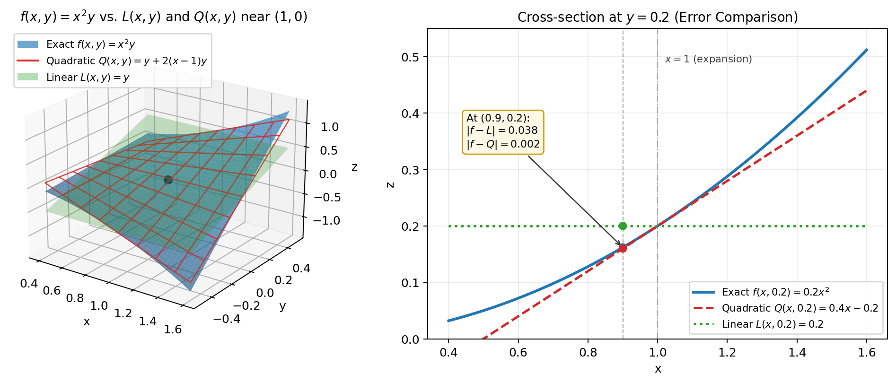

# MAT235 Week 10 Study Notes: Second-Order Partial Derivatives (§14.7) & Differentiability (§14.8)

> **Primary Source:** Professor's Week 10 lecture slides (`W10/lec/Week10-sol.pdf`, 12 PDF pages / printed Slides 1–7 of 7).
> **Textbook Reference:** Hughes-Hallett et al., *Calculus: Single and Multivariable*, 8th Edition (`MAT235_textbook.pdf`), §14.7 (printed pp. 838–847 / PDF pp. 858–867) and §14.8 (printed pp. 847–854 / PDF pp. 867–874).
> **Worked Solutions & Practice:** All teaching-example solutions, slide question solutions, requested textbook exercise solutions, self-test questions/answers, and the coverage appendix are in [Answers-and-Practice.md](Answers-and-Practice.md).

---

## Contents

1. [Scope, Notation, and Method Selection](#1-scope-notation-and-method-selection)
2. [§14.7 Second-Order Partial Derivatives](#2-147-second-order-partial-derivatives)
   - [Concept 14.7-A: Second-Order and Higher-Order Partial Derivatives](#concept-147-a-second-order-and-higher-order-partial-derivatives)
     - [PT-10.1: Computing Second-Order (and Higher-Order) Partial Derivatives](#pt-101-computing-second-order-and-higher-order-partial-derivatives)
     - [PT-10.2: Estimating Second-Order Partial Derivatives from a Table or Gradient Data](#pt-102-estimating-second-order-partial-derivatives-from-a-table-or-gradient-data)
   - [Concept 14.7-B: Equality of Mixed Partial Derivatives & PDE Verification](#concept-147-b-equality-of-mixed-partial-derivatives--pde-verification)
     - [PT-10.3: Testing Whether Proposed Partial Derivatives Can Come from a Function](#pt-103-testing-whether-proposed-partial-derivatives-can-come-from-a-function)
     - [PT-10.4: Verifying a Solution (or Parameter Relation) for a PDE](#pt-104-verifying-a-solution-or-parameter-relation-for-a-pde)
   - [Concept 14.7-C: Degree-1 and Degree-2 Taylor Polynomials](#concept-147-c-degree-1-and-degree-2-taylor-polynomials)
     - [PT-10.5: Constructing Degree-1 and Degree-2 Taylor Polynomials and Comparing Approximations](#pt-105-constructing-degree-1-and-degree-2-taylor-polynomials-and-comparing-approximations)
3. [§14.8 Differentiability](#3-148-differentiability)
   - [Concept 14.8-A: Local Linearity, Continuity, and Necessary Conditions for Differentiability](#concept-148-a-local-linearity-continuity-and-necessary-conditions-for-differentiability)
     - [PT-10.6: Showing a Function Is Not Differentiable at a Point (Without the Formal Definition)](#pt-106-showing-a-function-is-not-differentiable-at-a-point-without-the-formal-definition)
   - [Concept 14.8-B: Sufficient Condition for Differentiability (Continuous Partial Derivatives)](#concept-148-b-sufficient-condition-for-differentiability-continuous-partial-derivatives)
     - [PT-10.7: Proving Differentiability via Continuity of Partial Derivatives](#pt-107-proving-differentiability-via-continuity-of-partial-derivatives)

---

## 1. Scope, Notation, and Method Selection

### TT2 Scope Boundaries (`Week10-sol.pdf`, PDF pp. 7–9, 12)

- **In Scope (Core):**
  - §14.7: Computing second-order and higher-order partial derivatives; differentiation order in subscript vs. Leibniz notation; equality of mixed partial derivatives (Clairaut's Theorem) and smoothness; estimating derivatives from tables; degree-1 ($L(x,y)$) and degree-2 ($Q(x,y)$) Taylor polynomials and their algebraic/graphical meanings; verifying solutions of partial differential equations (PDEs).
  - §14.8: Geometric intuition of differentiability (local linearity); necessary conditions (differentiable $\implies$ continuous, $f_x, f_y$ exist, and Chain Rule / $f_{\vec{u}} = \nabla f \cdot \vec{u}$ holds); sufficient condition ($f_x, f_y$ exist and are continuous on a small disk around $(a,b) \implies f$ is differentiable at $(a,b)$); showing a function is or is not differentiable without using the formal limit definition.
- **Out of TT2 Scope:**
  - **Formal limit definition of differentiability** ($\lim_{(h,k)\to(0,0)} E(a+h,b+k)/\sqrt{h^2+k^2} = 0$) — explicitly shaded out and marked *"will not be tested"* on `Week10-sol.pdf`, PDF pp. 8–9, 12.
  - **Implicit differentiation** — outside TT2 scope.
  - **§15.1 (Critical points / optimization) and later** — outside Week 10 scope.

### Key Notation (Professor's Convention)

| Symbol | Meaning |
|---|---|
| $f_{xx} = (f_x)_x = \dfrac{\partial^2 z}{\partial x^2}$ | Differentiate with respect to $x$, then $x$ again |
| $f_{xy} = (f_x)_y = \dfrac{\partial^2 z}{\partial y\,\partial x}$ | Differentiate **first** with respect to $x$, **then** with respect to $y$ |
| $f_{yx} = (f_y)_x = \dfrac{\partial^2 z}{\partial x\,\partial y}$ | Differentiate **first** with respect to $y$, **then** with respect to $x$ |
| $f_{yy} = (f_y)_y = \dfrac{\partial^2 z}{\partial y^2}$ | Differentiate with respect to $y$, then $y$ again |
| $L(x,y)$ | Degree-1 (linear) Taylor polynomial / local linearization near $(a,b)$ |
| $Q(x,y)$ | Degree-2 (quadratic) Taylor polynomial near $(a,b)$ |
| $\nabla f(a,b) = \operatorname{grad} f(a,b) = f_x(a,b)\vec{i} + f_y(a,b)\vec{j}$ | Gradient vector at $(a,b)$ |

### Quick Method-Selection Guide

| What the question asks | Jump to |
|---|---|
| Compute $f_{xx}, f_{xy}, f_{yx}, f_{yy}$ (or higher-order partials) from a formula | [PT-10.1](#pt-101-computing-second-order-and-higher-order-partial-derivatives) |
| Estimate $f_{xx}, f_{xy}, f_{yx}, f_{yy}$ from a table of $f(x,y)$ or gradient values | [PT-10.2](#pt-102-estimating-second-order-partial-derivatives-from-a-table-or-gradient-data) |
| Decide whether given formulas for $f_x, f_y$ can come from a function $f$ | [PT-10.3](#pt-103-testing-whether-proposed-partial-derivatives-can-come-from-a-function) |
| Check whether $u(x,t)$ or $F(x,y)$ satisfies a PDE (or find constants so it does) | [PT-10.4](#pt-104-verifying-a-solution-or-parameter-relation-for-a-pde) |
| Find $L(x,y)$ and/or $Q(x,y)$ near $(a,b)$ and compare approximations | [PT-10.5](#pt-105-constructing-degree-1-and-degree-2-taylor-polynomials-and-comparing-approximations) |
| Show $f$ is **not** differentiable at $(a,b)$ (cone, piecewise, fractional power, boundary) | [PT-10.6](#pt-106-showing-a-function-is-not-differentiable-at-a-point-without-the-formal-definition) |
| Prove $f$ **is** differentiable at $(a,b)$ or on its domain | [PT-10.7](#pt-107-proving-differentiability-via-continuity-of-partial-derivatives) |

---

## 2. §14.7 Second-Order Partial Derivatives

### Concept 14.7-A: Second-Order and Higher-Order Partial Derivatives

- **Classification:** **Core** (`Week10-sol.pdf`, PDF pp. 2–3 / printed Slides 1–2 of 7).
- **Brief Prerequisite Reminder:** First-order partial derivatives $f_x(x,y)$ and $f_y(x,y)$ are computed by holding the other variable constant and applying single-variable differentiation rules (product, quotient, chain).

#### Definition & Order of Mixed Differentiation

For $z = f(x,y)$, differentiating $f_x$ and $f_y$ once more produces **four** second-order partial derivatives (`Week10-sol.pdf`, PDF p. 2 / Slide p. 1):

$$f_{xx} = (f_x)_x = \frac{\partial^2 z}{\partial x^2}, \qquad f_{xy} = (f_x)_y = \frac{\partial^2 z}{\partial y\,\partial x},$$
$$f_{yx} = (f_y)_x = \frac{\partial^2 z}{\partial x\,\partial y}, \qquad f_{yy} = (f_y)_y = \frac{\partial^2 z}{\partial y^2}.$$

**Pay close attention to the order of differentiation:**
- In **subscript notation** ($f_{xy}$), read **left to right**: first differentiate with respect to $x$, then with respect to $y$.
- In **Leibniz notation** ($\frac{\partial^2 z}{\partial y\,\partial x} = \frac{\partial}{\partial y}\!\left(\frac{\partial z}{\partial x}\right)$), read **right to left** in the denominator: the operator closest to $z$ ($\frac{\partial}{\partial x}$) acts first.
- **Higher-order partial derivatives** continue the same pattern (`Week10-sol.pdf`, top of PDF p. 2): e.g., $f_{xxx} = (f_{xx})_x$ and $f_{xyx} = (f_{xy})_x$.

> **Supplementary — Geometric & Contextual Meaning of Second-Order Partials** *(needed for Quercus §14.7 Exercises #25, #29, #61; also sketched in handwritten notes `Nov 18.pdf`, p. 2, and Hughes-Hallett §14.7, pp. 839–840 / PDF pp. 859–860)*:
> - **$f_{xx}$ (or $f_{yy}$)** measures the **concavity** of the $x$-cross-section (or $y$-cross-section): $f_{xx} > 0$ means $f_x$ increases as $x$ increases (concave up in $x$); $f_{xx} < 0$ means $f_x$ decreases as $x$ increases (concave down in $x$). On a contour diagram with evenly spaced contour values, **contours getting closer together** in the $+x$ direction means $|f_x|$ is increasing.
> - **$f_{xy}$** measures how the $x$-slope $f_x$ changes as $y$ increases (and, when equal to $f_{yx}$, how the $y$-slope $f_y$ changes as $x$ increases). In applied contexts (e.g., surface area $S(h,w)$), $\frac{\partial^2 S}{\partial h\,\partial w} > 0$ means the marginal change $\frac{\partial S}{\partial w}$ is larger for larger $h$.

---

#### PT-10.1: Computing Second-Order (and Higher-Order) Partial Derivatives

- **Qualifying Source:** `Week10-sol.pdf`, PDF p. 2 (Slide p. 1), *Example. Compute second-order partial derivatives* ($f(x,y) = x^2 y + 3y^2 e^x$).
- **Recognition Cues:** Given an explicit formula $f(x,y)$ and asked to compute $f_{xx}, f_{xy}, f_{yx}, f_{yy}$ (or higher-order partials) and/or check $f_{xy} = f_{yx}$.
- **Reusable Method:**
  1. Compute $f_x(x,y)$ (treating $y$ as constant) and $f_y(x,y)$ (treating $x$ as constant).
  2. Differentiate $f_x$ with respect to $x$ to get $f_{xx}$, and with respect to $y$ to get $f_{xy}$.
  3. Differentiate $f_y$ with respect to $x$ to get $f_{yx}$, and with respect to $y$ to get $f_{yy}$.
  4. **Check:** On any open domain where $f_{xy}$ and $f_{yx}$ are continuous, verify $f_{xy} = f_{yx}$. If they disagree, re-check your algebra/chain rule!
- **Teaching Example (PT-10.1):**
  Let $f(x,y) = x^3 y^2 - 4y e^{2x}$. Compute all four second-order partial derivatives $f_{xx}, f_{xy}, f_{yx}, f_{yy}$ and verify that $f_{xy} = f_{yx}$.
  *(See [Answers-and-Practice.md — PT-10.1](Answers-and-Practice.md#pt-101-computing-second-order-and-higher-order-partial-derivatives) for the worked solution.)*
- **Checklist & Common Mistakes:**
  - [ ] Did you hold the non-differentiated variable strictly constant at every step?
  - [ ] Did you apply the product rule whenever the differentiated variable appears in two factors (e.g., $y e^y$)?
  - [ ] Did you independently compute both $f_{xy}$ and $f_{yx}$ to catch differentiation slips?
  - **Common mistake:** Treating $e^{2x}$ as $e^x$ (forgetting the inner derivative $2$), or differentiating $x/y$ with respect to $y$ as $1/y$ instead of $-x/y^2$.

---

#### PT-10.2: Estimating Second-Order Partial Derivatives from a Table or Gradient Data

- **Qualifying Source:** `Week10-sol.pdf`, PDF p. 3 (Slide p. 2), *Example. Estimate derivatives from a table*, part (b) ($f_{xy}(4,4)$).
- **Recognition Cues:** Given a numerical table of $f(x,y)$ (or values of $\nabla f$ at two nearby points) and asked to estimate $f_{xx}, f_{yy}, f_{xy}$, or $f_{yx}$ at a point $(a,b)$.
- **Reusable Method:**
  1. **From a table of $f(x,y)$ (Core — `Week10-sol.pdf`, PDF p. 3 / Slide p. 2)** (e.g., to estimate $f_{xy}(a,b)$):
     - Write $f_{xy}(a,b) = (f_x)_y(a,b) \approx \dfrac{f_x(a, b+\Delta y) - f_x(a, b-\Delta y)}{2\Delta y}$ (centered) or $\dfrac{f_x(a, b+\Delta y) - f_x(a,b)}{\Delta y}$ (one-sided).
     - Estimate each needed $f_x$ value using a difference quotient in $x$ along its fixed $y$-row/column, clearly stating which table entries you use.
     - Substitute those first-partial estimates into the outer difference quotient in $y$.
  2. **From gradient data (Supplementary — needed for Quercus §14.7 #35, #37, #41):** When $\nabla f(a,b)$ and $\nabla f(a+\Delta x, b)$ are given at two points differing in only one coordinate, apply a difference quotient directly to the components of $\nabla f$:
     $$f_{xx}(a,b) \approx \frac{f_x(a+\Delta x, b) - f_x(a,b)}{\Delta x}, \qquad f_{yx}(a,b) \approx \frac{f_y(a+\Delta x, b) - f_y(a,b)}{\Delta x}.$$
     If $f$ is assumed smooth, use $f_{xy}(a,b) = f_{yx}(a,b)$ when the step is in $x$ (or $f_{yx} = f_{xy}$ when the step is in $y$).
- **Teaching Example (PT-10.2):**
  The table below gives values of a smooth function $f(x,y)$. Estimate $f_{xy}(3,4)$, making clear which table values you use.

  | $x \backslash y$ | $2$ | $4$ | $6$ |
  |---|---|---|---|
  | **$1$** | $5$ | $9$ | $13$ |
  | **$3$** | $8$ | $14$ | $20$ |
  | **$5$** | $11$ | $21$ | $31$ |

  *(See [Answers-and-Practice.md — PT-10.2](Answers-and-Practice.md#pt-102-estimating-second-order-partial-derivatives-from-a-table-or-gradient-data) for the worked solution.)*
- **Checklist & Common Mistakes:**
  - [ ] Did you check which axis is rows ($x$) and which is columns ($y$) before reading entries?
  - [ ] Did you divide by the actual step size ($\Delta x$ or $2\Delta x$, $\Delta y$ or $2\Delta y$) rather than always dividing by $1$?
  - [ ] When using gradient data, did you verify that only one coordinate changed between the two points?
  - **Common mistake:** Swapping the $x$ and $y$ labels of the table, or dividing a centered difference $f(a+\Delta x, y) - f(a-\Delta x, y)$ by $\Delta x$ instead of $2\Delta x$.

---

### Concept 14.7-B: Equality of Mixed Partial Derivatives & PDE Verification

- **Classification:** **Core** (`Week10-sol.pdf`, PDF pp. 2–3, 5 / printed Slides 1–2, 4 of 7).

#### Equality of Mixed Partial Derivatives (Clairaut's Theorem)

> **Theorem (`Week10-sol.pdf`, PDF p. 2 / Slide p. 1):** If $f_{xy}$ and $f_{yx}$ are **continuous** at $(a,b)$, an interior point of their domain, then
> $$f_{xy}(a,b) = f_{yx}(a,b).$$
> A function $f$ is called **smooth** at $(a,b)$ if its partial derivatives of every order exist and are continuous there; it is **smooth on a region $R$** if it is smooth at every point of $R$.

**Why continuity matters:** Equality is not automatic for arbitrary pathological functions — the guarantee requires that the mixed partial derivatives be continuous at the interior point $(a,b)$. For elementary functions (polynomials, exponentials, sines/cosines, quotients with nonzero denominator), continuity holds automatically on their open domains.

#### Partial Differential Equations (PDEs)

An equation involving partial derivatives of an unknown multivariable function is a **partial differential equation (PDE)** (`Week10-sol.pdf`, PDF p. 5 / Slide p. 4), such as:
- **Heat equation (Core — `Week10-sol.pdf`, PDF p. 5 / Slide p. 4):** $u_t = u_{xx}$
- **Laplace's equation (Supplementary — needed for Quercus §14.7 #47):** $F_{xx} + F_{yy} = 0$

To verify a proposed solution (or find parameter values for which it is a solution), compute each required partial derivative, substitute into both sides of the PDE, and check that the identity holds across the entire domain.

---

#### PT-10.3: Testing Whether Proposed Partial Derivatives Can Come from a Function

- **Qualifying Source:** `Week10-sol.pdf`, PDF p. 3 (Slide p. 2), *Example. Can these be the partial derivatives of a function?* ($f_x = 3y^2 + x$, $f_y = 6xy + 3x$).
- **Recognition Cues:** Given two formulas $P(x,y)$ and $Q(x,y)$ and asked *"Does there exist a function $f(x,y)$ such that $f_x = P$ and $f_y = Q$?"* or *"Explain what is wrong with claiming $f_x = \dots$ and $f_y = \dots$."*
- **Reusable Method:**
  1. Assume for contradiction that such a function $f(x,y)$ exists with $f_x = P$ and $f_y = Q$.
  2. Compute $f_{xy} = \frac{\partial P}{\partial y}$ and $f_{yx} = \frac{\partial Q}{\partial x}$.
  3. Explicitly note that both $f_{xy}$ and $f_{yx}$ are **continuous** (e.g., polynomials/elementary functions on $\mathbb{R}^2$).
  4. Apply Clairaut's Theorem: if $f_{xy} \neq f_{yx}$ (even at a single point), no such function $f$ can exist! *(If $f_{xy} = f_{yx}$, you can verify existence directly by integrating to construct $f$.)*
- **Teaching Example (PT-10.3):**
  Does there exist a function $f(x,y)$ such that $f_x(x,y) = 2xy + y^3$ and $f_y(x,y) = x^2 + 3xy^2 + 4x$? Explain your reasoning.
  *(See [Answers-and-Practice.md — PT-10.3](Answers-and-Practice.md#pt-103-testing-whether-proposed-partial-derivatives-can-come-from-a-function) for the worked solution.)*
- **Checklist & Common Mistakes:**
  - [ ] Did you differentiate the proposed $f_x$ with respect to $y$ (not $x$) and the proposed $f_y$ with respect to $x$ (not $y$)?
  - [ ] Did you explicitly state that $f_{xy}$ and $f_{yx}$ are **continuous** so that Clairaut's Theorem applies?
  - **Common mistake:** Computing $(f_x)_x$ and $(f_y)_y$ instead of the mixed partials $(f_x)_y$ and $(f_y)_x$, or omitting the continuity justification.

---

#### PT-10.4: Verifying a Solution (or Parameter Relation) for a PDE

- **Qualifying Source:** `Week10-sol.pdf`, PDF p. 5 (Slide p. 4), *Example. Check a solution of the heat equation* ($u(x,t) = e^{at}\sin(bx)$ satisfying $u_t = u_{xx}$).
- **Recognition Cues:** Given a function $u(x,t)$ or $F(x,y)$ and a PDE (such as $u_t = u_{xx}$ or $F_{xx} + F_{yy} = 0$), asked to show it is a solution or find constants so it satisfies the PDE.
- **Reusable Method:**
  1. Compute all partial derivatives appearing in the PDE.
  2. Substitute them into the left-hand side (LHS) and right-hand side (RHS) of the PDE.
  3. Simplify and compare LHS and RHS for **all** $(x,t)$ or $(x,y)$ in the domain.
  4. If solving for constants, factor out the non-identically-zero function of $(x,t)$ and equate the remaining constant factor to $0$.
- **Teaching Example (PT-10.4):**
  Find the relationship between the constants $k$ and $c \neq 0$ for which $u(x,t) = e^{-kt}\cos(cx)$ satisfies the heat equation $u_t = u_{xx}$ for all $(x,t) \in \mathbb{R}^2$.
  *(See [Answers-and-Practice.md — PT-10.4](Answers-and-Practice.md#pt-104-verifying-a-solution-or-parameter-relation-for-a-pde) for the worked solution.)*
- **Checklist & Common Mistakes:**
  - [ ] Did you check the order and variable of every derivative in the PDE (e.g., $u_t$ is first-order in $t$, while $u_{xx}$ is second-order in $x$)?
  - [ ] Did you verify the identity holds for **all** points in the domain (not just at $(0,0)$)?
  - **Common mistake:** Dropping the minus sign when differentiating $\cos(cx)$ twice ($(\cos(cx))'' = -c^2\cos(cx)$), or dividing by $\cos(cx)$ without noting that the equality must hold everywhere where $\cos(cx) \neq 0$ (hence identically).

---

### Concept 14.7-C: Degree-1 and Degree-2 Taylor Polynomials

- **Classification:** **Core** (`Week10-sol.pdf`, PDF pp. 1, 4–6 / printed Slides 3–4 of 7 + handwritten motivation and error analysis).

#### Formulas Near an Expansion Point $(a,b)$

- **Degree-1 (Linear) Taylor Polynomial** (if $f$ has continuous first-order partial derivatives near $(a,b)$):
  $$f(x,y) \approx L(x,y) = f(a,b) + f_x(a,b)(x-a) + f_y(a,b)(y-b).$$
- **Degree-2 (Quadratic) Taylor Polynomial** (if $f$ has continuous second-order partial derivatives near $(a,b)$):
  $$f(x,y) \approx Q(x,y) = \underbrace{f(a,b)}_{\text{constant}} + \underbrace{f_x(a,b)(x-a) + f_y(a,b)(y-b)}_{\text{linear (tangent plane slope)}} + \underbrace{\frac{f_{xx}(a,b)}{2}(x-a)^2 + f_{xy}(a,b)(x-a)(y-b) + \frac{f_{yy}(a,b)}{2}(y-b)^2}_{\text{quadratic (curvature and twist)}}.$$

#### How the Coefficients Are Obtained & What Each Term Captures

1. **Matching derivatives at $(a,b)$:** Write $Q(x,y) = c_0 + c_1(x-a) + c_2(y-b) + c_3(x-a)^2 + c_4(x-a)(y-b) + c_5(y-b)^2$. Requiring $Q$ to share the exact value, first partials, and second partials of $f$ at $(a,b)$ forces:
   - $Q(a,b) = c_0 = f(a,b)$
   - $Q_x(a,b) = c_1 = f_x(a,b)$, $Q_y(a,b) = c_2 = f_y(a,b)$
   - $Q_{xx}(a,b) = 2c_3 = f_{xx}(a,b) \implies c_3 = \frac{1}{2}f_{xx}(a,b)$
   - $Q_{yy}(a,b) = 2c_5 = f_{yy}(a,b) \implies c_5 = \frac{1}{2}f_{yy}(a,b)$
   - $Q_{xy}(a,b) = c_4 = f_{xy}(a,b)$ — **no $\frac{1}{2}$ factor!** As shown on `Week10-sol.pdf` PDF p. 4, the full symmetric sum has $\frac{1}{2}f_{xy}(x-a)(y-b) + \frac{1}{2}f_{yx}(y-b)(x-a) = f_{xy}(a,b)(x-a)(y-b)$ because $f_{xy} = f_{yx}$.
2. **Algebraic & Graphical Relationships (`Week10-sol.pdf`, PDF pp. 1, 5–6):**
   - **Constant term** $f(a,b)$: matches the **height** of the surface at $(a,b)$.
   - **Linear terms** $f_x(a,b)(x-a) + f_y(a,b)(y-b)$: match the **slope / tangent plane** at $(a,b)$. Together, $L(x,y)$ is the tangent plane at $(a,b)$.
   - **Quadratic terms**: capture **concavity** along $x$ ($f_{xx}$), **concavity** along $y$ ($f_{yy}$), and **twist / cross-curvature** ($f_{xy}$). Graphically, $Q(x,y)$ is the *"tangent quadratic surface"* (`Week10-sol.pdf`, PDF p. 1) that bends with the surface $z = f(x,y)$ near $(a,b)$. For example, in the professor's calculation for $f(x,y) = x^2 y$ near $(1,0)$ (`Week10-sol.pdf`, PDF pp. 5–6), setting $(x,y) = (1+h, k)$ gives $|f(1+h,k) - L(1+h,k)| = |2hk + h^2 k|$, whereas $|f(1+h,k) - Q(1+h,k)| = |h^2 k|$, which is much smaller for small $h, k$ (at $(0.9, 0.2)$, $|f-Q| = 0.002 \ll |f-L| = 0.038$).

---

#### PT-10.5: Constructing Degree-1 and Degree-2 Taylor Polynomials and Comparing Approximations

- **Qualifying Sources:** `Week10-sol.pdf`, PDF p. 4 (Slide p. 3), *Example. Find a quadratic Taylor polynomial* ($f(x,y) = \frac{1}{xy}$ at $(1,2)$) and PDF p. 5 (Slide p. 4), *Example. Compare linear and quadratic approximations* ($f(x,y) = x^2 y$ near $(1,0)$).
- **Recognition Cues:** Asked to find the linear ($L$) and/or quadratic ($Q$) Taylor polynomial (or "best quadratic approximation") of $f(x,y)$ near a specified point $(a,b)$, and optionally evaluate/compare $L, Q$, and $f$ at a nearby point.
- **Reusable Method:**
  1. Identify the **expansion point** $(a,b)$ carefully (often $(0,0)$ or $(1,0)$, sometimes $(1,2)$).
  2. Build a 6-entry table of formulas and values at $(a,b)$:
     $$f,\; f_x,\; f_y,\; f_{xx},\; f_{xy},\; f_{yy}.$$
  3. Assemble $L(x,y)$ and $Q(x,y)$ in powers of $(x-a)$ and $(y-b)$. Keep $(x-a)$ and $(y-b)$ grouped unless expanding simplifies the expression.
  4. If asked to approximate at $(x_1, y_1)$, substitute $(x_1 - a)$ and $(y_1 - b)$ into $L$ and $Q$, and compare $|f(x_1,y_1) - L(x_1,y_1)|$ vs. $|f(x_1,y_1) - Q(x_1,y_1)|$.
- **Teaching Example (PT-10.5):**
  Let $f(x,y) = x e^{2y}$.
  (a) Find the degree-1 Taylor polynomial $L(x,y)$ and degree-2 Taylor polynomial $Q(x,y)$ near $(1, 0)$.
  (b) Compare $L(1.1, -0.05)$ and $Q(1.1, -0.05)$ with the exact value $f(1.1, -0.05)$.
  *(See [Answers-and-Practice.md — PT-10.5](Answers-and-Practice.md#pt-105-constructing-degree-1-and-degree-2-taylor-polynomials-and-comparing-approximations) for the worked solution.)*
- **Checklist & Common Mistakes:**
  - [ ] Did you evaluate all six derivatives at $(a,b)$ (yielding **numbers**, not functions of $x,y$) before plugging into $Q(x,y)$?
  - [ ] Did you include $\frac{1}{2}$ on $f_{xx}(a,b)(x-a)^2$ and $f_{yy}(a,b)(y-b)^2$, and **no** $\frac{1}{2}$ on $f_{xy}(a,b)(x-a)(y-b)$?
  - [ ] Did you center the polynomial at $(x-a)$ and $(y-b)$ rather than $x$ and $y$ when $(a,b) \neq (0,0)$?
  - **Common mistake:** Putting $\frac{1}{2}$ in front of $f_{xy}(a,b)(x-a)(y-b)$, or forgetting to plug $(a,b)$ into the derivative formulas.

---

## 3. §14.8 Differentiability

### Concept 14.8-A: Local Linearity, Continuity, and Necessary Conditions for Differentiability

- **Classification:** **Core** (`Week10-sol.pdf`, PDF pp. 8–10, 12 / printed Slides 5–6 of 7 + summary p. 12).

#### Geometric Intuition (Local Linearity)

Intuitively, $f(x,y)$ is **differentiable at $(a,b)$** when its graph becomes increasingly well approximated by a **plane** (its tangent plane / local linearization $L(x,y)$) as you zoom in near $(a,b)$ (`Week10-sol.pdf`, PDF p. 9 / Slide p. 5).
- A **smooth surface** looks flat like a plane when zoomed in $\implies$ differentiable.
- A **sharp vertex** (cone $\sqrt{x^2+y^2}$), **crease/ridge** ($|x|+|y|$), **pinched twist** ($x^{1/3}y^{1/3}$), or **jump/break** ($xy/(x^2+y^2)$) never flattens into a single plane when zoomed in $\implies$ **not** differentiable.

> **Scope Note (`Week10-sol.pdf`, PDF pp. 8–9, 12):** The formal limit definition $\lim_{(h,k)\to(0,0)} \frac{E(a+h,b+k)}{\sqrt{h^2+k^2}} = 0$ is **not tested on TT2**. Instead, TT2 focuses on the intuition, necessary conditions, and sufficient condition below.

#### What Differentiability Implies (Necessary Conditions)

If $f(x,y)$ is **differentiable at $(a,b)$**, then ALL of the following MUST hold (`Week10-sol.pdf`, PDF pp. 9–10, 12):
1. **$f$ is continuous at $(a,b)$:** $\lim_{(x,y)\to(a,b)} f(x,y) = f(a,b)$.
2. **Both partial derivatives $f_x(a,b)$ and $f_y(a,b)$ exist.**
3. **The Chain Rule & directional-derivative formula hold:** For any differentiable path $(x(t), y(t))$ through $(a,b)$ at $t=0$, $g(t) = f(x(t), y(t))$ is differentiable at $t=0$ with
   $$g'(0) = f_x(a,b)x'(0) + f_y(a,b)y'(0),$$
   and every directional derivative satisfies $f_{\vec{u}}(a,b) = \nabla f(a,b)\cdot\vec{u}$.

**Warning — None of the Converses Hold!**
- Continuous at $(a,b)$ $\not\Rightarrow$ Differentiable at $(a,b)$ (Counterexample: $f(x,y) = \sqrt{x^2+y^2}$ at $(0,0)$).
- Both $f_x(a,b)$ and $f_y(a,b)$ exist $\not\Rightarrow$ Continuous at $(a,b)$ (Counterexample: $f(x,y) = \frac{xy}{x^2+y^2}$ for $(x,y)\neq(0,0)$, $0$ at $(0,0)$).
- Continuous AND both $f_x(a,b), f_y(a,b)$ exist $\not\Rightarrow$ Differentiable at $(a,b)$ (Counterexample: $f(x,y) = x^{1/3}y^{1/3}$ at $(0,0)$).

---

#### PT-10.6: Showing a Function Is Not Differentiable at a Point (Without the Formal Definition)

- **Qualifying Sources:** `Week10-sol.pdf`, PDF p. 9 (Slide p. 5), *Example. Is a cone differentiable at its vertex?*; PDF p. 10 (Slide p. 6), *Example. Are partial derivatives enough?* and *Example. Continuity and partial derivatives at a point*; PDF p. 12 summary.
- **Recognition Cues:** Asked whether $f(x,y)$ is differentiable at a suspicious point $(a,b)$ (a sharp corner/vertex, root of $0$, piecewise branch point, fractional power, or boundary of domain) — or asked to list points where $f$ is not differentiable.
- **Reusable Method (Contrapositives of Necessary Conditions):**
  Check the three TT2-scope failure modes in order of ease:
  1. **Test continuity at $(a,b)$:** Try two paths approaching $(a,b)$ (e.g., $y=0$, $y=x$, $y=x^2$). If the path limits disagree (or differ from $f(a,b)$), $f$ is **discontinuous**, hence **not differentiable** at $(a,b)$.
  2. **Test existence of $f_x(a,b)$ and $f_y(a,b)$ using the limit definition:**
     $$f_x(a,b) = \lim_{h\to 0} \frac{f(a+h,b) - f(a,b)}{h}, \qquad f_y(a,b) = \lim_{k\to 0} \frac{f(a,b+k) - f(a,b)}{k}.$$
     *(Never plug $(a,b)$ into a formula that gives $0/0$ — always use the limit definition!)* If either limit fails to exist (or if $(a,b)$ is a domain boundary where a two-sided limit cannot be taken), $f$ is **not differentiable** at $(a,b)$.
  3. **Chain Rule / directional derivative contradiction:** If $f$ is continuous and both $f_x(a,b), f_y(a,b)$ exist, pick a line through $(a,b)$ (e.g., $x(t)=a+t, y(t)=b+t$) and compare the direct derivative of $g(t) = f(x(t), y(t))$ at $t=0$ against $f_x(a,b)x'(0) + f_y(a,b)y'(0)$. If $g'(0)$ fails to exist or disagrees with the Chain Rule value, $f$ is **not differentiable** at $(a,b)$.
- **Teaching Example (PT-10.6):**
  Determine whether each function is differentiable at $(0,0)$ without using the formal limit definition of differentiability:
  (a) $f(x,y) = \sqrt{4x^2 + y^2}$.
  (b) $g(x,y) = \begin{cases} \dfrac{2x^2 y}{x^4 + y^2}, & (x,y) \neq (0,0), \\ 0, & (x,y) = (0,0). \end{cases}$
  *(See [Answers-and-Practice.md — PT-10.6](Answers-and-Practice.md#pt-106-showing-a-function-is-not-differentiable-at-a-point-without-the-formal-definition) for the worked solution.)*
- **Checklist & Common Mistakes:**
  - [ ] Did you use the **limit definition** of $f_x(a,b)$ or $f_y(a,b)$ at piecewise/singular points instead of substituting into a $0/0$ formula?
  - [ ] When using the two-path test for discontinuity, did both paths actually approach $(a,b)$?
  - [ ] Did you state the logical link explicitly (e.g., *"not continuous $\implies$ not differentiable"*)?
  - **Common mistake:** Concluding $f$ is differentiable just because $f_x(0,0)$ and $f_y(0,0)$ both exist, or concluding $f$ is NOT differentiable solely because $f_x, f_y$ are discontinuous at $(a,b)$ (see Concept 14.8-B below!).

---

### Concept 14.8-B: Sufficient Condition for Differentiability (Continuous Partial Derivatives)

- **Classification:** **Core** (`Week10-sol.pdf`, PDF pp. 11–12 / printed Slide 7 of 7 + summary p. 12).

#### Sufficient Condition Theorem

> **Theorem (`Week10-sol.pdf`, PDF p. 11 / Slide p. 7):** If the partial derivatives $f_x$ and $f_y$ **exist and are continuous on a small disk centered at $(a,b)$**, then $f$ is **differentiable at $(a,b)$**.

#### Crucial Logical Caveat: Sufficient, NOT Necessary!

Failure of continuous partial derivatives **alone** does **not** prove $f$ is non-differentiable!
- **Slide Counterexample (`Week10-sol.pdf`, PDF p. 11 / Slide p. 7):**
  $$f(x,y) = \begin{cases} (x^2+y^2)\sin\!\left(\dfrac{1}{\sqrt{x^2+y^2}}\right), & (x,y)\neq(0,0), \\ 0, & (x,y)=(0,0), \end{cases}$$
  is **differentiable everywhere** (including $(0,0)$), even though $f_x$ and $f_y$ are **not continuous** at $(0,0)$.

---

#### PT-10.7: Proving Differentiability via Continuity of Partial Derivatives

- **Qualifying Source:** `Week10-sol.pdf`, PDF p. 11 (Slide p. 7), *Example. Use continuity of the partial derivatives* ($f(x,y) = \ln(x^2+y^2)$ and $f(x,y) = e^{-x^2-y^2}$).
- **Recognition Cues:** Given an elementary formula $f(x,y)$ and asked to determine its domain and show it is differentiable at a point $(a,b)$ or everywhere on its domain (or on an open region such as $(x,y) \neq (0,0)$).
- **Reusable Method:**
  1. **Find the domain** (check denominators $\neq 0$, arguments of $\ln$ strictly $> 0$, and arguments of $\sqrt{g(x,y)}$ satisfying $g(x,y) \ge 0$; to apply the chain-rule formula $f_x = g_x/(2\sqrt{g})$ on a small open disk, check where $g(x,y) > 0$, and treat points where $g(x,y) = 0$ separately rather than assuming non-differentiability).
  2. **Compute $f_x(x,y)$ and $f_y(x,y)$** on the open set of interest.
  3. **Justify continuity of $f_x$ and $f_y$:** Explain why both formulas are continuous on a small open disk centered at every point $(a,b)$ in that set (sums, products, compositions, and quotients with nonzero denominator of continuous elementary functions).
  4. **Conclude by the Sufficient Condition Theorem:** Therefore $f$ is differentiable at $(a,b)$ (or everywhere on the open domain).
- **Teaching Example (PT-10.7):**
  Determine the domain of $f(x,y) = \ln(1 + x^2 + 2y^2)$ and show that $f$ is differentiable everywhere in its domain.
  *(See [Answers-and-Practice.md — PT-10.7](Answers-and-Practice.md#pt-107-proving-differentiability-via-continuity-of-partial-derivatives) for the worked solution.)*
- **Checklist & Common Mistakes:**
  - [ ] Did you state the exact domain first?
  - [ ] Did you explicitly compute **both** $f_x$ and $f_y$ and explain why **both** are continuous on an open disk around $(a,b)$?
  - [ ] When applying this sufficient condition to a square root $\sqrt{g(x,y)}$ via the chain rule ($f_x = \frac{g_x}{2\sqrt{g}}$), did you check that $g(a,b) > 0$ so the denominator is nonzero on a small open disk? *(Note: $g(a,b) > 0$ is only needed to apply this derivative-continuity test, not necessary for differentiability in general — for instance, $\sqrt{x^4} = x^2$ is differentiable at $(0,0)$ even though $x^4 = 0$ there.)*
  - **Common mistake:** Only checking that $f$ itself is continuous (continuity of $f$ does NOT imply differentiability; to use this **sufficient** condition, you must check continuity of $f_x$ and $f_y$ on a small open disk around $(a,b)$ — while remembering that continuous partials are sufficient, not necessary).
