# MAT235 Week 2 Study Notes
## Graphs, Traces, and Contour Diagrams

- **Section 12.2:** Graphs and Surfaces
- **Section 12.3:** Contour Diagrams
- **Supplementary & Preview:** 3D Coordinates, Production Isoquants, Linear Planes (12.4), and Level Surfaces (12.5)

---

## How to Use This File

This document serves as the primary conceptual and methodological guide for Week 2 of MAT235. It synthesizes all core material from Sections 12.2 and 12.3 of the textbook, supplementary review and extensions from handwritten lecture notes, and preview material found in weekly lecture presentations.

The notes use a concept-first structure. Each topic begins with definitions and geometric meaning, then presents the Problem Types (PT-01 through PT-15) that use that concept. Each Problem Type gives recognition cues, a reusable method, a teaching example, and common mistakes. The examples are prompts; worked solutions and final answers are in `Answers-and-Practice.md`.

*Note:* In accordance with active-learning principles, **worked solutions and final answers to all Problem Types are located exclusively in `Answers-and-Practice.md`**. All drawings depicting 3D surfaces illustrate finite viewing windows of typically unbounded objects unless an explicit domain restriction is specified.

---

## 1. Core: 12.2 Graphs and Surfaces

> **Status: Core Material**  
> *Learning Targets:* Define functions of two variables and their graphs in $\mathbb{R}^3$; apply the vertical-line test for surfaces; recognize standard quadric surfaces (planes, spheres, paraboloids, saddles); identify domain constraints.

### 1.1 Definitions and Notation
A real-valued function of two real variables is a rule $f: D \subseteq \mathbb{R}^2 \to \mathbb{R}$ that assigns to each ordered pair $(x, y)$ in the domain $D$ exactly one real number $z = f(x, y)$.

- **Domain ($D$):** The subset of $\mathbb{R}^2$ on which the formula $f(x, y)$ is mathematically defined and real-valued. If no domain is explicitly stated, the natural domain is the largest subset of $\mathbb{R}^2$ where the expression is well-defined.
- **Graph ($G_f$):** The set of all points $(x, y, z)$ in three-dimensional space $\mathbb{R}^3$ such that $(x, y) \in D$ and $z = f(x, y)$:
  $G_f = \{(x, y, z) \in \mathbb{R}^3 : (x, y) \in D, z = f(x, y)\}$

- **Ambient Space:** The graph lies in $\mathbb{R}^3$ with standard Cartesian coordinates $(x, y, z)$. The $xy$-plane represents the horizontal domain plane, while the $z$-axis represents the vertical output height.

### 1.2 Function Graphs, Surface Types, and the Vertical-Line Test
Geometrically, the graph of a continuous function $z = f(x, y)$ represents a two-dimensional surface in $\mathbb{R}^3$. Because $f$ is a function, each input pair $(x_0, y_0) \in D$ generates exactly one height $z_0 = f(x_0, y_0)$.

**The Vertical-Line Test for Surfaces:**  
A surface $S \subset \mathbb{R}^3$ is the graph of a single-valued function $z = f(x, y)$ if and only if every vertical line parallel to the $z$-axis (given by parametric equations $x = x_0$, $y = y_0$, $z \in \mathbb{R}$) intersects the surface $S$ at **at most one point**.

- If a vertical line intersects $S$ at two or more distinct points, $S$ cannot be represented by a single function $z = f(x, y)$.
- *Example:* The sphere $x^2 + y^2 + z^2 = r^2$ contains $(0, 0, r)$ and $(0, 0, -r)$; the vertical line $x = 0, y = 0$ intersects it twice. Thus, the full sphere is not the graph of a single function. It must be decomposed into upper and lower hemispheres: $z = +\sqrt{r^2 - x^2 - y^2}$ and $z = -\sqrt{r^2 - x^2 - y^2}$.

\begin{figure}[H]
\centering
\pandocbounded{\includegraphics[keepaspectratio,alt={01-surfaces}]{graphs/01-surfaces.png}}
\caption{01-surfaces}
\end{figure}

A surface equation can be classified by its algebraic form. A linear equation $Ax + By + Cz = D$ defines a plane. The equation $x^2 + y^2 + z^2 = r^2$ defines a sphere centered at the origin. Explicit graphs such as $z = x^2/a^2 + y^2/b^2$ are elliptic paraboloids, while $z = x^2/a^2 - y^2/b^2$ is a hyperbolic paraboloid with opposite curvature along the coordinate directions. These forms identify orientation and symmetry; coordinate traces and intercepts make those features concrete.

---

#### Problem Type PT-01: Recognize and Describe a Surface from an Equation

**Recognition cues.** Use the equation's linear or quadratic form to identify the candidate surface, then check its orientation, traces, and extent.

\Needspace{4\baselineskip}

**General method.**

1. **Identify the surface type:** Classify the algebraic degree and match with standard quadric or planar forms.
2. **Determine key geometric landmarks:** Calculate coordinate axis intercepts (set two variables to 0) and identify vertices, centers, or radii.
3. **Compute primary coordinate traces:** Set $x = 0$, $y = 0$, and $z = 0$ to determine cross-sections in the coordinate planes.
4. **Evaluate the vertical-line test:** Determine whether solving for $z$ yields a unique value for each $(x, y)$.
5. **Describe orientation and extent:** State whether the surface is bounded (finite) or extends infinitely, and specify the direction of growth or opening.

**Teaching example.**

**Question.**  
Describe the geometric surfaces in $\mathbb{R}^3$ defined by the equations (a) $z = 1 + x - y$ and (b) $x^2 + y^2 + z^2 = 4$. For each surface:
1. Identify the specific geometric object.
2. Determine all coordinate axis intercepts and primary traces in the coordinate planes.
3. State whether the entire surface is the graph of a single-valued function $z = f(x, y)$, and explain why.
4. Describe the orientation, unbounded or bounded nature, and spatial extent.

**A complete answer must include:**

- [ ] Explicit classification of each equation into its geometric category.
- [ ] Exact coordinates for the $x$-, $y$-, and $z$-intercepts where they exist.
- [ ] The explicit equations and containing planes for the coordinate traces ($x = 0$, $y = 0$, $z = 0$).
- [ ] A clear verdict on whether each surface satisfies the vertical-line test, supported by an explicit algebraic or geometric justification.
- [ ] A precise statement of whether the surface is bounded or infinite, and its domain in $\mathbb{R}^2$.

**Common mistakes:**

- Confusing the bounded triangular drawing in a first-octant sketch with a finite physical boundary (planes are infinite).
- Claiming the sphere is a function $z = f(x, y)$ by discarding the negative square root branch.
- Omitting the containing plane equation when stating a trace (e.g., writing $z = 1 + x$ instead of $z = 1 + x$ in the plane $y = 0$).

---

#### Problem Type PT-02: Test a Surface as a Function z = f(x, y) and Determine Exact Domain

**Recognition cues.** Use this method when a surface is given implicitly or when solving for $z$ may produce multiple branches. Check the vertical-line test and the real-valued domain of each branch.

**General method.**

1. **Isolate $z$ algebraically:** Solve $F(x, y, z) = 0$ for $z$.
2. **Identify multiple outputs:** If $z = \pm \sqrt{g(x, y)}$, exhibit an input $(x_0, y_0)$ yielding two distinct real values $z_1 \ne z_2$, confirming failure of the vertical-line test.
3. **Decompose into single-valued branches:** Split the surface into top/bottom or positive/negative function branches: $z_top = +\sqrt{g(x, y)}$ and $z_bottom = -\sqrt{g(x, y)}$.
4. **Determine the natural domain:** Enforce the real-radicand condition $g(x, y) \ge 0$ and any denominator restrictions. Express the domain using exact set-builder notation.

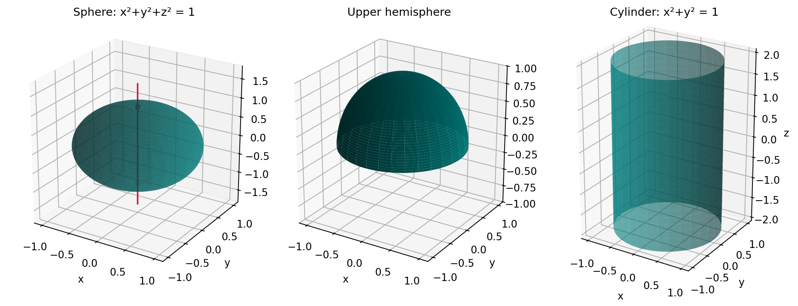

**Teaching example.**

**Question.**  
Consider the unit sphere $x^2 + y^2 + z^2 = 1$ in $\mathbb{R}^3$.
1. Show that the entire sphere is not the graph of a single function $z = f(x, y)$ by applying the vertical-line test at an explicit point.
2. Decompose the sphere into two separate function graphs $z = f_1(x, y)$ and $z = f_2(x, y)$.
3. State the exact natural domain $D$ for these functions using formal set notation, and explain why specifying $[-1, 1] \times [-1, 1]$ is incorrect.

**A complete answer must include:**

- [ ] An explicit vertical line exhibiting two distinct intersection points on the sphere.
- [ ] The algebraic formulas for the upper and lower hemispheres with explicit signs.
- [ ] An exact set description of the natural domain derived from the real-radicand condition.
- [ ] A clear geometric explanation of why the rectangular bounding box $[-1, 1]^2$ contains invalid points outside the disk where the radicand becomes negative.

**Common mistakes:**

- Stating the domain as $-1 \le x \le 1$ and $-1 \le y \le 1$ (the unit square has points like $(1, 1)$ where $1 - x^2 - y^2 = -1 < 0$).
- Forgetting to state the boundary condition $z = 0$ where the two hemispheres meet.

---

### 1.3 Transformations of Surface Graphs

Transformations describe how a graph changes when its inputs or output are changed. Replacing $x$ by $x-a$ or $y$ by $y-b$ moves the graph horizontally because the original input value is reached at a translated location. Adding a constant to the output moves every point vertically; multiplying the output changes vertical scale, and negating it reflects heights across the $xy$-plane. Replacing an input by its negative reflects the graph across the corresponding vertical coordinate plane. These rules apply pointwise and preserve the graph structure, while moving landmarks such as vertices and extrema with the transformation.

The standard transformation rules are:

- $z = f(x-a, y-b) + c$ translates the graph by $(a,b,c)$.
- $z = -f(x,y)$ reflects it across the $xy$-plane; multiplying by a positive factor stretches or compresses heights.
- Replacing $x$ by $-x$ or $y$ by $-y$ reflects across the $yz$- or $xz$-plane, respectively.

For radial functions depending on $x^2 + y^2$, height depends only on distance from the vertical axis. Translating the center moves that axis; a vertical reflection changes peaks to bowls. The profile $\exp(-(x^2+y^2))$ stays positive and approaches, but never reaches, zero as radius increases.

---

#### Problem Type PT-03: Transform a Known Surface Graph via Shifts, Reflections, and Scaling

**Recognition cues.** Identify which input or output has changed from the base graph, then apply the transformation rules to its landmarks and range.

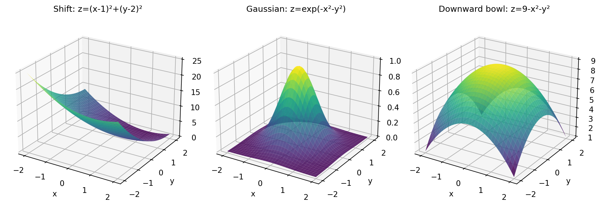

**General method.**

1. **Identify the base surface:** Locate the parent function (e.g., standard circular paraboloid $z = x^2 + y^2$).
2. **Determine shift coordinates:** Identify $(a, b)$ from $(x - a)$ and $(y - b)$, and $c$ from constant terms.
3. **Identify reflections and scaling:** Check signs preceding variables or parenthesized groups.
4. **Track key landmark points:** Compute the new position of the vertex, peak, or saddle point.
5. **State symmetry, range, and asymptotic behavior:** Note circular symmetry around shifted axes or decay toward horizontal planes.

**Teaching example.**

**Question.**  
Starting from the standard circular paraboloid $z = x^2 + y^2$, analyze the following functions:
1. For $z = (x - 1)^2 + (y - 2)^2$, identify the shift and describe the resulting surface.
2. For $z = 5 - x^2 - y^2$, identify the reflection and vertical translation, then classify the resulting surface.
3. For $z = \exp(-(x^2 + y^2))$, classify its radial profile and describe its peak, range, and behavior as distance from the origin increases. State how it compares with the paraboloid, without treating it as a shift, reflection, or scaling of that graph.

**A complete answer must include:**

- [ ] Correct transformation operations and resulting surface classifications for parts (1) and (2).
- [ ] The location and type of the peak or vertex for each function, with its range.
- [ ] The radial behavior of part (3), including its limiting height as distance from the origin increases.

**Common mistakes:**

- Inverting shift signs (e.g., claiming $(x - 1)^2$ translates by $-1$ instead of $+1$).
- Claiming that $z = \exp(-(x^2 + y^2))$ attains the value $z = 0$ (it approaches $0$ asymptotically, but $z > 0$ everywhere).
- Confusing horizontal shifts in the input domain with vertical shifts in height.

---

## 2. Core: Vertical Cross-Sections (Traces)

> **Status: Core Material**  
> *Learning Targets:* Obtain vertical cross-sections by holding one input variable constant; plot cross-section families on specified 2D axes; infer 3D surface geometry from orthogonal trace families.

### 2.1 Definition and Geometric Meaning
A **vertical cross-section** (or vertical trace) of the surface $z = f(x, y)$ is the curve formed by intersecting the surface with a vertical plane:

- **Cross-section with $x$ held constant ($x = a$):** The intersection of the surface with the vertical plane $x = a$. Points on this curve satisfy:
  $x = a, z = f(a, y)$
  This is a two-dimensional curve in the vertical plane $x = a$, plotted using horizontal coordinate $y$ and vertical coordinate $z$.

- **Cross-section with $y$ held constant ($y = b$):** The intersection of the surface with the vertical plane $y = b$. Points on this curve satisfy:
  $y = b, z = f(x, b)$
  This is a two-dimensional curve in the vertical plane $y = b$, plotted using horizontal coordinate $x$ and vertical coordinate $z$.

*Critical distinction:* The equation $z = f(x, b)$ alone does not fully define a spatial curve; the plane equation $y = b$ is an indispensable part of the mathematical specification.

---

### 2.2 Quadratic Trace Families

When a quadratic surface $z = f(x,y)$ is sliced by a vertical plane, fixing one input leaves a one-variable quadratic. For $z = x^2 + y^2$, fixing $x=a$ gives $z=y^2+a^2$, an upward-opening parabola whose vertex height changes with $a$; the perpendicular family behaves the same way. For $z=x^2-y^2$, fixing $y=b$ gives upward-opening traces $z=x^2-b^2$, while fixing $x=a$ gives downward-opening traces $z=a^2-y^2$. The opposite concavity in perpendicular directions explains the saddle geometry. In every case, the plane equation is part of the spatial curve specification.

#### Problem Type PT-04: Determine and Sketch Parabolic and Hyperbolic Vertical Traces

**Recognition cues.** Use this method when fixing an input variable turns a surface equation into a one-variable quadratic. Compare both perpendicular slice families to identify the surface's local shape.

**General method.**

1. **Fix the chosen variable:** Substitute $y = b$ (or $x = a$) into the surface equation $z = f(x, y)$.
2. **Formulate the 2D curve equation:** Write the resulting single-variable equation $z = g(x)$ (or $z = h(y)$).
3. **State the containing plane:** Explicitly pair the equation with its plane, e.g., $\{y = b, z = g(x)\}$.
4. **Identify conic/geometric features:** Determine vertex coordinates, concavity (upward vs downward), and axis intercepts in the designated plane.
5. **Synthesize the 3D surface:** Compare the behavior of orthogonal slices to identify the surface geometry.

**Teaching example.**

**Question.**  
For the hyperbolic paraboloid $z = x^2 - y^2$:
1. Find the equations of the cross-sections in the planes $y = -1$, $y = 0$, and $y = 1$. Specify the shape, opening direction, and vertex coordinates of each curve in its vertical plane.
2. Find the equations of the cross-sections in the planes $x = -1$, $x = 0$, and $x = 1$. Specify the shape, opening direction, and vertex coordinates of each curve in its vertical plane.
3. Describe how these two orthogonal families of parabolas explain the saddle shape and behavior near the origin.

**A complete answer must include:**

- [ ] Complete curve specifications including both the single-variable relation and the vertical plane condition.
- [ ] Coordinates of the vertex in 3D space $(x, y, z)$ for each of the six requested cross-sections.
- [ ] Concavity and opening direction for each family of slices.
- [ ] Synthesis of the orthogonal slice behavior and the resulting saddle geometry.

**Common mistakes:**

- Calling a 1D cross-section a "paraboloid" (a cross-section is a 2D *parabola* residing in a plane).
- Omitting the vertical plane equation and treating $z = x^2 - b^2$ as an equation in $\mathbb{R}^3$ (which would define a parabolic cylinder).

---

### 2.3 Parameterized Families of Vertical Traces

For an $x$-fixed family ($x=a$), the free input is $y$; draw $y$ horizontally and $z$ vertically, with $a$ labeling each curve. For a $y$-fixed family ($y=b$), use horizontal $x$ and vertical $z$, with $b$ as the parameter. Substituting the fixed value separates the parameter's effect from the curve variable. Comparing landmarks or slopes as the parameter changes shows how the surface evolves across space.

#### Problem Type PT-05: Sketch and Analyze Multi-Curve Families of Vertical Cross-Sections

**Recognition cues.** Use this method when several vertical slices must be compared or drawn on common axes. First distinguish each family's fixed parameter from its free plotting variable.

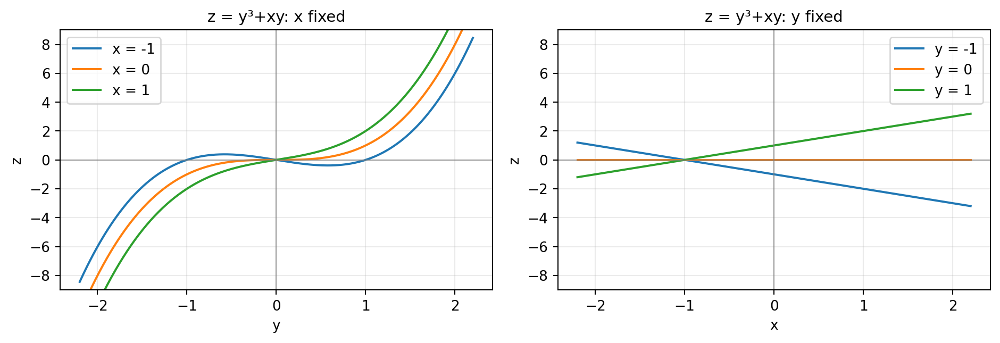

**General method.**

1. **Identify fixed vs free variables:** Determine which variable is constant for each family.
2. **Derive algebraic family equations:** Substitute the constant values to obtain $z$ as a function of the free variable.
3. **Determine key curve landmarks:** For each curve, find axis intercepts, local extrema, inflection points, or slopes.
4. **Establish correct plotting axes:** Label horizontal and vertical axes properly ($y$ vs $z$ for fixed $x$; $x$ vs $z$ for fixed $y$).
5. **Interpret physical or geometric trends:** Track how the curve shifts, rotates, or deforms as the parameter increases.

**Teaching example.**

**Question.**  
Consider the function $f(x, y) = y^3 + xy$.
1. Find the equations of the vertical cross-sections for $x = -1$, $x = 0$, and $x = 1$. Specify the plotting axes, and describe the shapes, roots, and turning points of the three curves.
2. Find the equations of the vertical cross-sections for $y = -1$, $y = 0$, and $y = 1$. Specify the plotting axes, and describe the geometric nature, slopes, and $z$-intercepts of the three curves.
3. Explain what happens to the slope of the $y$-fixed slices as $y$ increases from negative to positive values.

**A complete answer must include:**

- [ ] Complete algebraic equations for all six cross-sections.
- [ ] Explicit statement of axis assignments: horizontal $y$, vertical $z$ for family (1); horizontal $x$, vertical $z$ for family (2).
- [ ] Analysis of the cubic slices' roots, turning points, and inflection behavior.
- [ ] Analysis of the linear slices' slopes and intercepts as the fixed parameter varies.
- [ ] Physical synthesis of how the surface twists as $y$ changes sign.

**Common mistakes:**

- Plotting the $x$-fixed family with $x$ on the horizontal axis.
- Mistaking the linear family (for fixed $y$) for curved slices due to the presence of $y^3$.
- Forgetting to indicate which curve corresponds to which parameter value on multi-curve plots.

---

## 3. Core: Cylinders and Free Variables

> **Status: Core Material**  
> *Learning Targets:* Recognize cylinders in $\mathbb{R}^3$ from missing variables; identify the generating curve and the axis of extrusion; distinguish between circular, parabolic, and hyperbolic cylinders; evaluate cylinders against the vertical-line test.

### 3.1 Definition and the Missing Variable Principle
In multivariable calculus, a **cylinder** is defined much more broadly than the familiar circular can of elementary geometry.

- **Geometric Definition:** A cylinder is a surface in $\mathbb{R}^3$ generated by taking a plane curve $C$ (called the *generating curve*) and translating it along a family of parallel lines (called *rulings* or *generators*) passing through every point of $C$.
- **Missing Variable Rule:** If an equation in $\mathbb{R}^3$ involves only two of the three coordinate variables, the missing variable is **free** (completely unrestricted). The solution set consists of the 2D curve defined in the plane of the two present variables, extruded parallel to the axis of the missing variable.
- **Orientation of Extrusion:**
  - Equation $F(x, y) = 0$ (missing $z$): extruded parallel to the $z$-axis.
  - Equation $F(x, z) = 0$ (missing $y$): extruded parallel to the $y$-axis.
  - Equation $F(y, z) = 0$ (missing $x$): extruded parallel to the $x$-axis.

### 3.2 Cylinders vs Functions z = f(x, y)
A cylinder may or may not represent the graph of a function $z = f(x, y)$:

- The parabolic cylinder $z = x^2$ has $y$ free. For any $(x, y)$, $z$ is uniquely determined by $x^2$. Thus, $z = x^2$ **is** the graph of a valid function $z = f(x, y)$ (independent of $y$).
- The circular cylinder $x^2 + y^2 = 1$ has $z$ free. For any interior input pair $(x, y)$ with $x^2 + y^2 = 1$, $z$ can take *any* real value. Thus, vertical lines intersect it at infinitely many points, completely failing the vertical-line test. It **cannot** be written as $z = f(x, y)$.
- The parabolic cylinder $y = x^2$ has $z$ free, and likewise fails the vertical-line test for $z = f(x, y)$.

---

#### Problem Type PT-06: Identify and Sketch Cylinders from Missing Variables in $\mathbb{R}^3$

**Recognition cues.** Use this method when an equation in three-dimensional space omits one coordinate. The absent coordinate identifies the direction in which the generating curve extends.

**General method.**

1. **Identify the missing variable:** Determine which coordinate is absent from the equation.
2. **Analyze the 2D generating trace:** Set the missing variable to 0 (or view in its coordinate plane) and identify the curve (circle, parabola, ellipse, hyperbola, line).
3. **Determine the extrusion direction:** The surface is formed by translating the generating curve parallel to the axis of the missing coordinate.
4. **Test as a function $z = f(x, y)$:** Check if solving for $z$ yields a single unique output for each $(x, y)$. If $z$ is the missing variable, the surface fails the function test immediately.
5. **Describe extent:** Unless a domain bound is specified, the cylinder extends infinitely along its extrusion axis and along any unbounded directions of the generating curve.

**Teaching example.**

**Question.**  
1. Describe the geometric meaning of the equation $x^2 + y^2 = 1$ in two-dimensional space $\mathbb{R}^2$ versus three-dimensional space $\mathbb{R}^3$.
2. Describe the surface defined by $z = x^2$ in $\mathbb{R}^3$, specifying its generating curve, extrusion direction, and whether it represents a function $z = f(x, y)$.
3. Describe the surface defined by $y = x^2$ in $\mathbb{R}^3$, specifying its generating curve, extrusion direction, and whether it represents a function $z = f(x, y)$.

**A complete answer must include:**

- [ ] Contrast between 1D curve in $\mathbb{R}^2$ and 2D cylindrical surface in $\mathbb{R}^3$.
- [ ] Identification of the generating cross-section in its respective coordinate plane.
- [ ] Explicit name of the axis of extrusion for each surface.
- [ ] Rigorous vertical-line test assessment for all three cases.
- [ ] Clear statement of spatial extent for each surface.

**Common mistakes:**

- Assuming that "cylinder" exclusively means a circular cylinder.
- Assuming that all cylinders fail to be functions $z = f(x, y)$ (failing to recognize that $z = x^2$ is a valid function).
- Misidentifying the axis of extrusion (e.g., claiming $y = x^2$ extrudes along $y$).

### 3.3 Supplementary Trace Example: Hemisphere Slice
In lecture notes (`MAT235H-5201-Sept-16.pdf`, p. 17), the upper unit hemisphere $z = \sqrt{1 - x^2 - y^2}$ is sliced at $x = 1/2$. Setting $x = 1/2$ yields:
$z = \sqrt{1 - (1/2)^2 - y^2} = \sqrt{3/4 - y^2}, \quad \text{for } |y| \le \sqrt{3}/2$
In the vertical plane $x = 1/2$, this curve is the upper semicircle $y^2 + z^2 = 3/4$ with $z \ge 0$, having radius $r = \sqrt{3}/2$. It is neither a parabola nor a full circle.

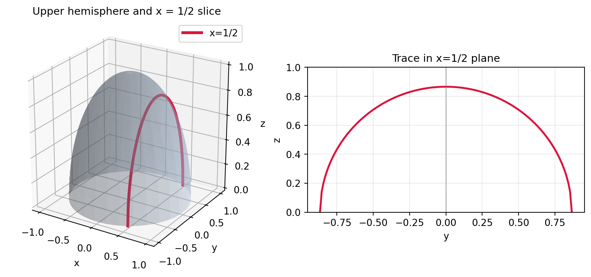

---

## 4. Core: 12.3 Contours and Level Curves

> **Status: Core Material**  
> *Learning Targets:* Define level sets and contours; distinguish contours from vertical cross-sections; calculate algebraic contours; interpret contour spacing and steepness; read and interpolate contour maps; construct contours from data tables.

### 4.1 Definitions and Notation
For a function $f: D \subseteq \mathbb{R}^2 \to \mathbb{R}$ and a real constant $c$, the **level set** (or **contour curve**) of height $c$ is the set of all input points $(x, y)$ in the domain where the function output equals $c$:
$L_c = \{(x, y) \in D : f(x, y) = c\}$

- **Geometric Meaning:** A contour is the horizontal slice of the 3D graph $z = f(x, y)$ formed by intersecting it with the horizontal plane $z = c$, projected vertically downward into the $xy$-domain plane.
- **Contour Diagram (Contour Map):** A collection of several contour lines drawn in the single $xy$-plane, where each curve is clearly labelled with its corresponding output value $c$.
- **The Non-Intersecting Rule:** For a single-valued function $f$, contours corresponding to *different* values $c_1 \ne c_2$ can **never intersect**. If they intersected at $(x_0, y_0)$, the function would evaluate to both $c_1$ and $c_2$ simultaneously, violating the definition of a function. (However, different branches of the *same* level set can cross, such as at a saddle point where $f(x, y) = 0$).

---

#### Problem Type PT-07: Distinguish Vertical Cross-Sections from Horizontal Level Curves

**Recognition cues.** Use this comparison when deciding whether a curve comes from fixing an input coordinate or fixing the output height. The first is a vertical trace; the second is a contour in the domain plane.

**General method.**

1. **Identify the held quantity:** Check whether the constraint fixes an input ($x$ or $y$) or the output ($z$).
2. **Specify the 3D containing plane:** Vertical plane $x = a$ or $y = b$ for cross-sections; horizontal plane $z = c$ for level sets.
3. **Identify the viewing projection:** $yz$-view or $xz$-view for cross-sections; $xy$-view for contour maps.
4. **State the output behavior:** Along a cross-section, $z$ varies; along a contour, $z$ is strictly constant.

**Teaching example.**

**Question.**  
For the paraboloid $f(x, y) = x^2 + y^2$:
1. Find the equation and describe the geometry of the cross-section corresponding to $x = 1$. Specify its containing plane and whether it is viewed in $xz$, $yz$, or $xy$ coordinates.
2. Find the equation and describe the geometry of the contour corresponding to $z = 4$. Specify its containing plane and its representation in the $xy$-plane.
3. State two fundamental mathematical differences between a vertical cross-section and a contour.

**A complete answer must include:**

- [ ] Explicit 3D point-set equations for both curves.
- [ ] Geometric classification (parabola vs circle).
- [ ] The containing and projection planes for both curves.
- [ ] Clear comparison of fixed variables, varying quantities, and display conventions.

**Common mistakes:**

- Calling $x^2 + y^2 = 4$ a "cross-section" without specifying that it is a horizontal cross-section.
- Drawing a contour on a graph with $z$ on one of the axes.

---

### 4.2 Algebraic Contours and Spacing

A contour at level $c$ is found by solving $f(x,y)=c$ in the domain. Its shape and dimensions can often be read by matching the equation to a standard curve. When adjacent contours have equal level increments, their perpendicular spacing estimates the local rate of change in the direction normal to the curves: closer spacing means a greater rate, while wider spacing means a smaller rate. Approximately equal spacing suggests an approximately constant normal rate in the displayed region. This is a local inference; a finite contour map cannot establish globally constant slope.

#### Problem Type PT-08: Find Algebraic Contours and Interpret Spacing and Steepness

**Recognition cues.** Use this method when asked to derive level curves from a formula or infer relative steepness from a labelled contour map. Confirm equal level increments before comparing spacing.

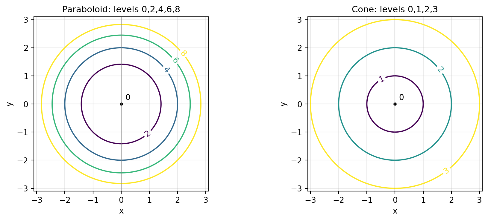

**General method.**

1. **Set $f(x, y) = c$:** Solve for standard 2D relations (circles, ellipses, lines, hyperbolas).
2. **Determine permissible values of $c$:** Identify constraints (e.g., radicands non-negative, squares non-negative). State when levels are empty or degenerate points.
3. **Express geometric dimensions in terms of $c$:** For radial functions, write radius $r(c)$ as a function of $c$.
4. **Analyze spacing for equal $\Delta c$:** Compute $\Delta r = r(c + \Delta c) - r(c)$ to determine if gaps widen, shrink, or remain constant.
5. **Relate to 3D surface shape:** Deduce whether the surface steepens, flattens, or has constant slope outward.

**Teaching example.**

**Question.**  
Consider the functions $f(x, y) = x^2 + y^2$ and $g(x, y) = \sqrt{x^2 + y^2}$.
1. For $f(x, y)$, determine the permissible values of $c$, find the contour equations for $c = 0, 2, 4, 6, 8$, and compute the exact radius of each contour.
2. For $g(x, y)$, determine the permissible values of $c$, find the contour equations for $c = 0, 1, 2, 3$, and compute the exact radius of each contour.
3. Compare the radial spacing between successive contours for equal increments of $c$ in both functions, and explain what this reveals about the steepness and profile of the paraboloid versus the cone.

**A complete answer must include:**

- [ ] Derivation of the contour equations and their geometric parameters for both functions.
- [ ] Evaluation of the requested levels, including any degenerate or empty cases.
- [ ] Identification of all admissible, degenerate, and empty level sets.
- [ ] Comparison of radial spacing for equal level increments and a qualified interpretation of the resulting steepness.

**Common mistakes:**

- Mistaking the radius of $x^2 + y^2 = c$ for $c$ instead of $\sqrt{c}$.
- Drawing a circle of positive radius for $c = 0$.
- Comparing contour spacing without confirming that the label increments $\Delta c$ are identical.

---

### 4.3 Contours of Linear Functions

For $f(x,y)=ax+by+d$, the level equation is $ax+by+d=c$, a line with normal vector $(a,b)$. Distinct levels therefore form parallel lines. A displacement parallel to a contour has zero change in $f$, while the normal direction changes $f$; for equal level increments the perpendicular distances are equal and determined by the magnitude of $(a,b)$. If one coefficient is zero, solve for the other coordinate rather than using slope-intercept form.

#### Problem Type PT-09: Plot and Interpret Contours of Linear Functions

**Recognition cues.** Use this method when the function is affine linear and the task asks for contour equations, intercepts, spacing, or direction of increase.

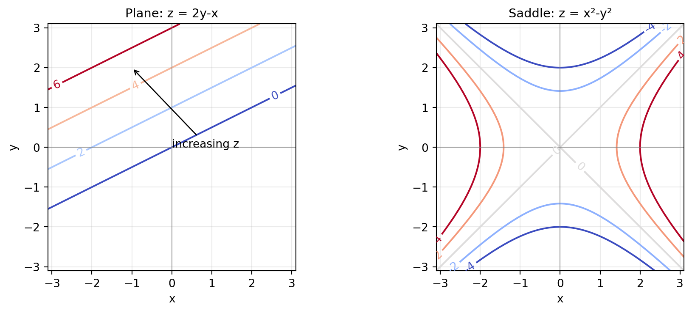

**General method.**

1. **Set $ax + by + d = c$:** Solve for $y$ in slope-intercept form $y = mx + k(c)$, or for $x$ if $b = 0$.
2. **Calculate specific lines:** Compute intercepts for each requested value of $c$.
3. **Determine spacing:** Calculate the perpendicular separation between parallel lines.
4. **Identify the direction of increasing $z$:** Evaluate the gradient vector $(a, b)$ or test point values to determine which side of a line has higher values.
5. **Draw and label:** Plot the parallel lines on $xy$-axes with clear numerical labels and an arrow indicating uphill direction.

**Teaching example.**

**Question.**  
Consider the linear function $z = 2y - x$.
1. Write the algebraic equations in slope-intercept form for the contours corresponding to $z = 0, 2, 4, 6$.
2. State the common slope of these lines and find the $y$-intercept for each contour.
3. Determine a vector in the $xy$-plane pointing in the direction of increasing $z$, and verify that moving along a contour leaves $z$ unchanged.

**A complete answer must include:**

- [ ] Equations for all requested contour levels.
- [ ] Slopes and intercepts for each requested contour.
- [ ] A direction of increase supported by evaluating how the function changes.
- [ ] Verification that displacement along a contour leaves the function value unchanged.

**Common mistakes:**

- Confusing the slope of the line in the $xy$-plane with the slope of the surface in $\mathbb{R}^3$.
- Inverting the sign of $x$ when solving for $y$ (e.g., writing $y = -x/2$).
- Labeling contour axes with $z$.

---

### 4.4 Reading and Interpolating Contour Maps

A labelled map gives exact function values only on its drawn level curves. A point between two labelled contours is rigorously bracketed by their levels when the function is continuous across the region and the map is complete there: the two curves bound the relevant connected region, and no hidden contour branches or extrema intervene. A sparse or incomplete diagram does not guarantee those conditions, so its apparent bracketing is only an estimate. An estimate can be made by measuring the point's relative distance between adjacent contours along a path normal to them and assuming the value changes approximately linearly along that path. Without a known formula, the exact variation between contours is not determined by the map alone.

#### Problem Type PT-10: Read a Labelled Contour Map and Bracket / Interpolate Values

**Recognition cues.** Use this method when a point lies between labelled contours or when a value must be estimated from map geometry.

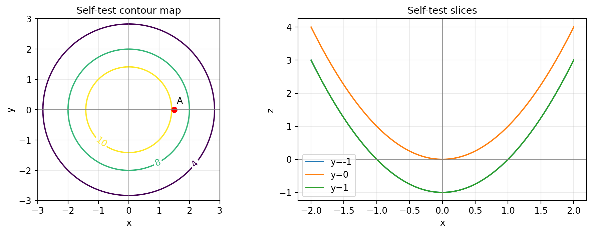

**General method.**

1. **Locate the coordinates:** Pinpoint $(x_0, y_0)$ using the map's coordinate axes.
2. **Identify bounding contours:** Find the adjacent displayed contours enclosing the point and record their labels $c_1, c_2$.
3. **Check whether a rigorous bracket is justified:** Confirm continuity across the region and that the map is complete there, with no hidden contour branches or extrema. Only under these conditions state the strict inequality between the labels; otherwise report an estimated range rather than a guaranteed bound.
4. **Measure relative distance:** Determine the fraction $t \in (0, 1)$ of the total distance from the $c_1$ contour to the $c_2$ contour along the shortest path through the point.
5. **Interpolate linearly:** Compute $f_est \approx c_1 + t(c_2 - c_1)$.
6. **State caveats:** Clearly state that linear interpolation provides an approximation, not an exact result, unless the function is known to be linear.

**Teaching example.**

**Question.**  
On the labelled contour map of $q(x, y) = 12 - x^2 - y^2$ shown above, consider the point $A = (1.5, 0)$.
1. Identify the two drawn contours that enclose point $A$. Assuming $q$ is continuous and the map shows all relevant contours in the region, state a rigorous bounding inequality for $q(1.5, 0)$; explain what the map alone would establish if it were sparse or incomplete.
2. Using radial distances from the origin to the enclosing contours, perform linear interpolation to estimate $q(1.5, 0)$. State the interpolation assumption explicitly.
3. Calculate the exact value of $q(1.5, 0)$ using the formula, and explain why the interpolated value differs slightly from the exact value.

**A complete answer must include:**

- [ ] Identification of the two enclosing contour levels.
- [ ] A strict bound under the stated continuity and map-completeness assumptions, plus the limitation of an incomplete diagram.
- [ ] Explicit linear interpolation calculation based on relative radial position.
- [ ] Exact evaluation from the defining function and a comparison with the interpolation estimate.
- [ ] Explanation that $q(r)$ is quadratic, so linear interpolation along $r$ incurs a small truncation error.

**Common mistakes:**

- Reporting an interpolated reading as an exact measurement.
- Interpolating along arbitrary non-perpendicular directions.

---

### 4.5 Constructing Contours from Data Tables

A two-input table gives sampled values on a finite grid. A contour level can pass through grid nodes whose values equal the requested level or cross a grid edge whose endpoint values straddle it. Linear interpolation along each such edge estimates the crossing. Connecting crossings gives an approximate contour consistent with nearby samples, but sparse samples do not determine a unique smooth curve, and the table gives no evidence outside its sampled region.

#### Problem Type PT-11: Construct and Interpolate Contours from Numerical Data Tables

**Recognition cues.** Use this method when a function is supplied as grid data rather than a formula and a contour must be estimated.

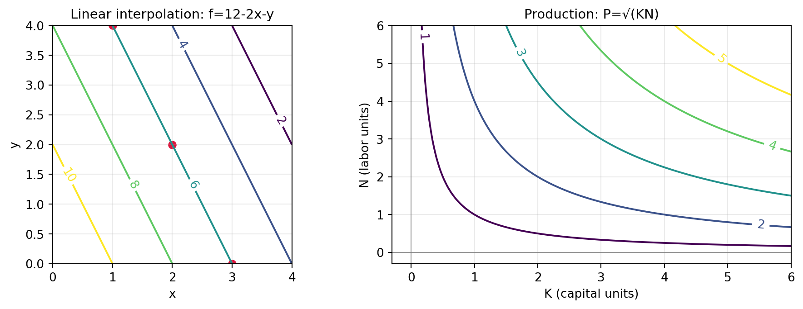

**General method.**

1. **Scan rows and columns:** Locate all adjacent pairs of grid points between which the value $c$ falls.
2. **Apply 1D linear interpolation:** Along a grid segment between $(x_1, y)$ with value $z_1$ and $(x_2, y)$ with value $z_2$, solve for $x$:
   $x = x_1 + [(c - z_1) / (z_2 - z_1)](x_2 - x_1)$
3. **Plot crossing points:** Mark all interpolated points on a coordinate grid.
4. **Sketch approximate segments:** Join crossings in a way consistent with nearby sampled values; sparse samples do not determine a unique smooth contour shape.
5. **State modeling limits:** A finite table only supports an empirical model within the sampled region; it does not prove global behavior.

**Teaching example.**

**Question.**  
The table below displays values of a function $f(x, y)$ on the square $0 \le x, y \le 4$.

| y \ x | 0 | 2 | 4 |
| :---: | :-: | :-: | :-: |
| **0** | 12 | 8 | 4 |
| **2** | 10 | 6 | 2 |
| **4** | 8 | 4 | 0 |

1. Estimate the coordinates where the contour $f(x, y) = 6$ intersects the horizontal grid lines $y = 0$, $y = 2$, and $y = 4$ using linear interpolation along rows.
2. Plot these points in the $xy$-plane and describe the resulting contour curve.
3. Find a linear equation $Ax + By = C$ that fits these interpolated points, and explain why this formula represents an empirical interpolation rather than a proven global identity.

**A complete answer must include:**

- [ ] Explicit 1D interpolation calculations for rows $y = 0$, $y = 2$, and $y = 4$.
- [ ] Coordinates of the contour crossings found by interpolation.
- [ ] An equation fitting the interpolated points.
- [ ] A clear statement that the finite grid entries do not rule out nonlinear fluctuations between sampled points.

**Common mistakes:**

- Confusing rows and columns (reading $x$ vertically instead of horizontally).
- Extending the interpolated contour line beyond the boundary of the sampled square.

---

### 4.6 Saddle Level Sets

For the saddle $f(x,y)=x^2-y^2$, the zero level factors into two intersecting lines. These branches belong to the same level, so their intersection does not violate the rule that contours of different function values cannot cross. For positive levels, the hyperbola branches open along the $x$-axis; for negative levels they open along the $y$-axis. The sign sectors follow from comparing $|x|$ and $|y|$, matching the saddle's rising and falling directions in 3D.

#### Problem Type PT-12: Analyze Saddle Contours, Hyperbolic Branches, and Intersecting Zero Levels

**Recognition cues.** Use this method for saddle-shaped quadratic level sets, especially when the zero level or the orientation of positive and negative contours is in question.

**General method.**

1. **Factor the zero level:** Solve $f(x, y) = 0$ algebraically to identify intersecting lines or asymptotes.
2. **Classify sign sectors:** Determine which regions in the domain have $f > 0$ ($|x| > |y|$) and $f < 0$ ($|y| > |x|$).
3. **Determine hyperbola vertices and axes:** For $c \ne 0$, find intercepts $(\pm \sqrt{c}, 0)$ for $c > 0$, or $(0, \pm \sqrt{-c})$ for $c < 0$.
4. **Read table symmetries:** Note even symmetries in $x$ and $y$, and the sign flip under swapping $x $\leftrightarrow$ y$.
5. **Relate to 3D saddle:** Conclude that ridges rise along the $x$-axis while valleys drop along the $y$-axis.

**Teaching example.**

**Question.**  
Consider the 7 $\times$ 7 integer evaluation table for $f(x, y) = x^2 - y^2$ on $[-3, 3] \times [-3, 3]$:

| y \ x | -3 | -2 | -1 | 0 | 1 | 2 | 3 |
| :---: | :-: | :-: | :-: | :-: | :-: | :-: | :-: |
| **3** | 0 | -5 | -8 | -9 | -8 | -5 | 0 |
| **2** | 5 | 0 | -3 | -4 | -3 | 0 | 5 |
| **1** | 8 | 3 | 0 | -1 | 0 | 3 | 8 |
| **0** | 9 | 4 | 1 | 0 | 1 | 4 | 9 |
| **-1** | 8 | 3 | 0 | -1 | 0 | 3 | 8 |
| **-2** | 5 | 0 | -3 | -4 | -3 | 0 | 5 |
| **-3** | 0 | -5 | -8 | -9 | -8 | -5 | 0 |

1. Identify all table entries equal to 0 and show that they correspond to two intersecting straight lines.
2. Describe the geometric shape, number of disconnected branches, and opening direction for the contours $c = 4, 2, 0, -2, -4$.
3. Explain why the intersection of contours at the origin does not violate the rule that contours cannot cross.

**A complete answer must include:**

- [ ] The factorization and geometry of the zero level.
- [ ] Branch count and orientation for each requested positive, zero, and negative level.
- [ ] Identification of vertices on the coordinate axes for each nonzero level.
- [ ] Rigorous clarification of the non-intersecting rule: contours of *distinct* heights $c_1 \ne c_2$ cannot intersect; branches of the *same* level $c = 0$ can and do intersect at stationary points.

**Common mistakes:**

- Asserting that a saddle function is invalid because its contours cross.
- Confusing the orientation of positive and negative hyperbola branches.

---

### 4.7 Bounded-Domain Surfaces and Spatial Distance

A physical surface is modeled by a height function together with a domain. The domain truncates the unrestricted plane or other surface and restricts each level curve to the portion that lies over the physical region. To measure a straight-line distance between two points on or near the surface, first determine all three coordinates and then use the Euclidean distance in $\mathbb{R}^3$:
$d(P_1, P_2) = \sqrt{(\Delta x)^2 + (\Delta y)^2 + (\Delta z)^2}$

#### Problem Type PT-13: Model a Finite-Domain Surface, Bounded Contours, and 3D Distances

**Recognition cues.** Use this method when a roof, plate, or other physical model has explicit boundary conditions and the task asks for truncated contours or a spatial distance.

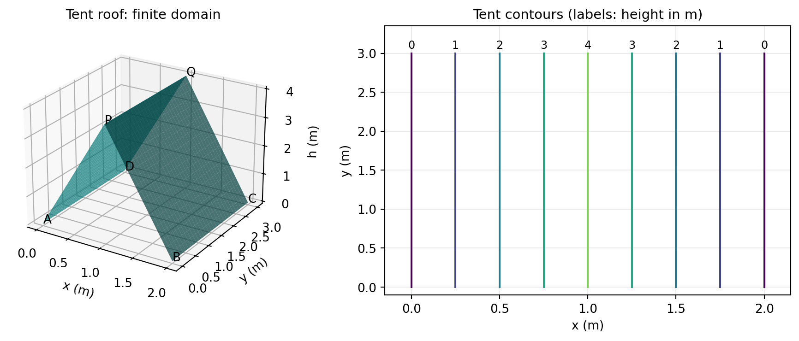
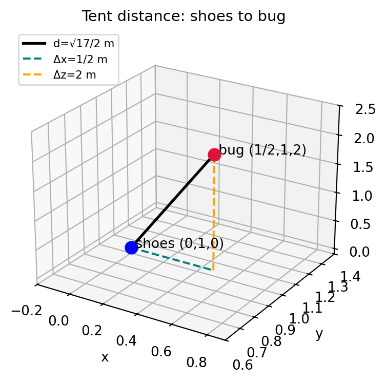

**General method.**

1. **Define piecewise height functions:** Model planar faces by calculating slopes along independent coordinates and specifying domain bounds.
2. **Solve for level sets within bounds:** Set $h(x, y) = c$ on each piece and intersect with the piecewise domain.
3. **Plot bounded contours:** Draw contour segments truncated strictly at domain boundaries.
4. **Compute 3D coordinates:** Evaluate $z = h(x, y)$ to obtain full 3D coordinates $(x, y, z)$ of physical points.
5. **Apply Euclidean distance:** Use the 3D distance formula and attach proper physical units.

**Teaching example.**

**Question.**  
A camping tent has a rectangular base on the ground ($z = 0$) with corners $A = (0, 0, 0)$, $B = (2, 0, 0)$, $C = (2, 3, 0)$, and $D = (0, 3, 0)$, and a horizontal ridge along the line connecting $P = (1, 0, 4)$ and $Q = (1, 3, 4)$ (all dimensions in metres).
1. Find a piecewise algebraic formula for the roof height $h(x, y)$, specifying its domain.
2. For $0 < c < 4$, solve $h(x, y) = c$ and sketch the contours for $c = 0, 1, 2, 3, 4$ m.
3. A pair of shoes is located on the ground at $(0, 1, 0)$, and a bug is crawling on the tent roof at $(1/2, 1, h(1/2, 1))$. Calculate the exact 3D straight-line distance between the shoes and the bug.

**A complete answer must include:**

- [ ] Piecewise height formula with explicit domain for each face.
- [ ] Equations and domain restrictions for each requested contour segment.
- [ ] The bug's three-dimensional coordinates found from the height function.
- [ ] Exact three-dimensional distance calculation with units.

**Common mistakes:**

- Extending the contour lines infinitely across the entire plane without imposing $0 \le y \le 3$.
- Computing only horizontal separation and neglecting the vertical coordinate difference.
- Omitting physical units (metres).

---

### 4.8 Supplementary Map Representation: The Corn-Yield Diagram
The textbook (Section 12.3, p. 712) presents an empirical contour map of corn yield $C = f(R, T)$, where rainfall $R$ is in inches and temperature $T$ is in $^\circ\text{F}$. Yield $C$ is expressed as a percentage of normal yield.

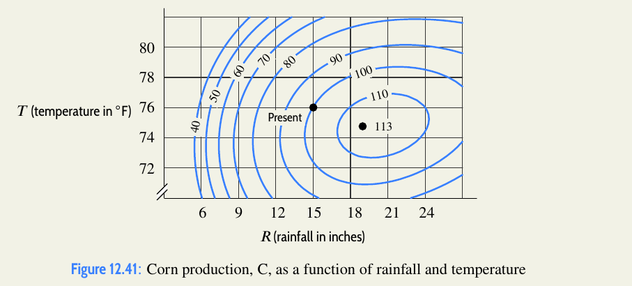

- Point $(R, T) = (18, 78)$ lies directly on the contour $C = 100$.
- Point $(12, 76)$ lies between $80$ and $90$, estimated at approximately $85$.
- Optimal yield occurs in a central elliptical region; both too much and too little rain reduce yield.

## 5. Supplementary: Review, Transformations, and Production

> **Status: Supplementary Material**  
> *Context:* Covers Section 12.1 review concepts present in weekly lecture files (3D coordinate geometry, distance, coordinate planes), qualitative thermal cross-sections, and Cobb-Douglas production functions from Section 12.3.

### 5.1 Review: 3D Coordinates and Distance to Coordinate Planes
In $\mathbb{R}^3$, a point $P = (x_0, y_0, z_0)$ has orthogonal projections onto the coordinate planes:

- Distance to $xy$-plane ($z = 0$): $|z_0|$.
- Distance to $xz$-plane ($y = 0$): $|y_0|$.
- Distance to $yz$-plane ($x = 0$): $|x_0|$.
- Distance to $y$-axis ($x = 0, z = 0$): $\sqrt{x_0^2 + z_0^2}$.

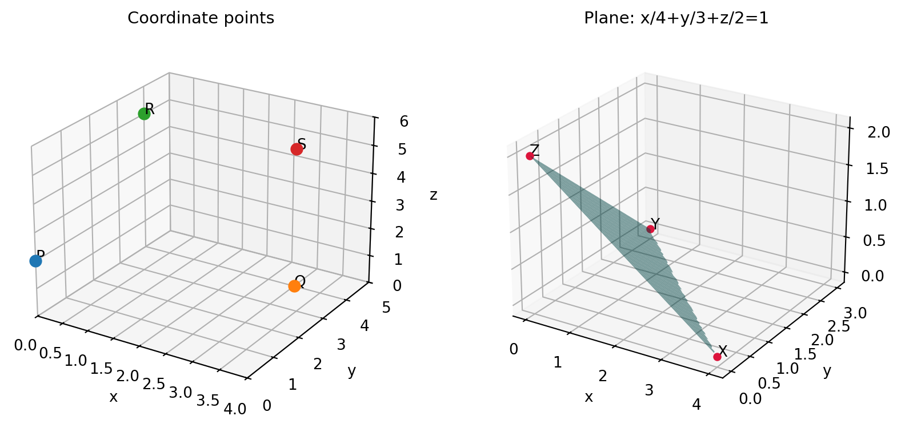

### 5.2 Review: Wind-Chill Table (C = f(w, T))
The September 16 lecture reviews 12.1 using the atmospheric wind-chill function $C = f(w, T)$, where wind speed $w$ is in mph, actual temperature $T$ is in $^\circ\text{F}$, and wind chill $C$ is in $^\circ\text{F}$:

- **Fixed row (fixed $w$):** As $T$ increases, $C$ increases (warmer air feels warmer).
- **Fixed column (fixed $T$):** As $w$ increases, $C$ decreases (stronger wind causes greater cooling).

*See `Answers-and-Practice.md` for the full table and lookup solutions.*

### 5.3 Qualitative Thermal Model: Room Heater Cross-Sections
In the lecture question regarding room temperature $T = f(d, t)$ (distance $d$ from a heater in metres, time $t$ in minutes):

- **Holding $d$ fixed ($d = d_0$):** Temperature rises over time toward a steady-state asymptote.
- **Holding $t$ fixed ($t = t_0$):** Temperature decays monotonically as distance $d$ from the heat source increases.

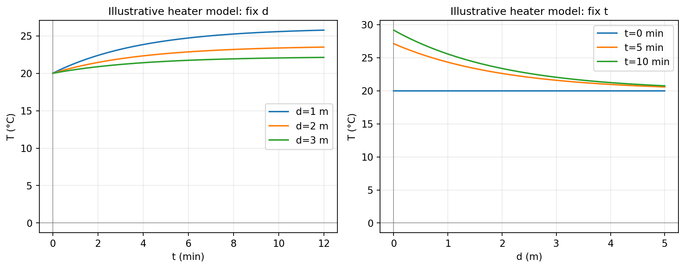

### 5.4 Production Functions and Isoquants

In economics, production output $P$ can be modeled as a function of inputs such as labor $N$ (or $L$) and capital $V$ (or $K$). A standard model is the **Cobb-Douglas production function**:
$P(N, V) = c \cdot N^\alpha \cdot V^\beta (c > 0, \alpha > 0, \beta > 0)$

A level curve $P(N,V)=P_0$ is called an **isoquant**: it records combinations of inputs that produce the same output. For positive inputs and positive output, solving for $V$ gives a positive power-law curve in $N$; it decreases because greater labor can substitute for capital. For this Cobb-Douglas form, the curve is strictly convex on $N > 0$. Positive-output isoquants do not meet either coordinate axis, since zero labor or zero capital gives zero production.

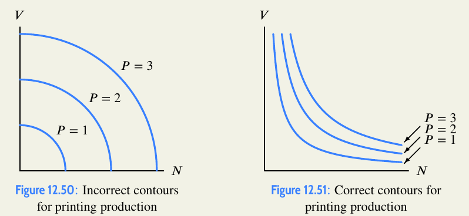

---

#### Problem Type PT-14: Analyze Multivariable Economic Models and Trade-offs along Contours

**Meaning and recognition.**
Recognize an isoquant problem when the output is fixed and the task asks how input combinations change while holding production constant. Identify the positive-input domain and the parameter values in the production model before solving.

**General method.**

1. **Set $P(N, V) = P_0$:** Fix the output constant.
2. **Solve for one input as a function of the other:** Express $V$ explicitly as $V(N)$.
3. **Determine asymptotic behavior:** Examine $N \to 0^+$ ($V \to \infty$) and $N \to \infty$ ($V \to 0^+$).
4. **Compute input trade-offs:** Calculate how scaling one input by factor $k$ requires scaling the other input to maintain constant production.
5. **Interpret the finite trade-off:** Explain how changing one input affects the amount of the other input needed to maintain the fixed output.

**Teaching example.**

**Question.**  
Consider the production function $P(N, V) = \sqrt{NV}$ for labor $N > 0$ and capital $V > 0$.
1. Find the algebraic equation for the isoquant (contour curve) corresponding to constant production $P = 4$.
2. Explain why this contour curve never intersects the $N$-axis or the $V$-axis.
3. If the quantity of labor $N$ is doubled from $N_0$ to $2N_0$, determine what must happen to capital $V$ to maintain the same production level $P = 4$.

**A complete answer must include:**

- [ ] An algebraic equation for the fixed-output isoquant and its shape in the positive-input domain.
- [ ] Mathematical and economic explanation of why $N = 0$ or $V = 0$ produces $P = 0 \ne 4$.
- [ ] The required capital adjustment when labor is scaled, supported by substituting into the fixed-output equation.

**Common mistakes:**

- Drawing production contours that intersect the coordinate axes (like circles).
- Forgetting that economic inputs $N, V$ are strictly positive in this model.

---

## 6. Preview: Later-Section Material in Weekly Files

> **Status: Preview Material**  
> *Context:* The weekly lecture slides contain advance previews of Section 12.4 (Linear functions, planes, and tables) and Section 12.5 (Functions of three variables and level surfaces). Covered here for complete weekly source fidelity.

### 6.1 12.4 Preview: Linear Functions and Planes
A function $f(x, y)$ is linear if its formula is $f(x, y) = ax + by + c$.

- **Graph in $\mathbb{R}^3$:** The graph $z = ax + by + c$ is a flat, infinite plane.
- **Intercept Form:** If a plane has non-zero intercepts $(x_0, 0, 0)$, $(0, y_0, 0)$, and $(0, 0, z_0)$, its equation is:
  $x/x_0 + y/y_0 + z/z_0 = 1$

- **Linearity Test for Tables:** A finite two-input table is consistent with a linear function on its sampled grid when:
  - Across every row (fixed $y$), equal steps in $x$ produce equal changes $\Delta z$ (constant $\Delta z / \Delta x$).
  - Down every column (fixed $x$), equal steps in $y$ produce equal changes $\Delta z$ (constant $\Delta z / \Delta y$). The rates must also agree across all rows and columns as expected for one linear formula. Finite samples cannot prove that the underlying function is linear between sampled points or outside the table.

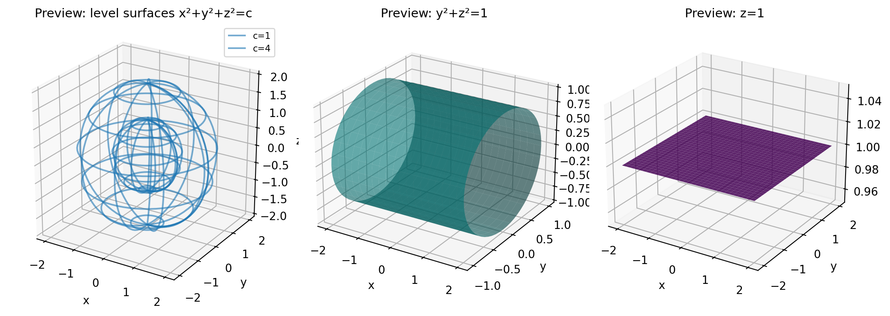

---

### 6.2 12.5 Preview: Level Surfaces

For a scalar field $F(x, y, z)$, setting $F(x, y, z) = c$ selects the locations in ordinary three-dimensional space where the field has the fixed value $c$. As $c$ varies, these level sets form a family that describes how the field is arranged spatially. The graph $w = F(x, y, z)$ includes the three input coordinates and output, so it lies in four-dimensional space; a level surface stays in 3D by fixing the output value. The equation also constrains the possible $c$ values and can produce special or degenerate cases that should be checked separately.

---

#### Problem Type PT-15: Describe and Visualize Level Surfaces of Three-Variable Functions

**Recognition cues.** Use this method when a three-input scalar field is to be represented through constant-value surfaces, or when the output range and geometry of those surfaces must be identified.

**General method.**

1. **Set $F(x, y, z) = c$:** Establish the implicit equation for a chosen constant $c$.
2. **Identify permissible values of $c$:** Enforce range constraints on $F$.
3. **Classify the 3D surface:**

   - $x^2 + y^2 + z^2 = r(c)^2$: concentric spheres centered at the origin.
   - $x^2 + y^2 = r(c)^2$ (missing $z$): concentric circular cylinders parallel to the $z$-axis.
   - $Ax + By + Cz = c$: parallel planes with normal vector $(A, B, C)$.
4. **Describe orientation and geometric parameters:** State center, radius, or normal vector as functions of $c$.

**Teaching example.**

**Question.**  
In a solid block of ice, temperature is modeled by $T(x, y, z) = (1/4)(x^2 + y^2 + z^2)$ in $^\circ\text{C}$, with coordinates $x, y, z$ measured in metres.
1. Explain why the graph of $T$ cannot be drawn in ordinary 3D space, and define what a level surface represents physically.
2. Describe the level surfaces of $T$ corresponding to temperatures $T = 1^\circ\text{C}$, $5^\circ\text{C}$, and $9^\circ\text{C}$, specifying their geometric type, center, and exact radii.
3. Describe the geometric nature of the level surfaces for the three functions:
   (i) $F(x, y, z) = \exp(-(x^2 + y^2))$
   (ii) $G(x, y, z) = z - y$
   (iii) $H(x, y, z) = \ln(x^2 + y^2 + z^2)$

**A complete answer must include:**

- [ ] Explanation that graphing $w = T(x, y, z)$ requires 4 dimensions $(x, y, z, w)$, whereas level surfaces live in 3D.
- [ ] The level equations, geometric types, centers, and radii for the requested temperatures.
- [ ] For each function, an equation and classification of its level sets, with the allowed values of $c$ and any degenerate or excluded cases.

**Common mistakes:**

- Confusing a 2D contour in the $xy$-plane of a 2-variable function with a 2D level surface in 3D space of a 3-variable function.
- Forgetting to square-root the radius term (e.g., writing radius is $4c$ instead of $\sqrt{4c}$).
- Claiming $\exp(-(x^2 + y^2)) = c$ has level surfaces for $c \le 0$ or $c > 1$.
