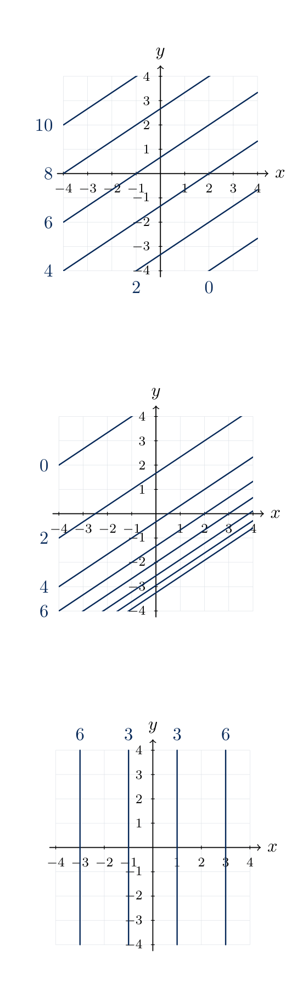
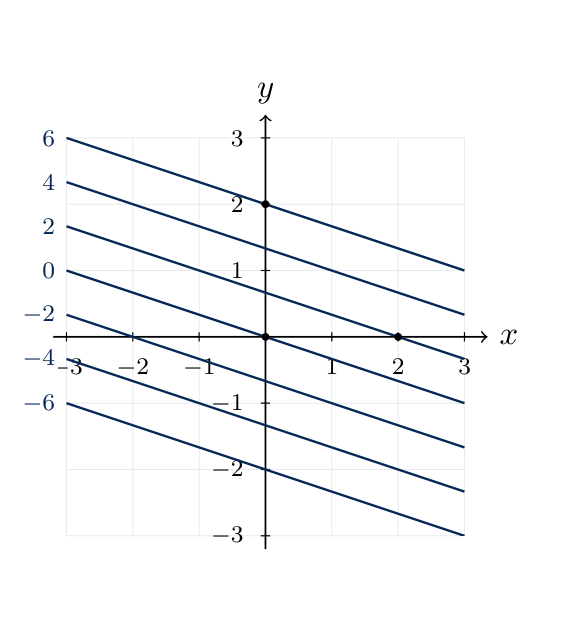
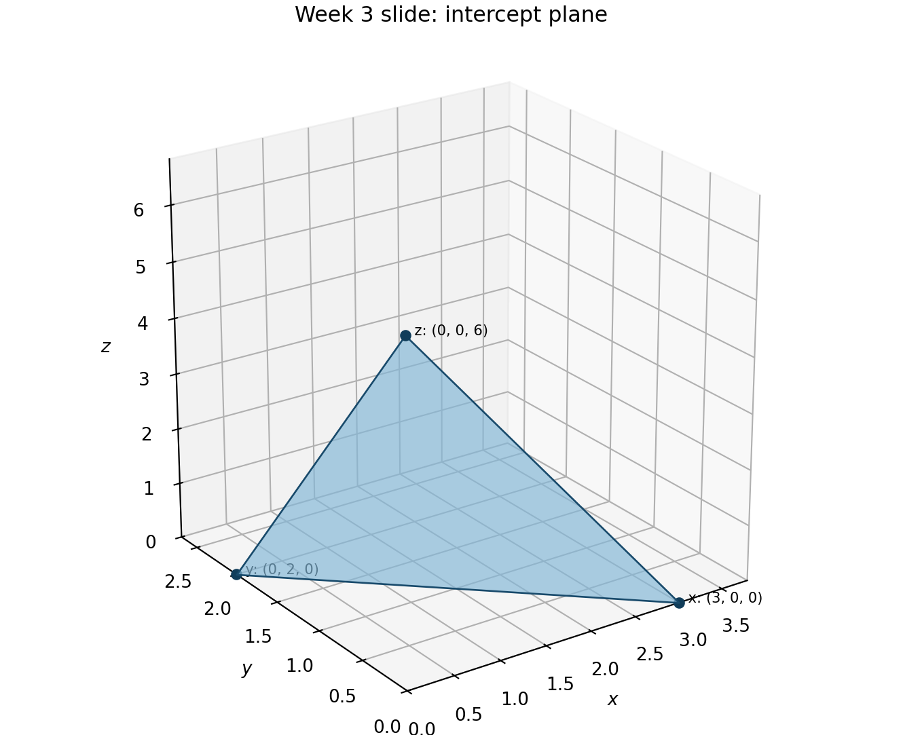
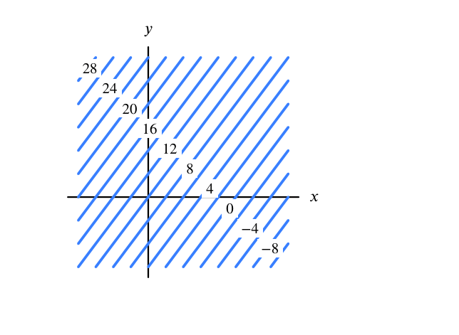
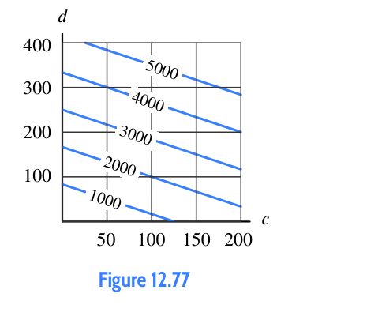
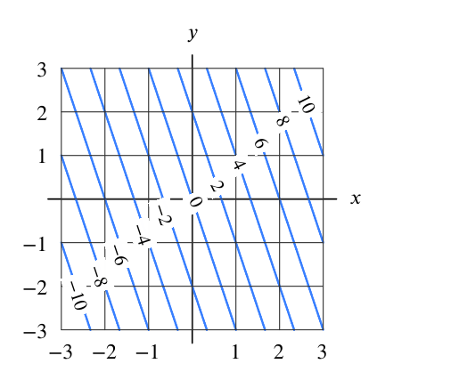
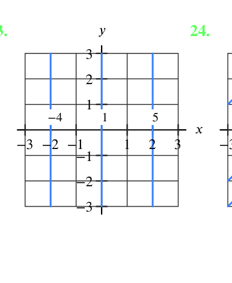
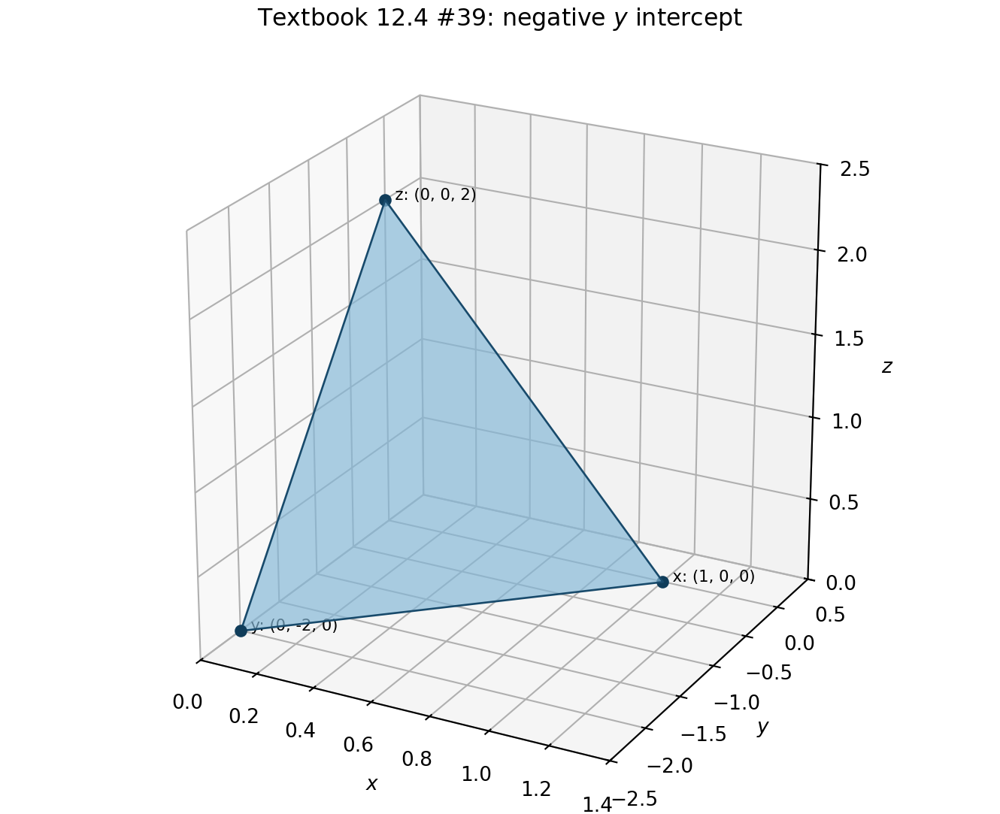
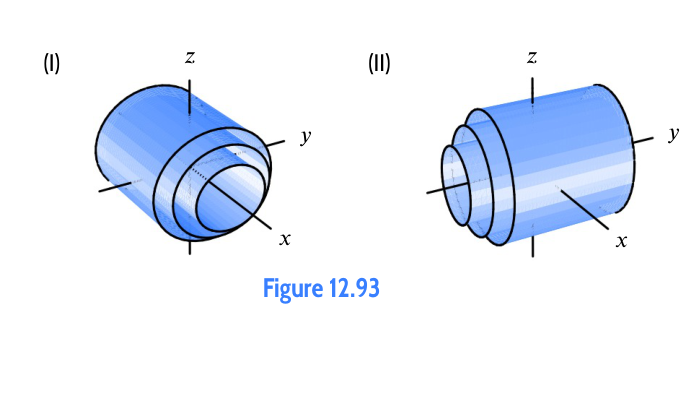

# MAT235 Week 3 Answers and Practice

Use the [concept notes and Problem Type guides](./Study-Notes.md) before reading these solutions. Source questions below are faithful, self-contained paraphrases unless short wording is quoted. The PDF page numbers in source labels are one-based viewer pages; printed textbook pages are 20 less in this chapter. The source figures reproduced here are direct crops of the local PDFs.

## Contents

- [A. Problem Type teaching-example solutions](#a-problem-type-teaching-example-solutions)
- [B. Actual weekly questions and solutions](#b-actual-weekly-questions-and-solutions)
- [C. Textbook exercises and solutions](#c-textbook-exercises-and-solutions)
- [F. Coverage and unresolved items](#f-coverage-and-unresolved-items)

## A. Problem Type Teaching-Example Solutions

### Problem Type PT-01: Linear functions from slopes and a point

**Question reference:** [PT-01 in Study Notes](./Study-Notes.md#problem-type-pt-01-linear-functions-from-slopes-and-a-point).

**Worked solution.** The signed coordinate-direction slopes are $m=3$ and $n=-4$. Through $(1,-2,7)$,

$$
f(x,y)=7+3(x-1)-4(y+2)=3x-4y-4.
$$

Substitution gives $f(1,-2)=7$. From $(1,-2)$ to $(4,0)$, $\Delta x=3$ and $\Delta y=2$, so $\Delta z=3(3)-4(2)=1$; equivalently $f(4,0)=8$.

**Answer.** $f(x,y)=3x-4y-4$; the height increases by $1$.

### Problem Type PT-02: A plane through three points

**Question reference:** [PT-02 in Study Notes](./Study-Notes.md#problem-type-pt-02-a-plane-through-three-points).

**Worked solution.** Comparing $(1,0,2)$ with $(0,1,3)$ gives $-m+n=1$. Comparing $(1,0,2)$ with $(1,2,7)$ gives $2n=5$, so $n=5/2$, $m=3/2$, and $c=2-m=1/2$. The projected-point determinant is $(-1)(2)-(0)(1)=-2\ne0$, so the formula is unique. The outputs at the three input pairs are $2,3,7$, respectively.

**Answer.** $z=f(x,y)=\tfrac12+\tfrac32x+\tfrac52y$.

### Problem Type PT-03: Recognizing linearity from data or a graph

**Question reference:** [PT-03 in Study Notes](./Study-Notes.md#problem-type-pt-03-recognizing-linearity-from-data-or-a-graph).

**Worked solution.** The first row gives $m=3$ per unit $x$. The first column comparison from $y=0$ to $y=2$ gives $n=(5-1)/2=2$. The candidate is $f(x,y)=1+3x+2y$, which gives $8$ at $(1,2)$ but $11$ at $(2,2)$. The table instead lists $12$ in that final cell.

**Answer.** The six entries cannot all come from one linear function. $1+3x+2y$ fits the first five; the entry at $(2,2)$ contradicts it.

### Problem Type PT-04: Contours of a linear function

**Question reference:** [PT-04 in Study Notes](./Study-Notes.md#problem-type-pt-04-contours-of-a-linear-function).

**Worked solution.** Figure 2 contains level $2$ at $(0,0)$, level $4$ at $(1,0)$, and level $0$ at $(0,2)$. Hence $c=2$, $m=(4-2)/1=2$, and $n=(0-2)/2=-1$. Thus $f(x,y)=2+2x-y$; for instance, its level-$6$ line is $2x-y=4$, agreeing with the figure. The normal vector $(2,-1)$ points toward increasing values. Setting $f=3$ gives $2x-y=1$.

**Answer.** $f(x,y)=2+2x-y$; the coordinate slopes are $2$ and $-1$; values increase in the $(2,-1)$ direction; level $3$ is $y=2x-1$.

### Problem Type PT-05: Sketching a plane with intercepts and traces

**Question reference:** [PT-05 in Study Notes](./Study-Notes.md#problem-type-pt-05-sketching-a-plane-with-intercepts-and-traces).

**Worked solution.** In $z=12-3x-2y$, setting $y=z=0$ gives $x=4$; setting $x=z=0$ gives $y=6$; setting $x=y=0$ gives $z=12$. The first-octant patch projects to $x\ge0$, $y\ge0$, $3x+2y\le12$. Its boundary traces join the three intercepts.

**Answer.** Draw the triangle with vertices $(4,0,0)$, $(0,6,0)$, $(0,0,12)$ over the triangular $(x,y)$ domain $3x+2y\le12$, $x,y\ge0$.

### Problem Type PT-06: Level surfaces of a three-variable function

**Question reference:** [PT-06 in Study Notes](./Study-Notes.md#problem-type-pt-06-level-surfaces-of-a-three-variable-function).

**Worked solution.** For temperature level $k$,

$$
(x-1)^2+4(y+2)^2+z^2=50-k.
$$

At $k=50$, the only point is $(1,-2,0)$. At $k=46$, the right side is $4$, yielding an ellipsoid with semiaxes $2,1,2$ along $x,y,z$. At $k=35$, the right side is $15$, yielding semiaxes $\sqrt{15},\sqrt{15}/2,\sqrt{15}$. For $k>50$ the right side is negative, impossible for a sum of squares. Larger distance from the centre in this weighted quadratic sense gives lower temperature.

**Answer.** A central point at $50^\circ$C; nested ellipsoids at $46^\circ$C and $35^\circ$C with the semiaxes above; no level above $50^\circ$C.

### Problem Type PT-07: Recovering a function from labelled level surfaces

**Question reference:** [PT-07 in Study Notes](./Study-Notes.md#problem-type-pt-07-recovering-a-function-from-labelled-level-surfaces).

**Worked solution.** Rearranging $x^2+4y^2+z^2=k+2$ gives $k=x^2+4y^2+z^2-2$. The quadratic sum is nonnegative, so the output range is $[-2,\infty)$. At $k=-2$ the surface is the single origin. If the labels are erased, a strictly increasing relabelling such as $H=e^F$ gives the same nested geometric sets with different numerical outputs.

**Answer.** One required function is $F(x,y,z)=x^2+4y^2+z^2-2$; unlabelled surfaces do not determine unique output values.

### Problem Type PT-08: Recognizing standard surfaces

**Question reference:** [PT-08 in Study Notes](./Study-Notes.md#problem-type-pt-08-recognizing-standard-surfaces).

**Worked solution.** Compare signs, free variables, and diagnostic slices. (a) $z=3x^2+2y^2$ has elliptical $z=t>0$ slices and opens upward: an elliptic paraboloid. (b) $z=x^2-y^2$ has opposite-curvature traces $z=x^2$ at $y=0$ and $z=-y^2$ at $x=0$: a hyperbolic paraboloid. (c) $z^2=x^2/9+y^2/4$ has elliptical $z=t$ slices shrinking to a vertex at $t=0$: an elliptic double cone with $z$ axis. (d) $x^2+y^2=1+z^2$ gives a circle at every height: a one-sheet hyperboloid. (e) $x^2+y^2=z^2-1$ requires $|z|\ge1$: a two-sheet hyperboloid. (f) $x^2+y^2=9$ has a free $z$: a circular cylinder of radius $3$. (g) the three positive squared terms equal $1$: an ellipsoid with semiaxes $2,3,4$.

**Answer.** (a) Elliptic paraboloid; (b) hyperbolic paraboloid; (c) elliptic cone; (d) one-sheet hyperboloid; (e) two-sheet hyperboloid; (f) circular cylinder parallel to $z$; (g) ellipsoid centred at the origin.

### Problem Type PT-09: Is a level surface a graph

**Question reference:** [PT-09 in Study Notes](./Study-Notes.md#problem-type-pt-09-is-a-level-surface-a-graph).

**Worked solution.** Rearranging gives $z=1\pm\sqrt{9-x^2-y^2}$, so the projection is the disk $x^2+y^2\le9$. At $(x,y)=(0,0)$ the whole sphere has heights $4$ and $-2$; it fails the single-value test. The restriction $z\ge1$ selects the plus sign, including the equator where the square root is zero.

**Answer.** The whole sphere is not $z=f(x,y)$. Its upper half is $z=1+\sqrt{9-x^2-y^2}$ on $x^2+y^2\le9$.

## B. Actual Weekly Questions and Solutions

The twelve slide-question groups below cover every explicit exercise/example in `Week3.pdf`; a group retains its original subparts. Three clearly legible conceptual prompts from the handwritten lectures follow. Figure-dependent questions include the original visual data.

### Weekly W3-S01: Airline revenue table

**Source:** `W3/Lec Note/Week3.pdf`, p. 1. **Relevant method:** [PT-01](./Study-Notes.md#problem-type-pt-01-linear-functions-from-slopes-and-a-point), [PT-03](./Study-Notes.md#problem-type-pt-03-recognizing-linearity-from-data-or-a-graph).

**Question.** Discount fares $d$ and regular fares $f$ produce revenue $R$ in thousands of dollars. The table has $f=0,100,200,300$ across columns and $d=0,100,200,300$ down rows. Revenue rows are $(0,24,48,72)$, $(8,32,56,80)$, $(16,40,64,88)$, and $(24,48,72,96)$. Find both coordinate-direction slopes and a linear formula for $R$.

**Necessary work.** A $100$-fare increase in $d$ adds $8$ thousand dollars, so its slope is $0.08$ thousand dollars per discount fare. A $100$-fare increase in $f$ adds $24$ thousand dollars, so its slope is $0.24$ thousand dollars per regular fare. The table contains $(0,0,0)$ and all rows/columns follow these rates.

**Answer.** $R(d,f)=0.08d+0.24f$ thousand dollars, corresponding to $80$ dollars per discount fare and $240$ dollars per regular fare.

### Weekly W3-S02: Plane through three intercept points

**Source:** `W3/Lec Note/Week3.pdf`, p. 2. **Relevant method:** [PT-02](./Study-Notes.md#problem-type-pt-02-a-plane-through-three-points), [PT-05](./Study-Notes.md#problem-type-pt-05-sketching-a-plane-with-intercepts-and-traces).

**Question.** Find the plane through $P=(4,0,0)$, $Q=(0,3,0)$, and $R=(0,0,2)$. The slide suggests both coordinate-slope comparisons and solving $z=c+mx+ny$ from the three points.

**Necessary work.** From $R$ to $P$, $y=0$ and $\Delta z/\Delta x=(0-2)/4=-1/2$. From $R$ to $Q$, $x=0$ and $\Delta z/\Delta y=(0-2)/3=-2/3$. At $(0,0)$ the height is $2$; all three points check by substitution.

**Answer.** $z=2-\tfrac12x-\tfrac23y$, equivalently $x/4+y/3+z/2=1$.

### Weekly W3-S03: Could each table be linear?

**Source:** `W3/Lec Note/Week3.pdf`, p. 3. **Relevant method:** [PT-03](./Study-Notes.md#problem-type-pt-03-recognizing-linearity-from-data-or-a-graph).

**Question.** In each table, the listed rows correspond to successive $x$ values and each row lists values at the stated successive $y$ values. Decide whether the displayed data could come from a linear function: (a) $x=1,5,9$, $y=0,5,10$, rows $(2,4,6)$, $(4,8,12)$, $(8,16,32)$; (b) $x=0,2,4,6$, $y=0,3,6$, rows $(1,-4,-9)$, $(4,-1,-6)$, $(7,2,-3)$, $(10,5,0)$; (c) $x=0,1,2,3$, $y=0,1,2$, rows $(0,1,2)$, $(1,3,5)$, $(2,5,8)$, $(3,7,11)$.

**Necessary work.** (a) In the $x=9$ row, equal $y$ steps change output by $8$ then $16$, so no constant $y$ slope exists. (b) Every $x$ step of $2$ adds $3$, and every $y$ step of $3$ subtracts $5$; the full table fits $1+\tfrac32x-\tfrac53y$. (c) At $x=0$, each $y$ step adds $1$, whereas at $x=1$ it adds $2$; one common $y$ slope is impossible.

**Answer.** (a) No; (b) yes, consistent with $f(x,y)=1+\tfrac32x-\tfrac53y$; (c) no. Finite table agreement in (b) establishes consistency with a linear model on the displayed data, not a global law.

### Weekly W3-S04: Which contour plots could be linear?

**Source:** `W3/Lec Note/Week3.pdf`, p. 4. **Relevant method:** [PT-04](./Study-Notes.md#problem-type-pt-04-contours-of-a-linear-function).

**Question.** Decide which of the three labelled plots (a)–(c) could be contours of a linear function; for each possible plot give one formula. The source plots, with coordinate grids and all level labels, are shown below.

**Necessary work.** In (a), at fixed $x=-4$, the levels $8$ and $10$ occur at $y=0$ and $y=2$, so $n=1$. A contour runs $3$ units right and $2$ units up; since its value is unchanged, $3m+2n=0$, giving $m=-2/3$. Using level $10$ at $(-4,2)$ gives $c=16/3$. In (b), equal level steps $0,2,4,6$ occur at unequally spaced $y$ positions along $x=-4$ (approximately $2,-1,-3,-4$), which conflicts with a fixed $y$ rate. In (c), equally spaced vertical lines at $x=-3,-1,1,3$ carry levels $6,3,3,6$, which cannot come from a fixed $x$ rate.

**Answer.** Only (a) can be linear; one formula is $f(x,y)=\tfrac{16}{3}-\tfrac23x+y$. Plots (b) and (c) cannot be linear with their shown level labels.

### Weekly W3-S05: Recover slopes and formula from a contour map

**Source:** `W3/Lec Note/Week3.pdf`, p. 5. **Relevant method:** [PT-04](./Study-Notes.md#problem-type-pt-04-contours-of-a-linear-function).

**Question.** The plotted contours belong to a linear $f$. Find the slope in each coordinate direction and a formula for $f$. The marked points and contour labels are part of the question.

**Necessary work.** The marked $(0,0)$ is on level $2$, $(2,0)$ on level $4$, and $(0,2)$ on level $6$. Thus $m=(4-2)/2=1$, $n=(6-2)/2=2$, and $c=f(0,0)=2$. The contour line slope is $-m/n=-1/2$, consistent with the drawing.

**Answer.** $m=1$, $n=2$, and $f(x,y)=2+x+2y$.

### Weekly W3-S06: Why do the contours slope downward?

**Source:** `W3/Lec Note/Week3.pdf`, p. 5. **Relevant method:** [PT-04](./Study-Notes.md#problem-type-pt-04-contours-of-a-linear-function).

**Question.** Explain why contour lines can have negative slope even though both coordinate-direction slopes of the function are positive.

**Necessary work.** Along a contour $c+mx+ny=k$, a change satisfies $m\Delta x+n\Delta y=0$. If $m,n>0$ and $\Delta x>0$, then $\Delta y=-(m/n)\Delta x<0$ to keep the output fixed.

**Answer.** A contour's geometric slope is $-m/n<0$; it is different from either positive coordinate-direction slope of the function.

### Weekly W3-S07: Plane sketch by intercepts

**Source:** `W3/Lec Note/Week3.pdf`, p. 5. **Relevant method:** [PT-05](./Study-Notes.md#problem-type-pt-05-sketching-a-plane-with-intercepts-and-traces).

**Question.** Sketch $z=6-2x-3y$ by plotting the three axis intercepts and joining them as a triangle.

**Necessary work.** Setting $y=z=0$ gives $x=3$; setting $x=z=0$ gives $y=2$; setting $x=y=0$ gives $z=6$. Each point satisfies the plane equation.

**Answer.** Join $(3,0,0)$, $(0,2,0)$, and $(0,0,6)$; this is the first-octant triangular plane patch.

### Weekly W3-S08: Three cylinders from equations

**Source:** `W3/Lec Note/Week3.pdf`, p. 6. **Relevant method:** [PT-08](./Study-Notes.md#problem-type-pt-08-recognizing-standard-surfaces).

**Question.** Sketch and describe (a) $x^2+y^2=4$, (b) $x^2+z^2=9$, and (c) $y=x^2$ in three-dimensional space.

**Necessary work.** In each equation, the missing coordinate is free. (a) Circular $xy$ cross-sections have radius $2$ and repeat along $z$. (b) Circular $xz$ cross-sections have radius $3$ and repeat along $y$. (c) Every fixed-$z$ $xy$ section is the same parabola $y=x^2$.

**Answer.** (a) Circular cylinder parallel to $z$, radius $2$; (b) circular cylinder parallel to $y$, radius $3$; (c) parabolic cylinder parallel to $z$, opening toward positive $y$.

### Weekly W3-S09: Temperature field around an ice block

**Source:** `W3/Lec Note/Week3.pdf`, p. 7. **Relevant method:** [PT-06](./Study-Notes.md#problem-type-pt-06-level-surfaces-of-a-three-variable-function).

**Question.** An ice block is at the origin. Temperature in degrees Celsius is $T(x,y,z)=\tfrac14(x^2+y^2+z^2)$ for coordinates in metres. (a) How many dimensions does the graph of $T$ require? (b) Find equations and shapes of the surfaces $T=1$, $T=5$, and $T=9$.

**Necessary work.** The graph records three input coordinates and one output, so it lies in four-dimensional space. Setting $T=k$ gives $x^2+y^2+z^2=4k$, a sphere with radius $2\sqrt{k}$ for $k>0$.

**Answer.** (a) Four dimensions. (b) Concentric spheres $x^2+y^2+z^2=4,20,36$, with radii $2,2\sqrt5,6$ metres, respectively.

### Weekly W3-S10: Insect density around a rope

**Source:** `W3/Lec Note/Week3.pdf`, p. 10. **Relevant method:** [PT-06](./Study-Notes.md#problem-type-pt-06-level-surfaces-of-a-three-variable-function), [PT-08](./Study-Notes.md#problem-type-pt-08-recognizing-standard-surfaces).

**Question.** A repellent rope lies along the $z$ axis. Insect density is $p(x,y,z)=5(x^2+y^2)$ insects per cubic foot, with distances in feet. (a) Find $p(1,1,2)$ and say how density changes away from the rope. (b) Describe the set where density is $20$. (c) Describe all level surfaces.

**Necessary work.** The squared distance from the $z$ axis is $x^2+y^2$. Thus $p(1,1,2)=5(1+1)=10$, independent of $z$. At level $k$, $x^2+y^2=k/5$; this has a circular cylinder for $k>0$, the $z$ axis at $k=0$, and no real points for $k<0$.

**Answer.** (a) $10$ insects/ft$^3$, increasing with distance from the $z$ axis; (b) the radius-$2$ cylinder $x^2+y^2=4$ parallel to $z$; (c) concentric cylinders of radius $\sqrt{k/5}$ for $k>0$, with the degenerate and empty cases stated above.

### Weekly W3-S11: Describe three level-surface families

**Source:** `W3/Lec Note/Week3.pdf`, p. 11. **Relevant method:** [PT-06](./Study-Notes.md#problem-type-pt-06-level-surfaces-of-a-three-variable-function).

**Question.** Describe all level surfaces for (a) $f(x,y,z)=e^{-(x^2+y^2)}$, (b) $g(x,y,z)=z-y$, and (c) $V(x,y,z)=\ln(x^2+y^2+z^2)$.

**Necessary work.** (a) Setting $f=k$ gives $x^2+y^2=-\ln k$, requiring $0<k\le1$. (b) Setting $g=k$ gives $z-y=k$ with $x$ free. (c) The logarithm's domain excludes the origin; setting $V=k$ gives $x^2+y^2+z^2=e^k>0$ for every real $k$.

**Answer.** (a) Coaxial $z$-cylinders of radius $\sqrt{-\ln k}$ for $0<k<1$, the $z$ axis at $k=1$, and empty sets otherwise. (b) Parallel planes $z-y=k$. (c) Spheres centred at the origin with radius $e^{k/2}$ for all real $k$.

### Weekly W3-S12: Which whole surfaces are graphs?

**Source:** `W3/Lec Note/Week3.pdf`, p. 12. **Relevant method:** [PT-09](./Study-Notes.md#problem-type-pt-09-is-a-level-surface-a-graph).

**Question.** Decide whether each *whole* surface is the graph of $z=f(x,y)$; if yes, solve for $z$, and if no, explain: (a) $z-x^2-3y^2=0$; (b) $2x+3y-5z-10=0$; (c) $z^2=x^2+3y^2$.

**Necessary work.** (a) and (b) solve uniquely for $z$ for every real input pair. (c) For any $(x,y)\ne(0,0)$ there are two heights $\pm\sqrt{x^2+3y^2}$.

**Answer.** (a) Yes, $z=x^2+3y^2$; (b) yes, $z=(2x+3y-10)/5$; (c) no, the whole double cone fails the single-value test, though each nappe separately is a graph.

### Weekly W3-H01: What information fixes a linear formula?

**Source:** `W3/Lec Note/sep 21.pdf`, p. 1; faithful paraphrase of the legible discussion. **Relevant method:** [PT-01](./Study-Notes.md#problem-type-pt-01-linear-functions-from-slopes-and-a-point).

**Question.** If $f(x,y)=a+bx+cy$ and the coordinate-direction slopes $b,c$ are known, is the function completely determined? What additional information fixes it?

**Necessary work.** The slopes determine only changes in output: adding any constant leaves them unchanged. One known value $f(x_0,y_0)=z_0$ gives $a=z_0-bx_0-cy_0$.

**Answer.** No. A point/value in addition to both slopes fixes the constant and hence the formula.

### Weekly W3-H02: What do sections of a linear plane look like?

**Source:** `W3/Lec Note/sep 21.pdf`, p. 4; faithful paraphrase of the legible slice questions. **Relevant method:** [PT-01](./Study-Notes.md#problem-type-pt-01-linear-functions-from-slopes-and-a-point), [PT-05](./Study-Notes.md#problem-type-pt-05-sketching-a-plane-with-intercepts-and-traces).

**Question.** For a linear graph $z=a+bx+cy$, what shape is its section at a fixed $x$ or a fixed $y$, and how does that section reveal a coordinate-direction slope?

**Necessary work.** At $y=y_0$, $z=(a+cy_0)+bx$ is a straight line in the $xz$ viewing plane with slope $b$. At $x=x_0$, $z=(a+bx_0)+cy$ is a straight line in the $yz$ viewing plane with slope $c$.

**Answer.** Each coordinate slice is a line; its rise per unit of the varying coordinate is the corresponding directional slope.

### Weekly W3-H03: Represent a spatial function by spheres

**Source:** `W3/Lec Note/Sep 23.pdf`, pp. 1–3; faithful paraphrase of the legible conceptual prompts. **Relevant method:** [PT-06](./Study-Notes.md#problem-type-pt-06-level-surfaces-of-a-three-variable-function).

**Question.** For $F(x,y,z)=x^2+y^2+z^2$, in what dimension does the full graph lie, and what are the level sets $F=k$ in ordinary three-dimensional space?

**Necessary work.** The graph uses $(x,y,z,F)$, four coordinates. For a level $k$, the squared distance from the origin equals $k$, so real points require $k\ge0$.

**Answer.** Its graph lies in four-dimensional space. The levels are spheres of radius $\sqrt{k}$ for $k>0$, the origin for $k=0$, and empty for $k<0$.

## C. Textbook Exercises and Solutions

The 25 exercises below are precisely the suggested Week 3 list from the [Canvas practice page](https://q.utoronto.ca/courses/454419/pages/week-3-learning-objectives-and-practice-problems). The page gives no difficulty labels. Questions are faithful paraphrases with all mathematical data, shared instructions, and necessary figures retained.

### Section 12.4 — Linear Functions (13 exercises)

### Textbook 12.4 #1

**Source:** *Calculus*, 8th ed., Section 12.4, printed p. 728, PDF p. 748. **Relevant method:** [PT-01](./Study-Notes.md#problem-type-pt-01-linear-functions-from-slopes-and-a-point), [PT-03](./Study-Notes.md#problem-type-pt-03-recognizing-linearity-from-data-or-a-graph).

**Question.** The following is a partial table for a linear function; fill its one blank.

| $x\backslash y$ | $0$ | $1$ |
|---|---:|---:|
| $0$ | $?$ | $1$ |
| $2$ | $3$ | $5$ |

**Necessary work.** At $x=2$, increasing $y$ by $1$ raises output by $2$, so the same change applies at $x=0$. Hence the blank plus $2$ equals $1$. Independently, the resulting table has $x$ slope $(3-(-1))/2=2$ and fits $f(x,y)=-1+2x+2y$.

**Answer.** The blank is $-1$.

### Textbook 12.4 #3

**Source:** Section 12.4, printed p. 728, PDF p. 748. **Relevant method:** [PT-03](./Study-Notes.md#problem-type-pt-03-recognizing-linearity-from-data-or-a-graph).

**Question.** Could this table, with both inputs $0,1,2$, come from one linear function?

| $x\backslash y$ | $0$ | $1$ | $2$ |
|---|---:|---:|---:|
| $0$ | $0$ | $1$ | $4$ |
| $1$ | $1$ | $0$ | $1$ |
| $2$ | $4$ | $1$ | $0$ |

**Necessary work.** Holding $y=0$, equal $x$ steps $0\to1\to2$ produce output changes $+1,+3$. A linear function must have one fixed $x$-direction rate.

**Answer.** No.

### Textbook 12.4 #5

**Source:** Section 12.4, printed p. 729, PDF p. 749. **Relevant method:** [PT-03](./Study-Notes.md#problem-type-pt-03-recognizing-linearity-from-data-or-a-graph).

**Question.** Could the table below represent a linear function?

| $x\backslash y$ | $0$ | $1$ | $2$ |
|---|---:|---:|---:|
| $0$ | $0$ | $5$ | $10$ |
| $1$ | $2$ | $7$ | $12$ |
| $2$ | $4$ | $9$ | $14$ |

**Necessary work.** Each unit increase in $x$ adds $2$ in every column; each unit increase in $y$ adds $5$ in every row. The origin value is $0$, and $2x+5y$ matches all nine entries.

**Answer.** Yes; $f(x,y)=2x+5y$ is one consistent linear function.

### Textbook 12.4 #7

**Source:** Section 12.4, printed p. 729, PDF p. 749. **Relevant method:** [PT-02](./Study-Notes.md#problem-type-pt-02-a-plane-through-three-points).

**Question.** Find $z=c+mx+ny$ through $(0,0,0)$, $(0,2,-1)$, and $(-3,0,-4)$.

**Necessary work.** The origin gives $c=0$. At $x=0$, a $2$-unit $y$ change gives $-1$, so $n=-1/2$. At $y=0$, a $-3$-unit $x$ change gives $-4$, so $m=4/3$. Both nonzero projected directions determine a unique plane, and substitution checks each point.

**Answer.** $z=\tfrac43x-\tfrac12y$.

### Textbook 12.4 #11

**Source:** Section 12.4, printed p. 729, PDF p. 749. **Relevant method:** [PT-01](./Study-Notes.md#problem-type-pt-01-linear-functions-from-slopes-and-a-point).

**Question.** A linear $z$ has slope $2$ in the $x$ direction and slope $3$ in the $y$ direction. (a) Find $\Delta z$ for $\Delta x=0.5$ and $\Delta y=-0.2$. (b) If $z=2$ at $(5,7)$, find $z$ at $(4.9,7.2)$.

**Necessary work.** Use $\Delta z=2\Delta x+3\Delta y$. For (a), $2(0.5)+3(-0.2)=0.4$. For (b), the input changes are $-0.1$ and $+0.2$, so $\Delta z=2(-0.1)+3(0.2)=0.4$.

**Answer.** (a) $0.4$. (b) $2.4$.

### Textbook 12.4 #13

**Source:** Section 12.4, printed p. 729, PDF p. 749; source contour diagram. **Relevant method:** [PT-04](./Study-Notes.md#problem-type-pt-04-contours-of-a-linear-function).

**Question.** Could the plotted, labelled contours represent a linear function?

**Necessary work.** The lines are parallel and equally spaced, while adjacent contour labels progress by equal steps of $4$ from $-8$ to $28$. This is consistent with a fixed gradient over the displayed region.

**Answer.** Yes, they could represent a linear function. The picture alone does not establish a unique law at all unshown points.

### Textbook 12.4 #15

**Source:** Section 12.4, printed p. 729, PDF p. 749, Figure 12.77. **Relevant method:** [PT-04](./Study-Notes.md#problem-type-pt-04-contours-of-a-linear-function), [PT-01](./Study-Notes.md#problem-type-pt-01-linear-functions-from-slopes-and-a-point).

**Question.** An internet streaming company offers basic and premium monthly subscriptions. The contour diagram shows monthly revenue $R$ in dollars as a function of basic-subscriber count $c$ and premium-subscriber count $d$. Find the monthly price of each package.

**Necessary work.** Revenue adds each subscriber's price. The $R=1000$ contour reaches about $c=125$ when $d=0$, giving $1000/125=8$ dollars per basic subscriber; its $d$-intercept is about $83\tfrac13$, giving $12$ dollars per premium subscriber. As a check, $(c,d)=(100,100)$ lies on $R=2000$, and $8(100)+12(100)=2000$.

**Answer.** Basic subscription: **\$8/month**. Premium subscription: **\$12/month**. A matching model is $R(c,d)=8c+12d$ dollars/month.

### Textbook 12.4 #21

**Source:** Section 12.4, printed p. 730, PDF p. 750, contour diagram matching Figure 12.76. **Relevant method:** [PT-04](./Study-Notes.md#problem-type-pt-04-contours-of-a-linear-function).

**Question.** Find a possible equation of a linear function from the labelled contour map.

**Necessary work.** The $0$ contour passes through $(0,0)$. Moving $2$ units right along the $x$ axis changes level by $2$, giving $m=1$. Moving $2$ units up the $y$ axis changes level by $6$, giving $n=3$. The contour orientation and other labels agree with $x+3y$.

**Answer.** One possible function is $f(x,y)=x+3y$.

### Textbook 12.4 #23

**Source:** Section 12.4, printed p. 730, PDF p. 750, left contour map for Problems 23–24. **Relevant method:** [PT-04](./Study-Notes.md#problem-type-pt-04-contours-of-a-linear-function).

**Question.** Could the three equally spaced vertical contours, labelled $-4,1,5$ at $x=-2,0,2$, represent a linear function? If so, find one.

**Necessary work.** A linear function with vertical contours has $n=0$ and fixed $x$ slope. The equal $2$-unit changes in $x$ here change the level by $5$ and then $4$, so no fixed $x$ slope exists.

**Answer.** No; no linear formula matches all three displayed contours and labels.

### Textbook 12.4 #25

**Source:** Section 12.4, printed p. 730, PDF p. 750. **Relevant method:** [PT-03](./Study-Notes.md#problem-type-pt-03-recognizing-linearity-from-data-or-a-graph).

**Question.** Find the linear function whose table has $y=-1,0,1,2$ and the following rows.

| $x\backslash y$ | $-1$ | $0$ | $1$ | $2$ |
|---|---:|---:|---:|---:|
| $0$ | $1.5$ | $1$ | $0.5$ | $0$ |
| $1$ | $3.5$ | $3$ | $2.5$ | $2$ |
| $2$ | $5.5$ | $5$ | $4.5$ | $4$ |
| $3$ | $7.5$ | $7$ | $6.5$ | $6$ |

**Necessary work.** Holding $y$ fixed, each $x$ step adds $2$. Holding $x$ fixed, each $y$ step subtracts $0.5$. Since $f(0,0)=1$, the candidate is $1+2x-0.5y$; it reproduces all table cells.

**Answer.** $f(x,y)=1+2x-\tfrac12y$.

### Textbook 12.4 #27

**Source:** Section 12.4, printed p. 730, PDF p. 750. **Relevant method:** [PT-03](./Study-Notes.md#problem-type-pt-03-recognizing-linearity-from-data-or-a-graph).

**Question.** Could the following table represent a linear function? If so, give one.

| $x\backslash y$ | $1$ | $2$ | $3$ |
|---|---:|---:|---:|
| $1$ | $1$ | $5$ | $9$ |
| $2$ | $2$ | $6$ | $10$ |
| $3$ | $3$ | $7$ | $11$ |

**Necessary work.** Each unit $x$ step adds $1$ and each unit $y$ step adds $4$ throughout. Thus $f=c+x+4y$; the entry $f(1,1)=1$ gives $c=-4$. Substitution checks every row.

**Answer.** Yes; $f(x,y)=x+4y-4$.

### Textbook 12.4 #29

**Source:** Section 12.4, printed p. 730, PDF p. 750. **Relevant method:** [PT-03](./Study-Notes.md#problem-type-pt-03-recognizing-linearity-from-data-or-a-graph).

**Question.** Could the following table represent a linear function? If so, give one.

| $x\backslash y$ | $-2$ | $0$ | $2$ |
|---|---:|---:|---:|
| $-2$ | $2$ | $2$ | $2$ |
| $0$ | $5$ | $5$ | $5$ |
| $2$ | $8$ | $8$ | $8$ |

**Necessary work.** The output is independent of $y$, so $n=0$. An $x$ increase of $2$ raises output by $3$, so $m=3/2$. The $x=0$ row gives $c=5$; all entries then check.

**Answer.** Yes; $f(x,y)=5+\tfrac32x$.

### Textbook 12.4 #39

**Source:** Section 12.4, printed p. 731, PDF p. 751; shared instruction for Problems 39–42. **Relevant method:** [PT-05](./Study-Notes.md#problem-type-pt-05-sketching-a-plane-with-intercepts-and-traces).

**Question.** Graph $z=2-2x+y$ by plotting and joining its $x$-, $y$-, and $z$-intercepts. The shared instruction says the intercept triangle lies in the first octant when all intercepts are positive; if not, use the same method from an appropriate viewing direction.

**Necessary work.** Set $y=z=0$ to get $x=1$; set $x=z=0$ to get $y=-2$; set $x=y=0$ to get $z=2$. The negative $y$ intercept means the triangle is not entirely in the first octant, so draw the negative $y$ axis.

**Answer.** Join $(1,0,0)$, $(0,-2,0)$, and $(0,0,2)$ in the plane. The axes and negative $y$ direction are labelled in the figure below.

### Section 12.5 — Functions of Three Variables (12 exercises)

### Textbook 12.5 #1

**Source:** Section 12.5, printed p. 736, PDF p. 756, Figure 12.93. **Relevant method:** [PT-06](./Study-Notes.md#problem-type-pt-06-level-surfaces-of-a-three-variable-function), [PT-08](./Study-Notes.md#problem-type-pt-08-recognizing-standard-surfaces).

**Question.** Match (a) $f(x,y,z)=y^2+z^2$ and (b) $h(x,y,z)=x^2+z^2$ to the two pictured level-surface families I and II.

**Necessary work.** At level $k>0$, (a) gives $y^2+z^2=k$ with $x$ free, so cylinders run along the $x$ axis; this is family I. In (b), $y$ is free and the cylinders run along the $y$ axis, family II. Both have cross-sectional radius $\sqrt{k}$.

**Answer.** (a) I; (b) II.

### Textbook 12.5 #3

**Source:** Section 12.5, printed p. 737, PDF p. 757. **Relevant method:** [PT-09](./Study-Notes.md#problem-type-pt-09-is-a-level-surface-a-graph).

**Question.** Write the level surface $x+2y+3z=5$ as a graph $z=f(x,y)$.

**Necessary work.** The coefficient of $z$ is nonzero. Solving gives one height for every real $(x,y)$; substitution returns the original plane.

**Answer.** $z=f(x,y)=(5-x-2y)/3$, domain $\mathbb R^2$.

### Textbook 12.5 #7

**Source:** Section 12.5, printed p. 737, PDF p. 757, referring to the catalogue on printed p. 735. **Relevant method:** [PT-08](./Study-Notes.md#problem-type-pt-08-recognizing-standard-surfaces), [PT-09](./Study-Notes.md#problem-type-pt-09-is-a-level-surface-a-graph).

**Question.** Which *whole* surfaces shown in the textbook's [catalogue figure](./Study-Notes.md#problem-type-pt-08-recognizing-standard-surfaces) can be graphs of a function of $x$ and $y$?

**Necessary work.** The elliptic and hyperbolic paraboloids are explicitly $z=$ one expression in $x,y$. A plane $Ax+By+Cz=D$ is a graph when $C\ne0$, giving $z=(D-Ax-By)/C$; a vertical plane is not. An ellipsoid, cone, or hyperboloid can give two heights at some inputs, while the pictured cylinders/parabolic cylinder have a free $z$ direction at allowed inputs.

**Answer.** Figures 12.84 (elliptic paraboloid), 12.85 (hyperbolic paraboloid), and 12.90 (plane, provided its $z$ coefficient is nonzero).

### Textbook 12.5 #11

**Source:** Section 12.5, printed p. 737, PDF p. 757. **Relevant method:** [PT-08](./Study-Notes.md#problem-type-pt-08-recognizing-standard-surfaces).

**Question.** Identify the catalogue surface $x^2+y^2/4+z^2=1$.

**Necessary work.** All squared terms have positive coefficients and the right side is $1$. Axis intercept distances are $1$ along $x$, $2$ along $y$, and $1$ along $z$.

**Answer.** An ellipsoid centred at the origin with semiaxes $(1,2,1)$.

### Textbook 12.5 #13

**Source:** Section 12.5, printed p. 737, PDF p. 757. **Relevant method:** [PT-09](./Study-Notes.md#problem-type-pt-09-is-a-level-surface-a-graph).

**Question.** Can the whole level surface $2x+3y-5z-10=0$ be written as $z=f(x,y)$? If so, give $f$.

**Necessary work.** The nonzero $z$ coefficient allows a unique solution at each input pair: $5z=2x+3y-10$.

**Answer.** Yes: $z=(2x+3y-10)/5$ on all $\mathbb R^2$.

### Textbook 12.5 #15

**Source:** Section 12.5, printed p. 737, PDF p. 757. **Relevant method:** [PT-09](./Study-Notes.md#problem-type-pt-09-is-a-level-surface-a-graph).

**Question.** Can the whole level surface $z^2=x^2+3y^2$ be the graph of $z=f(x,y)$? Explain.

**Necessary work.** At every $(x,y)\ne(0,0)$, $z=\pm\sqrt{x^2+3y^2}$ gives two distinct heights; for example $(1,0)$ gives $z=1,-1$. The two nappes meet at the origin but the whole surface is not single-valued.

**Answer.** No. Each separate nappe is a graph on $\mathbb R^2$, but their union is not.

### Textbook 12.5 #17

**Source:** Section 12.5, printed p. 737, PDF p. 757; shared instruction for Problems 17–19. **Relevant method:** [PT-09](./Study-Notes.md#problem-type-pt-09-is-a-level-surface-a-graph).

**Question.** Represent the plane $4x-y-2z=6$ both as a graph $z=f(x,y)$ and as a level surface $g(x,y,z)=c$. Many representations are possible.

**Necessary work.** Solve $-2z=6-4x+y$ for one height; for a level representation, use the left side as a three-variable function and the right side as its level.

**Answer.** $z=2x-\tfrac12y-3$ and, for example, $g(x,y,z)=4x-y-2z$ at level $c=6$.

### Textbook 12.5 #19

**Source:** Section 12.5, printed p. 737, PDF p. 757; shared instruction for Problems 17–19. **Relevant method:** [PT-09](./Study-Notes.md#problem-type-pt-09-is-a-level-surface-a-graph).

**Question.** Represent the *bottom half* of the ellipsoid $x^2+y^2+z^2/2=1$ both as a two-variable graph and as a level surface of a three-variable function. Preserve the bottom-half restriction.

**Necessary work.** Solving yields $z=\pm\sqrt{2(1-x^2-y^2)}$ where $x^2+y^2\le1$. Select $z\le0$. The unrestricted level equation would give the *whole* ellipsoid, so the level-surface representation must also carry the domain restriction.

**Answer.** $z=-\sqrt{2(1-x^2-y^2)}$ on $x^2+y^2\le1$. Equivalently, define $g(x,y,z)=x^2+y^2+z^2/2$ on the domain $z\le0$ and take its level $g=1$.

### Textbook 12.5 #21

**Source:** Section 12.5, printed pp. 737–738, PDF pp. 757–758. **Relevant method:** [PT-06](./Study-Notes.md#problem-type-pt-06-level-surfaces-of-a-three-variable-function), [PT-08](./Study-Notes.md#problem-type-pt-08-recognizing-standard-surfaces).

**Question.** A basal metabolic rate (BMR), in kcal/day, is modelled from mass $m$ kg, height $h$ cm, and age $a$ years by $P_{\mathrm{male}}=14m+5h-7a+66$ and $P_{\mathrm{female}}=10m+2h-5a+655$. (a) Find the BMR of a man aged $28$, height $180$ cm, mass $59$ kg. (b) Find the BMR of a woman aged $43$, height $162$ cm, mass $52$ kg. (c) Describe the female level surface $P=2000$ and its meaning. (d) A man aged $40$, height $175$ cm, mass $77$ kg consumes $1600$ kcal/day; under this model, should he expect weight loss?

**Necessary work.** (a) $14(59)+5(180)-7(28)+66=1596$. (b) $10(52)+2(162)-5(43)+655=1284$. (c) Set the female formula equal to $2000$: $10m+2h-5a=1345$, a plane in input space, restricted in practice to plausible $m,h,a$. (d) The male model gives $14(77)+5(175)-7(40)+66=1739$ kcal/day, exceeding the stated intake by $139$ kcal/day. This is a model-based energy comparison, not a guarantee about actual weight change.

**Answer.** (a) $1596$ kcal/day; (b) $1284$ kcal/day; (c) the plane $10m+2h-5a=1345$, whose admissible points model women with BMR $2000$ kcal/day; (d) yes, the model suggests weight loss because $1600<1739$.

### Textbook 12.5 #27

**Source:** Section 12.5, printed p. 738, PDF p. 758. **Relevant method:** [PT-09](./Study-Notes.md#problem-type-pt-09-is-a-level-surface-a-graph).

**Question.** Find two functions of $x,y$ whose graphs together form the whole ellipsoid $x^2+y^2/4+z^2/9=1$.

**Necessary work.** Solve $z^2=9(1-x^2-y^2/4)$. Real heights require $x^2+y^2/4\le1$. The two signs give upper and lower halves, meeting on the boundary ellipse.

**Answer.** $f_+(x,y)=3\sqrt{1-x^2-y^2/4}$ and $f_-(x,y)=-3\sqrt{1-x^2-y^2/4}$ on $x^2+y^2/4\le1$.

### Textbook 12.5 #33

**Source:** Section 12.5, printed p. 738, PDF p. 758. **Relevant method:** [PT-08](./Study-Notes.md#problem-type-pt-08-recognizing-standard-surfaces).

**Question.** Describe in words the level surface $x^2/4+z^2=1$.

**Necessary work.** At each fixed $y$, the $xz$ cross-section is the ellipse $x^2/4+z^2=1$, with semiaxes $2$ in $x$ and $1$ in $z$. Since $y$ does not appear, this ellipse repeats for every $y$.

**Answer.** An elliptic cylinder parallel to the $y$ axis, centred along that axis.

### Textbook 12.5 #35

**Source:** Section 12.5, printed p. 738, PDF p. 758. **Relevant method:** [PT-06](./Study-Notes.md#problem-type-pt-06-level-surfaces-of-a-three-variable-function).

**Question.** Describe all level surfaces of $g(x,y,z)=x+y+z$ in words.

**Necessary work.** At level $k$, $x+y+z=k$. Each is a plane normal to $(1,1,1)$. Different values of $k$ give parallel planes; their perpendicular distance for level change $\Delta k$ is $|\Delta k|/\sqrt3$.

**Answer.** A family of parallel planes $x+y+z=k$, one for each real output $k$.

## F. Coverage and Unresolved Items

### Weekly sources and reading scope

| Source | Pages and content | Where covered |
|---|---|
| `W3/Lec Note/Week3.pdf` | pp. 1–5: linear formulas, planes, tables, contours, intercept sketch | [W3-S01 to W3-S07](#b-actual-weekly-questions-and-solutions); PT-01–PT-05 |
| `W3/Lec Note/Week3.pdf` | pp. 6–12: three-variable functions, level surfaces, catalogue, applications, graph test | [W3-S08 to W3-S12](#b-actual-weekly-questions-and-solutions); PT-06–PT-09 |
| `W3/Lec Note/sep 21.pdf` | pp. 1–4: linear slopes, table checks, plane slices | [W3-H01 and W3-H02](#b-actual-weekly-questions-and-solutions); PT-01, PT-03, PT-05 |
| `W3/Lec Note/Sep 23.pdf` | pp. 1–7: spherical levels, cylinders, cones, ellipsoids, hyperboloids, graph branches | [W3-H03](#b-actual-weekly-questions-and-solutions); PT-06, PT-08, PT-09 |
| [Canvas Week 3 pre-class reading](https://q.utoronto.ca/courses/454419/pages/week-3-pre-class-reading) | **Verified assigned reading:** Section 12.4 definition and Example 1 on printed p. 726; numerical table characterization and Example 3 on printed p. 727 | PT-01, PT-03 |
| `MAT235_textbook.pdf` | **Supporting reading:** remainder of Section 12.4, printed pp. 728–732; Section 12.5, printed pp. 733–738, including p. 735 catalogue | PT-02–PT-09 and the 25 suggested exercises below |

The printed-to-PDF mapping is $\text{PDF page}=\text{printed page}+20$ throughout these two sections. All 12 slide question groups and three legible handwritten conceptual question groups are solved in Section B. Shared textbook directions and required visual data are included with the relevant exercise.

Weekly question-to-method map: W3-S01→PT-01/03; S02→PT-02/05; S03→PT-03; S04–S06→PT-04; S07→PT-05; S08→PT-08; S09→PT-06; S10→PT-06/08; S11→PT-06; S12→PT-09; W3-H01→PT-01; H02→PT-01/05; H03→PT-06.

### Suggested textbook exercise map

| Section | Exercise-to-Problem-Type mapping | Answer location |
|---|---|---|
| 12.4 | #1→PT-01/03; #3→PT-03; #5→PT-03; #7→PT-02; #11→PT-01; #13→PT-04; #15→PT-01/04 | [Section 12.4 answers](#section-124--linear-functions-13-exercises) |
| 12.4 | #21→PT-04; #23→PT-04; #25→PT-03; #27→PT-03; #29→PT-03; #39→PT-05 | [Section 12.4 answers](#section-124--linear-functions-13-exercises) |
| 12.5 | #1→PT-06/08; #3→PT-09; #7→PT-08/09; #11→PT-08; #13→PT-09; #15→PT-09 | [Section 12.5 answers](#section-125--functions-of-three-variables-12-exercises) |
| 12.5 | #17→PT-09; #19→PT-09; #21→PT-06/08; #27→PT-09; #33→PT-08; #35→PT-06 | [Section 12.5 answers](#section-125--functions-of-three-variables-12-exercises) |

### Canvas objective map

| Verified Week 3 learning objective | Problem Types |
|---|---|
| Definition of a linear function and its relation to a plane | PT-01, PT-02, PT-05 |
| Recognize linearity graphically or numerically | PT-03 |
| Identify contours of a linear function | PT-04 |
| Investigate three-variable functions using level surfaces | PT-06 |
| Identify a function from a collection of level surfaces | PT-07 |
| Catalogue paraboloids, ellipsoids, cones, planes, and cylinders | PT-08 |
| Decide whether a level surface is a two-variable graph | PT-09 |

### Unresolved source fragments

The two Canvas pages and all 25 suggested textbook exercises were accessible; no textbook exercise condition or subpart is unresolved. A short handwritten line on `sep 21.pdf` p. 1 is overwritten, and numerical entries in small tables on pp. 2–3 are too faint for reliable standalone transcription. The outer sphere label on `Sep 23.pdf` p. 1 and a bottom scribble on p. 7 are also not fully legible. Their clear conceptual content is covered through the legible slides and other handwritten pages; no guessed question or symbol has been added.
