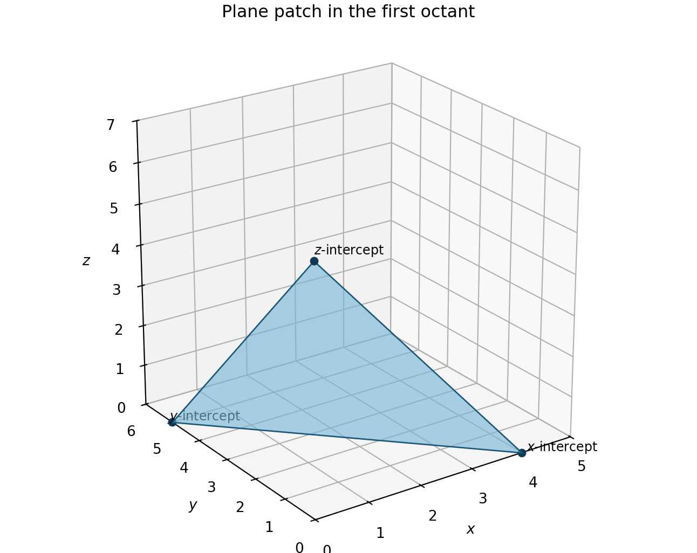
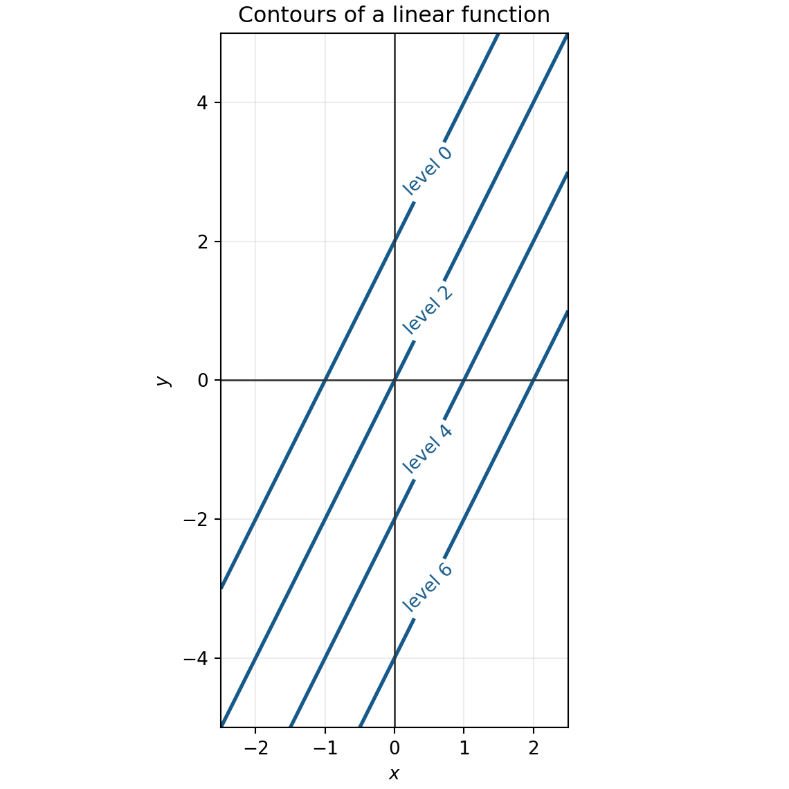
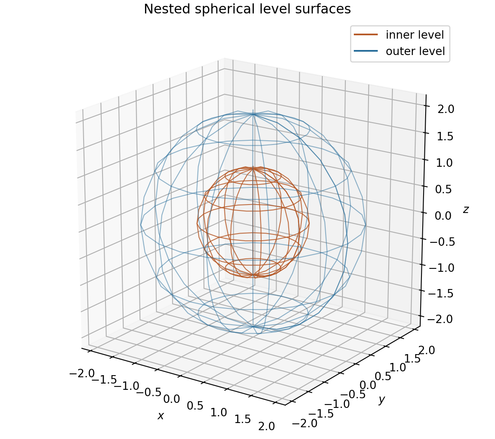
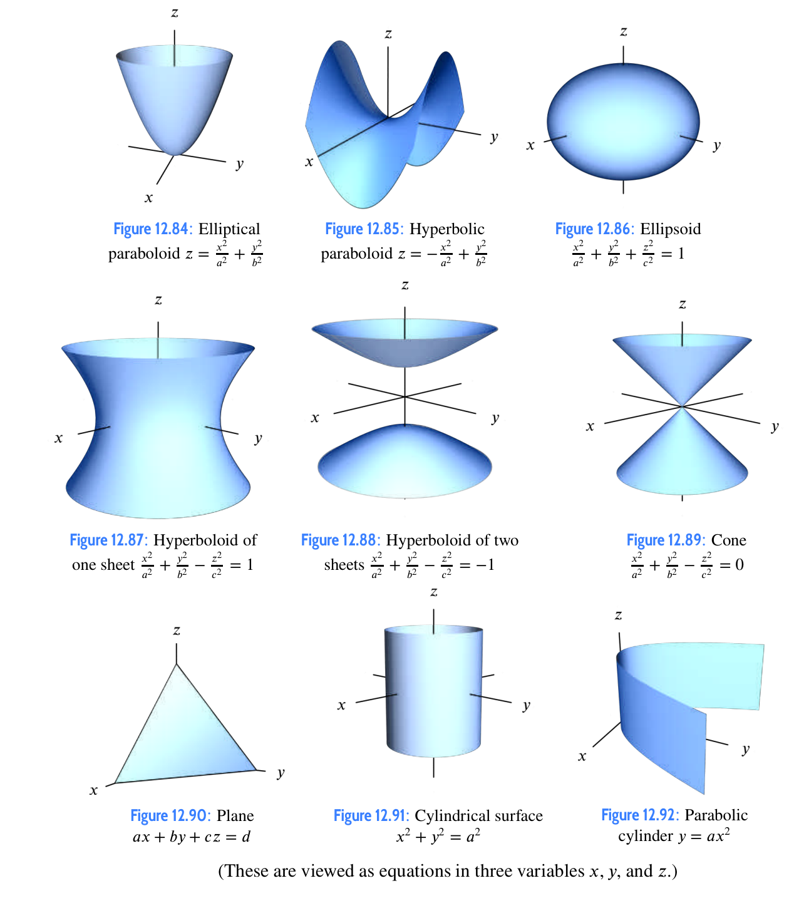

# MAT235 Week 3 Study Notes: Linear Functions and Level Surfaces

These notes teach the mathematical ideas in the Week 3 slides and handwritten lectures, with Sections 12.4–12.5 of the eighth-edition textbook used where needed. Each concept is explained first; its Problem Types then turn the idea into methods for particular questions. The [worked solutions and practice](./Answers-and-Practice.md) are in a separate file.

## Contents

- [Scope, notation, and method selection](#scope-notation-and-method-selection)
- [Concept 1: Linear functions and planes](#concept-1-linear-functions-and-planes) — PT-01, PT-02, PT-03, PT-05
- [Concept 2: Contours of linear functions](#concept-2-contours-of-linear-functions) — PT-04
- [Concept 3: Functions of three variables and level surfaces](#concept-3-functions-of-three-variables-and-level-surfaces) — PT-06, PT-07
- [Concept 4: Geometry of standard surfaces](#concept-4-geometry-of-standard-surfaces) — PT-08
- [Concept 5: When a surface is a graph](#concept-5-when-a-surface-is-a-graph) — PT-09

## Scope, notation, and method selection

The Week 3 [Canvas objectives](https://q.utoronto.ca/courses/454419/pages/week-3-learning-objectives-and-practice-problems) name three tasks in Section 12.4: understand linear functions as planes, recognize linearity graphically or numerically, and identify linear contours. They name four tasks in Section 12.5: use level surfaces to investigate three-variable functions, identify a function from its level surfaces, recognize a catalogue of surfaces, and decide whether a level surface is a two-variable graph.

The [pre-class reading](https://q.utoronto.ca/courses/454419/pages/week-3-pre-class-reading) explicitly assigns the definition and Example 1 on printed p. 726 and the numerical characterization and Example 3 on printed p. 727. Other parts of Sections 12.4–12.5 are used here as **supporting reading** where the weekly slides or suggested exercises need them. Earlier weeks' coordinates, graphs, contours, and traces are recalled briefly where useful.

The coordinate convention throughout is $(x,y)$ for a two-variable input and $(x,y,z)$ for a three-variable input. The output of the latter is written $w=F(x,y,z)$, so its level equation $F(x,y,z)=k$ should not be confused with a graph equation $z=f(x,y)$.

| Given information | First move | Decisive check |
|---|---|---|
| Slopes and a point | Use point-slope plane formula | Substitute the point; verify both slopes |
| Three points | Solve for $c,m,n$ | All three points satisfy the equation; projected points are not collinear |
| Table or graph | Test constant coordinate-direction rates or a plane | Use *all* available entries; finite data do not prove a global law |
| Linear contours | Set $c+mx+ny=k$ | Parallel lines, correct levels and direction of increase |
| Three-variable formula | Set $F(x,y,z)=k$ | Real values, domain, geometry, and how shape changes with $k$ |
| Surface equation | Compare traces and standard forms | Free variables, signs, orientation, and branches |
| Proposed $z=f(x,y)$ graph | Fix $(x,y)$ and count possible $z$ values | Exactly one $z$ for each point in the stated domain |

## Concept 1: Linear functions and planes

**Definition and interpretation.** In this course, a linear function of two variables has the form $f(x,y)=c+mx+ny$. The constant $c$ is its value at the origin when the origin is in the domain. The numbers $m$ and $n$ measure output change per unit $x$ and $y$, respectively, with the other input held fixed. In linear algebra this is often called an *affine* function; these notes use the textbook's terminology.

**Why the graph is a plane.** The graph consists of $(x,y,z)$ satisfying $z=c+mx+ny$, or $-mx-ny+z=c$. This is a plane whose $z$ coefficient is nonzero, so each allowed $(x,y)$ has one height. At fixed $y$, the trace is a line with $x$ slope $m$; at fixed $x$, the trace is a line with $y$ slope $n$. The plane can rise in one direction and fall in the other. If $m=n=0$, it is horizontal.

**Deriving the point-slope form.** Starting at $(x_0,y_0,z_0)$ on the plane, change $x$ by $x-x_0$ while holding $y$ fixed, then change $y$ by $y-y_0$. The output changes add because the rates are constant:

$$
f(x,y)=z_0+m(x-x_0)+n(y-y_0).
$$

Consequently, $c=z_0-mx_0-ny_0$. For nonzero $h$, the finite differences $[f(x+h,y)-f(x,y)]/h=m$ and $[f(x,y+h)-f(x,y)]/h=n$ everywhere in the domain where the comparisons are defined. A constant rate in only one coordinate direction is insufficient: $f(x,y)=3x+y^2$ has constant $x$ rate but is not linear in this course's sense. Slopes also carry output units per input unit.

**Why three points can determine the plane.** Subtracting the equation at one point from the equations at two others gives two equations for $m,n$. Their coefficient pairs are the projected displacement vectors in the $xy$ plane. If those vectors are not parallel, the slopes and then $c$ are unique. If they are parallel, the three heights may be inconsistent with a graph of this form, or many such graphs may fit. The condition concerns the *projected* points, not just whether the three spatial points lie on a plane.

**Data and sketches.** A table can be tested by comparing rates along both coordinate directions. A finite table can contradict a linear model, but agreement at finitely many points cannot establish a global law without an assumption about the function. Intercepts mark where the plane meets the coordinate axes: for an $x$-intercept, set $y=z=0$. Traces mark intersections with coordinate planes: setting $y=0$ leaves the line $z=c+mx$ in the $xz$ plane. These are different slices of the same plane and help check a sketch's direction and scale.

### Problem Type PT-01: Linear functions from slopes and a point

**Classification:** Core

**When to use it.** The problem gives two coordinate-direction slopes and one point on a plane, then asks for the function or a change in output.

**General method.** Read the signed slopes as $m$ and $n$, insert the given point into the point-slope form above, and simplify if a formula $c+mx+ny$ is requested. For a change between two inputs, calculate $\Delta z=m\Delta x+n\Delta y$. Substitute the given point and check each coordinate-direction change; include units when present.

**Teaching example — original question.** A plane is the graph of a linear function $z=f(x,y)$. It passes through $(1,-2,7)$. Increasing $x$ by one unit while holding $y$ fixed increases $z$ by $3$; increasing $y$ by one unit while holding $x$ fixed decreases $z$ by $4$. Find $f(x,y)$ and determine the change in $z$ from $(1,-2)$ to $(4,0)$.

**A complete answer must include.** Identify both signed slopes; use the given point; simplify the formula; calculate the requested change by either substitution or slope contributions; check the point.

**Common mistakes.** Using $z_0$ as the intercept $c$ when $(x_0,y_0)\ne(0,0)$; swapping $m$ and $n$; changing both inputs while interpreting a single coordinate-direction slope; dropping units in an application.

### Problem Type PT-02: A plane through three points

**Classification:** Core

**When to use it.** The problem gives three points and asks for a unique plane written as $z=f(x,y)$; first check that their $xy$ projections are not collinear.

**General method.** For points $P_i=(x_i,y_i,z_i)$, substitute each into $z_i=c+mx_i+ny_i$ and solve for $c,m,n$. Equivalently, subtract the first equation from the other two:

$$
\begin{aligned}
z_2-z_1&=m(x_2-x_1)+n(y_2-y_1),\\
z_3-z_1&=m(x_3-x_1)+n(y_3-y_1).
\end{aligned}
$$

The determinant

$$
D=(x_2-x_1)(y_3-y_1)-(x_3-x_1)(y_2-y_1)
$$

must be nonzero for a unique pair $(m,n)$. Then use $c=z_1-mx_1-ny_1$. If two points share the same $y$, their height difference divided by their $x$ difference gives $m$ directly; an analogous pair gives $n$. This shortcut is valid only when the other coordinate really is fixed.

There is a related geometric method: two displacement vectors in the plane give a normal vector by a cross product, then the normal form $A(x-x_1)+B(y-y_1)+C(z-z_1)=0$ describes the plane. It is the graph of $z=f(x,y)$ when $C\ne0$.

**Teaching example — original question.** Find the equation $z=f(x,y)$ of the plane through $(1,0,2)$, $(0,1,3)$, and $(1,2,7)$. Verify all three points and explain why the resulting formula is unique.

**A complete answer must include.** Set up two independent slope equations or a three-equation system; check the determinant or equivalent noncollinearity condition; solve; substitute all points.

**Common mistakes.** Computing $\Delta z/\Delta x$ from points whose $y$ coordinates differ; assuming any three points yield a unique graph $z=f(x,y)$; checking only two of the three points.

### Problem Type PT-03: Recognizing linearity from data or a graph

**Classification:** Core

**When to use it.** The problem gives a table, formula, or drawing and asks whether a single linear function could explain it. In a table with unequal input spacing, compare rates rather than raw differences.

**General method.** Pick a reference entry $(x_0,y_0,z_0)$. Use a fixed-$y$ pair to propose $m$ and a fixed-$x$ pair to propose $n$. Test every available entry against

$$
z=z_0+m(x-x_0)+n(y-y_0).
$$

One conflicting entry disproves the proposed linear model for the full table. Agreement on a finite table is **consistent with** a linear model, but does not prove an unknown function is linear at every unobserved input. On a graph, a planar surface supports linearity; bends or changing slopes disprove it.

The vanishing rectangular difference $f(x_2,y_2)-f(x_1,y_2)-f(x_2,y_1)+f(x_1,y_1)=0$ is a useful necessary check for linear data. By itself it is not sufficient: $f(x,y)=x^2+y^2$ also has vanishing rectangular differences while its coordinate rates change.

**Teaching example — original question.** A table lists $z=f(x,y)$:

| $y\backslash x$ | $0$ | $1$ | $2$ |
|---|---:|---:|---:|
| $0$ | $1$ | $4$ | $7$ |
| $2$ | $5$ | $8$ | $12$ |

Could all six entries come from one linear function? If not, identify a decisive contradiction and the linear formula that fits the first five entries.

**A complete answer must include.** Compute rates in both coordinate directions; test the proposed formula against every entry; cite the conflicting cell if there is one; distinguish a table fit from a global claim.

**Common mistakes.** Checking only a single row or column; treating equal raw differences across unequal input steps as equal slopes; concluding a global theorem from a finite sample; overlooking one exceptional cell.

### Problem Type PT-05: Sketching a plane with intercepts and traces

**Classification:** Core

**When to use it.** The problem asks for an intercept or trace, or for a sketch of a plane within a specified region such as the first octant.

**General method.** Set the other two coordinates to zero for each axis intercept. The $z$-intercept is $(0,0,c)$. If $m\ne0$, the $x$-intercept solves $0=c+mx$, giving $(-c/m,0,0)$; if $n\ne0$, the $y$-intercept is $(0,-c/n,0)$. If a denominator vanishes, determine whether the plane is parallel to that axis or contains it rather than writing an undefined intercept. For traces, set one coordinate to zero and solve the resulting line. Plot enough points, connect within the stated domain, and label axes and scale. A first-octant restriction keeps $x,y,z\ge0$ and may leave a triangular patch.

*Figure 1. A generic first-octant plane patch with labelled axes. Intercepts are found algebraically before drawing.*

**Teaching example — original question.** Sketch the part of $z=12-3x-2y$ in the first octant. Find and label its three axis intercepts, describe the boundary traces, and state the allowed $(x,y)$ region.

**A complete answer must include.** Solve three intercept equations; identify the first-octant inequalities; label the triangular boundary and axes; check one point on each trace.

**Common mistakes.** Treating $(0,0,c)$ as an $x$-intercept; plotting a plane patch outside the requested octant; using an intercept where the coefficient is zero; drawing a curved surface for a linear formula.

## Concept 2: Contours of linear functions

**Definition and geometry.** A contour of $f(x,y)$ at level $k$ is the set of input points where $f(x,y)=k$. It lies in the $xy$ plane, whereas the graph $z=f(x,y)$ lies in three-dimensional space. Geometrically, intersect the graph with the horizontal plane $z=k$ and project that intersection down to the $xy$ plane. This makes contours a way to read height without drawing the whole graph.

For $f(x,y)=c+mx+ny$, fixing the height gives $mx+ny=k-c$. When $(m,n)\ne(0,0)$, changing $k$ changes only the right-hand side, so all contours are parallel lines. The vector $(m,n)$ is perpendicular to each line because moving by $(\Delta x,\Delta y)$ stays on one contour precisely when $m\Delta x+n\Delta y=0$. Moving in the $(m,n)$ direction increases the output.

**Slope and spacing.** If $n\ne0$, each line has slope $-m/n$. This is the slope of a *contour line*, not an input-direction rate. Two levels separated by $|\Delta k|$ have perpendicular distance $|\Delta k|/\sqrt{m^2+n^2}$ when both axes use the same length scale. Thus equal level steps produce equal geometric spacing for a nonconstant linear function. Unequal gaps between level labels can produce unequal distances even when the function is linear. If $m=n=0$, the level $k=c$ is the whole domain and other levels are empty.

**Derivation of contour spacing via vector projection.** The perpendicular distance formula $d = |\Delta k|/\sqrt{m^2+n^2}$ arises directly from vector projection. The normal vector perpendicular to the parallel contour lines $mx+ny=k_1-c$ and $mx+ny=k_2-c$ is $\vec{n}=(m,n)$, with magnitude $|\vec{n}| = \sqrt{m^2+n^2}$ and unit normal $\vec{u} = (m,n)/\sqrt{m^2+n^2}$. Choose any point $P_1=(x_1,y_1)$ on the level-$k_1$ contour and any point $P_2=(x_2,y_2)$ on the level-$k_2$ contour. The displacement vector connecting them is $\vec{v} = (x_2-x_1, y_2-y_1)$. The perpendicular distance $d$ between the two lines is the absolute value of the scalar projection of $\vec{v}$ onto $\vec{u}$:

$$
d = |\vec{v} \cdot \vec{u}| = \frac{|\vec{v} \cdot \vec{n}|}{|\vec{n}|} = \frac{|(x_2-x_1)m + (y_2-y_1)n|}{\sqrt{m^2+n^2}}
$$

Expanding the numerator gives $|(mx_2+ny_2) - (mx_1+ny_1)|$. Since $P_2$ lies on the level-$k_2$ line, $mx_2+ny_2 = k_2-c$; similarly, $mx_1+ny_1 = k_1-c$. Substituting these values into the numerator yields:

$$
|(k_2-c) - (k_1-c)| = |k_2-k_1| = |\Delta k|
$$

Thus the specific coordinates cancel out completely, establishing $d = |\Delta k|/\sqrt{m^2+n^2}$.

### Problem Type PT-04: Contours of a linear function

**Classification:** Core

**When to use it.** The question gives a linear formula and asks for its contours, or gives labelled parallel contours and asks for slopes, a formula, or a missing level.

**General method.** Set $f(x,y)=k$ and rearrange. If $n\ne0$, write $y=-(m/n)x+(k-c)/n$; if $n=0$ and $m\ne0$, use the vertical line $x=(k-c)/m$. To recover a formula from a labelled map, compare level changes over known horizontal displacements for $m$ and vertical displacements for $n$, then use a labelled point to find $c$. Check the formula against another contour and use the actual level increments when interpreting spacing. If the function is constant, handle the whole-domain or empty-level case separately.

*Figure 2. An example of labelled contours. Read axis displacements and changes in level; the direction of increasing labels is perpendicular to the lines.*

**Teaching example — original question.** Figure 2 shows four contours of a linear function with levels $0,2,4,6$. Recover a possible formula $f(x,y)$, state its two coordinate-direction slopes and direction of increase, and write the equation of the level-$3$ contour.

**A complete answer must include.** Read at least one horizontal and one vertical comparison; use a labelled point for the constant; check the formula on another labelled contour; give the requested intermediate-level line.

**Common mistakes.** Calling the line slope $-m/n$ the $x$-direction rate $m$; assuming negative contour slope means the function decreases in both directions; forgetting the level label when finding $c$; inferring unequal spacing without accounting for unequal level increments.

## Concept 3: Functions of three variables and level surfaces

**Input, output, and level.** A function $w=F(x,y,z)$ assigns a scalar output to each allowed point in three-dimensional space. Its graph would consist of $(x,y,z,w)$ in four-dimensional space. Instead, a level set $F(x,y,z)=k$ shows all spatial inputs with one fixed output. In the weekly examples these sets are often surfaces, but a level may also be a point, a curve, empty, or all of space. Check the equation and domain before calling it a surface.

**How a family represents the function.** One unlabelled surface shows where the function has one unspecified value. A labelled family shows both the geometry and how values change across space. For example, $F(x,y,z)=x^2+y^2+z^2$ has level $k$ given by $x^2+y^2+z^2=k$: spheres of radius $\sqrt{k}$ for $k>0$, the origin for $k=0$, and no real points for $k<0$. Larger labels correspond to positions farther from the origin. The spatial coordinates may be measured in metres while the output has entirely different units.

**Recovering a function from levels.** If every labelled surface has an equation that can be solved for $k$, that expression gives a candidate output formula at each covered point. Substituting the formula back into the family checks it. Labels are essential: applying a strictly increasing function to the output preserves the same unlabelled level surfaces but changes their numeric labels. The level family must also cover the domain on which a recovered formula is claimed.

### Problem Type PT-06: Level surfaces of a three-variable function

**Classification:** Core

**When to use it.** The question supplies a three-variable formula and asks which spatial sets correspond to specified output values, or how those sets change as the value changes.

**General method.** Start from $F(x,y,z)=k$ and rearrange into a recognizable form. Determine which $k$ values give real points and check any physical domain. Look at traces obtained by fixing one coordinate. State the shape, centre or axis, size, and how the family changes as $k$ varies. For instance,

$$
\frac{(x-a)^2}{A^2}+\frac{(y-b)^2}{B^2}+\frac{(z-c)^2}{C^2}=r
$$

gives ellipsoids for $r>0$, one point for $r=0$, and no real points for $r<0$. When $A=B=C$, the positive-level surfaces are spheres. An equation independent of one coordinate extends in that free direction, giving a cylinder. Interpret output units separately from spatial units.

*Figure 3. Several labelled levels can encode how a spatial field changes. The drawn surfaces are schematic rather than data from a source question.*

**Teaching example — original question.** A temperature field is $T(x,y,z)=50-(x-1)^2-4(y+2)^2-z^2$, with position measured in metres and temperature in degrees Celsius. Describe its level sets for $T=50$, $T=46$, and $T=35$; say which levels above $50$ are possible and how temperature changes away from the centre.

**A complete answer must include.** Set $T$ equal to each specified value; determine existence and shape; name the common centre and changing sizes; interpret the direction of temperature change and units.

**Common mistakes.** Calling a single level surface the graph of $T$; ignoring impossible levels; confusing a sphere with an ellipsoid when coefficients differ; interpreting $T$ as a spatial coordinate.

### Problem Type PT-07: Recovering a function from labelled level surfaces

**Classification:** Core

**When to use it.** The problem gives a family of surface equations indexed by output label $k$ and asks for a formula for $F(x,y,z)$.

**General method.** Write the equation of the surface carrying label $k$ and isolate $k$ as an expression in $x,y,z$. That expression is a candidate $F(x,y,z)$. Substitute it back into several labelled surface equations, including boundary or degenerate levels. Check that the candidate gives exactly the advertised label at each point. If only the geometric surfaces are given with no labels, state the resulting nonuniqueness instead of inventing a unique function.

**Teaching example — original question.** For every $k\ge-2$, the surface labelled $k$ is described by $x^2+4y^2+z^2=k+2$. Find a three-variable function whose level-$k$ set is the given surface. Describe what changes if all labels are erased.

**A complete answer must include.** Solve for the label as a function of position; verify the proposed level equation; state the possible output values and what information is lost without labels.

**Common mistakes.** Confusing $k$ with a coordinate; shifting the level value with the wrong sign; claiming the unlabelled family uniquely fixes output values; omitting the degenerate lowest level.

## Concept 4: Geometry of standard surfaces

**From equations to shapes.** A surface in three-dimensional space is a set of points satisfying an equation in $x,y,z$. Its shape depends on which variables occur, the signs of squared terms, and the constant on the other side of the equation. Fixing one coordinate gives a cross-section that can distinguish shapes that look similar in a small sketch. The missing variable in an equation is *free*: the same two-dimensional curve is repeated along that axis, forming a cylinder.

**Orientation and scale.** A squared variable isolated on one side often identifies an axis or opening direction. Completing squares reveals shifts of centres or vertices; dividing by a positive constant reveals the relevant scale. A change of sign can turn ellipses into hyperbolas in cross-sections, while changing the right-hand side from $1$ to $0$ can turn a hyperboloid into a cone. Permuting coordinates rotates the named surface. In the catalogue below, nonzero $a,b,c$ set scales and their absolute values give lengths.

The following representative forms come from the Week 3 slide reference and accompanying textbook discussion. Use their cross-sections as evidence for the names:

| Surface | Representative form | Recognition cue |
|---|---|---|
| Elliptic paraboloid | $z=x^2/a^2+y^2/b^2$ | Elliptical horizontal slices; one vertex; opens in one $z$ direction |
| Hyperbolic paraboloid | $z=x^2/a^2-y^2/b^2$ | Saddle; opposite curvatures in perpendicular vertical traces |
| Ellipsoid | $x^2/a^2+y^2/b^2+z^2/c^2=1$ | Closed and bounded; ellipse traces |
| Hyperboloid of one sheet | $x^2/a^2+y^2/b^2-z^2/c^2=1$ | Connected; horizontal ellipse exists at every $z$ |
| Hyperboloid of two sheets | $z^2/c^2-x^2/a^2-y^2/b^2=1$ | Two disconnected pieces; no points for $|z|<|c|$ |
| Cone | $z^2/c^2=x^2/a^2+y^2/b^2$ | Two nappes meet at a vertex; radii grow linearly with $|z|$ |
| Plane | $Ax+By+Cz=D$ | Flat; if $C\ne0$, solve uniquely for $z$ |
| Cylindrical surface | $x^2/a^2+y^2/b^2=1$ | No $z$ term; the same cross-section repeats along $z$ |
| Parabolic cylinder | $y=ax^2$ | No $z$ term; a parabola extends along $z$ |

*Figure 4. Source excerpt from the textbook's surface catalogue, printed p. 735. Match each drawing to its equation and then verify the orientation with slices.*

The catalogue names a whole surface. Its name alone does not establish whether it is the graph of $z=f(x,y)$; that requires a separate single-height test.

### Problem Type PT-08: Recognizing standard surfaces

**Classification:** Core

**When to use it.** The question gives a surface equation or sketch and asks for its name, orientation, or a labelled sketch.

**General method.** Complete squares and normalize the equation when helpful. Note free variables and the signs of squared terms. Fix the candidate axis variable at several values and identify the resulting cross-sections. Then compare with the catalogue, specifying the axis, centre or vertex, opening direction, and any disconnected pieces. Verify the classification with a diagnostic slice or sample point.

**Teaching example — original question.** Name and sketch the surface in each part, identifying its axis or opening direction and one diagnostic cross-section: (a) $z=3x^2+2y^2$; (b) $z=x^2-y^2$; (c) $x^2/9+y^2/4-z^2=0$; (d) $x^2+y^2-z^2=1$; (e) $z^2-x^2-y^2=1$; (f) $x^2+y^2=9$; (g) $x^2/4+y^2/9+z^2/16=1$.

**A complete answer must include.** Give each name and orientation; show a cross-section that distinguishes it from a visually similar surface; identify any free variable, disconnected sheets, or vertex; label sketches.

**Common mistakes.** Treating a missing variable as zero rather than free; confusing a cone with a one-sheet hyperboloid; calling every quadratic graph a bowl; ignoring a negative squared term; assuming an ellipsoid is always a sphere.

## Concept 5: When a surface is a graph

**The single-height condition.** A graph $z=f(x,y)$ assigns exactly one height to each allowed input pair. Project a surface onto the $xy$ plane to find its potential domain, then imagine a vertical line above each point in that domain. The *whole surface* is a graph precisely when every such line meets it once. This is a statement about the chosen output coordinate: the same surface could be a graph when viewed along a different axis.

For example, a sphere $x^2+y^2+z^2=R^2$ projects to $x^2+y^2\le R^2$ and gives $z=\pm\sqrt{R^2-x^2-y^2}$. Interior inputs have two heights, so the whole sphere is not one graph. The upper and lower hemispheres are each graphs on the disk; at its boundary they meet at one height. A plane $Ax+By+Cz=D$ is a graph over the $xy$ plane when $C\ne0$. If $C=0$, each projected point on the plane's line has every height, so it fails the test. Likewise, a surface equation independent of $z$ describes unrestricted heights above its allowed $(x,y)$ points.

**Connection to level surfaces.** A level equation $F(x,y,z)=k$ selects a spatial subset; it does not automatically define $z$ as a single-valued output. Restrictions such as $z\ge0$ may select one branch, but the domain must still include exactly the input pairs for which that branch exists.

### Problem Type PT-09: Is a level surface a graph

**Classification:** Core

**When to use it.** The question asks whether a whole surface can be written as $z=f(x,y)$, or whether a restriction makes one branch into such a graph.

**General method.** Solve the equation for every real $z$ after fixing $(x,y)$. Determine the projected domain, count the possible heights at each input, and exhibit a two-height input if the whole surface fails. For a restricted branch, give its formula and domain, then check that the restriction selects one height throughout.

**Teaching example — original question.** Consider $x^2+y^2+(z-1)^2=9$. Decide whether the whole surface is the graph of $z=f(x,y)$. Determine its projection onto the $xy$ plane. Then restrict to $z\ge1$ and give the formula and domain of the resulting graph.

**A complete answer must include.** Solve for all real heights; state the projected domain; exhibit an $(x,y)$ with more than one height if the whole surface fails; apply the restriction and check uniqueness.

**Common mistakes.** Choosing a square-root sign without explaining why; forgetting the domain under a square root; claiming that a surface with two branches is globally a graph because each branch separately is one; applying a test in the wrong viewing direction.
