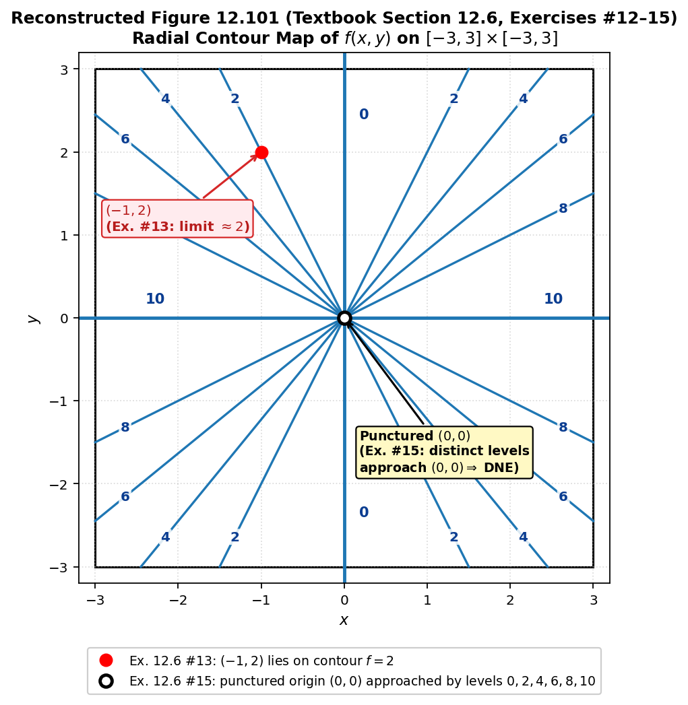

# MAT235 Week 4 Answers and Practice: Limits and Continuity, Displacement Vectors, and Vectors in General

## Contents

- [A. Problem Type Teaching-Example Solutions](#a-problem-type-teaching-example-solutions)
  - [Problem Type PT-01: Evaluating Multivariable Limits by Direct Substitution or Algebraic Simplification](#problem-type-pt-01-evaluating-multivariable-limits-by-direct-substitution-or-algebraic-simplification)
  - [Problem Type PT-02: Estimating or Diagnosing Multivariable Limits from Graphs, Contours, and Tables](#problem-type-pt-02-estimating-or-diagnosing-multivariable-limits-from-graphs-contours-and-tables)
  - [Problem Type PT-03: Proving a Multivariable Limit Does Not Exist Using the Two-Path Test](#problem-type-pt-03-proving-a-multivariable-limit-does-not-exist-using-the-two-path-test)
  - [Problem Type PT-04: Proving a Multivariable Limit Exists Using the Squeeze Theorem and Bounding Inequalities](#problem-type-pt-04-proving-a-multivariable-limit-exists-using-the-squeeze-theorem-and-bounding-inequalities)
  - [Problem Type PT-05: Determining the Maximal Continuity Set of a Function or Testing Continuity on a Region](#problem-type-pt-05-determining-the-maximal-continuity-set-of-a-function-or-testing-continuity-on-a-region)
  - [Problem Type PT-06: Analyzing Piecewise Continuity and Finding Parameters for Continuity](#problem-type-pt-06-analyzing-piecewise-continuity-and-finding-parameters-for-continuity)
  - [Problem Type PT-07: Sketching Geometric Vector Combinations and Resolving Vectors from Diagrams or Coordinates](#problem-type-pt-07-sketching-geometric-vector-combinations-and-resolving-vectors-from-diagrams-or-coordinates)
  - [Problem Type PT-08: Performing Componentwise Linear Combinations of Vectors](#problem-type-pt-08-performing-componentwise-linear-combinations-of-vectors)
  - [Problem Type PT-09: Computing Vector Magnitudes, Unit Vectors, and Vectors of Prescribed Length](#problem-type-pt-09-computing-vector-magnitudes-unit-vectors-and-vectors-of-prescribed-length)
  - [Problem Type PT-10: Testing Whether Vectors Are Parallel and Solving for Collinearity Parameters](#problem-type-pt-10-testing-whether-vectors-are-parallel-and-solving-for-collinearity-parameters)
  - [Problem Type PT-11: Classifying Scalar vs. Vector Quantities and Comparing Physical Magnitudes](#problem-type-pt-11-classifying-scalar-vs-vector-quantities-and-comparing-physical-magnitudes)
  - [Problem Type PT-12: Solving Relative Velocity, Navigation, and Static Force Equilibrium Problems](#problem-type-pt-12-solving-relative-velocity-navigation-and-static-force-equilibrium-problems)
  - [Problem Type PT-13: Justifying Vector Algebraic Identities Geometrically and Modeling Multi-Component Data in n Dimensions](#problem-type-pt-13-justifying-vector-algebraic-identities-geometrically-and-modeling-multi-component-data-in-n-dimensions)
- [B. Source Questions and Solutions](#b-source-questions-and-solutions)
- [C. Requested Textbook / Reference Exercises and Solutions](#c-requested-textbook--reference-exercises-and-solutions)
- [F. Coverage and Unresolved-Items Appendix](#f-coverage-and-unresolved-items-appendix)

---

## A. Problem Type Teaching-Example Solutions

### Problem Type PT-01: Evaluating Multivariable Limits by Direct Substitution or Algebraic Simplification

**Question reference:** [Study-Notes.md — PT-01 Teaching Example](Study-Notes.md#problem-type-pt-01-evaluating-multivariable-limits-by-direct-substitution-or-algebraic-simplification)

**Worked solution.**

1. **Part 1:** Evaluate $\displaystyle \lim_{(x,y) \to (1, -1)} \frac{e^{x+y} + x^2 y}{x^2 + y^2 + \cos(x+y)}$.
   - **Step 1 (Continuity check):** The numerator $e^{x+y} + x^2 y$ is the sum of a composite exponential function $e^{x+y}$ and a polynomial $x^2 y$, both of which are continuous everywhere on $\mathbb{R}^2$. The denominator $x^2 + y^2 + \cos(x+y)$ is the sum of a polynomial and a composite cosine function, also continuous everywhere on $\mathbb{R}^2$.
   - **Step 2 (Denominator check at $(1,-1)$):** At $(x,y) = (1, -1)$, we have $x + y = 1 + (-1) = 0$, so the denominator equals

     $$1^2 + (-1)^2 + \cos(0) = 1 + 1 + 1 = 3 \neq 0.$$

   - **Step 3 (Direct substitution):** Because the quotient of two continuous functions is continuous wherever the denominator is nonzero, we substitute $(x,y) = (1, -1)$ directly:

     $$\lim_{(x,y) \to (1, -1)} \frac{e^{x+y} + x^2 y}{x^2 + y^2 + \cos(x+y)} = \frac{e^{1 + (-1)} + 1^2(-1)}{1^2 + (-1)^2 + \cos(1 - 1)} = \frac{e^0 - 1}{1 + 1 + 1} = \frac{1 - 1}{3} = 0.$$

2. **Part 2:** Evaluate $\displaystyle \lim_{(x,y) \to (0, 0)} \frac{5x^2 + 2y^2}{\sqrt{5x^2 + 2y^2 + 9} - 3}$.
   - **Step 1 (Indeterminate form check):** Substituting $(x,y) = (0,0)$ gives $\frac{0}{\sqrt{9} - 3} = \frac{0}{0}$, so direct substitution is undefined.
   - **Step 2 (Conjugate rationalization for $(x,y) \neq (0,0)$):** Let $U(x,y) = 5x^2 + 2y^2$. For all $(x,y) \neq (0,0)$, we have $U(x,y) > 0$. Multiply the numerator and denominator by the conjugate $\sqrt{5x^2 + 2y^2 + 9} + 3$:

     $$\frac{5x^2 + 2y^2}{\sqrt{5x^2 + 2y^2 + 9} - 3} = \frac{(5x^2 + 2y^2)\left(\sqrt{5x^2 + 2y^2 + 9} + 3\right)}{\left(\sqrt{5x^2 + 2y^2 + 9} - 3\right)\left(\sqrt{5x^2 + 2y^2 + 9} + 3\right)}.$$

     By the difference of squares, the denominator simplifies to

     $$\left(\sqrt{5x^2 + 2y^2 + 9}\right)^2 - 3^2 = (5x^2 + 2y^2 + 9) - 9 = 5x^2 + 2y^2.$$

   - **Step 3 (Cancel nonzero common factor and evaluate limit):** Since $5x^2 + 2y^2 \neq 0$ for $(x,y) \neq (0,0)$, canceling $5x^2 + 2y^2$ yields

     $$\lim_{(x,y) \to (0,0)} \frac{5x^2 + 2y^2}{\sqrt{5x^2 + 2y^2 + 9} - 3} = \lim_{(x,y) \to (0,0)} \left(\sqrt{5x^2 + 2y^2 + 9} + 3\right) = \sqrt{0 + 0 + 9} + 3 = 3 + 3 = 6.$$

   - **Numerical verification:** At $(x,y) = (0.01, 0)$, $5x^2 + 2y^2 = 0.0005$, and $\frac{0.0005}{\sqrt{9.0005} - 3} \approx \frac{0.0005}{3.000083332 - 3} \approx 6.000083$, confirming the limit $6$.

**Answer.**
1. $\displaystyle \lim_{(x,y) \to (1, -1)} \frac{e^{x+y} + x^2 y}{x^2 + y^2 + \cos(x+y)} = 0$.
2. $\displaystyle \lim_{(x,y) \to (0, 0)} \frac{5x^2 + 2y^2}{\sqrt{5x^2 + 2y^2 + 9} - 3} = 6$.

---

### Problem Type PT-02: Estimating or Diagnosing Multivariable Limits from Graphs, Contours, and Tables

**Question reference:** [Study-Notes.md — PT-02 Teaching Example](Study-Notes.md#problem-type-pt-02-estimating-or-diagnosing-multivariable-limits-from-graphs-contours-and-tables)

**Worked solution.**

1. **Part 1: Estimate $\lim_{(x,y)\to(2, -2)} f(x,y)$.**
   - **Step 1 (Locate the target point):** The point $(x,y) = (2, -2)$ lies in the fourth quadrant on the line $y = -x$ at distance $\sqrt{2^2 + (-2)^2} = 2\sqrt{2} > 0$ away from the origin.
   - **Step 2 (Inspect local contour behavior):** Along the ray $y = -x$ ($x \neq 0$), the function lies on the contour $f(x,y) = 3$. Because the radial contours vary smoothly away from the origin, all points $(x,y)$ in a small disk around $(2, -2)$ lie on contours whose levels are arbitrarily close to $3$.
   - **Step 3 (Estimate):** Therefore, the contour diagram suggests $\lim_{(x,y)\to(2,-2)} f(x,y) \approx 3$.

2. **Part 2: Explain why $\lim_{(x,y)\to(0,0)} f(x,y)$ does not exist.**
   - **Step 1 (Inspect contours near the punctured origin $(0,0)$):** Every radial contour ray extends arbitrarily close to the origin $(0,0)$ (their closures meet at the punctured point $(0,0)$, even though a single-valued function can take at most one value at any domain point).
   - **Step 2 (Compare values along distinct rays arbitrarily close to $(0,0)$):** Within any arbitrarily small punctured disk $0 < \sqrt{x^2 + y^2} < \delta$:
     - Along the $x$-axis ($y = 0, x \neq 0$), $f(x,0) = 0$;
     - Along the diagonal lines $y = \pm x$ ($x \neq 0$), $f(x, \pm x) = 3$;
     - Along the $y$-axis ($x = 0, y \neq 0$), $f(0,y) = 6$.
   - **Step 3 (Conclusion):** Because points arbitrarily close to $(0,0)$ produce different function values ($0, 3, 6$) depending on the direction of approach, $f(x,y)$ does not approach a single number as $(x,y) \to (0,0)$, so $\lim_{(x,y)\to(0,0)} f(x,y)$ **does not exist**.

**Answer.**
1. $\displaystyle \lim_{(x,y)\to(2, -2)} f(x,y) \approx 3$.
2. $\displaystyle \lim_{(x,y)\to(0, 0)} f(x,y)$ **does not exist** because distinct contour levels ($0$, $3$, and $6$) extend arbitrarily close to the punctured origin $(0,0)$, giving different one-variable limits along different rays.

---

### Problem Type PT-03: Proving a Multivariable Limit Does Not Exist Using the Two-Path Test

**Question reference:** [Study-Notes.md — PT-03 Teaching Example](Study-Notes.md#problem-type-pt-03-proving-a-multivariable-limit-does-not-exist-using-the-two-path-test)

**Worked solution.**

1. **Part 1: Limits along the coordinate axes and straight lines $y = mx$.**
   - **Along the $x$-axis ($y = 0, x \neq 0$):**

     $$f(x, 0) = \frac{3x^3(0)}{x^6 + 2(0)^2} = \frac{0}{x^6} = 0 \implies \lim_{x \to 0} f(x, 0) = 0.$$

   - **Along the $y$-axis ($x = 0, y \neq 0$):**

     $$f(0, y) = \frac{3(0)^3 y}{0^6 + 2y^2} = \frac{0}{2y^2} = 0 \implies \lim_{y \to 0} f(0, y) = 0.$$

   - **Along any straight line $y = mx$ ($m \neq 0, x \neq 0$):**

     $$f(x, mx) = \frac{3x^3(mx)}{x^6 + 2(mx)^2} = \frac{3mx^4}{x^2(x^4 + 2m^2)} = \frac{3mx^2}{x^4 + 2m^2}.$$

     Taking the limit as $x \to 0$ (since $2m^2 \neq 0$):

     $$\lim_{x \to 0} f(x, mx) = \frac{3m(0)^2}{0^4 + 2m^2} = \frac{0}{2m^2} = 0.$$

2. **Part 2: Does this prove the limit exists?**
   - **No.** We can **never** prove that a multivariable limit exists by checking only straight-line paths $y = mx$. A two-variable limit exists only if $f(x,y)$ approaches the same value along **all** possible paths (including curved paths) approaching $(0,0)$. What Part 1 shows is only conditional: *if* $\lim_{(x,y)\to(0,0)} f(x,y)$ exists, it would have to equal $0$.

3. **Part 3: Degree-balancing curved path $y = x^p$ and conclusion.**
   - **Step 1 (Choose $p$ to balance degrees):** In the denominator $x^6 + 2y^2$, the $x$-term has degree $6$ and the $y$-term has degree $2$. To make $y^2$ match the degree of $x^6$, we set $y^2 = (x^p)^2 = x^6 \implies p = 3$, giving the cubic path $y = x^3$ (which passes through $(0,0)$).
   - **Step 2 (Evaluate along $y = x^3$ for $x \neq 0$):**

     $$f(x, x^3) = \frac{3x^3(x^3)}{x^6 + 2(x^3)^2} = \frac{3x^6}{x^6 + 2x^6} = \frac{3x^6}{3x^6} = 1.$$

     Therefore,

     $$\lim_{x \to 0} f(x, x^3) = \lim_{x \to 0} 1 = 1.$$

   - **Step 3 (Two-Path conclusion):** Since approaching $(0,0)$ along the $x$-axis ($y = 0$) gives $0$, whereas approaching $(0,0)$ along the curve $y = x^3$ gives $1 \neq 0$, the two-variable limit $\lim_{(x,y)\to(0,0)} f(x,y)$ **does not exist**.

**Answer.**
1. Along $y = 0$, $x = 0$, and every straight line $y = mx$ ($m \neq 0$), the one-variable limit is $0$.
2. **No**; agreement along all straight lines $y = mx$ is not sufficient to prove that a multivariable limit exists because curved paths may yield a different limit.
3. Along the cubic curve $y = x^3$, $\lim_{x \to 0} f(x, x^3) = 1 \neq 0$. Therefore, $\lim_{(x,y)\to(0,0)} \frac{3x^3 y}{x^6 + 2y^2}$ **does not exist**.

---

### Problem Type PT-04: Proving a Multivariable Limit Exists Using the Squeeze Theorem and Bounding Inequalities

**Question reference:** [Study-Notes.md — PT-04 Teaching Example](Study-Notes.md#problem-type-pt-04-proving-a-multivariable-limit-exists-using-the-squeeze-theorem-and-bounding-inequalities)

**Worked solution.**

1. **Part 1:** Evaluate $\displaystyle \lim_{(x,y) \to (0,0)} (x^2 + 3y^4) \cos\left(\frac{1}{x^2 + y^2}\right)$.
   - **Step 1 (Establish the bounding inequality):** For every $(x,y) \neq (0,0)$, the argument $\frac{1}{x^2+y^2}$ is a well-defined real number, so the cosine function satisfies

     $$\left|\cos\left(\frac{1}{x^2 + y^2}\right)\right| \leq 1.$$

     Since $x^2 + 3y^4 \geq 0$ for all $(x,y) \in \mathbb{R}^2$, multiplying by $x^2 + 3y^4$ preserves the inequality:

     $$0 \leq \left|(x^2 + 3y^4) \cos\left(\frac{1}{x^2 + y^2}\right) - 0\right| = (x^2 + 3y^4)\left|\cos\left(\frac{1}{x^2 + y^2}\right)\right| \leq x^2 + 3y^4,$$

     or equivalently,

     $$-(x^2 + 3y^4) \leq (x^2 + 3y^4) \cos\left(\frac{1}{x^2 + y^2}\right) \leq x^2 + 3y^4 \qquad \text{for all } (x,y) \neq (0,0).$$

   - **Step 2 (Limit of the bounding functions):** Because $\pm(x^2 + 3y^4)$ are polynomials, they are continuous everywhere, so

     $$\lim_{(x,y) \to (0,0)} (x^2 + 3y^4) = 0^2 + 3(0)^4 = 0 \qquad \text{and} \qquad \lim_{(x,y) \to (0,0)} -(x^2 + 3y^4) = 0.$$

   - **Step 3 (Squeeze Theorem conclusion):** By the Squeeze Theorem, $\lim_{(x,y)\to(0,0)} (x^2 + 3y^4)\cos\left(\frac{1}{x^2+y^2}\right) = 0$.

2. **Part 2:** Evaluate $\displaystyle \lim_{(x,y) \to (0,0)} \frac{x^2 \sin y}{x^2 + y^2}$.
   - **Step 1 (Establish the bounding inequality):** For all $(x,y) \neq (0,0)$, since $x^2 \geq 0$ and $y^2 \geq 0$, we have $0 \leq x^2 \leq x^2 + y^2$, which gives

     $$0 \leq \frac{x^2}{x^2 + y^2} \leq 1.$$

     Multiplying by $|\sin y| \geq 0$ yields

     $$0 \leq \left|\frac{x^2 \sin y}{x^2 + y^2} - 0\right| = \frac{x^2}{x^2 + y^2}|\sin y| \leq |\sin y| \qquad \text{for all } (x,y) \neq (0,0),$$

     or equivalently $-|\sin y| \leq \frac{x^2 \sin y}{x^2 + y^2} \leq |\sin y|$.
   - **Step 2 (Limit of the bounding function):** By continuity of $\sin y$ and the absolute value function at $y = 0$,

     $$\lim_{(x,y) \to (0,0)} |\sin y| = |\sin 0| = 0.$$

   - **Step 3 (Squeeze Theorem conclusion):** By the Squeeze Theorem, $\lim_{(x,y)\to(0,0)} \frac{x^2 \sin y}{x^2 + y^2} = 0$.

**Answer.**
1. $\displaystyle \lim_{(x,y) \to (0,0)} (x^2 + 3y^4) \cos\left(\frac{1}{x^2 + y^2}\right) = 0$.
2. $\displaystyle \lim_{(x,y) \to (0,0)} \frac{x^2 \sin y}{x^2 + y^2} = 0$.

---

### Problem Type PT-05: Determining the Maximal Continuity Set of a Function or Testing Continuity on a Region

**Question reference:** [Study-Notes.md — PT-05 Teaching Example](Study-Notes.md#problem-type-pt-05-determining-the-maximal-continuity-set-of-a-function-or-testing-continuity-on-a-region)

**Worked solution.**

1. **Part 1:** Maximal continuity set of $f(x,y) = \frac{\ln(4 - x^2 - y^2)}{x - 2y}$.
   - **Step 1 (Identify elementary building blocks):** The numerator $\ln(4 - x^2 - y^2)$ is the composition of the natural logarithm $\ln u$ with the polynomial $u(x,y) = 4 - x^2 - y^2$. Since $\ln u$ is continuous for $u > 0$, the numerator is continuous wherever

     $$4 - x^2 - y^2 > 0 \iff x^2 + y^2 < 4.$$

   - **Step 2 (Denominator restriction):** The denominator $x - 2y$ is a linear polynomial (continuous everywhere). For the quotient to be continuous, the denominator must be nonzero:

     $$x - 2y \neq 0 \iff x \neq 2y.$$

   - **Step 3 (Combine constraints and describe geometrically):** The function $f(x,y)$ is continuous on the set

     $$\left\{(x,y) \in \mathbb{R}^2 : x^2 + y^2 < 4 \text{ and } x \neq 2y\right\},$$

     which is the **open disk of radius $2$ centered at the origin, excluding all points on the diameter line $y = \frac{1}{2}x$**.

2. **Part 2:** Is $g(x,y) = \tan(x + y)$ continuous at all points in the square $R = [-1, 1] \times [-1, 1]$?
   - **Step 1 (Find the discontinuity set of $\tan(x+y)$):** Since $\tan u = \frac{\sin u}{\cos u}$ is continuous wherever $\cos u \neq 0$, $g(x,y)$ fails to be continuous whenever

     $$x + y = \frac{\pi}{2} + k\pi, \qquad k \in \mathbb{Z}.$$

   - **Step 2 (Check whether any singular line intersects $R = [-1, 1] \times [-1, 1]$):** On the square $-1 \leq x \leq 1, -1 \leq y \leq 1$, the sum $x + y$ ranges over the interval $[-2, 2]$. Since $\frac{\pi}{2} \approx 1.5708 \in [-2, 2]$ (and $-\frac{\pi}{2} \approx -1.5708 \in [-2, 2]$), the singular lines $x + y = \pm \frac{\pi}{2}$ pass directly through the square!
   - **Step 3 (Exhibit an explicit counterexample point in $R$):** Take $x = 1 \in [-1, 1]$ and $y = \frac{\pi}{2} - 1 \approx 0.5708 \in [-1, 1]$. Then $(1, \frac{\pi}{2} - 1) \in R$, and at this point $x + y = \frac{\pi}{2}$, where $\tan(x+y)$ is undefined and discontinuous.
   - **Conclusion:** $g(x,y) = \tan(x+y)$ is **not continuous** at all points in the square $[-1, 1] \times [-1, 1]$.

**Answer.**
1. $f(x,y)$ is continuous on $\{(x,y) \in \mathbb{R}^2 : x^2 + y^2 < 4 \text{ and } x \neq 2y\}$ (the open disk of radius $2$ centered at $(0,0)$ with the line $x = 2y$ removed).
2. **Not continuous** at all points in the square $-1 \leq x \leq 1, -1 \leq y \leq 1$, because $x + y = \pm \frac{\pi}{2} \approx \pm 1.5708$ intersects the square (for example, at $(1, \frac{\pi}{2}-1) \in [-1,1]^2$).

---

### Problem Type PT-06: Analyzing Piecewise Continuity and Finding Parameters for Continuity

**Question reference:** [Study-Notes.md — PT-06 Teaching Example](Study-Notes.md#problem-type-pt-06-analyzing-piecewise-continuity-and-finding-parameters-for-continuity)

**Worked solution.**

1. **Part 1:** Find $c$ making $f(x,y) = \begin{cases} \frac{\cos(x - y) + e^{2x+y}}{x^2 + y^2 + 4}, & (x,y) \neq (0,0), \\ c, & (x,y) = (0,0) \end{cases}$ continuous at $(0,0)$.
   - **Step 1 (Continuity condition):** By definition, $f$ is continuous at $(0,0)$ if and only if $c = f(0,0) = \lim_{(x,y)\to(0,0)} f(x,y)$.
   - **Step 2 (Evaluate the limit as $(x,y) \to (0,0)$):** For $(x,y) \neq (0,0)$, the numerator $\cos(x-y) + e^{2x+y}$ and denominator $x^2 + y^2 + 4$ are continuous everywhere, and at $(0,0)$ the denominator equals $0^2 + 0^2 + 4 = 4 \neq 0$. By direct substitution ([PT-01](#problem-type-pt-01-evaluating-multivariable-limits-by-direct-substitution-or-algebraic-simplification)):

     $$\lim_{(x,y) \to (0,0)} \frac{\cos(x - y) + e^{2x+y}}{x^2 + y^2 + 4} = \frac{\cos(0) + e^0}{0 + 0 + 4} = \frac{1 + 1}{4} = \frac{2}{4} = \frac{1}{2}.$$

   - **Step 3 (Solve for $c$):** Setting $c = \frac{1}{2}$ makes $f$ continuous at $(0,0)$.

2. **Part 2:** Determine whether a constant $c$ makes $h(x,y) = \begin{cases} 2x + cy, & x \leq 1, \\ 4 + y, & x > 1 \end{cases}$ continuous everywhere on $\mathbb{R}^2$.
   - **Step 1 (Continuity off the boundary line):** On the open half-planes $x < 1$ and $x > 1$, $h(x,y)$ is given by linear polynomials $2x + cy$ and $4 + y$, which are continuous everywhere on their respective open half-planes.
   - **Step 2 (Matching condition along the entire line $x = 1$):** For $h(x,y)$ to be continuous at every point $(1, y)$ on the vertical boundary line $x = 1$, the limit as $(u,v) \to (1, y)$ from $u \leq 1$ must equal the limit from $u > 1$ **for every $y \in \mathbb{R}$**:

     $$\lim_{\substack{(u,v) \to (1,y) \\ u \leq 1}} (2u + cv) = 2(1) + cy = 2 + cy, \qquad \lim_{\substack{(u,v) \to (1,y) \\ u > 1}} (4 + v) = 4 + y.$$

     Equating the two limits requires

     $$2 + cy = 4 + y \implies (c - 1)y = 2 \qquad \text{for all } y \in \mathbb{R}.$$

   - **Step 3 (Analyze existence of a constant $c$):** At $y = 0$, the equation $(c - 1)(0) = 2$ becomes $0 = 2$, which is impossible for any constant $c$! (Equivalently, for $y \neq 0$, $c = 1 + \frac{2}{y}$, which varies with $y$ rather than being a constant.) Therefore, **no** such constant $c$ exists.

**Answer.**
1. $c = \frac{1}{2}$.
2. **No** value of the constant $c$ makes $h(x,y)$ continuous everywhere, because continuity across the boundary line $x = 1$ requires $2 + cy = 4 + y$ for all $y \in \mathbb{R}$, which has no constant solution $c$ (and fails outright at $(1,0)$ where $2 \neq 4$).

---

### Problem Type PT-07: Sketching Geometric Vector Combinations and Resolving Vectors from Diagrams or Coordinates

**Question reference:** [Study-Notes.md — PT-07 Teaching Example](Study-Notes.md#problem-type-pt-07-sketching-geometric-vector-combinations-and-resolving-vectors-from-diagrams-or-coordinates)

**Worked solution.**

1. **Part 1: 3D rectangular box combinations with $\vec{a} = 2\vec{i}$, $\vec{b} = 4\vec{j}$, $\vec{c} = 3\vec{k}$.**
   - **Face diagonal $\vec{a} + \vec{b}$:** Starting at the origin $O(0,0,0)$, moving along $\vec{a}$ reaches $(2, 0, 0)$, and then moving parallel to $\vec{b}$ ($4$ units in the $+y$-direction) reaches the bottom-face corner $(2, 4, 0)$. Thus $\vec{a} + \vec{b}$ has tail at $(0,0,0)$, tip at $(2,4,0)$, and component form $\vec{a} + \vec{b} = 2\vec{i} + 4\vec{j}$.
   - **Space diagonal $\vec{a} + \vec{b} + \vec{c}$:** Starting from the tip $(2,4,0)$ of $\vec{a} + \vec{b}$ and moving parallel to $\vec{c}$ ($3$ units in the $+z$-direction) reaches the opposite box corner $(2, 4, 3)$. Thus $\vec{a} + \vec{b} + \vec{c}$ has tail at $(0,0,0)$, tip at $(2,4,3)$, and component form $\vec{a} + \vec{b} + \vec{c} = 2\vec{i} + 4\vec{j} + 3\vec{k}$.
   - **Difference $\vec{b} - \vec{a}$:** Since $\vec{a}$ (tip at $(2,0,0)$) and $\vec{b}$ (tip at $(0,4,0)$) share their tail at $(0,0,0)$, the difference vector $\vec{b} - \vec{a}$ is the bottom-face diagonal drawn with its **tail at the tip of $\vec{a}$**, $(2,0,0)$, and its **tip at the tip of $\vec{b}$**, $(0,4,0)$ (so that $\vec{a} + (\vec{b} - \vec{a}) = \vec{b}$). Its component form is $\vec{b} - \vec{a} = -2\vec{i} + 4\vec{j}$.

2. **Part 2: Displacement vector from $A = (5, -2, 7)$ to $B = (1, 4, -3)$.**
   - **Step 1 (Identify tail and tip):** The vector starts at tail $A = (5, -2, 7)$ and ends at tip $B = (1, 4, -3)$.
   - **Step 2 (Apply Tip minus Tail):**

     $$\overrightarrow{AB} = (1 - 5)\vec{i} + \big(4 - (-2)\big)\vec{j} + (-3 - 7)\vec{k} = -4\vec{i} + 6\vec{j} - 10\vec{k}.$$

   - **Check:** Adding the displacement $(-4, 6, -10)$ to the starting point $A(5, -2, 7)$ gives $(5 - 4, -2 + 6, 7 - 10) = (1, 4, -3) = B$.

**Answer.**
1. $\vec{a} + \vec{b} = 2\vec{i} + 4\vec{j}$ (tail $(0,0,0)$, tip $(2,4,0)$); $\vec{a} + \vec{b} + \vec{c} = 2\vec{i} + 4\vec{j} + 3\vec{k}$ (tail $(0,0,0)$, tip $(2,4,3)$); $\vec{b} - \vec{a} = -2\vec{i} + 4\vec{j}$ (tail at tip of $\vec{a}$, $(2,0,0)$, and tip at tip of $\vec{b}$, $(0,4,0)$).
2. $\overrightarrow{AB} = -4\vec{i} + 6\vec{j} - 10\vec{k}$.

---

### Problem Type PT-08: Performing Componentwise Linear Combinations of Vectors

**Question reference:** [Study-Notes.md — PT-08 Teaching Example](Study-Notes.md#problem-type-pt-08-performing-componentwise-linear-combinations-of-vectors)

**Worked solution.**

- **Step 1 (Write each vector with explicit $0$ placeholders for missing components):**

  $$\vec{u} = 3\vec{i} + 0\vec{j} - 2\vec{k}, \qquad \vec{v} = -2\vec{i} + 5\vec{j} + 1\vec{k}, \qquad \vec{w} = 4\vec{i} - 3\vec{j} + 0\vec{k}.$$

- **Step 2 (Compute each scalar multiple):**

  $$2\vec{u} = 2(3\vec{i} + 0\vec{j} - 2\vec{k}) = 6\vec{i} + 0\vec{j} - 4\vec{k},$$

  $$-3\vec{v} = -3(-2\vec{i} + 5\vec{j} + 1\vec{k}) = 6\vec{i} - 15\vec{j} - 3\vec{k},$$

  $$0.5\vec{w} = 0.5(4\vec{i} - 3\vec{j} + 0\vec{k}) = 2\vec{i} - 1.5\vec{j} + 0\vec{k}.$$

- **Step 3 (Sum corresponding components):**

  $$2\vec{u} - 3\vec{v} + 0.5\vec{w} = (6 + 6 + 2)\vec{i} + (0 - 15 - 1.5)\vec{j} + (-4 - 3 + 0)\vec{k} = 14\vec{i} - 16.5\vec{j} - 7\vec{k}.$$

**Answer.**

$$2\vec{u} - 3\vec{v} + 0.5\vec{w} = 14\vec{i} - 16.5\vec{j} - 7\vec{k} \quad \left(\text{or } 14\vec{i} - \frac{33}{2}\vec{j} - 7\vec{k}\right).$$

---

### Problem Type PT-09: Computing Vector Magnitudes, Unit Vectors, and Vectors of Prescribed Length

**Question reference:** [Study-Notes.md — PT-09 Teaching Example](Study-Notes.md#problem-type-pt-09-computing-vector-magnitudes-unit-vectors-and-vectors-of-prescribed-length)

**Worked solution.**

1. **Part 1: Displacement vector $\overrightarrow{PQ}$ and distance between $P(2, -1, 3)$ and $Q(4, 2, -3)$.**
   - **Displacement vector (Tip minus Tail):**

     $$\overrightarrow{PQ} = (4 - 2)\vec{i} + \big(2 - (-1)\big)\vec{j} + (-3 - 3)\vec{k} = 2\vec{i} + 3\vec{j} - 6\vec{k}.$$

   - **Distance $\|\overrightarrow{PQ}\|$:**

     $$\|\overrightarrow{PQ}\| = \sqrt{2^2 + 3^2 + (-6)^2} = \sqrt{4 + 9 + 36} = \sqrt{49} = 7.$$

2. **Part 2: Unit vector in the opposite direction to $\overrightarrow{PQ}$.**
   - The unit vector in the **same** direction as $\overrightarrow{PQ}$ is $\vec{u} = \frac{\overrightarrow{PQ}}{\|\overrightarrow{PQ}\|} = \frac{2}{7}\vec{i} + \frac{3}{7}\vec{j} - \frac{6}{7}\vec{k}$.
   - The unit vector in the **opposite** direction is

     $$-\vec{u} = -\frac{\overrightarrow{PQ}}{\|\overrightarrow{PQ}\|} = -\frac{2}{7}\vec{i} - \frac{3}{7}\vec{j} + \frac{6}{7}\vec{k}.$$

   - **Verification:** $\|-\vec{u}\| = \sqrt{\left(-\frac{2}{7}\right)^2 + \left(-\frac{3}{7}\right)^2 + \left(\frac{6}{7}\right)^2} = \sqrt{\frac{4+9+36}{49}} = \sqrt{\frac{49}{49}} = 1$.

3. **Part 3: Vector of length $21$ pointing from $P$ toward $Q$.**
   - Multiply the unit vector $\vec{u}$ in the direction of $\overrightarrow{PQ}$ by $L = 21$:

     $$\vec{w} = 21\vec{u} = 21\left(\frac{2}{7}\vec{i} + \frac{3}{7}\vec{j} - \frac{6}{7}\vec{k}\right) = 3(2\vec{i} + 3\vec{j} - 6\vec{k}) = 6\vec{i} + 9\vec{j} - 18\vec{k}.$$

   - **Verification:** $\|\vec{w}\| = \|3\overrightarrow{PQ}\| = 3\|\overrightarrow{PQ}\| = 3(7) = 21$, and since $3 > 0$, $\vec{w}$ points in the same direction as $\overrightarrow{PQ}$.

**Answer.**
1. $\overrightarrow{PQ} = 2\vec{i} + 3\vec{j} - 6\vec{k}$, and the distance between $P$ and $Q$ is $\|\overrightarrow{PQ}\| = 7$.
2. $-\frac{2}{7}\vec{i} - \frac{3}{7}\vec{j} + \frac{6}{7}\vec{k}$.
3. $6\vec{i} + 9\vec{j} - 18\vec{k}$.

---

### Problem Type PT-10: Testing Whether Vectors Are Parallel and Solving for Collinearity Parameters

**Question reference:** [Study-Notes.md — PT-10 Teaching Example](Study-Notes.md#problem-type-pt-10-testing-whether-vectors-are-parallel-and-solving-for-collinearity-parameters)

**Worked solution.**

1. **Part 1: Test whether $\vec{u} = 3\vec{i} - 6\vec{j} + 9\vec{k}$ is parallel to $\vec{v} = -2\vec{i} + 4\vec{j} - 6\vec{k}$ and $\vec{w} = -2\vec{i} + 4\vec{j} + 6\vec{k}$.**
   - **Testing $\vec{u}$ and $\vec{v}$:** Check the component ratios $\frac{v_1}{u_1}, \frac{v_2}{u_2}, \frac{v_3}{u_3}$:

     $$\frac{-2}{3} = -\frac{2}{3}, \qquad \frac{4}{-6} = -\frac{2}{3}, \qquad \frac{-6}{9} = -\frac{2}{3}.$$

     Because all three ratios equal $\lambda = -\frac{2}{3}$, we have $\vec{v} = -\frac{2}{3}\vec{u}$, so $\vec{u}$ and $\vec{v}$ **are parallel** (pointing in opposite directions).
   - **Testing $\vec{u}$ and $\vec{w}$:** Compare the $\vec{i}$- and $\vec{k}$-component ratios:

     $$\frac{w_1}{u_1} = -\frac{2}{3} \neq \frac{w_3}{u_3} = \frac{6}{9} = +\frac{2}{3}.$$

     Because no single scalar $\lambda$ satisfies $\vec{w} = \lambda\vec{u}$, $\vec{u}$ and $\vec{w}$ **are not parallel**.

2. **Part 2: Find all $a$ making $\vec{p} = 4a\vec{i} + 2\vec{j}$ and $\vec{q} = a^2\vec{i} - 6\vec{j}$ parallel.**
   - **Step 1 (Set up $\vec{q} = \lambda\vec{p}$):** Since the $\vec{j}$-components are $2$ and $-6$ (both nonzero), $\vec{p}$ and $\vec{q}$ are nonzero for every $a \in \mathbb{R}$, and $\vec{q} = \lambda\vec{p}$ requires

     $$a^2 = \lambda(4a) \qquad \text{and} \qquad -6 = \lambda(2).$$

   - **Step 2 (Solve for $\lambda$ and substitute):** The second equation gives $\lambda = \frac{-6}{2} = -3$. Substituting $\lambda = -3$ into the first equation gives

     $$a^2 = -3(4a) = -12a \implies a^2 + 12a = 0 \implies a(a + 12) = 0.$$

     Therefore, $a = 0$ or $a = -12$.
   - **Step 3 (Verify both solutions):**
     - When $a = 0$: $\vec{p} = 2\vec{j}$ and $\vec{q} = -6\vec{j} = -3\vec{p}$ (parallel).
     - When $a = -12$: $\vec{p} = -48\vec{i} + 2\vec{j}$ and $\vec{q} = 144\vec{i} - 6\vec{j} = -3\vec{p}$ (parallel).

**Answer.**
1. $\vec{u}$ and $\vec{v}$ **are parallel** ($\vec{v} = -\frac{2}{3}\vec{u}$); $\vec{u}$ and $\vec{w}$ **are not parallel**.
2. $a = 0$ or $a = -12$.

---

### Problem Type PT-11: Classifying Scalar vs. Vector Quantities and Comparing Physical Magnitudes

**Question reference:** [Study-Notes.md — PT-11 Teaching Example](Study-Notes.md#problem-type-pt-11-classifying-scalar-vs-vector-quantities-and-comparing-physical-magnitudes)

**Worked solution.**

1. **Part 1: Scalar vs. Vector classification.**
   - **(i) Wind velocity at Toronto Pearson Airport:** **Vector**, because velocity specifies both wind speed (magnitude) and the direction in which the air is moving.
   - **(ii) Atmospheric pressure at a point in the ocean:** **Scalar**, because pressure at a point is specified by a single numerical value (with no single spatial direction).
   - **(iii) Gravitational force exerted by the Earth on a satellite:** **Vector**, because force has both a magnitude (strength in newtons) and a direction (pointing from the satellite toward the center of the Earth).
   - **(iv) Monthly rainfall totals for each of the 12 months of the year in Toronto:** **Vector** (specifically a 12-dimensional vector $(r_1, r_2, \dots, r_{12}) \in \mathbb{R}^{12}$), because it is an ordered list of 12 numbers rather than a single number.

2. **Part 2: Speed comparison of Drone A and Drone B.**
   - Compute the speed (magnitude of the velocity vector) of each drone:

     $$\text{Speed}_A = \|\vec{v}_A\| = \sqrt{12^2 + (-16)^2 + 15^2} = \sqrt{144 + 256 + 225} = \sqrt{625} = 25\text{ m/s},$$

     $$\text{Speed}_B = \|\vec{v}_B\| = \sqrt{(-24)^2 + 7^2 + 0^2} = \sqrt{576 + 49} = \sqrt{625} = 25\text{ m/s}.$$

   - Comparing the two magnitudes: $\text{Speed}_A = \text{Speed}_B = 25\text{ m/s}$, so **both drones are flying at the exact same speed** ($25\text{ m/s}$), even though they are flying in different directions in 3-space.

**Answer.**
1. (i) **Vector**; (ii) **Scalar**; (iii) **Vector**; (iv) **Vector** (in $\mathbb{R}^{12}$).
2. Neither is faster; **both drones have the exact same speed of $25\text{ m/s}$** ($\|\vec{v}_A\| = \|\vec{v}_B\| = 25\text{ m/s}$).

---

### Problem Type PT-12: Solving Relative Velocity, Navigation, and Static Force Equilibrium Problems

**Question reference:** [Study-Notes.md — PT-12 Teaching Example](Study-Notes.md#problem-type-pt-12-solving-relative-velocity-navigation-and-static-force-equilibrium-problems)

**Worked solution.**

1. **Part 1: Kayaker in a river current.**
   - **Step 1 (Resolve velocity vectors into $\vec{i}$ [East] and $\vec{j}$ [North] components):**
     - Velocity of kayaker relative to water (due east at $6\text{ km/hr}$):

       $$\vec{v}_{\text{rel}} = 6\vec{i}\text{ km/hr}.$$

     - Velocity of current relative to riverbed (northeast at $2\sqrt{2}\text{ km/hr}$, angle $45^\circ$ north of east):

       $$\vec{v}_{\text{curr}} = (2\sqrt{2}\cos 45^\circ)\vec{i} + (2\sqrt{2}\sin 45^\circ)\vec{j} = 2\sqrt{2}\left(\frac{1}{\sqrt{2}}\vec{i} + \frac{1}{\sqrt{2}}\vec{j}\right) = 2\vec{i} + 2\vec{j}\text{ km/hr}.$$

   - **(a) Velocity relative to riverbed:**

     $$\vec{v}_{\text{bed}} = \vec{v}_{\text{rel}} + \vec{v}_{\text{curr}} = 6\vec{i} + (2\vec{i} + 2\vec{j}) = 8\vec{i} + 2\vec{j}\text{ km/hr}.$$

   - **(b) Speed relative to riverbed:**

     $$\text{Speed} = \|\vec{v}_{\text{bed}}\| = \sqrt{8^2 + 2^2} = \sqrt{64 + 4} = \sqrt{68} = 2\sqrt{17} \approx 8.246\text{ km/hr}.$$

   - **(c) Deflection angle north of due east:**

     $$\tan\theta = \frac{v_{\text{bed}, y}}{v_{\text{bed}, x}} = \frac{2}{8} = \frac{1}{4} = 0.25 \implies \theta = \arctan(0.25) \approx 0.2450\text{ rad} \approx 14.04^\circ \text{ north of east}.$$

2. **Part 2: Static force equilibrium.**
   - **Step 1 (Resolve given forces into components):**
     - $\vec{F}_1$ ($200\text{ N}$ due north): $\vec{F}_1 = 200\vec{j}\text{ N}$.
     - $\vec{F}_2$ ($100\sqrt{2}\text{ N}$ southwest, i.e., $45^\circ$ south of west, in the third quadrant where both $x$ and $y$ are negative):

       $$\vec{F}_2 = -(100\sqrt{2}\cos 45^\circ)\vec{i} - (100\sqrt{2}\sin 45^\circ)\vec{j} = -100\vec{i} - 100\vec{j}\text{ N}.$$

   - **Step 2 (Apply equilibrium equation $\vec{F}_1 + \vec{F}_2 + \vec{F}_3 = \vec{0}$):**

     $$\vec{F}_3 = -(\vec{F}_1 + \vec{F}_2) = -\big((-100\vec{i} - 100\vec{j}) + 200\vec{j}\big) = -(-100\vec{i} + 100\vec{j}) = 100\vec{i} - 100\vec{j}\text{ N}.$$

   - **Verification:** $\vec{F}_1 + \vec{F}_2 + \vec{F}_3 = 200\vec{j} + (-100\vec{i} - 100\vec{j}) + (100\vec{i} - 100\vec{j}) = 0\vec{i} + 0\vec{j} = \vec{0}$.

**Answer.**
1. (a) $\vec{v}_{\text{bed}} = 8\vec{i} + 2\vec{j}\text{ km/hr}$; (b) Speed $= 2\sqrt{17} \approx 8.25\text{ km/hr}$; (c) $\theta = \arctan(1/4) \approx 0.245\text{ rad} \approx 14.04^\circ$ north of east.
2. $\vec{F}_3 = 100\vec{i} - 100\vec{j}\text{ N}$.

---

### Problem Type PT-13: Justifying Vector Algebraic Identities Geometrically and Modeling Multi-Component Data in n Dimensions

**Question reference:** [Study-Notes.md — PT-13 Teaching Example](Study-Notes.md#problem-type-pt-13-justifying-vector-algebraic-identities-geometrically-and-modeling-multi-component-data-in-n-dimensions)

**Worked solution.**

1. **Part 1: Geometric explanation of $\alpha(\beta\vec{v}) = (\alpha\beta)\vec{v}$.**
   - **If $\vec{v} = \vec{0}$:** Scaling the zero vector by any scalar yields the zero vector (even when $\alpha\beta \neq 0$), so $\beta\vec{v} = \vec{0}$ and $\alpha(\beta\vec{v}) = \alpha\vec{0} = \vec{0} = (\alpha\beta)\vec{0} = (\alpha\beta)\vec{v}$.
   - **If $\alpha = 0$ or $\beta = 0$:** Then $\alpha\beta = 0$, and by the geometric definition of scalar multiplication by zero, both $\alpha(\beta\vec{v})$ and $(\alpha\beta)\vec{v} = 0\vec{v}$ have magnitude $0$ and equal the zero vector $\vec{0}$.
   - **If $\vec{v} \neq \vec{0}$, $\alpha \neq 0$, and $\beta \neq 0$:** We compare the **magnitude** and **direction** of both sides using the geometric definition of scalar multiplication:
     - **Magnitude comparison:** By definition, $\beta\vec{v}$ has magnitude $|\beta|\,\|\vec{v}\|$. Scaling $\beta\vec{v}$ by $\alpha$ multiplies its magnitude by $|\alpha|$, giving

       $$\big\|\alpha(\beta\vec{v})\big\| = |\alpha|\,\|\beta\vec{v}\| = |\alpha|\,|\beta|\,\|\vec{v}\| = |\alpha\beta|\,\|\vec{v}\| = \big\|(\alpha\beta)\vec{v}\big\|.$$

       Thus both vectors have the exact same length.
     - **Direction comparison:** Both $\alpha(\beta\vec{v})$ and $(\alpha\beta)\vec{v}$ are parallel to $\vec{v}$.
       - If $\alpha$ and $\beta$ have the **same sign** ($\alpha > 0, \beta > 0$ or $\alpha < 0, \beta < 0$), then $\alpha\beta > 0$, so $(\alpha\beta)\vec{v}$ points in the same direction as $\vec{v}$. Likewise, for $\alpha(\beta\vec{v})$, either the direction of $\vec{v}$ is preserved twice ($\alpha > 0, \beta > 0$) or reversed twice ($\beta < 0$ reverses $\vec{v}$ and $\alpha < 0$ reverses it back), resulting in the same direction as $\vec{v}$.
       - If $\alpha$ and $\beta$ have **opposite signs**, then $\alpha\beta < 0$, so $(\alpha\beta)\vec{v}$ points opposite to $\vec{v}$; likewise, exactly one of the two scaling steps in $\alpha(\beta\vec{v})$ reverses direction while the other preserves it, resulting in the direction opposite to $\vec{v}$.
     - Since $\alpha(\beta\vec{v})$ and $(\alpha\beta)\vec{v}$ have the same magnitude and the same direction in all cases, they are equal as displacement vectors.

2. **Part 2: Coffee roaster 4-dimensional data vectors $\vec{Q}_1 = (120, 85, 200, 60)$ and $\vec{Q}_2 = (140, 95, 180, 70)$.**
   - **(a) Vector sum and interpretation:**

     $$\vec{Q}_1 + \vec{Q}_2 = (120 + 140, 85 + 95, 200 + 180, 60 + 70) = (260, 180, 380, 130).$$

     Each component of $\vec{Q}_1 + \vec{Q}_2$ represents the **total number of kilograms of that specific coffee blend sold during the first half of the year (Quarters 1 and 2 combined)** by the roaster.
   - **(b) Scalar multiplication for unit conversion to pounds:**
     Multiplying the vector $\vec{Q}_1 + \vec{Q}_2$ by the scalar $2.2$ converts every component from kilograms to pounds:

     $$2.2(\vec{Q}_1 + \vec{Q}_2) = 2.2(260, 180, 380, 130) = (572, 396, 836, 286)\text{ lb}.$$

**Answer.**
1. Both $\alpha(\beta\vec{v})$ and $(\alpha\beta)\vec{v}$ have length $|\alpha\beta|\,\|\vec{v}\|$ and point in the direction of $\vec{v}$ when $\alpha, \beta$ share the same sign (zero or two reversals) and opposite to $\vec{v}$ when $\alpha, \beta$ have opposite signs (one reversal); hence $\alpha(\beta\vec{v}) = (\alpha\beta)\vec{v}$.
2. (a) $\vec{Q}_1 + \vec{Q}_2 = (260, 180, 380, 130)$ (total kg of each of the four blends sold in Q1 + Q2 combined); (b) $2.2(\vec{Q}_1 + \vec{Q}_2) = (572, 396, 836, 286)$ (total pounds of each blend sold in Q1 + Q2).

---

## B. Source Questions and Solutions

### SQ-01

- **Source & locator:** `W4/Week4-sol.pdf`, PDF p. 1 (extracted from `Week2-5-sol.pdf` p. 37), handwritten introduction.
- **Relevant PT ID(s):** [PT-05](#problem-type-pt-05-determining-the-maximal-continuity-set-of-a-function-or-testing-continuity-on-a-region), [PT-01](#problem-type-pt-01-evaluating-multivariable-limits-by-direct-substitution-or-algebraic-simplification)
- **Question statement (faithful transcription from handwritten notes):**
  > "Last Week: Linear functions $z = c + mx + ny$; Functions of 3 variables. This Week: Go back to 2 variables. Quiz 3: Ch 12.6. Limits and continuity $\to$ Is a linear function continuous?"
- **Complete working:**
  1. **Graphical justification:** The graph of a linear function $z = f(x,y) = c + mx + ny$ in $\mathbb{R}^3$ is a **plane** (with $z$-intercept $c$, slope $m$ in the $x$-direction, and slope $n$ in the $y$-direction). Because a plane is a flat, unbroken surface over $\mathbb{R}^2$ with no holes, jumps, poles, or rips, the function is continuous everywhere.
  2. **Algebraic justification:** We can write $z = (c + mx) + (ny)$. Since constant functions and single-variable linear functions $c + mx$ and $ny$ are continuous for all $(x,y) \in \mathbb{R}^2$, and the sum of two continuous functions is continuous, $f(x,y) = c + mx + ny$ is continuous at every point $(a,b) \in \mathbb{R}^2$ with $\lim_{(x,y)\to(a,b)} (c + mx + ny) = c + ma + nb = f(a,b)$.
- **Final answer:** **Yes**, every linear function $z = c + mx + ny$ is continuous everywhere on $\mathbb{R}^2$.

---

### SQ-02

- **Source & locator:** `W4/sep 28.pdf`, pp. 1–2, handwritten lecture notes for September 28.
- **Relevant PT ID(s):** [PT-01](#problem-type-pt-01-evaluating-multivariable-limits-by-direct-substitution-or-algebraic-simplification), [PT-02](#problem-type-pt-02-estimating-or-diagnosing-multivariable-limits-from-graphs-contours-and-tables), [PT-03](#problem-type-pt-03-proving-a-multivariable-limit-does-not-exist-using-the-two-path-test)
- **Question statement (faithful paraphrase of handwritten examples):**
  > 1. Give a geometric example of a discontinuous function of two variables and explain why it is discontinuous.
  > 2. Evaluate $\lim_{(x,y)\to(1,2)} (1 + 2x + 3y)$ algebraically.
  > 3. Investigate $\lim_{(x,y)\to(0,0)} (x^2 + y^2)$ (i) graphically using the surface $z = x^2 + y^2$, (ii) numerically using the table of values for $x, y \in \{0, 1, 2, 3\}$, and (iii) by restricting $f(x,y) = x^2 + y^2$ along the $x$-axis and $y$-axis.
- **Complete working:**
  1. **Discontinuous cliff example (`sep 28.pdf`, p. 1):** Consider a terrain height function $z = h(x,y)$ with a vertical cliff face (as in Half Dome, Textbook Fig. 12.95–12.96). Along the base/edge of the cliff, moving an arbitrarily small horizontal distance across the cliff line causes a large jump in height $z$. Because the surface has a vertical jump (rip) rather than approaching a single height from all sides, the function is not continuous along the cliff.
  2. **Algebraic limit (`sep 28.pdf`, p. 1):** The function $f(x,y) = 1 + 2x + 3y$ is a linear polynomial ("a nice continuous function"), so its limit as $(x,y) \to (1,2)$ equals its value at $(1,2)$:

     $$\lim_{(x,y)\to(1,2)} (1 + 2x + 3y) = 1 + 2(1) + 3(2) = 1 + 2 + 6 = 9.$$

  3. **Investigating $\lim_{(x,y)\to(0,0)} (x^2 + y^2)$ (`sep 28.pdf`, pp. 1–2):**
     - **(i) Graphically:** The graph of $z = x^2 + y^2$ is a circular paraboloid (a smooth bowl with vertex at $(0,0,0)$). As $(x,y)$ gets closer to $(0,0)$ in the $xy$-plane, the point $(x, y, x^2+y^2)$ on the surface gets closer to $(0,0,0)$, indicating $\lim_{(x,y)\to(0,0)} (x^2 + y^2) = 0$.
     - **(ii) Numerically:** The lecture note constructs the table of values $f(x,y) = x^2 + y^2$:

       | $x \backslash y$ | $0$ | $1$ | $2$ | $3$ |
       | :--- | :---: | :---: | :---: | :---: |
       | **$0$** | $0$ | $1$ | $4$ | $9$ |
       | **$1$** | $1$ | $2$ | $5$ | $10$ |
       | **$2$** | $4$ | $5$ | $8$ | $13$ |
       | **$3$** | $9$ | $10$ | $13$ | $18$ |

       As $(x,y)$ moves from $(3,3)$ toward $(0,0)$, the values $x^2 + y^2$ decrease toward $0$. *(Technical refinement: To test the limit rigorously numerically near $(0,0)$ with $(x,y) \neq (0,0)$, we also check small nonzero coordinates: at $(\pm 0.1, \pm 0.1)$, $f = 0.02$; at $(\pm 0.01, \pm 0.01)$, $f = 0.0002 \to 0$.)*
     - **(iii) Path checks along $x$-axis and $y$-axis:**
       - Along the $x$-axis ($y = 0$): $f(x,0) = x^2$, so $\lim_{x \to 0} f(x,0) = \lim_{x \to 0} x^2 = 0$.
       - Along the $y$-axis ($x = 0$): $f(0,y) = y^2$, so $\lim_{y \to 0} f(0,y) = \lim_{y \to 0} y^2 = 0$.
       Because $x^2 + y^2$ is a polynomial, it is continuous everywhere and $\lim_{(x,y)\to(0,0)} (x^2 + y^2) = 0^2 + 0^2 = 0$.
- **Final answer:** (1) A cliff surface has a jump discontinuity; (2) $\lim_{(x,y)\to(1,2)} (1 + 2x + 3y) = 9$; (3) $\lim_{(x,y)\to(0,0)} (x^2 + y^2) = 0$.

---

### SQ-03

- **Source & locator:** `W4/Week4-sol.pdf`, PDF p. 2 (Worksheet p. 1 of 10), *"Example. Use continuity of known functions"*. (Also matches Textbook Section 12.6 Exercises #7 and #10, and a 2-variable denominator variant of #9.)
- **Relevant PT ID(s):** [PT-01](#problem-type-pt-01-evaluating-multivariable-limits-by-direct-substitution-or-algebraic-simplification)
- **Question statement:**
  > Find the limit as $(x,y) \to (0,0)$ of each function:
  > (a) $e^{-x-y}$
  > (b) $\dfrac{x}{x^2 + y^2 + 1}$
  > (c) $\dfrac{x + y}{(\sin y) + 2}$
- **Complete working:**
  - **(a)** Since $-x - y$ is a continuous polynomial and $e^u$ is continuous everywhere, the composition $e^{-x-y}$ is continuous at $(0,0)$:

    $$\lim_{(x,y)\to(0,0)} e^{-x-y} = e^{\lim_{(x,y)\to(0,0)} (-x-y)} = e^{-0-0} = e^0 = 1.$$

  - **(b)** Both numerator $x$ and denominator $x^2 + y^2 + 1$ are polynomials (continuous everywhere), and at $(0,0)$ the denominator is $0^2 + 0^2 + 1 = 1 \neq 0$. Thus the quotient is continuous at $(0,0)$:

    $$\lim_{(x,y)\to(0,0)} \frac{x}{x^2 + y^2 + 1} = \frac{\lim_{(x,y)\to(0,0)} x}{\lim_{(x,y)\to(0,0)} (x^2 + y^2 + 1)} = \frac{0}{0 + 0 + 1} = \frac{0}{1} = 0.$$

  - **(c)** The numerator $x + y$ and denominator $(\sin y) + 2$ are continuous everywhere, and at $(0,0)$ the denominator is $\sin(0) + 2 = 0 + 2 = 2 \neq 0$ (in fact, since $\sin y \geq -1$, $(\sin y) + 2 \geq 1 > 0$ everywhere). By direct substitution:

    $$\lim_{(x,y)\to(0,0)} \frac{x + y}{(\sin y) + 2} = \frac{0 + 0}{\sin(0) + 2} = \frac{0}{2} = 0.$$

- **Final answer:** (a) $1$; (b) $0$; (c) $0$.

---

### SQ-04

- **Source & locator:** `W4/Week4-sol.pdf`, PDF p. 2 (Worksheet p. 1 of 10), *"Example. Find the set of points at which each function is continuous"* (parts a–c; also Textbook Section 12.6 p. 740), combined with `W4/sep 28.pdf`, p. 4 bottom table (parts d–e).
- **Relevant PT ID(s):** [PT-05](#problem-type-pt-05-determining-the-maximal-continuity-set-of-a-function-or-testing-continuity-on-a-region)
- **Question statement:**
  > Find the set of points at which each function is continuous:
  > (a) $\cos(x^2 y)$ (`Week4-sol.pdf` p. 2)
  > (b) $\ln(x^2 + y^2)$ (`Week4-sol.pdf` p. 2)
  > (c) $\dfrac{e^{x+y}}{x + y}$ (`Week4-sol.pdf` p. 2)
  > (d) $\dfrac{1}{x - y}$ (`sep 28.pdf` p. 4)
  > (e) $\ln(9 - x^2 - y^2)$ (`sep 28.pdf` p. 4)
- **Complete working:**
  - **(a) $\cos(x^2 y)$:** This is the composition of the cosine function $\cos(t)$ (continuous for all $t \in \mathbb{R}$) with the polynomial $t = x^2 y$ (continuous for all $(x,y) \in \mathbb{R}^2$). Therefore, $\cos(x^2 y)$ is **continuous everywhere on $\mathbb{R}^2$**.
  - **(b) $\ln(x^2 + y^2)$:** This is the composition of $\ln(t)$ (continuous for $t > 0$) with the polynomial $t = x^2 + y^2$. Since $x^2 + y^2 \geq 0$ for all $(x,y) \in \mathbb{R}^2$ and $x^2 + y^2 = 0 \iff (x,y) = (0,0)$, the requirement $x^2 + y^2 > 0$ holds for all $(x,y) \neq (0,0)$. Thus $\ln(x^2 + y^2)$ is continuous on **$\{(x,y) \in \mathbb{R}^2 : (x,y) \neq (0,0)\}$** (all $x \in \mathbb{R}, y \in \mathbb{R}$ except $(0,0)$).
  - **(c) $\frac{e^{x+y}}{x + y}$:** The numerator $e^{x+y}$ and denominator $x + y$ are continuous everywhere on $\mathbb{R}^2$. Their quotient is continuous wherever the denominator is nonzero: $x + y \neq 0 \iff y \neq -x$. Thus it is continuous on **$\{(x,y) \in \mathbb{R}^2 : x + y \neq 0\}$** (all points in $\mathbb{R}^2$ except the line $x + y = 0$).
  - **(d) $\frac{1}{x - y}$:** Quotient of continuous functions $1$ and $x - y$; continuous wherever $x - y \neq 0$, i.e., on **$\{(x,y) \in \mathbb{R}^2 : x \neq y\}$** (all of $\mathbb{R}^2$ except the line $y = x$).
  - **(e) $\ln(9 - x^2 - y^2)$:** Composition of $\ln(t)$ with the polynomial $t = 9 - x^2 - y^2$; continuous wherever the inner argument is strictly positive: $9 - x^2 - y^2 > 0 \iff x^2 + y^2 < 9$. Thus it is continuous on **$\{(x,y) \in \mathbb{R}^2 : 9 - x^2 - y^2 > 0\} = \{(x,y) \in \mathbb{R}^2 : x^2 + y^2 < 9\}$** (the open disk of radius $3$ centered at the origin).
- **Final answer:**
  - (a) All $(x,y) \in \mathbb{R}^2$ (continuous everywhere).
  - (b) $\{(x,y) \in \mathbb{R}^2 : (x,y) \neq (0,0)\}$.
  - (c) $\{(x,y) \in \mathbb{R}^2 : x + y \neq 0\}$.
  - (d) $\{(x,y) \in \mathbb{R}^2 : x \neq y\}$.
  - (e) $\{(x,y) \in \mathbb{R}^2 : 9 - x^2 - y^2 > 0\}$ (open disk $x^2 + y^2 < 9$).

---

### SQ-05

- **Source & locator:** `W4/Week4-sol.pdf`, PDF p. 3 (Worksheet p. 2 of 10), *"Example. Investigate a limit along different paths"*.
- **Relevant PT ID(s):** [PT-03](#problem-type-pt-03-proving-a-multivariable-limit-does-not-exist-using-the-two-path-test)
- **Question statement:**
  > Let $f(x,y) = \dfrac{y}{\sqrt{x^2 + y^2}}$.
  > (a) Is $f$ defined at the point $(0,0)$? What, if anything, does this say about whether $f$ has a limit at the point $(0,0)$?
  > (b) Now we consider what happens if we restrict our attention to different paths. First, we look at points in the domain along the $x$-axis; that is, we consider what happens when $y = 0$. What is the behavior of $f(x,0)$ as $x \to 0$? If we approach $(0,0)$ by moving along the $x$-axis, what value do we find as the limit?
  > (c) What is the behavior of $f$ along the line $y = x$ when $x > 0$; that is, what is the value of $f(x,x)$ when $x > 0$? If we approach $(0,0)$ by moving along the line $y = x$ in the first quadrant (thus considering $f(x,x)$ as $x \to 0^+$), what value do we find as the limit?
  > (d) What can we conclude about the limit of $f$ at $(0,0)$?
- **Complete working:**
  - **(a)** At $(0,0)$, the denominator is $\sqrt{0^2 + 0^2} = 0$, so $f$ is **not defined** at $(0,0)$. However, this says **nothing** about whether $f$ has a limit at $(0,0)$, because the statement "$\lim_{(x,y)\to(0,0)} f(x,y)$ exists" does **not** require $f$ to be defined at $(0,0)$ (it only depends on values at points near, but not equal to, $(0,0)$).
  - **(b)** Along the $x$-axis ($y = 0$ with $x \neq 0$):

    $$f(x, 0) = \frac{0}{\sqrt{x^2 + 0^2}} = \frac{0}{|x|} = 0.$$

    Therefore, $\lim_{x \to 0} f(x, 0) = \lim_{x \to 0} 0 = 0$. If $\lim_{(x,y)\to(0,0)} f(x,y)$ exists, it would have to equal $0$.
  - **(c)** Along the ray $y = x$ with $x > 0$ (so $\sqrt{x^2} = |x| = x$):

    $$f(x, x) = \frac{x}{\sqrt{x^2 + x^2}} = \frac{x}{\sqrt{2x^2}} = \frac{x}{\sqrt{2}\,x} = \frac{1}{\sqrt{2}}.$$

    Therefore, as $(x,y) \to (0,0)$ along $y = x$ in the first quadrant ($x \to 0^+$),

    $$\lim_{x \to 0^+} f(x, x) = \frac{1}{\sqrt{2}}.$$

    If $\lim_{(x,y)\to(0,0)} f(x,y)$ exists, it would have to equal $\frac{1}{\sqrt{2}}$.
  - **(d)** Because approaching $(0,0)$ along two different paths yields two different limits ($0 \neq \frac{1}{\sqrt{2}}$), we conclude that **$\lim_{(x,y)\to(0,0)} f(x,y)$ does not exist**.
- **Final answer:** (a) Not defined at $(0,0)$, which says nothing about whether the limit exists; (b) $f(x,0) = 0$ for $x \neq 0$, so the limit along the $x$-axis is $0$; (c) $f(x,x) = \frac{1}{\sqrt{2}}$ for $x > 0$, so the limit along $y = x$ ($x \to 0^+$) is $\frac{1}{\sqrt{2}}$; (d) $\lim_{(x,y)\to(0,0)} f(x,y)$ **does not exist**.

---

### SQ-06

- **Source & locator:** `W4/Week4-sol.pdf`, PDF p. 5 (Worksheet p. 3 of 10), *"Example. Use two paths to test a limit"*; also appears in `W4/sep 28.pdf`, p. 3 (without the $(0,0)$ piecewise definition) and Textbook Section 12.6 Examples 1(b) & 2(b), pp. 740–742.
- **Relevant PT ID(s):** [PT-03](#problem-type-pt-03-proving-a-multivariable-limit-does-not-exist-using-the-two-path-test), [PT-06](#problem-type-pt-06-analyzing-piecewise-continuity-and-finding-parameters-for-continuity)
- **Question statement:**
  > Let $f(x,y) = \begin{cases} \dfrac{x^2}{x^2 + y^2}, & (x,y) \neq (0,0), \\[6pt] 0, & (x,y) = (0,0). \end{cases}$
  > Investigate $\lim_{(x,y)\to(0,0)} f(x,y)$ along the $x$-axis ($y = 0$) and along the $y$-axis ($x = 0$), and state your conclusion regarding the limit and continuity of $f$ at $(0,0)$.
- **Complete working:**
  1. **Along the $x$-axis ($y = 0, x \neq 0$):**

     $$\lim_{x \to 0} f(x, 0) = \lim_{x \to 0} \frac{x^2}{x^2 + 0^2} = \lim_{x \to 0} \frac{x^2}{x^2} = \lim_{x \to 0} 1 = 1.$$

  2. **Along the $y$-axis ($x = 0, y \neq 0$):**

     $$\lim_{y \to 0} f(0, y) = \lim_{y \to 0} \frac{0^2}{0^2 + y^2} = \lim_{y \to 0} \frac{0}{y^2} = \lim_{y \to 0} 0 = 0.$$

  3. **Conclusion:** Since the limits along the $x$-axis ($1$) and $y$-axis ($0$) are different ($1 \neq 0$), **$f(x,y)$ has no limit at $(0,0)$**, and consequently **$f$ is not continuous at $(0,0)$** (even though $f(0,0) = 0$ is defined).
- **Final answer:** Along $y = 0$, the limit is $1$; along $x = 0$, the limit is $0$. Therefore, $\lim_{(x,y)\to(0,0)} f(x,y)$ **does not exist**, and $f$ is **discontinuous at $(0,0)$**.

---

### SQ-07

- **Source & locator:** `W4/Week4-sol.pdf`, PDF p. 5 (Worksheet p. 3 of 10), *"Example. Approach along the line $y = mx$"*. (Identical to Textbook Section 12.6 Problem #17; see also [Ex 12-6-17](#ex-12-6-17).)
- **Relevant PT ID(s):** [PT-03](#problem-type-pt-03-proving-a-multivariable-limit-does-not-exist-using-the-two-path-test)
- **Question statement:**
  > Let $f(x,y) = \dfrac{x^2 - y^2}{x^2 + y^2}$. Show that the function $f(x,y)$ does not have a limit as $(x,y) \to (0,0)$ by approaching along the line $y = mx$.
- **Complete working:**
  - Substitute $y = mx$ (for $x \neq 0$):

    $$f(x, mx) = \frac{x^2 - (mx)^2}{x^2 + (mx)^2} = \frac{x^2 - m^2 x^2}{x^2 + m^2 x^2} = \frac{x^2(1 - m^2)}{x^2(1 + m^2)} = \frac{1 - m^2}{1 + m^2}.$$

  - Taking the limit as $x \to 0$:

    $$\lim_{x \to 0} f(x, mx) = \frac{1 - m^2}{1 + m^2}.$$

  - As the slope $m$ differs, $\lim_{x \to 0} f(x, mx)$ differs (for instance, $m = 0$ gives $1$, while $m = 1$ gives $0$). Therefore, $f$ has **no limit at $(0,0)$**.
- **Final answer:** $\lim_{x \to 0} f(x, mx) = \frac{1 - m^2}{1 + m^2}$, which depends on $m$; hence $\lim_{(x,y)\to(0,0)} \frac{x^2 - y^2}{x^2 + y^2}$ **does not exist**.

---

### SQ-08

- **Source & locator:** `W4/Week4-sol.pdf`, PDF p. 5 (Worksheet p. 3 of 10), *"Example. Choose a value that makes a function continuous"*.
- **Relevant PT ID(s):** [PT-06](#problem-type-pt-06-analyzing-piecewise-continuity-and-finding-parameters-for-continuity), [PT-01](#problem-type-pt-01-evaluating-multivariable-limits-by-direct-substitution-or-algebraic-simplification)
- **Question statement:**
  > What value of $c$ makes the function continuous at $(0,0)$?
  > $$f(x,y) = \begin{cases} \dfrac{e^{x+y} + \cos(xy)}{x^2 + y^2 + 2}, & (x,y) \neq (0,0), \\[8pt] c, & (x,y) = (0,0). \end{cases}$$
- **Complete working:**
  - **Step 1:** For $f$ to be continuous at $(0,0)$, we need $c = f(0,0) = \lim_{(x,y)\to(0,0)} f(x,y)$.
  - **Step 2:** For $(x,y) \neq (0,0)$, $e^{x+y} + \cos(xy)$ and $x^2 + y^2 + 2$ are built from continuous functions, and the denominator at $(0,0)$ is $0^2 + 0^2 + 2 = 2 \neq 0$. By direct substitution:

    $$c = \lim_{(x,y)\to(0,0)} \frac{e^{x+y} + \cos(xy)}{x^2 + y^2 + 2} = \frac{e^{0+0} + \cos(0 \cdot 0)}{0^2 + 0^2 + 2} = \frac{1 + 1}{2} = \frac{2}{2} = 1.$$

- **Final answer:** $c = 1$.

---

### SQ-09

- **Source & locator:** `W4/Week4-sol.pdf`, PDF p. 5 top handwritten question & PDF p. 7 (Worksheet p. 4 of 10), *"Example. A 'terrible' example"*.
- **Relevant PT ID(s):** [PT-03](#problem-type-pt-03-proving-a-multivariable-limit-does-not-exist-using-the-two-path-test)
- **Question statement:**
  > *(Handwritten prompt on p. 5)*: "Q: Can we prove a limit exists by showing that the limits along any $y = mx$ coincide?"
  > *(Worksheet p. 7)*: Let $f(x,y) = \dfrac{x^2 y}{x^4 + y^2}$. Investigate the limit $\lim_{(x,y)\to(0,0)} f(x,y)$:
  > (a) Find the limits along the $x$- and $y$-axes.
  > (b) Find the limit along the line $y = mx$.
  > (c) Based on what you have seen so far, do you think $\lim_{(x,y)\to(0,0)} f(x,y)$ exists? If so, what is its value?
  > (d) Find the limit along the parabola $y = x^2$.
  > (e) What can we conclude about $\lim_{(x,y)\to(0,0)} f(x,y)$?
- **Complete working:**
  - **(a) Coordinate axes:**
    - Along the $x$-axis ($y = 0, x \neq 0$): $f(x,0) = \frac{x^2 \cdot 0}{x^4 + 0^2} = \frac{0}{x^4} = 0 \implies \lim_{x \to 0} f(x,0) = 0$.
    - Along the $y$-axis ($x = 0, y \neq 0$): $f(0,y) = \frac{0^2 \cdot y}{0^4 + y^2} = \frac{0}{y^2} = 0 \implies \lim_{y \to 0} f(0,y) = 0$.
  - **(b) Along the line $y = mx$ ($m \neq 0, x \neq 0$):**

    $$f(x, mx) = \frac{x^2(mx)}{x^4 + m^2 x^2} = \frac{mx}{x^2 + m^2} \implies \lim_{x \to 0} f(x, mx) = \frac{\lim_{x \to 0} mx}{\lim_{x \to 0} (x^2 + m^2)} = \frac{0}{m^2} = 0.$$

  - **(c) Tentative inference:** Based only on straight-line paths, we cannot conclude for sure that the limit exists, but **if the limit exists, it must equal $0$**.
  - **(d) Along the parabola $y = x^2$ ($x \neq 0$):**

    $$f(x, x^2) = \frac{x^2 \cdot x^2}{x^4 + (x^2)^2} = \frac{x^4}{2x^4} = \frac{1}{2} \implies \lim_{x \to 0} f(x, x^2) = \frac{1}{2}.$$

  - **(e) Conclusion and answer to top question:** Because approaching $(0,0)$ along straight lines gives $0$ while approaching along the parabola $y = x^2$ gives $\frac{1}{2} \neq 0$, **$\lim_{(x,y)\to(0,0)} f(x,y)$ does not exist!** This proves that the answer to the handwritten question on p. 5 is **NO**: we can **NEVER** conclude that the limit of a function exists only by considering its behavior along straight lines $y = mx$ (or any finite collection of paths).
- **Final answer:** (a) $0$ along both axes; (b) $0$ along every line $y = mx$; (c) If the limit exists, it must equal $0$; (d) $\frac{1}{2}$ along $y = x^2$; (e) $\lim_{(x,y)\to(0,0)} f(x,y)$ **does not exist**, and coinciding limits along all lines $y = mx$ do **not** prove a limit exists.

---

### SQ-10

- **Source & locator:** `W4/sep 28.pdf`, pp. 3–4, handwritten Squeeze Theorem example.
- **Relevant PT ID(s):** [PT-04](#problem-type-pt-04-proving-a-multivariable-limit-exists-using-the-squeeze-theorem-and-bounding-inequalities)
- **Question statement (faithful transcription from handwritten notes):**
  > Squeeze Theorem: If $|f(x,y) - L| \leq g(x,y)$ near the limit point and $g(x,y) \to 0$, then $f(x,y) \to L$.
  > Example: Find $\lim_{(x,y)\to(0,0)} f(x,y)$ where $f(x,y) = \sin x \cdot (x^2 + y^2)$.
- **Complete working:**
  - **Step 1 (Bound the trigonometric factor):** For all $(x,y) \in \mathbb{R}^2$, $|\sin x| \leq 1$ and $x^2 + y^2 \geq 0$.
  - **Step 2 (Estimate $|f(x,y) - 0|$):**

    $$0 \leq |f(x,y) - 0| = \big|\sin x \cdot (x^2 + y^2)\big| = |\sin x| \cdot (x^2 + y^2) \leq 1 \cdot (x^2 + y^2) = x^2 + y^2.$$

  - **Step 3 (Take the limit of the upper bound $g(x,y) = x^2 + y^2$):**
    Since $g(x,y) = x^2 + y^2$ is a continuous polynomial,

    $$\lim_{(x,y)\to(0,0)} g(x,y) = \lim_{(x,y)\to(0,0)} (x^2 + y^2) = 0.$$

    *(Note: As documented in the Scope section, `sep 28.pdf` p. 4 contains a slip of the pen writing "Since $\lim_{(x,y)\to(0,0)} f(x,y) = 0$" instead of $\lim_{(x,y)\to(0,0)} (x^2+y^2) = 0$.)*
  - **Step 4 (Squeeze Theorem conclusion):** By the Squeeze Theorem, $\lim_{(x,y)\to(0,0)} \sin x \cdot (x^2 + y^2) = 0$.
  - *(Alternative check: Since $\sin x$ and $x^2 + y^2$ are both continuous everywhere on $\mathbb{R}^2$, their product is also continuous at $(0,0)$, giving $\sin(0)(0^2+0^2) = 0$ immediately!)*
- **Final answer:** $\lim_{(x,y)\to(0,0)} \sin x \cdot (x^2 + y^2) = 0$.

---

### SQ-11

- **Source & locator:** `W4/Week4-sol.pdf`, PDF p. 8 (Worksheet p. 5 of 10), *"More practice examples"*.
- **Relevant PT ID(s):** [PT-01](#problem-type-pt-01-evaluating-multivariable-limits-by-direct-substitution-or-algebraic-simplification), [PT-03](#problem-type-pt-03-proving-a-multivariable-limit-does-not-exist-using-the-two-path-test), [PT-04](#problem-type-pt-04-proving-a-multivariable-limit-exists-using-the-squeeze-theorem-and-bounding-inequalities)
- **Question statement:**
  > Do the following functions have a limit at $(0,0)$? How about at $(1,1)$?
  > (a) $g(x,y) = \dfrac{xy}{x^2 + y^2 + 1}$
  > (b) $h(x,y) = \dfrac{2x^2}{4x^2 + 3y^2}$
  > (c) $f(x,y) = \dfrac{2x - y^2}{x + y^2}$
  > (d) $k(x,y) = \dfrac{3x^2 + 8y^2}{\sqrt{3x^2 + 8y^2 + 1} - 1}$
  > (e) $k(x,y) = x^4 \sin\left(\dfrac{1}{x^2 + |y|}\right)$ *(Try this after the tutorial on how to apply the Squeeze Theorem.)*
  > *(Note: In lecture, the instructor crossed out "How about at $(1,1)$?" to save time and left parts (c) and (e) unworked on the slide. Below we provide complete solutions at **both** $(0,0)$ and $(1,1)$ for all five functions.)*
- **Complete working:**
  - **(a) $g(x,y) = \dfrac{xy}{x^2 + y^2 + 1}$:**
    - **At $(0,0)$:** Since $xy$ and $x^2 + y^2 + 1$ are continuous polynomials and $x^2 + y^2 + 1 \geq 1 > 0$ everywhere, $g(x,y)$ is continuous on all of $\mathbb{R}^2$. Thus the limit exists and equals

      $$\lim_{(x,y)\to(0,0)} g(x,y) = g(0,0) = \frac{0 \cdot 0}{0^2 + 0^2 + 1} = \frac{0}{1} = 0.$$

    - **At $(1,1)$:** By continuity everywhere, the limit exists and equals

      $$\lim_{(x,y)\to(1,1)} g(x,y) = g(1,1) = \frac{1 \cdot 1}{1^2 + 1^2 + 1} = \frac{1}{3}.$$

  - **(b) $h(x,y) = \dfrac{2x^2}{4x^2 + 3y^2}$:**
    - **At $(0,0)$:** Direct substitution gives $\frac{0}{0}$. Test the coordinate axes ([PT-03](#problem-type-pt-03-proving-a-multivariable-limit-does-not-exist-using-the-two-path-test)):
      - Along the $x$-axis ($y = 0, x \neq 0$): $h(x,0) = \frac{2x^2}{4x^2} = \frac{1}{2} \implies \lim_{x \to 0} h(x,0) = \frac{1}{2}$.
      - Along the $y$-axis ($x = 0, y \neq 0$): $h(0,y) = \frac{2(0)^2}{3y^2} = 0 \implies \lim_{y \to 0} h(0,y) = 0$.
      Since $\frac{1}{2} \neq 0$, **the limit at $(0,0)$ does not exist**.
    - **At $(1,1)$:** Both numerator $2x^2$ and denominator $4x^2 + 3y^2$ are polynomials, and at $(1,1)$ the denominator is $4(1)^2 + 3(1)^2 = 7 \neq 0$. Thus $h$ is continuous at $(1,1)$, and the limit exists:

      $$\lim_{(x,y)\to(1,1)} \frac{2x^2}{4x^2 + 3y^2} = \frac{2(1)^2}{4(1)^2 + 3(1)^2} = \frac{2}{7}.$$

  - **(c) $f(x,y) = \dfrac{2x - y^2}{x + y^2}$:**
    - **At $(0,0)$:** Direct substitution gives $\frac{0}{0}$. Test the coordinate axes ([PT-03](#problem-type-pt-03-proving-a-multivariable-limit-does-not-exist-using-the-two-path-test)):
      - Along the $x$-axis ($y = 0, x \neq 0$): $f(x,0) = \frac{2x - 0}{x + 0} = \frac{2x}{x} = 2 \implies \lim_{x \to 0} f(x,0) = 2$.
      - Along the $y$-axis ($x = 0, y \neq 0$): $f(0,y) = \frac{0 - y^2}{0 + y^2} = \frac{-y^2}{y^2} = -1 \implies \lim_{y \to 0} f(0,y) = -1$.
      Since $2 \neq -1$, **the limit at $(0,0)$ does not exist**. *(Even more generally, along any parabola $x = ky^2$ with $k \neq -1$, $f(ky^2, y) = \frac{(2k-1)y^2}{(k+1)y^2} = \frac{2k-1}{k+1}$.)*
    - **At $(1,1)$:** Both numerator and denominator are polynomials, and at $(1,1)$ the denominator is $1 + 1^2 = 2 \neq 0$. By direct substitution:

      $$\lim_{(x,y)\to(1,1)} \frac{2x - y^2}{x + y^2} = \frac{2(1) - 1^2}{1 + 1^2} = \frac{1}{2}.$$

  - **(d) $k(x,y) = \dfrac{3x^2 + 8y^2}{\sqrt{3x^2 + 8y^2 + 1} - 1}$:**
    - **At $(0,0)$:** Direct substitution gives $\frac{0}{\sqrt{1}-1} = \frac{0}{0}$. Using conjugate rationalization ([PT-01](#problem-type-pt-01-evaluating-multivariable-limits-by-direct-substitution-or-algebraic-simplification)), since $\left(\sqrt{3x^2+8y^2+1}-1\right)\left(\sqrt{3x^2+8y^2+1}+1\right) = 3x^2 + 8y^2$, for all **$(x,y) \neq (0,0)$** (where $3x^2 + 8y^2 \neq 0$), we have

      $$k(x,y) = \frac{(3x^2 + 8y^2)\left(\sqrt{3x^2 + 8y^2 + 1} + 1\right)}{3x^2 + 8y^2} = \sqrt{3x^2 + 8y^2 + 1} + 1 \qquad ((x,y) \neq (0,0)).$$

      Therefore, the limit at $(0,0)$ exists and equals

      $$\lim_{(x,y)\to(0,0)} k(x,y) = \lim_{(x,y)\to(0,0)} \left(\sqrt{3x^2 + 8y^2 + 1} + 1\right) = \sqrt{1} + 1 = 2.$$

    - **At $(1,1)$:** At $(1,1)$, $3(1)^2 + 8(1)^2 = 11$, and the denominator is $\sqrt{12} - 1 \neq 0$, so $k$ is continuous at $(1,1)$:

      $$\lim_{(x,y)\to(1,1)} k(x,y) = \frac{11}{\sqrt{12} - 1} = \sqrt{12} + 1 = 2\sqrt{3} + 1 \approx 4.464.$$

  - **(e) $k(x,y) = x^4 \sin\left(\dfrac{1}{x^2 + |y|}\right)$:**
    - **At $(0,0)$:** Apply the Squeeze Theorem ([PT-04](#problem-type-pt-04-proving-a-multivariable-limit-exists-using-the-squeeze-theorem-and-bounding-inequalities)). For all $(x,y) \neq (0,0)$, $x^2 + |y| > 0$, so $\left|\sin\left(\frac{1}{x^2+|y|}\right)\right| \leq 1$. Multiplying by $x^4 \geq 0$ gives

      $$0 \leq \left|x^4 \sin\left(\frac{1}{x^2 + |y|}\right)\right| \leq x^4 \qquad \text{for all } (x,y) \neq (0,0),$$

      or $-x^4 \leq x^4 \sin\left(\frac{1}{x^2+|y|}\right) \leq x^4$. Since $\lim_{(x,y)\to(0,0)} (\pm x^4) = 0$, the Squeeze Theorem guarantees that the limit at $(0,0)$ **exists and equals $0$**.
    - **At $(1,1)$:** In a neighborhood of $(1,1)$, $x^2 + |y|$ is continuous ($|y| = y$ for $y > 0$) and equals $1^2 + |1| = 2 \neq 0$ at $(1,1)$. By continuity of compositions and products of continuous functions, the limit at $(1,1)$ exists and equals

      $$\lim_{(x,y)\to(1,1)} x^4 \sin\left(\frac{1}{x^2 + |y|}\right) = 1^4 \sin\left(\frac{1}{1^2 + 1}\right) = \sin\left(\frac{1}{2}\right) \approx 0.4794.$$

- **Final answer:**
  - **(a)** At $(0,0)$: exists, equals $0$. At $(1,1)$: exists, equals $\frac{1}{3}$.
  - **(b)** At $(0,0)$: **does not exist**. At $(1,1)$: exists, equals $\frac{2}{7}$.
  - **(c)** At $(0,0)$: **does not exist**. At $(1,1)$: exists, equals $\frac{1}{2}$.
  - **(d)** At $(0,0)$: exists, equals $2$. At $(1,1)$: exists, equals $2\sqrt{3} + 1$.
  - **(e)** At $(0,0)$: exists, equals $0$. At $(1,1)$: exists, equals $\sin(1/2)$.

---

### SQ-12

- **Source & locator:** `W4/Week4-sol.pdf`, PDF p. 9 (Worksheet p. 6 of 10), *"Example. Sketch vector sums"*.
- **Relevant PT ID(s):** [PT-07](#problem-type-pt-07-sketching-geometric-vector-combinations-and-resolving-vectors-from-diagrams-or-coordinates)
- **Question statement:**
  > In the diagram to the right [showing a 3D rectangular box $[0,1]^3$ with origin $O(0,0,0)$ at the back-bottom corner, where $\vec{u}$ is the bottom-left edge along $+x$ from $(0,0,0)$ to $(1,0,0)$, $\vec{v}$ is the $+y$-directed edge printed on the top-right from $(0,0,1)$ to $(0,1,1)$ (and translated in blue to the bottom-front edge from $(1,0,0)$ to $(1,1,0)$), and $\vec{w}$ is the front-most vertical edge along $+z$ from $(1,1,0)$ to $(1,1,1)$; see [Figure 5(b)](Study-Notes.md#concept-c-04-displacement-vectors-geometric-operations-and-coordinate-components)], sketch each of the following vectors:
  > $\vec{u} + \vec{v}$, $\quad \vec{u} + \vec{v} + \vec{w}$, $\quad \vec{u} - \vec{v}$.
- **Complete working:**
  1. **$\vec{u} + \vec{v}$:** Starting at the origin $O(0,0,0)$ (the tail of $\vec{u}$), follow $\vec{u}$ along the $+x$-edge to $(1,0,0)$, then follow the translated vector $\vec{v}$ in the $+y$-direction along the bottom-front edge to $(1,1,0)$. By the tip-to-tail rule, $\vec{u} + \vec{v}$ is the **bottom-face diagonal in the horizontal $xy$-plane ($z = 0$)** from $(0,0,0)$ to $(1,1,0)$.
  2. **$\vec{u} + \vec{v} + \vec{w}$:** Starting from the tip of $\vec{u} + \vec{v}$ at $(1,1,0)$, follow the vertical edge vector $\vec{w}$ straight upward (in the $+z$-direction) to the front-top corner $(1,1,1)$. Thus $\vec{u} + \vec{v} + \vec{w}$ is the **main space diagonal of the box** from the origin $(0,0,0)$ to $(1,1,1)$.
  3. **$\vec{u} - \vec{v} = \vec{u} + (-\vec{v})$:** As drawn in the instructor's annotation on `Week4-sol.pdf` p. 9 (and reconstructed in Figure 5(b)), the reversed vector $-\vec{v}$ lies in the horizontal plane and points in the $-y$-direction (back-left) with the **exact same length** as $\vec{v}$, going from the tip of $\vec{u}$ at $(1,0,0)$ to $(1,-1,0)$. Combining $\vec{u}$ with $-\vec{v}$ tip-to-tail gives $\vec{u} - \vec{v}$ in the **horizontal $xy$-plane ($z = 0$)** from the origin $(0,0,0)$ to $(1,-1,0)$ (equivalently, drawn inside the bottom face of the box, the diagonal from $(0,1,0)$ to $(1,0,0)$).
- **Final answer:** See reconstructed [Figure 5(b)](Study-Notes.md#concept-c-04-displacement-vectors-geometric-operations-and-coordinate-components): starting from the origin $(0,0,0)$, $\vec{u} + \vec{v}$ is the horizontal bottom-face diagonal from $(0,0,0)$ to $(1,1,0)$, $\vec{u} + \vec{v} + \vec{w}$ is the main space diagonal from $(0,0,0)$ to $(1,1,1)$, and $\vec{u} - \vec{v} = \vec{u} + (-\vec{v})$ is the horizontal diagonal in the $xy$-plane from $(0,0,0)$ to $(1,-1,0)$ (or from $(0,1,0)$ to $(1,0,0)$ across the bottom face).

---

### SQ-13

- **Source & locator:** `W4/Week4-sol.pdf`, PDF p. 9 (Worksheet p. 6 of 10), *"Example. Resolve a displacement vector into components"* (also Textbook Section 13.1 Example 2, p. 749), combined with `W4/sep 30.pdf`, p. 1, handwritten displacement vector examples.
- **Relevant PT ID(s):** [PT-07](#problem-type-pt-07-sketching-geometric-vector-combinations-and-resolving-vectors-from-diagrams-or-coordinates), [PT-09](#problem-type-pt-09-computing-vector-magnitudes-unit-vectors-and-vectors-of-prescribed-length)
- **Question statement:**
  > (a) (`Week4-sol.pdf` p. 9): The vectors $\vec{i}, \vec{j}$, and $\vec{k}$ have length $1$ and point along the positive $x$-, $y$-, and $z$-axes, respectively. Resolve the displacement vector $\vec{v}$ from $P_1 = (2, 4, 10)$ to $P_2 = (3, 7, 6)$ into components.
  > (b) (`sep 30.pdf` p. 1): Given $P = (1, 2, 3)$ and $Q = (4, 2, 5)$, express the displacement vector $\overrightarrow{PQ}$ using coordinates and find its magnitude $\|\overrightarrow{PQ}\|$. Then consider $P_1 = (2, 2, 3)$ and $Q_1 = (5, 2, 5)$: what is $\overrightarrow{P_1 Q_1}$, and how does it relate to $\overrightarrow{PQ}$?
- **Complete working:**
  - **(a)** Moving from tail $P_1 = (2, 4, 10)$ to tip $P_2 = (3, 7, 6)$:
    - Along the $x$-axis: $3 - 2 = +1$ unit (positive $x$-direction);
    - Along the $y$-axis: $7 - 4 = +3$ units (positive $y$-direction);
    - Along the $z$-axis: $6 - 10 = -4$ units (negative $z$-direction).
    Therefore, $\vec{v} = \overrightarrow{P_1 P_2} = \vec{i} + 3\vec{j} - 4\vec{k}$.
  - **(b)** For $P = (1, 2, 3)$ and $Q = (4, 2, 5)$:

    $$\overrightarrow{PQ} = (4 - 1, 2 - 2, 5 - 3) = (3, 0, 2) = 3\vec{i} + 2\vec{k}.$$

    Its magnitude (length) is

    $$\|\overrightarrow{PQ}\| = \sqrt{3^2 + 0^2 + 2^2} = \sqrt{9 + 0 + 4} = \sqrt{13}.$$

    For $P_1 = (2, 2, 3)$ and $Q_1 = (5, 2, 5)$:

    $$\overrightarrow{P_1 Q_1} = (5 - 2, 2 - 2, 5 - 3) = (3, 0, 2) = 3\vec{i} + 2\vec{k}.$$

    Because $\overrightarrow{P_1 Q_1}$ and $\overrightarrow{PQ}$ have the exact same components (and hence the same direction and magnitude $\sqrt{13}$), **$\overrightarrow{P_1 Q_1} = \overrightarrow{PQ}$** (a displacement vector is determined solely by the relative position between tail and tip).
- **Final answer:** (a) $\vec{v} = \vec{i} + 3\vec{j} - 4\vec{k}$; (b) $\overrightarrow{PQ} = (3, 0, 2) = 3\vec{i} + 2\vec{k}$, $\|\overrightarrow{PQ}\| = \sqrt{13}$, and $\overrightarrow{P_1 Q_1} = (3, 0, 2) = \overrightarrow{PQ}$.

---

### SQ-14

- **Source & locator:** `W4/sep 30.pdf`, pp. 2–4, handwritten examples on vector addition, subtraction, scalar multiplication, and unit vectors.
- **Relevant PT ID(s):** [PT-08](#problem-type-pt-08-performing-componentwise-linear-combinations-of-vectors), [PT-09](#problem-type-pt-09-computing-vector-magnitudes-unit-vectors-and-vectors-of-prescribed-length)
- **Question statement (faithful transcription from `sep 30.pdf` pp. 2–4):**
  > (a) Let $\vec{v} = (1, 2, 3)$ and $\vec{w} = (2, 0, 1)$. Find $\vec{v} + \vec{w}$.
  > (b) Let $\vec{w} = (1, 2, 3)$ and $\vec{v} = (2, 1, 3)$. Find $\vec{w} - \vec{v}$.
  > (c) Question: $\vec{v} = (1, 2, 4)$. Find $2\vec{v}$ and $-3\vec{v}$.
  > (d) Take $\vec{v} = (0, 0, 2)$. Find the unit vector $\dfrac{\vec{v}}{\|\vec{v}\|}$ representing the direction of $\vec{v}$.
  > (e) Question: Convert $(1, 2, 3)$ into a unit vector.
- **Complete working:**
  - **(a)** $\vec{v} + \vec{w} = (1, 2, 3) + (2, 0, 1) = (1 + 2, 2 + 0, 3 + 1) = (3, 2, 4) = 3\vec{i} + 2\vec{j} + 4\vec{k}$.
  - **(b)** $\vec{w} - \vec{v} = (1, 2, 3) - (2, 1, 3) = (1 - 2, 2 - 1, 3 - 3) = (-1, 1, 0) = -\vec{i} + \vec{j}$.
  - **(c)** For $\vec{v} = (1, 2, 4)$:

    $$2\vec{v} = 2(1, 2, 4) = (2, 4, 8) = 2\vec{i} + 4\vec{j} + 8\vec{k},$$

    $$-3\vec{v} = -3(1, 2, 4) = (-3, -6, -12) = -3\vec{i} - 6\vec{j} - 12\vec{k}.$$

  - **(d)** For $\vec{v} = (0, 0, 2)$: $\|\vec{v}\| = \sqrt{0^2 + 0^2 + 2^2} = 2$, so

    $$\frac{\vec{v}}{\|\vec{v}\|} = \frac{(0, 0, 2)}{2} = (0, 0, 1) = \vec{k}.$$

  - **(e)** For $\vec{v} = (1, 2, 3)$: $\|\vec{v}\| = \sqrt{1^2 + 2^2 + 3^2} = \sqrt{1 + 4 + 9} = \sqrt{14}$. Dividing $\vec{v}$ by $\|\vec{v}\|$ gives the unit vector in the direction of $(1, 2, 3)$:

    $$\vec{u} = \frac{\vec{v}}{\|\vec{v}\|} = \left(\frac{1}{\sqrt{14}}, \frac{2}{\sqrt{14}}, \frac{3}{\sqrt{14}}\right) = \frac{1}{\sqrt{14}}\vec{i} + \frac{2}{\sqrt{14}}\vec{j} + \frac{3}{\sqrt{14}}\vec{k}.$$

    *(Verification: $\left(\frac{1}{\sqrt{14}}\right)^2 + \left(\frac{2}{\sqrt{14}}\right)^2 + \left(\frac{3}{\sqrt{14}}\right)^2 = \frac{1+4+9}{14} = 1$.)*
- **Final answer:** (a) $(3, 2, 4)$; (b) $(-1, 1, 0)$; (c) $2\vec{v} = (2, 4, 8)$ and $-3\vec{v} = (-3, -6, -12)$; (d) $(0, 0, 1) = \vec{k}$; (e) $\left(\frac{1}{\sqrt{14}}, \frac{2}{\sqrt{14}}, \frac{3}{\sqrt{14}}\right) = \frac{1}{\sqrt{14}}\vec{i} + \frac{2}{\sqrt{14}}\vec{j} + \frac{3}{\sqrt{14}}\vec{k}$.

---

### SQ-15

- **Source & locator:** `W4/Week4-sol.pdf`, PDF p. 11 (Worksheet p. 8 of 10), Examples 1 & 2 (also Textbook Section 13.1 Example 6, p. 752).
- **Relevant PT ID(s):** [PT-09](#problem-type-pt-09-computing-vector-magnitudes-unit-vectors-and-vectors-of-prescribed-length)
- **Question statement:**
  > (a) *Example. Find a unit vector in a given direction:* Find a unit vector $\vec{u}$ in the direction of $\vec{v} = 2\vec{i} + 3\vec{j} + 5\vec{k}$.
  > (b) *Example. A unit vector pointing away from the origin:* Find a unit vector at the point $(x, y, z)$ that points directly outward away from the origin.
- **Complete working:**
  - **(a)** Compute the magnitude of $\vec{v} = 2\vec{i} + 3\vec{j} + 5\vec{k}$:

    $$\|\vec{v}\| = \sqrt{2^2 + 3^2 + 5^2} = \sqrt{4 + 9 + 25} = \sqrt{38}.$$

    Dividing $\vec{v}$ by $\|\vec{v}\|$ gives the unit vector in the direction of $\vec{v}$:

    $$\vec{u} = \frac{\vec{v}}{\|\vec{v}\|} = \frac{2}{\sqrt{38}}\vec{i} + \frac{3}{\sqrt{38}}\vec{j} + \frac{5}{\sqrt{38}}\vec{k}.$$

  - **(b)** At any point $(x, y, z) \neq (0,0,0)$, the position vector from the origin to $(x,y,z)$ is

    $$\vec{r} = x\vec{i} + y\vec{j} + z\vec{k}.$$

    When its tail is placed at $(x,y,z)$, $\vec{r}$ points directly outward away from the origin. Its magnitude is

    $$\|\vec{r}\| = \sqrt{x^2 + y^2 + z^2}.$$

    Therefore, the required outward unit vector is

    $$\frac{\vec{r}}{\|\vec{r}\|} = \frac{1}{\sqrt{x^2 + y^2 + z^2}}(x\vec{i} + y\vec{j} + z\vec{k}) = \frac{x}{\sqrt{x^2 + y^2 + z^2}}\vec{i} + \frac{y}{\sqrt{x^2 + y^2 + z^2}}\vec{j} + \frac{z}{\sqrt{x^2 + y^2 + z^2}}\vec{k}.$$

- **Final answer:** (a) $\vec{u} = \frac{2}{\sqrt{38}}\vec{i} + \frac{3}{\sqrt{38}}\vec{j} + \frac{5}{\sqrt{38}}\vec{k}$; (b) $\frac{\vec{r}}{\|\vec{r}\|} = \frac{1}{\sqrt{x^2+y^2+z^2}}(x\vec{i} + y\vec{j} + z\vec{k})$ for $(x,y,z) \neq (0,0,0)$.

---

### SQ-16

- **Source & locator:** `W4/Week4-sol.pdf`, PDF p. 11 (Worksheet p. 8 of 10), *"True or false"* (also matches Textbook Section 13.1 Strengthen Your Understanding Problems #54, #55, #56, #59, #60, #61, #62 on p. 755).
- **Relevant PT ID(s):** [PT-07](#problem-type-pt-07-sketching-geometric-vector-combinations-and-resolving-vectors-from-diagrams-or-coordinates), [PT-09](#problem-type-pt-09-computing-vector-magnitudes-unit-vectors-and-vectors-of-prescribed-length), [PT-10](#problem-type-pt-10-testing-whether-vectors-are-parallel-and-solving-for-collinearity-parameters)
- **Question statement:**
  > Decide whether each statement is true or false. Give reasons for your answers.
  > 1. There is exactly one unit vector parallel to a given nonzero vector $\vec{v}$.
  > 2. The vector $\dfrac{1}{\sqrt{3}}\vec{i} + \dfrac{-1}{\sqrt{3}}\vec{j} + \dfrac{2}{\sqrt{3}}\vec{k}$ is a unit vector.
  > 3. The length of the vector $2\vec{v}$ is twice the length of the vector $\vec{v}$.
  > 4. The vectors $2\vec{i} - \vec{j} + \vec{k}$ and $\vec{i} - 2\vec{j} + \vec{k}$ are parallel.
  > 5. The vector $\vec{u} + \vec{v}$ is always larger in magnitude than both $\vec{u}$ and $\vec{v}$.
  > 6. For any scalar $c$ and vector $\vec{v}$, we have $\|c\vec{v}\| = c\|\vec{v}\|$.
  > 7. The displacement vector from $(1,1,1)$ to $(1,2,3)$ is $-\vec{j} - 2\vec{k}$.
- **Complete working and justifications:**
  1. **False.** There are **two** unit vectors parallel to any nonzero vector $\vec{v}$: $+\frac{\vec{v}}{\|\vec{v}\|}$ (pointing in the same direction as $\vec{v}$) and $-\frac{\vec{v}}{\|\vec{v}\|}$ (pointing in the opposite direction to $\vec{v}$).
  2. **False.** Its magnitude is

     $$\left\|\frac{1}{\sqrt{3}}\vec{i} - \frac{1}{\sqrt{3}}\vec{j} + \frac{2}{\sqrt{3}}\vec{k}\right\| = \sqrt{\left(\frac{1}{\sqrt{3}}\right)^2 + \left(-\frac{1}{\sqrt{3}}\right)^2 + \left(\frac{2}{\sqrt{3}}\right)^2} = \sqrt{\frac{1 + 1 + 4}{3}} = \sqrt{\frac{6}{3}} = \sqrt{2} \neq 1.$$

  3. **True.** By the magnitude property of scalar multiplication, $\|2\vec{v}\| = |2|\,\|\vec{v}\| = 2\|\vec{v}\|$.
  4. **False.** Two vectors are parallel if and only if one is a scalar multiple of the other, $\vec{w} = \lambda\vec{v}$. Here the ratio of the $\vec{i}$-components is $\frac{1}{2}$, whereas the ratio of the $\vec{j}$-components is $\frac{-2}{-1} = 2$ (and the $\vec{k}$-components have ratio $\frac{1}{1} = 1$). Since the ratios are not equal, the vectors are not parallel.
  5. **False.** Counterexample: let $\vec{u} = \vec{i}$ and $\vec{v} = -\vec{i}$. Then $\|\vec{u}\| = \|\vec{v}\| = 1$, but $\vec{u} + \vec{v} = \vec{0}$ has magnitude $\|\vec{u} + \vec{v}\| = 0$, which is strictly smaller than $1$.
  6. **False.** The correct formula is $\|c\vec{v}\| = |c|\,\|\vec{v}\|$. Whenever $c < 0$ and $\vec{v} \neq \vec{0}$, $\|c\vec{v}\| = |c|\,\|\vec{v}\| > 0$ whereas $c\|\vec{v}\| < 0$ (for example, if $c = -1$ and $\vec{v} = \vec{i}$, $\|(-1)\vec{i}\| = 1 \neq -1$).
  7. **False.** The displacement vector from tail $P_1(1,1,1)$ to tip $P_2(1,2,3)$ is computed as Tip minus Tail:

     $$\overrightarrow{P_1 P_2} = (1 - 1)\vec{i} + (2 - 1)\vec{j} + (3 - 1)\vec{k} = \vec{j} + 2\vec{k},$$

     not $-\vec{j} - 2\vec{k}$ (which is the opposite vector $\overrightarrow{P_2 P_1}$ from $(1,2,3)$ to $(1,1,1)$).
- **Final answer:** (1) **False**; (2) **False**; (3) **True**; (4) **False**; (5) **False**; (6) **False**; (7) **False**.

---

### SQ-17

- **Source & locator:** `W4/Week4-sol.pdf`, PDF p. 12 (Worksheet p. 9 of 10), Section 13.2 *"Question"* and *"Example. Find a force that keeps an object stationary"*.
- **Relevant PT ID(s):** [PT-11](#problem-type-pt-11-classifying-scalar-vs-vector-quantities-and-comparing-physical-magnitudes), [PT-12](#problem-type-pt-12-solving-relative-velocity-navigation-and-static-force-equilibrium-problems)
- **Question statement:**
  > (a) *Question:* Which of the following quantities are vectors? `Velocity`, `Speed`, `Force`, `Area`, `Acceleration`, `Volume`.
  > (b) *Example. Find a force that keeps an object stationary:* An object is pulled by a force of $300\text{ pounds}$ due east and a force of $400\text{ pounds}$ southeast. Take east to be the positive $x$-direction and north to be the positive $y$-direction. Resolve the two forces into components ($\vec{F}_1, \vec{F}_2$) and use the equilibrium equation $\vec{F}_1 + \vec{F}_2 + \vec{F}_3 = \vec{0}$ to find the components of a third force $\vec{F}_3$ that keeps the object stationary.
- **Complete working:**
  - **(a)** **Velocity**, **Force**, and **Acceleration** are **vectors** because each has both a magnitude and a direction. **Speed**, **Area**, and **Volume** are **scalars** because each is specified by a single nonnegative number without direction.
  - **(b)** Taking East as $+\vec{i}$ and North as $+\vec{j}$ (see [Figure 6(a)](Study-Notes.md#concept-c-06-physical-vectors--velocity-acceleration-force-and-relative-motion)):
    - $\vec{F}_1$ has magnitude $300\text{ lb}$ pointing due east ($+x$-direction):

      $$\vec{F}_1 = 300\vec{i}.$$

    - $\vec{F}_2$ has magnitude $400\text{ lb}$ pointing southeast ($45^\circ$ south of east, so $+x$ and $-y$):

      $$\vec{F}_2 = (400\cos 45^\circ)\vec{i} - (400\sin 45^\circ)\vec{j} = 400\left(\frac{1}{\sqrt{2}}\vec{i} - \frac{1}{\sqrt{2}}\vec{j}\right) = \frac{400}{\sqrt{2}}\vec{i} - \frac{400}{\sqrt{2}}\vec{j} = 200\sqrt{2}\vec{i} - 200\sqrt{2}\vec{j}.$$

    - Using the static equilibrium equation $\vec{F}_1 + \vec{F}_2 + \vec{F}_3 = \vec{0}$:

      $$\vec{F}_3 = -\vec{F}_1 - \vec{F}_2 = \left(-\frac{400}{\sqrt{2}} - 300\right)\vec{i} + \frac{400}{\sqrt{2}}\vec{j} = (-300 - 200\sqrt{2})\vec{i} + 200\sqrt{2}\vec{j} \approx -582.84\vec{i} + 282.84\vec{j}\text{ lb}.$$

- **Final answer:** (a) **Velocity, Force, Acceleration**; (b) $\vec{F}_1 = 300\vec{i}$, $\vec{F}_2 = 400\left(\frac{1}{\sqrt{2}}\vec{i} - \frac{1}{\sqrt{2}}\vec{j}\right)$, and $\vec{F}_3 = \left(-\frac{400}{\sqrt{2}} - 300\right)\vec{i} + \frac{400}{\sqrt{2}}\vec{j} \approx -582.84\vec{i} + 282.84\vec{j}\text{ pounds}$.

---

### SQ-18

- **Source & locator:** `W4/oct 2.pdf`, pp. 1–4, handwritten lecture notes for October 2 (Part (b) also matches Textbook Section 13.2 Example 6, pp. 758–759; Part (c) also matches Textbook Section 13.2 Problem #27, p. 762).
- **Relevant PT ID(s):** [PT-09](#problem-type-pt-09-computing-vector-magnitudes-unit-vectors-and-vectors-of-prescribed-length), [PT-11](#problem-type-pt-11-classifying-scalar-vs-vector-quantities-and-comparing-physical-magnitudes), [PT-12](#problem-type-pt-12-solving-relative-velocity-navigation-and-static-force-equilibrium-problems)
- **Question statement (faithful transcription from `oct 2.pdf` pp. 1–4):**
  > **(a) Boat in a river (`oct 2.pdf` pp. 1–2):** Suppose that a boat travels north at $4\text{ m/s}$ relative to the water. The current flows east at $3\text{ m/s}$. Find:
  > $1^\circ$ What is the relative velocity of the boat to the ground?
  > $2^\circ$ Its displacement after $10\text{ seconds}$, assuming constant velocities.
  > $3^\circ$ A unit vector in its direction of travel.
  > **(b) Plane in wind (`oct 2.pdf` pp. 2–3; Textbook 13.2 Example 6):** A plane, heading due east at an airspeed of $600\text{ km/hr}$, experiences a wind of $50\text{ km/hr}$ blowing toward the northeast. Find the plane's direction and ground speed.
  > **(c) Circular motion (`oct 2.pdf` p. 4; Textbook 13.2 #27):** An object is attached by a string to a fixed point and rotates $30\text{ times}$ per minute in a horizontal plane. Show that the speed is constant but velocity is not. What does this imply about acceleration?
- **Complete working:**
  - **(a) Boat in a river:** Choose $+x$ = East and $+y$ = North (see [Figure 6(b)](Study-Notes.md#concept-c-06-physical-vectors--velocity-acceleration-force-and-relative-motion)).
    - The current velocity is $\vec{v}_1 = (3, 0) = 3\vec{i}\text{ m/s}$, and the boat's velocity relative to the water is $\vec{v}_2 = (0, 4) = 4\vec{j}\text{ m/s}$.
    - **$1^\circ$ Relative velocity to the ground:**

      $$\vec{v} = \vec{v}_1 + \vec{v}_2 = (3, 0) + (0, 4) = (3, 4) = 3\vec{i} + 4\vec{j}\text{ m/s}.$$

      *(Its speed relative to the ground is $\|\vec{v}\| = \sqrt{3^2 + 4^2} = 5\text{ m/s}$.)*
    - **$2^\circ$ Displacement after $10\text{ seconds}$:** Since velocity is constant, displacement is the scalar multiple of $\vec{v}$ by time $t = 10\text{ s}$:

      $$\text{displacement} = 10 \cdot \vec{v} = 10(3, 4) = (30, 40) = 30\vec{i} + 40\vec{j}\text{ meters}.$$

    - **$3^\circ$ Unit vector in the direction of travel:**

      $$\vec{u} = \frac{\vec{v}}{\|\vec{v}\|} = \frac{(3, 4)}{\sqrt{3^2 + 4^2}} = \frac{(3, 4)}{5} = \left(\frac{3}{5}, \frac{4}{5}\right) = \frac{3}{5}\vec{i} + \frac{4}{5}\vec{j}.$$

  - **(b) Plane in wind:** Choose $+x$ = East and $+y$ = North.
    - **Step 1 (Velocity of plane relative to still air):** $\vec{v}_1 = (600, 0) = 600\vec{i}\text{ km/hr}$.
    - **Step 2 (Velocity of wind relative to the ground):** The wind blows toward the northeast ($45^\circ$ north of east, in the direction of $(1,1)$) with magnitude $50\text{ km/hr}$. Since the unit vector in the direction of $(1,1)$ is $\frac{(1,1)}{\sqrt{1^2+1^2}} = \left(\frac{\sqrt{2}}{2}, \frac{\sqrt{2}}{2}\right)$, the wind velocity vector is

      $$\vec{v}_2 = 50\left(\frac{\sqrt{2}}{2}, \frac{\sqrt{2}}{2}\right) = (25\sqrt{2}, 25\sqrt{2}) = 25\sqrt{2}\vec{i} + 25\sqrt{2}\vec{j} \approx 35.355\vec{i} + 35.355\vec{j}\text{ km/hr}.$$

    - **Step 3 (Ground velocity vector vs. ground speed and direction):**
      Adding the two velocity vectors gives the **velocity of the plane relative to the ground**:

      $$\vec{v}_{\text{ground}} = \vec{v}_1 + \vec{v}_2 = (600 + 25\sqrt{2}, 25\sqrt{2}) = (600 + 25\sqrt{2})\vec{i} + 25\sqrt{2}\vec{j} \approx 635.355\vec{i} + 35.355\vec{j}\text{ km/hr}.$$

      *(Correction of `oct 2.pdf` p. 3: The handwritten notes labeled $\vec{v}_1 + \vec{v}_2$ as "ground speed" and stopped here. In fact, $\vec{v}_1 + \vec{v}_2$ is the **ground velocity vector**; the **ground speed** is its scalar magnitude $\|\vec{v}_1 + \vec{v}_2\|$, and the **direction** is the angle $\theta$ it makes with due east!)*
      - **Ground speed:**

        $$\text{Ground speed} = \|\vec{v}_1 + \vec{v}_2\| = \sqrt{(600 + 25\sqrt{2})^2 + (25\sqrt{2})^2} = \sqrt{362500 + 30000\sqrt{2}} \approx 636.34\text{ km/hr}$$

        *(or $636.4\text{ km/hr}$ using the textbook's intermediate rounding $25\sqrt{2} \approx 35.4$).*
      - **Direction of the plane relative to the ground:** The angle $\theta$ north of east satisfies

        $$\tan\theta = \frac{25\sqrt{2}}{600 + 25\sqrt{2}} \approx \frac{35.3553}{635.3553} \approx 0.05565 \implies \theta = \arctan\left(\frac{25\sqrt{2}}{600 + 25\sqrt{2}}\right) \approx 3.18^\circ \text{ (or } 3.2^\circ\text{)},$$

        which is $3.18^\circ$ (or $3.2^\circ$) north of east.

  - **(c) Circular motion:** Let $R$ be the length of the string (radius of the horizontal circle).
    - **Constant speed:** The object completes $30$ revolutions of circumference $2\pi R$ per minute ($60\text{ s}$) at a steady rate, so the distance traveled per unit time—its scalar **speed** $\|\vec{v}\| = \frac{30(2\pi R)}{60} = \pi R$—is **constant**.
    - **Non-constant velocity:** The **velocity vector** $\vec{v}$ points tangent to the circular path in the instantaneous direction of motion (see [Figure 6(c)](Study-Notes.md#concept-c-06-physical-vectors--velocity-acceleration-force-and-relative-motion)). As the object moves around the circle, its direction changes continuously at every moment, so the vector $\vec{v}$ is **not constant**.
    - **Implication for acceleration:** Because acceleration $\vec{a}$ is the rate of change of the velocity vector $\vec{v}$, and $\vec{v}$ is changing, the acceleration is **nonzero** ($\vec{a} \neq \vec{0}$). By Newton's Second Law $\vec{F} = m\vec{a}$, the force $\vec{F}$ is supplied by the tension in the string pulling **radially inward toward the center of the circle**. Because $\vec{F}$ (and hence $\vec{a}$) is always **perpendicular** to the tangential velocity $\vec{v}$, the acceleration changes only the *direction* of the velocity vector without changing the object's *speed*.
- **Final answer:**
  - (a) $1^\circ$ $\vec{v} = (3, 4) = 3\vec{i} + 4\vec{j}\text{ m/s}$; $2^\circ$ $(30, 40) = 30\vec{i} + 40\vec{j}\text{ m}$; $3^\circ$ $\left(\frac{3}{5}, \frac{4}{5}\right) = \frac{3}{5}\vec{i} + \frac{4}{5}\vec{j}$.
  - (b) Ground velocity $\vec{v}_{\text{ground}} = (600 + 25\sqrt{2})\vec{i} + 25\sqrt{2}\vec{j}\text{ km/hr}$; Ground speed $= \sqrt{(600+25\sqrt{2})^2 + (25\sqrt{2})^2} \approx 636.34\text{ km/hr}$ ($636.4\text{ km/hr}$ in textbook); Direction $\theta \approx 3.18^\circ$ ($3.2^\circ$) north of east.
  - (c) Speed $\|\vec{v}\|$ is constant, but velocity $\vec{v}$ is not constant because its tangential direction continually changes; this implies there is a **nonzero centripetal acceleration $\vec{a}$** pointing radially inward toward the center (perpendicular to $\vec{v}$) that changes the direction of $\vec{v}$ without changing its speed.

---

### SQ-19

- **Source & locator:** `W4/Week4-sol.pdf`, PDF p. 13 (Worksheet p. 10 of 10), *"Example. Combine data with a vector sum"* (left blank on worksheet; matches Textbook Section 13.2 Example 7, p. 760).
- **Relevant PT ID(s):** [PT-13](#problem-type-pt-13-justifying-vector-algebraic-identities-geometrically-and-modeling-multi-component-data-in-n-dimensions)
- **Question statement:**
  > The vector $\vec{I}$ gives the number of copies, in thousands, made by four copy centers in December. The vector $\vec{J}$ gives the number made by the same centers during the previous eleven months:
  > $$\vec{I} = (25, 211, 818, 642), \qquad \vec{J} = (331, 3227, 1377, 2570).$$
  > Compute $\vec{I} + \vec{J}$. What does each component of this sum represent?
- **Complete working:**
  - Add $\vec{I}$ and $\vec{J}$ componentwise in $\mathbb{R}^4$:

    $$\vec{I} + \vec{J} = (25 + 331, 211 + 3227, 818 + 1377, 642 + 2570) = (356, 3438, 2195, 3212).$$

  - **Interpretation:** Each component of $\vec{I} + \vec{J}$ is the sum of the copies made in December plus the copies made in the previous eleven months at that copy center—that is, the **total number of copies (in thousands) made during the entire 12-month year** at each of the four copy centers ($356\text{ thousand}$ at Center 1, $3{,}438\text{ thousand}$ at Center 2, $2{,}195\text{ thousand}$ at Center 3, and $3{,}212\text{ thousand}$ at Center 4).
- **Final answer:** $\vec{I} + \vec{J} = (356, 3438, 2195, 3212)$; each component represents the total number of copies (in thousands) made during the entire year at the corresponding copy center.

---

### SQ-20

- **Source & locator:** `W4/Week4-sol.pdf`, PDF p. 14 (extracted from `Week2-5-sol.pdf` p. 50), handwritten closing review and preview summary.
- **Relevant PT ID(s):** [PT-11](#problem-type-pt-11-classifying-scalar-vs-vector-quantities-and-comparing-physical-magnitudes), [PT-13](#problem-type-pt-13-justifying-vector-algebraic-identities-geometrically-and-modeling-multi-component-data-in-n-dimensions)
- **Question statement (faithful transcription from `Week4-sol.pdf` p. 14):**
  > (a) Summarize the output types (vector vs. scalar) of the operations: $\text{vector} + \text{vector}$, $\text{scalar} \cdot \text{vector}$, and $\text{vector} \text{ "}\times\text{" } \text{vector}$.
  > (b) "KEY QUESTION: How to find the eqn of a plane from some given data? Given a point $(x_0, y_0, z_0)$, the slopes $m, n$ in $x$-, $y$-directions."
- **Complete working:**
  - **(a) Operation output types:**
    - $\text{vector} + \text{vector} \leadsto \text{vector}$ (vector addition, Sections 13.1–13.2);
    - $\text{scalar} \cdot \text{vector} \leadsto \text{vector}$ (scalar multiplication, Sections 13.1–13.2);
    - $\text{vector} \text{ "}\times\text{" } \text{vector}$ has two distinct definitions previewed for upcoming sections:
      1. **Dot product** $\vec{v} \cdot \vec{w} \leadsto \text{scalar}$ (Section 13.3);
      2. **Cross product** $\vec{v} \times \vec{w} \leadsto \text{vector}$ (Section 13.4).
  - **(b) Equation of a plane from a point and slopes (Prerequisite review for Section 13.3):**
    Given a point $(x_0, y_0, z_0)$ on the plane and the slopes $m$ (in the $x$-direction) and $n$ (in the $y$-direction), the linear plane equation in point-slope form is

    $$z - z_0 = m(x - x_0) + n(y - y_0).$$

- **Final answer:** (a) $\text{vector} + \text{vector} \to \text{vector}$; $\text{scalar} \cdot \text{vector} \to \text{vector}$; $\text{vector} \cdot \text{vector} \to \text{scalar}$ (dot product) or $\text{vector} \times \text{vector} \to \text{vector}$ (cross product). (b) $z - z_0 = m(x - x_0) + n(y - y_0)$.

---

## C. Requested Textbook / Reference Exercises and Solutions

All exercises below are from Deborah Hughes-Hallett et al., *Calculus*, **Eighth Edition** (`MAT235_textbook.pdf`), matching the exact 31-exercise set specified in `W4/Week4-Learning-Objectives-and-Practice.png`.

### Section 12.6: Limits and Continuity (10 Exercises)

*Shared instruction for Exercises #1, #3, #5 (printed p. 742, PDF p. 762):*
> "In Exercises 1–6, is the function continuous at all points in the given region?"

### Ex 12-6-1

- **Section & Exercise:** Section 12.6, Exercise #1 (printed p. 742, PDF p. 762).
- **Relevant PT ID(s):** [PT-05](#problem-type-pt-05-determining-the-maximal-continuity-set-of-a-function-or-testing-continuity-on-a-region)
- **Question statement:**
  > Is the function $\dfrac{1}{x^2 + y^2}$ continuous at all points in the square $-1 \leq x \leq 1, -1 \leq y \leq 1$?
- **Complete reasoning & verification:**
  - The numerator $1$ and denominator $x^2 + y^2$ are polynomials, so the quotient $\frac{1}{x^2+y^2}$ is continuous everywhere its denominator is nonzero: $x^2 + y^2 \neq 0 \iff (x,y) \neq (0,0)$.
  - At the origin $(0,0)$, the denominator is $0^2 + 0^2 = 0$, so the function is undefined and not continuous at $(0,0)$ (in fact, $\frac{1}{x^2+y^2} \to +\infty$ as $(x,y) \to (0,0)$).
  - Because $(0,0)$ lies inside the given square $-1 \leq x \leq 1, -1 \leq y \leq 1$ (since $-1 \leq 0 \leq 1$), the function is **not continuous** at all points in the given region.
- **Final answer:** **Not continuous** (it is discontinuous/undefined at $(0,0)$, which belongs to the square $-1 \leq x \leq 1, -1 \leq y \leq 1$).

---

### Ex 12-6-3

- **Section & Exercise:** Section 12.6, Exercise #3 (printed p. 742, PDF p. 762).
- **Relevant PT ID(s):** [PT-05](#problem-type-pt-05-determining-the-maximal-continuity-set-of-a-function-or-testing-continuity-on-a-region)
- **Question statement:**
  > Is the function $\dfrac{y}{x^2 + 2}$ continuous at all points in the disk $x^2 + y^2 \leq 1$?
- **Complete reasoning & verification:**
  - Both numerator $y$ and denominator $x^2 + 2$ are polynomials, which are continuous everywhere on $\mathbb{R}^2$.
  - Since $x^2 \geq 0$ for every real number $x$, the denominator satisfies $x^2 + 2 \geq 2 > 0$ for all $(x,y) \in \mathbb{R}^2$.
  - Because the denominator is never zero anywhere on $\mathbb{R}^2$, the quotient $\frac{y}{x^2+2}$ is continuous on all of $\mathbb{R}^2$, and in particular at **all points in the disk $x^2 + y^2 \leq 1$**.
- **Final answer:** **Continuous** at all points in the disk $x^2 + y^2 \leq 1$.

---

### Ex 12-6-5

- **Section & Exercise:** Section 12.6, Exercise #5 (printed p. 742, PDF p. 762).
- **Relevant PT ID(s):** [PT-05](#problem-type-pt-05-determining-the-maximal-continuity-set-of-a-function-or-testing-continuity-on-a-region)
- **Question statement:**
  > Is the function $\tan(xy)$ continuous at all points in the square $-2 \leq x \leq 2, -2 \leq y \leq 2$?
- **Complete reasoning & verification:**
  - Since $\tan(u) = \frac{\sin u}{\cos u}$, the composite function $\tan(xy)$ is continuous wherever $\cos(xy) \neq 0$, and fails to be continuous wherever

    $$xy = \frac{\pi}{2} + k\pi, \qquad k \in \mathbb{Z}.$$

  - On the square $R = [-2, 2] \times [-2, 2]$, the product $xy$ takes all values in the interval $[-4, 4]$.
  - Because $\frac{\pi}{2} \approx 1.5708 \in [-4, 4]$ (and $-\frac{\pi}{2} \approx -1.5708 \in [-4, 4]$), the hyperbola branches $xy = \pm \frac{\pi}{2}$ pass directly through the interior of the square $R$ (see [Figure 3(b)](Study-Notes.md#concept-c-02-path-analysis-nonexistence-of-limits-and-the-squeeze-theorem); for example, $(x,y) = \left(1, \frac{\pi}{2}\right) \approx (1, 1.5708) \in [-2,2]^2$ makes $\tan(xy)$ undefined).
  - Therefore, $\tan(xy)$ is **not continuous** at all points in the square $-2 \leq x \leq 2, -2 \leq y \leq 2$.
- **Final answer:** **Not continuous** (discontinuous along the hyperbolas $xy = \pm \frac{\pi}{2}$ inside the square, such as at $\left(1, \frac{\pi}{2}\right)$).

---

*Shared instruction for Exercises #7 and #9 (printed p. 742, PDF p. 762):*
> "In Exercises 7–11, find the limit as $(x,y) \to (0,0)$ of $f(x,y)$. Assume that polynomials, exponentials, logarithmic, and trigonometric functions are continuous."

### Ex 12-6-7

- **Section & Exercise:** Section 12.6, Exercise #7 (printed p. 742, PDF p. 762; also `W4/Week4-sol.pdf` p. 2 Example (a)).
- **Relevant PT ID(s):** [PT-01](#problem-type-pt-01-evaluating-multivariable-limits-by-direct-substitution-or-algebraic-simplification)
- **Question statement:**
  > Find the limit as $(x,y) \to (0,0)$ of $f(x,y) = e^{-x-y}$.
- **Complete reasoning & verification:**
  - The linear polynomial $-x - y$ is continuous everywhere, and the exponential function $e^u$ is continuous everywhere. Their composition $f(x,y) = e^{-x-y}$ is therefore continuous at $(0,0)$.
  - Evaluating by direct substitution at $(0,0)$:

    $$\lim_{(x,y)\to(0,0)} e^{-x-y} = e^{-0-0} = e^0 = 1.$$

- **Final answer:** $1$.

---

### Ex 12-6-9

- **Section & Exercise:** Section 12.6, Exercise #9 (printed p. 742, PDF p. 762).
- **Relevant PT ID(s):** [PT-01](#problem-type-pt-01-evaluating-multivariable-limits-by-direct-substitution-or-algebraic-simplification)
- **Question statement:**
  > Find the limit as $(x,y) \to (0,0)$ of $f(x,y) = \dfrac{x}{x^2 + 1}$.
- **Complete reasoning & verification:**
  - Both numerator $x$ and denominator $x^2 + 1$ are polynomials (continuous everywhere), and at $(0,0)$ the denominator is $0^2 + 1 = 1 \neq 0$.
  - Thus $f(x,y) = \frac{x}{x^2+1}$ is continuous at $(0,0)$, and direct substitution gives

    $$\lim_{(x,y)\to(0,0)} \frac{x}{x^2 + 1} = \frac{0}{0^2 + 1} = \frac{0}{1} = 0.$$

- **Final answer:** $0$.

---

*Shared instruction and figure for Exercises #13 and #15 (printed p. 743, PDF p. 763):*
> "In Exercises 12–15, use the contour diagram for $f(x,y)$ in Figure 12.101 to suggest an estimate for the limit, or explain why it may not exist."

*Figure 4 (Reconstructed Figure 12.101, Textbook p. 743): Contour map of $f(x,y)$ on $[-3,3] \times [-3,3]$ showing straight radial level curves $f = 0, 2, 4, 6, 8, 10$ meeting at the origin, with target points $(-1,2)$ for #13 and $(0,0)$ for #15.*

### Ex 12-6-13

- **Section & Exercise:** Section 12.6, Exercise #13 (printed p. 743, PDF p. 763).
- **Relevant PT ID(s):** [PT-02](#problem-type-pt-02-estimating-or-diagnosing-multivariable-limits-from-graphs-contours-and-tables)
- **Question statement:**
  > Use the contour diagram for $f(x,y)$ in Figure 12.101 to suggest an estimate for $\lim_{(x,y)\to(-1,2)} f(x,y)$, or explain why it may not exist.
- **Complete reasoning & verification:**
  - Locate the point $(x,y) = (-1, 2)$ in the second quadrant of Figure 12.101 (reconstructed in Figure 4 above).
  - The contour line labeled $2$ passes directly through the point $(-1, 2)$, and the neighboring contours around $(-1, 2)$ are smooth, well-spaced lines between levels $0$ and $4$.
  - As $(x,y)$ approaches $(-1, 2)$ from any direction within a small neighborhood of $(-1, 2)$, the function values approach $2$.
- **Final answer:** $2$.

---

### Ex 12-6-15

- **Section & Exercise:** Section 12.6, Exercise #15 (printed p. 743, PDF p. 763).
- **Relevant PT ID(s):** [PT-02](#problem-type-pt-02-estimating-or-diagnosing-multivariable-limits-from-graphs-contours-and-tables)
- **Question statement:**
  > Use the contour diagram for $f(x,y)$ in Figure 12.101 to suggest an estimate for $\lim_{(x,y)\to(0,0)} f(x,y)$, or explain why it may not exist.
- **Complete reasoning & verification:**
  - Locate the origin $(0,0)$ in Figure 12.101 (reconstructed in Figure 4 above).
  - The radial contour rays for distinct levels $0, 2, 4, 6, 8,$ and $10$ all extend arbitrarily close to the punctured origin $(0,0)$ (their closures meet at $(0,0)$, even though a single-valued function can take at most one value at any domain point).
  - Consequently, within every arbitrarily small punctured disk around $(0,0)$, there are points along the $y$-axis where $f(x,y) = 0$, points along the ray through $(-1,2)$ where $f(x,y) = 2$, and points along the $x$-axis where $f(x,y) = 10$.
  - Because approaching $(0,0)$ along different directions yields different limiting values, $\lim_{(x,y)\to(0,0)} f(x,y)$ **does not exist**.
- **Final answer:** **Does not exist** (distinct contour levels $0, 2, 4, 6, 8, 10$ all extend arbitrarily close to the punctured origin $(0,0)$, so different approach directions give different limits).

---

### Ex 12-6-17

- **Section & Exercise:** Section 12.6, Problem #17 (printed p. 743, PDF p. 763; also `W4/Week4-sol.pdf` p. 5 Example 2).
- **Relevant PT ID(s):** [PT-03](#problem-type-pt-03-proving-a-multivariable-limit-does-not-exist-using-the-two-path-test)
- **Shared instruction & Question statement:**
  > "In Problems 16–17, show that the function $f(x,y)$ does not have a limit as $(x,y) \to (0,0)$. [Hint: Use the line $y = mx$.]"
  > 17. $f(x,y) = \dfrac{x^2 - y^2}{x^2 + y^2}$
- **Complete reasoning & verification:**
  - Restrict $f(x,y)$ to the straight line $y = mx$ passing through $(0,0)$ with $x \neq 0$:

    $$f(x, mx) = \frac{x^2 - (mx)^2}{x^2 + (mx)^2} = \frac{x^2(1 - m^2)}{x^2(1 + m^2)} = \frac{1 - m^2}{1 + m^2}.$$

  - Taking the one-variable limit as $x \to 0$ along $y = mx$:

    $$\lim_{x \to 0} f(x, mx) = \frac{1 - m^2}{1 + m^2}.$$

  - This limit depends on the slope $m$:
    - For $m = 0$ (the $x$-axis, $y = 0$), the limit is $\frac{1 - 0}{1 + 0} = 1$;
    - For $m = 1$ (the line $y = x$), the limit is $\frac{1 - 1}{1 + 1} = 0$ (and along the $y$-axis $x = 0$, $f(0,y) = \frac{-y^2}{y^2} = -1$).
  - Because different paths through $(0,0)$ yield different limits, $\lim_{(x,y)\to(0,0)} f(x,y)$ **does not exist**.
- **Final answer:** Along $y = mx$, $\lim_{x \to 0} f(x, mx) = \frac{1 - m^2}{1 + m^2}$, which varies with the slope $m$ (e.g., $1$ for $m = 0$ and $0$ for $m = 1$), so the limit as $(x,y) \to (0,0)$ **does not exist**.

---

### Ex 12-6-23

- **Section & Exercise:** Section 12.6, Problem #23 (printed p. 743, PDF p. 763).
- **Relevant PT ID(s):** [PT-06](#problem-type-pt-06-analyzing-piecewise-continuity-and-finding-parameters-for-continuity)
- **Shared instruction & Question statement:**
  > "In Problems 22–23, determine whether there is a value for the constant $c$ making the function continuous everywhere. If so, find it. If not, explain why not."
  > 23. $f(x,y) = \begin{cases} c + y, & x \leq 3, \\ 5 - y, & x > 3. \end{cases}$
- **Complete reasoning & verification:**
  - On the open half-plane $x < 3$, $f(x,y) = c + y$ is a linear polynomial and hence continuous; on the open half-plane $x > 3$, $f(x,y) = 5 - y$ is also a linear polynomial and hence continuous.
  - For $f(x,y)$ to be continuous everywhere on $\mathbb{R}^2$, it must be continuous at **every point $(3, y)$** on the boundary line $x = 3$ for all $y \in \mathbb{R}$.
  - Approaching $(3, y)$ from $x \leq 3$ gives the limit $c + y$, while approaching $(3, y)$ from $x > 3$ gives the limit $5 - y$. Matching these two limits requires

    $$c + y = 5 - y \implies c = 5 - 2y \qquad \text{for all } y \in \mathbb{R}.$$

  - Because $5 - 2y$ depends on $y$, **no single constant $c$** can satisfy $c = 5 - 2y$ for every $y \in \mathbb{R}$ (for any fixed constant $c$, the two planes $z = c + y$ and $z = 5 - y$ have the same height only at $y = \frac{5 - c}{2}$ and have a jump discontinuity at every other point on the line $x = 3$).
- **Final answer:** **No**; continuity along the boundary line $x = 3$ would require $c + y = 5 - y$, or $c = 5 - 2y$, for all $y \in \mathbb{R}$, which is impossible for a constant $c$.

---

### Ex 12-6-25

- **Section & Exercise:** Section 12.6, Problem #25 (printed p. 743, PDF p. 763).
- **Relevant PT ID(s):** [PT-06](#problem-type-pt-06-analyzing-piecewise-continuity-and-finding-parameters-for-continuity), [PT-01](#problem-type-pt-01-evaluating-multivariable-limits-by-direct-substitution-or-algebraic-simplification)
- **Question statement:**
  > What value of $c$ makes the following function continuous at $(0,0)$?
  > $$f(x,y) = \begin{cases} x^2 + y^2 + 1 & \text{if } (x,y) \neq (0,0) \\ c & \text{if } (x,y) = (0,0) \end{cases}$$
- **Complete reasoning & verification:**
  - By definition of continuity at $(0,0)$, $f$ is continuous at $(0,0)$ if and only if

    $$c = f(0,0) = \lim_{(x,y)\to(0,0)} f(x,y).$$

  - Since $x^2 + y^2 + 1$ is a polynomial, it is continuous everywhere on $\mathbb{R}^2$, so

    $$\lim_{(x,y)\to(0,0)} (x^2 + y^2 + 1) = 0^2 + 0^2 + 1 = 1.$$

  - Therefore, $c = 1$ makes $f(x,y)$ continuous at $(0,0)$.
- **Final answer:** $c = 1$.

---

### Section 13.1: Displacement Vectors (14 Exercises)

*Shared instruction for Exercises #1 and #3 (printed p. 753, PDF p. 773):*
> "In Exercises 1–6, resolve the vectors into components."

### Ex 13-1-1

- **Section & Exercise:** Section 13.1, Exercise #1 (printed p. 753, PDF p. 773).
- **Relevant PT ID(s):** [PT-07](#problem-type-pt-07-sketching-geometric-vector-combinations-and-resolving-vectors-from-diagrams-or-coordinates)
- **Question statement:**
  > Resolve the vectors $\vec{a}, \vec{b}, \vec{v}, \vec{w}$ shown in the 2D coordinate grid (reconstructed in [Figure 5(c)](Study-Notes.md#concept-c-04-displacement-vectors-geometric-operations-and-coordinate-components)) into components.
- **Complete reasoning & verification:**
  - In the diagram, all four vectors are position vectors with their tails at the origin $(0,0)$:
    - $\vec{a}$ has its tip at $(1, 3)$ $\implies \vec{a} = 1\vec{i} + 3\vec{j} = \vec{i} + 3\vec{j}$.
    - $\vec{b}$ has its tip at $(3, 2)$ $\implies \vec{b} = 3\vec{i} + 2\vec{j}$.
    - $\vec{v}$ has its tip at $(-2, -2)$ $\implies \vec{v} = -2\vec{i} - 2\vec{j}$.
    - $\vec{w}$ has its tip at $(-1, 2)$ $\implies \vec{w} = -1\vec{i} + 2\vec{j} = -\vec{i} + 2\vec{j}$.
- **Final answer:** $\vec{a} = \vec{i} + 3\vec{j}$, $\vec{b} = 3\vec{i} + 2\vec{j}$, $\vec{v} = -2\vec{i} - 2\vec{j}$, $\vec{w} = -\vec{i} + 2\vec{j}$.

---

### Ex 13-1-3

- **Section & Exercise:** Section 13.1, Exercise #3 (printed p. 753, PDF p. 773).
- **Relevant PT ID(s):** [PT-07](#problem-type-pt-07-sketching-geometric-vector-combinations-and-resolving-vectors-from-diagrams-or-coordinates)
- **Question statement:**
  > Resolve into components: A vector starting at the point $Q = (4, 6)$ and ending at the point $P = (1, 2)$.
- **Complete reasoning & verification:**
  - The starting point (tail) is $Q = (4, 6)$ and the ending point (tip) is $P = (1, 2)$.
  - Using Tip minus Tail ($P - Q$):

    $$\overrightarrow{QP} = (1 - 4)\vec{i} + (2 - 6)\vec{j} = -3\vec{i} - 4\vec{j}.$$

  - **Verification:** Starting at $Q(4,6)$ and moving $-3$ units in $x$ and $-4$ units in $y$ arrives at $(4 - 3, 6 - 4) = (1, 2) = P$.
- **Final answer:** $-3\vec{i} - 4\vec{j}$.

---

*Shared instruction for Exercises #7, #9, #11 (printed p. 753, PDF p. 773):*
> "For Exercises 7–14, perform the indicated computation."

### Ex 13-1-7

- **Section & Exercise:** Section 13.1, Exercise #7 (printed p. 753, PDF p. 773).
- **Relevant PT ID(s):** [PT-08](#problem-type-pt-08-performing-componentwise-linear-combinations-of-vectors)
- **Question statement:**
  > Perform the indicated computation: $(4\vec{i} + 2\vec{j}) - (3\vec{i} - \vec{j})$.
- **Complete reasoning & verification:**

  $$(4\vec{i} + 2\vec{j}) - (3\vec{i} - \vec{j}) = (4 - 3)\vec{i} + \big(2 - (-1)\big)\vec{j} = \vec{i} + 3\vec{j}.$$

- **Final answer:** $\vec{i} + 3\vec{j}$.

---

### Ex 13-1-9

- **Section & Exercise:** Section 13.1, Exercise #9 (printed p. 753, PDF p. 773).
- **Relevant PT ID(s):** [PT-08](#problem-type-pt-08-performing-componentwise-linear-combinations-of-vectors)
- **Question statement:**
  > Perform the indicated computation: $-4(\vec{i} - 2\vec{j}) - 0.5(\vec{i} - \vec{k})$.
- **Complete reasoning & verification:**
  - Distribute the scalar factors across each vector (inserting $0\vec{k}$ and $0\vec{j}$ placeholders):

    $$-4(\vec{i} - 2\vec{j} + 0\vec{k}) = -4\vec{i} + 8\vec{j} + 0\vec{k},$$

    $$-0.5(\vec{i} + 0\vec{j} - \vec{k}) = -0.5\vec{i} + 0\vec{j} + 0.5\vec{k}.$$

  - Combine like components:

    $$(-4 - 0.5)\vec{i} + (8 + 0)\vec{j} + (0 + 0.5)\vec{k} = -4.5\vec{i} + 8\vec{j} + 0.5\vec{k}.$$

- **Final answer:** $-4.5\vec{i} + 8\vec{j} + 0.5\vec{k}$.

---

### Ex 13-1-11

- **Section & Exercise:** Section 13.1, Exercise #11 (printed p. 753, PDF p. 773).
- **Relevant PT ID(s):** [PT-08](#problem-type-pt-08-performing-componentwise-linear-combinations-of-vectors)
- **Question statement:**
  > Perform the indicated computation: $(3\vec{i} - 4\vec{j} + 2\vec{k}) - (6\vec{i} + 8\vec{j} - \vec{k})$.
- **Complete reasoning & verification:**

  $$(3\vec{i} - 4\vec{j} + 2\vec{k}) - (6\vec{i} + 8\vec{j} - \vec{k}) = (3 - 6)\vec{i} + (-4 - 8)\vec{j} + \big(2 - (-1)\big)\vec{k} = -3\vec{i} - 12\vec{j} + 3\vec{k}.$$

- **Final answer:** $-3\vec{i} - 12\vec{j} + 3\vec{k}$.

---

*Shared instruction for Exercises #15 and #17 (printed p. 753, PDF p. 773):*
> "In Exercises 15–19, find the length of the vectors."

### Ex 13-1-15

- **Section & Exercise:** Section 13.1, Exercise #15 (printed p. 753, PDF p. 773).
- **Relevant PT ID(s):** [PT-09](#problem-type-pt-09-computing-vector-magnitudes-unit-vectors-and-vectors-of-prescribed-length)
- **Question statement:**
  > Find the length of the vector $\vec{v} = \vec{i} - \vec{j} + 2\vec{k}$.
- **Complete reasoning & verification:**

  $$\|\vec{v}\| = \sqrt{1^2 + (-1)^2 + 2^2} = \sqrt{1 + 1 + 4} = \sqrt{6} \approx 2.449.$$

- **Final answer:** $\sqrt{6}$.

---

### Ex 13-1-17

- **Section & Exercise:** Section 13.1, Exercise #17 (printed p. 753, PDF p. 773).
- **Relevant PT ID(s):** [PT-09](#problem-type-pt-09-computing-vector-magnitudes-unit-vectors-and-vectors-of-prescribed-length)
- **Question statement:**
  > Find the length of the vector $\vec{v} = \vec{i} - \vec{j} + 3\vec{k}$.
- **Complete reasoning & verification:**

  $$\|\vec{v}\| = \sqrt{1^2 + (-1)^2 + 3^2} = \sqrt{1 + 1 + 9} = \sqrt{11} \approx 3.317.$$

- **Final answer:** $\sqrt{11}$.

---

*Shared instruction and vector definitions for Exercises #21, #23, #25 (printed p. 754, PDF p. 774):*
> "For Exercises 20–25, perform the indicated operations on the following vectors:
> $$\vec{a} = 2\vec{j} + \vec{k}, \quad \vec{b} = -3\vec{i} + 5\vec{j} + 4\vec{k}, \quad \vec{c} = \vec{i} + 6\vec{j},$$
> $$\vec{x} = -2\vec{i} + 9\vec{j}, \quad \vec{y} = 4\vec{i} - 7\vec{j}, \quad \vec{z} = \vec{i} - 3\vec{j} - \vec{k}.\text{"}$$

### Ex 13-1-21

- **Section & Exercise:** Section 13.1, Exercise #21 (printed p. 754, PDF p. 774).
- **Relevant PT ID(s):** [PT-08](#problem-type-pt-08-performing-componentwise-linear-combinations-of-vectors)
- **Question statement:**
  > Compute $5\vec{a} + 2\vec{b}$, where $\vec{a} = 2\vec{j} + \vec{k}$ and $\vec{b} = -3\vec{i} + 5\vec{j} + 4\vec{k}$.
- **Complete reasoning & verification:**

  $$5\vec{a} + 2\vec{b} = 5(0\vec{i} + 2\vec{j} + \vec{k}) + 2(-3\vec{i} + 5\vec{j} + 4\vec{k}) = (0 - 6)\vec{i} + (10 + 10)\vec{j} + (5 + 8)\vec{k} = -6\vec{i} + 20\vec{j} + 13\vec{k}.$$

- **Final answer:** $-6\vec{i} + 20\vec{j} + 13\vec{k}$.

---

### Ex 13-1-23

- **Section & Exercise:** Section 13.1, Exercise #23 (printed p. 754, PDF p. 774).
- **Relevant PT ID(s):** [PT-08](#problem-type-pt-08-performing-componentwise-linear-combinations-of-vectors)
- **Question statement:**
  > Compute $2\vec{c} + \vec{x}$, where $\vec{c} = \vec{i} + 6\vec{j}$ and $\vec{x} = -2\vec{i} + 9\vec{j}$.
- **Complete reasoning & verification:**

  $$2\vec{c} + \vec{x} = 2(\vec{i} + 6\vec{j}) + (-2\vec{i} + 9\vec{j}) = (2 - 2)\vec{i} + (12 + 9)\vec{j} = 0\vec{i} + 21\vec{j} = 21\vec{j}.$$

- **Final answer:** $21\vec{j}$.

---

### Ex 13-1-25

- **Section & Exercise:** Section 13.1, Exercise #25 (printed p. 754, PDF p. 774).
- **Relevant PT ID(s):** [PT-09](#problem-type-pt-09-computing-vector-magnitudes-unit-vectors-and-vectors-of-prescribed-length), [PT-08](#problem-type-pt-08-performing-componentwise-linear-combinations-of-vectors)
- **Question statement:**
  > Compute $\|\vec{y} - \vec{x}\|$, where $\vec{x} = -2\vec{i} + 9\vec{j}$ and $\vec{y} = 4\vec{i} - 7\vec{j}$.
- **Complete reasoning & verification:**
  - **Step 1 (Compute the difference vector $\vec{y} - \vec{x}$):**

    $$\vec{y} - \vec{x} = (4\vec{i} - 7\vec{j}) - (-2\vec{i} + 9\vec{j}) = \big(4 - (-2)\big)\vec{i} + (-7 - 9)\vec{j} = 6\vec{i} - 16\vec{j}.$$

  - **Step 2 (Compute the magnitude of $\vec{y} - \vec{x}$):**

    $$\|\vec{y} - \vec{x}\| = \sqrt{6^2 + (-16)^2} = \sqrt{36 + 256} = \sqrt{292} = \sqrt{4 \cdot 73} = 2\sqrt{73} \approx 17.088.$$

- **Final answer:** $2\sqrt{73}$ (or $\sqrt{292} \approx 17.09$).

---

### Ex 13-1-27

- **Section & Exercise:** Section 13.1, Exercise #27 (printed p. 754, PDF p. 774).
- **Relevant PT ID(s):** [PT-09](#problem-type-pt-09-computing-vector-magnitudes-unit-vectors-and-vectors-of-prescribed-length)
- **Question statement:**
  > Find the unit vector in the direction of $0.06\vec{i} - 0.08\vec{k}$.
- **Complete reasoning & verification:**
  - Let $\vec{v} = 0.06\vec{i} + 0\vec{j} - 0.08\vec{k}$. Its magnitude is

    $$\|\vec{v}\| = \sqrt{(0.06)^2 + 0^2 + (-0.08)^2} = \sqrt{0.0036 + 0.0064} = \sqrt{0.0100} = 0.1.$$

  - Dividing $\vec{v}$ by $\|\vec{v}\| = 0.1$:

    $$\vec{u} = \frac{\vec{v}}{\|\vec{v}\|} = \frac{0.06\vec{i} - 0.08\vec{k}}{0.1} = 0.6\vec{i} - 0.8\vec{k} = \frac{3}{5}\vec{i} - \frac{4}{5}\vec{k}.$$

  - **Verification:** $\|\vec{u}\| = \sqrt{0.6^2 + (-0.8)^2} = \sqrt{0.36 + 0.64} = \sqrt{1} = 1$.
- **Final answer:** $0.6\vec{i} - 0.8\vec{k}$ (or $\frac{3}{5}\vec{i} - \frac{4}{5}\vec{k}$).

---

### Ex 13-1-29

- **Section & Exercise:** Section 13.1, Exercise #29 (printed p. 754, PDF p. 774).
- **Relevant PT ID(s):** [PT-09](#problem-type-pt-09-computing-vector-magnitudes-unit-vectors-and-vectors-of-prescribed-length)
- **Question statement:**
  > Find a unit vector in the opposite direction to $2\vec{i} - \vec{j} - \sqrt{11}\vec{k}$.
- **Complete reasoning & verification:**
  - Let $\vec{v} = 2\vec{i} - \vec{j} - \sqrt{11}\vec{k}$. Its magnitude is

    $$\|\vec{v}\| = \sqrt{2^2 + (-1)^2 + (-\sqrt{11})^2} = \sqrt{4 + 1 + 11} = \sqrt{16} = 4.$$

  - The unit vector in the **opposite** direction to $\vec{v}$ is $-\frac{\vec{v}}{\|\vec{v}\|}$:

    $$\vec{u} = -\frac{2\vec{i} - \vec{j} - \sqrt{11}\vec{k}}{4} = -\frac{1}{2}\vec{i} + \frac{1}{4}\vec{j} + \frac{\sqrt{11}}{4}\vec{k}.$$

  - **Verification:** $\|\vec{u}\| = \sqrt{\frac{1}{4} + \frac{1}{16} + \frac{11}{16}} = \sqrt{\frac{4 + 1 + 11}{16}} = \sqrt{\frac{16}{16}} = 1$, and $\vec{u} = -\frac{1}{4}\vec{v}$ points opposite to $\vec{v}$.
- **Final answer:** $-\frac{1}{2}\vec{i} + \frac{1}{4}\vec{j} + \frac{\sqrt{11}}{4}\vec{k}$.

---

### Ex 13-1-31

- **Section & Exercise:** Section 13.1, Problem #31 (printed p. 754, PDF p. 774).
- **Relevant PT ID(s):** [PT-10](#problem-type-pt-10-testing-whether-vectors-are-parallel-and-solving-for-collinearity-parameters)
- **Question statement:**
  > Find the value(s) of $a$ making $\vec{v} = 5a\vec{i} - 3\vec{j}$ parallel to $\vec{w} = a^2\vec{i} + 6\vec{j}$.
- **Complete reasoning & verification:**
  - Because the $\vec{j}$-components of $\vec{v}$ and $\vec{w}$ are $-3$ and $6$ (both nonzero), $\vec{v}$ and $\vec{w}$ are nonzero vectors for every $a \in \mathbb{R}$.
  - By definition, $\vec{v}$ and $\vec{w}$ are parallel if and only if $\vec{w} = \lambda\vec{v}$ for some scalar $\lambda$:

    $$a^2\vec{i} + 6\vec{j} = \lambda(5a\vec{i} - 3\vec{j}) = 5\lambda a\vec{i} - 3\lambda\vec{j}.$$

  - Matching the $\vec{j}$-components gives $6 = -3\lambda \implies \lambda = -2$.
  - Substituting $\lambda = -2$ into the $\vec{i}$-component equation gives

    $$a^2 = 5(-2)a = -10a \implies a^2 + 10a = 0 \implies a(a + 10) = 0.$$

  - Thus $a = 0$ or $a = -10$.
  - **Verification:**
    - If $a = 0$: $\vec{v} = -3\vec{j}$ and $\vec{w} = 6\vec{j} = -2\vec{v}$ (parallel).
    - If $a = -10$: $\vec{v} = -50\vec{i} - 3\vec{j}$ and $\vec{w} = 100\vec{i} + 6\vec{j} = -2\vec{v}$ (parallel).
- **Final answer:** $a = 0, -10$.

---

### Ex 13-1-33

- **Section & Exercise:** Section 13.1, Problem #33 (printed p. 754, PDF p. 774).
- **Relevant PT ID(s):** [PT-09](#problem-type-pt-09-computing-vector-magnitudes-unit-vectors-and-vectors-of-prescribed-length), [PT-07](#problem-type-pt-07-sketching-geometric-vector-combinations-and-resolving-vectors-from-diagrams-or-coordinates)
- **Question statement:**
  > (a) Find a unit vector from the point $P = (1, 2)$ and toward the point $Q = (4, 6)$.
  > (b) Find a vector of length $10$ pointing in the same direction.
- **Complete reasoning & verification:**
  - **(a)** First find the displacement vector $\overrightarrow{PQ}$ from $P(1,2)$ to $Q(4,6)$:

    $$\overrightarrow{PQ} = (4 - 1)\vec{i} + (6 - 2)\vec{j} = 3\vec{i} + 4\vec{j}.$$

    Its length is

    $$\|\overrightarrow{PQ}\| = \sqrt{3^2 + 4^2} = \sqrt{9 + 16} = \sqrt{25} = 5.$$

    Dividing $\overrightarrow{PQ}$ by its length $5$ gives the unit vector $\vec{u}$ from $P$ toward $Q$:

    $$\vec{u} = \frac{\overrightarrow{PQ}}{\|\overrightarrow{PQ}\|} = \frac{3}{5}\vec{i} + \frac{4}{5}\vec{j} = 0.6\vec{i} + 0.8\vec{j}.$$

  - **(b)** Multiply the unit vector $\vec{u}$ by the desired length $10$:

    $$\vec{w} = 10\vec{u} = 10\left(\frac{3}{5}\vec{i} + \frac{4}{5}\vec{j}\right) = 6\vec{i} + 8\vec{j}.$$

    *(Verification: $\|\vec{w}\| = \sqrt{6^2 + 8^2} = \sqrt{36 + 64} = \sqrt{100} = 10$.)*
- **Final answer:** (a) $\frac{3}{5}\vec{i} + \frac{4}{5}\vec{j}$; (b) $6\vec{i} + 8\vec{j}$.

---

### Section 13.2: Vectors in General (7 Exercises)

*Shared instruction for Exercises #1, #3, #5 (printed p. 761, PDF p. 781):*
> "In Exercises 1–5, say whether the given quantity is a vector or a scalar."

### Ex 13-2-1

- **Section & Exercise:** Section 13.2, Exercise #1 (printed p. 761, PDF p. 781).
- **Relevant PT ID(s):** [PT-11](#problem-type-pt-11-classifying-scalar-vs-vector-quantities-and-comparing-physical-magnitudes)
- **Question statement:**
  > Say whether the given quantity is a vector or a scalar: The population of the US.
- **Complete reasoning & verification:**
  - The total population of the United States at a given time is specified by a single number with no direction. Therefore, it is a **scalar**.
- **Final answer:** **Scalar**.

---

### Ex 13-2-3

- **Section & Exercise:** Section 13.2, Exercise #3 (printed p. 761, PDF p. 781).
- **Relevant PT ID(s):** [PT-11](#problem-type-pt-11-classifying-scalar-vs-vector-quantities-and-comparing-physical-magnitudes)
- **Question statement:**
  > Say whether the given quantity is a vector or a scalar: The temperature at a point on the earth's surface.
- **Complete reasoning & verification:**
  - Temperature at a point is specified completely by a single real number (degrees Celsius or Fahrenheit) and has no spatial direction. Therefore, it is a **scalar**.
- **Final answer:** **Scalar**.

---

### Ex 13-2-5

- **Section & Exercise:** Section 13.2, Exercise #5 (printed p. 761, PDF p. 781).
- **Relevant PT ID(s):** [PT-11](#problem-type-pt-11-classifying-scalar-vs-vector-quantities-and-comparing-physical-magnitudes), [PT-13](#problem-type-pt-13-justifying-vector-algebraic-identities-geometrically-and-modeling-multi-component-data-in-n-dimensions)
- **Question statement:**
  > Say whether the given quantity is a vector or a scalar: The populations of each of the 50 states.
- **Complete reasoning & verification:**
  - Recording the population of each of the 50 states requires an ordered string (50-tuple) of 50 numbers, $\vec{P} = (P_1, P_2, \dots, P_{50}) \in \mathbb{R}^{50}$. By the definition of an $n$-dimensional vector (Textbook Section 13.2, p. 759–760), this collection of 50 numbers is a **vector** (specifically a 50-dimensional vector).
- **Final answer:** **Vector** (a 50-dimensional vector in $\mathbb{R}^{50}$).

---

### Ex 13-2-9

- **Section & Exercise:** Section 13.2, Exercise #9 (printed p. 761, PDF p. 781).
- **Relevant PT ID(s):** [PT-11](#problem-type-pt-11-classifying-scalar-vs-vector-quantities-and-comparing-physical-magnitudes), [PT-09](#problem-type-pt-09-computing-vector-magnitudes-unit-vectors-and-vectors-of-prescribed-length)
- **Question statement:**
  > Which is traveling faster, a car whose velocity vector is $21\vec{i} + 35\vec{j}$ or a car whose velocity vector is $40\vec{i}$, assuming that the units are the same for both directions?
- **Complete reasoning & verification:**
  - The speed of a moving object is the magnitude (length) of its velocity vector:
    - Speed of the first car ($\vec{v}_1 = 21\vec{i} + 35\vec{j}$):

      $$\|\vec{v}_1\| = \sqrt{21^2 + 35^2} = \sqrt{441 + 1225} = \sqrt{1666} = 7\sqrt{34} \approx 40.817.$$

    - Speed of the second car ($\vec{v}_2 = 40\vec{i}$):

      $$\|\vec{v}_2\| = \sqrt{40^2 + 0^2} = \sqrt{1600} = 40.$$

  - Since $\sqrt{1666} \approx 40.82 > 40 = \sqrt{1600}$, the car with velocity vector **$21\vec{i} + 35\vec{j}$** is traveling faster.
- **Final answer:** The car with velocity vector **$21\vec{i} + 35\vec{j}$** (speed $\sqrt{1666} \approx 40.82 > 40$).

---

### Ex 13-2-11

- **Section & Exercise:** Section 13.2, Problem #11 (printed p. 761, PDF p. 781).
- **Relevant PT ID(s):** [PT-12](#problem-type-pt-12-solving-relative-velocity-navigation-and-static-force-equilibrium-problems)
- **Question statement:**
  > The velocity of the current in a river is $\vec{c} = 0.6\vec{i} + 0.8\vec{j}\text{ km/hr}$. A boat moves relative to the water with velocity $\vec{v} = 8\vec{i}\text{ km/hr}$.
  > (a) What is the speed of the boat relative to the riverbed?
  > (b) What angle does the velocity of the boat relative to the riverbed make with the vector $\vec{v}$? What does this angle tell us in practical terms?
- **Complete reasoning & verification:**
  - **Step 1 (Velocity of the boat relative to the riverbed):**

    $$\vec{v}_{\text{bed}} = \vec{v} + \vec{c} = 8\vec{i} + (0.6\vec{i} + 0.8\vec{j}) = 8.6\vec{i} + 0.8\vec{j}\text{ km/hr}.$$

  - **(a) Speed of the boat relative to the riverbed:**

    $$\text{Speed} = \|\vec{v} + \vec{c}\| = \sqrt{(8.6)^2 + (0.8)^2} = \sqrt{73.96 + 0.64} = \sqrt{74.60} \approx 8.6371\text{ km/hr} \approx 8.64\text{ km/hr}.$$

  - **(b) Angle with $\vec{v}$ and practical meaning:**
    Since $\vec{v} = 8\vec{i}$ points along the positive $x$-axis, the angle $\theta$ that $\vec{v} + \vec{c} = 8.6\vec{i} + 0.8\vec{j}$ makes with $\vec{v}$ satisfies

    $$\tan\theta = \frac{0.8}{8.6} = \frac{4}{43} \approx 0.093023 \implies \theta = \arctan\left(\frac{0.8}{8.6}\right) \approx 0.09276\text{ radians} \approx 5.31^\circ \text{ (or about } 0.093\text{ rad / } 5^\circ\text{)}.$$

    **Practical interpretation:** This angle tells us by how much the river current pushes (deflects) the boat off its intended heading $\vec{v}$ (about $5^\circ$ off course).
- **Final answer:** (a) $\sqrt{74.6} \approx 8.64\text{ km/hr}$; (b) $\theta = \arctan(0.8/8.6) \approx 0.093\text{ radian}$ (or about $5.31^\circ \approx 5^\circ$), which represents the angle by which the current pushes the boat off its intended course.

---

*Shared instruction for Problems #29 and #33 (printed p. 762, PDF p. 782):*
> "In Problems 28–35, use the geometric definition of addition and scalar multiplication to explain each of the properties."

### Ex 13-2-29

- **Section & Exercise:** Section 13.2, Problem #29 (printed p. 762, PDF p. 782).
- **Relevant PT ID(s):** [PT-13](#problem-type-pt-13-justifying-vector-algebraic-identities-geometrically-and-modeling-multi-component-data-in-n-dimensions)
- **Question statement:**
  > Use the geometric definition of addition and scalar multiplication to explain the property:
  > $$(\alpha + \beta)\vec{v} = \alpha\vec{v} + \beta\vec{v}.$$
- **Complete reasoning & verification:**
  - By the geometric definition of scalar multiplication, for any scalar $\lambda$, $\lambda\vec{v}$ is the displacement vector parallel to $\vec{v}$ with length $|\lambda|\,\|\vec{v}\|$, pointing in the same direction as $\vec{v}$ if $\lambda > 0$, the opposite direction if $\lambda < 0$, and equal to $\vec{0}$ if $\lambda = 0$. By the geometric definition of addition, $\alpha\vec{v} + \beta\vec{v}$ is the combined displacement resulting from first applying $\alpha\vec{v}$ and then applying $\beta\vec{v}$ tip-to-tail along the line of $\vec{v}$.
  - **Case 1 ($\vec{v} = \vec{0}$, or $\alpha = 0$, or $\beta = 0$):** If $\vec{v} = \vec{0}$, both sides are $\vec{0}$. If $\alpha = 0$, then $(\alpha+\beta)\vec{v} = \beta\vec{v}$ and $\alpha\vec{v} + \beta\vec{v} = \vec{0} + \beta\vec{v} = \beta\vec{v}$ (and similarly if $\beta = 0$).
  - **Case 2 ($\alpha$ and $\beta$ have the same sign, i.e., both $> 0$ or both $< 0$):**
    - The displacements $\alpha\vec{v}$ and $\beta\vec{v}$ point in the **same direction** (the direction of $\vec{v}$ if $\alpha, \beta > 0$, or opposite to $\vec{v}$ if $\alpha, \beta < 0$).
    - When chained tip-to-tail, $\alpha\vec{v} + \beta\vec{v}$ continues in that same common direction, and its total length is the sum of the two lengths:

      $$\|\alpha\vec{v}\| + \|\beta\vec{v}\| = |\alpha|\,\|\vec{v}\| + |\beta|\,\|\vec{v}\| = (|\alpha| + |\beta|)\|\vec{v}\| = |\alpha + \beta|\,\|\vec{v}\|.$$

    - This matches both the direction and the length $|\alpha + \beta|\,\|\vec{v}\|$ of $(\alpha + \beta)\vec{v}$.
  - **Case 3 ($\alpha$ and $\beta$ have opposite signs):**
    - The displacements $\alpha\vec{v}$ and $\beta\vec{v}$ point in **opposite directions** along the line of $\vec{v}$.
    - When chained tip-to-tail, the second displacement $\beta\vec{v}$ doubles back against the first displacement $\alpha\vec{v}$:
      - If $|\alpha| = |\beta|$ (so $\alpha + \beta = 0$), $\beta\vec{v}$ returns the tip all the way back to the starting tail, giving $\vec{0} = 0\vec{v} = (\alpha+\beta)\vec{v}$.
      - If $|\alpha| \neq |\beta|$, the net displacement points in the direction of whichever vector ($\alpha\vec{v}$ or $\beta\vec{v}$) has the larger length—which is the sign of $\alpha + \beta$—and its net length is the difference of the two lengths:

        $$\big|\,|\alpha|\,\|\vec{v}\| - |\beta|\,\|\vec{v}\|\,\big| = \big||\alpha| - |\beta|\big|\,\|\vec{v}\| = |\alpha + \beta|\,\|\vec{v}\|.$$

    - Again, both the direction and the length match $(\alpha + \beta)\vec{v}$.
- **Final answer:** Chaining the collinear displacements $\alpha\vec{v}$ (length $|\alpha|\,\|\vec{v}\|$) and $\beta\vec{v}$ (length $|\beta|\,\|\vec{v}\|$) tip-to-tail along the line of $\vec{v}$ adds their lengths when $\alpha, \beta$ have the same sign and subtracts their lengths when $\alpha, \beta$ have opposite signs, always yielding a vector of length $|\alpha + \beta|\,\|\vec{v}\|$ in the direction determined by the sign of $\alpha + \beta$, which is $(\alpha + \beta)\vec{v}$.

---

### Ex 13-2-33

- **Section & Exercise:** Section 13.2, Problem #33 (printed p. 762, PDF p. 782).
- **Relevant PT ID(s):** [PT-13](#problem-type-pt-13-justifying-vector-algebraic-identities-geometrically-and-modeling-multi-component-data-in-n-dimensions)
- **Question statement:**
  > Use the geometric definition of addition and scalar multiplication to explain the property:
  > $$1\vec{v} = \vec{v}.$$
- **Complete reasoning & verification:**
  - If $\vec{v} = \vec{0}$, then $\|1\vec{0}\| = |1|\,\|\vec{0}\| = 0$, so $1\vec{0} = \vec{0}$.
  - If $\vec{v} \neq \vec{0}$, by the geometric definition of scalar multiplication $\lambda\vec{v}$ with $\lambda = 1 > 0$:
    1. **Direction:** Because the scalar $\lambda = 1$ is strictly positive ($1 > 0$), the vector $1\vec{v}$ is parallel to $\vec{v}$ and points in the **exact same direction** as $\vec{v}$.
    2. **Magnitude:** The magnitude of $1\vec{v}$ is

       $$\|1\vec{v}\| = |1|\,\|\vec{v}\| = 1 \cdot \|\vec{v}\| = \|\vec{v}\|,$$

       so $1\vec{v}$ has the **exact same length** as $\vec{v}$.
  - Because two displacement vectors with the same magnitude and the same direction are equal, $1\vec{v} = \vec{v}$.
- **Final answer:** By the geometric definition of scalar multiplication with $\lambda = 1 > 0$, the vector $1\vec{v}$ points in the same direction as $\vec{v}$ (since $1 > 0$) and has magnitude $|1|\,\|\vec{v}\| = \|\vec{v}\|$; having the same magnitude and direction as $\vec{v}$, it equals $\vec{v}$.

---

## F. Coverage and Unresolved-Items Appendix

### 1. Source Files, Reading Status, and Roles

| Source File | Pages / Scope | Role & Reading Classification | Coverage in Study Notes & Practice |
| :--- | :--- | :--- | :--- |
| `W4/Week4-Learning-Objectives-and-Practice.png` | 1 image (10 objectives; 31 suggested exercises from 8th ed.) | **Primary Source** (defines objectives and exact 31-exercise scope) | All 10 objectives mapped to `C-01`–`C-07`; all 31 exercises solved in [Section C](#c-requested-textbook--reference-exercises-and-solutions). |
| `W4/Week4-sol.pdf` | 14 pages (PDF pp. 37–50 of `Week2-5-sol.pdf`; Worksheet pp. 1–10 + 4 handwritten pages) | **Primary Source** (weekly lecture worksheets, instructor annotations, and solutions) | Every worksheet question, True/False item, and handwritten page covered in `C-01`–`C-07` and `SQ-01`, `SQ-03`–`SQ-09`, `SQ-11`–`SQ-13`, `SQ-15`–`SQ-17`, `SQ-19`–`SQ-20`. |
| `W4/sep 28.pdf` | 4 pages (Sep 28 handwritten lecture notes on §12.6) | **Primary Source** (lecture explanations and examples) | Covered in `C-01`–`C-03` and `SQ-02`, `SQ-04`, `SQ-06`, `SQ-10`. |
| `W4/sep 30.pdf` | 4 pages (Sep 30 handwritten lecture notes on §13.1) | **Primary Source** (lecture explanations and examples) | Covered in `C-04`–`C-05` and `SQ-13`, `SQ-14`. |
| `W4/oct 2.pdf` | 4 pages (Oct 2 handwritten lecture notes on §13.2) | **Primary Source** (lecture explanations and examples) | Covered in `C-06` and `SQ-18`. |
| `MAT235_textbook.pdf` (Hughes-Hallett et al., *Calculus*, **8th Edition**) | §12.6 (pp. 739–744 / PDF pp. 759–764); §13.1 (pp. 746–755 / PDF pp. 766–775); §13.2 (pp. 755–762 / PDF pp. 775–782); Answers (pp. 1158–1159 / PDF pp. 1205–1206) | **Reference / Supporting Reading** (edition verified as 8th Edition; not separately labelled as verified assigned reading) | Used to verify definitions, reconstruct figures, and extract/verify all 31 requested exercises in [Section C](#c-requested-textbook--reference-exercises-and-solutions). |

### 2. Learning Objectives to Concept, Problem Type, and Practice Mapping

| Section & Learning Objective (`Week4-Learning-Objectives-and-Practice.png`) | Owning Concept | Problem Type ID(s) | Source Questions (`SQ`) | Textbook Exercises (`Ex`) | Self-Test (`ST`) |
| :--- | :--- | :--- | :--- | :--- | :--- |
| **12.6 Obj 1:** Understand the intuitive definition of a limit of a function of two variables algebraically, graphically, and numerically. | `C-01` | `PT-01`, `PT-02` | `SQ-01`, `SQ-02`, `SQ-03`, `SQ-11(a),(d)` | `12.6` #7, #9, #13, #15 | `ST-01`, `ST-02` |
| **12.6 Obj 2:** Show that a limit does not exist by finding two different paths which give different one-variable limits. | `C-02` | `PT-03` | `SQ-05`, `SQ-06`, `SQ-07`, `SQ-09`, `SQ-11(b),(c)` | `12.6` #17 | `ST-03` |
| **12.6 Obj 3:** Apply the Squeeze Theorem to show the existence of a limit. | `C-02` | `PT-04` | `SQ-10`, `SQ-11(e)` | *(Tutorial / lecture focus)* | `ST-04` |
| **12.6 Obj 4:** Determine the set of points where a function of two variables is continuous. | `C-03` | `PT-05`, `PT-06` | `SQ-01`, `SQ-04`, `SQ-06`, `SQ-08` | `12.6` #1, #3, #5, #23, #25 | `ST-05`, `ST-06` |
| **13.1 Obj 1:** Understand the algebraic and geometric definitions behind vector addition and scalar multiplication. | `C-04` | `PT-07`, `PT-08` | `SQ-12`, `SQ-14(a)–(c)` | `13.1` #1, #7, #9, #11, #21, #23 | `ST-07`, `ST-08` |
| **13.1 Obj 2:** Find the length of a vector and convert a given vector into a unit vector. | `C-05` | `PT-09`, `PT-10` | `SQ-13(b)`, `SQ-14(d),(e)`, `SQ-15`, `SQ-16(1)–(6)` | `13.1` #15, #17, #25, #27, #29, #31, #33 | `ST-09`, `ST-10` |
| **13.1 Obj 3:** Find the displacement vector from one point to another point. | `C-04` | `PT-07` | `SQ-13(a),(b)`, `SQ-16(7)` | `13.1` #3, #33(a) | `ST-07` |
| **13.2 Obj 1:** Use vectors to solve or set up problems from physics. | `C-06` | `PT-11`, `PT-12` | `SQ-17`, `SQ-18` | `13.2` #1, #3, #9, #11 | `ST-11`, `ST-12` |
| **13.2 Obj 2:** Understand and use basic properties of vector addition and scalar multiplication. | `C-07` | `PT-13` | `SQ-20(a)` | `13.2` #29, #33 | `ST-13` |
| **13.2 Obj 3:** Understand the need for the use of vectors in higher dimensions. | `C-07` | `PT-11`, `PT-13` | `SQ-19` | `13.2` #5 | `ST-11`, `ST-13` |

### 3. Complete Requested Textbook Exercise Verification Log (31 Exercises)

- **Section 12.6 (10/10 accounted for):** [#1](#ex-12-6-1), [#3](#ex-12-6-3), [#5](#ex-12-6-5), [#7](#ex-12-6-7), [#9](#ex-12-6-9), [#13](#ex-12-6-13), [#15](#ex-12-6-15), [#17](#ex-12-6-17), [#23](#ex-12-6-23), [#25](#ex-12-6-25).
- **Section 13.1 (14/14 accounted for):** [#1](#ex-13-1-1), [#3](#ex-13-1-3), [#7](#ex-13-1-7), [#9](#ex-13-1-9), [#11](#ex-13-1-11), [#15](#ex-13-1-15), [#17](#ex-13-1-17), [#21](#ex-13-1-21), [#23](#ex-13-1-23), [#25](#ex-13-1-25), [#27](#ex-13-1-27), [#29](#ex-13-1-29), [#31](#ex-13-1-31), [#33(a),(b)](#ex-13-1-33).
- **Section 13.2 (7/7 accounted for):** [#1](#ex-13-2-1), [#3](#ex-13-2-3), [#5](#ex-13-2-5), [#9](#ex-13-2-9), [#11(a),(b)](#ex-13-2-11), [#29](#ex-13-2-29), [#33](#ex-13-2-33).

### 4. Unresolved or Inaccessible Source Items

- **None.** All 4 weekly PDFs (`W4/Week4-sol.pdf`, `W4/sep 28.pdf`, `W4/sep 30.pdf`, `W4/oct 2.pdf`), the learning-objectives screenshot (`W4/Week4-Learning-Objectives-and-Practice.png`), and the 8th-edition textbook (`MAT235_textbook.pdf`) were locally accessible, legible, and visually inspected in full.
- **Course-platform reading assignment status:** Because no live course-platform syllabus page outside the provided screenshot was needed or specified, textbook Sections 12.6, 13.1, and 13.2 are conservatively documented as **supporting/reference reading** rather than verified mandatory assigned reading.
