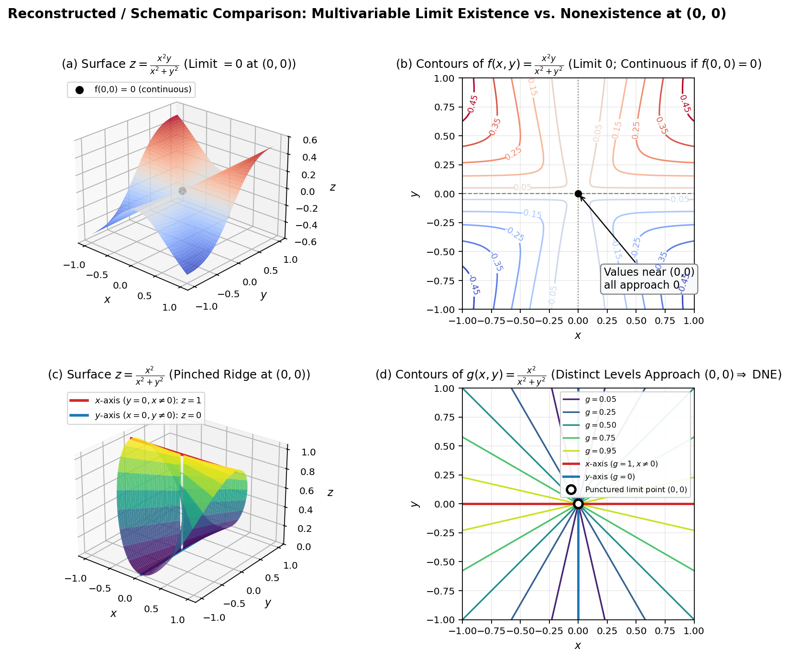
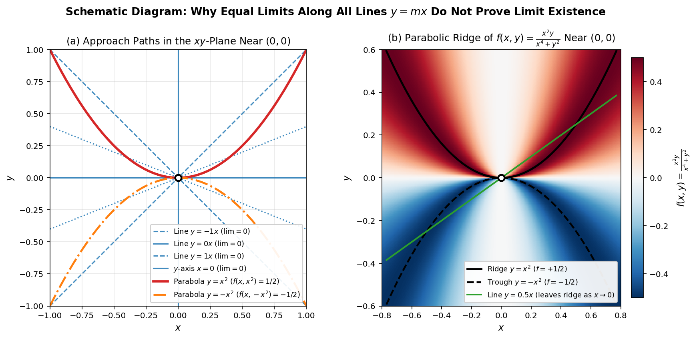
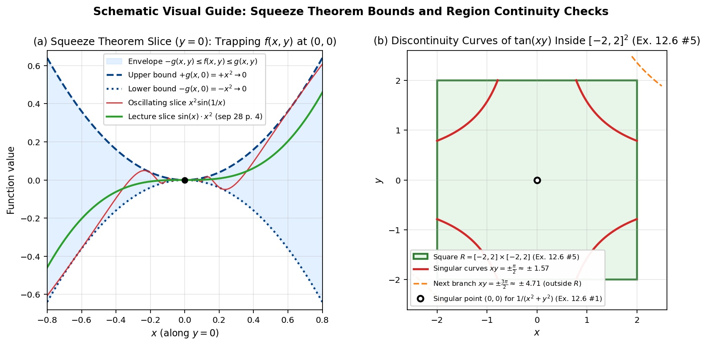
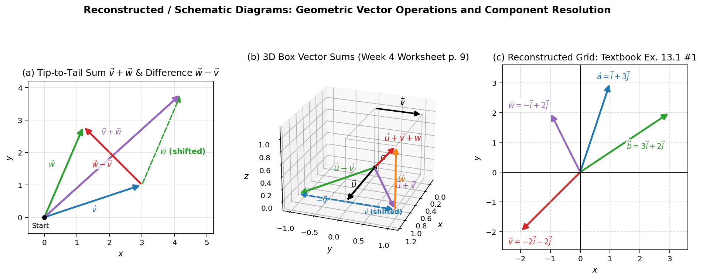
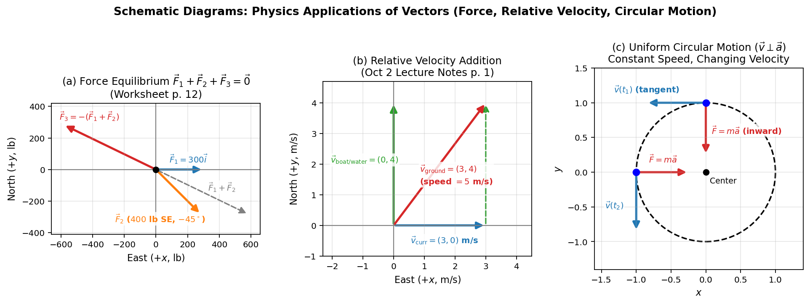

# MAT235 Week 4 Study Notes: Limits and Continuity, Displacement Vectors, and Vectors in General

## Contents

- [Scope, notation, and method selection](#scope-notation-and-method-selection)
- [Concept C-01: Intuitive Definition and Representations of Multivariable Limits](#concept-c-01-intuitive-definition-and-representations-of-multivariable-limits)
  - [Problem Type PT-01: Evaluating Multivariable Limits by Direct Substitution or Algebraic Simplification](#problem-type-pt-01-evaluating-multivariable-limits-by-direct-substitution-or-algebraic-simplification)
  - [Problem Type PT-02: Estimating or Diagnosing Multivariable Limits from Graphs, Contours, and Tables](#problem-type-pt-02-estimating-or-diagnosing-multivariable-limits-from-graphs-contours-and-tables)
- [Concept C-02: Path Analysis, Nonexistence of Limits, and the Squeeze Theorem](#concept-c-02-path-analysis-nonexistence-of-limits-and-the-squeeze-theorem)
  - [Problem Type PT-03: Proving a Multivariable Limit Does Not Exist Using the Two-Path Test](#problem-type-pt-03-proving-a-multivariable-limit-does-not-exist-using-the-two-path-test)
  - [Problem Type PT-04: Proving a Multivariable Limit Exists Using the Squeeze Theorem and Bounding Inequalities](#problem-type-pt-04-proving-a-multivariable-limit-exists-using-the-squeeze-theorem-and-bounding-inequalities)
- [Concept C-03: Continuity of Functions of Two Variables](#concept-c-03-continuity-of-functions-of-two-variables)
  - [Problem Type PT-05: Determining the Maximal Continuity Set of a Function or Testing Continuity on a Region](#problem-type-pt-05-determining-the-maximal-continuity-set-of-a-function-or-testing-continuity-on-a-region)
  - [Problem Type PT-06: Analyzing Piecewise Continuity and Finding Parameters for Continuity](#problem-type-pt-06-analyzing-piecewise-continuity-and-finding-parameters-for-continuity)
- [Concept C-04: Displacement Vectors, Geometric Operations, and Coordinate Components](#concept-c-04-displacement-vectors-geometric-operations-and-coordinate-components)
  - [Problem Type PT-07: Sketching Geometric Vector Combinations and Resolving Vectors from Diagrams or Coordinates](#problem-type-pt-07-sketching-geometric-vector-combinations-and-resolving-vectors-from-diagrams-or-coordinates)
  - [Problem Type PT-08: Performing Componentwise Linear Combinations of Vectors](#problem-type-pt-08-performing-componentwise-linear-combinations-of-vectors)
- [Concept C-05: Vector Magnitude, Unit Vectors, Direction, and Parallel Vectors](#concept-c-05-vector-magnitude-unit-vectors-direction-and-parallel-vectors)
  - [Problem Type PT-09: Computing Vector Magnitudes, Unit Vectors, and Vectors of Prescribed Length](#problem-type-pt-09-computing-vector-magnitudes-unit-vectors-and-vectors-of-prescribed-length)
  - [Problem Type PT-10: Testing Whether Vectors Are Parallel and Solving for Collinearity Parameters](#problem-type-pt-10-testing-whether-vectors-are-parallel-and-solving-for-collinearity-parameters)
- [Concept C-06: Physical Vectors — Velocity, Acceleration, Force, and Relative Motion](#concept-c-06-physical-vectors--velocity-acceleration-force-and-relative-motion)
  - [Problem Type PT-11: Classifying Scalar vs. Vector Quantities and Comparing Physical Magnitudes](#problem-type-pt-11-classifying-scalar-vs-vector-quantities-and-comparing-physical-magnitudes)
  - [Problem Type PT-12: Solving Relative Velocity, Navigation, and Static Force Equilibrium Problems](#problem-type-pt-12-solving-relative-velocity-navigation-and-static-force-equilibrium-problems)
- [Concept C-07: Algebraic Properties of Vectors and Vectors in n Dimensions](#concept-c-07-algebraic-properties-of-vectors-and-vectors-in-n-dimensions)
  - [Problem Type PT-13: Justifying Vector Algebraic Identities Geometrically and Modeling Multi-Component Data in n Dimensions](#problem-type-pt-13-justifying-vector-algebraic-identities-geometrically-and-modeling-multi-component-data-in-n-dimensions)

---

## Scope, notation, and method selection

### Source scope and reading status

- **Course and unit:** MAT235 (Multivariable Calculus), Week 4 — *Limits and Continuity* (Section 12.6), *Displacement Vectors* (Section 13.1), and *Vectors in General* (Section 13.2).
- **Primary weekly sources:**
  1. `W4/Week4-Learning-Objectives-and-Practice.png` — course-page screenshot specifying the 10 weekly learning objectives across Sections 12.6, 13.1, and 13.2, and the exact suggested practice list of 31 textbook exercises from the 8th edition.
  2. `W4/Week4-sol.pdf` — 14-page weekly lecture worksheet packet with instructor solutions and handwritten annotations (extracted from PDF viewer pages 37–50 of `Week2-5-sol.pdf`), covering Section 12.6 (worksheet pp. 1–5, PDF pp. 2, 3, 5, 7, 8, plus handwritten intro on PDF p. 1, approach-path diagram on PDF p. 4, and limit flowchart on PDF p. 6), Section 13.1 (worksheet pp. 6–8, PDF pp. 9–11), Section 13.2 (worksheet pp. 9–10, PDF pp. 12–13), and a closing review/preview page (PDF p. 14).
  3. `W4/sep 28.pdf` — 4-page handwritten lecture notes for September 28 (Section 12.6: discontinuous cliff graph, algebraic/graphical/numerical limits, two-path test, Squeeze Theorem, and continuity sets).
  4. `W4/sep 30.pdf` — 4-page handwritten lecture notes for September 30 (Section 13.1: displacement vectors $\overrightarrow{PQ}$, magnitude, vector sum and difference, scalar multiplication, and unit vectors).
  5. `W4/oct 2.pdf` — 4-page handwritten lecture notes for October 2 (Section 13.2: physics applications of vectors — boat in river current, airplane in wind, acceleration, force, Newton's second law $\vec{F} = m\vec{a}$, and uniform circular motion).
- **Reference / supporting textbook source:**
  - `MAT235_textbook.pdf` — verified as Deborah Hughes-Hallett et al., *Calculus*, **Eighth Edition** (John Wiley & Sons; title pages at PDF viewer pp. 5, 7). This matches the edition specified in `W4/Week4-Learning-Objectives-and-Practice.png`.
  - **Supporting reading ranges (not separately verified as mandatory assigned reading):**
    - **Section 12.6 (Limits and Continuity):** printed pp. 739–744 (PDF viewer pp. 759–764).
    - **Section 13.1 (Displacement Vectors):** printed pp. 746–755 (PDF viewer pp. 766–775).
    - **Section 13.2 (Vectors in General):** printed pp. 755–762 (PDF viewer pp. 775–782).
    - **Answers to Odd-Numbered Problems (Sections 12.6, 13.1, 13.2):** printed pp. 1158–1159 (PDF viewer pp. 1205–1206).
  - Because the course screenshot lists these sections as "sections introduced in Week 4" along with suggested practice problems without explicitly stating an assigned reading requirement, these textbook ranges are classified as **supporting/reference reading**.

### Documented source discrepancies and technical corrections

1. **Squeeze Theorem circular-limit typo (`W4/sep 28.pdf`, p. 4):** In the handwritten Squeeze Theorem example $f(x,y) = \sin x \cdot (x^2 + y^2)$, after establishing $|f(x,y) - 0| \leq x^2 + y^2$, the note writes *"Since $\lim_{(x,y)\to(0,0)} f(x,y) = 0$, we have $\lim_{(x,y)\to(0,0)} f(x,y) = 0$."* The first expression is a slip of the pen for the bounding function $g(x,y) = x^2 + y^2$; the correct statement is **"Since $\lim_{(x,y)\to(0,0)} (x^2 + y^2) = 0$, we have $\lim_{(x,y)\to(0,0)} f(x,y) = 0$."**
2. **Two-path test and limit nonexistence vs. discontinuity (`W4/sep 28.pdf`, pp. 2–3):** The handwritten notes frame the two-path test under *"A useful way to check discontinuity"* and apply it to $f(x,y) = \frac{x^2}{x^2+y^2}$ (which is undefined at $(0,0)$ unless extended piecewise as in `W4/Week4-sol.pdf` p. 5). Technically, finding two paths to $(a,b)$ with different one-variable limits proves first and foremost that **$\lim_{(x,y)\to(a,b)} f(x,y)$ does not exist**, which in turn implies $f$ cannot be continuous at $(a,b)$ regardless of how $f(a,b)$ is defined.
3. **Ground velocity vector vs. ground speed (`W4/oct 2.pdf`, p. 3):** In the airplane-and-wind example, the handwritten notes write *"$\text{ground speed} = \text{speed of the plane relative to ground} = \vec{v}_1 + \vec{v}_2 = (600 + 25\sqrt{2}, 25\sqrt{2})$"* and stop without computing the magnitude or direction angle. Technically, $\vec{v}_{\text{ground}} = \vec{v}_1 + \vec{v}_2 = (600 + 25\sqrt{2}, 25\sqrt{2})\text{ km/hr}$ is the **ground velocity vector**, whereas **ground speed** is its scalar magnitude $\|\vec{v}_1 + \vec{v}_2\| = \sqrt{(600 + 25\sqrt{2})^2 + (25\sqrt{2})^2} \approx 636.34\text{ km/hr}$ (or $636.4\text{ km/hr}$ in Textbook Section 13.2 Example 6, p. 759), and the direction is $\theta = \arctan\left(\frac{25\sqrt{2}}{600+25\sqrt{2}}\right) \approx 3.18^\circ$ north of east.
4. **Partially worked or crossed-out worksheet items (`W4/Week4-sol.pdf`, pp. 8, 11, 13):** On p. 8 (*"More practice examples"*), the instructor crossed out *"How about at $(1,1)$?"* during lecture and left subparts (c) and (e) unworked on the slide; on p. 11, the 7 True/False boxes are checked without written reasons; and on p. 13, the copy-center vector sum is left blank. All of these are solved in full in [Answers-and-Practice.md](Answers-and-Practice.md#b-source-questions-and-solutions).

### Notation conventions

| Concept / Object | Primary Course / Textbook Notation | Alternative Lecture Notation (`sep 30.pdf`, `oct 2.pdf`) | Meaning and Remarks |
| :--- | :--- | :--- | :--- |
| Point in $\mathbb{R}^2$ or $\mathbb{R}^3$ | $P = (a, b)$ or $P = (x_0, y_0, z_0)$ | Same | Ordered pair or triple of coordinates specifying a location in space. |
| Euclidean distance in $\mathbb{R}^2$ | $\sqrt{(x-a)^2 + (y-b)^2}$ | $\lVert(x,y) - (a,b)\rVert$ | Straight-line distance between $(x,y)$ and $(a,b)$ in the domain plane. |
| Displacement vector from $P_1$ to $P_2$ | $\overrightarrow{P_1 P_2}$ | $P_2 - P_1$ (`sep 30.pdf` p. 1) | Arrow with tail at $P_1$ and tip at $P_2$; computed as "tip minus tail". |
| Standard unit basis vectors | $\vec{i}, \vec{j}, \vec{k}$ | $(1,0,0), (0,1,0), (0,0,1)$ | Unit vectors pointing along positive $x$-, $y$-, and $z$-axes, respectively. |
| Vector in component form | $\vec{v} = v_1\vec{i} + v_2\vec{j} + v_3\vec{k}$ | $\vec{v} = (v_1, v_2, v_3)$ | Textbook prefers $\vec{i}, \vec{j}, \vec{k}$ in 2D/3D so vectors are never confused with points. |
| Vector in $n$ dimensions | $\vec{c} = (c_1, c_2, \dots, c_n)$ | Same | Ordered string ($n$-tuple) of $n$ real numbers in $\mathbb{R}^n$. |
| Magnitude (length) of $\vec{v}$ | $\lVert\vec{v}\rVert$ | $\lvert\overrightarrow{PQ}\rvert$ (`sep 30.pdf` p. 1) | Nonnegative scalar length $\sqrt{v_1^2 + v_2^2 + v_3^2}$; always use $\lVert\vec{v}\rVert$ to avoid confusion with scalar absolute value $\lvert\lambda\rvert$. |
| Zero vector | $\vec{0} = 0\vec{i} + 0\vec{j} + 0\vec{k}$ | $(0,0,0)$ | Vector of length $0$ and no defined direction; distinct from the scalar $0$. |

### Prerequisite reminders and preview connections

- **Prerequisite reminder — Linear functions of two variables (`W4/Week4-sol.pdf`, p. 1 & p. 14):**
  - A linear function has the explicit form $z = f(x,y) = c + mx + ny$, or point-slope form through $(x_0, y_0, z_0)$ with slopes $m$ (in the $x$-direction) and $n$ (in the $y$-direction):

    $$z - z_0 = m(x - x_0) + n(y - y_0).$$

  - Its graph is a **plane** in $\mathbb{R}^3$ with no holes, jumps, or rips, so every linear function is continuous on all of $\mathbb{R}^2$.
- **Prerequisite reminder — Basic one-variable limits and trigonometric bounds:**
  - Fundamental trig limit: $\lim_{t \to 0} \frac{\sin t}{t} = 1$.
  - Universal trig bounds: $|\sin u| \leq 1$ and $|\cos u| \leq 1$ for every real number $u \in \mathbb{R}$ where $u$ is defined.
  - Difference of squares for square-root rationalization: $(\sqrt{A} - \sqrt{B})(\sqrt{A} + \sqrt{B}) = A - B$.
- **Preview connection — Vector products and plane equations (`W4/Week4-sol.pdf`, p. 14):**
  - Page 14 of `Week4-sol.pdf` previews how the vector operations introduced in Sections 13.1–13.2 fit into the broader Chapter 13 algebra:
    - $\text{vector} + \text{vector} \leadsto \text{vector}$ (Section 13.1–13.2)
    - $\text{scalar} \cdot \text{vector} \leadsto \text{vector}$ (Section 13.1–13.2)
    - $\text{vector} \cdot \text{vector} \leadsto \text{scalar}$ (**Dot product**, previewed for Section 13.3)
    - $\text{vector} \times \text{vector} \leadsto \text{vector}$ (**Cross product**, previewed for Section 13.4)
  - In Section 13.3, the plane equation $z - z_0 = m(x - x_0) + n(y - y_0)$ will be rewritten as $(-m)(x - x_0) + (-n)(y - y_0) + 1(z - z_0) = 0$ using a normal vector $\vec{n}$ perpendicular to displacement vectors in the plane.

### Compact method-selection guide

#### 1. Decision workflow for evaluating or disproving $\lim_{(x,y)\to(a,b)} f(x,y)$ (`W4/Week4-sol.pdf`, p. 6)

| Step | Condition / Diagnostic Question | Action / Method to Apply | Target Problem Type |
| :--- | :--- | :--- | :--- |
| **Step 1: Direct Substitution** | Is $f(x,y)$ built from elementary continuous functions (polynomials, $e^u, \sin u, \cos u, \ln u, \sqrt{u}$) and is $(a,b)$ strictly in the interior of the domain (no $0$ denominator, $\ln(\leq 0)$, or $\sqrt{<0}$)? | Plug $(x,y) = (a,b)$ directly into $f(x,y)$. The limit exists and equals $f(a,b)$. | [PT-01](#problem-type-pt-01-evaluating-multivariable-limits-by-direct-substitution-or-algebraic-simplification) |
| **Step 2: Algebraic / Composite Reduction** | Does substitution give $0/0$, and does the numerator factor with the denominator, contain a radical $\sqrt{U} - c$, or depend only on a single radial combination $t = g(x,y) \to 0$ (such as $\frac{\sin(x^2+y^2)}{x^2+y^2}$)? | Factor and cancel common nonzero factors for $(x,y) \neq (a,b)$, multiply by the conjugate $\sqrt{U} + c$, or substitute $t = g(x,y) \to t_0$ and use a known 1D limit. | [PT-01](#problem-type-pt-01-evaluating-multivariable-limits-by-direct-substitution-or-algebraic-simplification) |
| **Step 3: Scaling & Boundedness Analysis (Squeeze vs. Two Paths)** | Suppose $\frac{P(x,y)}{Q(x,y)} \to \frac{0}{0}$ as $(x,y) \to (0,0)$ *after canceling any common factors*, or $f(x,y) = A(x,y)B(x,y)$ has a vanishing factor $A(x,y) \to 0$ multiplying an oscillating factor $B(x,y)$ such as $\sin(\cdot)$ or $\cos(\cdot)$. | **Case A (Sufficient conditions to prove limit $= 0$):** If $f(x,y) = A(x,y)B(x,y)$ with $A(x,y) \to 0$ and $\lvert B(x,y)\rvert \leq M$ bounded near $(0,0)$, OR if $Q(x,y) = ax^2 + by^2$ ($a,b > 0$) is positive-definite quadratic and **every nonzero monomial (term)** of $P(x,y)$ has degree strictly greater than $2$ (minimum monomial degree $\geq 3$), the limit **exists and equals $0$**. Prove via the **Squeeze Theorem** ($\lvert f(x,y) - 0\rvert \leq B(x,y) \to 0$). **Case B (Heuristic cue for nonexistence):** If, after canceling common factors, at least one term of $P(x,y)$ has degree (or weighted directional scaling rate along $y = kx^p$) $\leq$ that of $Q(x,y)$, expect the limit **not to exist**. Prove by exhibiting two paths with different limits via the **Two-Path Test**. | [PT-04](#problem-type-pt-04-proving-a-multivariable-limit-exists-using-the-squeeze-theorem-and-bounding-inequalities) (Case A) [PT-03](#problem-type-pt-03-proving-a-multivariable-limit-does-not-exist-using-the-two-path-test) (Case B) |
| **Step 4: Selecting Paths for the Two-Path Test** | Which paths through $(0,0)$ should you test to get two different one-variable limits? | 1. **Coordinate axes:** $y = 0$ ($x \to 0$) and $x = 0$ ($y \to 0$). 2. **Half-lines / rays:** $y = x$ with $x \to 0^+$ vs. $x \to 0^-$ (especially when $\sqrt{x^2+y^2}$ or $\lvert x\rvert$ is present). 3. **Lines $y = mx$:** When all terms in numerator and denominator have the same total degree (e.g., $x^2, xy, y^2$). 4. **Degree-balancing curves $y = kx^p$ or $x = ky^p$:** When $x$ and $y$ have unequal powers in the denominator (e.g., for $x^4 + y^2$, set $y = kx^2$ so $x^4$ and $y^2$ match degree; for $x + y^2$, test $x = ky^2$ or $y=0$ vs. $x=0$). | [PT-03](#problem-type-pt-03-proving-a-multivariable-limit-does-not-exist-using-the-two-path-test) |

#### 2. Decision workflow for vector problems (Sections 13.1–13.2)

| Task / Given Information | Key Formula / Condition | Target Problem Type |
| :--- | :--- | :--- |
| Given two points $P_1(x_1,y_1,z_1)$ and $P_2(x_2,y_2,z_2)$, find the displacement vector from $P_1$ to $P_2$ | $\overrightarrow{P_1 P_2} = (x_2 - x_1)\vec{i} + (y_2 - y_1)\vec{j} + (z_2 - z_1)\vec{k}$ (*Tip minus Tail*) | [PT-07](#problem-type-pt-07-sketching-geometric-vector-combinations-and-resolving-vectors-from-diagrams-or-coordinates) |
| Combine vectors via addition, subtraction, or scalar multiples | $c_1\vec{v} + c_2\vec{w} = (c_1 v_1 + c_2 w_1)\vec{i} + (c_1 v_2 + c_2 w_2)\vec{j} + (c_1 v_3 + c_2 w_3)\vec{k}$ | [PT-08](#problem-type-pt-08-performing-componentwise-linear-combinations-of-vectors) |
| Find a unit vector in the same or opposite direction as $\vec{v} \neq \vec{0}$, or a vector of length $L$ | $\lVert\vec{v}\rVert = \sqrt{v_1^2+v_2^2+v_3^2}$; same direction: $\vec{u} = \frac{\vec{v}}{\lVert\vec{v}\rVert}$; opposite: $-\frac{\vec{v}}{\lVert\vec{v}\rVert}$; length $L$: $\pm L\frac{\vec{v}}{\lVert\vec{v}\rVert}$ | [PT-09](#problem-type-pt-09-computing-vector-magnitudes-unit-vectors-and-vectors-of-prescribed-length) |
| Decide if $\vec{v}$ and $\vec{w}$ are parallel, or find parameter $a$ making them parallel | $\vec{w} = \lambda\vec{v}$ for some scalar $\lambda \neq 0 \iff \frac{w_1}{v_1} = \frac{w_2}{v_2} = \frac{w_3}{v_3} = \lambda$ | [PT-10](#problem-type-pt-10-testing-whether-vectors-are-parallel-and-solving-for-collinearity-parameters) |
| Resolve a 2D physical vector of magnitude $M$ and angle $\theta$ (CCW from $+x$/East) | $\vec{v} = (M\cos\theta)\vec{i} + (M\sin\theta)\vec{j}$; speed $= \lVert\vec{v}\rVert$; for $\vec{v} \neq \vec{0}$, direction angle $\theta = \operatorname{atan2}(v_y, v_x)$ | [PT-11](#problem-type-pt-11-classifying-scalar-vs-vector-quantities-and-comparing-physical-magnitudes), [PT-12](#problem-type-pt-12-solving-relative-velocity-navigation-and-static-force-equilibrium-problems) |
| Find resultant velocity relative to the ground or a third force for static equilibrium | Relative velocity: $\vec{v}_{\text{ground}} = \vec{v}_{\text{rel}} + \vec{v}_{\text{medium}}$ Static equilibrium (object initially at rest): $\vec{F}_1 + \vec{F}_2 + \vec{F}_3 = \vec{0} \implies \vec{F}_3 = -(\vec{F}_1 + \vec{F}_2)$ | [PT-12](#problem-type-pt-12-solving-relative-velocity-navigation-and-static-force-equilibrium-problems) |

---

## Concept C-01: Intuitive Definition and Representations of Multivariable Limits

**Classification:** Core (Section 12.6, Learning Objective 1)

### 1. Definition and mathematical setup

Let $f : D \subseteq \mathbb{R}^2 \to \mathbb{R}$ be a real-valued function of two variables defined on a domain $D$ that contains points $(x,y)$ arbitrarily close to a target point $(a,b) \in \mathbb{R}^2$ (though $(a,b)$ itself **does not need to belong to $D$**).

- **Intuitive definition of a limit (`W4/Week4-sol.pdf`, p. 2; Textbook Section 12.6, p. 741):**
  The function $f$ has a limit $L \in \mathbb{R}$ at the point $(a,b)$, written

  $$\lim_{(x,y) \to (a,b)} f(x,y) = L,$$

  if $f(x,y)$ is as close to $L$ as we please whenever the Euclidean distance

  $$d\big((x,y), (a,b)\big) = \sqrt{(x - a)^2 + (y - b)^2}$$

  from $(x,y)$ to $(a,b)$ is sufficiently small, **but not zero** (that is, $(x,y) \neq (a,b)$).
- **Formal $\varepsilon$-$\delta$ quantification (supporting precision from Textbook Example 2(a), pp. 741–742):**
  For every positive number $\varepsilon > 0$ (no matter how small), there exists a positive distance $\delta > 0$ such that for all $(x,y) \in D$,

  $$0 < \sqrt{(x - a)^2 + (y - b)^2} < \delta \implies |f(x,y) - L| < \varepsilon.$$

### 2. Fundamental conceptual distinctions

1. **The value $f(a,b)$ is irrelevant to the existence or value of $\lim_{(x,y)\to(a,b)} f(x,y)$ (`W4/Week4-sol.pdf`, pp. 2–3):**
   - Because the definition requires the distance $\sqrt{(x-a)^2 + (y-b)^2}$ to be **strictly positive** ("not zero"), the limit examines only points $(x,y)$ *near* $(a,b)$, never the point $(a,b)$ itself.
   - Consequently, $f$ does **not** have to be defined at $(a,b)$ in order for $\lim_{(x,y)\to(a,b)} f(x,y)$ to exist. Conversely, if $f(a,b)$ is defined, the limit might still fail to exist or might equal a number $L \neq f(a,b)$.
2. **One-variable vs. two-variable limits (`W4/Week4-sol.pdf`, p. 4; Textbook p. 742):**
   - For a function of one variable $y = f(x)$, the domain is a line ($\mathbb{R}^1$), so $x$ can approach $a$ from only **two directions**: from the left ($x \to a^-$) and from the right ($x \to a^+$). Thus $\lim_{x \to a} f(x) = L$ if and only if $\lim_{x \to a^-} f(x) = \lim_{x \to a^+} f(x) = L$.
   - For a function of two variables $z = f(x,y)$, the domain is a plane ($\mathbb{R}^2$). A point $(x,y)$ can approach $(a,b)$ from **infinitely many directions and along infinitely many curved paths** (straight lines, parabolas, spirals, etc.). For $\lim_{(x,y)\to(a,b)} f(x,y) = L$ to hold, $f(x,y)$ must approach the **exact same number $L$** regardless of which path or direction $(x,y)$ takes toward $(a,b)$.

### 3. Three representations: Algebraic, Graphical, and Numerical

1. **Algebraic representation (`W4/Week4-sol.pdf`, p. 2 & p. 8; `W4/sep 28.pdf`, p. 1):**
   - **Continuity of known building blocks:** Polynomials, exponential functions ($e^u$), sine and cosine ($\sin u, \cos u$) are continuous everywhere; logarithms ($\ln u$) are continuous where $u > 0$; roots ($\sqrt{u}$) are continuous where $u > 0$ (and continuous on $u \geq 0$ within their domain); and sums, products, compositions, and quotients (where the denominator is nonzero) of continuous functions are continuous. Whenever $f$ is built from such functions and $(a,b)$ causes no domain violation (such as division by zero), the limit is found by **direct substitution**:

     $$\lim_{(x,y) \to (a,b)} f(x,y) = f(a,b).$$

   - **Algebraic simplification of $0/0$ indeterminate forms:** When direct substitution yields $0/0$, $f(a,b)$ is undefined, but since $(x,y) \neq (a,b)$ inside the limit, we may simplify $f(x,y)$ algebraically before taking the limit:
     - *Rationalization by conjugate:* For an expression of the form $\frac{U(x,y)}{\sqrt{U(x,y) + 1} - 1}$ with $U(x,y) \to 0$ and $U(x,y) \neq 0$ for $(x,y) \neq (a,b)$, multiplying numerator and denominator by the conjugate $\sqrt{U(x,y)+1} + 1$ uses $(\sqrt{U+1}-1)(\sqrt{U+1}+1) = (U+1)-1 = U$ to cancel $U(x,y)$ cleanly (`W4/Week4-sol.pdf`, p. 8(d)).
     - *Single-variable composite substitution:* If $f(x,y) = \phi\big(u(x,y)\big)$ where $t = u(x,y) \to t_0$ (with $t \neq t_0$ for $(x,y) \neq (a,b)$) and $\lim_{t \to t_0} \phi(t) = L$, then $\lim_{(x,y)\to(a,b)} f(x,y) = L$. For example, setting $t = x^2 + y^2 \to 0^+$ gives $\lim_{(x,y)\to(0,0)} \frac{\sin(x^2+y^2)}{x^2+y^2} = \lim_{t \to 0^+} \frac{\sin t}{t} = 1$ (Textbook Section 12.6, #11).
2. **Graphical representation (`W4/sep 28.pdf`, p. 1; Textbook Example 1, pp. 740–741):**
   - **Surface graph $z = f(x,y)$:** If the limit $L$ exists, then restricting the surface to a small cylinder around $(a,b)$ (excluding $(a,b)$ itself) produces a patch of surface whose height $z$ stays arbitrarily close to $L$ (no vertical cliffs, jumps, or pinched ridges of varying heights at $(a,b)$).
   - **Contour map (level curves $f(x,y) = c$):**
     - If $f(x,y)$ approaches a limit $L$ as $(x,y) \to (a,b)$, all contours in a sufficiently small punctured neighborhood of $(a,b)$ have level values close to $L$, so defining $f(a,b) = L$ makes the function continuous at $(a,b)$ (see Figure 1(a)–(b)).
     - Because a single-valued function can take at most one value at any point in its domain, two distinct level sets $f(x,y) = c_1$ and $f(x,y) = c_2$ ($c_1 \neq c_2$) never literally share a domain point; however, if **multiple distinct contour levels $c_1 \neq c_2$ extend arbitrarily close to a punctured limit point $(a,b)$** (their closures meet at $(a,b)$, which is what the textbook informally calls contours "crashing" toward the origin, as in Figure 1(d) and Figure 4), or if contours crowd together into a vertical cliff (`W4/sep 28.pdf`, p. 1; Textbook Figure 12.96), then every punctured disk around $(a,b)$ contains points with $f(x,y) = c_1$ and points with $f(x,y) = c_2$, so the limit **does not exist**.
   - **Limitation of graphs:** As emphasized in Textbook Example 1(a) (p. 740), a graph or contour plot can *suggest* that a limit exists, but finite plot resolution cannot rule out hidden oscillations or narrow ridges; analytical verification is required for certainty.
3. **Numerical representation (`W4/sep 28.pdf`, p. 2):**
   - A table of values of $f(x,y)$ supports $\lim_{(x,y)\to(a,b)} f(x,y) = L$ if, for points $(x,y) \neq (a,b)$ at progressively smaller distances $\sqrt{(x-a)^2 + (y-b)^2}$ in all directions around $(a,b)$, the entries $f(x,y)$ cluster ever closer to $L$.
   - **Warning on numerical tables:** In `W4/sep 28.pdf` (p. 2), the table for $f(x,y) = x^2 + y^2$ evaluates $x, y \in \{0, 1, 2, 3\}$. While those values decrease toward $0$ as $(x,y)$ moves toward $(0,0)$, a rigorous numerical investigation of a limit at $(0,0)$ must sample **small nonzero coordinates** such as $x, y \in \{\pm 0.1, \pm 0.01, \pm 0.001\}$ in all quadrants, and even then a finite table can only suggest—never prove—existence of a limit.

*Figure 1 (Reconstructed / Schematic): Comparison of surface graphs and contour diagrams at $(0,0)$ for $f(x,y) = \frac{x^2 y}{x^2+y^2}$ (panels a–b, where the limit is $0$ and defining $f(0,0)=0$ makes $f$ continuous at the origin) versus $g(x,y) = \frac{x^2}{x^2+y^2}$ (panels c–d, where distinct radial contours of values $0$ through $1$ approach the punctured origin arbitrarily closely so the limit does not exist).*

---

### Problem Type PT-01: Evaluating Multivariable Limits by Direct Substitution or Algebraic Simplification

**Recognition cues.**
You are given a formula for $f(x,y)$ and asked to evaluate $\lim_{(x,y)\to(a,b)} f(x,y)$, where either:
1. $f(x,y)$ is an elementary combination (sum, product, quotient, composition) of polynomials, exponentials, logarithms, radicals, or trig functions that is defined at $(a,b)$; or
2. Direct substitution gives the indeterminate form $0/0$, and the numerator and denominator share a common algebraic factor, a radical expression of the form $\sqrt{U(x,y) + c^2} - c$, or a single composite expression $t = u(x,y) \to 0$.

**General method.**
1. **Test direct substitution at $(x,y) = (a,b)$:**
   - Evaluate the numerator, denominator, and any inner arguments of $\ln(\cdot)$, $\sqrt{\cdot}$, or $\tan(\cdot)$ at $(a,b)$.
   - If no division by zero or domain violation occurs, cite the continuity of the elementary building blocks at $(a,b)$ and conclude $\lim_{(x,y)\to(a,b)} f(x,y) = f(a,b)$.
2. **If direct substitution yields $0/0$, simplify algebraically for $(x,y) \neq (a,b)$:**
   - **Factoring:** If numerator and denominator are polynomials in $x, y$ (or powers of a common subexpression $U(x,y)$), factor and cancel the common nonzero factor for $(x,y) \neq (a,b)$.
   - **Conjugate rationalization:** If a radical difference $\sqrt{U(x,y) + c^2} - c$ (with $c > 0$ and $U(x,y) \to 0$) appears in the denominator or numerator, multiply numerator and denominator by the conjugate $\sqrt{U(x,y) + c^2} + c$:

     $$\left(\sqrt{U(x,y) + c^2} - c\right)\left(\sqrt{U(x,y) + c^2} + c\right) = \big(U(x,y) + c^2\big) - c^2 = U(x,y).$$

     Explicitly state that $U(x,y) \neq 0$ for $(x,y) \neq (a,b)$ when canceling $U(x,y)$.
   - **Composite substitution:** If $f(x,y) = \phi(u(x,y))$ where $t = u(x,y) \to t_0$ and $t \neq t_0$ for $(x,y) \neq (a,b)$, reduce to the 1D limit $\lim_{t \to t_0} \phi(t)$.
3. **Evaluate the simplified continuous expression by direct substitution at $(a,b)$.**

**Teaching example — original question.**
Evaluate each of the following limits, justifying every step:
1. $\displaystyle \lim_{(x,y) \to (1, -1)} \frac{e^{x+y} + x^2 y}{x^2 + y^2 + \cos(x+y)}$
2. $\displaystyle \lim_{(x,y) \to (0, 0)} \frac{5x^2 + 2y^2}{\sqrt{5x^2 + 2y^2 + 9} - 3}$

*(See worked solution in [Answers-and-Practice.md — PT-01](Answers-and-Practice.md#problem-type-pt-01-evaluating-multivariable-limits-by-direct-substitution-or-algebraic-simplification).)*

**A complete answer must include.**
- Verification of whether direct substitution at the target point $(a,b)$ is valid or produces an indeterminate form such as $0/0$.
- For direct-substitution limits: explicit identification of the continuous elementary functions being composed, added, multiplied, or divided, and confirmation that the denominator is nonzero at $(a,b)$.
- For indeterminate $0/0$ limits: the algebraic transformation (such as conjugate multiplication), the explicit domain condition $(x,y) \neq (a,b)$ justifying cancellation of the vanishing factor, and the final substitution into the simplified continuous expression.

**Common mistakes.**
- Writing $\frac{0}{0}$ as if it were a valid number or concluding immediately from $\frac{0}{0}$ that the limit does not exist without checking for algebraic cancellation.
- Canceling a factor such as $U(x,y)$ without noting that the equality between the original and simplified expressions holds only for $(x,y) \neq (a,b)$.
- Forgetting to multiply **both** numerator and denominator by the conjugate, or miscomputing $(\sqrt{A} - B)(\sqrt{A} + B)$ as $A - B$ instead of $A - B^2$.

---

### Problem Type PT-02: Estimating or Diagnosing Multivariable Limits from Graphs, Contours, and Tables

**Recognition cues.**
You are given a contour map (level-curve diagram), a 3D surface plot, or a numerical table of values for a two-variable function $f(x,y)$, and asked to estimate $\lim_{(x,y)\to(a,b)} f(x,y)$ or explain why the limit may not exist.

**General method.**
1. **Locate the target point $(a,b)$ on the contour diagram, surface plot, or table.**
2. **Inspect the behavior of $f(x,y)$ in a small punctured neighborhood around $(a,b)$:**
   - **Contour diagram check:**
     - *Case 1 (Consistent local behavior):* If a single contour $f(x,y) = c$ passes through $(a,b)$ and the neighboring contours on all sides have values close to $c$ without pinching or crowding into a cliff, estimate $\lim_{(x,y)\to(a,b)} f(x,y) \approx c$ (or interpolate between the two closest contour values).
     - *Case 2 (Distinct contours approaching $(a,b)$ / "crash" or cliff):* If two or more contours with **different** level values $c_1 \neq c_2$ extend arbitrarily close to the punctured point $(a,b)$ (for example, radial contour rays whose closures meet at the origin, where $f(0,0)$ is undefined or can belong to at most one level set) or form an abrupt cliff edge at $(a,b)$, explain that every small punctured disk around $(a,b)$ contains points where $f(x,y) = c_1$ and points where $f(x,y) = c_2$, so $\lim_{(x,y)\to(a,b)} f(x,y)$ **does not exist**.
   - **Numerical table check:**
     - Read entries $(x,y) \neq (a,b)$ closest to $(a,b)$ across multiple directions (horizontal, vertical, diagonal). If all nearby entries approach a single value $L$, estimate $L$; if different approach directions in the table approach different numbers, state that the limit does not exist.
3. **Add the standard epistemological caveat:** Visual and numerical representations provide estimates or evidence, whereas an exact proof of limit existence requires an analytical argument (continuity or Squeeze Theorem).

**Teaching example — original question.**
Suppose a function $f(x,y)$ has a contour diagram on $[-3,3] \times [-3,3]$ whose level curves are straight rays from the origin given by $f(x,y) = 6$ along the positive and negative $y$-axis ($x = 0, y \neq 0$), $f(x,y) = 3$ along the lines $y = \pm x$ ($x \neq 0$), and $f(x,y) = 0$ along the positive and negative $x$-axis ($y = 0, x \neq 0$), with smooth intermediate radial contours in between.
1. Use the contour description to estimate $\lim_{(x,y)\to(2, -2)} f(x,y)$.
2. Use the contour description to explain why $\lim_{(x,y)\to(0, 0)} f(x,y)$ does not exist.

*(See worked solution in [Answers-and-Practice.md — PT-02](Answers-and-Practice.md#problem-type-pt-02-estimating-or-diagnosing-multivariable-limits-from-graphs-contours-and-tables).)*

**A complete answer must include.**
- Identification of the target point's location relative to the labeled contours, surface features, or table entries.
- Examination of how the function values behave when approaching the target point from **all** nearby directions (not just one direction).
- For an existing limit estimate: the estimated numerical value supported by nearby contour levels or table values.
- For a nonexisting limit: explicit citation of at least two distinct contour levels (or directional trends) that extend arbitrarily close to the punctured target point.

**Common mistakes.**
- Confusing the **coordinates** $(a,b)$ of the input point with the **contour level** $c = f(x,y)$ (for instance, answering with the $x$- or $y$-coordinate instead of the label on the level curve).
- Looking only along a single axis in a contour plot or table and overlooking other directions that approach a different value.
- Claiming that a smooth-looking contour diagram or finite table *proves* with $100\%$ certainty that a limit exists.

**Concept C-01 Practice Index:**
- **Source Questions:** [SQ-01](Answers-and-Practice.md#sq-01), [SQ-02](Answers-and-Practice.md#sq-02), [SQ-03](Answers-and-Practice.md#sq-03), [SQ-11(a),(d)](Answers-and-Practice.md#sq-11)
- **Textbook Exercises:** [Ex. 12.6 #7](Answers-and-Practice.md#ex-12-6-7), [Ex. 12.6 #9](Answers-and-Practice.md#ex-12-6-9), [Ex. 12.6 #13](Answers-and-Practice.md#ex-12-6-13), [Ex. 12.6 #15](Answers-and-Practice.md#ex-12-6-15)

---

## Concept C-02: Path Analysis, Nonexistence of Limits, and the Squeeze Theorem

**Classification:** Core (Section 12.6, Learning Objectives 2 and 3)

### 1. Restricting a multivariable limit to a path

Let $C$ be a continuous curve in the domain $D \subseteq \mathbb{R}^2$ that passes through $(a,b)$, parameterized by $(x(t), y(t))$ as $t \to t_0$ (or given by a graph $y = \gamma(x)$ as $x \to a$, or a ray $y = mx$ with $x \to 0^+$), such that $(x,y) \neq (a,b)$ along the approach.

- **Key theorem (Path Inheritance):** If the two-variable limit $\lim_{(x,y)\to(a,b)} f(x,y) = L$ exists, then the one-variable limit of $f(x,y)$ restricted to **every** such path $C$ approaching $(a,b)$ must also exist and equal the **same value $L$**.
- **Contrapositive — The Two-Path Test for Nonexistence (`W4/Week4-sol.pdf`, p. 5; `W4/sep 28.pdf`, p. 3):**
  If there exist two paths $C_1$ and $C_2$ approaching $(a,b)$ such that

  $$\lim_{\substack{(x,y) \to (a,b) \\ (x,y) \in C_1}} f(x,y) = L_1, \qquad \lim_{\substack{(x,y) \to (a,b) \\ (x,y) \in C_2}} f(x,y) = L_2, \qquad \text{with } L_1 \neq L_2$$

  (or if the one-variable limit along even a single valid path fails to exist), then the two-variable limit $\lim_{(x,y)\to(a,b)} f(x,y)$ **does not exist**.

### 2. How to choose paths: Degree-homogeneity and anisotropic scaling

When $\lim_{(x,y)\to(0,0)} \frac{P(x,y)}{Q(x,y)}$ gives $\frac{0}{0}$, the algebraic structure of $P(x,y)$ and $Q(x,y)$ tells you which paths will expose path-dependence:

1. **Homogeneous degree in $x$ and $y$ (e.g., $\frac{x^2}{x^2+y^2}$, $\frac{x^2-y^2}{x^2+y^2}$, $\frac{2x^2}{4x^2+3y^2}$, $\frac{y}{\sqrt{x^2+y^2}}$):**
   - Every term in the numerator and denominator scales with the same power of distance $r = \sqrt{x^2+y^2}$.
   - Substituting the straight line $y = mx$ (with $x \neq 0$) factors out the lowest power of $x$ (or $|x| = \sqrt{x^2}$) and leaves a constant that depends on the slope $m$:
     - For $f(x,y) = \frac{x^2 - y^2}{x^2 + y^2}$, along $y = mx$ ($x \neq 0$):

       $$f(x, mx) = \frac{x^2 - m^2 x^2}{x^2 + m^2 x^2} = \frac{x^2(1 - m^2)}{x^2(1 + m^2)} = \frac{1 - m^2}{1 + m^2}.$$

       Since different slopes $m$ give different limits (e.g., $m = 0 \implies 1$, $m = 1 \implies 0$), the limit does not exist (`W4/Week4-sol.pdf`, p. 5).
     - **Sign-of-radical subtlety (`W4/Week4-sol.pdf`, p. 3):** When $\sqrt{x^2 + y^2}$ appears, remember that $\sqrt{x^2} = |x|$, which equals $+x$ for $x > 0$ and $-x$ for $x < 0$. For $f(x,y) = \frac{y}{\sqrt{x^2+y^2}}$, restricting to the ray $y = x, x > 0$ gives $f(x,x) = \frac{x}{\sqrt{2x^2}} = \frac{x}{\sqrt{2}\,x} = \frac{1}{\sqrt{2}}$ as $x \to 0^+$, whereas along the $x$-axis ($y=0, x \neq 0$), $f(x,0) = 0$ (and along the opposite ray $y = x, x < 0$, $f(x,x) = -\frac{1}{\sqrt{2}}$).
2. **Weighted / anisotropic degrees — The "Terrible Example" (`W4/Week4-sol.pdf`, p. 7 & p. 8(c)):**
   - Consider $f(x,y) = \frac{x^2 y}{x^4 + y^2}$ as $(x,y) \to (0,0)$ (`W4/Week4-sol.pdf`, p. 7):
     - Along the $x$-axis ($y = 0, x \neq 0$): $f(x,0) = \frac{0}{x^4} = 0 \to 0$.
     - Along the $y$-axis ($x = 0, y \neq 0$): $f(0,y) = \frac{0}{y^2} = 0 \to 0$.
     - Along **every straight line $y = mx$** ($m \neq 0, x \neq 0$):

       $$f(x, mx) = \frac{x^2(mx)}{x^4 + m^2 x^2} = \frac{x^2(mx)}{x^2(x^2 + m^2)} = \frac{mx}{x^2 + m^2} \xrightarrow{x \to 0} \frac{0}{0 + m^2} = 0.$$

     - **Why all straight lines give $0$ yet the limit still fails to exist:** In the denominator $x^4 + y^2$, the term $x^4$ has degree $4$ while $y^2$ has degree $2$. To make both terms in the denominator have the **same degree**, we must match $y^2 \sim x^4$, i.e., choose the **parabolic path $y = x^2$** (or $y = kx^2$):

       $$f(x, x^2) = \frac{x^2(x^2)}{x^4 + (x^2)^2} = \frac{x^4}{2x^4} = \frac{1}{2} \xrightarrow{x \to 0} \frac{1}{2} \neq 0.$$

   - Similarly, for $f(x,y) = \frac{2x - y^2}{x + y^2}$ (`W4/Week4-sol.pdf`, p. 8(c)), matching $x$ with $y^2$ (or simply testing the $x$-axis $y=0$, where $f(x,0) = \frac{2x}{x} = 2 \to 2$, against the $y$-axis $x=0$, where $f(0,y) = \frac{-y^2}{y^2} = -1 \to -1$) immediately shows nonexistence.

> [!WARNING]
> **Critical Rule (`W4/Week4-sol.pdf`, p. 7):** We **CAN NEVER** conclude that the limit of a function exists only by considering its behavior along different paths (even if infinitely many straight lines $y = mx$ all give the same value). Path testing can **only disprove** the existence of a limit (or tell us what the candidate value $L$ *must* be if the limit does exist).

*Figure 2 (Schematic): For $f(x,y) = \frac{x^2 y}{x^4 + y^2}$, every straight line $y = mx$ leaves the parabolic ridge $y = x^2$ near the origin and approaches $0$, whereas moving along the parabola $y = x^2$ stays on top of the ridge where $f(x, x^2) = \frac{1}{2}$.*

### 3. The Squeeze Theorem (Sandwich Theorem) and Bounding Inequalities

When a limit $\lim_{(x,y)\to(a,b)} f(x,y) = L$ *does* exist at a point where $f(a,b)$ is undefined ($0/0$) and cannot be simplified by pure cancellation, we prove existence using the **Squeeze Theorem** (`W4/Week4-sol.pdf`, p. 2, p. 6, p. 8(e); `W4/sep 28.pdf`, pp. 3–4; Textbook Example 2(a), p. 741).

- **Two-Sided Inequality Form:**
  If there exist functions $g(x,y)$ and $h(x,y)$ such that for all $(x,y)$ sufficiently close to $(a,b)$ with $(x,y) \neq (a,b)$,

  $$g(x,y) \leq f(x,y) \leq h(x,y) \qquad \text{and} \qquad \lim_{(x,y)\to(a,b)} g(x,y) = \lim_{(x,y)\to(a,b)} h(x,y) = L,$$

  then $\lim_{(x,y)\to(a,b)} f(x,y) = L$.
- **Absolute-Value / Error-Bound Form (`W4/sep 28.pdf`, p. 3):**
  Equivalently, since $|f(x,y) - L| \leq B(x,y) \iff L - B(x,y) \leq f(x,y) \leq L + B(x,y)$, if

  $$0 \leq |f(x,y) - L| \leq B(x,y) \quad \text{near } (a,b) \text{ (for } (x,y) \neq (a,b)\text{)} \qquad \text{and} \qquad \lim_{(x,y)\to(a,b)} B(x,y) = 0,$$

  then $\lim_{(x,y)\to(a,b)} f(x,y) = L$.
- **Core Intuition (`W4/sep 28.pdf`, p. 4):** *"We rule out some complicated, rapidly oscillating, or singular-looking terms that remain bounded by an inequality."*
- **Three standard bounding inequalities for $(x,y) \neq (0,0)$:**
  1. **Bounded sine/cosine with wild arguments:** For any real expression $u(x,y)$ defined for $(x,y) \neq (0,0)$ (such as $u = \frac{1}{x^2 + |y|}$ or $u = x$),

     $$\big|\sin\big(u(x,y)\big)\big| \leq 1 \qquad \text{and} \qquad \big|\cos\big(u(x,y)\big)\big| \leq 1.$$

     Multiplying by a nonnegative quantity $|A(x,y)| \geq 0$ gives

     $$\big|A(x,y) \sin\big(u(x,y)\big)\big| = |A(x,y)| \cdot \big|\sin\big(u(x,y)\big)\big| \leq |A(x,y)|.$$

     If $\lim_{(x,y)\to(0,0)} |A(x,y)| = 0$, the Squeeze Theorem immediately yields $\lim_{(x,y)\to(0,0)} A(x,y)\sin(u(x,y)) = 0$.
  2. **Sum-of-squares fraction bound (Textbook Example 2(a), p. 741):** Since $x^2 \geq 0$ and $y^2 \geq 0$, we have $0 \leq x^2 \leq x^2 + y^2$ and $0 \leq y^2 \leq x^2 + y^2$. Dividing by $x^2 + y^2 > 0$ for $(x,y) \neq (0,0)$ gives

     $$0 \leq \frac{x^2}{x^2 + y^2} \leq 1 \qquad \text{and} \qquad 0 \leq \frac{y^2}{x^2 + y^2} \leq 1.$$

     For instance, for $f(x,y) = \frac{x^2 y}{x^2 + y^2}$,

     $$|f(x,y) - 0| = \left|\frac{x^2}{x^2 + y^2}\right| |y| \leq 1 \cdot |y| = |y| \xrightarrow{(x,y)\to(0,0)} 0,$$

     proving $\lim_{(x,y)\to(0,0)} \frac{x^2 y}{x^2 + y^2} = 0$.
  3. **Coordinate-to-radius bound:** $|x| = \sqrt{x^2} \leq \sqrt{x^2 + y^2}$ and $|y| = \sqrt{y^2} \leq \sqrt{x^2 + y^2}$.

*Figure 3 (Schematic): (a) Cross-section along $y = 0$ illustrating how the Squeeze Theorem traps both smooth products like $\sin(x)(x^2+y^2)$ and wild oscillations near $(0,0)$ between $-g(x,y)$ and $+g(x,y)$ as $g(x,y) \to 0$. (b) Domain and discontinuity geometry in $\mathbb{R}^2$ for Textbook Section 12.6 Exercises #1 and #5.*

---

### Problem Type PT-03: Proving a Multivariable Limit Does Not Exist Using the Two-Path Test

**Recognition cues.**
You are asked either to "show that $\lim_{(x,y)\to(a,b)} f(x,y)$ does not exist" or to "investigate / determine whether $\lim_{(x,y)\to(a,b)} f(x,y)$ exists" for a quotient $f(x,y) = \frac{P(x,y)}{Q(x,y)}$ that gives $\frac{0}{0}$ at $(a,b)$, where—after canceling any common factors—at least one term in the numerator has degree (or weighted directional scaling rate along a family of curves $y = kx^p$) less than or equal to that of the denominator.

**General method.**
1. **Verify that the path passes through the limit point $(a,b)$:** If testing $(x,y) \to (0,0)$, any candidate path $y = \gamma(x)$ must satisfy $\gamma(0) = 0$ (and lie in the domain of $f$ for $x \neq 0$).
2. **Test the coordinate axes first (unless prohibited by the domain):**
   - **Along the $x$-axis ($y = 0, x \neq 0$):** Substitute $y = 0$ first to simplify $f(x,0)$, then take $\lim_{x \to 0} f(x,0) = L_1$.
   - **Along the $y$-axis ($x = 0, y \neq 0$):** Substitute $x = 0$ first to simplify $f(0,y)$, then take $\lim_{y \to 0} f(0,y) = L_2$.
   - If $L_1 \neq L_2$, stop: you have two paths with different limits, so the limit does not exist.
3. **If the coordinate axes give the same value (e.g., because of a product $xy$ in the numerator) or a Hint specifies $y = mx$, test straight lines $y = mx$:**
   - Substitute $y = mx$ with $x \neq 0$ into $f(x,y)$ to get $f(x, mx)$.
   - Factor and cancel the common power of $x$ (using $\sqrt{x^2} = x$ if restricting to $x > 0$).
   - Take $\lim_{x \to 0} f(x, mx) = L(m)$. If $L(m)$ depends on $m$, pick two specific slopes (or note that $L(m)$ varies with $m$) to conclude the limit does not exist.
4. **If all lines $y = mx$ give the same value $L_0$, test a degree-balancing curve $y = kx^p$ (or $x = ky^p$):**
   - Inspect the denominator $x^a + y^b$ (or similar). Choose $y = kx^{a/b}$ (e.g., $y = kx^2$ for $x^4 + y^2$; $x = ky^2$ for $x + y^2$) so that the leading powers in the denominator match in degree.
   - Compute $\lim_{x \to 0} f(x, kx^p) = L_3(k)$.
   - **Conditional decision:**
     - **If $L_3(k) \neq L_0$ for some $k$** (or if $L_3(k)$ varies with $k$), conclude that $\lim_{(x,y)\to(0,0)} f(x,y)$ **does not exist**.
     - **If $L_3(k) = L_0$ for all $k$**, then the path test along $y = kx^p$ is **inconclusive** (remember: path testing can never prove that a limit exists!). At that point, either test whether another curve exposes path-dependence or check whether the numerator actually vanishes faster than the denominator on all of $\mathbb{R}^2 \setminus \{(0,0)\}$ so that the limit equals $L_0$ by the **Squeeze Theorem** (for example, $f(x,y) = \frac{x^4 y}{x^4 + y^2}$ gives $0$ along the axes, $y = mx$, and $y = kx^2$, and since $x^4 + y^2 \geq 2x^2|y|$ gives $|f(x,y)| \leq \frac{1}{2}x^2 \to 0$, its limit is in fact $0$).

**Teaching example — original question.**
Consider the function

$$f(x,y) = \frac{3x^3 y}{x^6 + 2y^2}, \qquad (x,y) \neq (0,0).$$

1. Find the limit of $f(x,y)$ as $(x,y) \to (0,0)$ along the $x$-axis ($y = 0$), along the $y$-axis ($x = 0$), and along any straight line $y = mx$ ($m \neq 0$).
2. Does your result in part 1 prove that $\lim_{(x,y)\to(0,0)} f(x,y)$ exists? Why or why not?
3. Find a curved path $y = x^p$ through $(0,0)$ along which $f(x,y)$ approaches a different limit, and state your final conclusion about $\lim_{(x,y)\to(0,0)} f(x,y)$.

*(See worked solution in [Answers-and-Practice.md — PT-03](Answers-and-Practice.md#problem-type-pt-03-proving-a-multivariable-limit-does-not-exist-using-the-two-path-test).)*

**A complete answer must include.**
- Explicit specification of each chosen path and confirmation that the path approaches the target point $(a,b)$ within the domain of $f$.
- Step-by-step algebraic substitution of the path relation into $f(x,y)$ and simplification for nonzero distance before taking the one-variable limit.
- Exact evaluation of the one-variable limits along at least two valid paths (or a parameterized family of paths) showing two distinct values $L_1 \neq L_2$.
- A clear concluding statement that because two paths yield different limits, the two-variable limit does not exist.

**Common mistakes.**
- Testing a curve $y = \gamma(x)$ that **does not pass through the target point $(a,b)$** (for example, testing $y = x + 1$ as $(x,y) \to (0,0)$, which approaches $(0,1)$ instead of $(0,0)$!).
- Concluding that a limit **exists** after finding that $y = 0$, $x = 0$, and $y = mx$ all give the same value.
- When simplifying $\sqrt{x^2 + y^2}$ along $y = mx$, writing $\sqrt{(1+m^2)x^2} = \sqrt{1+m^2}\,x$ for all $x \neq 0$ without restricting to $x > 0$ (since $\sqrt{x^2} = |x| = -x$ when $x < 0$).

---

### Problem Type PT-04: Proving a Multivariable Limit Exists Using the Squeeze Theorem and Bounding Inequalities

**Recognition cues.**
You are asked to prove that $\lim_{(x,y)\to(a,b)} f(x,y)$ exists (or to find the limit when the Squeeze Theorem is indicated), and $f(x,y)$ has either:
1. A factor approaching $0$ (such as $x^4$, $x^2+y^2$, or $|y|$) multiplied by a bounded factor whose limit alone does not exist (such as $\sin\big(\frac{1}{x^2+|y|}\big)$ or $\cos\big(\frac{1}{xy}\big)$) or a bounded trig function $\sin x$; or
2. A rational form $\frac{P(x,y)}{Q(x,y)}$ with a positive-definite quadratic denominator $Q(x,y) = x^2 + y^2$ (or $ax^2 + by^2$ with $a,b > 0$) where **every nonzero monomial (term)** $c_{ij}x^i y^j$ of $P(x,y)$ has total degree $i + j$ **strictly greater** than $2$ (i.e., minimum monomial degree $\geq 3$, such as $\frac{x^2 y}{x^2+y^2}$ or $\frac{x^3}{x^2+y^2}$; note that if $P(x,y)$ contains any lower-degree term—for instance $P(x,y) = x^2 + y^3$, which has total polynomial degree $3$ but minimum monomial degree $2$—then $\frac{x^2+y^3}{x^2+y^2}$ fails to have a limit at $(0,0)$, and for general denominators $Q(x,y)$ one must compare directional vanishing rates rather than polynomial degree alone).

**General method.**
1. **Identify the candidate limit $L$** (almost always $L = 0$ after testing a simple path such as $y = 0$).
2. **Construct an explicit upper bound $B(x,y)$ for $|f(x,y) - L|$ for all $(x,y) \neq (a,b)$:**
   - **For $A(x,y) \sin(u(x,y))$ or $A(x,y) \cos(u(x,y))$:** Use $|\sin(u(x,y))| \leq 1$ (valid for all $(x,y) \neq (a,b)$ where $u(x,y)$ is a real number) to write

     $$0 \leq |f(x,y) - 0| = |A(x,y)| \cdot |\sin(u(x,y))| \leq |A(x,y)|,$$

     or in two-sided form: $-|A(x,y)| \leq f(x,y) \leq |A(x,y)|$.
   - **For $\frac{x^2 \cdot R(x,y)}{x^2 + y^2}$:** Use $0 \leq \frac{x^2}{x^2+y^2} \leq 1$ for $(x,y) \neq (0,0)$ to write

     $$0 \leq |f(x,y) - 0| = \frac{x^2}{x^2 + y^2} |R(x,y)| \leq |R(x,y)|.$$

3. **Evaluate the limit of the bounding function(s):** Show by direct substitution (continuity) that $\lim_{(x,y)\to(a,b)} |A(x,y)| = 0$ (and $\lim_{(x,y)\to(a,b)} (-|A(x,y)|) = 0$).
4. **Invoke the Squeeze Theorem:** Conclude that since $f(x,y)$ is trapped between two functions (or $|f(x,y) - L|$ is trapped between $0$ and $B(x,y)$) that both converge to $L$ as $(x,y) \to (a,b)$, $\lim_{(x,y)\to(a,b)} f(x,y) = L$.

**Teaching example — original question.**
Use the Squeeze Theorem to prove that each of the following limits exists and find its value:
1. $\displaystyle \lim_{(x,y) \to (0,0)} (x^2 + 3y^4) \cos\left(\frac{1}{x^2 + y^2}\right)$
2. $\displaystyle \lim_{(x,y) \to (0,0)} \frac{x^2 \sin y}{x^2 + y^2}$

*(See worked solution in [Answers-and-Practice.md — PT-04](Answers-and-Practice.md#problem-type-pt-04-proving-a-multivariable-limit-exists-using-the-squeeze-theorem-and-bounding-inequalities).)*

**A complete answer must include.**
- A valid inequality $g(x,y) \leq f(x,y) \leq h(x,y)$ (or $0 \leq |f(x,y) - L| \leq B(x,y)$) that holds for all $(x,y) \neq (a,b)$ in a neighborhood of $(a,b)$, with explicit justification of the elementary bound used (e.g., $|\cos(\cdot)| \leq 1$ or $\frac{x^2}{x^2+y^2} \leq 1$).
- Care with absolute values or even powers so that the direction of the inequality is never reversed when multiplying by a factor that could be negative.
- Explicit evaluation of the limit of the bounding function $B(x,y)$ (or both $g(x,y)$ and $h(x,y)$) as $(x,y) \to (a,b)$.
- An explicit concluding statement citing the Squeeze Theorem.

**Common mistakes.**
- **Forgetting absolute values when multiplying an inequality:** Writing $-1 \leq \sin u \leq 1 \implies -x \leq x\sin u \leq x$, which is **false when $x < 0$** (when $x < 0$, multiplying by $x$ flips the inequalities, so the correct bound is $-|x| \leq x\sin u \leq |x|$!).
- **Splitting the limit of a product when one factor has no limit:** Writing $\lim (A \cdot B) = (\lim A)(\lim B) = 0 \cdot (\text{DNE}) = 0$. The product law for limits applies *only* when both individual limits exist and are finite; when one factor oscillates without a limit, you **must** use an inequality and the Squeeze Theorem.
- **Circular reasoning in the conclusion:** Writing "Since $\lim f(x,y) = 0$, we have $\lim f(x,y) = 0$" instead of taking the limit of the bounding function $B(x,y)$ (as noted in the correction to `W4/sep 28.pdf` p. 4).

**Concept C-02 Practice Index:**
- **Source Questions:** [SQ-05](Answers-and-Practice.md#sq-05), [SQ-06](Answers-and-Practice.md#sq-06), [SQ-07](Answers-and-Practice.md#sq-07), [SQ-09](Answers-and-Practice.md#sq-09), [SQ-10](Answers-and-Practice.md#sq-10), [SQ-11(b),(c),(e)](Answers-and-Practice.md#sq-11)
- **Textbook Exercises:** [Ex. 12.6 #17](Answers-and-Practice.md#ex-12-6-17)

---

## Concept C-03: Continuity of Functions of Two Variables

**Classification:** Core (Section 12.6, Learning Objective 4)

### 1. Definition of continuity at a point and on a region

- **Continuity at a point (`W4/Week4-sol.pdf`, p. 2; Textbook Section 12.6, p. 741):**
  A function $f(x,y)$ is **continuous at the point $(a,b)$** if

  $$\lim_{(x,y) \to (a,b)} f(x,y) = f(a,b).$$

  Unpacking this compact equation into its three mandatory conditions, $f$ is continuous at $(a,b)$ if and only if:
  1. **$f$ is defined at $(a,b)$** (i.e., $(a,b)$ belongs to the domain of $f$, so $f(a,b)$ is a finite real number);
  2. **$\lim_{(x,y)\to(a,b)} f(x,y)$ exists** (and is finite); and
  3. **The limit equals the function value:** $\lim_{(x,y)\to(a,b)} f(x,y) = f(a,b)$.
- **Discontinuity at a point:** If $f$ is defined at $(a,b)$ but is not continuous there, Textbook Section 12.6 (p. 741) and `W4/Week4-sol.pdf` (p. 2) state that $f$ is **discontinuous at $(a,b)$**. More broadly, when asked whether a function formula is continuous at all points in a given region $R \subseteq \mathbb{R}^2$ (as in Textbook Section 12.6 Exercises #1–6), if $f$ fails to be defined or continuous at any point $(a,b) \in R$, then $f$ is **not continuous** on $R$.
- **Continuity on a region $R$:** A function is **continuous on a region $R$** in the $xy$-plane if it is continuous at every point $(a,b) \in R$.

### 2. Preservation of continuity and domain-based continuity rules

By the algebra of limits (`W4/Week4-sol.pdf`, p. 2; Textbook pp. 739–740):
- Sums $f(x,y) + g(x,y)$, differences $f(x,y) - g(x,y)$, and products $f(x,y)g(x,y)$ of continuous functions are continuous wherever both $f$ and $g$ are continuous.
- A quotient $\frac{f(x,y)}{g(x,y)}$ of two continuous functions is continuous at every point $(a,b)$ where $f$ and $g$ are continuous **and $g(a,b) \neq 0$**.
- A composition $\phi(u(x,y))$ is continuous at $(a,b)$ if $u(x,y)$ is continuous at $(a,b)$ and $\phi(t)$ is continuous at $t = u(a,b)$.

Consequently, for any single-formula elementary expression $f(x,y)$, $f$ is continuous at every point where its constituent operations are defined and continuous:

| Elementary Function / Building Block | Condition for Continuity at $(x,y)$ | Singular / Excluded Set (Discontinuities) |
| :--- | :--- | :--- |
| Polynomial $P(x,y)$ (including linear $c + mx + ny$) | All $(x,y) \in \mathbb{R}^2$ | None ($\emptyset$) |
| Exponential $e^{u(x,y)}$, Sine $\sin(u(x,y))$, Cosine $\cos(u(x,y))$ | Wherever $u(x,y)$ is continuous | Only where $u(x,y)$ itself is discontinuous |
| Rational / Quotient $\frac{p(x,y)}{q(x,y)}$ | $q(x,y) \neq 0$ (and $p, q$ continuous) | Zero set $\{(x,y) \in \mathbb{R}^2 : q(x,y) = 0\}$ |
| Natural Logarithm $\ln(u(x,y))$ | $u(x,y) > 0$ (strictly positive!) | $\{(x,y) \in \mathbb{R}^2 : u(x,y) \leq 0\}$ |
| Tangent $\tan(u(x,y)) = \frac{\sin(u(x,y))}{\cos(u(x,y))}$ | $\cos(u(x,y)) \neq 0 \iff u(x,y) \neq \frac{\pi}{2} + k\pi$ ($k \in \mathbb{Z}$) | Curves $u(x,y) = \frac{\pi}{2} + k\pi$ for $k \in \mathbb{Z}$ |
| Even Root $\sqrt{u(x,y)}$ | $u(x,y) > 0$ (interior), and $u(x,y) \geq 0$ on its domain | $\{(x,y) \in \mathbb{R}^2 : u(x,y) < 0\}$ |

### 3. Piecewise continuity: Isolated point extensions vs. boundary curves

1. **Isolated point extension at $(a,b)$ (`W4/Week4-sol.pdf`, p. 5; Textbook 12.6 #24, #25):**
   Suppose

   $$f(x,y) = \begin{cases} g(x,y), & (x,y) \neq (a,b), \\ c, & (x,y) = (a,b), \end{cases}$$

   where $g(x,y)$ is continuous for all $(x,y) \neq (a,b)$. Then $f$ is automatically continuous at every $(x,y) \neq (a,b)$, and $f$ is continuous at $(a,b)$ if and only if

   $$c = f(a,b) = \lim_{(x,y) \to (a,b)} g(x,y).$$

   - If $\lim_{(x,y)\to(a,b)} g(x,y) = L$ exists, setting $c = L$ "plugs the hole" and makes $f$ continuous at $(a,b)$.
   - If $\lim_{(x,y)\to(a,b)} g(x,y)$ does **not** exist (as for $g(x,y) = \frac{x^2}{x^2+y^2}$ at $(0,0)$), then **no choice of $c$** can make $f$ continuous at $(a,b)$.
2. **Gluing across a 1D boundary line or curve (`Textbook Section 12.6`, Exercise #23):**
   Suppose $f(x,y)$ is defined by two continuous formulas on either side of a line $x = x_0$:

   $$f(x,y) = \begin{cases} g_1(x,y), & x \leq x_0, \\ g_2(x,y), & x > x_0. \end{cases}$$

   For $f$ to be continuous **everywhere on $\mathbb{R}^2$**, the limit as $(x,y) \to (x_0, y)$ from the left ($x \leq x_0$) must equal the limit from the right ($x > x_0$) **for every real number $y \in \mathbb{R}$ simultaneously**:

   $$g_1(x_0, y) = g_2(x_0, y) \qquad \text{for all } y \in \mathbb{R}.$$

   - For example, in Textbook Section 12.6 Exercise #23, $g_1(x,y) = c + y$ for $x \leq 3$ and $g_2(x,y) = 5 - y$ for $x > 3$. Matching the two branches along the boundary line $x = 3$ requires $c + y = 5 - y \implies c = 5 - 2y$ for all $y \in \mathbb{R}$, which is impossible for a **constant** $c$! Geometrically, the two half-planes $z = c + y$ and $z = 5 - y$ have opposite slopes in the $y$-direction ($+1$ vs. $-1$), so across the vertical plane $x = 3$ their heights match at only one $y$-value ($y = \frac{5-c}{2}$) and have a jump discontinuity at every other $y$-value.

---

### Problem Type PT-05: Determining the Maximal Continuity Set of a Function or Testing Continuity on a Region

**Recognition cues.**
You are given a single-formula function $f(x,y)$ and asked either:
1. "Find the set of points at which $f(x,y)$ is continuous" (`W4/Week4-sol.pdf`, p. 2; `W4/sep 28.pdf`, p. 4); or
2. "Is the function continuous at all points in the given region $R$?" (`Textbook Section 12.6`, Exercises #1–6).

**General method.**
1. **Decompose $f(x,y)$ into elementary building blocks** (polynomials, exponentials, logarithms, roots, trig functions, quotients).
2. **Write down all domain/continuity constraints:**
   - Every denominator $q(x,y)$ must satisfy $q(x,y) \neq 0$.
   - Every logarithm argument $u(x,y)$ must satisfy $u(x,y) > 0$.
   - Every tangent argument $u(x,y)$ must satisfy $u(x,y) \neq \frac{\pi}{2} + k\pi$ ($k \in \mathbb{Z}$).
   - Every square-root argument $u(x,y)$ must satisfy $u(x,y) \geq 0$.
3. **If asked for the maximal continuity set:** State the set in clear set-builder notation $\{(x,y) \in \mathbb{R}^2 : \text{conditions}\}$ and describe its geometry in the $xy$-plane (e.g., all of $\mathbb{R}^2$, $\mathbb{R}^2 \setminus \{(0,0)\}$, the open disk $x^2+y^2 < R^2$, or the plane minus a line).
4. **If asked whether $f$ is continuous at all points in a given region $R$:**
   - Determine whether the singular set (points where a denominator is $0$, $\tan u$ is undefined, etc.) intersects $R$.
   - **If the singular set does NOT intersect $R$:** Conclude that $f$ is **continuous** at all points in $R$ (and prove why the singular condition cannot occur on $R$, e.g., $x^2 + 2 \geq 2 > 0$).
   - **If the singular set DOES intersect $R$:** Exhibit at least one explicit point $(x_0, y_0) \in R$ where $f$ fails to be continuous, and conclude that $f$ is **not continuous** at all points in $R$.

**Teaching example — original question.**
1. Find the set of all points $(x,y) \in \mathbb{R}^2$ at which $f(x,y) = \frac{\ln(4 - x^2 - y^2)}{x - 2y}$ is continuous, and describe this region geometrically.
2. Is the function $g(x,y) = \tan(x + y)$ continuous at all points in the square $-1 \leq x \leq 1, -1 \leq y \leq 1$? Justify your answer by checking whether any singularity lies inside the square.

*(See worked solution in [Answers-and-Practice.md — PT-05](Answers-and-Practice.md#problem-type-pt-05-determining-the-maximal-continuity-set-of-a-function-or-testing-continuity-on-a-region).)*

**A complete answer must include.**
- Identification of the elementary functions composing $f(x,y)$ and why they are continuous on their domains.
- Complete algebraic characterization of all singular/excluded points (denominators equal to zero, nonpositive logarithm arguments, or tangent asymptotes).
- For maximal-set questions: a precise set-builder or verbal description of the continuity set in $\mathbb{R}^2$.
- For region-testing questions: an explicit test of whether any singular point lies inside the given region $R$, supported by an inequality (if continuous) or a concrete counterexample point in $R$ (if not continuous).

**Common mistakes.**
- Writing $u(x,y) \geq 0$ instead of strict inequality $u(x,y) > 0$ for the continuity domain of $\ln(u(x,y))$ (since $\ln 0$ is undefined!).
- For $\ln(x^2 + y^2)$, saying it is continuous "everywhere" because $x^2 + y^2 \geq 0$, forgetting that at the single point $(0,0)$ we have $x^2 + y^2 = 0$, so $(0,0)$ must be excluded (`W4/Week4-sol.pdf`, p. 2).
- When testing $\tan(xy)$ or $\tan(x+y)$ on a square, checking only $(0,0)$ or the corners instead of checking whether the range of the inner argument on $R$ contains $\frac{\pi}{2} \approx 1.5708$.

---

### Problem Type PT-06: Analyzing Piecewise Continuity and Finding Parameters for Continuity

**Recognition cues.**
You are given a piecewise-defined function $f(x,y)$ containing a constant parameter $c$ (either defining $f(a,b) = c$ at an isolated point $(a,b)$, or defining one branch for $x \leq x_0$ and another for $x > x_0$), and asked to find the value of $c$ that makes $f$ continuous at $(a,b)$ or everywhere on $\mathbb{R}^2$, or to explain why no such constant exists.

**General method.**
1. **Case A — Isolated point definition at $(a,b)$:**
   - Compute $L = \lim_{(x,y)\to(a,b)} f(x,y)$ using the formula for $(x,y) \neq (a,b)$ (applying [PT-01](#problem-type-pt-01-evaluating-multivariable-limits-by-direct-substitution-or-algebraic-simplification), [PT-03](#problem-type-pt-03-proving-a-multivariable-limit-does-not-exist-using-the-two-path-test), or [PT-04](#problem-type-pt-04-proving-a-multivariable-limit-exists-using-the-squeeze-theorem-and-bounding-inequalities)).
   - If the limit $L$ exists and is finite, set $f(a,b) = c = L$.
   - If $\lim_{(x,y)\to(a,b)} f(x,y)$ does not exist, state that no value of $c$ can make $f$ continuous at $(a,b)$.
2. **Case B — Two formulas separated by a boundary line $x = x_0$ (or $y = y_0$):**
   - Note that each branch is continuous on its open half-plane ($x < x_0$ and $x > x_0$).
   - Let $(x_0, y)$ be an **arbitrary** point on the boundary line $x = x_0$. Compute the one-sided limits from $x \leq x_0$ and $x > x_0$:

     $$\lim_{\substack{(u,v) \to (x_0, y) \\ u \leq x_0}} g_1(u,v) = g_1(x_0, y), \qquad \lim_{\substack{(u,v) \to (x_0, y) \\ u > x_0}} g_2(u,v) = g_2(x_0, y).$$

   - Equate $g_1(x_0, y) = g_2(x_0, y)$ and solve for $c$.
   - **Crucial check:** Does the resulting expression for $c$ yield a **single constant independent of $y$** that works for **all $y \in \mathbb{R}$**?
     - If $y$ cancels out and leaves a constant $c = c_0$, then $c = c_0$ makes $f$ continuous everywhere.
     - If the required value of $c$ depends on $y$ (e.g., $c = 5 - 2y$), then no single constant $c$ works for all $y \in \mathbb{R}$, so **no such constant $c$ exists**.

**Teaching example — original question.**
1. Find the value of the constant $c$ that makes the function

   $$f(x,y) = \begin{cases} \dfrac{\cos(x - y) + e^{2x+y}}{x^2 + y^2 + 4}, & (x,y) \neq (0,0), \\[8pt] c, & (x,y) = (0,0) \end{cases}$$

   continuous at $(0,0)$.
2. Consider the piecewise function

   $$h(x,y) = \begin{cases} 2x + cy, & x \leq 1, \\ 4 + y, & x > 1. \end{cases}$$

   Determine whether there is a value for the constant $c$ that makes $h(x,y)$ continuous everywhere on $\mathbb{R}^2$. If so, find it; if not, explain why not.

*(See worked solution in [Answers-and-Practice.md — PT-06](Answers-and-Practice.md#problem-type-pt-06-analyzing-piecewise-continuity-and-finding-parameters-for-continuity).)*

**A complete answer must include.**
- Explicit statement of the continuity condition $\lim_{(x,y)\to(a,b)} f(x,y) = f(a,b)$ at the point(s) where the piecewise definition changes.
- For isolated-point problems: complete evaluation of $\lim_{(x,y)\to(a,b)} f(x,y)$ and equating it to $c$.
- For boundary-line problems: evaluation of both branches at an arbitrary boundary point $(x_0, y)$, testing whether the matching equation $g_1(x_0, y) = g_2(x_0, y)$ holds for **all** $y \in \mathbb{R}$ with a single constant $c$.

**Common mistakes.**
- In boundary-line problems, plugging in only a single point on the line (such as $(x_0, 0)$) instead of checking that the two pieces match for **every** $y \in \mathbb{R}$ along the entire line $x = x_0$.
- Leaving the answer to a "constant $c$" question as a formula containing $y$ (such as $c = 5 - 2y$); a constant $c$ cannot depend on the variable $y$.

**Concept C-03 Practice Index:**
- **Source Questions:** [SQ-01](Answers-and-Practice.md#sq-01), [SQ-04](Answers-and-Practice.md#sq-04), [SQ-06](Answers-and-Practice.md#sq-06), [SQ-08](Answers-and-Practice.md#sq-08)
- **Textbook Exercises:** [Ex. 12.6 #1](Answers-and-Practice.md#ex-12-6-1), [Ex. 12.6 #3](Answers-and-Practice.md#ex-12-6-3), [Ex. 12.6 #5](Answers-and-Practice.md#ex-12-6-5), [Ex. 12.6 #23](Answers-and-Practice.md#ex-12-6-23), [Ex. 12.6 #25](Answers-and-Practice.md#ex-12-6-25)

---

## Concept C-04: Displacement Vectors, Geometric Operations, and Coordinate Components

**Classification:** Core (Section 13.1, Learning Objectives 1 and 3)

### 1. Vectors, displacement vectors, and equality of vectors

- **Vector vs. Scalar (`W4/Week4-sol.pdf`, p. 9; Textbook Section 13.1, p. 746):**
  - A **vector** is a quantity that has both a **magnitude** (nonnegative length) and a **direction**. Graphically, a vector is represented by an arrow whose length represents its magnitude $\|\vec{v}\|$ and whose arrowhead indicates its direction.
  - A **scalar** is a quantity specified solely by a real number (with no direction).
- **Displacement vector $\overrightarrow{PQ}$ (`W4/sep 30.pdf`, p. 1; Textbook p. 746):**
  Given two points $P$ (initial point / **tail**) and $Q$ (terminal point / **tip**), the **displacement vector from $P$ to $Q$**, denoted $\overrightarrow{PQ}$, is the arrow with its tail at $P$ and its tip at $Q$.
- **Equivalence of displacement vectors (`W4/sep 30.pdf`, pp. 1–2; Textbook p. 746):**
  Two displacement vectors $\overrightarrow{PQ}$ and $\overrightarrow{P_1 Q_1}$ are considered **equal** ($\overrightarrow{PQ} = \overrightarrow{P_1 Q_1}$) if and only if they have the **same magnitude** and point in the **same direction**, even if their tails are at different locations in space. That is, a displacement vector is determined solely by the *relative position* from its tail to its tip.
- **The zero vector $\vec{0}$ (Textbook p. 747):**
  If the tail and tip coincide ($P = Q$), the resulting displacement is the **zero vector** $\vec{0}$, which has magnitude $\|\vec{0}\| = 0$ and **no defined direction**.

### 2. Geometric definitions of vector addition, subtraction, and scalar multiplication

1. **Vector addition $\vec{v} + \vec{w}$ (`W4/Week4-sol.pdf`, p. 9; `W4/sep 30.pdf`, p. 2; Textbook p. 747):**
   - **Tip-to-tail (triangle) rule:** The sum $\vec{v} + \vec{w}$ of two displacement vectors $\vec{v}$ and $\vec{w}$ is the combined displacement resulting from first applying $\vec{v}$ and then applying $\vec{w}$ (placing the tail of $\vec{w}$ at the tip of $\vec{v}$, the sum $\vec{v} + \vec{w}$ is the arrow from the tail of $\vec{v}$ to the tip of $\vec{w}$; see Figure 5(a)).
   - **Parallelogram rule:** If $\vec{v}$ and $\vec{w}$ are drawn with their tails at the same starting point, $\vec{v} + \vec{w} = \vec{w} + \vec{v}$ is the diagonal of the parallelogram formed by $\vec{v}$ and $\vec{w}$ starting from their common tail.
2. **Scalar multiplication $\lambda\vec{v}$ (`W4/Week4-sol.pdf`, p. 9; `W4/sep 30.pdf`, p. 3; Textbook pp. 747–748):**
   If $\lambda \in \mathbb{R}$ is a scalar and $\vec{v}$ is a displacement vector, the **scalar multiple** $\lambda\vec{v}$ is the displacement vector with:
   - **Direction:** Parallel to $\vec{v}$, pointing in the **same direction** as $\vec{v}$ if $\lambda > 0$, and in the **opposite direction** to $\vec{v}$ if $\lambda < 0$. If $\lambda = 0$ (or $\vec{v} = \vec{0}$), then $\lambda\vec{v} = \vec{0}$ (`W4/Week4-sol.pdf`, p. 9 handwritten note: $\lambda\vec{v} = \vec{0}$ if $\lambda = 0$).
   - **Magnitude:** Scaled by the absolute value of $\lambda$:

     $$\|\lambda\vec{v}\| = |\lambda|\,\|\vec{v}\|.$$

3. **Vector subtraction $\vec{w} - \vec{v}$ (`W4/sep 30.pdf`, p. 2; Textbook pp. 747–748):**
   - **Missing-addend definition:** $\vec{w} - \vec{v}$ is the unique displacement vector that, when added to $\vec{v}$, gives $\vec{w}$:

     $$\vec{v} + (\vec{w} - \vec{v}) = \vec{w}.$$

     When $\vec{v}$ and $\vec{w}$ are drawn **tail-to-tail** at the same starting point (Figure 5(a)), the difference vector $\vec{w} - \vec{v}$ has its **tail at the tip of $\vec{v}$ and its tip at the tip of $\vec{w}$** (*"tip of the first minus tip of the second: goes from tip of $\vec{v}$ to tip of $\vec{w}$"*).
   - **Additive-inverse definition (Textbook Example 1, p. 748):** Equivalently, $\vec{w} - \vec{v} = \vec{w} + (-1)\vec{v}$ is the combined displacement of $\vec{w}$ followed by the reversed vector $-\vec{v}$.

### 3. Coordinate components, standard basis vectors $\vec{i}, \vec{j}, \vec{k}$, and position vectors

Choose a right-handed Cartesian coordinate system in $\mathbb{R}^3$ (or $\mathbb{R}^2$):
- **Standard unit basis vectors (`W4/Week4-sol.pdf`, p. 9; Textbook pp. 748–749):**
  - $\vec{i}$ has length $1$ and points along the positive $x$-axis;
  - $\vec{j}$ has length $1$ and points along the positive $y$-axis;
  - $\vec{k}$ has length $1$ and points along the positive $z$-axis.
- **Resolving a vector into components (`W4/Week4-sol.pdf`, p. 10; Textbook p. 749):**
  Every displacement vector $\vec{v}$ in 3-space can be written uniquely as

  $$\vec{v} = v_1\vec{i} + v_2\vec{j} + v_3\vec{k},$$

  where the scalars $v_1, v_2, v_3 \in \mathbb{R}$ measure the signed displacements along the $x$-, $y$-, and $z$-axes. (In Textbook terminology, $v_1\vec{i}, v_2\vec{j}, v_3\vec{k}$ are called the *components* of $\vec{v}$, and $\vec{v}$ is also written in alternative tuple notation as $\vec{v} = (v_1, v_2, v_3)$.)
- **Displacement vector between two points ("Tip minus Tail", `W4/Week4-sol.pdf`, p. 10; Textbook p. 750):**
  The displacement vector from $P_1 = (x_1, y_1, z_1)$ (tail) to $P_2 = (x_2, y_2, z_2)$ (tip) is

  $$\overrightarrow{P_1 P_2} = (x_2 - x_1)\vec{i} + (y_2 - y_1)\vec{j} + (z_2 - z_1)\vec{k}.$$

  *(Note: Reversing the order gives the opposite vector $\overrightarrow{P_2 P_1} = -\overrightarrow{P_1 P_2}$.)*
- **Position vector of a point (`W4/Week4-sol.pdf`, p. 10; Textbook p. 750):**
  A displacement vector whose tail is at the origin $O = (0,0,0)$ is called a **position vector**. The point $P_0 = (x_0, y_0, z_0)$ has position vector

  $$\vec{r}_0 = \overrightarrow{OP_0} = x_0\vec{i} + y_0\vec{j} + z_0\vec{k}.$$

  Notice that for any two points $P_1, P_2$ with position vectors $\vec{r}_1, \vec{r}_2$, we have $\overrightarrow{P_1 P_2} = \vec{r}_2 - \vec{r}_1$.
- **Resolving a 2D vector from magnitude and angle (Textbook Section 13.1, p. 751):**
  If a vector $\vec{v}$ in the $xy$-plane has magnitude $v = \|\vec{v}\|$ and makes an angle $\theta$ measured counterclockwise from the positive $x$-axis, right-triangle trigonometry gives

  $$\vec{v} = (v\cos\theta)\vec{i} + (v\sin\theta)\vec{j}.$$

- **Componentwise addition, subtraction, and scalar multiplication (`W4/Week4-sol.pdf`, p. 10; Textbook p. 751):**
  For $\vec{v} = v_1\vec{i} + v_2\vec{j} + v_3\vec{k}$ and $\vec{w} = w_1\vec{i} + w_2\vec{j} + w_3\vec{k}$ and any scalar $\lambda \in \mathbb{R}$:

  $$\vec{v} + \vec{w} = (v_1 + w_1)\vec{i} + (v_2 + w_2)\vec{j} + (v_3 + w_3)\vec{k},$$

  $$\vec{v} - \vec{w} = (v_1 - w_1)\vec{i} + (v_2 - w_2)\vec{j} + (v_3 - w_3)\vec{k},$$

  $$\lambda\vec{v} = \lambda v_1\vec{i} + \lambda v_2\vec{j} + \lambda v_3\vec{k}.$$

*Figure 5 (Reconstructed / Schematic): (a) Geometric tip-to-tail addition $\vec{v}+\vec{w}$ and tail-to-tail subtraction $\vec{w}-\vec{v}$. (b) 3D rectangular box vector combinations from `W4/Week4-sol.pdf` p. 9 ($\vec{u}$ along $+x$, $\vec{v}$ along $+y$, $\vec{w}$ along $+z$, with $\vec{u}+\vec{v}$ and $\vec{u}-\vec{v}$ in the bottom horizontal $xy$-plane and $\vec{u}+\vec{v}+\vec{w}$ along the main space diagonal). (c) Reconstructed 2D coordinate grid for Textbook Section 13.1 Exercise #1.*

---

### Problem Type PT-07: Sketching Geometric Vector Combinations and Resolving Vectors from Diagrams or Coordinates

**Recognition cues.**
You are given either:
1. A geometric diagram (such as a 3D box, polygon, or grid) showing labeled arrows $\vec{u}, \vec{v}, \vec{w}$ and asked to sketch or express combinations such as $\vec{u}+\vec{v}$, $\vec{u}+\vec{v}+\vec{w}$, or $\vec{u}-\vec{v}$; or
2. Arrows plotted on a 2D/3D coordinate grid (or explicit coordinates of two points $P_1, P_2$) and asked to resolve the displacement vector into $\vec{i}, \vec{j}, \vec{k}$ components.

**General method.**
1. **For sketching geometric sums and differences:**
   - **To sketch $\vec{u} + \vec{v}$:** Start at the tail of $\vec{u}$, follow $\vec{u}$ to its tip, translate $\vec{v}$ (preserving length and direction) so its tail sits at the tip of $\vec{u}$, and draw the arrow from the initial tail of $\vec{u}$ to the final tip of $\vec{v}$ (for a 3D box, this is the face diagonal; adding a third perpendicular edge $\vec{w}$ gives the space diagonal $\vec{u}+\vec{v}+\vec{w}$).
   - **To sketch $\vec{u} - \vec{v}$:** Either draw $-\vec{v}$ (opposite direction to $\vec{v}$) starting from the tip of $\vec{u}$ (or tail of $\vec{u}$) and complete $\vec{u} + (-\vec{v})$, or place $\vec{u}$ and $\vec{v}$ tail-to-tail at the same corner and draw the arrow **from the tip of $\vec{v}$ to the tip of $\vec{u}$**.
2. **For resolving a vector from a grid or 3D box diagram:**
   - Read the coordinates of the tail $P_1 = (x_1, y_1, z_1)$ and the tip $P_2 = (x_2, y_2, z_2)$ (or directly count the signed displacements $\Delta x, \Delta y, \Delta z$ parallel to the positive $x$-, $y$-, $z$-axes from tail to tip).
   - Write $\vec{v} = \Delta x\,\vec{i} + \Delta y\,\vec{j} + \Delta z\,\vec{k}$.
3. **For finding the displacement vector from $P_1 = (x_1, y_1, z_1)$ to $P_2 = (x_2, y_2, z_2)$:**
   - Identify which point is the starting point (**tail**, $P_1$) and which is the ending point (**tip**, $P_2$).
   - Compute **Tip minus Tail**: $\overrightarrow{P_1 P_2} = (x_2 - x_1)\vec{i} + (y_2 - y_1)\vec{j} + (z_2 - z_1)\vec{k}$.

**Teaching example — original question.**
1. Consider a 3D rectangular box whose edges meeting at the origin $O(0,0,0)$ are $\vec{a} = 2\vec{i}$ (along the positive $x$-axis), $\vec{b} = 4\vec{j}$ (along the positive $y$-axis), and $\vec{c} = 3\vec{k}$ (along the positive $z$-axis). Describe the tail and tip coordinates (and component forms) of the face diagonal $\vec{a} + \vec{b}$, the space diagonal $\vec{a} + \vec{b} + \vec{c}$, and the vector $\vec{b} - \vec{a}$ drawn inside the bottom face.
2. Find the component form (using $\vec{i}, \vec{j}, \vec{k}$) of the displacement vector starting at the point $A = (5, -2, 7)$ and ending at the point $B = (1, 4, -3)$.

*(See worked solution in [Answers-and-Practice.md — PT-07](Answers-and-Practice.md#problem-type-pt-07-sketching-geometric-vector-combinations-and-resolving-vectors-from-diagrams-or-coordinates).)*

**A complete answer must include.**
- Correct identification of the tail (starting point) and tip (ending point) of each displacement vector.
- For geometric sketches/descriptions: explicit explanation of how tip-to-tail chaining or vector reversal $-\vec{v}$ produces the resultant arrow.
- For coordinate resolution: subtraction of tail coordinates from tip coordinates ($\Delta x = x_{\text{tip}} - x_{\text{tail}}$, etc.) and assembly into $\vec{i}, \vec{j}, \vec{k}$ (or tuple) notation with correct signs.

**Common mistakes.**
- **Subtracting Tail minus Tip instead of Tip minus Tail:** Computing $(x_1 - x_2)\vec{i} + (y_1 - y_2)\vec{j} + (z_1 - z_2)\vec{k}$, which points in the exact opposite direction ($\overrightarrow{P_2 P_1}$ instead of $\overrightarrow{P_1 P_2}$, as tested in `W4/Week4-sol.pdf` p. 11 TF #7).
- **Reversing the arrow of $\vec{u} - \vec{v}$:** When $\vec{u}$ and $\vec{v}$ are drawn tail-to-tail, drawing $\vec{u} - \vec{v}$ from the tip of $\vec{u}$ to the tip of $\vec{v}$ (which is actually $\vec{v} - \vec{u}$!). Always check: $\vec{v} + (\vec{u} - \vec{v}) = \vec{u}$, so $\vec{u} - \vec{v}$ must go **from the tip of $\vec{v}$ to the tip of $\vec{u}$**.
- Reading the phrasing "starting at $Q$ and ending at $P$" (as in Textbook 13.1 #3) and automatically computing $\overrightarrow{PQ}$ instead of $\overrightarrow{QP}$!

---

### Problem Type PT-08: Performing Componentwise Linear Combinations of Vectors

**Recognition cues.**
You are given two or more vectors in $\vec{i}, \vec{j}, \vec{k}$ component form (or tuple form) and asked to evaluate a linear combination such as $c_1\vec{u} + c_2\vec{v} + c_3\vec{w}$.

**General method.**
1. **Align all vectors in $\vec{i}, \vec{j}, \vec{k}$ form, explicitly writing $0$ for any missing basis vector:**
   - For example, if $\vec{a} = 2\vec{j} + \vec{k}$ and $\vec{c} = \vec{i} + 6\vec{j}$ (Textbook Section 13.1, p. 754), rewrite them as $\vec{a} = 0\vec{i} + 2\vec{j} + 1\vec{k}$ and $\vec{c} = 1\vec{i} + 6\vec{j} + 0\vec{k}$ so no component slot is shifted.
2. **Distribute each scalar multiplier across all three components** of its vector, paying careful attention to negative signs.
3. **Group and sum like components** ($\vec{i}$ with $\vec{i}$, $\vec{j}$ with $\vec{j}$, $\vec{k}$ with $\vec{k}$), and omit any basis vector whose final coefficient is $0$ (unless the result is $\vec{0}$).

**Teaching example — original question.**
Let $\vec{u} = 3\vec{i} - 2\vec{k}$, $\vec{v} = -2\vec{i} + 5\vec{j} + \vec{k}$, and $\vec{w} = 4\vec{i} - 3\vec{j}$. Compute the linear combination

$$2\vec{u} - 3\vec{v} + 0.5\vec{w}.$$

*(See worked solution in [Answers-and-Practice.md — PT-08](Answers-and-Practice.md#problem-type-pt-08-performing-componentwise-linear-combinations-of-vectors).)*

**A complete answer must include.**
- Explicit expansion of each scalar multiple across the $\vec{i}$, $\vec{j}$, and $\vec{k}$ components (inserting $0$ placeholders where a component is absent).
- Component-by-component arithmetic grouping the coefficients of $\vec{i}$, $\vec{j}$, and $\vec{k}$ separately.
- The final simplified vector written clearly in $\vec{i}, \vec{j}, \vec{k}$ (or coordinate tuple) notation.

**Common mistakes.**
- Misaligning components when a vector is missing $\vec{i}$, $\vec{j}$, or $\vec{k}$ (for instance, treating $2\vec{j} + \vec{k}$ as $(2, 1, 0)$ instead of $(0, 2, 1)$).
- Sign errors when distributing a negative scalar across a parenthesized vector difference, such as $-0.5(\vec{i} - \vec{k}) = -0.5\vec{i} + 0.5\vec{k}$.

**Concept C-04 Practice Index:**
- **Source Questions:** [SQ-12](Answers-and-Practice.md#sq-12), [SQ-13](Answers-and-Practice.md#sq-13), [SQ-14(a)–(c)](Answers-and-Practice.md#sq-14), [SQ-16(7)](Answers-and-Practice.md#sq-16)
- **Textbook Exercises:** [Ex. 13.1 #1](Answers-and-Practice.md#ex-13-1-1), [Ex. 13.1 #3](Answers-and-Practice.md#ex-13-1-3), [Ex. 13.1 #7](Answers-and-Practice.md#ex-13-1-7), [Ex. 13.1 #9](Answers-and-Practice.md#ex-13-1-9), [Ex. 13.1 #11](Answers-and-Practice.md#ex-13-1-11), [Ex. 13.1 #21](Answers-and-Practice.md#ex-13-1-21), [Ex. 13.1 #23](Answers-and-Practice.md#ex-13-1-23)

---

## Concept C-05: Vector Magnitude, Unit Vectors, Direction, and Parallel Vectors

**Classification:** Core (Section 13.1, Learning Objective 2)

### 1. Magnitude (length) of a vector and its fundamental properties

- **Pythagorean derivation in 2D and 3D (`W4/Week4-sol.pdf`, p. 10; Textbook Section 13.1, p. 750):**
  For a 2D vector $\vec{v} = v_1\vec{i} + v_2\vec{j}$, the components $v_1$ and $v_2$ form the legs of a right triangle whose hypotenuse is $\|\vec{v}\| = \sqrt{v_1^2 + v_2^2}$. Applying the Pythagorean theorem a second time with vertical component $v_3$ in 3-space gives the **magnitude (or length)** of $\vec{v} = v_1\vec{i} + v_2\vec{j} + v_3\vec{k}$:

  $$\|\vec{v}\| = \sqrt{v_1^2 + v_2^2 + v_3^2}.$$

  In particular, the distance between two points $P_1(x_1, y_1, z_1)$ and $P_2(x_2, y_2, z_2)$ is the magnitude of their displacement vector:

  $$\operatorname{dist}(P_1, P_2) = \|\overrightarrow{P_1 P_2}\| = \sqrt{(x_2 - x_1)^2 + (y_2 - y_1)^2 + (z_2 - z_1)^2},$$

  and the distance between the tips of two position vectors $\vec{x}$ and $\vec{y}$ is $\|\vec{y} - \vec{x}\|$ (Textbook 13.1 #25).
- **Essential algebraic and geometric properties of magnitude (`W4/Week4-sol.pdf`, p. 9, p. 11 TF #3, #5, #6):**
  1. **Positivity:** $\|\vec{v}\| \geq 0$ for all $\vec{v}$, and $\|\vec{v}\| = 0 \iff \vec{v} = \vec{0}$.
  2. **Absolute-homogeneity under scalar multiplication:** For any scalar $c \in \mathbb{R}$ and vector $\vec{v}$,

     $$\|c\vec{v}\| = \sqrt{(cv_1)^2 + (cv_2)^2 + (cv_3)^2} = \sqrt{c^2(v_1^2 + v_2^2 + v_3^2)} = \sqrt{c^2}\sqrt{v_1^2+v_2^2+v_3^2} = |c|\,\|\vec{v}\|.$$

     - **Counterexample to $\|c\vec{v}\| = c\|\vec{v}\|$ (`W4/Week4-sol.pdf`, p. 11 TF #6):** If $c = -1$ and $\vec{v} = \vec{i}$, then $\|(-1)\vec{i}\| = \|-\vec{i}\| = 1 \geq 0$, whereas $c\|\vec{v}\| = -1 < 0$. Thus $\|c\vec{v}\| = c\|\vec{v}\|$ is **false** whenever $c < 0$ and $\vec{v} \neq \vec{0}$!
  3. **Triangle Inequality and non-additivity of lengths (`W4/Week4-sol.pdf`, p. 11 TF #5; Textbook p. 755 #57–60):**
     For any two vectors $\vec{u}$ and $\vec{v}$,

     $$\big|\,\|\vec{u}\| - \|\vec{v}\|\,\big| \leq \|\vec{u} + \vec{v}\| \leq \|\vec{u}\| + \|\vec{v}\|.$$

     - In general, $\|\vec{u} + \vec{v}\| \neq \|\vec{u}\| + \|\vec{v}\|$ (equality holds if and only if $\vec{u}$ and $\vec{v}$ point in the same direction or one is $\vec{0}$).
     - **Counterexample showing $\|\vec{u} + \vec{v}\|$ need NOT be larger than $\|\vec{u}\|$ and $\|\vec{v}\|$:** Take $\vec{u} = \vec{i}$ and $\vec{v} = -\vec{i}$. Both have magnitude $1$, but $\vec{u} + \vec{v} = \vec{0}$ has magnitude $0 < 1$.

### 2. Unit vectors and normalizing a vector (`W4/Week4-sol.pdf`, pp. 10–11; `W4/sep 30.pdf`, pp. 3–4; Textbook p. 752)

- **Definition:** A **unit vector** is any vector $\vec{u}$ whose magnitude equals $1$: $\|\vec{u}\| = 1$.
  - Note: A vector of the form $\frac{1}{\sqrt{3}}\vec{i} - \frac{1}{\sqrt{3}}\vec{j} + \frac{2}{\sqrt{3}}\vec{k}$ (`W4/Week4-sol.pdf`, p. 11 TF #2) is **not** a unit vector because its magnitude is $\sqrt{\frac{1}{3} + \frac{1}{3} + \frac{4}{3}} = \sqrt{\frac{6}{3}} = \sqrt{2} \neq 1$.
- **Unit vector in the direction of $\vec{v} \neq \vec{0}$ (Normalization):**
  Given any nonzero vector $\vec{v} \neq \vec{0}$, dividing $\vec{v}$ by its positive scalar length $\|\vec{v}\|$ scales its length by $\frac{1}{\|\vec{v}\|}$ without changing its direction:

  $$\vec{u} = \frac{1}{\|\vec{v}\|}\vec{v} = \frac{\vec{v}}{\|\vec{v}\|}, \qquad \text{with} \qquad \|\vec{u}\| = \left\|\frac{1}{\|\vec{v}\|}\vec{v}\right\| = \frac{1}{\|\vec{v}\|}\|\vec{v}\| = 1.$$

  As noted in `W4/sep 30.pdf` (p. 3), the unit vector $\frac{\vec{v}}{\|\vec{v}\|}$ uniquely represents the **direction** of $\vec{v}$.
- **Unit vector in the opposite direction vs. parallel unit vectors (`W4/Week4-sol.pdf`, p. 11 TF #1):**
  - The unit vector pointing in the **opposite direction** to $\vec{v} \neq \vec{0}$ is $-\frac{\vec{v}}{\|\vec{v}\|}$.
  - Therefore, there are **two** unit vectors **parallel** to any nonzero vector $\vec{v}$: namely $+\frac{\vec{v}}{\|\vec{v}\|}$ (same direction) and $-\frac{\vec{v}}{\|\vec{v}\|}$ (opposite direction).
- **Vector of prescribed length $L > 0$ in the direction of $\vec{v} \neq \vec{0}$ (Textbook 13.1 #30, #33(b)):**
  First normalize $\vec{v}$ to get the unit vector $\vec{u} = \frac{\vec{v}}{\|\vec{v}\|}$, then multiply by $L$:

  $$\vec{w} = L\,\vec{u} = \frac{L}{\|\vec{v}\|}\vec{v}.$$

- **Outward radial unit vector field (`W4/Week4-sol.pdf`, p. 11; Textbook Example 6, p. 752):**
  At any point $(x, y, z) \neq (0, 0, 0)$, the position vector $\vec{r} = x\vec{i} + y\vec{j} + z\vec{k}$ points directly outward from the origin through $(x,y,z)$, so the unit vector pointing directly outward away from the origin is

  $$\frac{\vec{r}}{\|\vec{r}\|} = \frac{x\vec{i} + y\vec{j} + z\vec{k}}{\sqrt{x^2 + y^2 + z^2}}.$$

### 3. Parallel vectors (`W4/Week4-sol.pdf`, p. 11 TF #4; Textbook pp. 748–749)

- **Definition:** Two vectors $\vec{v}$ and $\vec{w}$ are **parallel** if one is a scalar multiple of the other; that is, for nonzero vectors $\vec{v}, \vec{w}$, there exists a nonzero scalar $\lambda \in \mathbb{R}$ such that

  $$\vec{w} = \lambda\vec{v} \iff (w_1, w_2, w_3) = (\lambda v_1, \lambda v_2, \lambda v_3).$$

  - If $\lambda > 0$, $\vec{v}$ and $\vec{w}$ are parallel and point in the **same direction**.
  - If $\lambda < 0$, $\vec{v}$ and $\vec{w}$ are parallel and point in **opposite directions**.
- **Component-ratio test:** Two nonzero vectors $\vec{v} = v_1\vec{i} + v_2\vec{j} + v_3\vec{k}$ and $\vec{w} = w_1\vec{i} + w_2\vec{j} + w_3\vec{k}$ are parallel if and only if the ratios of corresponding nonzero components are all equal to the same scalar $\lambda$:

  $$\frac{w_1}{v_1} = \frac{w_2}{v_2} = \frac{w_3}{v_3} = \lambda$$

  (and any component that is $0$ in $\vec{v}$ is also $0$ in $\vec{w}$). For example, $2\vec{i} - \vec{j} + \vec{k}$ and $\vec{i} - 2\vec{j} + \vec{k}$ (`W4/Week4-sol.pdf`, p. 11 TF #4) are **not** parallel because $\frac{1}{2} \neq \frac{-2}{-1} = 2$.

---

### Problem Type PT-09: Computing Vector Magnitudes, Unit Vectors, and Vectors of Prescribed Length

**Recognition cues.**
You are given a vector $\vec{v}$ (or two points $P$ and $Q$, or two vectors $\vec{x}$ and $\vec{y}$) and asked to find:
1. The length/magnitude $\|\vec{v}\|$ or $\|\vec{y} - \vec{x}\|$;
2. The unit vector in the same direction as $\vec{v}$ (or in the opposite direction to $\vec{v}$); or
3. A vector of a specified length $L$ pointing in the direction of $\vec{v}$ (or from $P$ toward $Q$).

**General method.**
1. **Determine the direction vector $\vec{v}$ in components:**
   - If given two points $P$ (start/tail) and $Q$ (end/tip), first compute $\vec{v} = \overrightarrow{PQ} = Q - P$.
   - If asked for $\|\vec{y} - \vec{x}\|$, first compute the difference vector $\vec{d} = \vec{y} - \vec{x}$ in components.
2. **Compute the magnitude $\|\vec{v}\|$:**

   $$\|\vec{v}\| = \sqrt{v_1^2 + v_2^2 + v_3^2}.$$

   Simplify the radical (or decimal, such as $\sqrt{0.06^2 + (-0.08)^2} = \sqrt{0.01} = 0.1$).
3. **Construct the requested vector:**
   - **Unit vector in the same direction:** $\vec{u} = \frac{1}{\|\vec{v}\|}\vec{v} = \frac{v_1}{\|\vec{v}\|}\vec{i} + \frac{v_2}{\|\vec{v}\|}\vec{j} + \frac{v_3}{\|\vec{v}\|}\vec{k}$.
   - **Unit vector in the opposite direction:** $-\vec{u} = -\frac{1}{\|\vec{v}\|}\vec{v}$.
   - **Vector of length $L > 0$ in the same direction:** $\vec{w} = L\vec{u} = \frac{L}{\|\vec{v}\|}\vec{v}$.
4. **Verification check:** Sum the squares of the components of your unit vector $\vec{u}$ to confirm that $u_1^2 + u_2^2 + u_3^2 = 1$ (or $w_1^2 + w_2^2 + w_3^2 = L^2$).

**Teaching example — original question.**
Let $P = (2, -1, 3)$ and $Q = (4, 2, -3)$.
1. Find the displacement vector $\overrightarrow{PQ}$ and the distance between $P$ and $Q$.
2. Find the unit vector pointing in the **opposite** direction to $\overrightarrow{PQ}$.
3. Find a vector of length $21$ pointing from $P$ toward $Q$.

*(See worked solution in [Answers-and-Practice.md — PT-09](Answers-and-Practice.md#problem-type-pt-09-computing-vector-magnitudes-unit-vectors-and-vectors-of-prescribed-length).)*

**A complete answer must include.**
- Explicit component form of the underlying displacement or difference vector before computing its length.
- Correct application of the Pythagorean magnitude formula $\sqrt{v_1^2 + v_2^2 + v_3^2}$ with negative components squared inside parentheses so every squared term is nonnegative.
- Division by $\|\vec{v}\|$ and application of the correct sign ($+$ for same direction, $-$ for opposite direction) and scalar factor $L$ (if a prescribed length $L$ is requested).

**Common mistakes.**
- Squaring negative components without parentheses, writing $-3^2 = -9$ instead of $(-3)^2 = +9$ inside $\sqrt{v_1^2 + v_2^2 + v_3^2}$.
- Computing $\|\vec{y} - \vec{x}\|$ as $\|\vec{y}\| - \|\vec{x}\|$! Remember that $\|\vec{y} - \vec{x}\| \neq \|\vec{y}\| - \|\vec{x}\|$; you **must** subtract the components $\vec{y} - \vec{x}$ first and then compute the magnitude of the resulting difference vector.
- Overlooking the word **"opposite"** in "Find a unit vector in the opposite direction to $\vec{v}$" (as in Textbook 13.1 #29) and giving $+\frac{\vec{v}}{\|\vec{v}\|}$ instead of $-\frac{\vec{v}}{\|\vec{v}\|}$.
- Multiplying $\vec{v}$ directly by $L$ (which gives a vector of length $L\|\vec{v}\|$) instead of multiplying the **unit vector** $\frac{\vec{v}}{\|\vec{v}\|}$ by $L$.

---

### Problem Type PT-10: Testing Whether Vectors Are Parallel and Solving for Collinearity Parameters

**Recognition cues.**
You are given two vectors $\vec{v}$ and $\vec{w}$ (either with numerical components or depending on an unknown parameter $a$ or $t$) and asked whether they are parallel, or asked to find all values of the parameter that make them parallel (or to evaluate true/false statements about parallel vectors and scalar multiples).

**General method.**
1. **Set up the collinearity equation $\vec{w} = \lambda\vec{v}$** (or $\vec{v} = \lambda\vec{w}$):

   $$w_1 = \lambda v_1, \qquad w_2 = \lambda v_2, \qquad w_3 = \lambda v_3.$$

2. **Use a component where both vectors have known nonzero values to solve for the proportionality constant $\lambda$:**
   - For example, if $v_2 = -3$ and $w_2 = 6$, then $6 = \lambda(-3) \implies \lambda = -2$.
3. **Substitute $\lambda$ into the remaining component equation(s):**
   - If the vectors are numerical: check whether $w_1 = \lambda v_1$ and $w_3 = \lambda v_3$ hold. If yes, they are parallel; if any component fails, they are **not** parallel.
   - If the vectors contain a parameter $a$: solve the resulting algebraic equation (e.g., $a^2 = \lambda(5a)$) for all real roots $a$, **without dividing by $a$** (since $a = 0$ may be a valid solution!).
4. **Substitute each candidate parameter value $a$ back into $\vec{v}$ and $\vec{w}$** to verify that one is indeed a scalar multiple of the other.

**Teaching example — original question.**
1. Decide whether the vector $\vec{u} = 3\vec{i} - 6\vec{j} + 9\vec{k}$ is parallel to $\vec{v} = -2\vec{i} + 4\vec{j} - 6\vec{k}$ and whether it is parallel to $\vec{w} = -2\vec{i} + 4\vec{j} + 6\vec{k}$.
2. Find all values of the constant $a$ that make the vectors $\vec{p} = 4a\vec{i} + 2\vec{j}$ and $\vec{q} = a^2\vec{i} - 6\vec{j}$ parallel.

*(See worked solution in [Answers-and-Practice.md — PT-10](Answers-and-Practice.md#problem-type-pt-10-testing-whether-vectors-are-parallel-and-solving-for-collinearity-parameters).)*

**A complete answer must include.**
- Explicit statement of the parallel condition $\vec{w} = \lambda\vec{v}$ (or equality of component ratios).
- Determination of the scalar factor $\lambda$ from the known nonzero component(s).
- Complete algebraic solution for all parameter values (factoring rather than dividing by the variable) and verification of each solution in the original vectors.

**Common mistakes.**
- **Dividing both sides of $a^2 = -10a$ by $a$** and losing the valid solution $a = 0$! (When $a = 0$, $\vec{v} = -3\vec{j}$ and $\vec{w} = 6\vec{j} = -2\vec{v}$ in Textbook 13.1 #31, which are nonzero parallel vectors along the $y$-axis.)
- Assuming that the scalar multiplier $\lambda$ must be positive ($\lambda > 0$); vectors pointing in **opposite** directions ($\lambda < 0$) are still **parallel**!

**Concept C-05 Practice Index:**
- **Source Questions:** [SQ-13(b)](Answers-and-Practice.md#sq-13), [SQ-14(d),(e)](Answers-and-Practice.md#sq-14), [SQ-15](Answers-and-Practice.md#sq-15), [SQ-16(1)–(6)](Answers-and-Practice.md#sq-16)
- **Textbook Exercises:** [Ex. 13.1 #15](Answers-and-Practice.md#ex-13-1-15), [Ex. 13.1 #17](Answers-and-Practice.md#ex-13-1-17), [Ex. 13.1 #25](Answers-and-Practice.md#ex-13-1-25), [Ex. 13.1 #27](Answers-and-Practice.md#ex-13-1-27), [Ex. 13.1 #29](Answers-and-Practice.md#ex-13-1-29), [Ex. 13.1 #31](Answers-and-Practice.md#ex-13-1-31), [Ex. 13.1 #33](Answers-and-Practice.md#ex-13-1-33)

---

## Concept C-06: Physical Vectors — Velocity, Acceleration, Force, and Relative Motion

**Classification:** Core (Section 13.2, Learning Objectives 1 and 2)

### 1. Physical scalars vs. physical vectors (`W4/Week4-sol.pdf`, p. 12; `W4/oct 2.pdf`, pp. 1–4; Textbook Section 13.2, pp. 755–758)

Many quantities in physics and geometry are either scalars (specified completely by a single magnitude/signed number) or vectors (requiring both magnitude and direction, and combining via the parallelogram/tip-to-tail law):

| Quantity | Classification | Magnitude & Direction / Physical Meaning |
| :--- | :--- | :--- |
| **Displacement** $\Delta\vec{r}$ | **Vector** | Magnitude = straight-line distance between start and finish; Direction = from start to finish. |
| **Distance** $d$ | **Scalar** | Nonnegative number measuring length (e.g., distance from Seattle to St. Louis, or path length). |
| **Velocity** $\vec{v}$ | **Vector** | Magnitude = **speed** $\lVert\vec{v}\rVert$ of the moving object; Direction = instantaneous direction of motion. For constant velocity over time $t$, displacement is $\Delta\vec{r} = t\vec{v}$ (`W4/oct 2.pdf`, p. 2). |
| **Speed** $v = \lVert\vec{v}\rVert$ | **Scalar** | Nonnegative rate of motion (e.g., $80\text{ km/hr}$), with no direction specified. |
| **Acceleration** $\vec{a}$ | **Vector** | Rate of change of the velocity vector $\vec{v}$ (e.g., gravity $9.81\text{ m/s}^2$ vertically downward). Nonzero whenever speed changes **or** direction of motion changes! |
| **Force** $\vec{F}$ | **Vector** | Magnitude = strength of push/pull (in pounds or newtons); Direction = direction in which force acts. |
| **Magnetic field** $\vec{B}$ | **Vector** | At any point on Earth's surface, has both field strength and compass/dip direction. |
| **Temperature, Area, Volume, Time, Mass, Total US Population** | **Scalar** | Specified at a point or for a region/country by a single number without direction (note: in 3D cross-product geometry in §13.4 an oriented area vector can be defined, but in Section 13.2 area itself is classified as a **scalar**; see `W4/Week4-sol.pdf` p. 12 and Textbook 13.2 #45). |
| **Populations of each of the 50 US states** | **Vector (in $\mathbb{R}^{50}$)** | An ordered 50-tuple $(P_1, P_2, \dots, P_{50})$ of 50 numbers (Textbook 13.2 #5; see [Concept C-07](#concept-c-07-algebraic-properties-of-vectors-and-vectors-in-n-dimensions)). |

### 2. Compass directions and resolving physical vectors into components

In standard 2D navigation and force problems (`W4/Week4-sol.pdf`, p. 12; `W4/oct 2.pdf`, pp. 1–3; Textbook pp. 757–759):
- **Standard coordinate axes:**
  - Positive $x$-direction ($+\vec{i}$) = **East**; Negative $x$-direction ($-\vec{i}$) = **West**.
  - Positive $y$-direction ($+\vec{j}$) = **North**; Negative $y$-direction ($-\vec{j}$) = **South**.
  - (In 3D: Positive $z$-direction ($+\vec{k}$) = **Upward**.)
- **Resolving a vector of magnitude $M$ from compass bearings:**
  - **Due East:** $M\vec{i}$; **Due North:** $M\vec{j}$; **Due West:** $-M\vec{i}$; **Due South:** $-M\vec{j}$.
  - **Northeast ($45^\circ$ north of east, $\theta = 45^\circ$):**

    $$\vec{v} = (M\cos 45^\circ)\vec{i} + (M\sin 45^\circ)\vec{j} = M\left(\frac{1}{\sqrt{2}}\vec{i} + \frac{1}{\sqrt{2}}\vec{j}\right) = \frac{M\sqrt{2}}{2}\vec{i} + \frac{M\sqrt{2}}{2}\vec{j}.$$

    *(Note: As shown on `W4/oct 2.pdf` p. 3, since $(1,1)$ points northeast with length $\sqrt{1^2+1^2} = \sqrt{2}$, the northeast unit vector is $\frac{(1,1)}{\|(1,1)\|} = \left(\frac{\sqrt{2}}{2}, \frac{\sqrt{2}}{2}\right)$, so a wind of speed $M = 50$ toward the northeast has velocity $50\left(\frac{\sqrt{2}}{2}, \frac{\sqrt{2}}{2}\right) = (25\sqrt{2}, 25\sqrt{2})$.)*
  - **Southeast ($45^\circ$ south of east, $\theta = -45^\circ$):**

    $$\vec{v} = (M\cos 45^\circ)\vec{i} - (M\sin 45^\circ)\vec{j} = M\left(\frac{1}{\sqrt{2}}\vec{i} - \frac{1}{\sqrt{2}}\vec{j}\right)$$

    (`W4/Week4-sol.pdf`, p. 12).
  - **General bearing $\alpha$ north/south of east/west:** Draw the right triangle against the reference axis, assign $|\Delta x| = M\cos\alpha$ and $|\Delta y| = M\sin\alpha$ (if $\alpha$ is measured from the East/West $x$-axis), and attach $+$ or $-$ signs according to the quadrant (East $= +x$, West $= -x$, North $= +y$, South $= -y$).

### 3. Relative velocity, static force equilibrium, and uniform circular motion

1. **Relative velocity addition (`W4/oct 2.pdf`, pp. 1–3; Textbook Examples 2 & 6, pp. 756, 758–759):**
   When an object (boat or airplane) moves with velocity $\vec{v}_{\text{rel}}$ relative to a moving medium (water or air), and the medium moves with velocity $\vec{v}_{\text{medium}}$ (river current or wind) relative to the ground/riverbed, the object's **actual velocity relative to the ground/riverbed** is the vector sum:

   $$\vec{v}_{\text{ground}} = \vec{v}_{\text{rel}} + \vec{v}_{\text{medium}}.$$

   - **Ground speed (actual speed relative to the ground/riverbed):**

     $$\text{Ground speed} = \|\vec{v}_{\text{ground}}\| = \|\vec{v}_{\text{rel}} + \vec{v}_{\text{medium}}\| = \sqrt{v_{\text{ground}, x}^2 + v_{\text{ground}, y}^2}.$$

   - **Direction / deflection angle $\theta$ (full quadrant and axis cases):** Let $\vec{v}_{\text{ground}} = v_x\vec{i} + v_y\vec{j}$. If $\vec{v}_{\text{ground}} = \vec{0}$ ($v_x = v_y = 0$), the direction is undefined. For $\vec{v}_{\text{ground}} \neq \vec{0}$, the counterclockwise angle $\theta = \operatorname{atan2}(v_y, v_x)$ measured from the positive $x$-axis (East) is determined by the quadrant of $(v_x, v_y)$:
     - **Right half-plane ($v_x > 0$, Quadrants I and IV):** $\theta = \arctan\!\left(\frac{v_y}{v_x}\right) \in \left(-\frac{\pi}{2}, \frac{\pi}{2}\right)$.
     - **Left half-plane ($v_x < 0$, Quadrants II and III):** $\theta = \arctan\!\left(\frac{v_y}{v_x}\right) + \pi$ (or $+180^\circ$) for $v_y \geq 0$ (Quadrant II), and $\theta = \arctan\!\left(\frac{v_y}{v_x}\right) - \pi$ (or $+180^\circ$) for $v_y < 0$ (Quadrant III).
     - **Vertical axis ($v_x = 0, v_y \neq 0$):** $\theta = +\frac{\pi}{2}$ ($+90^\circ$, due North) if $v_y > 0$, and $\theta = -\frac{\pi}{2}$ ($-90^\circ$, due South) if $v_y < 0$.

2. **Static force equilibrium (`W4/Week4-sol.pdf`, p. 12):**
   By Newton's Second Law $\vec{F}_{\text{net}} = m\vec{a}$, zero resultant force ($\vec{F}_{\text{net}} = \vec{0}$) implies zero acceleration ($\vec{a} = \vec{0}$, i.e., constant velocity). Therefore, an object **initially at rest** and pulled by forces $\vec{F}_1, \vec{F}_2, \dots, \vec{F}_k$ remains **stationary** if and only if the resultant (total) force is the zero vector:

   $$\vec{F}_1 + \vec{F}_2 + \vec{F}_3 = \vec{0} \implies \vec{F}_3 = -(\vec{F}_1 + \vec{F}_2).$$

3. **Uniform circular motion — Constant speed vs. changing velocity (`W4/oct 2.pdf`, p. 4; Textbook 13.2 #27):**
   When an object attached to a string rotates at a constant rate (e.g., $30\text{ revolutions/minute}$) in a horizontal circle of radius $R$:
   - Its **speed** $\|\vec{v}\| = \frac{\text{distance}}{\text{time}} = \frac{30 \cdot 2\pi R}{60\text{ s}} = \pi R\text{ m/s}$ is **constant**.
   - Its **velocity vector** $\vec{v}(t)$ is always **tangent** to the circle in the direction of motion, so its **direction changes continuously** at every instant. Because two vectors are equal only if both their magnitudes and directions match, the velocity vector $\vec{v}(t)$ is **not constant**.
   - **Implication for acceleration $\vec{a}$:** Since acceleration is the rate of change of the velocity vector $\vec{v}$, the acceleration $\vec{a}$ must be **nonzero** ($\vec{a} \neq \vec{0}$). By Newton's Second Law $\vec{F} = m\vec{a}$, the string tension $\vec{F}$ pulls radially **inward toward the center of the circle**, perpendicular to the tangent velocity $\vec{v}$ (see Figure 6(c)), so $\vec{a}$ changes only the *direction* of $\vec{v}$ without changing the *speed* $\|\vec{v}\|$.

*Figure 6 (Schematic): (a) Static force equilibrium $\vec{F}_1 + \vec{F}_2 + \vec{F}_3 = \vec{0}$ (`W4/Week4-sol.pdf`, p. 12). (b) Relative velocity vector addition $\vec{v}_{\text{ground}} = \vec{v}_{\text{boat/water}} + \vec{v}_{\text{curr}}$ (`W4/oct 2.pdf`, p. 1). (c) Uniform circular motion where inward force/acceleration $\vec{F} = m\vec{a}$ is perpendicular to tangent velocity $\vec{v}$ (`W4/oct 2.pdf`, p. 4).*

---

### Problem Type PT-11: Classifying Scalar vs. Vector Quantities and Comparing Physical Magnitudes

**Recognition cues.**
You are given a list of physical, geometric, or demographic quantities and asked to classify each as a **scalar** or a **vector** (with justification), or you are given two or more velocity/force vectors in components and asked which object is moving faster (or experiences a stronger force).

**General method.**
1. **For Scalar vs. Vector classification:**
   - Ask two diagnostic questions:
     1. *Does specifying this quantity at a single point/instant require both a magnitude and a spatial direction, or is it an ordered multi-component list $(c_1, \dots, c_n)$ with $n \geq 2$?* If yes $\implies$ **Vector**.
     2. *Is the quantity completely specified by a single number (magnitude/signed value) with no direction?* If yes $\implies$ **Scalar**.
   - Watch out for standard pairs: **Velocity** (vector) vs. **Speed** (scalar); **Displacement** (vector) vs. **Distance** (scalar); **Populations of each of the 50 states** (50-component vector in $\mathbb{R}^{50}$) vs. **Population of the US** (single scalar number).
2. **For comparing speeds from velocity vectors $\vec{v}_1$ and $\vec{v}_2$:**
   - Compute the scalar speed of each object as the magnitude of its velocity vector:

     $$\text{Speed}_1 = \|\vec{v}_1\| = \sqrt{v_{1x}^2 + v_{1y}^2 + v_{1z}^2}, \qquad \text{Speed}_2 = \|\vec{v}_2\| = \sqrt{v_{2x}^2 + v_{2y}^2 + v_{2z}^2}.$$

   - Compare $\|\vec{v}_1\|$ and $\|\vec{v}_2\|$ numerically (or by comparing their squares $\|\vec{v}_1\|^2$ and $\|\vec{v}_2\|^2$).

**Teaching example — original question.**
1. Classify each of the following quantities as a **scalar** or a **vector**, and briefly explain why:
   - (i) The wind velocity at Toronto Pearson Airport;
   - (ii) The atmospheric pressure at a point in the ocean;
   - (iii) The gravitational force exerted by the Earth on a satellite;
   - (iv) The monthly rainfall totals (in mm) for each of the 12 months of the year in Toronto.
2. Drone A has velocity vector $\vec{v}_A = 12\vec{i} - 16\vec{j} + 15\vec{k}\text{ m/s}$ and Drone B has velocity vector $\vec{v}_B = -24\vec{i} + 7\vec{j}\text{ m/s}$. Which drone is flying faster?

*(See worked solution in [Answers-and-Practice.md — PT-11](Answers-and-Practice.md#problem-type-pt-11-classifying-scalar-vs-vector-quantities-and-comparing-physical-magnitudes).)*

**A complete answer must include.**
- Explicit classification (Scalar or Vector) for each quantity accompanied by a clear reason based on whether direction (or multi-component tuple structure) is part of the quantity.
- For speed/strength comparisons: calculation of the Euclidean norm $\|\vec{v}\| = \sqrt{v_x^2 + v_y^2 + v_z^2}$ for each vector and an explicit inequality comparing the resulting scalar magnitudes.

**Common mistakes.**
- Comparing only a single component (or adding components $|v_x| + |v_y|$ instead of $\sqrt{v_x^2 + v_y^2}$) when deciding which velocity vector has the greater speed.
- Confusing "the population of the US" (1 number $\implies$ scalar) with "the populations of each of the 50 states" (50 numbers $\implies$ 50-dimensional vector).

---

### Problem Type PT-12: Solving Relative Velocity, Navigation, and Static Force Equilibrium Problems

**Recognition cues.**
You are given magnitudes and compass directions (or component vectors) for:
1. A boat in a river current or an airplane in wind, and asked to find the velocity vector relative to the ground/riverbed, the ground speed, the displacement after time $t$, a unit vector in the direction of travel, or the angle of deflection off course; or
2. Two or more forces $\vec{F}_1, \vec{F}_2$ acting on an object, and asked to find the components (or magnitude and direction) of an additional force $\vec{F}_3$ that keeps the object stationary.

**General method.**
1. **Fix a clear coordinate system:** Set $+x$ ($\vec{i}$) = East and $+y$ ($\vec{j}$) = North (unless already specified).
2. **Resolve every given velocity or force vector into $\vec{i}, \vec{j}$ components:**
   - Use $\vec{v} = (M\cos\theta)\vec{i} + (M\sin\theta)\vec{j}$ where $\theta$ is measured counterclockwise from East ($+x$), checking the signs of the $x$- and $y$-components from the compass quadrant (e.g., Southeast $\implies +x, -y$ with $\cos 45^\circ = \sin 45^\circ = \frac{1}{\sqrt{2}}$).
3. **Apply the governing physical vector equation:**
   - **Relative motion:** $\vec{v}_{\text{ground}} = \vec{v}_{\text{rel}} + \vec{v}_{\text{medium}}$.
     - Ground speed $= \|\vec{v}_{\text{ground}}\| = \sqrt{v_{\text{ground}, x}^2 + v_{\text{ground}, y}^2}$.
     - Displacement after time $t$ (at constant velocity): $\Delta\vec{r} = t\,\vec{v}_{\text{ground}}$.
     - Unit direction vector (when $\vec{v}_{\text{ground}} \neq \vec{0}$): $\vec{u} = \frac{\vec{v}_{\text{ground}}}{\|\vec{v}_{\text{ground}}\|}$.
     - Direction angle relative to $\vec{i}$ (East) for $\vec{v}_{\text{ground}} = v_x\vec{i} + v_y\vec{j} \neq \vec{0}$: use $\theta = \operatorname{atan2}(v_y, v_x)$, i.e., $\theta = \arctan(v_y/v_x)$ if $v_x > 0$; $\arctan(v_y/v_x) + 180^\circ$ (or $\pm\pi$) if $v_x < 0$; and $\pm 90^\circ$ ($\pm\frac{\pi}{2}$) if $v_x = 0, v_y \neq 0$ (if $\vec{v}_{\text{ground}} = \vec{0}$, the direction is undefined).
   - **Static force equilibrium (for an object initially at rest):** $\vec{F}_1 + \vec{F}_2 + \vec{F}_3 = \vec{0} \implies \vec{F}_3 = -(\vec{F}_1 + \vec{F}_2) = -(F_{1x} + F_{2x})\vec{i} - (F_{1y} + F_{2y})\vec{j}$.

**Teaching example — original question.**
1. A kayaker paddles due east at a speed of $6\text{ km/hr}$ relative to the water in a river whose current flows toward the northeast at $2\sqrt{2}\text{ km/hr}$. Taking east as $+\vec{i}$ and north as $+\vec{j}$, find:
   - (a) The velocity vector of the kayaker relative to the riverbed;
   - (b) The speed of the kayaker relative to the riverbed;
   - (c) The angle (in degrees and radians) by which the current deflects the kayaker north of due east.
2. An object at the origin is pulled by a force $\vec{F}_1$ of $200\text{ N}$ due north and a force $\vec{F}_2$ of $100\sqrt{2}\text{ N}$ southwest ($45^\circ$ south of west). Find the exact $\vec{i}, \vec{j}$ components of the third force $\vec{F}_3$ required to keep the object stationary.

*(See worked solution in [Answers-and-Practice.md — PT-12](Answers-and-Practice.md#problem-type-pt-12-solving-relative-velocity-navigation-and-static-force-equilibrium-problems).)*

**A complete answer must include.**
- Explicit statement of the chosen coordinate axes ($+x$ = East, $+y$ = North).
- Resolution of each individual force or velocity into exact $\vec{i}, \vec{j}$ components with correct quadrant signs.
- Setup and componentwise solution of the physical vector equation ($\vec{v}_{\text{ground}} = \vec{v}_{\text{rel}} + \vec{v}_{\text{medium}}$ or $\vec{F}_1 + \vec{F}_2 + \vec{F}_3 = \vec{0}$ for an object initially at rest).
- When speed or direction angle is requested: computation of the scalar norm $\|\vec{v}_{\text{ground}}\|$ and quadrant-correct angle $\theta = \operatorname{atan2}(v_y, v_x)$ (using $\arctan(v_y/v_x)$ when $v_x > 0$, adding $180^\circ$ when $v_x < 0$, or $\pm 90^\circ$ when $v_x = 0$) with units and practical directional interpretation.

**Common mistakes.**
- **Stopping at the velocity vector $\vec{v}_1 + \vec{v}_2$ when asked for ground speed** (as in the unfinished handwritten note on `W4/oct 2.pdf` p. 3)—always take the magnitude $\|\vec{v}_1 + \vec{v}_2\|$ to get speed!
- **Adding speeds as scalars ($\|\vec{v}_1\| + \|\vec{v}_2\|$) instead of adding velocity vectors first** and then taking the magnitude of the sum.
- **Forgetting the negative sign in static equilibrium:** Writing $\vec{F}_3 = \vec{F}_1 + \vec{F}_2$ (which is the net pulling force) instead of the equilibrant $\vec{F}_3 = -(\vec{F}_1 + \vec{F}_2)$.

**Concept C-06 Practice Index:**
- **Source Questions:** [SQ-17](Answers-and-Practice.md#sq-17), [SQ-18](Answers-and-Practice.md#sq-18), [SQ-20(a)](Answers-and-Practice.md#sq-20)
- **Textbook Exercises:** [Ex. 13.2 #1](Answers-and-Practice.md#ex-13-2-1), [Ex. 13.2 #3](Answers-and-Practice.md#ex-13-2-3), [Ex. 13.2 #5](Answers-and-Practice.md#ex-13-2-5), [Ex. 13.2 #9](Answers-and-Practice.md#ex-13-2-9), [Ex. 13.2 #11](Answers-and-Practice.md#ex-13-2-11)

---

## Concept C-07: Algebraic Properties of Vectors and Vectors in n Dimensions

**Classification:** Core (Section 13.2, Learning Objectives 2 and 3; with explicit Preview connection from `W4/Week4-sol.pdf` p. 14)

### 1. The 9 properties of vector addition and scalar multiplication (`W4/Week4-sol.pdf`, p. 13; Textbook Section 13.2, p. 758)

For any vectors $\vec{u}, \vec{v}, \vec{w}$ and any scalars $\alpha, \beta \in \mathbb{R}$, vector addition and scalar multiplication obey nine fundamental laws:

| Category | Property Number & Formula | Geometric Justification (`Textbook 13.2`, Problems #28–35) |
| :--- | :--- | :--- |
| **Commutativity** | **(1)** $\vec{v} + \vec{w} = \vec{w} + \vec{v}$ | Following displacement $\vec{v}$ then $\vec{w}$, or $\vec{w}$ then $\vec{v}$, traces the two opposite pairs of sides of the same parallelogram from the common start corner to the opposite finish corner (Textbook Fig. 13.3; if $\vec{v},\vec{w}$ are collinear or zero, it reduces to directed 1D segment addition). |
| **Associativity** | **(2)** $(\vec{u} + \vec{v}) + \vec{w} = \vec{u} + (\vec{v} + \vec{w})$ | Chaining three consecutive displacements $\vec{u}$, then $\vec{v}$, then $\vec{w}$ tip-to-tail starts at the tail of $\vec{u}$ and ends at the tip of $\vec{w}$ regardless of which adjacent pair is grouped first. |
| | **(3)** $\alpha(\beta\vec{v}) = (\alpha\beta)\vec{v}$ | If $\vec{v} = \vec{0}$, scaling $\vec{0}$ by any scalar yields $\vec{0}$ on both sides; if $\alpha = 0$ or $\beta = 0$, then $\alpha\beta = 0$ and both sides equal $\vec{0}$. For $\vec{v} \neq \vec{0}$ and $\alpha,\beta \neq 0$, scaling length by $\lvert\beta\rvert$ and then by $\lvert\alpha\rvert$ multiplies $\lVert\vec{v}\rVert$ by $\lvert\alpha\rvert\lvert\beta\rvert = \lvert\alpha\beta\rvert$, and two direction reversals (if $\alpha < 0, \beta < 0$) restore the original direction, matching the sign of $\alpha\beta$. |
| **Distributivity** | **(4)** $(\alpha + \beta)\vec{v} = \alpha\vec{v} + \beta\vec{v}$ | Both vectors lie along the line of $\vec{v}$. When $\alpha, \beta$ have the same sign, tip-to-tail addition adds their lengths $(\lvert\alpha\rvert+\lvert\beta\rvert)\lVert\vec{v}\rVert = \lvert\alpha+\beta\rvert\lVert\vec{v}\rVert$ in that common direction; when $\alpha, \beta$ have opposite signs, the second displacement folds back against the first, leaving net length $\big\lvert\lvert\alpha\rvert-\lvert\beta\rvert\big\rvert\lVert\vec{v}\rVert = \lvert\alpha+\beta\rvert\lVert\vec{v}\rVert$ in the direction of the larger multiple (Textbook 13.2 #29). |
| | **(5)** $\alpha(\vec{v} + \vec{w}) = \alpha\vec{v} + \alpha\vec{w}$ | If $\alpha = 0$, $\vec{v} = \vec{0}$, or $\vec{w} = \vec{0}$, both sides match immediately; if $\vec{v}, \vec{w}$ are nonzero collinear vectors, scaling directed segment lengths along their common line scales the net length by $\lvert\alpha\rvert$ and preserves/reverses direction according to $\operatorname{sgn}(\alpha)$. For non-collinear $\vec{v}, \vec{w}$, scaling the sides $\vec{v}$ and $\vec{w}$ of the tip-to-tail triangle by $\alpha$ produces a **similar triangle** (by SAS similarity) whose third side is scaled by $\lvert\alpha\rvert$ and remains parallel (same direction if $\alpha > 0$, reversed if $\alpha < 0$) to $\vec{v}+\vec{w}$. |
| **Identity & Inverse** | **(6)** $1\vec{v} = \vec{v}$ | By definition of scalar multiplication with $\lambda = 1 > 0$, $1\vec{v}$ has the same direction as $\vec{v}$ and length $\lvert 1\rvert\,\lVert\vec{v}\rVert = \lVert\vec{v}\rVert$, so it is the exact same displacement vector as $\vec{v}$ (Textbook 13.2 #33). |
| | **(7)** $0\vec{v} = \vec{0}$ | By definition, $\lVert 0\vec{v}\rVert = \lvert 0\rvert\,\lVert\vec{v}\rVert = 0$, and the only displacement vector of length $0$ is the zero vector $\vec{0}$. |
| | **(8)** $\vec{v} + \vec{0} = \vec{v}$ | Following displacement $\vec{v}$ by a zero displacement $\vec{0}$ (staying in place) leaves the final position at the tip of $\vec{v}$. |
| | **(9)** $\vec{w} + (-1)\vec{v} = \vec{w} - \vec{v}$ | The vector $(-1)\vec{v}$ has the same length as $\vec{v}$ and opposite direction; adding it to $\vec{w}$ gives a vector that when added to $\vec{v}$ yields $\vec{w}$ (Textbook Example 1, p. 748). |

### 2. Vectors in $n$ dimensions and why we need them (`W4/Week4-sol.pdf`, pp. 12–13; Textbook pp. 759–760)

- **Definition:** A **vector in $n$ dimensions** (an $n$-vector in $\mathbb{R}^n$) is an ordered string of $n$ real numbers:

  $$\vec{c} = (c_1, c_2, \dots, c_n).$$

- **Componentwise operations in $\mathbb{R}^n$ (`W4/Week4-sol.pdf`, p. 12):**
  For $\vec{v} = (v_1, v_2, \dots, v_n)$ and $\vec{w} = (w_1, w_2, \dots, w_n)$ in $\mathbb{R}^n$ and any scalar $\lambda \in \mathbb{R}$:

  $$\vec{v} + \vec{w} = (v_1 + w_1, v_2 + w_2, \dots, v_n + w_n),$$

  $$\lambda\vec{v} = (\lambda v_1, \lambda v_2, \dots, \lambda v_n).$$

  *(Note: Two vectors can be added only if they have the **exact same dimension $n$** and compatible component meanings/units!)*
- **Why do we want vectors in higher dimensions ($n > 3$)? (Learning Objective 3; Textbook pp. 759–760):**
  While 2D and 3D vectors model spatial arrows (displacements, velocities, forces), an $n$-dimensional vector $\vec{c} = (c_1, c_2, \dots, c_n)$ is a powerful mathematical structure for **keeping $n$ distinct but related quantities organized simultaneously** and performing uniform algebraic operations across all $n$ categories at once:
  1. **Multi-site production / inventory data (`W4/Week4-sol.pdf`, p. 13; Textbook Example 7, p. 760):** If $\vec{I} = (25, 211, 818, 642) \in \mathbb{R}^4$ lists the copies (in thousands) made by 4 copy centers in December and $\vec{J} = (331, 3227, 1377, 2570) \in \mathbb{R}^4$ lists the copies made by the same 4 centers in the previous 11 months, then $\vec{I} + \vec{J} = (356, 3438, 2195, 3212)$ gives the full-year total for each of the 4 copy centers.
  2. **Demographics / population vectors (Textbook p. 760 & #5):** A 50-dimensional vector $\vec{P} = (P_1, \dots, P_{50}) \in \mathbb{R}^{50}$ stores the populations of all 50 US states, or an 11-dimensional age-bracket vector $\vec{N} = (N_1, \dots, N_{11}) \in \mathbb{R}^{11}$ stores the population in each 10-year age group.
  3. **Economics — Price and consumption vectors (Textbook p. 760, Example 8, & #25):** A price vector $\vec{p} = (p_1, p_2, \dots, p_n)$ lists the prices of $n$ commodities, and a consumption vector $\vec{q} = (q_1, q_2, \dots, q_n)$ lists the quantities consumed. Unit conversions (e.g., converting dollars to cents via $100\vec{p}$, or dollars per pound to dollars per ounce via $\frac{1}{16}\vec{p}$) or uniform percentage price changes are single scalar multiplications!
  4. **Physics — Minkowski 4-dimensional spacetime (Textbook p. 760):** Each physical event is represented by a 4-vector $(x, y, z, t) \in \mathbb{R}^4$ combining 3 spatial coordinates and 1 time coordinate.

---

### Problem Type PT-13: Justifying Vector Algebraic Identities Geometrically and Modeling Multi-Component Data in n Dimensions

**Recognition cues.**
You are asked either:
1. To "use the geometric definition of addition and scalar multiplication to explain" one of the algebraic properties of vectors (such as $(\alpha+\beta)\vec{v} = \alpha\vec{v} + \beta\vec{v}$ or $1\vec{v} = \vec{v}$ in Textbook Section 13.2 #28–35); or
2. To set up, compute, and interpret a vector sum, weighted average, or scalar multiple of $n$-dimensional data vectors $\vec{u}, \vec{v} \in \mathbb{R}^n$.

**General method.**
1. **For geometric justification of a vector identity:**
   - Do **not** merely expand in $(v_1, v_2, v_3)$ coordinates when the prompt specifies *"use the geometric definition of addition and scalar multiplication"*.
   - State the geometric definition of each side of the identity in terms of **magnitude (length)**, **direction**, and **tip-to-tail displacement**:
     - For scalar multiples $\lambda\vec{v}$: cite that the length is $|\lambda|\,\|\vec{v}\|$ and the direction is the same as $\vec{v}$ if $\lambda > 0$, opposite if $\lambda < 0$, and $\vec{0}$ if $\lambda = 0$.
     - For sums $\vec{a} + \vec{b}$: cite that $\vec{a} + \vec{b}$ is the combined displacement resulting from first applying $\vec{a}$ and then $\vec{b}$.
     - Break into clear sign cases if needed (e.g., for $(\alpha+\beta)\vec{v} = \alpha\vec{v} + \beta\vec{v}$: $\alpha, \beta$ same sign vs. opposite signs vs. zero) and verify that both the left-hand and right-hand displacements have the **exact same length** and **exact same direction**.
2. **For $n$-dimensional data modeling:**
   - Identify what each component index $k \in \{1, \dots, n\}$ represents and what units it uses.
   - Perform the requested scalar multiplication $\lambda\vec{v}$ or linear combination $\alpha\vec{v} + \beta\vec{w}$ component by component:

     $$\alpha\vec{v} + \beta\vec{w} = (\alpha v_1 + \beta w_1, \dots, \alpha v_n + \beta w_n).$$

   - State the practical real-world meaning (including units!) of each component of the resulting $n$-vector.

**Teaching example — original question.**
1. Use the geometric definitions of vector addition and scalar multiplication to explain why $\alpha(\beta\vec{v}) = (\alpha\beta)\vec{v}$ for any scalars $\alpha, \beta$ and any displacement vector $\vec{v}$.
2. A coffee roaster sells four blends. The vector $\vec{Q}_1 = (120, 85, 200, 60)$ gives the number of kilograms of each blend sold in Quarter 1, and $\vec{Q}_2 = (140, 95, 180, 70)$ gives the number of kilograms sold in Quarter 2.
   - (a) Compute $\vec{Q}_1 + \vec{Q}_2$ and explain what each component represents.
   - (b) If $1\text{ kg} = 2.2\text{ lb}$, write a vector operation that converts the first-half total into pounds, and compute the resulting vector.

*(See worked solution in [Answers-and-Practice.md — PT-13](Answers-and-Practice.md#problem-type-pt-13-justifying-vector-algebraic-identities-geometrically-and-modeling-multi-component-data-in-n-dimensions).)*

**A complete answer must include.**
- For geometric property justifications: explicit comparison of **both** magnitude and direction of the left-hand and right-hand vectors using the geometric definitions of tip-to-tail displacement and scalar scaling (including sign/direction cases where applicable).
- For $n$-dimensional data problems: accurate componentwise arithmetic, preservation of the $n$-tuple structure, and a clear verbal interpretation specifying the category, time period, and units of each component.

**Common mistakes.**
- Answering a question that asks for a **geometric explanation** by only writing out component algebra $(v_1, v_2, v_3)$ without discussing lengths, directions, or tip-to-tail displacements.
- In geometric proofs involving scalars $\alpha, \beta$, assuming without mention that $\alpha > 0$ and $\beta > 0$ and ignoring negative or zero scalars.
- Summing the $n$ components of an $n$-vector into a single scalar when the question asks for the vector sum $\vec{I} + \vec{J} \in \mathbb{R}^n$.

**Concept C-07 Practice Index:**
- **Source Questions:** [SQ-19](Answers-and-Practice.md#sq-19), [SQ-20](Answers-and-Practice.md#sq-20)
- **Textbook Exercises:** [Ex. 13.2 #5](Answers-and-Practice.md#ex-13-2-5), [Ex. 13.2 #29](Answers-and-Practice.md#ex-13-2-29), [Ex. 13.2 #33](Answers-and-Practice.md#ex-13-2-33)
