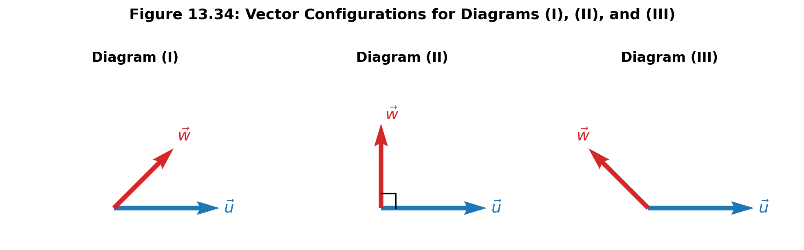

# MAT235 Week 5: Answers and Practice

## Table of Contents

- [Section A: Problem Type Teaching-Example Solutions](#section-a-problem-type-teaching-example-solutions)
  - [Problem Type PT-01: Evaluating Dot Products and Translating Definitions](#problem-type-pt-01-evaluating-dot-products-and-translating-definitions)
  - [Problem Type PT-02: Testing Orthogonality and Solving Parameter Conditions](#problem-type-pt-02-testing-orthogonality-and-solving-parameter-conditions)
  - [Problem Type PT-03: Determining Angles Between Vectors and Geometric Diagnostics](#problem-type-pt-03-determining-angles-between-vectors-and-geometric-diagnostics)
  - [Problem Type PT-04: Resolving Vector Projections and Orthogonal Components](#problem-type-pt-04-resolving-vector-projections-and-orthogonal-components)
  - [Problem Type PT-05: Computing Work Done by a Constant Force](#problem-type-pt-05-computing-work-done-by-a-constant-force)
  - [Problem Type PT-06: Formulating and Recognizing Equations of Planes from Point and Normal](#problem-type-pt-06-formulating-and-recognizing-equations-of-planes-from-point-and-normal)
  - [Problem Type PT-07: Analyzing Relationships Between Planes](#problem-type-pt-07-analyzing-relationships-between-planes)
  - [Problem Type PT-08: Computing Cross Products via Determinants and Algebraic Expansion](#problem-type-pt-08-computing-cross-products-via-determinants-and-algebraic-expansion)
  - [Problem Type PT-09: Geometric Cross Product, Right-Hand Rule, and Unit Normal Construction](#problem-type-pt-09-geometric-cross-product-right-hand-rule-and-unit-normal-construction)
  - [Problem Type PT-10: Determining Plane Equations Under Geometric Constraints](#problem-type-pt-10-determining-plane-equations-under-geometric-constraints)
  - [Problem Type PT-11: Calculating Parallelogram and Triangle Areas and Area Vectors](#problem-type-pt-11-calculating-parallelogram-and-triangle-areas-and-area-vectors)
  - [Problem Type PT-12: Scalar Triple Products and Parallelepiped Volumes](#problem-type-pt-12-scalar-triple-products-and-parallelepiped-volumes)
- [Section B: Actual Weekly Lecture and Handout Questions](#section-b-actual-weekly-lecture-and-handout-questions)
  - [Week 5 Slides (Week5.pdf)](#week-5-slides-week5pdf)
  - [October 5 Lecture Notes (oct 5.pdf)](#october-5-lecture-notes-oct-5pdf)
  - [October 7 Lecture Notes (oct 7.pdf)](#october-7-lecture-notes-oct-7pdf)
  - [MAT223 Supplementary Cross Product Handout (15 mat223_cross_product.pdf)](#mat223-supplementary-cross-product-handout-15-mat223_cross_productpdf)
- [Section C: Textbook Exercises and Solutions (Hughes-Hallett 8th Edition)](#section-c-textbook-exercises-and-solutions-hughes-hallett-8th-edition)
  - [Section 13.3 Exercises](#section-133-exercises)
  - [Section 13.4 Exercises](#section-134-exercises)
- [Section D: Original Self-Test Questions](#section-d-original-self-test-questions)
- [Section E: Self-Test Answers and Detailed Solutions](#section-e-self-test-answers-and-detailed-solutions)
- [Section F: Compact Source Coverage & Discrepancies Appendix](#section-f-compact-source-coverage--discrepancies-appendix)

---

## Section A: Problem Type Teaching-Example Solutions

### Problem Type PT-01: Evaluating Dot Products and Translating Definitions

**Question reference:** [Study-Notes.md: Problem Type PT-01](Study-Notes.md#problem-type-pt-01-evaluating-dot-products-and-translating-definitions)

**Worked solution.**
We are given $\vec{v} = 2\vec{i} - \vec{j} + 3\vec{k} = \langle 2, -1, 3 \rangle$ and $\vec{w} = 4\vec{i} + 2\vec{j} - \vec{k} = \langle 4, 2, -1 \rangle$.

(a) Using the algebraic definition in $\mathbb{R}^3$:
$$\vec{v}\cdot\vec{w} = (2)(4) + (-1)(2) + (3)(-1) = 8 - 2 - 3 = 3$$

(b) Compute the vector magnitudes:
$$\|\vec{v}\| = \sqrt{2^2 + (-1)^2 + 3^2} = \sqrt{4 + 1 + 9} = \sqrt{14}$$
$$\|\vec{w}\| = \sqrt{4^2 + 2^2 + (-1)^2} = \sqrt{16 + 4 + 1} = \sqrt{21}$$
From the geometric definition $\vec{v}\cdot\vec{w} = \|\vec{v}\|\|\vec{w}\|\cos\theta$:
$$\cos\theta = \frac{\vec{v}\cdot\vec{w}}{\|\vec{v}\|\|\vec{w}\|} = \frac{3}{\sqrt{14}\sqrt{21}} = \frac{3}{\sqrt{294}} = \frac{3}{7\sqrt{6}} = \frac{\sqrt{6}}{14} \approx 0.17496$$

(c) Using linearity and distributive properties:
$$(2\vec{v} - \vec{w})\cdot\vec{v} = 2(\vec{v}\cdot\vec{v}) - (\vec{w}\cdot\vec{v}) = 2\|\vec{v}\|^2 - (\vec{v}\cdot\vec{w})$$
Substituting $\|\vec{v}\|^2 = 14$ and $\vec{v}\cdot\vec{w} = 3$:
$$(2\vec{v} - \vec{w})\cdot\vec{v} = 2(14) - 3 = 28 - 3 = 25$$

**Answer.**
(a) $\vec{v}\cdot\vec{w} = 3$.  
(b) $\|\vec{v}\| = \sqrt{14}$, $\|\vec{w}\| = \sqrt{21}$, and $\cos\theta = \frac{3}{\sqrt{294}} = \frac{\sqrt{6}}{14} \approx 0.1750$ ($\theta \approx 1.395\text{ rad} \approx 79.9^\circ$).  
(c) $(2\vec{v} - \vec{w})\cdot\vec{v} = 25$.

---

### Problem Type PT-02: Testing Orthogonality and Solving Parameter Conditions

**Question reference:** [Study-Notes.md: Problem Type PT-02](Study-Notes.md#problem-type-pt-02-testing-orthogonality-and-solving-parameter-conditions)

**Worked solution.**
Given $\vec{a} = \langle 2, t, -4 \rangle$ and $\vec{b} = \langle t - 1, 3, 2 \rangle$.

(a) Orthogonality condition is $\vec{a}\cdot\vec{b} = 0$:
$$\vec{a}\cdot\vec{b} = 2(t - 1) + t(3) + (-4)(2) = 0$$
$$2t - 2 + 3t - 8 = 0 \iff 5t - 10 = 0 \iff 5t = 10 \iff t = 2$$

(b) Verification check:
At $t = 2$, the vectors are:
$$\vec{a} = \langle 2, 2, -4 \rangle, \quad \vec{b} = \langle 2 - 1, 3, 2 \rangle = \langle 1, 3, 2 \rangle$$
Evaluate their dot product:
$$\vec{a}\cdot\vec{b} = (2)(1) + (2)(3) + (-4)(2) = 2 + 6 - 8 = 0$$
The dot product vanishes identically, confirming orthogonality.

**Answer.**
(a) $t = 2$.  
(b) Verified: $\vec{a}(2) = \langle 2, 2, -4 \rangle$, $\vec{b}(2) = \langle 1, 3, 2 \rangle$, and $\vec{a}\cdot\vec{b} = 2 + 6 - 8 = 0$.

---

### Problem Type PT-03: Determining Angles Between Vectors and Geometric Diagnostics

**Question reference:** [Study-Notes.md: Problem Type PT-03](Study-Notes.md#problem-type-pt-03-determining-angles-between-vectors-and-geometric-diagnostics)

**Worked solution.**
Given vertices $A(1, 1, 0)$, $B(3, 2, 2)$, and $C(2, -1, 3)$.

(a) Construct displacement vectors emanating from vertex $A$:
$$\vec{AB} = B - A = \langle 3 - 1, 2 - 1, 2 - 0 \rangle = \langle 2, 1, 2 \rangle$$
$$\vec{AC} = C - A = \langle 2 - 1, -1 - 1, 3 - 0 \rangle = \langle 1, -2, 3 \rangle$$

(b) Calculate dot product and norms:
$$\vec{AB}\cdot\vec{AC} = (2)(1) + (1)(-2) + (2)(3) = 2 - 2 + 6 = 6$$
$$\|\vec{AB}\| = \sqrt{2^2 + 1^2 + 2^2} = \sqrt{4 + 1 + 4} = \sqrt{9} = 3$$
$$\|\vec{AC}\| = \sqrt{1^2 + (-2)^2 + 3^2} = \sqrt{1 + 4 + 9} = \sqrt{14}$$
Then:
$$\cos(\angle BAC) = \frac{\vec{AB}\cdot\vec{AC}}{\|\vec{AB}\|\|\vec{AC}\|} = \frac{6}{3\sqrt{14}} = \frac{2}{\sqrt{14}} = \frac{\sqrt{14}}{7} \approx 0.53452$$
Since $\cos(\angle BAC) > 0$, the angle at vertex $A$ is **acute**.

(c) Compute the angle:
$$\angle BAC = \arccos\left(\frac{2}{\sqrt{14}}\right) \approx 1.00685\text{ radians} \approx 57.7^\circ$$

**Answer.**
(a) $\vec{AB} = \langle 2, 1, 2 \rangle$, $\vec{AC} = \langle 1, -2, 3 \rangle$.  
(b) $\cos(\angle BAC) = \frac{2}{\sqrt{14}} = \frac{\sqrt{14}}{7} > 0$; the angle is acute.  
(c) $\angle BAC = \arccos\left(\frac{2}{\sqrt{14}}\right) \approx 57.7^\circ$ ($1.01$ rad).

---

### Problem Type PT-04: Resolving Vector Projections and Orthogonal Components

**Question reference:** [Study-Notes.md: Problem Type PT-04](Study-Notes.md#problem-type-pt-04-resolving-vector-projections-and-orthogonal-components)

**Worked solution.**
Given $\vec{v} = \langle 4, 3, -1 \rangle$ and $\vec{u} = \langle 2, -1, 2 \rangle$.

(a) Compute $\vec{v}\cdot\vec{u}$ and $\|\vec{u}\|$:
$$\vec{v}\cdot\vec{u} = (4)(2) + (3)(-1) + (-1)(2) = 8 - 3 - 2 = 3$$
$$\|\vec{u}\| = \sqrt{2^2 + (-1)^2 + 2^2} = \sqrt{4 + 1 + 4} = \sqrt{9} = 3$$
Scalar projection (component):
$$\text{comp}_{\vec{u}}\vec{v} = \frac{\vec{v}\cdot\vec{u}}{\|\vec{u}\|} = \frac{3}{3} = 1$$

(b) Vector projection:
$$\vec{v}_\parallel = \text{proj}_{\vec{u}}\vec{v} = \left(\frac{\vec{v}\cdot\vec{u}}{\|\vec{u}\|^2}\right)\vec{u} = \frac{3}{9}\langle 2, -1, 2 \rangle = \frac{1}{3}\langle 2, -1, 2 \rangle = \left\langle \frac{2}{3}, -\frac{1}{3}, \frac{2}{3} \right\rangle$$

(c) Orthogonal component:
$$\vec{v}_\perp = \vec{v} - \vec{v}_\parallel = \langle 4, 3, -1 \rangle - \left\langle \frac{2}{3}, -\frac{1}{3}, \frac{2}{3} \right\rangle = \left\langle 4 - \frac{2}{3}, 3 + \frac{1}{3}, -1 - \frac{2}{3} \right\rangle = \left\langle \frac{10}{3}, \frac{10}{3}, -\frac{5}{3} \right\rangle$$

(d) Verifications:

- Sum check:
  $$\vec{v}_\parallel + \vec{v}_\perp = \left\langle \frac{2}{3} + \frac{10}{3}, -\frac{1}{3} + \frac{10}{3}, \frac{2}{3} - \frac{5}{3} \right\rangle = \langle 4, 3, -1 \rangle = \vec{v}$$

- Orthogonality check:
  $$\vec{v}_\perp \cdot \vec{u} = \left(\frac{10}{3}\right)(2) + \left(\frac{10}{3}\right)(-1) + \left(-\frac{5}{3}\right)(2) = \frac{20 - 10 - 10}{3} = 0$$

**Answer.**
(a) Scalar projection $= 1$.  
(b) $\vec{v}_\parallel = \left\langle \frac{2}{3}, -\frac{1}{3}, \frac{2}{3} \right\rangle$.  
(c) $\vec{v}_\perp = \left\langle \frac{10}{3}, \frac{10}{3}, -\frac{5}{3} \right\rangle$.  
(d) Verified: $\vec{v}_\parallel + \vec{v}_\perp = \vec{v}$ and $\vec{v}_\perp \cdot \vec{u} = 0$.

---

### Problem Type PT-05: Computing Work Done by a Constant Force

**Question reference:** [Study-Notes.md: Problem Type PT-05](Study-Notes.md#problem-type-pt-05-computing-work-done-by-a-constant-force)

**Worked solution.**
Given force $\vec{F} = \langle 40, 25 \rangle\text{ N}$ moving an object from $P(2, 1)\text{ m}$ to $Q(7, 5)\text{ m}$.

(a) Displacement vector:
$$\vec{d} = \vec{PQ} = \langle 7 - 2, 5 - 1 \rangle = \langle 5, 4 \rangle\text{ meters}$$
Magnitude:
$$\|\vec{d}\| = \sqrt{5^2 + 4^2} = \sqrt{25 + 16} = \sqrt{41}\text{ m} \approx 6.403\text{ m}$$

(b) Work done in Joules:
$$W = \vec{F}\cdot\vec{d} = (40)(5) + (25)(4) = 200 + 100 = 300\text{ Joules}$$

(c) Conversion to foot-pounds using $1\text{ J} \approx 0.73756\text{ ft-lb}$:
$$W = 300 \times 0.73756 = 221.268\text{ ft-lb} \approx 221.3\text{ ft-lb}$$

(d) Force component parallel to motion:
$$F_\parallel = \frac{\vec{F}\cdot\vec{d}}{\|\vec{d}\|} = \frac{300}{\sqrt{41}} \approx 46.85\text{ Newtons}$$

**Answer.**
(a) $\vec{d} = \langle 5, 4 \rangle\text{ m}$, $\|\vec{d}\| = \sqrt{41}\text{ m} \approx 6.40\text{ m}$.  
(b) $W = 300\text{ Joules}$.  
(c) $W \approx 221.3\text{ ft-lb}$.  
(d) $F_\parallel = \frac{300}{\sqrt{41}}\text{ N} \approx 46.85\text{ N}$.

---

### Problem Type PT-06: Formulating and Recognizing Equations of Planes from Point and Normal

**Question reference:** [Study-Notes.md: Problem Type PT-06](Study-Notes.md#problem-type-pt-06-formulating-and-recognizing-equations-of-planes-from-point-and-normal)

**Worked solution.**
(a) Given $P_0(3, -2, 4)$ and $\vec{n} = \langle 5, -1, 2 \rangle$:
$$5(x - 3) - 1(y - (-2)) + 2(z - 4) = 0$$
$$5x - 15 - y - 2 + 2z - 8 = 0 \iff 5x - y + 2z = 25$$
Check at $(3, -2, 4)$: $5(3) - (-2) + 2(4) = 15 + 2 + 8 = 25$. Holds.

(b) Surface classification:

- (i) $4x - 6z = 7$: Linear in coordinates $x, y, z$ with $0y$. **Represents a plane.** Normal vector: $\vec{n} = \langle 4, 0, -6 \rangle$ (or any non-zero multiple, e.g. $\langle 2, 0, -3 \rangle$).
- (ii) $x^2 + y^2 - z = 0$: Contains nonlinear quadratic terms $x^2, y^2$. **Not a plane** (it is a circular paraboloid).
- (iii) $3(x - 1) + 2(y + 4) = 5(z - 2) \iff 3x - 3 + 2y + 8 = 5z - 10 \iff 3x + 2y - 5z = -15$. Linear equation. **Represents a plane.** Normal vector: $\vec{n} = \langle 3, 2, -5 \rangle$.

**Answer.**
(a) $5x - y + 2z = 25$.  
(b) (i) Plane, $\vec{n} = \langle 4, 0, -6 \rangle$; (ii) Not a plane (paraboloid); (iii) Plane, $\vec{n} = \langle 3, 2, -5 \rangle$.

---

### Problem Type PT-07: Analyzing Relationships Between Planes

**Question reference:** [Study-Notes.md: Problem Type PT-07](Study-Notes.md#problem-type-pt-07-analyzing-relationships-between-planes)

**Worked solution.**
The given planes have normal vectors:

- $\mathcal{P}_1: 2x - 4y + 6z = 5 \implies \vec{n}_1 = \langle 2, -4, 6 \rangle$
- $\mathcal{P}_2: -x + 2y - 3z = 8 \implies \vec{n}_2 = \langle -1, 2, -3 \rangle$
- $\mathcal{P}_3: 3x + 3y + z = 1 \implies \vec{n}_3 = \langle 3, 3, 1 \rangle$

(a) Relationship between $\mathcal{P}_1$ and $\mathcal{P}_2$:
Observe the ratio of components:
$$\frac{2}{-1} = \frac{-4}{2} = \frac{6}{-3} = -2 \implies \vec{n}_1 = -2\vec{n}_2$$
Because their normal vectors are parallel non-zero multiples, **$\mathcal{P}_1$ and $\mathcal{P}_2$ are parallel**. (Furthermore, the constant $5 \neq -2(8) = -16$, so they are distinct parallel planes).

(b) Relationship between $\mathcal{P}_1$ and $\mathcal{P}_3$:
Compute their normal dot product:
$$\vec{n}_1 \cdot \vec{n}_3 = (2)(3) + (-4)(3) + (6)(1) = 6 - 12 + 6 = 0$$
Since their normal vectors are orthogonal, **$\mathcal{P}_1$ and $\mathcal{P}_3$ are perpendicular**.

(c) Direction vector of the line of intersection of $\mathcal{P}_1$ and $\mathcal{P}_3$:
$$\vec{v}_{\text{line}} = \vec{n}_1 \times \vec{n}_3 = \begin{vmatrix} \vec{i} & \vec{j} & \vec{k} \\ 2 & -4 & 6 \\ 3 & 3 & 1 \end{vmatrix}$$
$$= \vec{i}((-4)(1) - (6)(3)) - \vec{j}((2)(1) - (6)(3)) + \vec{k}((2)(3) - (-4)(3))$$
$$= \vec{i}(-4 - 18) - \vec{j}(2 - 18) + \vec{k}(6 + 12) = -22\vec{i} + 16\vec{j} + 18\vec{k} = \langle -22, 16, 18 \rangle$$
Any non-zero scalar multiple, such as $\langle -11, 8, 9 \rangle$, is also parallel to the line of intersection.

**Answer.**
(a) $\mathcal{P}_1$ and $\mathcal{P}_2$ are **parallel** ($\vec{n}_1 = -2\vec{n}_2$).  
(b) $\mathcal{P}_1$ and $\mathcal{P}_3$ are **perpendicular** ($\vec{n}_1\cdot\vec{n}_3 = 0$).  
(c) $\vec{v}_{\text{line}} = \langle -22, 16, 18 \rangle$ (or simplified $\langle -11, 8, 9 \rangle$).

---

### Problem Type PT-08: Computing Cross Products via Determinants and Algebraic Expansion

**Question reference:** [Study-Notes.md: Problem Type PT-08](Study-Notes.md#problem-type-pt-08-computing-cross-products-via-determinants-and-algebraic-expansion)

**Worked solution.**
Given $\vec{u} = \langle 2, -1, 3 \rangle$ and $\vec{v} = \langle -1, 4, 2 \rangle$.

(a) Determinant expansion along row 1:
$$\vec{u}\times\vec{v} = \begin{vmatrix} \vec{i} & \vec{j} & \vec{k} \\ 2 & -1 & 3 \\ -1 & 4 & 2 \end{vmatrix}$$
$$= \vec{i}\begin{vmatrix} -1 & 3 \\ 4 & 2 \end{vmatrix} - \vec{j}\begin{vmatrix} 2 & 3 \\ -1 & 2 \end{vmatrix} + \vec{k}\begin{vmatrix} 2 & -1 \\ -1 & 4 \end{vmatrix}$$
$$= \vec{i}((-1)(2) - (3)(4)) - \vec{j}((2)(2) - (3)(-1)) + \vec{k}((2)(4) - (-1)(-1))$$
$$= \vec{i}(-2 - 12) - \vec{j}(4 + 3) + \vec{k}(8 - 1) = -14\vec{i} - 7\vec{j} + 7\vec{k} = \langle -14, -7, 7 \rangle$$

(b) Using the anticommutativity property $\vec{v}\times\vec{u} = -(\vec{u}\times\vec{v})$:
$$\vec{v}\times\vec{u} = -\langle -14, -7, 7 \rangle = \langle 14, 7, -7 \rangle = 14\vec{i} + 7\vec{j} - 7\vec{k}$$

(c) Orthogonality verification:

- Dot with $\vec{u}$:
  $$\langle -14, -7, 7 \rangle \cdot \langle 2, -1, 3 \rangle = (-14)(2) + (-7)(-1) + (7)(3) = -28 + 7 + 21 = 0$$

- Dot with $\vec{v}$:
  $$\langle -14, -7, 7 \rangle \cdot \langle -1, 4, 2 \rangle = (-14)(-1) + (-7)(4) + (7)(2) = 14 - 28 + 14 = 0$$
Both dot products are $0$, confirming the cross product is perpendicular to both original vectors.

**Answer.**
(a) $\vec{u}\times\vec{v} = -14\vec{i} - 7\vec{j} + 7\vec{k} = \langle -14, -7, 7 \rangle$.  
(b) $\vec{v}\times\vec{u} = 14\vec{i} + 7\vec{j} - 7\vec{k} = \langle 14, 7, -7 \rangle$ by anticommutativity.  
(c) Verified: $(\vec{u}\times\vec{v})\cdot\vec{u} = 0$ and $(\vec{u}\times\vec{v})\cdot\vec{v} = 0$.

---

### Problem Type PT-09: Geometric Cross Product, Right-Hand Rule, and Unit Normal Construction

**Question reference:** [Study-Notes.md: Problem Type PT-09](Study-Notes.md#problem-type-pt-09-geometric-cross-product-right-hand-rule-and-unit-normal-construction)

**Worked solution.**
(a) Basis cross products:

- (i) $\vec{j}\times\vec{k}$: Fingers curl from $+y$ to $+z$; right thumb points along positive $x$-axis: $\vec{j}\times\vec{k} = \vec{i}$.
- (ii) $\vec{k}\times\vec{j}$: Reverse order of (i); by anticommutativity: $\vec{k}\times\vec{j} = -\vec{i}$.
- (iii) $(\vec{i} + \vec{j})\times\vec{i} = \vec{i}\times\vec{i} + \vec{j}\times\vec{i} = \vec{0} - \vec{k} = -\vec{k}$.

(b) Given $\vec{a} = \langle 2, 1, 2 \rangle$ and $\vec{b} = \langle 3, -2, 1 \rangle$:
Compute their cross product:
$$\vec{n} = \vec{a}\times\vec{b} = \begin{vmatrix} \vec{i} & \vec{j} & \vec{k} \\ 2 & 1 & 2 \\ 3 & -2 & 1 \end{vmatrix}$$
$$= \vec{i}(1(1) - 2(-2)) - \vec{j}(2(1) - 2(3)) + \vec{k}(2(-2) - 1(3))$$
$$= \vec{i}(1 + 4) - \vec{j}(2 - 6) + \vec{k}(-4 - 3) = 5\vec{i} + 4\vec{j} - 7\vec{k} = \langle 5, 4, -7 \rangle$$
Compute its norm:
$$\|\vec{n}\| = \sqrt{5^2 + 4^2 + (-7)^2} = \sqrt{25 + 16 + 49} = \sqrt{90} = 3\sqrt{10}$$
The two unit normal vectors are:
$$\hat{u} = \pm \frac{\vec{n}}{\|\vec{n}\|} = \pm \frac{1}{3\sqrt{10}}\langle 5, 4, -7 \rangle = \pm \left\langle \frac{5}{3\sqrt{10}}, \frac{4}{3\sqrt{10}}, -\frac{7}{3\sqrt{10}} \right\rangle$$

**Answer.**
(a) (i) $\vec{i}$; (ii) $-\vec{i}$; (iii) $-\vec{k}$.  
(b) $\pm \left\langle \frac{5}{3\sqrt{10}}, \frac{4}{3\sqrt{10}}, -\frac{7}{3\sqrt{10}} \right\rangle = \pm \frac{1}{3\sqrt{10}}(5\vec{i} + 4\vec{j} - 7\vec{k})$.

---

### Problem Type PT-10: Determining Plane Equations Under Geometric Constraints

**Question reference:** [Study-Notes.md: Problem Type PT-10](Study-Notes.md#problem-type-pt-10-determining-plane-equations-under-geometric-constraints)

**Worked solution.**
Given points $A(2, 0, 1)$, $B(1, 3, -1)$, and $C(4, 1, 2)$.

(a) Compute displacement vectors:
$$\vec{AB} = B - A = \langle 1 - 2, 3 - 0, -1 - 1 \rangle = \langle -1, 3, -2 \rangle$$
$$\vec{AC} = C - A = \langle 4 - 2, 1 - 0, 2 - 1 \rangle = \langle 2, 1, 1 \rangle$$

(b) Compute cross product to test noncollinearity:
$$\vec{n} = \vec{AB}\times\vec{AC} = \begin{vmatrix} \vec{i} & \vec{j} & \vec{k} \\ -1 & 3 & -2 \\ 2 & 1 & 1 \end{vmatrix}$$
$$= \vec{i}(3(1) - (-2)(1)) - \vec{j}((-1)(1) - (-2)(2)) + \vec{k}((-1)(1) - 3(2))$$
$$= \vec{i}(3 + 2) - \vec{j}(-1 + 4) + \vec{k}(-1 - 6) = 5\vec{i} - 3\vec{j} - 7\vec{k} = \langle 5, -3, -7 \rangle$$
Since $\vec{n} = \langle 5, -3, -7 \rangle \neq \vec{0}$, the displacement vectors are not parallel, which proves the points $A, B, C$ are noncollinear and determine a unique plane.

(c) Formulate the plane equation using point $A(2, 0, 1)$:
$$5(x - 2) - 3(y - 0) - 7(z - 1) = 0$$
$$5x - 10 - 3y - 7z + 7 = 0 \iff 5x - 3y - 7z = 3$$
Verification by substitution:

- At $A(2, 0, 1)$: $5(2) - 3(0) - 7(1) = 10 - 7 = 3$. Holds.
- At $B(1, 3, -1)$: $5(1) - 3(3) - 7(-1) = 5 - 9 + 7 = 3$. Holds.
- At $C(4, 1, 2)$: $5(4) - 3(1) - 7(2) = 20 - 3 - 14 = 3$. Holds.

**Answer.**
(a) $\vec{AB} = \langle -1, 3, -2 \rangle$, $\vec{AC} = \langle 2, 1, 1 \rangle$.  
(b) $\vec{n} = \langle 5, -3, -7 \rangle \neq \vec{0}$ verifies noncollinearity.  
(c) $5x - 3y - 7z = 3$. All three points independently satisfy the equation.

---

### Problem Type PT-11: Calculating Parallelogram and Triangle Areas and Area Vectors

**Question reference:** [Study-Notes.md: Problem Type PT-11](Study-Notes.md#problem-type-pt-11-calculating-parallelogram-and-triangle-areas-and-area-vectors)

**Worked solution.**
Given vertices $P(1, 0, 2)$, $Q(3, 2, 1)$, and $R(2, 4, 5)$.

(a) Displacement vectors from vertex $P$:
$$\vec{PQ} = Q - P = \langle 3 - 1, 2 - 0, 1 - 2 \rangle = \langle 2, 2, -1 \rangle$$
$$\vec{PR} = R - P = \langle 2 - 1, 4 - 0, 5 - 2 \rangle = \langle 1, 4, 3 \rangle$$

(b) Cross product:
$$\vec{PQ}\times\vec{PR} = \begin{vmatrix} \vec{i} & \vec{j} & \vec{k} \\ 2 & 2 & -1 \\ 1 & 4 & 3 \end{vmatrix}$$
$$= \vec{i}(2(3) - (-1)(4)) - \vec{j}(2(3) - (-1)(1)) + \vec{k}(2(4) - 2(1))$$
$$= \vec{i}(6 + 4) - \vec{j}(6 + 1) + \vec{k}(8 - 2) = 10\vec{i} - 7\vec{j} + 6\vec{k} = \langle 10, -7, 6 \rangle$$
Magnitude:
$$\|\vec{PQ}\times\vec{PR}\| = \sqrt{10^2 + (-7)^2 + 6^2} = \sqrt{100 + 49 + 36} = \sqrt{185} \approx 13.6015$$

(c) Triangle Area:
$$\text{Area}(\triangle PQR) = \frac{1}{2}\|\vec{PQ}\times\vec{PR}\| = \frac{\sqrt{185}}{2} \approx 6.80$$

(d) Altitude / perpendicular distance from $R$ to line $PQ$:
Base length is $\|\vec{PQ}\| = \sqrt{2^2 + 2^2 + (-1)^2} = \sqrt{4 + 4 + 1} = \sqrt{9} = 3$.
$$h = \frac{\|\vec{PQ}\times\vec{PR}\|}{\|\vec{PQ}\|} = \frac{\sqrt{185}}{3} \approx 4.534$$

**Answer.**
(a) $\vec{PQ} = \langle 2, 2, -1 \rangle$, $\vec{PR} = \langle 1, 4, 3 \rangle$.  
(b) $\vec{PQ}\times\vec{PR} = \langle 10, -7, 6 \rangle$, magnitude $= \sqrt{185}$.  
(c) $\text{Area}(\triangle PQR) = \frac{\sqrt{185}}{2} \approx 6.80$.  
(d) Perpendicular distance $h = \frac{\sqrt{185}}{3} \approx 4.53$.

---

### Problem Type PT-12: Scalar Triple Products and Parallelepiped Volumes

**Question reference:** [Study-Notes.md: Problem Type PT-12](Study-Notes.md#problem-type-pt-12-scalar-triple-products-and-parallelepiped-volumes)

**Worked solution.**
Given $\vec{a} = \langle 1, 2, -1 \rangle$, $\vec{b} = \langle 3, 1, 2 \rangle$, and $\vec{c} = \langle -1, 4, 1 \rangle$.

(a) Evaluate the scalar triple product via a $3 \times 3$ determinant:
$$\det[\vec{a}, \vec{b}, \vec{c}] = \begin{vmatrix} 1 & 2 & -1 \\ 3 & 1 & 2 \\ -1 & 4 & 1 \end{vmatrix}$$
Expanding along row 1:
$$= 1\begin{vmatrix} 1 & 2 \\ 4 & 1 \end{vmatrix} - 2\begin{vmatrix} 3 & 2 \\ -1 & 1 \end{vmatrix} + (-1)\begin{vmatrix} 3 & 1 \\ -1 & 4 \end{vmatrix}$$
$$= 1(1 - 8) - 2(3 - (-2)) - 1(12 - (-1))$$
$$= 1(-7) - 2(5) - 1(13) = -7 - 10 - 13 = -30$$
Thus $(\vec{b}\times\vec{c})\cdot\vec{a} = -30$.

(b) Volume of the parallelepiped:
$$\text{Volume} = |(\vec{b}\times\vec{c})\cdot\vec{a}| = |-30| = 30$$

(c) Coplanarity diagnostic:
Because the volume is strictly nonzero ($\text{Volume} = 30 \neq 0$), the three vectors span a true 3-dimensional solid. Therefore, $\vec{a}, \vec{b}, \vec{c}$ **are not coplanar**.

**Answer.**
(a) $(\vec{b}\times\vec{c})\cdot\vec{a} = -30$.  
(b) $\text{Volume} = 30$ cubic units.  
(c) No, the vectors are not coplanar because the volume is non-zero ($30 \neq 0$).

---

## Section B: Actual Weekly Lecture and Handout Questions

### Week 5 Slides (Week5.pdf)

### [Week5.pdf Slide 1, Example 1.1]

**Source:** `W5/lec_note/Week5.pdf`, Page 1.

**Question.**
Calculate $\vec{v}\cdot\vec{w}$ for $\vec{v} = \vec{i} + 2\vec{j} + 3\vec{k}$ and $\vec{w} = 3\vec{i} - 2\vec{j} + \vec{k}$.

**Relevant method:** [Problem Type PT-01](Study-Notes.md#problem-type-pt-01-evaluating-dot-products-and-translating-definitions).

**Necessary work.**
State vectors in component form: $\vec{v} = \langle 1, 2, 3 \rangle$ and $\vec{w} = \langle 3, -2, 1 \rangle$.
Apply the algebraic definition of the dot product in $\mathbb{R}^3$:
$$\vec{v}\cdot\vec{w} = v_1 w_1 + v_2 w_2 + v_3 w_3 = (1)(3) + (2)(-2) + (3)(1) = 3 - 4 + 3 = 2$$

**Answer.**
$\vec{v}\cdot\vec{w} = 2$.

---

### [Week5.pdf Slide 1, Example 1.2(a)]

**Source:** `W5/lec_note/Week5.pdf`, Page 1.

**Question.**
Let $\vec{v} = 3\vec{i} + 3\vec{j} + 4\vec{k}$ and $\vec{w} = 3\vec{i} + 4\vec{k}$. Find the measure of the angle between $\vec{v}$ and $\vec{w}$.

**Relevant method:** [Problem Type PT-03](Study-Notes.md#problem-type-pt-03-determining-angles-between-vectors-and-geometric-diagnostics).

**Necessary work.**
Identify components: $\vec{v} = \langle 3, 3, 4 \rangle$ and $\vec{w} = \langle 3, 0, 4 \rangle$.
Both vectors are nonzero:

- $\vec{v}\cdot\vec{w} = (3)(3) + (3)(0) + (4)(4) = 9 + 0 + 16 = 25$
- $\|\vec{v}\| = \sqrt{3^2 + 3^2 + 4^2} = \sqrt{9 + 9 + 16} = \sqrt{34}$
- $\|\vec{w}\| = \sqrt{3^2 + 0^2 + 4^2} = \sqrt{9 + 16} = \sqrt{25} = 5$
Calculate the cosine of angle $\theta \in [0, \pi]$:
$$\cos\theta = \frac{\vec{v}\cdot\vec{w}}{\|\vec{v}\|\|\vec{w}\|} = \frac{25}{5\sqrt{34}} = \frac{5}{\sqrt{34}} = \frac{5\sqrt{34}}{34}$$
$$\theta = \arccos\left(\frac{5}{\sqrt{34}}\right) \approx 0.5404\text{ rad} \approx 30.96^\circ$$

**Answer.**
$\theta = \arccos\left(\frac{5}{\sqrt{34}}\right) \approx 31.0^\circ$ ($0.540$ radians).

---

### [Week5.pdf Slide 1, Example 1.2(b)]

**Source:** `W5/lec_note/Week5.pdf`, Page 1.

**Question.**
Let $\vec{v} = 3\vec{i} + 3\vec{j} + 4\vec{k}$. Find the value of $t$ for which the vector $t\vec{i} + 2t\vec{j} + 3\vec{k}$ is perpendicular to $\vec{v}$.

**Relevant method:** [Problem Type PT-02](Study-Notes.md#problem-type-pt-02-testing-orthogonality-and-solving-parameter-conditions).

**Necessary work.**
Two nonzero vectors are perpendicular if and only if their dot product vanishes:
$$(t\vec{i} + 2t\vec{j} + 3\vec{k})\cdot(3\vec{i} + 3\vec{j} + 4\vec{k}) = 0$$
Evaluate the dot product:
$$(t)(3) + (2t)(3) + (3)(4) = 3t + 6t + 12 = 9t + 12 = 0$$
Solve the linear equation for $t$:
$$9t = -12 \iff t = -\frac{12}{9} = -\frac{4}{3}$$
Verification check:
At $t = -4/3$, the vector is $\langle -4/3, -8/3, 3 \rangle$. Dot product: $3(-4/3) + 3(-8/3) + 4(3) = -4 - 8 + 12 = 0$.

**Answer.**
$t = -\frac{4}{3}$.

---

### [Week5.pdf Slide 2, Example 2.1]

**Source:** `W5/lec_note/Week5.pdf`, Page 2.

**Question.**
Which of the following equations represent planes? For each plane, give a normal vector:
(a) $2x + 3y - 5z = 4$  
(b) $2x^2 + 3(y - 2)^2 - 4(z - 1)^2 = 0$  
(c) $y = 2x - 1$  
(d) $z = 4 - 2y$

**Relevant method:** [Problem Type PT-06](Study-Notes.md#problem-type-pt-06-formulating-and-recognizing-equations-of-planes-from-point-and-normal).

**Necessary work.**
A plane in $\mathbb{R}^3$ is defined by a linear algebraic equation $Ax + By + Cz = D$ where $(A, B, C) \neq (0, 0, 0)$. The normal vector is $\vec{n} = \langle A, B, C \rangle$.

- (a) $2x + 3y - 5z = 4$ is linear in $x, y, z$. It represents a plane with normal vector $\vec{n} = \langle 2, 3, -5 \rangle = 2\vec{i} + 3\vec{j} - 5\vec{k}$.
- (b) $2x^2 + 3(y - 2)^2 - 4(z - 1)^2 = 0$ contains quadratic terms degree 2. It represents an elliptic cone, **not a plane**.
- (c) $y = 2x - 1 \iff 2x - y + 0z = 1$ is linear with $C = 0$. It represents a plane perpendicular to the $xy$-plane with normal vector $\vec{n} = \langle 2, -1, 0 \rangle = 2\vec{i} - \vec{j}$.
- (d) $z = 4 - 2y \iff 0x + 2y + z = 4$ is linear with $A = 0$. It represents a plane parallel to the $x$-axis with normal vector $\vec{n} = \langle 0, 2, 1 \rangle = 2\vec{j} + \vec{k}$.

**Answer.**
(a) Is a plane; normal vector $\vec{n} = \langle 2, 3, -5 \rangle$.  
(b) Not a plane (nonlinear quadric cone).  
(c) Is a plane; normal vector $\vec{n} = \langle 2, -1, 0 \rangle$.  
(d) Is a plane; normal vector $\vec{n} = \langle 0, 2, 1 \rangle$.

---

### [Week5.pdf Slide 2, Example 2.2]

**Source:** `W5/lec_note/Week5.pdf`, Page 2.

**Question.**
Which pairs of planes are parallel? Which pairs are perpendicular?
(a) $4x + 6y - 2z = 4$  
(b) $z = 2x + 3y$  
(c) $2x + 3y + z = 4$  
(d) $4x - 5y + 7z = 2$

**Relevant method:** [Problem Type PT-07](Study-Notes.md#problem-type-pt-07-analyzing-relationships-between-planes).

**Necessary work.**
Extract normal vectors for each plane:

- $\vec{n}_a = \langle 4, 6, -2 \rangle$
- $\vec{n}_b = \langle 2, 3, -1 \rangle$ (from $2x + 3y - z = 0$)
- $\vec{n}_c = \langle 2, 3, 1 \rangle$
- $\vec{n}_d = \langle 4, -5, 7 \rangle$

1. **Parallel test ($\vec{n}_1 = k\vec{n}_2$):**
   Comparing $\vec{n}_a$ and $\vec{n}_b$: $\langle 4, 6, -2 \rangle = 2\langle 2, 3, -1 \rangle$. Thus $\vec{n}_a = 2\vec{n}_b$, so planes **(a) and (b) are parallel**.
   No other pair of normals are proportional.

2. **Perpendicular test ($\vec{n}_1 \cdot \vec{n}_2 = 0$):**
   - $\vec{n}_a \cdot \vec{n}_c = 4(2) + 6(3) - 2(1) = 8 + 18 - 2 = 24 \neq 0$
   - $\vec{n}_a \cdot \vec{n}_d = 4(4) + 6(-5) - 2(7) = 16 - 30 - 14 = -28 \neq 0$
   - $\vec{n}_b \cdot \vec{n}_c = 2(2) + 3(3) - 1(1) = 4 + 9 - 1 = 12 \neq 0$
   - $\vec{n}_b \cdot \vec{n}_d = 2(4) + 3(-5) - 1(7) = 8 - 15 - 7 = -14 \neq 0$
   - $\vec{n}_c \cdot \vec{n}_d = 2(4) + 3(-5) + 1(7) = 8 - 15 + 7 = 0$.
   Thus planes **(c) and (d) are perpendicular**.

**Answer.**
Parallel pair: **(a) and (b)**.  
Perpendicular pair: **(c) and (d)**.

---

### [Week5.pdf Slide 3, Example 3.1]

**Source:** `W5/lec_note/Week5.pdf`, Page 3.

**Question.**
Find the equation of the plane parallel to $z = 1 - x + 6y$ that contains the point $(1, 1, 1)$.

**Relevant method:** [Problem Type PT-06](Study-Notes.md#problem-type-pt-06-formulating-and-recognizing-equations-of-planes-from-point-and-normal), [Problem Type PT-07](Study-Notes.md#problem-type-pt-07-analyzing-relationships-between-planes).

**Necessary work.**
Rewrite given plane in linear standard form:
$$x - 6y + z = 1$$
Its normal vector is $\vec{n} = \langle 1, -6, 1 \rangle$.
A parallel plane shares the same normal vector direction $\vec{n} = \langle 1, -6, 1 \rangle$.
Using point-normal form with $P_0(1, 1, 1)$:
$$1(x - 1) - 6(y - 1) + 1(z - 1) = 0$$
$$x - 6y + z = 1(1) - 6(1) + 1(1) = 1 - 6 + 1 = -4$$
Check: Substitute $(1, 1, 1)$: $1 - 6(1) + 1 = -4$. Holds.

**Answer.**
$x - 6y + z = -4$ (or $z = 6y - x - 4$).

---

### [Week5.pdf Slide 3, Example 3.2]

**Source:** `W5/lec_note/Week5.pdf`, Page 3.

**Question.**
A crate is hauled $6\text{ meters}$ up a ramp under a constant force of $300\text{ Newtons}$ applied at an angle of $25^\circ$ to the ramp. Use the definition of work to calculate the work done.

**Relevant method:** [Problem Type PT-05](Study-Notes.md#problem-type-pt-05-computing-work-done-by-a-constant-force).

**Necessary work.**
The force magnitude is $\|\vec{F}\| = 300\text{ N}$.
The displacement magnitude is $\|\vec{d}\| = 6\text{ m}$.
The angle between the applied force vector and the displacement along the ramp is $\theta = 25^\circ$.
By the geometric dot product definition of work:
$$W = \vec{F}\cdot\vec{d} = \|\vec{F}\|\|\vec{d}\|\cos\theta = (300\text{ N})(6\text{ m})\cos(25^\circ) = 1800\cos(25^\circ)\text{ Joules}$$
Evaluating numerically:
$$W = 1800 \times 0.906307787\dots \approx 1631.35\text{ Joules}$$

**Answer.**
$W = 1800\cos(25^\circ)\text{ J} \approx 1631.35\text{ Joules}$.

---

### [Week5.pdf Slide 4, Example 4.1]

**Source:** `W5/lec_note/Week5.pdf`, Page 4.

**Question.**
Evaluate $\begin{vmatrix} 2 & 1 & -1 \\ 3 & 0 & 2 \\ 1 & -2 & 1 \end{vmatrix}$.

**Relevant method:** [Problem Type PT-08](Study-Notes.md#problem-type-pt-08-computing-cross-products-via-determinants-and-algebraic-expansion).

**Necessary work.**
Expand along row 1 using $2 \times 2$ minors:
$$\begin{vmatrix} 2 & 1 & -1 \\ 3 & 0 & 2 \\ 1 & -2 & 1 \end{vmatrix} = 2\begin{vmatrix} 0 & 2 \\ -2 & 1 \end{vmatrix} - 1\begin{vmatrix} 3 & 2 \\ 1 & 1 \end{vmatrix} + (-1)\begin{vmatrix} 3 & 0 \\ 1 & -2 \end{vmatrix}$$
Evaluate each $2 \times 2$ determinant:

- $\begin{vmatrix} 0 & 2 \\ -2 & 1 \end{vmatrix} = (0)(1) - (2)(-2) = 0 - (-4) = 4$
- $\begin{vmatrix} 3 & 2 \\ 1 & 1 \end{vmatrix} = (3)(1) - (2)(1) = 3 - 2 = 1$
- $\begin{vmatrix} 3 & 0 \\ 1 & -2 \end{vmatrix} = (3)(-2) - (0)(1) = -6 - 0 = -6$
Combine the signed terms:
$$= 2(4) - 1(1) - 1(-6) = 8 - 1 + 6 = 13$$

**Answer.**
$13$.

---

### [Week5.pdf Slide 5, Example 5.1]

**Source:** `W5/lec_note/Week5.pdf`, Page 5.

**Question.**
Let $\vec{u} = \vec{i} + 2\vec{j}$ and $\vec{v} = -\vec{i} + 2\vec{j} + \vec{k}$. Find $\vec{u}\times\vec{v}$ and $\vec{v}\times\vec{u}$.

**Relevant method:** [Problem Type PT-08](Study-Notes.md#problem-type-pt-08-computing-cross-products-via-determinants-and-algebraic-expansion).

**Necessary work.**
Write component vectors: $\vec{u} = \langle 1, 2, 0 \rangle$ and $\vec{v} = \langle -1, 2, 1 \rangle$.
Set up determinant for $\vec{u}\times\vec{v}$:
$$\vec{u}\times\vec{v} = \begin{vmatrix} \vec{i} & \vec{j} & \vec{k} \\ 1 & 2 & 0 \\ -1 & 2 & 1 \end{vmatrix}$$
$$= \vec{i}(2(1) - 0(2)) - \vec{j}(1(1) - 0(-1)) + \vec{k}(1(2) - 2(-1))$$
$$= 2\vec{i} - 1\vec{j} + (2 + 2)\vec{k} = 2\vec{i} - \vec{j} + 4\vec{k} = \langle 2, -1, 4 \rangle$$
By anticommutativity of the cross product:
$$\vec{v}\times\vec{u} = -(\vec{u}\times\vec{v}) = -(2\vec{i} - \vec{j} + 4\vec{k}) = -2\vec{i} + \vec{j} - 4\vec{k} = \langle -2, 1, -4 \rangle$$
Verification:
$\langle 2, -1, 4 \rangle \cdot \langle 1, 2, 0 \rangle = 2 - 2 + 0 = 0$.
$\langle 2, -1, 4 \rangle \cdot \langle -1, 2, 1 \rangle = -2 - 2 + 4 = 0$.

**Answer.**
$\vec{u}\times\vec{v} = 2\vec{i} - \vec{j} + 4\vec{k} = \langle 2, -1, 4 \rangle$;  
$\vec{v}\times\vec{u} = -2\vec{i} + \vec{j} - 4\vec{k} = \langle -2, 1, -4 \rangle$.

---

### [Week5.pdf Slide 6, Example 6.1]

**Source:** `W5/lec_note/Week5.pdf`, Page 6.

**Question.**
Let $\vec{v} = 3\vec{i} + 3\vec{j} + 4\vec{k}$ and $\vec{w} = 3\vec{i} + 4\vec{k}$. Find a unit vector that is perpendicular to both $\vec{v}$ and $\vec{w}$.

**Relevant method:** [Problem Type PT-08](Study-Notes.md#problem-type-pt-08-computing-cross-products-via-determinants-and-algebraic-expansion), [Problem Type PT-09](Study-Notes.md#problem-type-pt-09-geometric-cross-product-right-hand-rule-and-unit-normal-construction).

**Necessary work.**
Components: $\vec{v} = \langle 3, 3, 4 \rangle$ and $\vec{w} = \langle 3, 0, 4 \rangle$.
A vector perpendicular to both is their cross product:
$$\vec{n} = \vec{v}\times\vec{w} = \begin{vmatrix} \vec{i} & \vec{j} & \vec{k} \\ 3 & 3 & 4 \\ 3 & 0 & 4 \end{vmatrix}$$
$$= \vec{i}(3(4) - 4(0)) - \vec{j}(3(4) - 4(3)) + \vec{k}(3(0) - 3(3))$$
$$= 12\vec{i} - 0\vec{j} - 9\vec{k} = \langle 12, 0, -9 \rangle$$
Compute magnitude:
$$\|\vec{n}\| = \sqrt{12^2 + 0^2 + (-9)^2} = \sqrt{144 + 81} = \sqrt{225} = 15$$
Normalize to a unit vector:
$$\hat{u} = \frac{\vec{n}}{\|\vec{n}\|} = \frac{1}{15}\langle 12, 0, -9 \rangle = \left\langle \frac{4}{5}, 0, -\frac{3}{5} \right\rangle = \frac{4}{5}\vec{i} - \frac{3}{5}\vec{k}$$
Its opposite $-\hat{u} = -\frac{4}{5}\vec{i} + \frac{3}{5}\vec{k}$ is also valid.

**Answer.**
$\frac{4}{5}\vec{i} - \frac{3}{5}\vec{k} = \left\langle \frac{4}{5}, 0, -\frac{3}{5} \right\rangle$ (or $\pm \left\langle \frac{4}{5}, 0, -\frac{3}{5} \right\rangle$).

---

### [Week5.pdf Slide 6, Example 6.2]

**Source:** `W5/lec_note/Week5.pdf`, Page 6.

**Question.**
Find an equation of the plane through the points $A = (1, 2, -1)$, $B = (2, 3, 0)$, $C = (3, -1, 2)$.
(a) Find two displacement vectors in the plane.
(b) Find a normal vector to the plane.
(c) Find an equation of the plane.

**Relevant method:** [Problem Type PT-10](Study-Notes.md#problem-type-pt-10-determining-plane-equations-under-geometric-constraints).

**Necessary work.**
(a) Displacement vectors:
$$\vec{AB} = B - A = \langle 2 - 1, 3 - 2, 0 - (-1) \rangle = \langle 1, 1, 1 \rangle$$
$$\vec{AC} = C - A = \langle 3 - 1, -1 - 2, 2 - (-1) \rangle = \langle 2, -3, 3 \rangle$$

(b) Normal vector using cross product:
$$\vec{n} = \vec{AB}\times\vec{AC} = \begin{vmatrix} \vec{i} & \vec{j} & \vec{k} \\ 1 & 1 & 1 \\ 2 & -3 & 3 \end{vmatrix}$$
$$= \vec{i}(1(3) - 1(-3)) - \vec{j}(1(3) - 1(2)) + \vec{k}(1(-3) - 1(2))$$
$$= 6\vec{i} - 1\vec{j} - 5\vec{k} = \langle 6, -1, -5 \rangle$$

(c) Equation of plane using $A(1, 2, -1)$:
$$6(x - 1) - 1(y - 2) - 5(z + 1) = 0$$
$$6x - 6 - y + 2 - 5z - 5 = 0 \iff 6x - y - 5z = 9$$
Verification on all three points:

- At $A(1, 2, -1)$: $6(1) - 2 - 5(-1) = 6 - 2 + 5 = 9$.
- At $B(2, 3, 0)$: $6(2) - 3 - 5(0) = 12 - 3 = 9$.
- At $C(3, -1, 2)$: $6(3) - (-1) - 5(2) = 18 + 1 - 10 = 9$.

**Answer.**
(a) $\vec{AB} = \langle 1, 1, 1 \rangle$, $\vec{AC} = \langle 2, -3, 3 \rangle$.  
(b) $\vec{n} = \langle 6, -1, -5 \rangle = 6\vec{i} - \vec{j} - 5\vec{k}$.  
(c) $6x - y - 5z = 9$.

---

### [Week5.pdf Slide 7, Example 7.1]

**Source:** `W5/lec_note/Week5.pdf`, Page 7.

**Question.**
Find an area vector for the parallelogram with vertices $P = (2, 1, 1)$, $Q = (3, 3, 0)$, $R = (4, 0, 2)$, $S = (5, 2, 1)$.

**Relevant method:** [Problem Type PT-11](Study-Notes.md#problem-type-pt-11-calculating-parallelogram-and-triangle-areas-and-area-vectors).

**Necessary work.**
Identify adjacent edge vectors from base vertex $P$:
$$\vec{PQ} = Q - P = \langle 3 - 2, 3 - 1, 0 - 1 \rangle = \langle 1, 2, -1 \rangle$$
$$\vec{PR} = R - P = \langle 4 - 2, 0 - 1, 2 - 1 \rangle = \langle 2, -1, 1 \rangle$$
Check opposite vertex $S$: $P + \vec{PQ} + \vec{PR} = (2+1+2, 1+2-1, 1-1+1) = (5, 2, 1) = S$. Confirmed parallelogram.
The area vector $\vec{A}$ is given by the cross product of the adjacent edges:
$$\vec{A} = \vec{PQ}\times\vec{PR} = \begin{vmatrix} \vec{i} & \vec{j} & \vec{k} \\ 1 & 2 & -1 \\ 2 & -1 & 1 \end{vmatrix}$$
$$= \vec{i}(2(1) - (-1)(-1)) - \vec{j}(1(1) - (-1)(2)) + \vec{k}(1(-1) - 2(2))$$
$$= \vec{i}(2 - 1) - \vec{j}(1 + 2) + \vec{k}(-1 - 4) = \vec{i} - 3\vec{j} - 5\vec{k} = \langle 1, -3, -5 \rangle$$
(The opposite vector $-\vec{A} = -\vec{i} + 3\vec{j} + 5\vec{k}$ is also an area vector with opposite orientation).
Area magnitude is $\|\vec{A}\| = \sqrt{1^2 + (-3)^2 + (-5)^2} = \sqrt{35}$.

**Answer.**
$\vec{A} = \vec{i} - 3\vec{j} - 5\vec{k} = \langle 1, -3, -5 \rangle$ (or $\langle -1, 3, 5 \rangle$); area is $\sqrt{35}$.

---

### [Week5.pdf Slide 8, Example 8.1]

**Source:** `W5/lec_note/Week5.pdf`, Page 8.

**Question.**
Find the equation of the plane containing the point $(1, 0, -1)$ and the line $x - 2y = 4$ in the $xy$-plane.

**Relevant method:** [Problem Type PT-10](Study-Notes.md#problem-type-pt-10-determining-plane-equations-under-geometric-constraints).

**Necessary work.**
In the $xy$-plane, $z = 0$. Thus the line is defined by the equations $x - 2y = 4$ and $z = 0$.

1. Direction vector of the line: As $y$ increases by $1$, $x$ increases by $2$, and $z=0$, so $\vec{v}_L = \langle 2, 1, 0 \rangle$.
2. Pick a point on the line: Setting $y = 0 \implies x = 4, z = 0$, so $Q(4, 0, 0)$ is on the line.
3. Form displacement vector from $Q$ to the given external point $P(1, 0, -1)$:
   $$\vec{QP} = P - Q = \langle 1 - 4, 0 - 0, -1 - 0 \rangle = \langle -3, 0, -1 \rangle$$

4. Compute the plane normal vector:
   $$\vec{n} = \vec{v}_L \times \vec{QP} = \begin{vmatrix} \vec{i} & \vec{j} & \vec{k} \\ 2 & 1 & 0 \\ -3 & 0 & -1 \end{vmatrix}$$
   $$= \vec{i}(1(-1) - 0(0)) - \vec{j}(2(-1) - 0(-3)) + \vec{k}(2(0) - 1(-3))$$
   $$= -\vec{i} - \vec{j}(-2) + 3\vec{k} = -\vec{i} + 2\vec{j} + 3\vec{k} = \langle -1, 2, 3 \rangle$$

5. Multiply by $-1$ to choose convenient normal $\vec{n} = \langle 1, -2, -3 \rangle$.
   Using point $Q(4, 0, 0)$:
   $$1(x - 4) - 2(y - 0) - 3(z - 0) = 0 \iff x - 2y - 3z = 4$$
Verification:

- Point $(1, 0, -1)$: $1 - 2(0) - 3(-1) = 1 + 3 = 4$. Holds.
- On the $xy$-plane ($z=0$): $x - 2y - 3(0) = 4 \implies x - 2y = 4$. Exact given line.

**Answer.**
$x - 2y - 3z = 4$ (or $-x + 2y + 3z = -4$).

---

### [Week5.pdf Slide 8, Example 8.2]

**Source:** `W5/lec_note/Week5.pdf`, Page 8.

**Question.**
Find an equation of the plane through the points $Q(0, 2, -1)$ and $R(3, 1, 0)$ that is perpendicular to the plane $z = 2x + y$.

**Relevant method:** [Problem Type PT-07](Study-Notes.md#problem-type-pt-07-analyzing-relationships-between-planes), [Problem Type PT-10](Study-Notes.md#problem-type-pt-10-determining-plane-equations-under-geometric-constraints).

**Necessary work.**

1. Vector along the desired plane:
   $$\vec{QR} = R - Q = \langle 3 - 0, 1 - 2, 0 - (-1) \rangle = \langle 3, -1, 1 \rangle$$

2. Normal of given plane $2x + y - z = 0$:
   $$\vec{n}_1 = \langle 2, 1, -1 \rangle$$

3. Since the desired plane is perpendicular to the given plane, $\vec{n}_1$ is parallel to the desired plane. Thus the normal $\vec{n}$ to the desired plane must be perpendicular to both $\vec{QR}$ and $\vec{n}_1$:
   $$\vec{n} = \vec{QR} \times \vec{n}_1 = \begin{vmatrix} \vec{i} & \vec{j} & \vec{k} \\ 3 & -1 & 1 \\ 2 & 1 & -1 \end{vmatrix}$$
   $$= \vec{i}((-1)(-1) - (1)(1)) - \vec{j}((3)(-1) - (1)(2)) + \vec{k}((3)(1) - (-1)(2))$$
   $$= \vec{i}(1 - 1) - \vec{j}(-3 - 2) + \vec{k}(3 + 2) = 0\vec{i} + 5\vec{j} + 5\vec{k} = \langle 0, 5, 5 \rangle$$

4. Choose simplified normal $\vec{n} = \langle 0, 1, 1 \rangle$.
   Using point $Q(0, 2, -1)$:
   $$0(x - 0) + 1(y - 2) + 1(z + 1) = 0 \iff y + z - 1 = 0 \iff y + z = 1$$
Verification:

- At $Q(0, 2, -1)$: $2 + (-1) = 1$. Holds.
- At $R(3, 1, 0)$: $1 + 0 = 1$. Holds.
- Perpendicularity check: $\langle 0, 1, 1 \rangle \cdot \langle 2, 1, -1 \rangle = 0 + 1 - 1 = 0$. Normal vectors are perpendicular.

**Answer.**
$y + z = 1$.

---

### October 5 Lecture Notes (oct 5.pdf)

### [oct 5.pdf Page 1-2, Example 1]

**Source:** `W5/lec_note/oct 5.pdf`, Pages 1–2.

**Question.**
Consider vectors $\vec{v} = (1, 0)$ and $\vec{w} = (2, 2)$ in $\mathbb{R}^2$. Show that the geometric definition and algebraic definition of the dot product are equivalent.

**Relevant method:** [Problem Type PT-01](Study-Notes.md#problem-type-pt-01-evaluating-dot-products-and-translating-definitions).

**Necessary work.**

1. Geometric definition:
   - $\|\vec{v}\| = \sqrt{1^2 + 0^2} = 1$.
   - $\|\vec{w}\| = \sqrt{2^2 + 2^2} = \sqrt{8} = 2\sqrt{2}$.
   - Angle between positive $x$-axis and $\langle 2, 2 \rangle$ is $\theta = \pi/4$.
   - $\vec{v}\cdot\vec{w} = \|\vec{v}\|\|\vec{w}\|\cos\theta = (1)(2\sqrt{2})\cos(\pi/4) = 2\sqrt{2}\left(\frac{\sqrt{2}}{2}\right) = 2$.
2. Algebraic definition:
   - $\vec{v}\cdot\vec{w} = (1)(2) + (0)(2) = 2 + 0 = 2$.
Both definitions yield identical value $2$.

**Answer.**
Both definitions yield $\vec{v}\cdot\vec{w} = 2$.

---

### [oct 5.pdf Page 2, Question 1]

**Source:** `W5/lec_note/oct 5.pdf`, Page 2.

**Question.**
Given $\vec{v} = (1, 2, -1)$ and $\vec{w} = (2, k, 4)$. Find $k$ such that $\vec{v}$ and $\vec{w}$ are orthogonal.

**Relevant method:** [Problem Type PT-02](Study-Notes.md#problem-type-pt-02-testing-orthogonality-and-solving-parameter-conditions).

**Necessary work.**
Vectors are orthogonal if and only if $\vec{v}\cdot\vec{w} = 0$:
$$\vec{v}\cdot\vec{w} = (1)(2) + (2)(k) + (-1)(4) = 2 + 2k - 4 = 2k - 2 = 0$$
$$2k = 2 \iff k = 1$$

**Answer.**
$k = 1$.

---

### [oct 5.pdf Page 3, Question 2]

**Source:** `W5/lec_note/oct 5.pdf`, Page 3.

**Question.**
Find the plane passing through $(1, 1, 1)$ with a normal vector $(1, 2, 1)$.

**Relevant method:** [Problem Type PT-06](Study-Notes.md#problem-type-pt-06-formulating-and-recognizing-equations-of-planes-from-point-and-normal).

**Necessary work.**
In lecture notation $n_1(x_1 - p_1) + n_2(x_2 - p_2) + n_3(x_3 - p_3) = 0$:
$$1(x_1 - 1) + 2(x_2 - 1) + 1(x_3 - 1) = 0$$
$$x_1 + 2x_2 + x_3 - (1 + 2 + 1) = 0 \iff x_1 + 2x_2 + x_3 = 4$$
In standard $(x, y, z)$ coordinates: $x + 2y + z = 4$.

**Answer.**
$x_1 + 2x_2 + x_3 = 4$ (or $x + 2y + z = 4$).

---

### [oct 5.pdf Page 4, Question 3(a)]

**Source:** `W5/lec_note/oct 5.pdf`, Page 4.

**Question.**
What is a normal vector to the $(x, y)$ plane in $\mathbb{R}^3$?

**Relevant method:** [Problem Type PT-06](Study-Notes.md#problem-type-pt-06-formulating-and-recognizing-equations-of-planes-from-point-and-normal).

**Necessary work.**
The $xy$-plane has equation $z = 0$, or $0x + 0y + 1z = 0$.
The normal vector is directed along the $z$-axis:
$$\vec{n} = (0, 0, 1) = \vec{k}$$
Any nonzero scalar multiple $(0, 0, c)$ with $c \neq 0$ is also a valid normal vector.

**Answer.**
$\vec{n} = (0, 0, 1) = \vec{k}$ (or any non-zero multiple).

---

### [oct 5.pdf Page 4, Question 3(b)]

**Source:** `W5/lec_note/oct 5.pdf`, Page 4.

**Question.**
What is the normal vector to the plane $\{(x_1, x_2, x_3) : (x_1 - 1) + (x_2 - 2) + 2(x_3 - 2) = 0\}$?

**Relevant method:** [Problem Type PT-06](Study-Notes.md#problem-type-pt-06-formulating-and-recognizing-equations-of-planes-from-point-and-normal).

**Necessary work.**
The equation is given in point-normal form $n_1(x_1 - p_1) + n_2(x_2 - p_2) + n_3(x_3 - p_3) = 0$.
Reading the coefficients directly:
$n_1 = 1, n_2 = 1, n_3 = 2$.
Therefore, $\vec{n} = (1, 1, 2) = \vec{i} + \vec{j} + 2\vec{k}$.

**Answer.**
$\vec{n} = (1, 1, 2) = \vec{i} + \vec{j} + 2\vec{k}$.

---

### October 7 Lecture Notes (oct 7.pdf)

### [oct 7.pdf Page 2, Question 1]

**Source:** `W5/lec_note/oct 7.pdf`, Page 2.

**Question.**
Find the work done by a force $\vec{F}$ moving an object on the line from point $P$ to point $Q$:
$\vec{F} = 3\vec{i} + 4\vec{j}$, $P = (3, 4)$, $Q = (8, 10)$.

**Relevant method:** [Problem Type PT-05](Study-Notes.md#problem-type-pt-05-computing-work-done-by-a-constant-force).

**Necessary work.**
Displacement vector:
$$\vec{d} = \vec{PQ} = (8 - 3)\vec{i} + (10 - 4)\vec{j} = 5\vec{i} + 6\vec{j} = \langle 5, 6 \rangle$$
Work formula:
$$W = \vec{F}\cdot\vec{d} = (3)(5) + (4)(6) = 15 + 24 = 39\text{ Joules}$$

**Answer.**
$W = 39\text{ Joules}$ (or 39 units of work).

---

### [oct 7.pdf Page 4, Question 2]

**Source:** `W5/lec_note/oct 7.pdf`, Page 4.

**Question.**
What is $\vec{i}\times\vec{j}$?

**Relevant method:** [Problem Type PT-09](Study-Notes.md#problem-type-pt-09-geometric-cross-product-right-hand-rule-and-unit-normal-construction).

**Necessary work.**
By the Right-Hand Rule, curling fingers from the positive $x$-axis ($\vec{i}$) to the positive $y$-axis ($\vec{j}$) results in the thumb pointing straight along the positive $z$-axis ($\vec{k}$).
Magnitude is $\|\vec{i}\|\|\vec{j}\|\sin(\pi/2) = (1)(1)(1) = 1$.
Thus $\vec{i}\times\vec{j} = \vec{k}$.

**Answer.**
$\vec{k} = (0, 0, 1)$.

---

### [oct 7.pdf Page 4, Question 3]

**Source:** `W5/lec_note/oct 7.pdf`, Page 4.

**Question.**
Let $\vec{v} = (1, 2, 3)$ and $\vec{w} = (2, 1, 3)$. What is $\vec{v}\times\vec{w}$?

**Relevant method:** [Problem Type PT-08](Study-Notes.md#problem-type-pt-08-computing-cross-products-via-determinants-and-algebraic-expansion).

**Necessary work.**
Using the lecture formula $\vec{v}\times\vec{w} = (v_2 w_3 - v_3 w_2, v_3 w_1 - v_1 w_3, v_1 w_2 - v_2 w_1)$:

- $c_1 = (2)(3) - (3)(1) = 6 - 3 = 3$
- $c_2 = (3)(2) - (1)(3) = 6 - 3 = 3$
- $c_3 = (1)(1) - (2)(2) = 1 - 4 = -3$
Thus $\vec{v}\times\vec{w} = (3, 3, -3) = 3\vec{i} + 3\vec{j} - 3\vec{k}$.
Verification:
$(3, 3, -3)\cdot(1, 2, 3) = 3 + 6 - 9 = 0$.
$(3, 3, -3)\cdot(2, 1, 3) = 6 + 3 - 9 = 0$.

**Answer.**
$(3, 3, -3) = 3\vec{i} + 3\vec{j} - 3\vec{k}$.

---

### MAT223 Supplementary Cross Product Handout (15 mat223_cross_product.pdf)

### [MAT223 Handout Page 1, Question 2]

**Source:** `W5/lec_note/15 mat223_cross_product.pdf`, Page 1.

**Question.**
Determine the direction of the cross product using the right hand rule:
(a) $\vec{e}_1 \times \vec{e}_2$  
(b) $\vec{e}_2 \times \vec{e}_1$  
(c) $\vec{e}_2 \times \vec{e}_3$  
(d) $\vec{e}_3 \times \vec{e}_2$  
(e) $\vec{e}_1 \times \vec{e}_3$  
(f) $\vec{e}_3 \times \vec{e}_1$

**Relevant method:** [Problem Type PT-09](Study-Notes.md#problem-type-pt-09-geometric-cross-product-right-hand-rule-and-unit-normal-construction).

**Necessary work.**
Here $\vec{e}_1 = \vec{i}, \vec{e}_2 = \vec{j}, \vec{e}_3 = \vec{k}$.
Using cyclic Right-Hand Rule relations:

- $\vec{e}_1 \times \vec{e}_2 = \vec{e}_3$
- $\vec{e}_2 \times \vec{e}_1 = -\vec{e}_3$ (by anticommutativity)
- $\vec{e}_2 \times \vec{e}_3 = \vec{e}_1$
- $\vec{e}_3 \times \vec{e}_2 = -\vec{e}_1$
- $\vec{e}_1 \times \vec{e}_3 = -\vec{e}_2$
- $\vec{e}_3 \times \vec{e}_1 = \vec{e}_2$

**Answer.**
(a) $\vec{e}_3$; (b) $-\vec{e}_3$; (c) $\vec{e}_1$; (d) $-\vec{e}_1$; (e) $-\vec{e}_2$; (f) $\vec{e}_2$.

---

### [MAT223 Handout Page 1, Question 3]

**Source:** `W5/lec_note/15 mat223_cross_product.pdf`, Page 1.

**Question.**
Compute the cross products:
(a) $\begin{bmatrix} 1 \\ 0 \\ 2 \end{bmatrix} \times \begin{bmatrix} 3 \\ 4 \\ -2 \end{bmatrix}$  
(b) $\begin{bmatrix} -1 \\ 3 \\ 4 \end{bmatrix} \times \begin{bmatrix} 1 \\ 1 \\ 1 \end{bmatrix}$  
(c) $\begin{bmatrix} 1 \\ -7 \\ 2 \end{bmatrix} \times \begin{bmatrix} 6 \\ 2 \\ 4 \end{bmatrix}$

**Relevant method:** [Problem Type PT-08](Study-Notes.md#problem-type-pt-08-computing-cross-products-via-determinants-and-algebraic-expansion).

**Necessary work.**
Using the column determinant minor formulas from the handout:
(a)
$$c_1 = \det\begin{bmatrix} 0 & 4 \\ 2 & -2 \end{bmatrix} = 0 - 8 = -8$$
$$c_2 = -\det\begin{bmatrix} 1 & 3 \\ 2 & -2 \end{bmatrix} = -(-2 - 6) = 8$$
$$c_3 = \det\begin{bmatrix} 1 & 3 \\ 0 & 4 \end{bmatrix} = 4 - 0 = 4$$
Result: $\begin{bmatrix} -8 \\ 8 \\ 4 \end{bmatrix}$. Check: $[-8, 8, 4]\cdot[1, 0, 2] = -8 + 8 = 0$.

(b)
$$c_1 = \det\begin{bmatrix} 3 & 1 \\ 4 & 1 \end{bmatrix} = 3 - 4 = -1$$
$$c_2 = -\det\begin{bmatrix} -1 & 1 \\ 4 & 1 \end{bmatrix} = -(-1 - 4) = 5$$
$$c_3 = \det\begin{bmatrix} -1 & 1 \\ 3 & 1 \end{bmatrix} = -1 - 3 = -4$$
Result: $\begin{bmatrix} -1 \\ 5 \\ -4 \end{bmatrix}$. Check: $[-1, 5, -4]\cdot[1, 1, 1] = -1 + 5 - 4 = 0$.

(c)
$$c_1 = \det\begin{bmatrix} -7 & 2 \\ 2 & 4 \end{bmatrix} = -28 - 4 = -32$$
$$c_2 = -\det\begin{bmatrix} 1 & 6 \\ 2 & 4 \end{bmatrix} = -(4 - 12) = 8$$
$$c_3 = \det\begin{bmatrix} 1 & 6 \\ -7 & 2 \end{bmatrix} = 2 - (-42) = 44$$
Result: $\begin{bmatrix} -32 \\ 8 \\ 44 \end{bmatrix}$. Check: $[-32, 8, 44]\cdot[1, -7, 2] = -32 - 56 + 88 = 0$.

**Answer.**
(a) $\begin{bmatrix} -8 \\ 8 \\ 4 \end{bmatrix}$;  
(b) $\begin{bmatrix} -1 \\ 5 \\ -4 \end{bmatrix}$;  
(c) $\begin{bmatrix} -32 \\ 8 \\ 44 \end{bmatrix}$.

---

### [MAT223 Handout Page 2, Question 5]

**Source:** `W5/lec_note/15 mat223_cross_product.pdf`, Page 2.

**Question.**
Let $P$ be a plane in $\mathbb{R}^3$ given in vector form by
$$\vec{x} = s\begin{bmatrix} 2 \\ 2 \\ 3 \end{bmatrix} + t\begin{bmatrix} -1 \\ 0 \\ -3 \end{bmatrix}$$
for some $s, t \in \mathbb{R}$. Use the cross product to help you find the normal form of this plane.

**Relevant method:** [Problem Type PT-10](Study-Notes.md#problem-type-pt-10-determining-plane-equations-under-geometric-constraints).

**Necessary work.**
The plane is spanned by direction vectors $\vec{d}_1 = \begin{bmatrix} 2 \\ 2 \\ 3 \end{bmatrix}$ and $\vec{d}_2 = \begin{bmatrix} -1 \\ 0 \\ -3 \end{bmatrix}$.
A normal vector is given by their cross product:
$$\vec{n} = \vec{d}_1 \times \vec{d}_2 = \begin{vmatrix} \vec{i} & \vec{j} & \vec{k} \\ 2 & 2 & 3 \\ -1 & 0 & -3 \end{vmatrix}$$
$$= \vec{i}((2)(-3) - (3)(0)) - \vec{j}((2)(-3) - (3)(-1)) + \vec{k}((2)(0) - (2)(-1))$$
$$= \vec{i}(-6 - 0) - \vec{j}(-6 + 3) + \vec{k}(0 + 2)$$
$$= -6\vec{i} + 3\vec{j} + 2\vec{k} = \begin{bmatrix} -6 \\ 3 \\ 2 \end{bmatrix}$$
The plane passes through the origin $\vec{0}$ (at $s = t = 0$).
Normal form:
$$\vec{n}\cdot\vec{x} = 0 \iff \begin{bmatrix} -6 \\ 3 \\ 2 \end{bmatrix}\cdot\vec{x} = 0 \iff -6x_1 + 3x_2 + 2x_3 = 0$$

**Answer.**
$\begin{bmatrix} -6 \\ 3 \\ 2 \end{bmatrix}\cdot\vec{x} = 0$ (or $-6x + 3y + 2z = 0$).

---

## Section C: Textbook Exercises and Solutions (Hughes-Hallett 8th Edition)

### Section 13.3 Exercises

### [Textbook Section 13.3, Exercise 1]

**Source:** `MAT235_textbook.pdf`, Section 13.3, Exercise 1, Page 771.

**Question.**
*Shared instruction (Exercises 1–4):* Evaluate the dot product.
$$(3\vec{i} + 2\vec{j} - 5\vec{k}) \cdot (\vec{i} - 2\vec{j} - 3\vec{k})$$

**Relevant method:** [Problem Type PT-01](Study-Notes.md#problem-type-pt-01-evaluating-dot-products-and-translating-definitions).

**Necessary work.**
Express vectors in component notation: $\vec{u} = \langle 3, 2, -5 \rangle$ and $\vec{v} = \langle 1, -2, -3 \rangle$.
Apply the algebraic definition of the dot product:
$$\vec{u}\cdot\vec{v} = (3)(1) + (2)(-2) + (-5)(-3) = 3 - 4 + 15 = 14$$

**Answer.**
$14$.

---

### [Textbook Section 13.3, Exercise 3]

**Source:** `MAT235_textbook.pdf`, Section 13.3, Exercise 3, Page 771.

**Question.**
*Shared instruction (Exercises 1–4):* Evaluate the dot product.
$$(3\vec{i} - 2\vec{j} - 4\vec{k}) \cdot (3\vec{i} - 2\vec{j} - 4\vec{k})$$

**Relevant method:** [Problem Type PT-01](Study-Notes.md#problem-type-pt-01-evaluating-dot-products-and-translating-definitions).

**Necessary work.**
Notice this is the dot product of a vector with itself: $\vec{v} \cdot \vec{v} = \|\vec{v}\|^2$.
$$\vec{v}\cdot\vec{v} = 3^2 + (-2)^2 + (-4)^2 = 9 + 4 + 16 = 29$$

**Answer.**
$29$.

---

### [Textbook Section 13.3, Exercise 5]

**Source:** `MAT235_textbook.pdf`, Section 13.3, Exercise 5, Page 771.

**Question.**
*Shared instruction (Exercises 5–6):* Evaluate $\vec{u}\cdot\vec{w}$.
$\|\vec{u}\| = 3$, $\|\vec{w}\| = 5$; the angle between $\vec{u}$ and $\vec{w}$ is $45^\circ$.

**Relevant method:** [Problem Type PT-01](Study-Notes.md#problem-type-pt-01-evaluating-dot-products-and-translating-definitions).

**Necessary work.**
Use the geometric definition of the dot product:
$$\vec{u}\cdot\vec{w} = \|\vec{u}\|\|\vec{w}\|\cos\theta$$
Substitute the given values:
$$\vec{u}\cdot\vec{w} = (3)(5)\cos(45^\circ) = 15\left(\frac{\sqrt{2}}{2}\right) = \frac{15\sqrt{2}}{2} \approx 10.6066$$

**Answer.**
$\frac{15\sqrt{2}}{2}$ (or $\approx 10.61$).

---

### [Textbook Section 13.3, Exercise 7]

**Source:** `MAT235_textbook.pdf`, Section 13.3, Exercise 7, Page 771.

**Question.**
*Shared instruction (Exercises 7–15):* Perform the following operations on the given 3-dimensional vectors:
$$\vec{a} = 2\vec{j} + \vec{k}, \quad \vec{b} = -3\vec{i} + 5\vec{j} + 4\vec{k}, \quad \vec{c} = \vec{i} + 6\vec{j}, \quad \vec{y} = 4\vec{i} - 7\vec{j}, \quad \vec{z} = \vec{i} - 3\vec{j} - \vec{k}$$
Evaluate $\vec{a}\cdot\vec{y}$.

**Relevant method:** [Problem Type PT-01](Study-Notes.md#problem-type-pt-01-evaluating-dot-products-and-translating-definitions).

**Necessary work.**
Write vectors with all three components:
$$\vec{a} = \langle 0, 2, 1 \rangle, \quad \vec{y} = \langle 4, -7, 0 \rangle$$
Evaluate the dot product:
$$\vec{a}\cdot\vec{y} = (0)(4) + (2)(-7) + (1)(0) = 0 - 14 + 0 = -14$$

**Answer.**
$-14$.

---

### [Textbook Section 13.3, Exercise 9]

**Source:** `MAT235_textbook.pdf`, Section 13.3, Exercise 9, Page 771.

**Question.**
*Shared instruction (Exercises 7–15):* Perform the operation $\vec{a}\cdot\vec{b}$ on the vectors:
$$\vec{a} = 2\vec{j} + \vec{k}, \quad \vec{b} = -3\vec{i} + 5\vec{j} + 4\vec{k}$$

**Relevant method:** [Problem Type PT-01](Study-Notes.md#problem-type-pt-01-evaluating-dot-products-and-translating-definitions).

**Necessary work.**
Components: $\vec{a} = \langle 0, 2, 1 \rangle$ and $\vec{b} = \langle -3, 5, 4 \rangle$.
Evaluate the dot product:
$$\vec{a}\cdot\vec{b} = (0)(-3) + (2)(5) + (1)(4) = 0 + 10 + 4 = 14$$

**Answer.**
$14$.

---

### [Textbook Section 13.3, Exercise 13]

**Source:** `MAT235_textbook.pdf`, Section 13.3, Exercise 13, Page 771.

**Question.**
*Shared instruction (Exercises 7–15):* Perform the operation $(\vec{a}\cdot\vec{b})\vec{a}$ on the vectors:
$$\vec{a} = 2\vec{j} + \vec{k}, \quad \vec{b} = -3\vec{i} + 5\vec{j} + 4\vec{k}$$

**Relevant method:** [Problem Type PT-01](Study-Notes.md#problem-type-pt-01-evaluating-dot-products-and-translating-definitions).

**Necessary work.**
From Exercise 9, the scalar dot product is $\vec{a}\cdot\vec{b} = 14$.
Now perform scalar multiplication with vector $\vec{a} = 2\vec{j} + \vec{k} = \langle 0, 2, 1 \rangle$:
$$(\vec{a}\cdot\vec{b})\vec{a} = 14(2\vec{j} + \vec{k}) = 28\vec{j} + 14\vec{k} = \langle 0, 28, 14 \rangle$$

**Answer.**
$28\vec{j} + 14\vec{k} = \langle 0, 28, 14 \rangle$.

---

### [Textbook Section 13.3, Exercise 17]

**Source:** `MAT235_textbook.pdf`, Section 13.3, Exercise 17, Page 771.

**Question.**
*Shared instruction (Exercises 16–20):* Find a normal vector to the plane:
$$2(x - z) = 3(x + y)$$

**Relevant method:** [Problem Type PT-06](Study-Notes.md#problem-type-pt-06-formulating-and-recognizing-equations-of-planes-from-point-and-normal).

**Necessary work.**
Expand and rearrange into standard linear form $Ax + By + Cz = D$:
$$2x - 2z = 3x + 3y \iff 3x - 2x + 3y + 2z = 0 \iff x + 3y + 2z = 0$$
The coefficients of $x, y, z$ yield the normal vector components:
$$\vec{n} = \langle 1, 3, 2 \rangle = \vec{i} + 3\vec{j} + 2\vec{k}$$
Any nonzero scalar multiple $k\langle 1, 3, 2 \rangle$ ($k \neq 0$) is also valid.

**Answer.**
$\vec{n} = \langle 1, 3, 2 \rangle = \vec{i} + 3\vec{j} + 2\vec{k}$ (or any non-zero multiple).

---

### [Textbook Section 13.3, Exercise 19]

**Source:** `MAT235_textbook.pdf`, Section 13.3, Exercise 19, Page 771.

**Question.**
*Shared instruction (Exercises 16–20):* Find a normal vector to the plane:
$$z = 3x + 4y - 7$$

**Relevant method:** [Problem Type PT-06](Study-Notes.md#problem-type-pt-06-formulating-and-recognizing-equations-of-planes-from-point-and-normal).

**Necessary work.**
Rearrange into standard form $Ax + By + Cz = D$:
$$3x + 4y - z = 7$$
The normal vector is:
$$\vec{n} = \langle 3, 4, -1 \rangle = 3\vec{i} + 4\vec{j} - \vec{k}$$
(Equivalently, $-3\vec{i} - 4\vec{j} + \vec{k}$).

**Answer.**
$\vec{n} = \langle 3, 4, -1 \rangle = 3\vec{i} + 4\vec{j} - \vec{k}$ (or any non-zero multiple).

---

### [Textbook Section 13.3, Exercise 21]

**Source:** `MAT235_textbook.pdf`, Section 13.3, Exercise 21, Page 771.

**Question.**
*Shared instruction (Exercises 21–27):* Find an equation of a plane that satisfies the given conditions:
Through $(1, 5, 2)$ perpendicular to $3\vec{i} - \vec{j} + 4\vec{k}$.

**Relevant method:** [Problem Type PT-06](Study-Notes.md#problem-type-pt-06-formulating-and-recognizing-equations-of-planes-from-point-and-normal).

**Necessary work.**
The plane passes through $P_0(1, 5, 2)$ and is perpendicular to normal $\vec{n} = \langle 3, -1, 4 \rangle$.
Apply point-normal form:
$$3(x - 1) - 1(y - 5) + 4(z - 2) = 0$$
$$3x - 3 - y + 5 + 4z - 8 = 0 \iff 3x - y + 4z = 6$$
Verification: At $(1, 5, 2)$, $3(1) - 5 + 4(2) = 3 - 5 + 8 = 6$. Holds.

**Answer.**
$3x - y + 4z = 6$.

---

### [Textbook Section 13.3, Exercise 23]

**Source:** `MAT235_textbook.pdf`, Section 13.3, Exercise 23, Page 771.

**Question.**
*Shared instruction (Exercises 21–27):* Find an equation of a plane that satisfies the given conditions:
Through $(1, 3, 5)$ and normal to $\vec{i} - \vec{j} + \vec{k}$.

**Relevant method:** [Problem Type PT-06](Study-Notes.md#problem-type-pt-06-formulating-and-recognizing-equations-of-planes-from-point-and-normal).

**Necessary work.**
Given $P_0(1, 3, 5)$ and normal $\vec{n} = \langle 1, -1, 1 \rangle$.
Point-normal form:
$$1(x - 1) - 1(y - 3) + 1(z - 5) = 0$$
$$x - 1 - y + 3 + z - 5 = 0 \iff x - y + z = 3$$
Verification: At $(1, 3, 5)$, $1 - 3 + 5 = 3$. Holds.

**Answer.**
$x - y + z = 3$.

---

### [Textbook Section 13.3, Exercise 25]

**Source:** `MAT235_textbook.pdf`, Section 13.3, Exercise 25, Page 771.

**Question.**
*Shared instruction (Exercises 21–27):* Find an equation of a plane that satisfies the given conditions:
Parallel to $2x + 4y - 3z = 1$ and through $(1, 0, -1)$.

**Relevant method:** [Problem Type PT-06](Study-Notes.md#problem-type-pt-06-formulating-and-recognizing-equations-of-planes-from-point-and-normal), [Problem Type PT-07](Study-Notes.md#problem-type-pt-07-analyzing-relationships-between-planes).

**Necessary work.**
A parallel plane shares normal $\vec{n} = \langle 2, 4, -3 \rangle$.
Through $P_0(1, 0, -1)$:
$$2(x - 1) + 4(y - 0) - 3(z - (-1)) = 0$$
$$2x - 2 + 4y - 3z - 3 = 0 \iff 2x + 4y - 3z = 5$$
Verification: At $(1, 0, -1)$, $2(1) + 4(0) - 3(-1) = 2 + 3 = 5$. Holds.

**Answer.**
$2x + 4y - 3z = 5$.

---

### [Textbook Section 13.3, Exercise 27]

**Source:** `MAT235_textbook.pdf`, Section 13.3, Exercise 27, Page 771.

**Question.**
*Shared instruction (Exercises 21–27):* Find an equation of a plane that satisfies the given conditions:
Perpendicular to $\vec{v} = 2\vec{i} - 3\vec{j} + 5\vec{k}$ and through $(4, 5, -2)$.

**Relevant method:** [Problem Type PT-06](Study-Notes.md#problem-type-pt-06-formulating-and-recognizing-equations-of-planes-from-point-and-normal).

**Necessary work.**
Normal vector is $\vec{n} = \vec{v} = \langle 2, -3, 5 \rangle$.
Through $P_0(4, 5, -2)$:
$$2(x - 4) - 3(y - 5) + 5(z - (-2)) = 0$$
$$2x - 8 - 3y + 15 + 5z + 10 = 0 \iff 2x - 3y + 5z = -17$$
Verification: At $(4, 5, -2)$, $2(4) - 3(5) + 5(-2) = 8 - 15 - 10 = -17$. Holds.

**Answer.**
$2x - 3y + 5z = -17$.

---

### [Textbook Section 13.3, Exercise 29]

**Source:** `MAT235_textbook.pdf`, Section 13.3, Exercise 29, Page 771.

**Question.**
*Shared instruction (Exercises 28–32):* Compute the angle between the vectors:
$$\vec{i} + \vec{k} \quad \text{and} \quad \vec{j} - \vec{k}$$

**Relevant method:** [Problem Type PT-03](Study-Notes.md#problem-type-pt-03-determining-angles-between-vectors-and-geometric-diagnostics).

**Necessary work.**
Let $\vec{u} = \vec{i} + \vec{k} = \langle 1, 0, 1 \rangle$ and $\vec{w} = \vec{j} - \vec{k} = \langle 0, 1, -1 \rangle$.

- $\vec{u}\cdot\vec{w} = (1)(0) + (0)(1) + (1)(-1) = 0 + 0 - 1 = -1$
- $\|\vec{u}\| = \sqrt{1^2 + 0^2 + 1^2} = \sqrt{2}$
- $\|\vec{w}\| = \sqrt{0^2 + 1^2 + (-1)^2} = \sqrt{2}$
Cosine of the angle $\theta \in [0, \pi]$:
$$\cos\theta = \frac{\vec{u}\cdot\vec{w}}{\|\vec{u}\|\|\vec{w}\|} = \frac{-1}{\sqrt{2}\sqrt{2}} = -\frac{1}{2}$$
Since $\cos\theta = -1/2$, the angle is obtuse:
$$\theta = \arccos\left(-\frac{1}{2}\right) = \frac{2\pi}{3}\text{ radians} = 120^\circ$$

**Answer.**
$\frac{2\pi}{3}\text{ radians}$ (or $120^\circ$).

---

### [Textbook Section 13.3, Exercise 33]

**Source:** `MAT235_textbook.pdf`, Section 13.3, Exercise 33, Page 771 (referencing Figure 13.34).

**Question.**
Match statements (a)-(c) with diagrams (I)-(III) of vectors $\vec{u}$ and $\vec{w}$ in Figure 13.34:
(a) $\vec{u}\cdot\vec{w} = 0$  
(b) $\vec{u}\cdot\vec{w} > 0$  
(c) $\vec{u}\cdot\vec{w} < 0$

**Relevant method:** [Problem Type PT-03](Study-Notes.md#problem-type-pt-03-determining-angles-between-vectors-and-geometric-diagnostics).

**Necessary work.**
Recall the geometric definition of the dot product for nonzero vectors: $\vec{u}\cdot\vec{w} = \|\vec{u}\|\|\vec{w}\|\cos\theta$, where $\theta \in [0, \pi]$ is the angle between $\vec{u}$ and $\vec{w}$.
Inspect the geometric vector orientations in Figure 13.34:

- In **Diagram (I)**, the vectors are separated by an acute angle ($0 < \theta < \pi/2$). Since $\cos\theta > 0$, the dot product satisfies $\vec{u}\cdot\vec{w} > 0$. This corresponds to statement **(b)**.
- In **Diagram (II)**, the vectors are perpendicular ($\theta = \pi/2$, indicated by the right-angle marker). Since $\cos(\pi/2) = 0$, the dot product satisfies $\vec{u}\cdot\vec{w} = 0$. This corresponds to statement **(a)**.
- In **Diagram (III)**, the vectors are separated by an obtuse angle ($\pi/2 < \theta < \pi$). Since $\cos\theta < 0$, the dot product satisfies $\vec{u}\cdot\vec{w} < 0$. This corresponds to statement **(c)**.

**Answer.**
(a) $\leftrightarrow$ (II);  
(b) $\leftrightarrow$ (I);  
(c) $\leftrightarrow$ (III).

---

### [Textbook Section 13.3, Exercise 35]

**Source:** `MAT235_textbook.pdf`, Section 13.3, Exercise 35, Page 771.

**Question.**
Give a unit vector:
(a) In the same direction as $\vec{v} = 2\vec{i} + 3\vec{j}$.  
(b) Perpendicular to $\vec{v}$.

**Relevant method:** [Unit-vector normalization](Study-Notes.md#notation-conventions) for part (a); [Problem Type PT-02](Study-Notes.md#problem-type-pt-02-testing-orthogonality-and-solving-parameter-conditions) and normalization for part (b).

**Necessary work.**
Magnitude of $\vec{v} = \langle 2, 3 \rangle$:
$$\|\vec{v}\| = \sqrt{2^2 + 3^2} = \sqrt{4 + 9} = \sqrt{13}$$
(a) Unit vector in the same direction:
$$\hat{u} = \frac{\vec{v}}{\|\vec{v}\|} = \frac{1}{\sqrt{13}}(2\vec{i} + 3\vec{j}) = \frac{2}{\sqrt{13}}\vec{i} + \frac{3}{\sqrt{13}}\vec{j} = \left\langle \frac{2}{\sqrt{13}}, \frac{3}{\sqrt{13}} \right\rangle$$

(b) A vector perpendicular to $\langle 2, 3 \rangle$ in 2D satisfies $(2)(u_1) + (3)(u_2) = 0$. Swapping components and negating one gives $\langle -3, 2 \rangle$ or $\langle 3, -2 \rangle$. Normalizing:
$$\hat{u}_\perp = \frac{1}{\sqrt{13}}(-3\vec{i} + 2\vec{j}) = -\frac{3}{\sqrt{13}}\vec{i} + \frac{2}{\sqrt{13}}\vec{j} = \left\langle -\frac{3}{\sqrt{13}}, \frac{2}{\sqrt{13}} \right\rangle$$
(or its negative $\frac{3}{\sqrt{13}}\vec{i} - \frac{2}{\sqrt{13}}\vec{j}$).

**Answer.**
(a) $\frac{2}{\sqrt{13}}\vec{i} + \frac{3}{\sqrt{13}}\vec{j} = \left\langle \frac{2}{\sqrt{13}}, \frac{3}{\sqrt{13}} \right\rangle$.  
(b) $-\frac{3}{\sqrt{13}}\vec{i} + \frac{2}{\sqrt{13}}\vec{j} = \left\langle -\frac{3}{\sqrt{13}}, \frac{2}{\sqrt{13}} \right\rangle$ (or $\left\langle \frac{3}{\sqrt{13}}, -\frac{2}{\sqrt{13}} \right\rangle$).

---

### [Textbook Section 13.3, Exercise 37]

**Source:** `MAT235_textbook.pdf`, Section 13.3, Exercise 37, Page 771.

**Question.**
For what value of $c$ is the vector $c\vec{i} + c\vec{j} + \vec{k}$ parallel to the plane $10 + 2x + 3y + z = 0$?

**Relevant method:** [Problem Type PT-02](Study-Notes.md#problem-type-pt-02-testing-orthogonality-and-solving-parameter-conditions), [Problem Type PT-06](Study-Notes.md#problem-type-pt-06-formulating-and-recognizing-equations-of-planes-from-point-and-normal).

**Necessary work.**
The plane has equation $2x + 3y + z = -10$. Its normal vector is $\vec{n} = \langle 2, 3, 1 \rangle$.
A vector $\vec{v} = \langle c, c, 1 \rangle$ is parallel to the plane if and only if it is perpendicular to the plane's normal vector $\vec{n}$:
$$\vec{v}\cdot\vec{n} = 0$$
$$\langle c, c, 1 \rangle \cdot \langle 2, 3, 1 \rangle = 2c + 3c + 1 = 0$$
$$5c + 1 = 0 \iff 5c = -1 \iff c = -\frac{1}{5}$$

**Answer.**
$c = -\frac{1}{5}$ (or $-0.2$).

---

### [Textbook Section 13.3, Exercise 45]

**Source:** `MAT235_textbook.pdf`, Section 13.3, Exercise 45, Page 772.

**Question.**
Match the planes in (a)–(d) with one or more of the descriptions in (I)–(IV). No reasons are needed.
(a) $3x - y + z = 0$  
(b) $4x + y + 2z - 5 = 0$  
(c) $x + y = 5$  
(d) $x = 5$

Descriptions:
I Goes through the origin.  
II Has a normal vector parallel to the $xy$-plane.  
III Goes through the point $(0, 5, 0)$.  
IV Has a normal vector whose dot products with $\vec{i}, \vec{j}, \vec{k}$ are all positive.

**Relevant method:** [Problem Type PT-06](Study-Notes.md#problem-type-pt-06-formulating-and-recognizing-equations-of-planes-from-point-and-normal).

**Necessary work.**
Evaluate each plane against descriptions:

- Plane (a): $3x - y + z = 0$.
  At $(0,0,0)$: $0 = 0 \implies$ passes through origin (**I**).

- Plane (b): $4x + y + 2z - 5 = 0 \iff 4x + y + 2z = 5$.
  At $(0,5,0)$: $4(0) + 5 + 2(0) = 5 \implies$ passes through $(0, 5, 0)$ (**III**).
  Normal vector $\vec{n} = \langle 4, 1, 2 \rangle$: dot products with $\vec{i}, \vec{j}, \vec{k}$ are $4, 1, 2 > 0$ (**IV**).

- Plane (c): $x + y = 5$.
  Normal vector $\vec{n} = \langle 1, 1, 0 \rangle$: since $z$-component is 0, $\vec{n}$ lies in (is parallel to) the $xy$-plane (**II**).
  At $(0,5,0)$: $0 + 5 = 5 \implies$ passes through $(0, 5, 0)$ (**III**).

- Plane (d): $x = 5$.
  Normal vector $\vec{n} = \langle 1, 0, 0 \rangle$: $z$-component is 0, so $\vec{n}$ is parallel to the $xy$-plane (**II**).

**Answer.**
(a) $\leftrightarrow$ I;  
(b) $\leftrightarrow$ III, IV;  
(c) $\leftrightarrow$ II, III;  
(d) $\leftrightarrow$ II.

---

### [Textbook Section 13.3, Exercise 57]

**Source:** `MAT235_textbook.pdf`, Section 13.3, Exercise 57, Page 772.

**Question.**
The points $(5, 0, 0)$, $(0, -3, 0)$, and $(0, 0, 2)$ form a triangle. Find the lengths of the sides of the triangle and each of its angles.

**Relevant method:** [Problem Type PT-03](Study-Notes.md#problem-type-pt-03-determining-angles-between-vectors-and-geometric-diagnostics).

**Necessary work.**
Label vertices $A(5, 0, 0)$, $B(0, -3, 0)$, $C(0, 0, 2)$.

1. **Side lengths:**
   - Opposite $C$: side $c = \|\vec{AB}\| = \|\langle -5, -3, 0 \rangle\| = \sqrt{(-5)^2 + (-3)^2 + 0^2} = \sqrt{25 + 9} = \sqrt{34} \approx 5.831$.
   - Opposite $B$: side $b = \|\vec{AC}\| = \|\langle -5, 0, 2 \rangle\| = \sqrt{(-5)^2 + 0^2 + 2^2} = \sqrt{25 + 4} = \sqrt{29} \approx 5.385$.
   - Opposite $A$: side $a = \|\vec{BC}\| = \|\langle 0, 3, 2 \rangle\| = \sqrt{0^2 + 3^2 + 2^2} = \sqrt{9 + 4} = \sqrt{13} \approx 3.606$.
2. **Angles:**
   - Angle at vertex $A$:
     $$\vec{AB} = \langle -5, -3, 0 \rangle, \quad \vec{AC} = \langle -5, 0, 2 \rangle$$
     $$\vec{AB}\cdot\vec{AC} = (-5)(-5) + (-3)(0) + (0)(2) = 25$$
     $$\cos A = \frac{25}{\sqrt{34}\sqrt{29}} = \frac{25}{\sqrt{986}} \approx 0.79612 \implies A = \arccos\left(\frac{25}{\sqrt{986}}\right) \approx 37.235^\circ \approx 37.2^\circ$$

   - Angle at vertex $B$:
     $$\vec{BA} = \langle 5, 3, 0 \rangle, \quad \vec{BC} = \langle 0, 3, 2 \rangle$$
     $$\vec{BA}\cdot\vec{BC} = (5)(0) + (3)(3) + (0)(2) = 9$$
     $$\cos B = \frac{9}{\sqrt{34}\sqrt{13}} = \frac{9}{\sqrt{442}} \approx 0.42809 \implies B = \arccos\left(\frac{9}{\sqrt{442}}\right) \approx 64.654^\circ \approx 64.7^\circ$$

   - Angle at vertex $C$:
     $$\vec{CA} = \langle 5, 0, -2 \rangle, \quad \vec{CB} = \langle 0, -3, -2 \rangle$$
     $$\vec{CA}\cdot\vec{CB} = (5)(0) + (0)(-3) + (-2)(-2) = 4$$
     $$\cos C = \frac{4}{\sqrt{29}\sqrt{13}} = \frac{4}{\sqrt{377}} \approx 0.20600 \implies C = \arccos\left(\frac{4}{\sqrt{377}}\right) \approx 78.111^\circ \approx 78.1^\circ$$
   Check sum: $37.235^\circ + 64.654^\circ + 78.111^\circ = 180.000^\circ$.

**Answer.**
Side lengths: $\sqrt{34}$ ($\approx 5.83$), $\sqrt{29}$ ($\approx 5.39$), $\sqrt{13}$ ($\approx 3.61$).  
Angles:  
$A = \arccos\left(\frac{25}{\sqrt{986}}\right) \approx 37.2^\circ$ ($0.650$ rad);  
$B = \arccos\left(\frac{9}{\sqrt{442}}\right) \approx 64.7^\circ$ ($1.128$ rad);  
$C = \arccos\left(\frac{4}{\sqrt{377}}\right) \approx 78.1^\circ$ ($1.363$ rad).

---

### [Textbook Section 13.3, Exercise 61]

**Source:** `MAT235_textbook.pdf`, Section 13.3, Exercise 61, Page 772.

**Question.**
*Shared instruction (Problems 59–61):* Find the work done by a force $\vec{F}$ moving an object on the line from point $P$ to point $Q$. Give answers in joules and foot-pounds, using $1\text{ joule} \approx 0.73756\text{ ft-lb}$.
$$\vec{F} = 20\vec{i} + 30\vec{j}\text{ pounds}, \quad P = (9, 3)\text{ feet}, \quad Q = (12, 5)\text{ feet}$$

**Relevant method:** [Problem Type PT-05](Study-Notes.md#problem-type-pt-05-computing-work-done-by-a-constant-force).

**Necessary work.**
Displacement vector:
$$\vec{d} = \vec{PQ} = \langle 12 - 9, 5 - 3 \rangle = \langle 3, 2 \rangle\text{ feet} = 3\vec{i} + 2\vec{j}$$
Force vector: $\vec{F} = \langle 20, 30 \rangle\text{ pounds}$.
Work in foot-pounds:
$$W = \vec{F}\cdot\vec{d} = (20)(3) + (30)(2) = 60 + 60 = 120\text{ ft-lb}$$
Convert to Joules using $1\text{ J} \approx 0.73756\text{ ft-lb}$:
$$W = \frac{120}{0.73756} \approx 162.70\text{ Joules}$$

**Answer.**
$120\text{ ft-lb}$ and $\approx 162.7\text{ Joules}$.

---

### Section 13.4 Exercises

### [Textbook Section 13.4, Exercise 1]

**Source:** `MAT235_textbook.pdf`, Section 13.4, Exercise 1, Page 781.

**Question.**
*Shared instruction (Exercises 1–7):* Use the algebraic definition to find $\vec{v}\times\vec{w}$.
$$\vec{v} = \vec{k}, \quad \vec{w} = \vec{j}$$

**Relevant method:** [Problem Type PT-08](Study-Notes.md#problem-type-pt-08-computing-cross-products-via-determinants-and-algebraic-expansion).

**Necessary work.**
Components: $\vec{v} = \langle 0, 0, 1 \rangle$ and $\vec{w} = \langle 0, 1, 0 \rangle$.
Apply determinant formula:
$$\vec{v}\times\vec{w} = \begin{vmatrix} \vec{i} & \vec{j} & \vec{k} \\ 0 & 0 & 1 \\ 0 & 1 & 0 \end{vmatrix}$$
$$= \vec{i}(0(0) - 1(1)) - \vec{j}(0(0) - 1(0)) + \vec{k}(0(1) - 0(0)) = -\vec{i} + 0\vec{j} + 0\vec{k} = -\vec{i}$$

**Answer.**
$-\vec{i} = \langle -1, 0, 0 \rangle$.

---

### [Textbook Section 13.4, Exercise 3]

**Source:** `MAT235_textbook.pdf`, Section 13.4, Exercise 3, Page 781.

**Question.**
*Shared instruction (Exercises 1–7):* Use the algebraic definition to find $\vec{v}\times\vec{w}$.
$$\vec{v} = \vec{i} + \vec{k}, \quad \vec{w} = \vec{i} + \vec{j}$$

**Relevant method:** [Problem Type PT-08](Study-Notes.md#problem-type-pt-08-computing-cross-products-via-determinants-and-algebraic-expansion).

**Necessary work.**
Components: $\vec{v} = \langle 1, 0, 1 \rangle$ and $\vec{w} = \langle 1, 1, 0 \rangle$.
Determinant:
$$\vec{v}\times\vec{w} = \begin{vmatrix} \vec{i} & \vec{j} & \vec{k} \\ 1 & 0 & 1 \\ 1 & 1 & 0 \end{vmatrix}$$
$$= \vec{i}(0(0) - 1(1)) - \vec{j}(1(0) - 1(1)) + \vec{k}(1(1) - 0(1))$$
$$= -\vec{i} - \vec{j}(-1) + \vec{k}(1) = -\vec{i} + \vec{j} + \vec{k} = \langle -1, 1, 1 \rangle$$
Check: $\langle -1, 1, 1 \rangle \cdot \langle 1, 0, 1 \rangle = -1 + 1 = 0$. $\langle -1, 1, 1 \rangle \cdot \langle 1, 1, 0 \rangle = -1 + 1 = 0$.

**Answer.**
$-\vec{i} + \vec{j} + \vec{k} = \langle -1, 1, 1 \rangle$.

---

### [Textbook Section 13.4, Exercise 5]

**Source:** `MAT235_textbook.pdf`, Section 13.4, Exercise 5, Page 781.

**Question.**
*Shared instruction (Exercises 1–7):* Use the algebraic definition to find $\vec{v}\times\vec{w}$.
$$\vec{v} = 2\vec{i} - 3\vec{j} + \vec{k}, \quad \vec{w} = \vec{i} + 2\vec{j} - \vec{k}$$

**Relevant method:** [Problem Type PT-08](Study-Notes.md#problem-type-pt-08-computing-cross-products-via-determinants-and-algebraic-expansion).

**Necessary work.**
Components: $\vec{v} = \langle 2, -3, 1 \rangle$ and $\vec{w} = \langle 1, 2, -1 \rangle$.
Determinant:
$$\vec{v}\times\vec{w} = \begin{vmatrix} \vec{i} & \vec{j} & \vec{k} \\ 2 & -3 & 1 \\ 1 & 2 & -1 \end{vmatrix}$$
$$= \vec{i}((-3)(-1) - 1(2)) - \vec{j}(2(-1) - 1(1)) + \vec{k}(2(2) - (-3)(1))$$
$$= \vec{i}(3 - 2) - \vec{j}(-2 - 1) + \vec{k}(4 + 3) = \vec{i} + 3\vec{j} + 7\vec{k} = \langle 1, 3, 7 \rangle$$
Check: $\langle 1, 3, 7 \rangle \cdot \langle 2, -3, 1 \rangle = 2 - 9 + 7 = 0$. $\langle 1, 3, 7 \rangle \cdot \langle 1, 2, -1 \rangle = 1 + 6 - 7 = 0$.

**Answer.**
$\vec{i} + 3\vec{j} + 7\vec{k} = \langle 1, 3, 7 \rangle$.

---

### [Textbook Section 13.4, Exercise 7]

**Source:** `MAT235_textbook.pdf`, Section 13.4, Exercise 7, Page 781.

**Question.**
*Shared instruction (Exercises 1–7):* Use the algebraic definition to find $\vec{v}\times\vec{w}$.
$$\vec{v} = -3\vec{i} + 5\vec{j} + 4\vec{k}, \quad \vec{w} = \vec{i} - 3\vec{j} - \vec{k}$$

**Relevant method:** [Problem Type PT-08](Study-Notes.md#problem-type-pt-08-computing-cross-products-via-determinants-and-algebraic-expansion).

**Necessary work.**
Components: $\vec{v} = \langle -3, 5, 4 \rangle$ and $\vec{w} = \langle 1, -3, -1 \rangle$.
Determinant:
$$\vec{v}\times\vec{w} = \begin{vmatrix} \vec{i} & \vec{j} & \vec{k} \\ -3 & 5 & 4 \\ 1 & -3 & -1 \end{vmatrix}$$
$$= \vec{i}(5(-1) - 4(-3)) - \vec{j}((-3)(-1) - 4(1)) + \vec{k}((-3)(-3) - 5(1))$$
$$= \vec{i}(-5 + 12) - \vec{j}(3 - 4) + \vec{k}(9 - 5) = 7\vec{i} + \vec{j} + 4\vec{k} = \langle 7, 1, 4 \rangle$$
Check: $\langle 7, 1, 4 \rangle \cdot \langle -3, 5, 4 \rangle = -21 + 5 + 16 = 0$. $\langle 7, 1, 4 \rangle \cdot \langle 1, -3, -1 \rangle = 7 - 3 - 4 = 0$.

**Answer.**
$7\vec{i} + \vec{j} + 4\vec{k} = \langle 7, 1, 4 \rangle$.

---

### [Textbook Section 13.4, Exercise 13]

**Source:** `MAT235_textbook.pdf`, Section 13.4, Exercise 13, Page 781.

**Question.**
If $\vec{v} = 3\vec{i} - 2\vec{j} + 4\vec{k}$ and $\vec{w} = \vec{i} + 2\vec{j} - \vec{k}$, find $\vec{v}\times\vec{w}$ and $\vec{w}\times\vec{v}$. What is the relation between the two answers?

**Relevant method:** [Problem Type PT-08](Study-Notes.md#problem-type-pt-08-computing-cross-products-via-determinants-and-algebraic-expansion).

**Necessary work.**
Components: $\vec{v} = \langle 3, -2, 4 \rangle$ and $\vec{w} = \langle 1, 2, -1 \rangle$.
Calculate $\vec{v}\times\vec{w}$:
$$\vec{v}\times\vec{w} = \begin{vmatrix} \vec{i} & \vec{j} & \vec{k} \\ 3 & -2 & 4 \\ 1 & 2 & -1 \end{vmatrix}$$
$$= \vec{i}((-2)(-1) - 4(2)) - \vec{j}(3(-1) - 4(1)) + \vec{k}(3(2) - (-2)(1))$$
$$= \vec{i}(2 - 8) - \vec{j}(-3 - 4) + \vec{k}(6 + 2) = -6\vec{i} + 7\vec{j} + 8\vec{k} = \langle -6, 7, 8 \rangle$$
By the anticommutative property of the cross product:
$$\vec{w}\times\vec{v} = -(\vec{v}\times\vec{w}) = -(-6\vec{i} + 7\vec{j} + 8\vec{k}) = 6\vec{i} - 7\vec{j} - 8\vec{k} = \langle 6, -7, -8 \rangle$$
The two vectors are exact additive inverses (negatives of each other).

**Answer.**
$\vec{v}\times\vec{w} = -6\vec{i} + 7\vec{j} + 8\vec{k} = \langle -6, 7, 8 \rangle$;  
$\vec{w}\times\vec{v} = 6\vec{i} - 7\vec{j} - 8\vec{k} = \langle 6, -7, -8 \rangle$.  
Relation: $\vec{w}\times\vec{v} = -(\vec{v}\times\vec{w})$ (the vectors point in opposite directions with equal magnitude).

---

### [Textbook Section 13.4, Exercise 15]

**Source:** `MAT235_textbook.pdf`, Section 13.4, Exercise 15, Page 781.

**Question.**
*Shared instruction (Exercises 14–15):* Find an equation for the plane through the points $(3, 4, 2)$, $(-2, 1, 0)$, and $(0, 2, 1)$.

**Relevant method:** [Problem Type PT-10](Study-Notes.md#problem-type-pt-10-determining-plane-equations-under-geometric-constraints).

**Necessary work.**
Label points $P(3, 4, 2)$, $Q(-2, 1, 0)$, $R(0, 2, 1)$.
Displacement vectors:
$$\vec{PQ} = Q - P = \langle -2 - 3, 1 - 4, 0 - 2 \rangle = \langle -5, -3, -2 \rangle$$
$$\vec{PR} = R - P = \langle 0 - 3, 2 - 4, 1 - 2 \rangle = \langle -3, -2, -1 \rangle$$
Cross product to find normal vector:
$$\vec{n} = \vec{PQ}\times\vec{PR} = \begin{vmatrix} \vec{i} & \vec{j} & \vec{k} \\ -5 & -3 & -2 \\ -3 & -2 & -1 \end{vmatrix}$$
$$= \vec{i}((-3)(-1) - (-2)(-2)) - \vec{j}((-5)(-1) - (-2)(-3)) + \vec{k}((-5)(-2) - (-3)(-3))$$
$$= \vec{i}(3 - 4) - \vec{j}(5 - 6) + \vec{k}(10 - 9) = -\vec{i} + \vec{j} + \vec{k} = \langle -1, 1, 1 \rangle$$
Point-normal form using $R(0, 2, 1)$:
$$-1(x - 0) + 1(y - 2) + 1(z - 1) = 0 \iff -x + y + z = 3 \iff x - y - z = -3$$
Check all points:

- At $P(3, 4, 2)$: $-3 + 4 + 2 = 3$. Holds.
- At $Q(-2, 1, 0)$: $-(-2) + 1 + 0 = 3$. Holds.
- At $R(0, 2, 1)$: $-0 + 2 + 1 = 3$. Holds.

**Answer.**
$-x + y + z = 3$ (or $x - y - z = -3$).

---

### [Textbook Section 13.4, Exercise 25]

**Source:** `MAT235_textbook.pdf`, Section 13.4, Exercise 25, Page 781.

**Question.**
Find an equation of the plane through the origin that is perpendicular to the line of intersection of the planes in Problem 24: $2y - z = 2$ and $-2x + y = 4$.

**Relevant method:** [Problem Type PT-07](Study-Notes.md#problem-type-pt-07-analyzing-relationships-between-planes), [Problem Type PT-06](Study-Notes.md#problem-type-pt-06-formulating-and-recognizing-equations-of-planes-from-point-and-normal).

**Necessary work.**

1. From Problem 24, the planes are $\mathcal{P}_1: 0x + 2y - z = 2$ and $\mathcal{P}_2: -2x + y + 0z = 4$.
   Normal vectors: $\vec{n}_1 = \langle 0, 2, -1 \rangle$ and $\vec{n}_2 = \langle -2, 1, 0 \rangle$.

2. The direction vector $\vec{v}_L$ of the line of intersection is perpendicular to both normals:
   $$\vec{v}_L = \vec{n}_1 \times \vec{n}_2 = \begin{vmatrix} \vec{i} & \vec{j} & \vec{k} \\ 0 & 2 & -1 \\ -2 & 1 & 0 \end{vmatrix}$$
   $$= \vec{i}(2(0) - (-1)(1)) - \vec{j}(0(0) - (-1)(-2)) + \vec{k}(0(1) - 2(-2))$$
   $$= \vec{i}(0 + 1) - \vec{j}(0 - 2) + \vec{k}(0 + 4) = \vec{i} + 2\vec{j} + 4\vec{k} = \langle 1, 2, 4 \rangle$$

3. The desired plane is perpendicular to this line of intersection, so its normal vector is the line's direction vector:
   $$\vec{n}_{\text{plane}} = \vec{v}_L = \langle 1, 2, 4 \rangle$$

4. Through the origin $(0, 0, 0)$:
   $$1(x - 0) + 2(y - 0) + 4(z - 0) = 0 \iff x + 2y + 4z = 0$$

**Answer.**
$x + 2y + 4z = 0$.

---

### [Textbook Section 13.4, Exercise 27]

**Source:** `MAT235_textbook.pdf`, Section 13.4, Exercise 27, Page 781.

**Question.**
Find an equation for the plane through the origin containing the points $(1, 3, 0)$ and $(2, 4, 1)$.

**Relevant method:** [Problem Type PT-10](Study-Notes.md#problem-type-pt-10-determining-plane-equations-under-geometric-constraints).

**Necessary work.**
Let the three points on the plane be $O(0, 0, 0)$, $A(1, 3, 0)$, and $B(2, 4, 1)$.
Two displacement vectors emanating from the origin are:
$$\vec{OA} = \langle 1, 3, 0 \rangle, \quad \vec{OB} = \langle 2, 4, 1 \rangle$$
Normal vector:
$$\vec{n} = \vec{OA}\times\vec{OB} = \begin{vmatrix} \vec{i} & \vec{j} & \vec{k} \\ 1 & 3 & 0 \\ 2 & 4 & 1 \end{vmatrix}$$
$$= \vec{i}(3(1) - 0(4)) - \vec{j}(1(1) - 0(2)) + \vec{k}(1(4) - 3(2))$$
$$= 3\vec{i} - \vec{j} + (4 - 6)\vec{k} = 3\vec{i} - \vec{j} - 2\vec{k} = \langle 3, -1, -2 \rangle$$
Since the plane passes through the origin:
$$3x - y - 2z = 0$$
Verification:

- At $(1, 3, 0)$: $3(1) - 3 - 2(0) = 0$. Holds.
- At $(2, 4, 1)$: $3(2) - 4 - 2(1) = 6 - 4 - 2 = 0$. Holds.

**Answer.**
$3x - y - 2z = 0$.

---

### [Textbook Section 13.4, Exercise 29]

**Source:** `MAT235_textbook.pdf`, Section 13.4, Exercise 29, Page 781.

**Question.**
Find a vector parallel to the intersection of the planes:
$$2x - 3y + 5z = 2 \quad \text{and} \quad 4x + y - 3z = 7$$

**Relevant method:** [Problem Type PT-07](Study-Notes.md#problem-type-pt-07-analyzing-relationships-between-planes).

**Necessary work.**
Normal vectors of the two planes are:
$$\vec{n}_1 = \langle 2, -3, 5 \rangle, \quad \vec{n}_2 = \langle 4, 1, -3 \rangle$$
A vector parallel to the line of intersection is given by their cross product:
$$\vec{v} = \vec{n}_1 \times \vec{n}_2 = \begin{vmatrix} \vec{i} & \vec{j} & \vec{k} \\ 2 & -3 & 5 \\ 4 & 1 & -3 \end{vmatrix}$$
$$= \vec{i}((-3)(-3) - 5(1)) - \vec{j}(2(-3) - 5(4)) + \vec{k}(2(1) - (-3)(4))$$
$$= \vec{i}(9 - 5) - \vec{j}(-6 - 20) + \vec{k}(2 + 12)$$
$$= 4\vec{i} + 26\vec{j} + 14\vec{k} = \langle 4, 26, 14 \rangle$$
Any nonzero scalar multiple is also parallel; dividing by 2 gives $\langle 2, 13, 7 \rangle$.
Verification: $\langle 2, 13, 7 \rangle \cdot \langle 2, -3, 5 \rangle = 4 - 39 + 35 = 0$; $\langle 2, 13, 7 \rangle \cdot \langle 4, 1, -3 \rangle = 8 + 13 - 21 = 0$.

**Answer.**
$4\vec{i} + 26\vec{j} + 14\vec{k} = \langle 4, 26, 14 \rangle$ (or $2\vec{i} + 13\vec{j} + 7\vec{k} = \langle 2, 13, 7 \rangle$).

---

### [Textbook Section 13.4, Exercise 33]

**Source:** `MAT235_textbook.pdf`, Section 13.4, Exercise 33, Page 782.

**Question.**
Given the points $P = (1, 2, 3)$, $Q = (3, 5, 7)$, and $R = (2, 5, 3)$, find:
(a) A unit vector perpendicular to a plane containing $P, Q, R$.  
(b) The angle between $\vec{PQ}$ and $\vec{PR}$.  
(c) The area of the triangle $PQR$.  
(d) The distance from $R$ to the line through $P$ and $Q$.

**Relevant method:** [Problem Type PT-03](Study-Notes.md#problem-type-pt-03-determining-angles-between-vectors-and-geometric-diagnostics), [Problem Type PT-09](Study-Notes.md#problem-type-pt-09-geometric-cross-product-right-hand-rule-and-unit-normal-construction), [Problem Type PT-11](Study-Notes.md#problem-type-pt-11-calculating-parallelogram-and-triangle-areas-and-area-vectors).

**Necessary work.**
Compute displacement vectors:
$$\vec{PQ} = \langle 3 - 1, 5 - 2, 7 - 3 \rangle = \langle 2, 3, 4 \rangle$$
$$\vec{PR} = \langle 2 - 1, 5 - 2, 3 - 3 \rangle = \langle 1, 3, 0 \rangle$$
Cross product:
$$\vec{PQ}\times\vec{PR} = \begin{vmatrix} \vec{i} & \vec{j} & \vec{k} \\ 2 & 3 & 4 \\ 1 & 3 & 0 \end{vmatrix} = \vec{i}(0 - 12) - \vec{j}(0 - 4) + \vec{k}(6 - 3) = \langle -12, 4, 3 \rangle$$
Magnitude:
$$\|\vec{PQ}\times\vec{PR}\| = \sqrt{(-12)^2 + 4^2 + 3^2} = \sqrt{144 + 16 + 9} = \sqrt{169} = 13$$

(a) Unit normal vector:
$$\hat{u} = \pm \frac{\vec{PQ}\times\vec{PR}}{\|\vec{PQ}\times\vec{PR}\|} = \pm \frac{\langle -12, 4, 3 \rangle}{13} = \pm \left\langle -\frac{12}{13}, \frac{4}{13}, \frac{3}{13} \right\rangle$$

(b) Angle between $\vec{PQ}$ and $\vec{PR}$:
$$\vec{PQ}\cdot\vec{PR} = (2)(1) + (3)(3) + (4)(0) = 2 + 9 + 0 = 11$$
$$\|\vec{PQ}\| = \sqrt{2^2 + 3^2 + 4^2} = \sqrt{4 + 9 + 16} = \sqrt{29}$$
$$\|\vec{PR}\| = \sqrt{1^2 + 3^2 + 0^2} = \sqrt{1 + 9} = \sqrt{10}$$
$$\cos\theta = \frac{11}{\sqrt{29}\sqrt{10}} = \frac{11}{\sqrt{290}} \approx 0.64593$$
$$\theta = \arccos\left(\frac{11}{\sqrt{290}}\right) \approx 0.8686\text{ radians} \approx 49.8^\circ$$

(c) Area of triangle $PQR$:
$$\text{Area} = \frac{1}{2}\|\vec{PQ}\times\vec{PR}\| = \frac{13}{2} = 6.5$$

(d) Distance from $R$ to the line through $P$ and $Q$:
$$d = \frac{\|\vec{PQ}\times\vec{PR}\|}{\|\vec{PQ}\|} = \frac{13}{\sqrt{29}} \approx 2.414$$

**Answer.**
(a) $\pm \left\langle -\frac{12}{13}, \frac{4}{13}, \frac{3}{13} \right\rangle$.  
(b) $\theta = \arccos\left(\frac{11}{\sqrt{290}}\right) \approx 49.8^\circ$ ($0.869$ rad).  
(c) $\text{Area} = \frac{13}{2} = 6.5$.  
(d) $d = \frac{13}{\sqrt{29}} \approx 2.41$.

---

### [Textbook Section 13.4, Exercise 45]

**Source:** `MAT235_textbook.pdf`, Section 13.4, Exercise 45, Page 782.

**Question.**
*Shared instruction (Problems 45–46):* Find an area vector for the parallelogram with given vertices:
$$P = (2, 1, 1), \quad Q = (3, 3, 0), \quad R = (4, 0, 2), \quad S = (5, 2, 1)$$

**Relevant method:** [Problem Type PT-11](Study-Notes.md#problem-type-pt-11-calculating-parallelogram-and-triangle-areas-and-area-vectors).

**Necessary work.**
Displacement vectors along adjacent sides from $P$:
$$\vec{PQ} = \langle 3 - 2, 3 - 1, 0 - 1 \rangle = \langle 1, 2, -1 \rangle$$
$$\vec{PR} = \langle 4 - 2, 0 - 1, 2 - 1 \rangle = \langle 2, -1, 1 \rangle$$
Verify vertex $S$: $P + \vec{PQ} + \vec{PR} = (2+1+2, 1+2-1, 1-1+1) = (5, 2, 1) = S$. Confirmed parallelogram.
The area vector $\vec{A}$ is:
$$\vec{A} = \vec{PQ}\times\vec{PR} = \begin{vmatrix} \vec{i} & \vec{j} & \vec{k} \\ 1 & 2 & -1 \\ 2 & -1 & 1 \end{vmatrix} = \langle 2 - 1, -(1 - (-2)), -1 - 4 \rangle = \langle 1, -3, -5 \rangle$$
(Opposite area vector is $-\vec{A} = \langle -1, 3, 5 \rangle$).

**Answer.**
$\vec{A} = \vec{i} - 3\vec{j} - 5\vec{k} = \langle 1, -3, -5 \rangle$ (or $-\vec{i} + 3\vec{j} + 5\vec{k}$).

---

### [Textbook Section 13.4, Exercise 49]

**Source:** `MAT235_textbook.pdf`, Section 13.4, Exercise 49, Page 783.

**Question.**
*Shared instruction (Problems 49–51):* If $0 \le \theta \le \pi$, what are the possible values for the angle, $\theta$, between two nonzero vectors $\vec{v}$ and $\vec{w}$ satisfying the equality:
$$|\vec{v}\cdot\vec{w}| = \|\vec{v}\times\vec{w}\|$$

**Relevant method:** [Problem Type PT-01](Study-Notes.md#problem-type-pt-01-evaluating-dot-products-and-translating-definitions), [Problem Type PT-03](Study-Notes.md#problem-type-pt-03-determining-angles-between-vectors-and-geometric-diagnostics), [Problem Type PT-09](Study-Notes.md#problem-type-pt-09-geometric-cross-product-right-hand-rule-and-unit-normal-construction).

**Necessary work.**
Apply the geometric definitions:
$$\vec{v}\cdot\vec{w} = \|\vec{v}\|\|\vec{w}\|\cos\theta \implies |\vec{v}\cdot\vec{w}| = \|\vec{v}\|\|\vec{w}\||\cos\theta|$$
$$\|\vec{v}\times\vec{w}\| = \|\vec{v}\|\|\vec{w}\|\sin\theta \quad (\text{since } \sin\theta \ge 0 \text{ for } \theta \in [0, \pi])$$
Since $\vec{v}, \vec{w}$ are nonzero vectors, $\|\vec{v}\|\|\vec{w}\| > 0$. Divide both sides by $\|\vec{v}\|\|\vec{w}\|$:
$$|\cos\theta| = \sin\theta$$
Square both sides or analyze cases:

1. If $\cos\theta > 0$ ($0 \le \theta < \pi/2$):
   $$\cos\theta = \sin\theta \iff \tan\theta = 1 \implies \theta = \frac{\pi}{4}\text{ rad } (45^\circ)$$

2. If $\cos\theta < 0$ ($\pi/2 < \theta \le \pi$):
   $$-\cos\theta = \sin\theta \iff \tan\theta = -1 \implies \theta = \frac{3\pi}{4}\text{ rad } (135^\circ)$$

3. If $\cos\theta = 0$ ($\theta = \pi/2$), $|\cos\theta| = 0 \neq \sin(\pi/2) = 1$.
Both $\theta = \pi/4$ and $\theta = 3\pi/4$ satisfy the equation.

**Answer.**
$\theta = \frac{\pi}{4}$ or $\theta = \frac{3\pi}{4}$ ($45^\circ$ or $135^\circ$).

---

## Section D: Original Self-Test Questions

> **Study Tip:** Attempt all problems in this section independently before consulting [Section E](#section-e-self-test-answers-and-detailed-solutions). Ensure you write out the explicit vector formulas, intermediate components, and sanity checks as practiced in [Study-Notes.md](Study-Notes.md).

### Practice Problem 1: Algebraic Operations and Dot Product Geometry
*Focus: Problem Type PT-01 (Evaluating Dot Products and Translating Definitions)*

Let $\vec{u} = \langle 3, -2, 1 \rangle$, $\vec{v} = \langle -1, 4, 2 \rangle$, and $\vec{w} = \langle 2, 0, -3 \rangle$ be vectors in $\mathbb{R}^3$.

1. Compute the algebraic dot product $\vec{u} \cdot (2\vec{v} - 3\vec{w})$.
2. Determine the vector magnitudes $\|\vec{u}\|$ and $\|\vec{v}\|$, and calculate the exact cosine of the angle $\theta$ between $\vec{u}$ and $\vec{v}$.
3. Without evaluating $\theta$ numerically, determine whether $\theta$ is acute, right, or obtuse.

---

### Practice Problem 2: Parameter Determination for Orthogonality
*Focus: Problem Type PT-02 (Testing Orthogonality and Solving Parameter Conditions)*

Consider the parameterized vectors $\vec{a}(k) = \langle k, 3, -2 \rangle$ and $\vec{b}(k) = \langle k - 1, k, 4 \rangle$, where $k \in \mathbb{R}$.

1. Formulate the algebraic scalar equation governing the condition that $\vec{a}(k)$ and $\vec{b}(k)$ are orthogonal.
2. Solve for all real values of $k$ that satisfy this condition.
3. For each value of $k$ obtained, substitute back into $\vec{a}(k)$ and $\vec{b}(k)$ to confirm that their dot product is identically zero.

---

### Practice Problem 3: Triangle Classification and Angle Measures in $\mathbb{R}^3$
*Focus: Problem Type PT-03 (Determining Angles Between Vectors and Geometric Diagnostics)*

A triangle in $\mathbb{R}^3$ has vertices located at $A(1, 2, -1)$, $B(3, 1, 1)$, and $C(2, 4, 2)$.

1. Construct the displacement vectors $\vec{AB}$, $\vec{BC}$, and $\vec{CA}$, along with their opposing vectors $\vec{BA}$, $\vec{CB}$, and $\vec{AC}$.
2. Compute the dot products $\vec{AB} \cdot \vec{AC}$, $\vec{BA} \cdot \vec{BC}$, and $\vec{CA} \cdot \vec{CB}$.
3. Based on the signs of these dot products, classify triangle $ABC$ as acute, right, or obtuse.
4. Calculate the exact angle $\angle BAC$ at vertex $A$.

---

### Practice Problem 4: Vector Projections and Orthogonal Decompositions
*Focus: Problem Type PT-04 (Resolving Vector Projections and Orthogonal Components)*

Let $\vec{v} = \langle 4, -2, 6 \rangle$ and $\vec{b} = \langle 1, 2, -2 \rangle$.

1. Compute the scalar component (scalar projection) of $\vec{v}$ in the direction of $\vec{b}$, denoted $v_{\parallel} = \operatorname{comp}_{\vec{b}}(\vec{v})$.
2. Compute the vector projection of $\vec{v}$ along $\vec{b}$, denoted $\vec{v}_{\parallel} = \operatorname{proj}_{\vec{b}}(\vec{v})$.
3. Compute the orthogonal component $\vec{v}_{\perp} = \vec{v} - \vec{v}_{\parallel}$.
4. Verify by direct computation that $\vec{v}_{\perp} \cdot \vec{b} = 0$ and $\vec{v}_{\parallel} + \vec{v}_{\perp} = \vec{v}$.

---

### Practice Problem 5: Work Along a Displacement Path with Physical Units
*Focus: Problem Type PT-05 (Computing Work Done by a Constant Force)*

1. A constant force $\vec{F} = 30\vec{i} - 10\vec{j} + 20\vec{k}$ (in Newtons) acts on a particle as it moves along a straight path from point $P(1, 0, 2)$ to point $Q(5, 3, -1)$ (coordinates in meters). Compute the total mechanical work performed by the force.
2. A sled is pulled across a flat, frictionless snowfield by a rope exerting a constant tension of $45\text{ N}$ oriented at an angle of $35^\circ$ above the horizontal. Calculate the work done in pulling the sled a distance of $20\text{ m}$. Give both the exact expression and an approximation to two decimal places.

---

### Practice Problem 6: Formulation and Intercept Analysis of Planes
*Focus: Problem Type PT-06 (Formulating and Recognizing Equations of Planes from Point and Normal)*

A plane $\mathcal{P}$ passes through the point $P_0(2, -3, 5)$ and has a normal vector $\vec{n} = \langle -1, 4, 2 \rangle$.

1. Write the point-normal vector equation of $\mathcal{P}$.
2. Write the standard scalar equation and simplify it into the general Cartesian form $ax + by + cz = d$.
3. Find the coordinates of the $x$-, $y$-, and $z$-intercepts of plane $\mathcal{P}$, or state that an intercept does not exist.
4. Test whether the point $Q(4, 1, 0)$ lies on plane $\mathcal{P}$.

---

### Practice Problem 7: Geometric Relationships Between Planes and Line of Intersection
*Focus: Problem Type PT-07 (Analyzing Relationships Between Planes)*

Consider the two planes:
$$\mathcal{P}_1: 2x - y + 3z = 4$$
$$\mathcal{P}_2: x + 2y - z = 7$$

1. Determine whether $\mathcal{P}_1$ and $\mathcal{P}_2$ are parallel, perpendicular, identical, or intersecting at an oblique angle.
2. Find the cosine of the acute angle $\theta$ between the two planes.
3. Find a vector $\vec{d}$ parallel to the line of intersection $\mathcal{L} = \mathcal{P}_1 \cap \mathcal{P}_2$.
4. Find a particular point lying on both planes, and formulate parametric equations for the intersection line $\mathcal{L}$.

---

### Practice Problem 8: Algebraic Cross Product and Orthogonality Verification
*Focus: Problem Type PT-08 (Computing Cross Products via Determinants and Algebraic Expansion)*

Let $\vec{u} = \langle 2, -3, 1 \rangle$ and $\vec{v} = \langle 1, 4, -2 \rangle$.

1. Compute the cross product $\vec{u} \times \vec{v}$ using a $3 \times 3$ determinant expansion.
2. Directly verify that the resulting vector is orthogonal to both $\vec{u}$ and $\vec{v}$ using dot products.
3. Compute $\vec{v} \times \vec{u}$ and state the algebraic property relating it to $\vec{u} \times \vec{v}$.
4. Compute $(\vec{u} \times \vec{v}) \times \vec{i}$.

---

### Practice Problem 9: Unit Normal Construction and Right-Hand Orientation
*Focus: Problem Type PT-09 (Geometric Cross Product, Right-Hand Rule, and Unit Normal Construction)*

Two vectors in $\mathbb{R}^3$ are given by $\vec{v} = \langle 1, 1, 0 \rangle$ and $\vec{w} = \langle 0, 2, 3 \rangle$.

1. Use the right-hand rule to describe the qualitative direction of $\vec{v} \times \vec{w}$.
2. Compute $\vec{v} \times \vec{w}$ algebraically.
3. Find the two unit vectors that are perpendicular to the plane spanned by $\vec{v}$ and $\vec{w}$.
4. Identify which of the two unit vectors forms a right-handed system $(\vec{v}, \vec{w}, \vec{u})$.

---

### Practice Problem 10: Three-Point Determinant Plane Construction
*Focus: Problem Type PT-10 (Determining Plane Equations Under Geometric Constraints)*

A plane $\mathcal{P}$ contains the three non-collinear points $P(1, 0, 1)$, $Q(2, 3, 0)$, and $R(-1, 1, 4)$.

1. Construct two displacement vectors spanning the plane emanating from $P$.
2. Compute a normal vector $\vec{n}$ to the plane using the cross product.
3. Formulate the Cartesian equation of the plane in the form $ax + by + cz = d$.
4. Verify that the coordinates of all three points $P, Q, R$ satisfy your Cartesian equation.

---

### Practice Problem 11: Area of Triangles and Parallelograms, and Triangle Altitude
*Focus: Problem Type PT-11 (Calculating Parallelogram and Triangle Areas and Area Vectors)*

Consider the triangle $PQR$ with vertices $P(0, 1, 2)$, $Q(2, 0, -1)$, and $R(1, 3, 1)$.

1. Compute the displacement vectors $\vec{PQ}$ and $\vec{PR}$.
2. Compute the vector cross product $\vec{PQ} \times \vec{PR}$.
3. Calculate the area of the parallelogram spanned by $\vec{PQ}$ and $\vec{PR}$.
4. Calculate the area of triangle $PQR$.
5. Determine the exact length of the altitude (perpendicular distance) from vertex $R$ to the baseline segment $PQ$.

---

### Practice Problem 12: Scalar Triple Products, Parallelepiped Volumes, and Coplanarity Diagnostics
*Focus: Problem Type PT-12 (Scalar Triple Products and Parallelepiped Volumes)*

1. Calculate the volume of the parallelepiped determined by the three vectors $\vec{u} = \langle 2, 1, -1 \rangle$, $\vec{v} = \langle 1, 3, 2 \rangle$, and $\vec{w} = \langle 0, 2, 4 \rangle$ using the scalar triple product.
2. Determine whether the four points $A(1, 2, 3)$, $B(2, 4, 6)$, $C(0, 3, 5)$, and $D(3, 3, 4)$ lie in a common plane (are coplanar) in $\mathbb{R}^3$.

---

## Section E: Self-Test Answers and Detailed Solutions

### Solution to Practice Problem 1
*Reference:* [Problem Type PT-01: Evaluating Dot Products and Translating Definitions](Study-Notes.md#problem-type-pt-01-evaluating-dot-products-and-translating-definitions)

**Given vectors:**
$$\vec{u} = \langle 3, -2, 1 \rangle, \quad \vec{v} = \langle -1, 4, 2 \rangle, \quad \vec{w} = \langle 2, 0, -3 \rangle$$

**Part 1: Compute $\vec{u} \cdot (2\vec{v} - 3\vec{w})$.**
First evaluate the linear combination $2\vec{v} - 3\vec{w}$:
$$2\vec{v} = 2\langle -1, 4, 2 \rangle = \langle -2, 8, 4 \rangle$$
$$3\vec{w} = 3\langle 2, 0, -3 \rangle = \langle 6, 0, -9 \rangle$$
$$2\vec{v} - 3\vec{w} = \langle -2 - 6, 8 - 0, 4 - (-9) \rangle = \langle -8, 8, 13 \rangle$$
Now take the algebraic dot product with $\vec{u}$:
$$\vec{u} \cdot (2\vec{v} - 3\vec{w}) = (3)(-8) + (-2)(8) + (1)(13) = -24 - 16 + 13 = -27$$

*Alternative Verification via Bilinearity:*
$$\vec{u} \cdot (2\vec{v} - 3\vec{w}) = 2(\vec{u}\cdot\vec{v}) - 3(\vec{u}\cdot\vec{w})$$
$$\vec{u}\cdot\vec{v} = (3)(-1) + (-2)(4) + (1)(2) = -3 - 8 + 2 = -9$$
$$\vec{u}\cdot\vec{w} = (3)(2) + (-2)(0) + (1)(-3) = 6 + 0 - 3 = 3$$
$$2(-9) - 3(3) = -18 - 9 = -27$$
Both methods match.

**Part 2: Magnitudes and $\cos\theta$.**
$$\|\vec{u}\| = \sqrt{3^2 + (-2)^2 + 1^2} = \sqrt{9 + 4 + 1} = \sqrt{14}$$
$$\|\vec{v}\| = \sqrt{(-1)^2 + 4^2 + 2^2} = \sqrt{1 + 16 + 4} = \sqrt{21}$$
Using $\vec{u} \cdot \vec{v} = \|\vec{u}\|\|\vec{v}\|\cos\theta$:
$$\cos\theta = \frac{\vec{u}\cdot\vec{v}}{\|\vec{u}\|\|\vec{v}\|} = \frac{-9}{\sqrt{14}\sqrt{21}} = \frac{-9}{\sqrt{294}} = \frac{-9}{7\sqrt{6}} = -\frac{3\sqrt{6}}{14}$$

**Part 3: Angle classification.**
Since $\vec{u}\cdot\vec{v} = -9 < 0$ (and $\cos\theta < 0$), the angle $\theta$ is **obtuse** ($\frac{\pi}{2} < \theta \le \pi$).

---

### Solution to Practice Problem 2
*Reference:* [Problem Type PT-02: Testing Orthogonality and Solving Parameter Conditions](Study-Notes.md#problem-type-pt-02-testing-orthogonality-and-solving-parameter-conditions)

**Given vectors:**
$$\vec{a}(k) = \langle k, 3, -2 \rangle, \quad \vec{b}(k) = \langle k - 1, k, 4 \rangle$$

**Part 1: Formulation.**
Two vectors are orthogonal if and only if their dot product vanishes:
$$\vec{a}(k) \cdot \vec{b}(k) = 0$$
Evaluating component-wise:
$$k(k - 1) + 3(k) + (-2)(4) = 0$$
$$k^2 - k + 3k - 8 = 0$$
$$k^2 + 2k - 8 = 0$$

**Part 2: Solve for $k$.**
Factor the quadratic equation:
$$(k + 4)(k - 2) = 0 \implies k = 2 \quad \text{or} \quad k = -4$$

**Part 3: Verification.**

- Case $k = 2$:
  $$\vec{a}(2) = \langle 2, 3, -2 \rangle, \quad \vec{b}(2) = \langle 2 - 1, 2, 4 \rangle = \langle 1, 2, 4 \rangle$$
  $$\vec{a}(2) \cdot \vec{b}(2) = (2)(1) + (3)(2) + (-2)(4) = 2 + 6 - 8 = 0 \quad \checkmark$$

- Case $k = -4$:
  $$\vec{a}(-4) = \langle -4, 3, -2 \rangle, \quad \vec{b}(-4) = \langle -5, -4, 4 \rangle$$
  $$\vec{a}(-4) \cdot \vec{b}(-4) = (-4)(-5) + (3)(-4) + (-2)(4) = 20 - 12 - 8 = 0 \quad \checkmark$$
Both values $k = 2$ and $k = -4$ satisfy the orthogonality condition.

---

### Solution to Practice Problem 3
*Reference:* [Problem Type PT-03: Determining Angles Between Vectors and Geometric Diagnostics](Study-Notes.md#problem-type-pt-03-determining-angles-between-vectors-and-geometric-diagnostics)

**Given vertices:** $A(1, 2, -1)$, $B(3, 1, 1)$, $C(2, 4, 2)$.

**Part 1: Displacement vectors.**
At vertex $A$:
$$\vec{AB} = \langle 3 - 1, 1 - 2, 1 - (-1) \rangle = \langle 2, -1, 2 \rangle$$
$$\vec{AC} = \langle 2 - 1, 4 - 2, 2 - (-1) \rangle = \langle 1, 2, 3 \rangle$$
At vertex $B$:
$$\vec{BA} = -\vec{AB} = \langle -2, 1, -2 \rangle$$
$$\vec{BC} = \langle 2 - 3, 4 - 1, 2 - 1 \rangle = \langle -1, 3, 1 \rangle$$
At vertex $C$:
$$\vec{CA} = -\vec{AC} = \langle -1, -2, -3 \rangle$$
$$\vec{CB} = -\vec{BC} = \langle 1, -3, -1 \rangle$$

**Part 2: Dot products.**

- At vertex $A$:
  $$\vec{AB} \cdot \vec{AC} = (2)(1) + (-1)(2) + (2)(3) = 2 - 2 + 6 = 6$$

- At vertex $B$:
  $$\vec{BA} \cdot \vec{BC} = (-2)(-1) + (1)(3) + (-2)(1) = 2 + 3 - 2 = 3$$

- At vertex $C$:
  $$\vec{CA} \cdot \vec{CB} = (-1)(1) + (-2)(-3) + (-3)(-1) = -1 + 6 + 3 = 8$$

**Part 3: Classification.**
Since all three dot products are strictly positive:
$$\vec{AB} \cdot \vec{AC} = 6 > 0, \quad \vec{BA} \cdot \vec{BC} = 3 > 0, \quad \vec{CA} \cdot \vec{CB} = 8 > 0$$
all three interior angles $\angle A, \angle B, \angle C$ are strictly acute ($< 90^\circ$). Therefore, triangle $ABC$ is an **acute triangle**.

**Part 4: Exact angle $\angle BAC$.**
$$\|\vec{AB}\| = \sqrt{2^2 + (-1)^2 + 2^2} = \sqrt{4 + 1 + 4} = \sqrt{9} = 3$$
$$\|\vec{AC}\| = \sqrt{1^2 + 2^2 + 3^2} = \sqrt{1 + 4 + 9} = \sqrt{14}$$
$$\cos(\angle BAC) = \frac{\vec{AB} \cdot \vec{AC}}{\|\vec{AB}\|\|\vec{AC}\|} = \frac{6}{3\sqrt{14}} = \frac{2}{\sqrt{14}} = \frac{\sqrt{14}}{7}$$
$$\angle BAC = \arccos\left(\frac{2}{\sqrt{14}}\right) = \arccos\left(\frac{\sqrt{14}}{7}\right) \approx 1.0068\text{ rad } (57.69^\circ)$$

---

### Solution to Practice Problem 4
*Reference:* [Problem Type PT-04: Resolving Vector Projections and Orthogonal Components](Study-Notes.md#problem-type-pt-04-resolving-vector-projections-and-orthogonal-components)

**Given vectors:** $\vec{v} = \langle 4, -2, 6 \rangle$ and $\vec{b} = \langle 1, 2, -2 \rangle$.

**Part 1: Scalar projection $v_{\parallel}$.**
$$\|\vec{b}\|^2 = 1^2 + 2^2 + (-2)^2 = 1 + 4 + 4 = 9 \implies \|\vec{b}\| = 3$$
$$\vec{v} \cdot \vec{b} = (4)(1) + (-2)(2) + (6)(-2) = 4 - 4 - 12 = -12$$
The scalar component of $\vec{v}$ in the direction of $\vec{b}$ is:
$$v_{\parallel} = \frac{\vec{v} \cdot \vec{b}}{\|\vec{b}\|} = \frac{-12}{3} = -4$$
(The negative sign indicates the projection points in the direction opposite to $\vec{b}$).

**Part 2: Vector projection $\vec{v}_{\parallel}$.**
$$\vec{v}_{\parallel} = \left(\frac{\vec{v} \cdot \vec{b}}{\|\vec{b}\|^2}\right)\vec{b} = \frac{-12}{9}\vec{b} = -\frac{4}{3}\langle 1, 2, -2 \rangle = \left\langle -\frac{4}{3}, -\frac{8}{3}, \frac{8}{3} \right\rangle$$

**Part 3: Orthogonal component $\vec{v}_{\perp}$.**
$$\vec{v}_{\perp} = \vec{v} - \vec{v}_{\parallel} = \langle 4, -2, 6 \rangle - \left\langle -\frac{4}{3}, -\frac{8}{3}, \frac{8}{3} \right\rangle$$
$$\vec{v}_{\perp} = \left\langle 4 + \frac{4}{3}, -2 + \frac{8}{3}, 6 - \frac{8}{3} \right\rangle = \left\langle \frac{16}{3}, \frac{2}{3}, \frac{10}{3} \right\rangle$$

**Part 4: Verification.**

1. Direct dot product check:
   $$\vec{v}_{\perp} \cdot \vec{b} = \left(\frac{16}{3}\right)(1) + \left(\frac{2}{3}\right)(2) + \left(\frac{10}{3}\right)(-2) = \frac{16 + 4 - 20}{3} = 0 \quad \checkmark$$

2. Sum check:
   $$\vec{v}_{\parallel} + \vec{v}_{\perp} = \left\langle -\frac{4}{3} + \frac{16}{3}, -\frac{8}{3} + \frac{2}{3}, \frac{8}{3} + \frac{10}{3} \right\rangle = \langle 4, -2, 6 \rangle = \vec{v} \quad \checkmark$$

---

### Solution to Practice Problem 5
*Reference:* [Problem Type PT-05: Computing Work Done by a Constant Force](Study-Notes.md#problem-type-pt-05-computing-work-done-by-a-constant-force)

**Part 1: Force in $\mathbb{R}^3$.**

- Force vector: $\vec{F} = \langle 30, -10, 20 \rangle\text{ N}$.
- Initial point $P(1, 0, 2)$, final point $Q(5, 3, -1)$.
- Displacement vector:
  $$\vec{d} = \vec{PQ} = \langle 5 - 1, 3 - 0, -1 - 2 \rangle = \langle 4, 3, -3 \rangle\text{ m}$$

- Work is given by the dot product:
  $$W = \vec{F} \cdot \vec{d} = (30)(4) + (-10)(3) + (20)(-3) = 120 - 30 - 60 = 30\text{ J (Joules)}$$

**Part 2: Tension pulling a sled.**

- Force magnitude: $\|\vec{F}\| = 45\text{ N}$.
- Displacement magnitude: $\|\vec{d}\| = 20\text{ m}$.
- Angle between force and displacement: $\theta = 35^\circ$.
- Work formula:
  $$W = \|\vec{F}\|\|\vec{d}\|\cos\theta = (45)(20)\cos(35^\circ) = 900\cos(35^\circ)\text{ J}$$

- Numerical evaluation:
  $$W = 900(0.819152) \approx 737.24\text{ J}$$

---

### Solution to Practice Problem 6
*Reference:* [Problem Type PT-06: Formulating and Recognizing Equations of Planes from Point and Normal](Study-Notes.md#problem-type-pt-06-formulating-and-recognizing-equations-of-planes-from-point-and-normal)

**Given:** Point $P_0(2, -3, 5)$, normal vector $\vec{n} = \langle -1, 4, 2 \rangle$.

**Part 1: Point-normal vector equation.**
$$\vec{n} \cdot (\vec{r} - \vec{r}_0) = 0 \implies \langle -1, 4, 2 \rangle \cdot \langle x - 2, y + 3, z - 5 \rangle = 0$$

**Part 2: Standard and general Cartesian forms.**
Standard scalar form:
$$-(x - 2) + 4(y + 3) + 2(z - 5) = 0$$
Expand and simplify:
$$-x + 2 + 4y + 12 + 2z - 10 = 0$$
$$-x + 4y + 2z + 4 = 0 \implies -x + 4y + 2z = -4 \quad (\text{or } x - 4y - 2z = 4)$$

**Part 3: Intercepts.**
Using $x - 4y - 2z = 4$:

- $x$-intercept: set $y = z = 0 \implies x = 4 \implies (4, 0, 0)$.
- $y$-intercept: set $x = z = 0 \implies -4y = 4 \implies y = -1 \implies (0, -1, 0)$.
- $z$-intercept: set $x = y = 0 \implies -2z = 4 \implies z = -2 \implies (0, 0, -2)$.

**Part 4: Point testing.**
Test $Q(4, 1, 0)$ in the plane equation:
$$-x + 4y + 2z = -(4) + 4(1) + 2(0) = -4 + 4 + 0 = 0 \neq -4$$
Since $0 \neq -4$, point $Q(4, 1, 0)$ **does not lie** on the plane.

---

### Solution to Practice Problem 7
*Reference:* [Problem Type PT-07: Analyzing Relationships Between Planes](Study-Notes.md#problem-type-pt-07-analyzing-relationships-between-planes)

**Given planes:**
$$\mathcal{P}_1: 2x - y + 3z = 4 \implies \vec{n}_1 = \langle 2, -1, 3 \rangle$$
$$\mathcal{P}_2: x + 2y - z = 7 \implies \vec{n}_2 = \langle 1, 2, -1 \rangle$$

**Part 1: Relationship.**

- Check for parallelism: $\vec{n}_1$ and $\vec{n}_2$ are parallel if $\vec{n}_1 = c\vec{n}_2$. The component ratios are $\frac{2}{1} \neq \frac{-1}{2} \neq \frac{3}{-1}$. Not parallel.
- Check for perpendicularity:
  $$\vec{n}_1 \cdot \vec{n}_2 = (2)(1) + (-1)(2) + (3)(-1) = 2 - 2 - 3 = -3 \neq 0$$
  Not perpendicular.
Therefore, $\mathcal{P}_1$ and $\mathcal{P}_2$ are **intersecting at an oblique angle along a line**.

**Part 2: Angle between planes.**
$$\|\vec{n}_1\| = \sqrt{2^2 + (-1)^2 + 3^2} = \sqrt{4 + 1 + 9} = \sqrt{14}$$
$$\|\vec{n}_2\| = \sqrt{1^2 + 2^2 + (-1)^2} = \sqrt{1 + 4 + 1} = \sqrt{6}$$
The acute angle $\theta$ between the planes satisfies:
$$\cos\theta = \frac{|\vec{n}_1 \cdot \vec{n}_2|}{\|\vec{n}_1\|\|\vec{n}_2\|} = \frac{|-3|}{\sqrt{14}\sqrt{6}} = \frac{3}{\sqrt{84}} = \frac{3}{2\sqrt{21}} = \frac{\sqrt{21}}{14} \approx 0.3273$$
$$\theta = \arccos\left(\frac{\sqrt{21}}{14}\right) \approx 1.237\text{ rad } (70.89^\circ)$$

**Part 3: Direction vector of line $\mathcal{L}$.**
The line of intersection lies in both planes, so its direction vector $\vec{d}$ is perpendicular to both $\vec{n}_1$ and $\vec{n}_2$:
$$\vec{d} = \vec{n}_1 \times \vec{n}_2 = \begin{vmatrix} \vec{i} & \vec{j} & \vec{k} \\ 2 & -1 & 3 \\ 1 & 2 & -1 \end{vmatrix}$$
$$\vec{d} = \vec{i}((-1)(-1) - (3)(2)) - \vec{j}((2)(-1) - (3)(1)) + \vec{k}((2)(2) - (-1)(1))$$
$$\vec{d} = \vec{i}(1 - 6) - \vec{j}(-2 - 3) + \vec{k}(4 + 1) = -5\vec{i} + 5\vec{j} + 5\vec{k} = \langle -5, 5, 5 \rangle$$
We can rescale $\vec{d}$ by multiplying by $-\frac{1}{5}$ to get a simpler direction vector: $\vec{d} = \langle 1, -1, -1 \rangle$ (or $\langle -1, 1, 1 \rangle$).

**Part 4: Particular point and parametric equations.**
Set $z = 0$ in the system:
$$\begin{cases} 2x - y = 4 \\ x + 2y = 7 \end{cases}$$
From the second equation, $x = 7 - 2y$. Substitute into the first:
$$2(7 - 2y) - y = 4 \implies 14 - 4y - y = 4 \implies -5y = -10 \implies y = 2$$
Then $x = 7 - 2(2) = 3$.
So a particular point on the intersection line is $(3, 2, 0)$.
Using direction vector $\langle -1, 1, 1 \rangle$, the parametric equations of $\mathcal{L}$ are:
$$\begin{cases} x = 3 - t \\ y = 2 + t \\ z = t \end{cases} \quad (t \in \mathbb{R})$$

---

### Solution to Practice Problem 8
*Reference:* [Problem Type PT-08: Computing Cross Products via Determinants and Algebraic Expansion](Study-Notes.md#problem-type-pt-08-computing-cross-products-via-determinants-and-algebraic-expansion)

**Given vectors:** $\vec{u} = \langle 2, -3, 1 \rangle$ and $\vec{v} = \langle 1, 4, -2 \rangle$.

**Part 1: Determinant expansion.**
$$\vec{u} \times \vec{v} = \begin{vmatrix} \vec{i} & \vec{j} & \vec{k} \\ 2 & -3 & 1 \\ 1 & 4 & -2 \end{vmatrix}$$
$$= \vec{i}\begin{vmatrix} -3 & 1 \\ 4 & -2 \end{vmatrix} - \vec{j}\begin{vmatrix} 2 & 1 \\ 1 & -2 \end{vmatrix} + \vec{k}\begin{vmatrix} 2 & -3 \\ 1 & 4 \end{vmatrix}$$
$$= \vec{i}((-3)(-2) - (1)(4)) - \vec{j}((2)(-2) - (1)(1)) + \vec{k}((2)(4) - (-3)(1))$$
$$= \vec{i}(6 - 4) - \vec{j}(-4 - 1) + \vec{k}(8 + 3)$$
$$= 2\vec{i} + 5\vec{j} + 11\vec{k} = \langle 2, 5, 11 \rangle$$

**Part 2: Orthogonality check.**
$$\vec{u} \cdot (\vec{u} \times \vec{v}) = (2)(2) + (-3)(5) + (1)(11) = 4 - 15 + 11 = 0 \quad \checkmark$$
$$\vec{v} \cdot (\vec{u} \times \vec{v}) = (1)(2) + (4)(5) + (-2)(11) = 2 + 20 - 22 = 0 \quad \checkmark$$
The cross product is orthogonal to both input vectors.

**Part 3: Anticommutativity.**
By the anti-commutative property of the cross product:
$$\vec{v} \times \vec{u} = -(\vec{u} \times \vec{v}) = -\langle 2, 5, 11 \rangle = \langle -2, -5, -11 \rangle$$

**Part 4: Second cross product.**
$$(\vec{u} \times \vec{v}) \times \vec{i} = \langle 2, 5, 11 \rangle \times \langle 1, 0, 0 \rangle = \begin{vmatrix} \vec{i} & \vec{j} & \vec{k} \\ 2 & 5 & 11 \\ 1 & 0 & 0 \end{vmatrix}$$
$$= \vec{i}(0) - \vec{j}(0 - 11) + \vec{k}(0 - 5) = 11\vec{j} - 5\vec{k} = \langle 0, 11, -5 \rangle$$

---

### Solution to Practice Problem 9
*Reference:* [Problem Type PT-09: Geometric Cross Product, Right-Hand Rule, and Unit Normal Construction](Study-Notes.md#problem-type-pt-09-geometric-cross-product-right-hand-rule-and-unit-normal-construction)

**Given vectors:** $\vec{v} = \langle 1, 1, 0 \rangle$ and $\vec{w} = \langle 0, 2, 3 \rangle$.

**Part 1: Right-hand rule qualitative direction.**
Curl the fingers of the right hand from $\vec{v}$ (which points in the first quadrant of the $xy$-plane) toward $\vec{w}$ (which points in the positive $y$- and positive $z$-directions). The thumb points outward with positive $x$-, negative $y$-, and positive $z$-components.

**Part 2: Algebraic computation.**
$$\vec{v} \times \vec{w} = \begin{vmatrix} \vec{i} & \vec{j} & \vec{k} \\ 1 & 1 & 0 \\ 0 & 2 & 3 \end{vmatrix}$$
$$= \vec{i}(3 - 0) - \vec{j}(3 - 0) + \vec{k}(2 - 0) = 3\vec{i} - 3\vec{j} + 2\vec{k} = \langle 3, -3, 2 \rangle$$

**Part 3: Unit normal vectors.**
Compute the magnitude:
$$\|\vec{v} \times \vec{w}\| = \sqrt{3^2 + (-3)^2 + 2^2} = \sqrt{9 + 9 + 4} = \sqrt{22}$$
The two unit normal vectors perpendicular to the plane are:
$$\vec{u}_1 = +\frac{\vec{v} \times \vec{w}}{\|\vec{v} \times \vec{w}\|} = \frac{1}{\sqrt{22}}\langle 3, -3, 2 \rangle = \left\langle \frac{3}{\sqrt{22}}, -\frac{3}{\sqrt{22}}, \frac{2}{\sqrt{22}} \right\rangle$$
$$\vec{u}_2 = -\frac{\vec{v} \times \vec{w}}{\|\vec{v} \times \vec{w}\|} = -\frac{1}{\sqrt{22}}\langle 3, -3, 2 \rangle = \left\langle -\frac{3}{\sqrt{22}}, \frac{3}{\sqrt{22}}, -\frac{2}{\sqrt{22}} \right\rangle$$

**Part 4: Right-handed system identification.**
By definition of the right-hand rule, the vector $\vec{u}_1 = +\frac{\vec{v} \times \vec{w}}{\|\vec{v} \times \vec{w}\|}$ forms a right-handed triple $(\vec{v}, \vec{w}, \vec{u}_1)$.

---

### Solution to Practice Problem 10
*Reference:* [Problem Type PT-10: Determining Plane Equations Under Geometric Constraints](Study-Notes.md#problem-type-pt-10-determining-plane-equations-under-geometric-constraints)

**Given points:** $P(1, 0, 1)$, $Q(2, 3, 0)$, $R(-1, 1, 4)$.

**Part 1: Displacement vectors.**
Choose $P$ as the base vertex:
$$\vec{PQ} = \langle 2 - 1, 3 - 0, 0 - 1 \rangle = \langle 1, 3, -1 \rangle$$
$$\vec{PR} = \langle -1 - 1, 1 - 0, 4 - 1 \rangle = \langle -2, 1, 3 \rangle$$

**Part 2: Normal vector via cross product.**
$$\vec{n} = \vec{PQ} \times \vec{PR} = \begin{vmatrix} \vec{i} & \vec{j} & \vec{k} \\ 1 & 3 & -1 \\ -2 & 1 & 3 \end{vmatrix}$$
$$\vec{n} = \vec{i}((3)(3) - (-1)(1)) - \vec{j}((1)(3) - (-1)(-2)) + \vec{k}((1)(1) - (3)(-2))$$
$$\vec{n} = \vec{i}(9 + 1) - \vec{j}(3 - 2) + \vec{k}(1 + 6) = 10\vec{i} - \vec{j} + 7\vec{k} = \langle 10, -1, 7 \rangle$$

**Part 3: Cartesian equation.**
Using point $P(1, 0, 1)$ and normal $\vec{n} = \langle 10, -1, 7 \rangle$:
$$10(x - 1) - 1(y - 0) + 7(z - 1) = 0$$
$$10x - 10 - y + 7z - 7 = 0$$
$$10x - y + 7z = 17$$

**Part 4: Point verification.**

- Point $P(1, 0, 1)$: $10(1) - (0) + 7(1) = 10 + 7 = 17 \quad \checkmark$
- Point $Q(2, 3, 0)$: $10(2) - (3) + 7(0) = 20 - 3 = 17 \quad \checkmark$
- Point $R(-1, 1, 4)$: $10(-1) - (1) + 7(4) = -10 - 1 + 28 = 17 \quad \checkmark$
All three points satisfy the equation.

---

### Solution to Practice Problem 11
*Reference:* [Problem Type PT-11: Calculating Parallelogram and Triangle Areas and Area Vectors](Study-Notes.md#problem-type-pt-11-calculating-parallelogram-and-triangle-areas-and-area-vectors)

**Given vertices:** $P(0, 1, 2)$, $Q(2, 0, -1)$, $R(1, 3, 1)$.

**Part 1: Displacement vectors.**
$$\vec{PQ} = \langle 2 - 0, 0 - 1, -1 - 2 \rangle = \langle 2, -1, -3 \rangle$$
$$\vec{PR} = \langle 1 - 0, 3 - 1, 1 - 2 \rangle = \langle 1, 2, -1 \rangle$$

**Part 2: Cross product $\vec{PQ} \times \vec{PR}$.**
$$\vec{PQ} \times \vec{PR} = \begin{vmatrix} \vec{i} & \vec{j} & \vec{k} \\ 2 & -1 & -3 \\ 1 & 2 & -1 \end{vmatrix}$$
$$= \vec{i}((-1)(-1) - (-3)(2)) - \vec{j}((2)(-1) - (-3)(1)) + \vec{k}((2)(2) - (-1)(1))$$
$$= \vec{i}(1 + 6) - \vec{j}(-2 + 3) + \vec{k}(4 + 1) = 7\vec{i} - \vec{j} + 5\vec{k} = \langle 7, -1, 5 \rangle$$

**Part 3: Parallelogram area.**
$$\text{Area}_{\text{parallelogram}} = \|\vec{PQ} \times \vec{PR}\| = \sqrt{7^2 + (-1)^2 + 5^2} = \sqrt{49 + 1 + 25} = \sqrt{75} = 5\sqrt{3}$$

**Part 4: Triangle area.**
$$\text{Area}(\triangle PQR) = \frac{1}{2}\|\vec{PQ} \times \vec{PR}\| = \frac{5\sqrt{3}}{2} \approx 4.33$$

**Part 5: Triangle altitude from $R$ to $PQ$.**
The area of the triangle can also be written in terms of baseline length $b = \|\vec{PQ}\|$ and altitude $h$:
$$\text{Area} = \frac{1}{2} b h \implies h = \frac{2\text{Area}}{b} = \frac{\|\vec{PQ} \times \vec{PR}\|}{\|\vec{PQ}\|}$$
Compute base length:
$$\|\vec{PQ}\| = \sqrt{2^2 + (-1)^2 + (-3)^2} = \sqrt{4 + 1 + 9} = \sqrt{14}$$
Thus:
$$h = \frac{\sqrt{75}}{\sqrt{14}} = \frac{5\sqrt{3}}{\sqrt{14}} = \frac{5\sqrt{42}}{14} \approx 2.31$$

---

### Solution to Practice Problem 12
*Reference:* [Problem Type PT-12: Scalar Triple Products and Parallelepiped Volumes](Study-Notes.md#problem-type-pt-12-scalar-triple-products-and-parallelepiped-volumes)

**Part 1: Parallelepiped volume.**
Given $\vec{u} = \langle 2, 1, -1 \rangle$, $\vec{v} = \langle 1, 3, 2 \rangle$, and $\vec{w} = \langle 0, 2, 4 \rangle$.
The volume is given by the absolute value of the scalar triple product:
$$\vec{u} \cdot (\vec{v} \times \vec{w}) = \begin{vmatrix} 2 & 1 & -1 \\ 1 & 3 & 2 \\ 0 & 2 & 4 \end{vmatrix}$$
Expand along the first row:
$$= 2\begin{vmatrix} 3 & 2 \\ 2 & 4 \end{vmatrix} - 1\begin{vmatrix} 1 & 2 \\ 0 & 4 \end{vmatrix} + (-1)\begin{vmatrix} 1 & 3 \\ 0 & 2 \end{vmatrix}$$
$$= 2(12 - 4) - 1(4 - 0) - 1(2 - 0) = 2(8) - 4 - 2 = 16 - 6 = 10$$
Therefore, the volume is:
$$V = |\vec{u} \cdot (\vec{v} \times \vec{w})| = |10| = 10\text{ cubic units}$$

**Part 2: Coplanarity test.**
Given four points: $A(1, 2, 3)$, $B(2, 4, 6)$, $C(0, 3, 5)$, $D(3, 3, 4)$.
Construct three vectors with common base point $A$:
$$\vec{AB} = \langle 2 - 1, 4 - 2, 6 - 3 \rangle = \langle 1, 2, 3 \rangle$$
$$\vec{AC} = \langle 0 - 1, 3 - 2, 5 - 3 \rangle = \langle -1, 1, 2 \rangle$$
$$\vec{AD} = \langle 3 - 1, 3 - 2, 4 - 3 \rangle = \langle 2, 1, 1 \rangle$$
The four points are coplanar if and only if the scalar triple product $\vec{AB} \cdot (\vec{AC} \times \vec{AD}) = 0$:
$$\begin{vmatrix} 1 & 2 & 3 \\ -1 & 1 & 2 \\ 2 & 1 & 1 \end{vmatrix} = 1\begin{vmatrix} 1 & 2 \\ 1 & 1 \end{vmatrix} - 2\begin{vmatrix} -1 & 2 \\ 2 & 1 \end{vmatrix} + 3\begin{vmatrix} -1 & 1 \\ 2 & 1 \end{vmatrix}$$
$$= 1(1 - 2) - 2(-1 - 4) + 3(-1 - 2)$$
$$= 1(-1) - 2(-5) + 3(-3) = -1 + 10 - 9 = 0$$
Since the scalar triple product is identically $0$, the parallelepiped spanned by the vectors has zero volume. Thus, the four points $A, B, C, D$ **are coplanar** (they all lie in a common plane).

---

## Section F: Compact Source Coverage & Discrepancies Appendix

### 1. Course Materials and Sources Inventory

| Source Identifier | File Name / Path | Format & Scope | Primary Content Covered |
| :--- | :--- | :--- | :--- |
| **Primary Lecture Slides** | `W5/lec_note/Week5.pdf` | 8 slides, digital PDF | Algebraic and geometric dot products, orthogonality, projections, work, planes, 2x2/3x3 determinants, cross product definition, RHR, 3-point planes, triangle area, and parallelepiped volume. Total: 14 examples/questions. |
| **Handwritten Lecture (Oct 5)** | `W5/lec_note/oct 5.pdf` | 4 pages, handwritten PDF | Geometric vs. algebraic dot product equivalence for $(1,0)$ and $(2,2)$ (pp. 1–2); orthogonality parameter $k$ for $(1,2,-1)$ and $(2,k,4)$ (p. 2); plane through $(1,1,1)$ with normal $(1,2,1)$ (p. 3); normal vector to $(x,y)$-plane (p. 4); normal vector to plane $(x_1-1)+(x_2-2)+2(x_3-2)=0$ (p. 4). Total: 5 questions/examples. |
| **Handwritten Lecture (Oct 7)** | `W5/lec_note/oct 7.pdf` | 4 pages, handwritten PDF | 1D and multi-dimensional mechanical work: force $\vec{F} = 3\vec{i}+4\vec{j}$ from $P(3,4)$ to $Q(8,10)$ (p. 2); cross product $\vec{i}\times\vec{j} = \vec{k}$ via RHR (p. 4); cross product $(1,2,3)\times(2,1,3) = (3,3,-3)$ via component formula (p. 4). Total: 3 questions/examples. |
| **Supplementary Handout** | `W5/lec_note/15 mat223_cross_product.pdf` | 3 pages, digital PDF | MAT223 linear algebra cross product handout by Prof. Stan Yoshinobu and Noha ElGarem retrieved directly from Canvas Module 1376951. RHR on basis vectors $\vec{e}_i \times \vec{e}_j$ (p. 1, Q2); computing cross products via $2 \times 2$ minors (p. 1, Q3); normal form of plane from parametric direction vectors (p. 2, Q5). Total: 3 questions/examples. |
| **Course Textbook** | `MAT235_textbook.pdf` | Printed pp. 763–784 (PDF pp. 783–804) | Hughes-Hallett, McCallum, Gleason et al., *Calculus: Multivariable*, 8th Edition. Sections 13.3 (The Dot Product, pp. 763–774) & 13.4 (The Cross Product, pp. 775–784). Total: 31 suggested exercises (19 in Section 13.3, 12 in Section 13.4). |

---

### 2. Comprehensive Concept and Problem Type Mapping

| Concept ID & Name | Problem Type ID & Name | Weekly Slide Deck (Week5.pdf) | Handwritten Notes (oct 5 & 7) | Supplementary Handout (MAT223) | Suggested Textbook Exercises (HH 8th ed.) |
| :--- | :--- | :--- | :--- | :--- | :--- |
| **C-01: Dot Product & Orthogonality** | **PT-01: Evaluating Dot Products** | Slide 1 (Ex 1.1) | Oct 5 (pp. 1–2, Ex 1) | — | 13.3: #1, #3, #5, #7, #9, #13; 13.4: #49 |
| | **PT-02: Testing Orthogonality & Parameters** | Slide 1 (Ex 1.2(b)) | Oct 5 (p. 2, Q1) | — | 13.3: #35, #37 |
| | **PT-03: Determining Angles & Diagnostics** | Slide 1 (Ex 1.2(a)) | — | — | 13.3: #29, #33, #57; 13.4: #33, #49 |
| **C-02: Projections & Work** | **PT-04: Vector Projections** | Slide 3 (Theory) | — | — | No direct projection problem in the specified textbook set; covered by lecture theory and original PT-04 teaching and self-test problems |
| | **PT-05: Computing Mechanical Work** | Slide 3 (Ex 3.2) | Oct 7 (p. 2, Q1) | — | 13.3: #61 |
| **C-03: Point-Normal Plane Geometry** | **PT-06: Formulating Plane Equations** | Slide 2 (Ex 2.1); Slide 3 (Ex 3.1) | Oct 5 (p. 3, Q2; p. 4, Q3a, Q3b) | — | 13.3: #17, #19, #21, #23, #25, #27, #37, #45; 13.4: #25 |
| | **PT-07: Analyzing Plane Relationships** | Slide 2 (Ex 2.2); Slide 3 (Ex 3.1); Slide 8 (Ex 8.2) | — | — | 13.3: #25, #45; 13.4: #25, #29 |
| **C-04: Cross Product in R3** | **PT-08: Cross Product via Determinants** | Slide 4 (Ex 4.1); Slide 5 (Ex 5.1); Slide 6 (Ex 6.1) | Oct 7 (p. 4, Q3) | Handout p. 1, Q3 | 13.4: #1, #3, #5, #7, #13 |
| | **PT-09: RHR & Unit Normal Construction** | Slide 6 (Ex 6.1) | Oct 7 (p. 4, Q2) | Handout p. 1, Q2 | 13.4: #33, #49 |
| **C-05: Planar Determinations** | **PT-10: Constrained Plane Equations** | Slide 6 (Ex 6.2); Slide 8 (Ex 8.1, 8.2) | — | Handout p. 2, Q5 | 13.4: #15, #27 |
| **C-06: Areas, Volumes, & Triple Products** | **PT-11: Areas & Area Vectors** | Slide 7 (Ex 7.1) | — | — | 13.4: #33, #45 |
| | **PT-12: Scalar Triple Products & Volumes** | Slide 7 (Theory) | — | — | Section 13.4 volume theory; no direct volume or scalar triple product problem in the specified textbook set. Original PT-12 teaching and self-test problems provide practice |

---

### 3. Notational Conventions, Ambiguities, and Discrepancy Notes

1. **Textbook Edition and Authorship Confirmation:**
   - The course textbook for MAT235 is Hughes-Hallett, McCallum, Gleason et al., *Calculus: Multivariable*, 8th Edition, John Wiley & Sons.
   - Section 13.3 spans printed pages 763–774 (PDF pages 783–794).
   - Section 13.4 spans printed pages 775–784 (PDF pages 795–804).
   - All 31 problems assigned in the prompt correspond exactly to Hughes-Hallett 8th Edition and are suggested practice exercises.

2. **Vector Notation Conventions:**
   - In lecture slides and handwritten notes, vectors are denoted with overhead arrows (e.g., $\vec{v}$, $\vec{w}$).
   - In Hughes-Hallett, boldface type without arrows is standard (e.g., $\mathbf{v}$, $\mathbf{w}$).
   - In these study notes, we universally adopt the overhead arrow notation $\vec{v}$ to avoid ambiguity in student handwriting and digital rendering.
   - Component notation $\langle v_1, v_2, v_3 \rangle$ and standard basis expansion $v_1\vec{i} + v_2\vec{j} + v_3\vec{k}$ are used interchangeably throughout.

3. **Vector Projection Nomenclature:**
   - Hughes-Hallett denotes the vector component parallel to $\vec{w}$ as $\vec{v}_{\text{parallel}}$ and the perpendicular component as $\vec{v}_{\text{perp}}$. The scalar quantity is called the *scalar component* $v_{\text{parallel}} = \|\vec{v}\|\cos\theta = \frac{\vec{v}\cdot\vec{w}}{\|\vec{w}\|}$.
   - Standard linear algebra and Stewart notation denote these as $\operatorname{proj}_{\vec{w}}\vec{v}$ and $\operatorname{comp}_{\vec{w}}\vec{v}$.
   - In these notes, both notations are presented side-by-side to guarantee seamless comprehension across courses.

4. **Textbook Typographical Notice in Section 13.4 (Exercises 49–51):**
   - In Hughes-Hallett 8th ed., page 783, the shared header for Exercises 49–51 reads: *"In Problems 49–51, if $0 \le \theta \le \pi$, what are the possible values for the angle, $\theta$, between two nonzero vectors $\vec{v}$ and $\vec{w}$ satisfying the inequality?"*
   - However, Exercise 49 states an **equality**: $|\vec{v}\cdot\vec{w}| = \|\vec{v}\times\vec{w}\|$.
   - In Section C and Section D, this is treated rigorously as an equality, yielding $\tan\theta = \pm 1 \implies \theta = \frac{\pi}{4}$ or $\theta = \frac{3\pi}{4}$.

5. **Multi-Matching Analysis in Section 13.3 (Exercise 45):**
   - Problem 45 asks students to match four planes:
     - (a) $3x - y + z = 0$
     - (b) $4x + y + 2z - 5 = 0 \iff 4x + y + 2z = 5$
     - (c) $x + y = 5$
     - (d) $x = 5$
     against four geometric descriptions:

     - I: Passes through the origin
     - II: Has a normal vector that is parallel to the $xy$-plane
     - III: Passes through $(0, 5, 0)$
     - IV: Has a normal vector that makes an acute angle with $\vec{i}, \vec{j}, \vec{k}$
   - Geometric analysis reveals that the matching is not strictly one-to-one:
     - Plane (a) passes through $(0,0,0) \implies$ matches **I**.
     - Plane (b) passes through $(0,5,0)$ ($4(0) + 5 + 2(0) = 5$) $\implies$ matches **III**; and its normal $\langle 4, 1, 2 \rangle$ has positive dot products with $\vec{i}, \vec{j}, \vec{k} \implies$ matches **IV**.
     - Plane (c) has normal $\langle 1, 1, 0 \rangle$ whose $z$-component is 0 $\implies$ matches **II**; and passes through $(0,5,0)$ ($0 + 5 = 5$) $\implies$ matches **III**.
     - Plane (d) has normal $\langle 1, 0, 0 \rangle$ whose $z$-component is 0 $\implies$ matches **II**.
   - This exact multi-match geometry is thoroughly explained and justified in Section C.

6. **Canvas Supplementary Handout Origin:**
   - The file `15 mat223_cross_product.pdf` originated in the MAT223 (Linear Algebra I) curriculum at the University of Toronto. It was attached to Canvas Module 1376951 as a high-rigor linear algebraic supplement for computing cross products using $2 \times 2$ determinant minors and understanding normal forms of planes from parametric vector representations.
