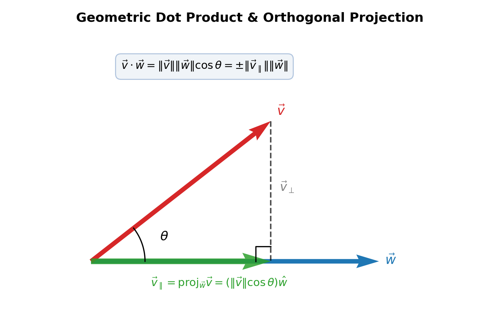
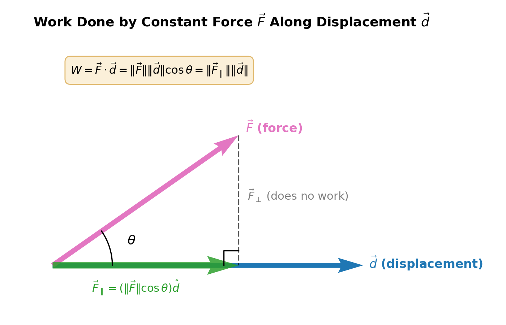
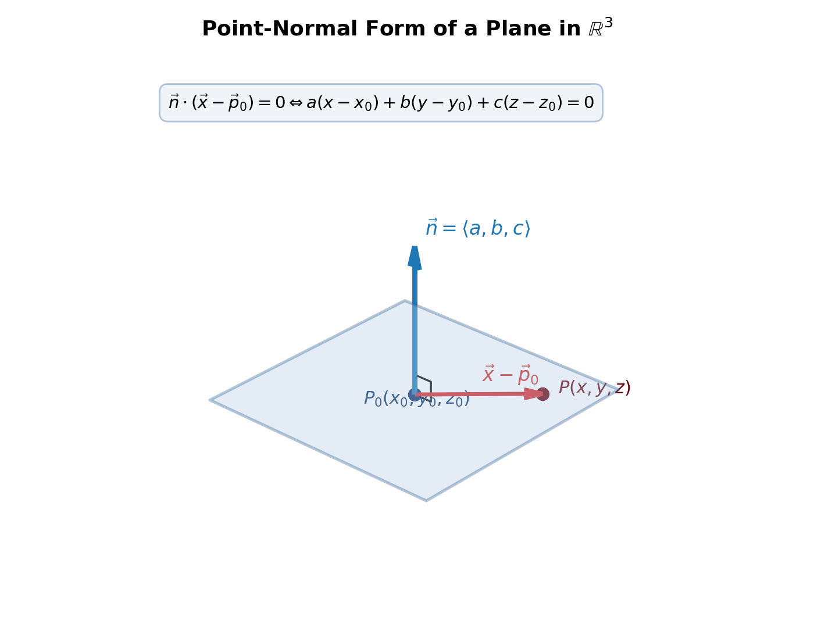
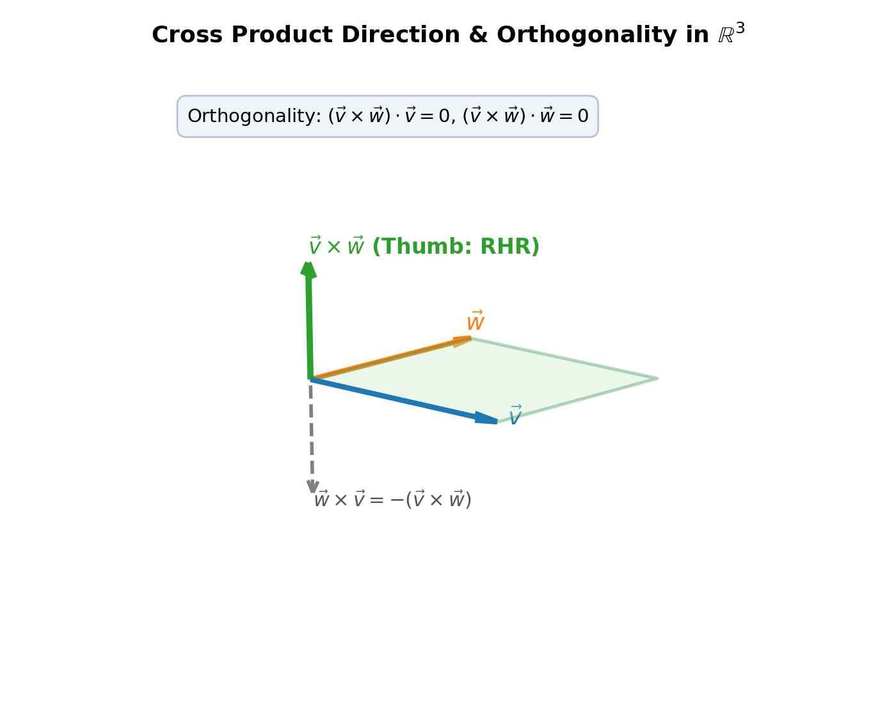
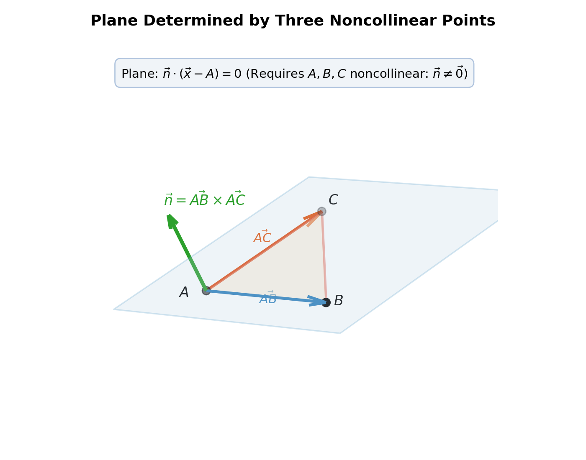
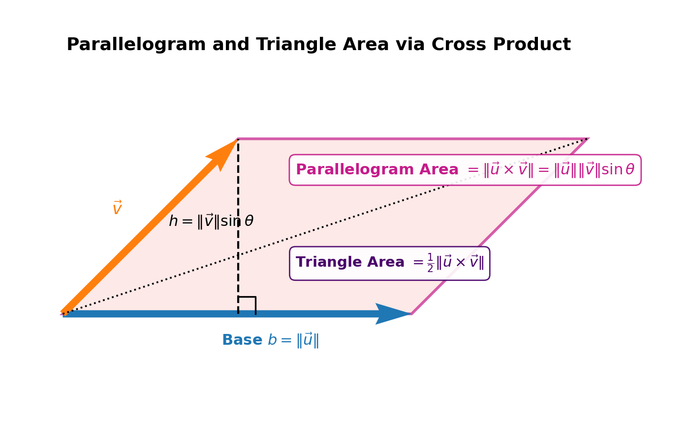

# MAT235 Week 5 Study Notes: The Dot Product and The Cross Product

## Contents

- [Scope, notation, and method selection](#scope-notation-and-method-selection)
  - [Source Scope & Authorized Materials](#source-scope--authorized-materials)
  - [Notation Conventions](#notation-conventions)
  - [Prerequisite Reminders](#prerequisite-reminders)
  - [Determinants Review](#determinants-review)
  - [Method-Selection Decision Guide](#method-selection-decision-guide)
- [Concept C-01: The Dot Product and Orthogonality](#concept-c-01-the-dot-product-and-orthogonality)
  - [Problem Type PT-01: Evaluating Dot Products and Translating Definitions](#problem-type-pt-01-evaluating-dot-products-and-translating-definitions)
  - [Problem Type PT-02: Testing Orthogonality and Solving Parameter Conditions](#problem-type-pt-02-testing-orthogonality-and-solving-parameter-conditions)
  - [Problem Type PT-03: Determining Angles Between Vectors and Geometric Diagnostics](#problem-type-pt-03-determining-angles-between-vectors-and-geometric-diagnostics)
- [Concept C-02: Vector Projections and Mechanical Work](#concept-c-02-vector-projections-and-mechanical-work)
  - [Problem Type PT-04: Resolving Vector Projections and Orthogonal Components](#problem-type-pt-04-resolving-vector-projections-and-orthogonal-components)
  - [Problem Type PT-05: Computing Work Done by a Constant Force](#problem-type-pt-05-computing-work-done-by-a-constant-force)
- [Concept C-03: Point-Normal Geometry and Equations of Planes](#concept-c-03-point-normal-geometry-and-equations-of-planes)
  - [Problem Type PT-06: Formulating and Recognizing Equations of Planes from Point and Normal](#problem-type-pt-06-formulating-and-recognizing-equations-of-planes-from-point-and-normal)
  - [Problem Type PT-07: Analyzing Relationships Between Planes](#problem-type-pt-07-analyzing-relationships-between-planes)
- [Concept C-04: The Cross Product and Right-Hand Rule in R3](#concept-c-04-the-cross-product-and-right-hand-rule-in-r3)
  - [Problem Type PT-08: Computing Cross Products via Determinants and Algebraic Expansion](#problem-type-pt-08-computing-cross-products-via-determinants-and-algebraic-expansion)
  - [Problem Type PT-09: Geometric Cross Product, Right-Hand Rule, and Unit Normal Construction](#problem-type-pt-09-geometric-cross-product-right-hand-rule-and-unit-normal-construction)
- [Concept C-05: Planar Determinations Under Geometric Constraints](#concept-c-05-planar-determinations-under-geometric-constraints)
  - [Problem Type PT-10: Determining Plane Equations Under Geometric Constraints](#problem-type-pt-10-determining-plane-equations-under-geometric-constraints)
- [Concept C-06: Geometric Measurement: Areas, Volumes, and Scalar Triple Products](#concept-c-06-geometric-measurement-areas-volumes-and-scalar-triple-products)
  - [Problem Type PT-11: Calculating Parallelogram and Triangle Areas and Area Vectors](#problem-type-pt-11-calculating-parallelogram-and-triangle-areas-and-area-vectors)
  - [Problem Type PT-12: Scalar Triple Products and Parallelepiped Volumes](#problem-type-pt-12-scalar-triple-products-and-parallelepiped-volumes)

---

## Scope, notation, and method selection

### Source Scope & Authorized Materials
This study guide synthesizes the official instructional materials for MAT235 Week 5:

- **Primary Weekly Sources:**
  - `W5/lec_note/Week5.pdf`: Official 8-slide weekly lecture presentation covering algebraic and geometric definitions of the dot product, plane equations, projections, work, 2x2 and 3x3 determinants, cross products, right-hand rule, area vectors, and volumes.
  - `W5/lec_note/oct 5.pdf`: 4 pages of handwritten lecture notes covering the equivalence of geometric and algebraic dot products, orthogonality conditions, normal vectors, and point-normal plane equations.
  - `W5/lec_note/oct 7.pdf`: 4 pages of handwritten lecture notes covering 1D and multi-dimensional mechanical work, standard basis vectors, the geometric definition of the cross product, and determinant-based component formulas.
- **Course-Platform Reading Status (Canvas Course ID: 454419):**
  - **Verified Assigned Pre-Class Reading:** [Canvas Week 5 Pre-Class Reading](https://q.utoronto.ca/courses/454419/pages/week-5-pre-class-reading) specifies the following parts of Section 13.3 (*The Dot Product*):
    - Algebraic and geometric dot product definitions on p. 763, plus Example 1.
    - Examples 2 and 3 on pp. 765–766.
    - The definition of a normal vector on p. 767.
    - The definition of work in terms of the dot product, plus Example 9; Canvas labels this p. 771.
    - **Page-number discrepancy:** In the local Hughes-Hallett 8th edition, the work definition and Example 9 question are on printed p. 769 (PDF p. 789), and its solution is on printed p. 770 (PDF p. 790). Canvas's p. 771 is retained above as the original course-page reference.
  - **Supporting Textbook Reading:** Section 13.4 (*The Cross Product*, printed pp. 775–784), serving as supporting reference material for cross product algebra, right-hand rule, area vectors, and volumes.
  - **Suggested Textbook Practice:** 31 suggested exercises from Hughes-Hallett *Calculus*, 8th edition (19 in Section 13.3, 12 in Section 13.4).
- **Supplementary Source:**
  - `W5/lec_note/15 mat223_cross_product.pdf`: 3-page linear algebra supplementary handout by Prof. Stan Yoshinobu and Noha ElGarem retrieved directly from Canvas Module 1376951.

### Notation Conventions

- **Vectors in $\mathbb{R}^3$:** Written with an arrow $\vec{v}$, as an ordered triple $\langle v_1, v_2, v_3 \rangle$ or $(v_1, v_2, v_3)$, or in Cartesian basis form $\vec{v} = v_1\vec{i} + v_2\vec{j} + v_3\vec{k}$, where:
  $$\vec{i} = \langle 1, 0, 0 \rangle, \quad \vec{j} = \langle 0, 1, 0 \rangle, \quad \vec{k} = \langle 0, 0, 1 \rangle$$

- **Linear Algebra Basis Form (MAT223 Handout):** Column notation $\begin{bmatrix} v_1 \\ v_2 \\ v_3 \end{bmatrix}$ or standard basis $\vec{e}_1, \vec{e}_2, \vec{e}_3$.
- **Coordinate Indexing (Oct 5 Lecture Notes):** Points $(p_1, p_2, p_3)$, variables $(x_1, x_2, x_3)$, and normal components $(n_1, n_2, n_3)$.
- **Vector Magnitude:** Denoted $\|\vec{v}\|$ (or $|\vec{v}|$ in some textbook figures); defined as $\|\vec{v}\| = \sqrt{v_1^2 + v_2^2 + v_3^2}$.
- **Unit Vectors:** Denoted $\hat{u}$ or $\vec{u}$ with $\|\vec{u}\| = 1$. The normalization of nonzero $\vec{v}$ is $\hat{v} = \frac{\vec{v}}{\|\vec{v}\|}$.

### Prerequisite Reminders

- **Displacement Vector:** Between initial point $P(x_1, y_1, z_1)$ and terminal point $Q(x_2, y_2, z_2)$, the directed displacement is:
  $$\vec{PQ} = Q - P = \langle x_2 - x_1, y_2 - y_1, z_2 - z_1 \rangle$$

- **Linearity:** Vector addition and scalar multiplication act component-wise:
  $$\alpha \langle u_1, u_2, u_3 \rangle + \beta \langle v_1, v_2, v_3 \rangle = \langle \alpha u_1 + \beta v_1, \alpha u_2 + \beta v_2, \alpha u_3 + \beta v_3 \rangle$$

### Determinants Review

**Source and purpose:** Week 5 lecture slides, p. 4, introduce $2\times2$ and $3\times3$ determinants; slide 5 and textbook Section 13.4, printed p. 776 (PDF p. 796), use them to compute cross products. This review explains the calculation before we use that notation.

**What is a determinant?** A *matrix* is a rectangular array of entries arranged in rows and columns. A *square matrix* has the same number of rows and columns. Its **determinant** is a single number calculated from those entries. For numerical matrices, the determinant is a scalar and can be positive, negative, or zero.

**Reading the notation.** Parentheses or square brackets enclose the matrix itself; vertical bars around a square array mean “calculate its determinant”:
$$A=\begin{pmatrix}a&b\\c&d\end{pmatrix},\qquad \det(A)=\begin{vmatrix}a&b\\c&d\end{vmatrix}.$$
The meaning of vertical bars depends on what is inside them: $\lvert r\rvert$ is the absolute value of a scalar, $\|\vec{v}\|$ is vector length, and $\begin{vmatrix}a&b\\c&d\end{vmatrix}$ is a determinant. After calculating a determinant, we may separately take its absolute value to obtain an area or volume.

**$2\times2$: multiply the diagonals, then subtract.**
$$\begin{vmatrix}a&b\\c&d\end{vmatrix}=ad-bc.$$
First multiply the top-left and bottom-right entries; then subtract the product of the top-right and bottom-left entries. For example:
$$\begin{vmatrix}2&3\\1&4\end{vmatrix}=(2)(4)-(3)(1)=8-3=5.$$
The determinant is $5$. The parallelogram with edges $\langle2,3\rangle$ and $\langle1,4\rangle$ has area $|5|=5$. The sign records orientation: positive for a counterclockwise ordered pair, negative for a clockwise pair. A zero determinant means the two edges are linearly dependent, so the area is zero.

**$3\times3$: reduce it to three $2\times2$ calculations.** For
$$A=\begin{pmatrix}a_1&a_2&a_3\\b_1&b_2&b_3\\c_1&c_2&c_3\end{pmatrix},$$
expand along the first row as follows:

1. Choose an entry in the first row.
2. Delete that entry's row and column. Calculate the determinant of the remaining $2\times2$ array. This number is its **minor**, $M_{1j}$.
3. Multiply the minor by the chosen entry and its **cofactor sign**. These signs follow $(-1)^{i+j}$ for row $i$, column $j$, so the first-row signs are $+,-,+$. The signed minor is the cofactor.
4. Add the three signed contributions:
   $$\det(A)=a_1M_{11}-a_2M_{12}+a_3M_{13}.$$

In full:
$$\det(A)=a_1\begin{vmatrix}b_2&b_3\\c_2&c_3\end{vmatrix}-a_2\begin{vmatrix}b_1&b_3\\c_1&c_3\end{vmatrix}+a_3\begin{vmatrix}b_1&b_2\\c_1&c_2\end{vmatrix}.$$

**Worked calculation — Week 5 slide 4.** Evaluate
$$D=\begin{vmatrix}2&1&-1\\3&0&2\\1&-2&1\end{vmatrix}.$$
Deleting row 1 and, successively, columns 1, 2, and 3 gives:
$$M_{11}=\begin{vmatrix}0&2\\-2&1\end{vmatrix}=0(1)-2(-2)=4,$$
$$M_{12}=\begin{vmatrix}3&2\\1&1\end{vmatrix}=3(1)-2(1)=1,$$
$$M_{13}=\begin{vmatrix}3&0\\1&-2\end{vmatrix}=3(-2)-0(1)=-6.$$
Apply the $+,-,+$ pattern to the first-row entries $2,1,-1$:
$$D=2(4)-1(1)+(-1)(-6)=8-1+6=13.$$
Keep the entry's own sign separate from its cofactor sign: the third contribution is positive here because the entry and its minor are both negative. For three numerical edge vectors, $|D|$ gives parallelepiped volume; $D=0$ means the three vectors are linearly dependent and the volume is zero.

**How this becomes the cross-product formula.** Put $\vec{i},\vec{j},\vec{k}$ in the first row and the two vectors' components underneath. This is a *formal determinant expansion*: the basis vectors replace numerical first-row entries, so the output is a vector:
$$\vec{v}\times\vec{w}=\begin{vmatrix}\vec{i}&\vec{j}&\vec{k}\\v_1&v_2&v_3\\w_1&w_2&w_3\end{vmatrix}$$
$$=\vec{i}(v_2w_3-v_3w_2)-\vec{j}(v_1w_3-v_3w_1)+\vec{k}(v_1w_2-v_2w_1).$$
Each parenthesis is a $2\times2$ determinant. In particular, the middle component carries the cofactor minus sign. Keep all component signs when finding the vector; take its magnitude only when an area or a unit-vector calculation calls for it.

**Common mistakes:** Using $ad+bc$; deleting the wrong column; forgetting the middle cofactor minus sign; losing a negative entry's own sign; or taking an absolute value before the calculation asks for an area or volume.

### Method-Selection Decision Guide

| Goal / Given Information | Primary Operation | Governing Formula or Criterion | Output Nature |
| :--- | :--- | :--- | :--- |
| Test if two vectors are perpendicular | **Dot Product** | $\vec{v}\cdot\vec{w} = 0$ | Boolean test / Scalar equation |
| Test if two vectors are parallel | **Cross Product** / Scalar Ratio | $\vec{v}\times\vec{w} = \vec{0}$ iff the pair is linearly dependent; for nonzero vectors, $\vec{v} = k\vec{w}$ | Vector test / Scalar ratio |
| Find angle $\theta \in [0, \pi]$ between vectors | **Dot Product** | $\cos\theta = \frac{\vec{v}\cdot\vec{w}}{\lVert\vec{v}\rVert\lVert\vec{w}\rVert}$, $\theta = \arccos(\cos\theta)$ | Scalar angle in $[0, \pi]$ |
| Project vector $\vec{v}$ onto vector $\vec{u}$ | **Dot Product** | $\vec{v}_\parallel = \left(\frac{\vec{v}\cdot\vec{u}}{\lVert\vec{u}\rVert^2}\right)\vec{u}$; $\vec{v}_\perp = \vec{v} - \vec{v}_\parallel$ | Parallel and perpendicular vectors |
| Calculate work done by constant force | **Dot Product** | $W = \vec{F}\cdot\vec{d} = \lVert\vec{F}\rVert\lVert\vec{d}\rVert\cos\theta$ | Scalar (Joules, ft-lb) |
| Find vector $\perp$ to two vectors in $\mathbb{R}^3$ | **Cross Product** | $\vec{n} = \vec{v}\times\vec{w}$ | Vector in $\mathbb{R}^3$ |
| Construct unit normal vector | **Cross Product** + Norm | $\hat{u} = \pm \frac{\vec{v}\times\vec{w}}{\lVert\vec{v}\times\vec{w}\rVert}$ | Unit vectors in $\mathbb{R}^3$ |
| Equation of plane from point $P_0$ and normal $\vec{n}$ | **Dot Product** | $\vec{n}\cdot(\vec{x} - \vec{p}_0) = 0 \iff ax + by + cz = d$ | Linear equation in $x, y, z$ |
| Equation of plane through 3 noncollinear points | **Cross Product** + Point-Normal | $\vec{n} = \vec{AB}\times\vec{AC}$; $\vec{n}\cdot(\vec{x} - A) = 0$ | Linear equation in $x, y, z$ |
| Direction of intersection line of two planes | **Cross Product** of Normals | $\vec{v}_{\text{line}} = \vec{n}_1 \times \vec{n}_2$ | Direction vector in $\mathbb{R}^3$ |
| Area of parallelogram with edges $\vec{v}, \vec{w}$ | **Cross Product Magnitude** | $\text{Area} = \lVert\vec{v}\times\vec{w}\rVert$ | Nonnegative scalar |
| Area of triangle with vertices $A, B, C$ | **Cross Product Magnitude** | $\text{Area} = \frac{1}{2}\lVert\vec{AB}\times\vec{AC}\rVert$ | Nonnegative scalar |
| Volume of parallelepiped with edges $\vec{a}, \vec{b}, \vec{c}$ | **Scalar Triple Product** | $\text{Volume} = \lvert (\vec{b}\times\vec{c})\cdot\vec{a} \rvert = \lvert \det[\vec{a}, \vec{b}, \vec{c}] \rvert$ | Nonnegative scalar |

---

## Concept C-01: The Dot Product and Orthogonality

**Classification:** Core weekly material

### 1. Conceptual Framework & Definitions
The **dot product** (also known as the *scalar product* or *inner product*) is an algebraic and geometric operation that maps two vectors to a single real scalar.

- **Algebraic Definition:**  
  For vectors $\vec{v} = \langle v_1, v_2, v_3 \rangle$ and $\vec{w} = \langle w_1, w_2, w_3 \rangle$ in $\mathbb{R}^3$:
  $$\vec{v}\cdot\vec{w} = v_1 w_1 + v_2 w_2 + v_3 w_3$$
  In general $\mathbb{R}^n$: $\vec{v}\cdot\vec{w} = \sum_{i=1}^n v_i w_i = v_1 w_1 + \dots + v_n w_n$.
  *Computational Advantage:* Trivial to compute directly from Cartesian components without requiring trigonometric angles.

- **Geometric Definition:**  
  For nonzero vectors $\vec{v}$ and $\vec{w}$ with angle $\theta \in [0, \pi]$ between them:
  $$\vec{v}\cdot\vec{w} = \|\vec{v}\|\|\vec{w}\|\cos\theta$$
  *Geometric Interpretation:* The dot product measures directional alignment. It equals the magnitude of one vector multiplied by the signed length of the projection of the other vector onto it.

### 2. Equivalence Derivation via the Law of Cosines
Why do the component sum and the geometric angle product produce the exact same value? Consider the triangle formed by vectors $\vec{v}$, $\vec{w}$, and the displacement $\vec{v} - \vec{w}$ placed tail-to-tail at the origin.

By the classical **Law of Cosines**:
$$\|\vec{v} - \vec{w}\|^2 = \|\vec{v}\|^2 + \|\vec{w}\|^2 - 2\|\vec{v}\|\|\vec{w}\|\cos\theta$$

Expanding the left side using coordinate algebra:
$$\|\vec{v} - \vec{w}\|^2 = (v_1 - w_1)^2 + (v_2 - w_2)^2 + (v_3 - w_3)^2$$
$$= (v_1^2 + v_2^2 + v_3^2) + (w_1^2 + w_2^2 + w_3^2) - 2(v_1 w_1 + v_2 w_2 + v_3 w_3)$$
$$= \|\vec{v}\|^2 + \|\vec{w}\|^2 - 2(v_1 w_1 + v_2 w_2 + v_3 w_3)$$

Equating the algebraic expansion to the geometric Law of Cosines:
$$\|\vec{v}\|^2 + \|\vec{w}\|^2 - 2(v_1 w_1 + v_2 w_2 + v_3 w_3) = \|\vec{v}\|^2 + \|\vec{w}\|^2 - 2\|\vec{v}\|\|\vec{w}\|\cos\theta$$
Subtracting $\|\vec{v}\|^2 + \|\vec{w}\|^2$ from both sides and dividing by $-2$:
$$v_1 w_1 + v_2 w_2 + v_3 w_3 = \|\vec{v}\|\|\vec{w}\|\cos\theta$$
This establishes the exact mathematical identity of both formulations.

### 3. Core Properties of the Dot Product
For any vectors $\vec{u}, \vec{v}, \vec{w} \in \mathbb{R}^3$ and scalar $\lambda \in \mathbb{R}$:

1. **Commutativity:** $\vec{v}\cdot\vec{w} = \vec{w}\cdot\vec{v}$
2. **Scalar Associativity:** $\vec{v}\cdot(\lambda\vec{w}) = \lambda(\vec{v}\cdot\vec{w}) = (\lambda\vec{v})\cdot\vec{w}$
3. **Distributivity over Addition:** $(\vec{v} + \vec{w})\cdot\vec{u} = \vec{v}\cdot\vec{u} + \vec{w}\cdot\vec{u}$
4. **Self-Dot Product (Norm Relation):** $\vec{v}\cdot\vec{v} = \|\vec{v}\|^2 \ge 0$, and $\vec{v}\cdot\vec{v} = 0 \iff \vec{v} = \vec{0}$.

### 4. Orthogonality Condition
Two nonzero vectors $\vec{v}$ and $\vec{w}$ are **orthogonal** (perpendicular, written $\vec{v}\perp\vec{w}$) if and only if:
$$\vec{v}\cdot\vec{w} = 0$$
*Proof:* Since $\|\vec{v}\| \neq 0$ and $\|\vec{w}\| \neq 0$, $\|\vec{v}\|\|\vec{w}\|\cos\theta = 0 \iff \cos\theta = 0 \iff \theta = \pi/2$.

*Boundary Case (Zero Vector):* By algebraic definition, $\vec{0}\cdot\vec{w} = 0$ for every vector $\vec{w}$. Thus $\vec{0}$ is algebraically orthogonal to all vectors. However, the angle $\theta$ between $\vec{0}$ and any vector is undefined because $\cos\theta$ involves division by zero norm.

---

### Problem Type PT-01: Evaluating Dot Products and Translating Definitions

**Recognition cues.**  
The problem provides vectors in component form ($\langle v_1, v_2, v_3 \rangle$ or $v_1\vec{i} + v_2\vec{j} + v_3\vec{k}$) or in geometric form (lengths and angle $\theta$), and asks to evaluate $\vec{v}\cdot\vec{w}$, find vector lengths, or translate between components and geometric quantities.

**General method.**  

1. If coordinates are given, calculate the component sum: $\vec{v}\cdot\vec{w} = v_1 w_1 + v_2 w_2 + v_3 w_3$.
2. If lengths and angle are given, calculate $\|\vec{v}\|\|\vec{w}\|\cos\theta$.
3. When translating, calculate norms $\|\vec{v}\| = \sqrt{\vec{v}\cdot\vec{v}}$ and $\|\vec{w}\| = \sqrt{\vec{w}\cdot\vec{w}}$, then determine $\cos\theta = \frac{\vec{v}\cdot\vec{w}}{\|\vec{v}\|\|\vec{w}\|}$.
4. Use distributive and scaling properties to simplify linear combinations before expanding.

**Teaching example — original question.**  
Let $\vec{v} = 2\vec{i} - \vec{j} + 3\vec{k}$ and $\vec{w} = 4\vec{i} + 2\vec{j} - \vec{k}$ in $\mathbb{R}^3$.
(a) Evaluate the algebraic dot product $\vec{v}\cdot\vec{w}$.
(b) Compute $\|\vec{v}\|$ and $\|\vec{w}\|$, and determine the exact value of $\cos\theta$ where $\theta$ is the angle between $\vec{v}$ and $\vec{w}$.
(c) Evaluate the expression $(2\vec{v} - \vec{w})\cdot\vec{v}$ using algebraic properties of the dot product.

**A complete answer must include.**  

- Step-by-step arithmetic showing each component product with correct signs.
- Output clearly presented as a scalar quantity.
- Radical evaluations for magnitudes $\|\vec{v}\|$ and $\|\vec{w}\|$.
- Exact simplified fraction or radical form for $\cos\theta$.
- Expansion using algebraic properties showing distribution over vector subtraction.

**Common mistakes.**  

- Returning an ordered triple/vector instead of a single scalar number.
- Multiplying negative signs incorrectly (e.g., $(-1)(2) = 2$ instead of $-2$).
- Confusing the self-dot product $\vec{v}\cdot\vec{v}$ with the norm $\|\vec{v}\|$; recall that $\vec{v}\cdot\vec{v} = \|\vec{v}\|^2$.

*Detailed worked solution:* [Answers-and-Practice.md: PT-01 Solution](Answers-and-Practice.md#problem-type-pt-01-evaluating-dot-products-and-translating-definitions)

---

### Problem Type PT-02: Testing Orthogonality and Solving Parameter Conditions

**Recognition cues.**  
The problem asks whether two given vectors are perpendicular/orthogonal, or gives vector components containing an unknown parameter (e.g., $t$, $k$, or $c$) and requires solving for the parameter values that make the vectors orthogonal.

**General method.**  

1. State the fundamental condition: $\vec{v}\cdot\vec{w} = 0$.
2. Substitute the components into the algebraic dot product equation:
   $$v_1(t)w_1(t) + v_2(t)w_2(t) + v_3(t)w_3(t) = 0$$

3. Simplify the equation into a standard polynomial (linear or quadratic) in the parameter.
4. Solve the polynomial equation for all real roots.
5. Substitute each root back into the original vectors to verify that the dot product evaluates to $0$.

**Teaching example — original question.**  
Given vectors $\vec{a} = 2\vec{i} + t\vec{j} - 4\vec{k}$ and $\vec{b} = (t - 1)\vec{i} + 3\vec{j} + 2\vec{k}$ in $\mathbb{R}^3$:
(a) Find all real values of $t$ for which $\vec{a}$ and $\vec{b}$ are orthogonal.
(b) For each value of $t$ found in part (a), verify by independent calculation that $\vec{a}\cdot\vec{b} = 0$.

**A complete answer must include.**  

- Stated orthogonality criterion $\vec{a}\cdot\vec{b} = 0$.
- Component-wise equation formulated with explicit signs and parentheses.
- Step-by-step algebraic solution of the parameter equation.
- Verification step substituting the solution back into the original vector definitions.

**Common mistakes.**  

- Setting the dot product equal to $1$ instead of $0$.
- Setting the cross product equal to zero (which tests parallelism, not perpendicularity).
- Dropping constant terms or misapplying the distributive property when expanding expressions like $2(t - 1)$.

*Detailed worked solution:* [Answers-and-Practice.md: PT-02 Solution](Answers-and-Practice.md#problem-type-pt-02-testing-orthogonality-and-solving-parameter-conditions)

---

### Problem Type PT-03: Determining Angles Between Vectors and Geometric Diagnostics

**Recognition cues.**  
The problem provides two nonzero vectors or the vertices of a triangle in $\mathbb{R}^3$, and asks to calculate the measure of the angle between them (in radians or degrees), or to classify the angle as acute, right, or obtuse based on dot product signs or visual diagrams.

**General method.**  

1. Ensure both vectors are nonzero. If vertices $A, B, C$ are given, construct displacement vectors radiating from the common vertex (e.g., for $\angle BAC$, form $\vec{AB} = B - A$ and $\vec{AC} = C - A$).
2. Compute the dot product $\vec{u}\cdot\vec{w}$ and norms $\|\vec{u}\|$, $\|\vec{w}\|$.
3. Compute the cosine ratio:
   $$\cos\theta = \frac{\vec{u}\cdot\vec{w}}{\|\vec{u}\|\|\vec{w}\|}$$

4. Apply the **Angle Diagnostic Criterion** (for nonzero vectors $\vec{u}, \vec{w}$):
   - **Strictly Acute Angle:** $0 < \theta < \pi/2 \iff 0 < \cos\theta < 1 \iff 0 < \vec{u}\cdot\vec{w} < \|\vec{u}\|\|\vec{w}\|$.
   - **Right Angle / Orthogonal Vectors:** $\theta = \pi/2 \iff \cos\theta = 0 \iff \vec{u}\cdot\vec{w} = 0$.
   - **Strictly Obtuse Angle:** $\pi/2 < \theta < \pi \iff -1 < \cos\theta < 0 \iff -\|\vec{u}\|\|\vec{w}\| < \vec{u}\cdot\vec{w} < 0$.
   - **Collinear / Parallel Boundary Cases:**
     - Parallel in same direction: $\theta = 0 \iff \cos\theta = 1 \iff \vec{u}\cdot\vec{w} = \|\vec{u}\|\|\vec{w}\|$.
     - Parallel in opposite directions (antiparallel): $\theta = \pi \iff \cos\theta = -1 \iff \vec{u}\cdot\vec{w} = -\|\vec{u}\|\|\vec{w}\|$.
   - *Diagnostic for Non-Collinear Vectors:* Whenever $\vec{u}$ and $\vec{w}$ are not scalar multiples of each other, the sign of the dot product uniquely classifies the angle: $\vec{u}\cdot\vec{w} > 0 \iff \text{acute}$, $\vec{u}\cdot\vec{w} = 0 \iff \text{right}$, and $\vec{u}\cdot\vec{w} < 0 \iff \text{obtuse}$.
   *(Note: If either vector is the zero vector $\vec{0}$, the geometric angle $\theta$ is undefined; orthogonality $\vec{0}\cdot\vec{w} = 0$ holds purely algebraically).*

5. Evaluate $\theta = \arccos(\cos\theta)$ exactly and provide a decimal degree approximation if requested. Check that $-1 \le \cos\theta \le 1$.

**Teaching example — original question.**  
Consider the three vertices in $\mathbb{R}^3$: $A(1, 1, 0)$, $B(3, 2, 2)$, and $C(2, -1, 3)$.
(a) Find displacement vectors $\vec{AB}$ and $\vec{AC}$.
(b) Compute $\cos(\angle BAC)$ and determine whether the interior angle at vertex $A$ is acute, right, or obtuse.
(c) Find the exact measure of $\angle BAC$ in radians, and approximate it in degrees to one decimal place.

**A complete answer must include.**  

- Correct terminal-minus-initial point displacement vectors.
- Component-wise dot product and magnitude calculations with simplified radicals.
- Explicit sign evaluation of the cosine ratio with geometric classification.
- Exact arccosine expression and decimal degree conversion.

**Common mistakes.**  

- Using displacement vectors pointing in opposite directions (e.g., using $\vec{BA}$ and $\vec{AC}$), which calculates the exterior angle $\pi - \theta$ rather than the interior angle.
- Forgetting that $\arccos$ outputs angles restricted to $[0, \pi]$ radians ($[0^\circ, 180^\circ]$).
- Obtaining a value for $\cos\theta$ outside the interval $[-1, 1]$, indicating an arithmetic error in the dot product or norms.

*Detailed worked solution:* [Answers-and-Practice.md: PT-03 Solution](Answers-and-Practice.md#problem-type-pt-03-determining-angles-between-vectors-and-geometric-diagnostics)

---

## Concept C-02: Vector Projections and Mechanical Work

**Classification:** Core weekly material

### 1. Vector Projections & Orthogonal Decomposition
Any vector $\vec{v}$ can be uniquely decomposed relative to a given nonzero direction vector $\vec{u}$ into two orthogonal components:
$$\vec{v} = \vec{v}_\parallel + \vec{v}_\perp$$
where $\vec{v}_\parallel$ is parallel to $\vec{u}$ and $\vec{v}_\perp$ is perpendicular to $\vec{u}$.

- **Scalar Component (Scalar Projection):**  
  The signed length of the "shadow" cast by $\vec{v}$ onto the line spanned by $\vec{u}$ is:
  $$\text{comp}_{\vec{u}}\vec{v} = \|\vec{v}\|\cos\theta = \frac{\vec{v}\cdot\vec{u}}{\|\vec{u}\|}$$
  If $\vec{u}$ is already a unit vector $\hat{u}$ ($\|\hat{u}\| = 1$), then $\text{comp}_{\hat{u}}\vec{v} = \vec{v}\cdot\hat{u}$.

- **Vector Projection ($\vec{v}_\parallel$):**  
  Multiplying the scalar projection by the unit vector in the direction of $\vec{u}$ yields:
  $$\vec{v}_\parallel = \text{proj}_{\vec{u}}\vec{v} = (\text{comp}_{\vec{u}}\vec{v})\left(\frac{\vec{u}}{\|\vec{u}\|}\right) = \left(\frac{\vec{v}\cdot\vec{u}}{\|\vec{u}\|^2}\right)\vec{u}$$

- **Orthogonal Component ($\vec{v}_\perp$):**  
  $$\vec{v}_\perp = \vec{v} - \vec{v}_\parallel = \vec{v} - \left(\frac{\vec{v}\cdot\vec{u}}{\|\vec{u}\|^2}\right)\vec{u}$$
  *Orthogonality Invariant:* $\vec{v}_\perp \cdot \vec{u} = 0$.

### 2. Physical and Mathematical Definition of Mechanical Work
In physics and vector calculus, when an object undergoes a linear displacement $\vec{d}$ while subject to a constant force $\vec{F}$, the mechanical **work** $W$ done by the force is defined as the dot product:
$$W = \vec{F}\cdot\vec{d} = \|\vec{F}\|\|\vec{d}\|\cos\theta = (\|\vec{F}\|\cos\theta)\|\vec{d}\|$$

- **Physical Intuition:** Only the component of force acting parallel to the displacement ($\vec{F}_\parallel = (\|\vec{F}\|\cos\theta)\hat{d}$) contributes to the work done. The perpendicular component $\vec{F}_\perp$ does **zero work** ($W_\perp = \vec{F}_\perp \cdot \vec{d} = 0$).
- **Sign Interpretation:**
  - $W > 0$: Force aids the motion ($0 \le \theta < 90^\circ$, including force and displacement in the same direction).
  - $W = 0$: Force acts perpendicular to motion ($\theta = 90^\circ$; e.g., centripetal force, normal force on level ground).
  - $W < 0$: Force opposes the motion ($90^\circ < \theta \le 180^\circ$, including opposite directions; e.g., kinetic friction).
  - These angle statements assume nonzero force and displacement. If either is zero, $W = \vec{F}\cdot\vec{d} = 0$ algebraically, and their geometric angle is undefined.
- **Physical Units:**
  - SI Units: Force in Newtons ($\text{N}$), displacement in meters ($\text{m}$), work in Joules ($\text{J} = \text{N}\cdot\text{m}$).
  - US Customary Units: Force in pounds ($\text{lb}$), displacement in feet ($\text{ft}$), work in foot-pounds ($\text{ft-lb}$).
  - Conversion Factor: $1\text{ Joule} \approx 0.73756\text{ ft-lb} \iff 1\text{ ft-lb} \approx 1.35582\text{ Joules}$.

---

### Problem Type PT-04: Resolving Vector Projections and Orthogonal Components

**Recognition cues.**  
The problem asks to resolve or decompose a vector $\vec{v}$ into components parallel and perpendicular to a given vector $\vec{u}$, or asks for the scalar/vector projection of one vector onto another.

**General method.**  

1. Compute $\vec{v}\cdot\vec{u}$ and $\|\vec{u}\|^2 = \vec{u}\cdot\vec{u}$.
2. Compute the scalar projection: $\text{comp}_{\vec{u}}\vec{v} = \frac{\vec{v}\cdot\vec{u}}{\|\vec{u}\|}$.
3. Compute the vector projection: $\vec{v}_\parallel = \left(\frac{\vec{v}\cdot\vec{u}}{\|\vec{u}\|^2}\right)\vec{u}$.
4. Compute the perpendicular component: $\vec{v}_\perp = \vec{v} - \vec{v}_\parallel$.
5. Check: Verify that $\vec{v}_\parallel + \vec{v}_\perp = \vec{v}$ and $\vec{v}_\perp \cdot \vec{u} = 0$.

**Teaching example — original question.**  
Let $\vec{v} = 4\vec{i} + 3\vec{j} - \vec{k}$ and $\vec{u} = 2\vec{i} - \vec{j} + 2\vec{k}$ in $\mathbb{R}^3$.
(a) Compute the scalar projection of $\vec{v}$ onto $\vec{u}$.
(b) Find the vector projection $\vec{v}_\parallel = \text{proj}_{\vec{u}}\vec{v}$.
(c) Find the orthogonal vector component $\vec{v}_\perp$.
(d) Verify that $\vec{v}_\parallel + \vec{v}_\perp = \vec{v}$ and $\vec{v}_\perp \cdot \vec{u} = 0$.

**A complete answer must include.**  

- Clear distinction between scalar projection (a single number) and vector projection (a vector).
- Exact fraction form for all vector components.
- Orthogonal subtraction step $\vec{v} - \vec{v}_\parallel$.
- Algebraic verification verifying both vector sum reconstruction and orthogonality.

**Common mistakes.**  

- Dividing by $\|\vec{u}\|$ instead of $\|\vec{u}\|^2$ in the vector projection formula.
- Inverting the roles of $\vec{u}$ and $\vec{v}$ (projecting $\vec{u}$ onto $\vec{v}$ rather than $\vec{v}$ onto $\vec{u}$).
- Forgetting that the scalar projection can be negative when $\theta > \pi/2$.

*Detailed worked solution:* [Answers-and-Practice.md: PT-04 Solution](Answers-and-Practice.md#problem-type-pt-04-resolving-vector-projections-and-orthogonal-components)

---

### Problem Type PT-05: Computing Work Done by a Constant Force

**Recognition cues.**  
The problem describes a force $\vec{F}$ (given as a vector or by magnitude and angle) acting on an object moving along a displacement $\vec{d}$ (or between points $P$ and $Q$), and asks for the mechanical work done, its units, or its sign interpretation.

**General method.**  

1. If initial point $P$ and terminal point $Q$ are given, construct displacement $\vec{d} = \vec{PQ} = Q - P$.
2. If given in component form: Compute $W = \vec{F}\cdot\vec{d} = F_1 d_1 + F_2 d_2 + F_3 d_3$.
3. If given by magnitudes and angle: Compute $W = \|\vec{F}\|\|\vec{d}\|\cos\theta$.
4. Check units: $\text{N}\cdot\text{m} = \text{Joules}$, or $\text{lb}\cdot\text{ft} = \text{ft-lb}$. Convert if requested ($1\text{ J} \approx 0.73756\text{ ft-lb}$).
5. Interpret sign: $W > 0$ indicates force acts in the direction of motion; $W = 0$ indicates force acts perpendicular to motion; $W < 0$ indicates force opposes motion.

**Teaching example — original question.**  
A constant force $\vec{F} = 40\vec{i} + 25\vec{j}$ Newtons acts on an object as it moves along a straight path from position $P(2, 1)$ meters to position $Q(7, 5)$ meters.
(a) Determine the displacement vector $\vec{d} = \vec{PQ}$ and its magnitude.
(b) Calculate the total work done by the force in Joules.
(c) Convert the work into foot-pounds using $1\text{ J} \approx 0.73756\text{ ft-lb}$.
(d) Find the component of force acting parallel to the direction of motion.

**A complete answer must include.**  

- Terminal-minus-initial displacement vector calculation with units.
- Dot product computation showing explicit multiplication and addition steps.
- Stated physical units for all quantities ($\text{m}, \text{J}, \text{ft-lb}, \text{N}$).
- Proper conversion calculation between SI and US Customary units.
- Force component calculation along the displacement direction.

**Common mistakes.**  

- Using position coordinates $Q$ directly as the displacement rather than computing $Q - P$.
- Omitting units or mixing up Joules and foot-pounds.
- Assuming perpendicular forces perform work (normal forces and perpendicular magnetic forces perform zero mechanical work).

*Detailed worked solution:* [Answers-and-Practice.md: PT-05 Solution](Answers-and-Practice.md#problem-type-pt-05-computing-work-done-by-a-constant-force)

---

## Concept C-03: Point-Normal Geometry and Equations of Planes

**Classification:** Core weekly material

### 1. Point-Normal Form of a Plane in $\mathbb{R}^3$
A plane $\mathcal{P}$ in three-dimensional space is uniquely determined by specifying:

1. A known base point $P_0(x_0, y_0, z_0)$ on the plane.
2. A nonzero vector $\vec{n} = \langle a, b, c \rangle$ perpendicular to the plane, known as a **normal vector**.

- **Geometric Condition:**  
  A point $P(x, y, z)$ lies on plane $\mathcal{P}$ if and only if the displacement vector $\vec{P_0 P} = \langle x - x_0, y - y_0, z - z_0 \rangle$ lies entirely within the plane, which means it is perpendicular to the normal vector $\vec{n}$:
  $$\vec{n}\cdot\vec{P_0 P} = 0 \iff \vec{n}\cdot(\vec{x} - \vec{p}_0) = 0$$

- **Point-Normal Equation:**
  $$a(x - x_0) + b(y - y_0) + c(z - z_0) = 0$$
  In lecture coordinate notation ($x_1, x_2, x_3$):
  $$n_1(x_1 - p_1) + n_2(x_2 - p_2) + n_3(x_3 - p_3) = 0$$

- **Standard Linear Form:**  
  Expanding and collecting constants yields:
  $$ax + by + cz = d, \quad \text{where } d = ax_0 + by_0 + cz_0$$
  Conversely, any linear equation $Ax + By + Cz = D$ with $(A, B, C) \neq (0, 0, 0)$ represents a plane in $\mathbb{R}^3$ with normal vector $\vec{n} = \langle A, B, C \rangle$.

### 2. Criterion for Recognizing Planes in $\mathbb{R}^3$

- **Fundamental Criterion:** An equation represents a plane in $\mathbb{R}^3$ if and only if its genuine solution set is identical to the solution set of a linear equation of the form:
  $$Ax + By + Cz = D, \quad \text{with } (A, B, C) \neq (0, 0, 0)$$
  The coefficients define a non-zero normal vector $\vec{n} = \langle A, B, C \rangle$ perpendicular to the plane.

- **Missing Variables:** If a coordinate variable does not appear explicitly in a linear equation (e.g., $2x - y = 5$), its coefficient in $\mathbb{R}^3$ is 0, giving normal $\vec{n} = \langle 2, -1, 0 \rangle$. Geometrically, the plane is parallel to the missing variable's axis ($z$-axis).
- **Evaluating Equations with Non-Standard Appearances:**
  - An equation cannot be classified solely by superficial inspection of powers or functions; one must determine its **equivalent real solution set**.
  - *Example of reducible appearance:* An equation such as $(x + y + z - 1)^2 = 0$ simplifies over real numbers to $x + y + z - 1 = 0$, whose solution set is a genuine plane with normal $\vec{n} = \langle 1, 1, 1 \rangle$.
  - *Non-planar surfaces:* Equations whose simplified solution sets cannot be expressed as a single linear equation with a nonzero normal vector (e.g., $x^2 + y^2 + z^2 = 1$ defining a sphere, $z = x^2 + y^2$ defining a paraboloid, or $z = \sin(x)$ defining a wave cylinder) represent curved surfaces, curves, points, or empty sets—**not planes**.

### 3. Geometric Relationships Between Planes
Let $\mathcal{P}_1: a_1 x + b_1 y + c_1 z = d_1$ and $\mathcal{P}_2: a_2 x + b_2 y + c_2 z = d_2$ with normals $\vec{n}_1 = \langle a_1, b_1, c_1 \rangle$ and $\vec{n}_2 = \langle a_2, b_2, c_2 \rangle$:

- **Parallel Planes:**  
  $\mathcal{P}_1 \parallel \mathcal{P}_2 \iff \vec{n}_1 \parallel \vec{n}_2 \iff \vec{n}_1 = k\vec{n}_2$ for some nonzero scalar $k$.
  *(If $d_1 = k d_2$, the equations define the identical plane; otherwise they are parallel and distinct).*

- **Perpendicular Planes:**  
  $\mathcal{P}_1 \perp \mathcal{P}_2 \iff \vec{n}_1 \perp \vec{n}_2 \iff \vec{n}_1 \cdot \vec{n}_2 = 0 \iff a_1 a_2 + b_1 b_2 + c_1 c_2 = 0$.

- **Line of Intersection:**  
  When two planes are not parallel, they intersect along a unique line. Because the line lies on both planes, its direction vector $\vec{v}_{\text{line}}$ is perpendicular to both normal vectors:
  $$\vec{v}_{\text{line}} = \vec{n}_1 \times \vec{n}_2$$

---

### Problem Type PT-06: Formulating and Recognizing Equations of Planes from Point and Normal

**Recognition cues.**  
The problem asks to find the equation of a plane given a point and a normal vector, or presents algebraic equations and asks which ones represent planes in $\mathbb{R}^3$ and to identify their normal vectors.

**General method.**  

1. Identify base point $P_0(x_0, y_0, z_0)$ and normal vector $\vec{n} = \langle a, b, c \rangle \neq \vec{0}$.
2. Write point-normal form: $a(x - x_0) + b(y - y_0) + c(z - z_0) = 0$.
3. Expand and simplify to standard form: $ax + by + cz = d$ with $d = ax_0 + by_0 + cz_0$.
4. Check: Substitute $(x_0, y_0, z_0)$ back into the final equation.
5. For recognition: Simplify the equation into its irreducible real solution set. If it reduces to $Ax + By + Cz = D$ with $\langle A, B, C \rangle \neq \vec{0}$, it is a plane with normal vector $\vec{n} = \langle A, B, C \rangle$ (with missing variables having coefficient 0). If the solution set cannot be reduced to a single linear equation with nonzero normal, it represents a non-planar surface or empty set.

**Teaching example — original question.**  
(a) Find an equation of the plane passing through $P_0(3, -2, 4)$ with normal vector $\vec{n} = 5\vec{i} - \vec{j} + 2\vec{k}$.
(b) Identify whether each of the following equations represents a plane in $\mathbb{R}^3$. For each that is a plane, give a normal vector:
    (i) $4x - 6z = 7$  
    (ii) $x^2 + y^2 - z = 0$  
    (iii) $3(x - 1) + 2(y + 4) = 5(z - 2)$

**A complete answer must include.**  

- Proper substitution into the point-normal formula.
- Simplification into standard Cartesian linear form.
- Clear distinction between linear and nonlinear terms for surface recognition.
- Identification of normal vectors including zero components for missing variables.

**Common mistakes.**  

- Flipping signs when substituting coordinates: writing $(x + x_0)$ instead of $(x - x_0)$.
- Thinking equations missing one variable (like $4x - 6z = 7$) represent lines; in 3D, any single linear equation represents a plane!
- Confusing the coordinates of the base point with the components of the normal vector.

*Detailed worked solution:* [Answers-and-Practice.md: PT-06 Solution](Answers-and-Practice.md#problem-type-pt-06-formulating-and-recognizing-equations-of-planes-from-point-and-normal)

---

### Problem Type PT-07: Analyzing Relationships Between Planes

**Recognition cues.**  
The problem gives equations for two or more planes and asks to determine whether they are parallel, perpendicular, or intersecting, or to find a vector parallel to the line of intersection.

**General method.**  

1. Extract normal vectors $\vec{n}_1, \vec{n}_2, \dots$ from the linear equations.
2. Parallel test: Check if $\vec{n}_1 = k\vec{n}_2$ for a nonzero scalar $k$.
3. Perpendicular test: Check if $\vec{n}_1 \cdot \vec{n}_2 = 0$.
4. Intersection direction: Compute the cross product of the normal vectors: $\vec{v}_{\text{line}} = \vec{n}_1 \times \vec{n}_2$.

**Teaching example — original question.**  
Consider the three planes:
$$\mathcal{P}_1: 2x - 4y + 6z = 5$$
$$\mathcal{P}_2: -x + 2y - 3z = 8$$
$$\mathcal{P}_3: 3x + 3y + z = 1$$
(a) Determine whether $\mathcal{P}_1$ and $\mathcal{P}_2$ are parallel, perpendicular, or neither.
(b) Determine whether $\mathcal{P}_1$ and $\mathcal{P}_3$ are parallel, perpendicular, or neither.
(c) Find a vector parallel to the line of intersection of planes $\mathcal{P}_1$ and $\mathcal{P}_3$.

**A complete answer must include.**  

- Stated normal vectors for all planes.
- Ratio comparison demonstrating normal vector proportionality for parallel planes.
- Dot product calculation demonstrating orthogonality for perpendicular planes.
- Determinant cross product evaluation yielding the direction vector of the intersection line.

**Common mistakes.**  

- Comparing constants $d_1, d_2$ rather than normal vectors to test parallelism.
- Stating planes are perpendicular when their normals are parallel multiples.
- Arithmetic sign errors when computing the cross product of normals.

*Detailed worked solution:* [Answers-and-Practice.md: PT-07 Solution](Answers-and-Practice.md#problem-type-pt-07-analyzing-relationships-between-planes)

---

## Concept C-04: The Cross Product and Right-Hand Rule in R3

**Classification:** Core weekly material

### 1. Conceptual Scope & Geometric Definition
Unlike the dot product, the **cross product** (vector product) is defined **exclusively in three dimensions** ($\mathbb{R}^3$) and outputs a **vector**.

For two nonzero, nonparallel vectors $\vec{v}, \vec{w} \in \mathbb{R}^3$ with angle $\theta \in [0, \pi]$:
$$\vec{v}\times\vec{w} = (\|\vec{v}\|\|\vec{w}\|\sin\theta)\,\hat{n}$$
where:

1. **Perpendicularity:** $\vec{v}\times\vec{w}$ is perpendicular to **both** $\vec{v}$ and $\vec{w}$:
   $$(\vec{v}\times\vec{w})\cdot\vec{v} = 0 \quad \text{and} \quad (\vec{v}\times\vec{w})\cdot\vec{w} = 0$$

2. **Direction (Right-Hand Rule):** $\hat{n}$ is the unit normal vector pointing in the direction of your right thumb when the fingers of your right hand curl through the smaller angle $\theta$ from $\vec{v}$ to $\vec{w}$.
3. **Magnitude:** $\|\vec{v}\times\vec{w}\| = \|\vec{v}\|\|\vec{w}\|\sin\theta$, which equals the area of the parallelogram spanned by $\vec{v}$ and $\vec{w}$.

### 2. Degenerate and Boundary Cases

- **Nonzero Vectors:** For nonzero vectors $\vec{v}, \vec{w} \neq \vec{0}$, they are collinear (parallel) if and only if the angle between them is $\theta = 0$ (same direction) or $\theta = \pi$ (opposite directions). In either case, $\sin\theta = 0$, so:
  $$\|\vec{v}\times\vec{w}\| = \|\vec{v}\|\|\vec{w}\|\sin\theta = 0 \implies \vec{v}\times\vec{w} = \vec{0}$$

- **Zero Vector Cases:** If either $\vec{v} = \vec{0}$ or $\vec{w} = \vec{0}$ (or both), the geometric angle $\theta$ is undefined. However, directly from the algebraic component definition:
  $$\vec{0}\times\vec{w} = \langle 0(w_3) - 0(w_2), 0(w_1) - 0(w_3), 0(w_2) - 0(w_1) \rangle = \vec{0}$$
  and similarly $\vec{v}\times\vec{0} = \vec{0}$.

- **General Collinearity Criterion:** For any vectors $\vec{v}, \vec{w} \in \mathbb{R}^3$:
  $$\vec{v}\times\vec{w} = \vec{0} \iff \{\vec{v}, \vec{w}\} \text{ is linearly dependent}$$
  For nonzero vectors $\vec{v}, \vec{w}$, this is equivalent to $\vec{v} = k\vec{w}$ for some scalar $k \in \mathbb{R}$. In particular, the self-cross product always vanishes: $\vec{v}\times\vec{v} = \vec{0}$.

### 3. Algebraic Definition via Determinants
For $\vec{v} = \langle v_1, v_2, v_3 \rangle$ and $\vec{w} = \langle w_1, w_2, w_3 \rangle$, the cross product is computed algebraically by expanding a formal $3 \times 3$ determinant along its top row:
$$\vec{v}\times\vec{w} = \begin{vmatrix} \vec{i} & \vec{j} & \vec{k} \\ v_1 & v_2 & v_3 \\ w_1 & w_2 & w_3 \end{vmatrix} = \vec{i}\begin{vmatrix} v_2 & v_3 \\ w_2 & w_3 \end{vmatrix} - \vec{j}\begin{vmatrix} v_1 & v_3 \\ w_1 & w_3 \end{vmatrix} + \vec{k}\begin{vmatrix} v_1 & v_2 \\ w_1 & w_2 \end{vmatrix}$$
$$= (v_2 w_3 - v_3 w_2)\vec{i} - (v_1 w_3 - v_3 w_1)\vec{j} + (v_1 w_2 - v_2 w_1)\vec{k}$$
$$= \langle v_2 w_3 - v_3 w_2, v_3 w_1 - v_1 w_3, v_1 w_2 - v_2 w_1 \rangle$$

### 4. Standard Basis Relations
Under the Right-Hand Rule and determinant expansion:

- Positive cyclic order: $\vec{i}\times\vec{j} = \vec{k}$, $\vec{j}\times\vec{k} = \vec{i}$, $\vec{k}\times\vec{i} = \vec{j}$.
- Reversed order: $\vec{j}\times\vec{i} = -\vec{k}$, $\vec{k}\times\vec{j} = -\vec{i}$, $\vec{i}\times\vec{k} = -\vec{j}$.
- Self-products: $\vec{i}\times\vec{i} = \vec{j}\times\vec{j} = \vec{k}\times\vec{k} = \vec{0}$.

### 5. Algebraic Properties

1. **Anticommutativity:** $\vec{w}\times\vec{v} = -(\vec{v}\times\vec{w})$ (swapping rows inverts the determinant).
2. **Scalar Associativity:** $(\lambda\vec{v})\times\vec{w} = \lambda(\vec{v}\times\vec{w}) = \vec{v}\times(\lambda\vec{w})$.
3. **Distributivity:** $\vec{u}\times(\vec{v} + \vec{w}) = \vec{u}\times\vec{v} + \vec{u}\times\vec{w}$.
4. **Non-Associativity:** In general, $\vec{u}\times(\vec{v}\times\vec{w}) \neq (\vec{u}\times\vec{v})\times\vec{w}$.

---

### Problem Type PT-08: Computing Cross Products via Determinants and Algebraic Expansion

**Recognition cues.**  
The problem provides vectors in component form and asks to calculate $\vec{v}\times\vec{w}$ using determinants or the algebraic definition, or to calculate cross products in both orders.

**General method.**  

1. Set up the $3 \times 3$ determinant with basis vectors $\vec{i}, \vec{j}, \vec{k}$ in row 1, components of $\vec{v}$ in row 2, and components of $\vec{w}$ in row 3.
2. Expand along row 1, taking special care of the minus sign on the $\vec{j}$ minor:
   $$\vec{v}\times\vec{w} = \langle v_2 w_3 - v_3 w_2, -(v_1 w_3 - v_3 w_1), v_1 w_2 - v_2 w_1 \rangle$$

3. To find $\vec{w}\times\vec{v}$, negate all components: $\vec{w}\times\vec{v} = -(\vec{v}\times\vec{w})$.
4. Check: Verify that the resulting vector has dot product $0$ with both inputs.

**Teaching example — original question.**  
Given vectors $\vec{u} = 2\vec{i} - \vec{j} + 3\vec{k}$ and $\vec{v} = -\vec{i} + 4\vec{j} + 2\vec{k}$:
(a) Compute $\vec{u}\times\vec{v}$ using a $3 \times 3$ determinant expansion.
(b) Write down $\vec{v}\times\vec{u}$ without recalculating the determinant, justifying your answer by a property of the cross product.
(c) Perform independent dot product checks to verify that your result is perpendicular to both $\vec{u}$ and $\vec{v}$.

**A complete answer must include.**  

- Setup of the $3 \times 3$ matrix and signed $2 \times 2$ minor calculations.
- Tracking of the middle $\vec{j}$ negative sign.
- Justification of reverse order via anticommutativity.
- Dot product verification showing $(\vec{u}\times\vec{v})\cdot\vec{u} = 0$ and $(\vec{u}\times\vec{v})\cdot\vec{v} = 0$.

**Common mistakes.**  

- Forgetting the negative sign on the $\vec{j}$ component ($+(v_1 w_3 - v_3 w_1)$ instead of $-(v_1 w_3 - v_3 w_1)$).
- Treating the cross product as commutative: $\vec{u}\times\vec{v} = \vec{v}\times\vec{u}$ (false; it is anticommutative).
- Giving a scalar output instead of a vector.

*Detailed worked solution:* [Answers-and-Practice.md: PT-08 Solution](Answers-and-Practice.md#problem-type-pt-08-computing-cross-products-via-determinants-and-algebraic-expansion)

---

### Problem Type PT-09: Geometric Cross Product, Right-Hand Rule, and Unit Normal Construction

**Recognition cues.**  
The problem asks to evaluate cross products geometrically (such as among basis vectors), determine vector directions using the Right-Hand Rule, or find a unit vector perpendicular to two given vectors.

**General method.**  

1. For basis vectors: Use cyclic order $\vec{i} \to \vec{j} \to \vec{k} \to \vec{i}$ and anticommutativity.
2. For unit perpendicular vectors:
   - Compute cross product $\vec{n} = \vec{v}\times\vec{w}$.
   - Compute its magnitude $\|\vec{n}\| = \sqrt{n_1^2 + n_2^2 + n_3^2}$.
   - Form the two unit normal vectors: $\hat{u} = \pm \frac{\vec{n}}{\|\vec{n}\|}$.

**Teaching example — original question.**  
(a) Using the geometric definition and Right-Hand Rule, evaluate:
    (i) $\vec{j}\times\vec{k}$  
    (ii) $\vec{k}\times\vec{j}$  
    (iii) $(\vec{i} + \vec{j})\times\vec{i}$
(b) Given vectors $\vec{a} = 2\vec{i} + \vec{j} + 2\vec{k}$ and $\vec{b} = 3\vec{i} - 2\vec{j} + \vec{k}$, find both unit vectors that are perpendicular to both $\vec{a}$ and $\vec{b}$.

**A complete answer must include.**  

- Application of basis cross product rules and distributivity.
- Determinant computation for $\vec{a}\times\vec{b}$.
- Magnitude evaluation with square root simplification.
- Expression of both unit vectors ($\pm$).

**Common mistakes.**  

- Using the left hand instead of the right hand, reversing the vector direction.
- Providing only one unit normal when two opposite unit normal vectors exist ($\pm$).
- Forgetting that parallel vectors have cross product $\vec{0}$.

*Detailed worked solution:* [Answers-and-Practice.md: PT-09 Solution](Answers-and-Practice.md#problem-type-pt-09-geometric-cross-product-right-hand-rule-and-unit-normal-construction)

---

## Concept C-05: Planar Determinations Under Geometric Constraints

**Classification:** Core weekly material

### 1. Geometric Determination of Planes in $\mathbb{R}^3$
While a point and a normal vector directly produce the point-normal equation, geometric problems frequently specify planes through alternative constraints that require constructing the normal vector using the **cross product**.

### 2. Standard Geometric Plane Configurations

1. **Three Noncollinear Points $A, B, C$:**
   - Construct two displacement vectors in the plane: $\vec{AB} = B - A$ and $\vec{AC} = C - A$.
   - **Collinearity Check:** Compute $\vec{n} = \vec{AB}\times\vec{AC}$. If $\vec{n} = \vec{0}$, the points lie on a single line and do not define a unique plane! If $\vec{n} \neq \vec{0}$, $\vec{n}$ is a valid normal vector.
   - Point-normal form: $\vec{n}\cdot(\vec{x} - A) = 0$.
2. **A Point $P_0$ and a Line $L$ (not containing $P_0$):**
   - Identify a point $P_1$ on $L$ and line direction vector $\vec{v}_L$.
   - Displacement vector: $\vec{u} = P_0 - P_1$.
   - Normal vector: $\vec{n} = \vec{v}_L \times \vec{u}$.
3. **Two Points $Q, R$ and Perpendicular to Plane $\mathcal{P}_1$:**
   - Vector in plane: $\vec{QR} = R - Q$.
   - Normal of given plane: $\vec{n}_1$.
   - Normal to desired plane: $\vec{n} = \vec{QR} \times \vec{n}_1$ (since $\vec{n}_1$ is parallel to the desired plane).
4. **Vector Parametric Plane $\vec{x} = s\vec{d}_1 + t\vec{d}_2$:**
   - Spanning directions: $\vec{d}_1, \vec{d}_2$.
   - Normal vector: $\vec{n} = \vec{d}_1 \times \vec{d}_2$. Passes through origin $\implies \vec{n}\cdot\vec{x} = 0$.

---

### Problem Type PT-10: Determining Plane Equations Under Geometric Constraints

**Recognition cues.**  
The problem asks to find the equation of a plane determined by three points, a point and a line, two points and perpendicularity to another plane, or spanning parametric vectors.

**General method.**  

1. Identify or construct two nonparallel vectors $\vec{u}$ and $\vec{v}$ that lie parallel to the desired plane.
2. Compute normal vector $\vec{n} = \vec{u}\times\vec{v}$.
3. Verify nondegeneracy: $\vec{n} \neq \vec{0}$.
4. Choose any known point $P_0$ on the plane and apply $\vec{n}\cdot(\vec{x} - P_0) = 0$.
5. Expand to standard linear form $ax + by + cz = d$ and verify that all given points or geometric constraints satisfy the equation.

**Teaching example — original question.**  
Find an equation of the plane passing through the points $A(2, 0, 1)$, $B(1, 3, -1)$, and $C(4, 1, 2)$ in $\mathbb{R}^3$.
(a) Compute displacement vectors $\vec{AB}$ and $\vec{AC}$.
(b) Verify that the points are noncollinear by computing $\vec{n} = \vec{AB}\times\vec{AC} \neq \vec{0}$.
(c) Write the Cartesian equation of the plane and verify that all three points satisfy it.

**A complete answer must include.**  

- Displacement vector calculations.
- Noncollinearity check showing $\vec{n} \neq \vec{0}$.
- Determinant computation for the normal vector.
- Formulation and simplification of the linear plane equation.
- Independent substitution check for all three points.

**Common mistakes.**  

- Attempting to define a unique plane through collinear points ($\vec{n} = \vec{0}$).
- Subtracting coordinates in reverse order when finding displacement vectors.
- Forgetting to verify that points $B$ and $C$ satisfy the equation obtained using $A$.

*Detailed worked solution:* [Answers-and-Practice.md: PT-10 Solution](Answers-and-Practice.md#problem-type-pt-10-determining-plane-equations-under-geometric-constraints)

---

## Concept C-06: Geometric Measurement: Areas, Volumes, and Scalar Triple Products

**Classification:** Core weekly material (Covered in Week 5 Lecture Slides pp. 7–8 and Textbook Section 13.4 pp. 778–781)

### 1. Parallelogram and Triangle Areas
By Euclidean geometry, the area of a parallelogram with adjacent sides $\vec{v}$ and $\vec{w}$ is:
$$\text{Area} = \text{base} \times \text{height} = \|\vec{w}\|(\|\vec{v}\|\sin\theta) = \|\vec{v}\times\vec{w}\|$$
Consequently:

- **Triangle Area:** A triangle with vertices $A, B, C$ has area half of the parallelogram:
  $$\text{Area}(\triangle ABC) = \frac{1}{2}\|\vec{AB}\times\vec{AC}\|$$

- **Point-to-Line Distance:** The perpendicular distance from point $R$ to the line through $P$ and $Q$ is:
  $$d = \frac{\|\vec{PQ}\times\vec{PR}\|}{\|\vec{PQ}\|}$$

### 2. Area Vectors
An **area vector** $\vec{A}$ of a planar surface is a vector perpendicular to the surface whose magnitude equals the surface area:
$$\vec{A} = \vec{v}\times\vec{w}$$
Reversing the vector order reverses the direction of the area vector ($\vec{w}\times\vec{v} = -\vec{A}$) while leaving the scalar area $\|\vec{A}\|$ unchanged.

### 3. The Scalar Triple Product and Parallelepiped Volume
The volume of a parallelepiped (three-dimensional skewed prism) with adjacent edges represented by vectors $\vec{a}, \vec{b}, \vec{c} \in \mathbb{R}^3$ is:
$$\text{Volume} = \text{base area} \times \text{height} = \|\vec{b}\times\vec{c}\|(\|\vec{a}\||\cos\phi|) = |(\vec{b}\times\vec{c})\cdot\vec{a}|$$
This combination is the **scalar triple product**, computed directly via a $3 \times 3$ determinant:
$$(\vec{b}\times\vec{c})\cdot\vec{a} = \begin{vmatrix} a_1 & a_2 & a_3 \\ b_1 & b_2 & b_3 \\ c_1 & c_2 & c_3 \end{vmatrix}$$
$$\text{Volume} = |\det[\vec{a}, \vec{b}, \vec{c}]|$$

- **Coplanarity Test:** Three vectors $\vec{a}, \vec{b}, \vec{c}$ lie in the same plane (coplanar) if and only if the parallelepiped volume is zero:
  $$\det[\vec{a}, \vec{b}, \vec{c}] = 0$$

---

### Problem Type PT-11: Calculating Parallelogram and Triangle Areas and Area Vectors

**Recognition cues.**  
The problem provides vectors or coordinates of vertices of a parallelogram or triangle in $\mathbb{R}^3$ and asks for the area, area vector, or the perpendicular distance from a point to a line.

**General method.**  

1. Construct adjacent edge vectors from a common base point (e.g., $\vec{PQ}$ and $\vec{PR}$).
2. Compute the cross product $\vec{A} = \vec{PQ}\times\vec{PR}$.
3. Parallelogram area $= \|\vec{A}\| = \sqrt{A_1^2 + A_2^2 + A_3^2}$.
4. Triangle area $= \frac{1}{2}\|\vec{A}\|$.
5. Point-to-line altitude $= \frac{\|\vec{A}\|}{\|\text{base vector}\|}$.

**Teaching example — original question.**  
Consider the triangle with vertices $P(1, 0, 2)$, $Q(3, 2, 1)$, and $R(2, 4, 5)$ in $\mathbb{R}^3$.
(a) Find displacement vectors $\vec{PQ}$ and $\vec{PR}$.
(b) Compute the cross product $\vec{PQ}\times\vec{PR}$ and its magnitude.
(c) Find the area of $\triangle PQR$.
(d) Find the perpendicular distance from point $R$ to the line passing through $P$ and $Q$.

**A complete answer must include.**  

- Displacement vector calculations.
- Complete determinant expansion for the cross product.
- Norm evaluation with simplified radical.
- Factor of $1/2$ applied for the triangle area.
- Point-to-line altitude calculation via area division.

**Common mistakes.**  

- Forgetting the factor of $1/2$ for triangle areas.
- Dividing by the wrong side length when computing altitude to a line.
- Confusing the vector cross product with its scalar magnitude area.

*Detailed worked solution:* [Answers-and-Practice.md: PT-11 Solution](Answers-and-Practice.md#problem-type-pt-11-calculating-parallelogram-and-triangle-areas-and-area-vectors)

---

### Problem Type PT-12: Scalar Triple Products and Parallelepiped Volumes

**Recognition cues.**  
The problem gives three vectors in $\mathbb{R}^3$ and asks for the scalar triple product, the volume of the spanned parallelepiped, or whether the three vectors/four points are coplanar.

**General method.**  

1. Arrange the components of the three vectors into a $3 \times 3$ matrix.
2. Evaluate the determinant: $(\vec{b}\times\vec{c})\cdot\vec{a} = \det[\vec{a}, \vec{b}, \vec{c}]$.
3. Parallelepiped volume $= |\det[\vec{a}, \vec{b}, \vec{c}]|$.
4. Test coplanarity: If volume $= 0$, vectors are coplanar; if volume $\neq 0$, vectors are not coplanar.

**Teaching example — original question.**  
Let $\vec{a} = \vec{i} + 2\vec{j} - \vec{k}$, $\vec{b} = 3\vec{i} + \vec{j} + 2\vec{k}$, and $\vec{c} = -\vec{i} + 4\vec{j} + \vec{k}$ in $\mathbb{R}^3$.
(a) Evaluate the scalar triple product $(\vec{b}\times\vec{c})\cdot\vec{a}$ using a $3 \times 3$ determinant.
(b) Find the volume of the parallelepiped with edges $\vec{a}, \vec{b}, \vec{c}$.
(c) Are the vectors $\vec{a}, \vec{b}, \vec{c}$ coplanar? Explain.

**A complete answer must include.**  

- Formulation of the $3 \times 3$ determinant.
- Step-by-step expansion along row 1 with signs.
- Absolute value taken to ensure volume is nonnegative.
- Geometric conclusion regarding coplanarity based on whether the computed volume (or scalar triple product) is zero or non-zero, with clear justification.

**Common mistakes.**  

- Forgetting the absolute value when the determinant evaluates to a negative number.
- Writing meaningless expressions like $(\vec{a}\cdot\vec{b})\times\vec{c}$ (cannot take cross product of scalar and vector).
- Assuming coplanar vectors span a solid of positive volume.

*Detailed worked solution:* [Answers-and-Practice.md: PT-12 Solution](Answers-and-Practice.md#problem-type-pt-12-scalar-triple-products-and-parallelepiped-volumes)

---

*For complete worked solutions to all Teaching Examples, actual weekly lecture questions, and all 31 suggested textbook exercises, refer to [Answers-and-Practice.md](Answers-and-Practice.md).*
