# MAT235H1 Week 6 Answers and Practice — §17.3 Vector Fields

Companion file to [Study-Notes.md](Study-Notes.md).

## Contents

1. [Teaching-Example Solutions](#1-teaching-example-solutions)
2. [Slide Questions and Solutions](#2-slide-questions-and-solutions)
3. [Textbook Exercises and Solutions (§17.3)](#3-textbook-exercises-and-solutions-173)
4. [Self-Test Questions and Answers](#4-self-test-questions-and-answers)
5. [Coverage Appendix](#5-coverage-appendix)

---

## 1. Teaching-Example Solutions

### TE-01 Solution

- **Problem Type:** `PT-01` — Interpret Direction, Magnitude, and Scaling from a Vector-Field Formula
- **Question link:** [Study-Notes.md — TE-01](Study-Notes.md#teaching-example-te-01)

**Given:** $\vec{F}(x,y) = (y + 2e^{-x})\vec{j}$ on $x > 0,\ y > 0$.

1. **Direction:** The $\vec{i}$-component is $P(x,y) = 0$ and the $\vec{j}$-component is $Q(x,y) = y + 2e^{-x} > 0$. Because only the $\vec{j}$-component is nonzero, every vector points vertically upward, **parallel to the $y$-axis**.
2. **Magnitude:**
   $$\|\vec{F}(x,y)\| = \sqrt{0^2 + (y + 2e^{-x})^2} = |y + 2e^{-x}|.$$
   Since $y > 0$ and $2e^{-x} > 0$ for all $x > 0$, we have $y + 2e^{-x} > 0$, so
   $$\|\vec{F}(x,y)\| = y + 2e^{-x}.$$
3. **Variation with $x$ and $y$:**
   - **As $x$ increases** (with $y > 0$ fixed): $e^{-x}$ strictly decreases, so $\|\vec{F}(x,y)\| = y + 2e^{-x}$ **decreases**.
   - **As $y$ increases** (with $x > 0$ fixed): $y$ strictly increases while $2e^{-x}$ stays constant, so $\|\vec{F}(x,y)\|$ **increases**.
   - *Point check:* At $(1,1)$, $\|\vec{F}\| = 1 + 2e^{-1} \approx 1.74$; at $(2,1)$, $\|\vec{F}\| = 1 + 2e^{-2} \approx 1.27$ (smaller); at $(1,2)$, $\|\vec{F}\| = 2 + 2e^{-1} \approx 2.74$ (larger).
4. **Effect of multiplying by $-1$:** For $-\vec{F}(x,y) = -(y + 2e^{-x})\vec{j}$, every arrow has the **same length** ($y + 2e^{-x}$) but points in the **opposite direction** (straight downward, parallel to the negative $y$-axis).

---

### TE-02 Solution

- **Problem Type:** `PT-02` — Sketch a Portion of a 2D Vector Field from an Algebraic Formula
- **Question link:** [Study-Notes.md — TE-02](Study-Notes.md#teaching-example-te-02)

**Given:** $\vec{F}(x,y) = 2x\vec{j}$ on $x, y \in \{-2, -1, 0, 1, 2\}$.

1. **Domain and zero set:** Defined on all of $\mathbb{R}^2$. $\vec{F}(x,y) = \vec{0}$ along the entire $y$-axis ($x = 0$).
2. **Global structure:** Since $P(x,y) = 0$, every arrow is vertical (parallel to the $y$-axis). Since $Q(x,y) = 2x$ does not depend on $y$, all arrows along any vertical line $x = c$ are identical:
   - For $x > 0$: arrows point **upward** with length $2x$.
   - For $x < 0$: arrows point **downward** with length $2|x|$.
3. **Representative table of values:**

| $(x,y)$ | $\vec{F}(x,y) = 2x\vec{j}$ | Direction | $\|\vec{F}(x,y)\|$ |
| :--- | :--- | :--- | :--- |
| $(0, y)$ | $\vec{0}$ | Zero vector (dot) | $0$ |
| $(1, y)$ | $2\vec{j}$ | Up | $2$ |
| $(2, y)$ | $4\vec{j}$ | Up (twice as long) | $4$ |
| $(-1, y)$ | $-2\vec{j}$ | Down | $2$ |
| $(-2, y)$ | $-4\vec{j}$ | Down (twice as long) | $4$ |

4. **Sketch** (uniformly scaled by $0.22\times$ so arrows do not overlap):

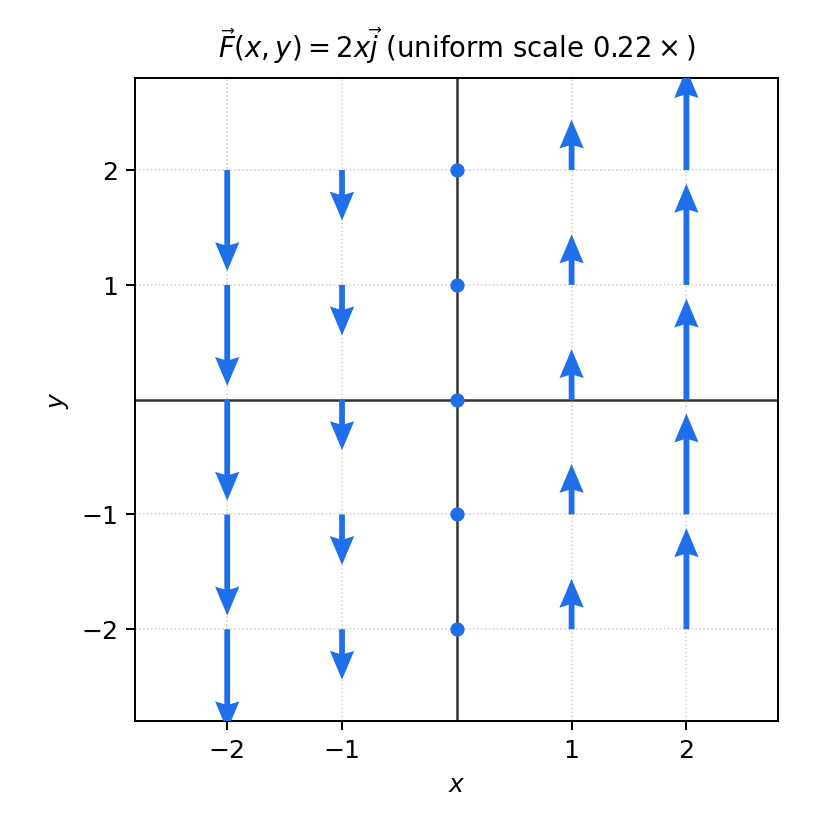

5. **Verification:** Tails sit on the integer grid points; arrows on $x=0$ are dots; arrows at $x=2$ are twice as long as at $x=1$ and point upward; arrows at $x=-1, -2$ point downward symmetrically.

---

### TE-03 Solution

- **Problem Type:** `PT-03` — Match Vector-Field Formulas to Plots Using Direction and Magnitude
- **Question link:** [Study-Notes.md — TE-03](Study-Notes.md#teaching-example-te-03)

**Given:** $\vec{G}_1(x,y) = x\vec{i} + y\vec{j}$ and $\vec{G}_2(x,y) = \frac{x\vec{i} + y\vec{j}}{\sqrt{x^2 + y^2}}$, with Plots I and II in `figures/te_pt03_matching.png`.

1. **Direction check:** For $(x,y) \ne (0,0)$, $\vec{G}_2(x,y) = \frac{1}{\sqrt{x^2+y^2}}\vec{G}_1(x,y)$ is a positive scalar multiple of $\vec{G}_1(x,y)$, so both fields point radially outward from the origin. Direction alone does not separate the two plots.
2. **Magnitude and origin check:**
   - For $\vec{G}_1$: $\|\vec{G}_1(x,y)\| = \sqrt{x^2 + y^2}$, which equals the distance from $(0,0)$. Arrows are $\vec{0}$ at the origin and grow linearly as $(x,y)$ moves outward.
   - For $\vec{G}_2$: for $(x,y) \ne (0,0)$,
     $$\|\vec{G}_2(x,y)\| = \sqrt{\frac{x^2}{x^2+y^2} + \frac{y^2}{x^2+y^2}} = \sqrt{\frac{x^2+y^2}{x^2+y^2}} = 1.$$
     Every nonzero arrow has the **same length**, and $\vec{G}_2$ is **undefined** at $(0,0)$.
3. **Match:**
   - **Plot I $\longleftrightarrow \vec{G}_2(x,y) = \frac{x\vec{i}+y\vec{j}}{\sqrt{x^2+y^2}}$** (all arrows have uniform length; open circle at the origin).
   - **Plot II $\longleftrightarrow \vec{G}_1(x,y) = x\vec{i}+y\vec{j}$** (arrows are short near the origin, zero dot at $(0,0)$, and longer near the edges).

---

## 2. Slide Questions and Solutions

All distinct, in-scope §17.3 questions from `Week6-sol.pdf` (pp. 2–5), `oct 14.pdf` (pp. 1–4), and the single §17.3 True/False item in `oct 16.pdf` (p. 1, item $6^\circ$) are solved below. (TT1 review questions on Chapters 12–13 in `oct 16.pdf` and `oct 19.pdf` are out of scope for §17.3.)

### SQ-01 — Wind Arrows and Vector-Field Definition

- **Sources:** `oct 14.pdf` p. 1; `Week6-sol.pdf` p. 2; `oct 16.pdf` p. 1, item $6^\circ$.
- **Applicable PT:** `PT-01` (conceptual foundation).
- **Questions:**
  1. *(Verbatim, `oct 14.pdf` p. 1)* "A weather map shows a wind arrow at each location. What information does each arrow communicate?"
  2. *(Paraphrase, `Week6-sol.pdf` p. 2)* On the Ontario weather map, interpret the wind data "Toronto: $16\text{ km/h}$ west wind" and "Madison: $14\text{ km/h}$ northeast wind" as vectors.
  3. *(Verbatim, `oct 16.pdf` p. 1, item $6^\circ$)* True or False: "A vector field assigns a vector to each input location."

**Solution:**
1. Each arrow communicates **wind direction** (the direction the arrow points) and **wind speed** (the magnitude/length of the arrow).
2. At Toronto, a $16\text{ km/h}$ **west wind** blows *from* the west *toward* the east, so its vector points east with magnitude $16\text{ km/h}$ (as drawn with a blue eastward arrow at Toronto on `Week6-sol.pdf` p. 2). At Madison, a $14\text{ km/h}$ **northeast wind** blows *from* the northeast *toward* the southwest, so its vector points southwest with magnitude $14\text{ km/h}$ (slightly shorter than Toronto's arrow).
3. **True.** By definition, a vector field in 2-space or 3-space assigns a vector to each point (input location) in its domain.

---

### SQ-02 — Sketch and Describe $\vec{F}_1(x,y) = -y\vec{i}+x\vec{j}$ and $\vec{F}_2(\vec{r}) = \vec{r}$

- **Sources:** `Week6-sol.pdf` p. 3 (Worksheet p. 1 of 2); also `oct 14.pdf` p. 1 ("Draw the vector field $\vec{F}(x,y) = (-y,x)$") and `oct 14.pdf` p. 3.
- **Applicable PTs:** `PT-02`, `PT-01`.
- **Question *(verbatim, `Week6-sol.pdf` p. 3)*:** "On the grids below, sketch a portion of each vector field: $\vec{F}_1(x,y) = -y\vec{i} + x\vec{j}$, $\vec{F}_2(\vec{r}) = \vec{r}$. For each field, describe how the direction and magnitude of the vectors change as the point moves away from the origin."

**Solution:**
Evaluate both fields at representative points (matching the lecture table on `Week6-sol.pdf` p. 3):

| $(x,y)$ | $\vec{F}_1(x,y) = -y\vec{i}+x\vec{j}$ | $\vec{F}_2(x,y) = x\vec{i}+y\vec{j}$ |
| :--- | :--- | :--- |
| $(0,0)$ | $\vec{0}$ | $\vec{0}$ |
| $(1,0)$ | $\vec{j}$ | $\vec{i}$ |
| $(0,1)$ | $-\vec{i}$ | $\vec{j}$ |
| $(-1,0)$ | $-\vec{j}$ | $-\vec{i}$ |
| $(0,-1)$ | $\vec{i}$ | $-\vec{j}$ |
| $(1,1)$ | $-\vec{i}+\vec{j}$ | $\vec{i}+\vec{j}$ |
| $(2,0)$ | $2\vec{j}$ | $2\vec{i}$ |

- **Sketches:** See the **Outward radial** ($\vec{F}_2$) and **CCW rotational** ($\vec{F}_1$) panels of [canonical_2d_patterns.png](figures/canonical_2d_patterns.png) in [Study-Notes.md](Study-Notes.md#four-canonical-2d-patterns-from-lecture-core--oct-14pdf-pp-23).
- **Description for $\vec{F}_1(x,y) = -y\vec{i}+x\vec{j}$:**
  - *Direction:* Because $\vec{r}\cdot\vec{F}_1 = (x,y)\cdot(-y,x) = 0$ (`oct 14.pdf` p. 3), every vector is perpendicular to the position vector and tangent to the circle centered at the origin, pointing **counterclockwise**. Moving radially outward along a ray from the origin keeps the direction constant.
  - *Magnitude:* $\|\vec{F}_1(x,y)\| = \sqrt{(-y)^2 + x^2} = \sqrt{x^2+y^2}$, which equals the distance from $(0,0)$ and **increases linearly** as the point moves away from the origin.
- **Description for $\vec{F}_2(\vec{r}) = \vec{r} = x\vec{i}+y\vec{j}$:**
  - *Direction:* Points **radially outward** directly away from the origin along the ray through $(x,y)$ (direction stays constant along any ray from the origin).
  - *Magnitude:* $\|\vec{F}_2(x,y)\| = \sqrt{x^2+y^2}$, which equals the distance from $(0,0)$ and **increases linearly** as the point moves away from the origin.

---

### SQ-03 — Constant Field Properties

- **Source:** `oct 14.pdf` p. 2.
- **Applicable PT:** `PT-01`.
- **Question *(verbatim, `oct 14.pdf` p. 2)*:** For the constant field $\vec{F}(x,y) = (2,1)$: "Does changing the input point change the vector? magnitude = ?"

**Solution:**
- **Effect of changing $(x,y)$:** **No.** Neither component depends on $x$ or $y$, so every point in $\mathbb{R}^2$ is assigned the exact same vector $\langle 2, 1 \rangle$ (see the top-left panel of [canonical_2d_patterns.png](figures/canonical_2d_patterns.png)).
- **Magnitude:** $\|\vec{F}(x,y)\| = \sqrt{2^2 + 1^2} = \sqrt{5}$ at every point.

---

### SQ-04 — Comparing Outward and Inward Radial Fields

- **Source:** `oct 14.pdf` p. 2.
- **Applicable PT:** `PT-01`.
- **Question *(paraphrase combining prompts on `oct 14.pdf` p. 2)*:** Consider $2^\circ$ the outward radial field $\vec{F}(x,y) = (x,y)$ and $3^\circ$ the inward radial field $\vec{F}(x,y) = (-x,-y)$. Find the magnitude of each field. Compare $2^\circ$ and $3^\circ$: how does multiplying a vector field by $(-1)$ change its diagram?

**Solution:**
- **Magnitudes:**
  $$\|(x,y)\| = \sqrt{x^2+y^2}, \qquad \|(-x,-y)\| = \sqrt{(-x)^2 + (-y)^2} = \sqrt{x^2+y^2}.$$
  Both fields have the exact same magnitude at every point $(x,y)$ (equal to the distance from the origin).
- **Effect of multiplying by $(-1)$:** Multiplying $\vec{F}$ by $(-1)$ **reverses the direction of every arrow** (pointing radially inward instead of radially outward; see the top-right and bottom-left panels of [canonical_2d_patterns.png](figures/canonical_2d_patterns.png)) while **keeping every arrow's length unchanged**.

---

### SQ-05 — Sketch $\vec{F}(x,y) = 3\vec{i}+4\vec{j}$ and $\vec{F}(x,y) = 2y\vec{i}$

- **Source:** `oct 14.pdf` p. 4.
- **Applicable PT:** `PT-02`.
- **Question *(verbatim, `oct 14.pdf` p. 4)*:** "Sketch the following vector fields in the $xy$-plane: (1) $\vec{F}(x,y) = 3\vec{i} + 4\vec{j}$; (2) $\vec{F}(x,y) = 2y\vec{i}$." *(Note: the second item's circled numeral on `oct 14.pdf` p. 4 is handwritten as `2` or `3`; we label it (2) sequentially.)*

**Solution:**
1. **$\vec{F}(x,y) = 3\vec{i} + 4\vec{j}$:** Constant field. Every point receives the same vector pointing right $3$ and up $4$ (slope $4/3$), with constant magnitude $\sqrt{3^2+4^2} = 5$.
2. **$\vec{F}(x,y) = 2y\vec{i}$:** Horizontal field ($Q = 0$) independent of $x$, so arrows are identical along each horizontal line:
   - $y = 0$ ($x$-axis): $\vec{F}(x,0) = \vec{0}$ (dots).
   - $y = 1$: $\vec{F}(x,1) = 2\vec{i}$ (right, length $2$); $y = 2$: $\vec{F}(x,2) = 4\vec{i}$ (right, length $4$).
   - $y = -1$: $\vec{F}(x,-1) = -2\vec{i}$ (left, length $2$); $y = -2$: $\vec{F}(x,-2) = -4\vec{i}$ (left, length $4$).

---

### SQ-06 — Compare Two Rotational Vector-Field Plots

- **Source:** `Week6-sol.pdf` p. 5 (Worksheet p. 2 of 2).
- **Applicable PT:** `PT-03`.
- **Question *(verbatim, `Week6-sol.pdf` p. 5)*:** "Shown below are the plots of the two vector fields $\vec{F}_1(x,y) = -y\vec{i} + x\vec{j}$, $\vec{F}_2(x,y) = \frac{-y\vec{i}+x\vec{j}}{\sqrt{x^2+y^2}}$. Determine which plot represents each field and explain your reasoning." *(Reproduced in [slide_compare_rotational.png](figures/slide_compare_rotational.png), where Plot A is the left plot and Plot B is the right plot from `Week6-sol.pdf` p. 5.)*

**Solution:**
Both fields have the same counterclockwise rotational direction at every $(x,y) \ne (0,0)$, so compare magnitudes:
- $\|\vec{F}_1(x,y)\| = \sqrt{(-y)^2 + x^2} = \sqrt{x^2+y^2}$, which is $0$ at $(0,0)$ and **grows** as distance from the origin increases. This matches the **left plot (Plot A)**, where arrows are very short near the origin and noticeably longer near the boundary.
- $\|\vec{F}_2(x,y)\| = \sqrt{\left(\frac{-y}{\sqrt{x^2+y^2}}\right)^2 + \left(\frac{x}{\sqrt{x^2+y^2}}\right)^2} = \sqrt{\frac{y^2+x^2}{x^2+y^2}} = 1$ for all $(x,y) \ne (0,0)$, and $\vec{F}_2$ is undefined at $(0,0)$. This matches the **right plot (Plot B)**, where all arrows have the exact same length.

---

## 3. Textbook Exercises and Solutions (§17.3)

All 15 Quercus-suggested exercises from Hughes-Hallett et al., *Calculus*, 8th Edition, §17.3 (pp. 963–965), solved in numerical order.

> **Shared directions for Exercises 1–6 (p. 963):** *"For Exercises 1–6, find formulas for the vector fields. (There are many possible answers.)"*

### Exercise 1

- **Applicable PT:** No established PT (**Supplementary** graph-to-formula translation, Concept 4.1).

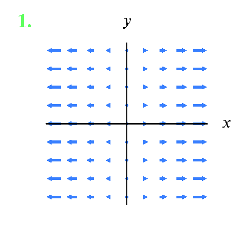

- **Source figure inspection (p. 963, Ex. 1):** All arrows are horizontal (parallel to the $x$-axis). On the $y$-axis ($x = 0$), arrows shrink to dots ($\vec{0}$). For $x > 0$, arrows point to the **right**; for $x < 0$, arrows point to the **left**. Along any vertical line ($x$ fixed), all arrows are identical, and arrow length increases linearly with $|x|$.
- **Solution:** Because the $y$-component is $0$ and the $x$-component is proportional to $x$ with a positive constant of proportionality, the simplest formula is
  $$\vec{F}(x,y) = x\vec{i}$$
  *(any positive scalar multiple $cx\vec{i}$ with $c > 0$ also matches the plot).*
- **Verification:** At $(1,y) \mapsto \vec{i}$ (right, length $1$); at $(2,y) \mapsto 2\vec{i}$ (right, length $2$); at $(0,y) \mapsto \vec{0}$; at $(-1,y) \mapsto -\vec{i}$ (left, length $1$). Matches the figure.

---

### Exercise 3

- **Applicable PT:** No established PT (**Supplementary** graph-to-formula translation, Concept 4.1).

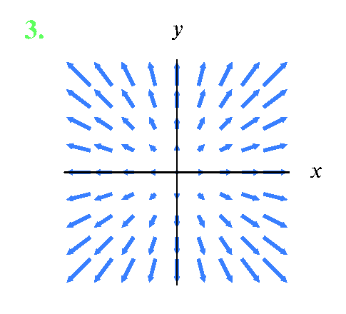

- **Source figure inspection (p. 963, Ex. 3):** Arrows point **radially outward** away from the origin in all four quadrants and along both axes (right on $+x$-axis, up on $+y$-axis, left on $-x$-axis, down on $-y$-axis). Arrows are very short near $(0,0)$ and grow linearly with distance from the origin.
- **Solution:** A vector field pointing outward along $\vec{r}$ with magnitude proportional to $\|\vec{r}\|$ is
  $$\vec{F}(x,y) = x\vec{i} + y\vec{j} = \vec{r}$$
  *(any positive scalar multiple $c\vec{r}$ with $c > 0$ also matches).*
- **Verification:** At $(1,0) \mapsto \vec{i}$ (right), at $(0,1) \mapsto \vec{j}$ (up), at $(1,1) \mapsto \vec{i}+\vec{j}$ (up-right), and $\|\vec{F}\| = \sqrt{x^2+y^2}$ grows linearly with distance. Matches the figure.

---

### Exercise 5

- **Applicable PT:** No established PT (**Supplementary** graph-to-formula translation, Concept 4.1).

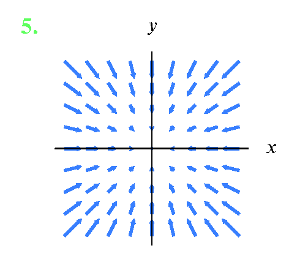

- **Source figure inspection (p. 963, Ex. 5):** Arrows point **radially inward** toward the origin in all four quadrants and along both axes (left on $+x$-axis, down on $+y$-axis, right on $-x$-axis, up on $-y$-axis). Arrows are very short near $(0,0)$ and grow linearly with distance from the origin.
- **Solution:** Reversing the field in Exercise 3 gives
  $$\vec{F}(x,y) = -x\vec{i} - y\vec{j} = -\vec{r}$$
  *(any $-c\vec{r}$ with $c > 0$ also matches).*
- **Verification:** At $(1,0) \mapsto -\vec{i}$ (left), at $(0,1) \mapsto -\vec{j}$ (down), at $(-1,-1) \mapsto \vec{i}+\vec{j}$ (toward origin), and $\|\vec{F}\| = \sqrt{x^2+y^2}$ grows linearly with distance. Matches the figure.

---

> **Shared directions for Exercises 7–10 (p. 963):** *"In Exercises 7–10, assume $x, y > 0$ and decide if (a) The vector field is parallel to the $x$-axis, parallel to the $y$-axis, or neither. (b) As $x$ increases, the length increases, decreases, or neither. (c) As $y$ increases, the length increases, decreases, or neither. Assume $x, y > 0$."*

### Exercise 7

- **Applicable PT:** `PT-01` (with **Supplementary** axis-aligned monotonicity check, Concept 1).
- **Given:** $\vec{F} = x\vec{j}$, with $x, y > 0$.
- **Solution:**
  - **(a)** Since $P(x,y) = 0$ and $Q(x,y) = x > 0$, $\vec{F}$ has only a $\vec{j}$-component and is **parallel to the $y$-axis**.
  - **(b)** The length is $\|\vec{F}(x,y)\| = \sqrt{0^2 + x^2} = |x| = x$ (since $x > 0$). As $x$ increases, the length **increases**.
  - **(c)** Since $\|\vec{F}(x,y)\| = x$ does not depend on $y$, as $y$ increases, the length **neither** increases nor decreases (stays constant).

---

### Exercise 9

- **Applicable PT:** `PT-01` (with **Supplementary** axis-aligned monotonicity check, Concept 1).
- **Given:** $\vec{F} = (x + e^{1-y})\vec{i}$, with $x, y > 0$.
- **Solution:**
  - **(a)** Since $Q(x,y) = 0$ and $P(x,y) = x + e^{1-y} > 0$, $\vec{F}$ has only an $\vec{i}$-component and is **parallel to the $x$-axis**.
  - **(b)** Because $x > 0$ and $e^{1-y} > 0$, the length is $\|\vec{F}(x,y)\| = |x + e^{1-y}| = x + e^{1-y}$. Holding $y$ fixed, as $x$ increases, $x + e^{1-y}$ **increases**.
  - **(c)** Holding $x$ fixed, as $y$ increases, $1 - y$ decreases and hence $e^{1-y}$ strictly decreases, so $x + e^{1-y}$ **decreases**.
- **Point check:** At $(1,1)$, $\|\vec{F}\| = 1 + e^{0} = 2$; at $(2,1)$, $\|\vec{F}\| = 2 + e^{0} = 3$ (increased as $x$ increased); at $(1,2)$, $\|\vec{F}\| = 1 + e^{-1} \approx 1.37$ (decreased as $y$ increased).

---

> **Shared directions for Exercises 11–19 (p. 963):** *"Sketch the vector fields in Exercises 11–19 in the $xy$-plane."*

### Exercise 11

- **Applicable PT:** `PT-02`.
- **Given:** $\vec{F}(x,y) = 2\vec{i} + 3\vec{j}$.
- **Analysis:** Constant vector field. At every point $(x,y)$, draw the same arrow pointing right $2$ and up $3$ (slope $3/2$), with constant length $\|\vec{F}\| = \sqrt{2^2 + 3^2} = \sqrt{13}$.
- **Sample values:** $\vec{F}(0,0) = \vec{F}(1,0) = \vec{F}(-1,2) = 2\vec{i} + 3\vec{j}$.

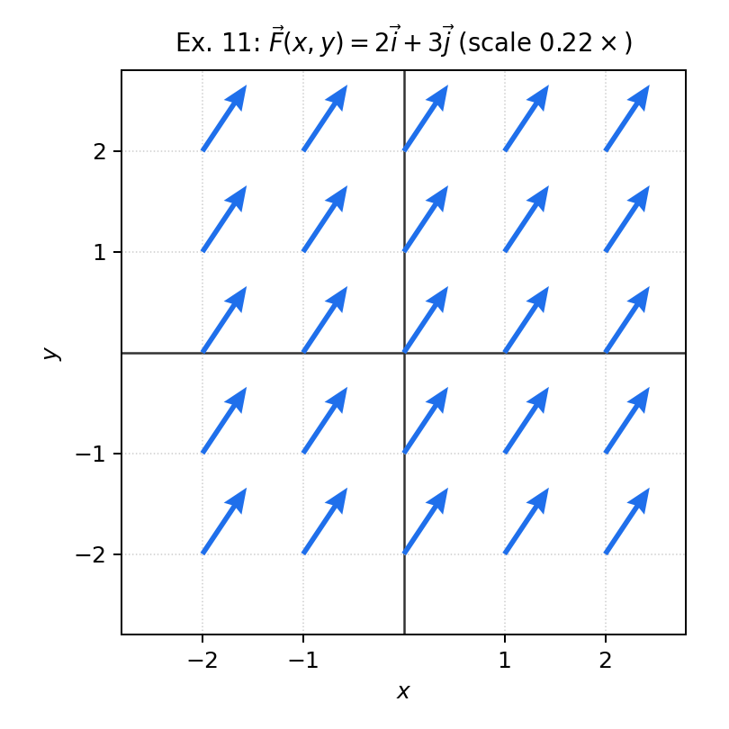

---

### Exercise 13

- **Applicable PT:** `PT-02`.
- **Given:** $\vec{F}(x,y) = -y\vec{j}$.
- **Analysis:** Vertical arrows ($P = 0$) independent of $x$, so arrows are identical along every horizontal line.
  - Along the $x$-axis ($y = 0$): $\vec{F}(x,0) = \vec{0}$ (dots).
  - For $y > 0$: arrows point **downward** (toward the $x$-axis) with length $y$.
  - For $y < 0$: arrows point **upward** (toward the $x$-axis) with length $|y| = -y$.
- **Sample values:** $(x,2) \mapsto -2\vec{j}$, $(x,1) \mapsto -\vec{j}$, $(x,0) \mapsto \vec{0}$, $(x,-1) \mapsto \vec{j}$, $(x,-2) \mapsto 2\vec{j}$.

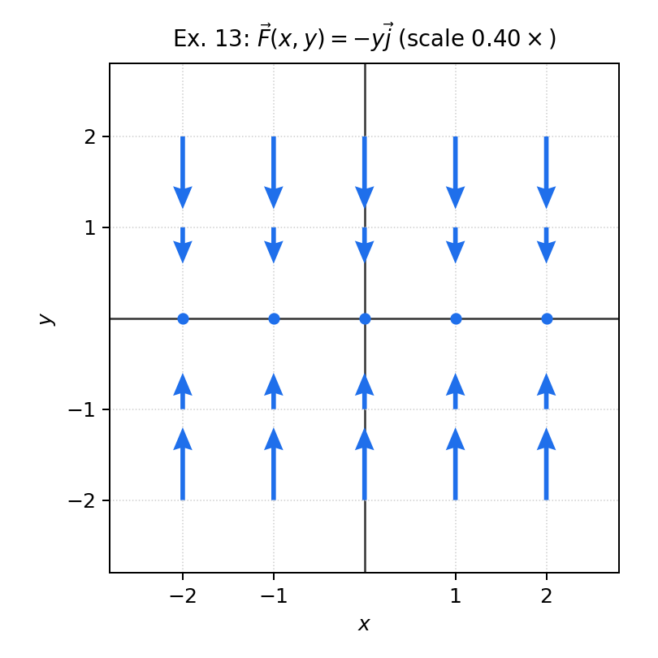

---

### Exercise 15

- **Applicable PT:** `PT-02`.
- **Given:** $\vec{F}(\vec{r}) = \frac{\vec{r}}{\|\vec{r}\|} = \frac{x\vec{i} + y\vec{j}}{\sqrt{x^2+y^2}}$.
- **Analysis:**
  - **Domain:** All $(x,y) \ne (0,0)$ (undefined at the origin, marked with an open circle).
  - **Direction:** Radially outward away from the origin at every $(x,y) \ne (0,0)$.
  - **Magnitude:** $\|\vec{F}(\vec{r})\| = \frac{\|\vec{r}\|}{\|\vec{r}\|} = 1$ (constant unit length everywhere it is defined).
- **Sample values:** $(1,0) \mapsto \vec{i}$, $(2,0) \mapsto \vec{i}$, $(0,1) \mapsto \vec{j}$, $(-1,0) \mapsto -\vec{i}$, $(1,1) \mapsto \frac{1}{\sqrt{2}}(\vec{i}+\vec{j})$.

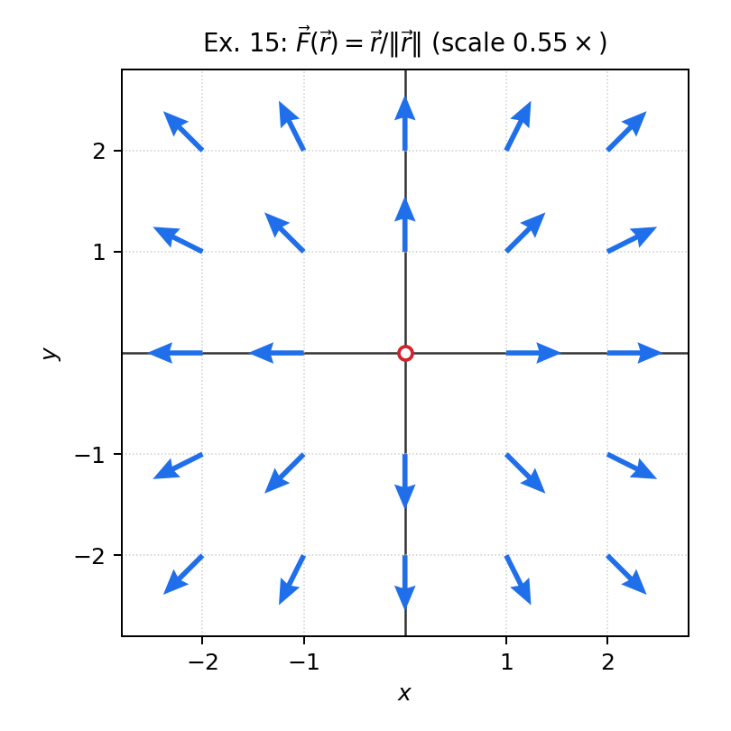

---

### Exercise 17

- **Applicable PT:** `PT-02`.
- **Given:** $\vec{F}(x,y) = y\vec{i} - x\vec{j}$.
- **Analysis:** Notice $\vec{F}(x,y) = -(-y\vec{i} + x\vec{j})$, so it is the **opposite** of the lecture's counterclockwise rotational field.
  - **Direction:** $\vec{r}\cdot\vec{F} = x(y) + y(-x) = 0$, so arrows are tangent to circles centered at the origin and point **clockwise**.
  - **Magnitude:** $\|\vec{F}(x,y)\| = \sqrt{y^2 + (-x)^2} = \sqrt{x^2+y^2}$, zero at $(0,0)$ and growing linearly with distance from the origin.
- **Sample values:** $(0,0) \mapsto \vec{0}$, $(1,0) \mapsto -\vec{j}$ (down), $(0,1) \mapsto \vec{i}$ (right), $(-1,0) \mapsto \vec{j}$ (up), $(0,-1) \mapsto -\vec{i}$ (left), $(1,1) \mapsto \vec{i}-\vec{j}$ (down-right), $(2,0) \mapsto -2\vec{j}$.

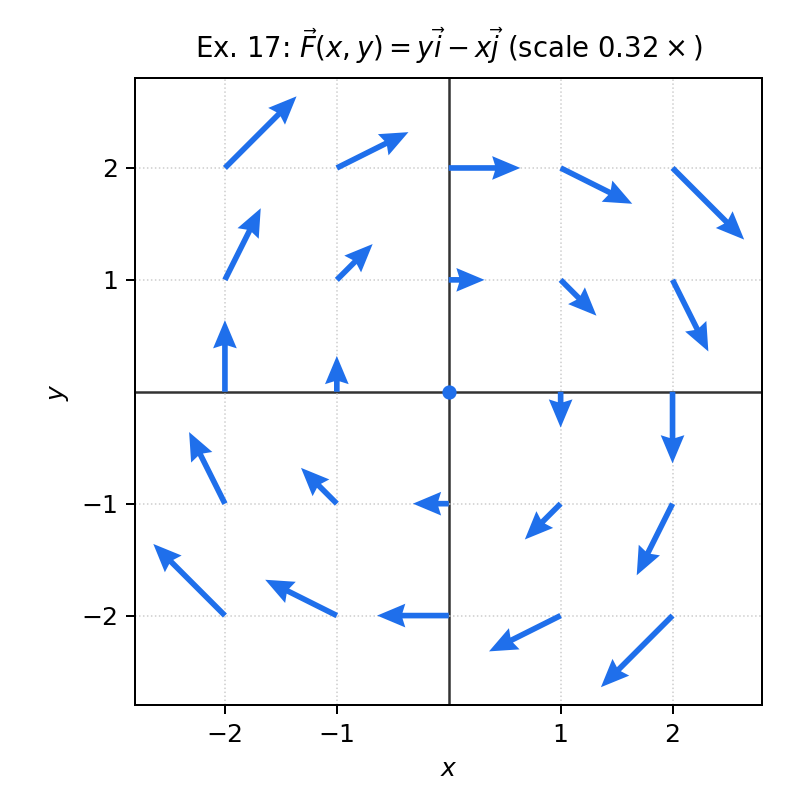

---

> **Shared directions for Problems 23–27 (p. 964):** *"In Problems 23–27, give an example of a vector field $\vec{F}(x,y)$ in 2-space with the stated properties."*

### Problem 23

- **Applicable PT:** No established PT (**Supplementary** verbal-to-formula construction, Concept 4.2).
- **Property:** $\vec{F}$ is constant.
- **Solution:** Choose any constant components, for example:
  $$\vec{F}(x,y) = 3\vec{i} - 4\vec{j}.$$
- **Verification:** Neither component depends on $x$ or $y$, so $\vec{F}(x,y)$ is the same vector at every point in $\mathbb{R}^2$. *(Many other answers are possible, such as $\vec{F}(x,y) = \vec{i}$.)*

---

### Problem 25

- **Applicable PT:** No established PT (**Supplementary** verbal-to-formula construction, Concept 4.2).
- **Property:** $\|\vec{F}\|$ is constant, but $\vec{F}$ is not constant.
- **Solution:** Choose a unit vector whose direction varies with $x$ (or $y$), for example:
  $$\vec{F}(x,y) = \cos(x)\vec{i} + \sin(x)\vec{j}.$$
  *(Another valid example, matching the textbook's answer key, is $\vec{F}(x,y) = \frac{1}{\sqrt{1+x^2}}(\vec{i} - x\vec{j})$.)*
- **Verification:**
  - Constant magnitude: $\|\vec{F}(x,y)\| = \sqrt{\cos^2(x) + \sin^2(x)} = 1$ for all $(x,y) \in \mathbb{R}^2$.
  - Nonconstant field: $\vec{F}(0,0) = \vec{i}$ whereas $\vec{F}(\pi,0) = -\vec{i} \ne \vec{i}$.

---

### Problem 27

- **Applicable PT:** No established PT (**Supplementary** verbal-to-formula construction, Concept 4.2).
- **Property:** $\vec{F}$ is perpendicular to $\vec{G} = (x+y)\vec{i} + (1+y^2)\vec{j}$ at every point.
- **Solution:** Swap the components of $\vec{G}$ and negate one of them:
  $$\vec{F}(x,y) = -(1+y^2)\vec{i} + (x+y)\vec{j}.$$
  *(Any scalar multiple $h(x,y)\big((1+y^2)\vec{i} - (x+y)\vec{j}\big)$ is also valid.)*
- **Verification:** Compute the dot product at an arbitrary point $(x,y)$:
  $$\vec{F}(x,y) \cdot \vec{G}(x,y) = -(1+y^2)(x+y) + (x+y)(1+y^2) = 0 \quad \text{for all } (x,y) \in \mathbb{R}^2.$$
  Hence $\vec{F}(x,y) \perp \vec{G}(x,y)$ at every point.

---

> **Shared directions for Problems 29–30 (p. 964):** *"Problems 29–30 concern the vector fields $\vec{F} = x\vec{i} + y\vec{j}$, $\vec{G} = -y\vec{i} + x\vec{j}$, and $\vec{H} = x\vec{i} - y\vec{j}$."*

### Problem 29

- **Applicable PT:** `PT-03`.
- **Question (p. 964):** Match $\vec{F}$, $\vec{G}$, $\vec{H}$ with their sketches in (I)–(III).

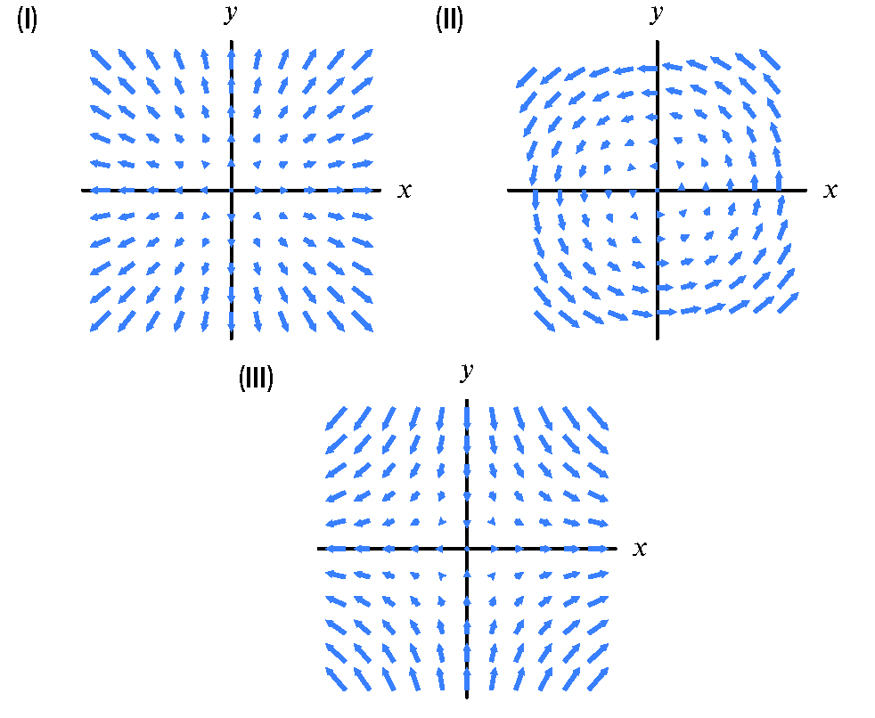

- **Solution (using test points $(1,0)$, $(0,1)$, and $(1,1)$ against the textbook figures on p. 964):**

| Field | At $(1,0)$ | At $(0,1)$ | At $(1,1)$ | Visual features in p. 964 figures | Match |
| :--- | :--- | :--- | :--- | :--- | :--- |
| $\vec{F} = x\vec{i}+y\vec{j}$ | $\vec{i}$ (right) | $\vec{j}$ (up) | $\vec{i}+\vec{j}$ (up-right) | Plot (I): radially outward everywhere | **$\vec{F} \leftrightarrow \text{(I)}$** |
| $\vec{G} = -y\vec{i}+x\vec{j}$ | $\vec{j}$ (up) | $-\vec{i}$ (left) | $-\vec{i}+\vec{j}$ (up-left) | Plot (II): counterclockwise circulation around origin | **$\vec{G} \leftrightarrow \text{(II)}$** |
| $\vec{H} = x\vec{i}-y\vec{j}$ | $\vec{i}$ (right) | $-\vec{j}$ (down) | $\vec{i}-\vec{j}$ (down-right) | Plot (III): outward along $x$-axis, inward along $y$-axis (hyperbolic/saddle pattern) | **$\vec{H} \leftrightarrow \text{(III)}$** |

- **Final answer:** $\vec{F} \leftrightarrow \text{(I)}$, $\vec{G} \leftrightarrow \text{(II)}$, $\vec{H} \leftrightarrow \text{(III)}$.

---

### Problem 31

- **Applicable PT:** `PT-03` (**Supplementary** 3D extension, Concept 3).
- **Question (p. 965):** Match vector fields (a)–(f) with their 3D graphs (I)–(VI):
  (a) $-y\vec{i}+x\vec{j}$, (b) $x\vec{i}$, (c) $y\vec{j}$, (d) $z\vec{k}$, (e) $2\vec{k}$, (f) $\vec{r}$.

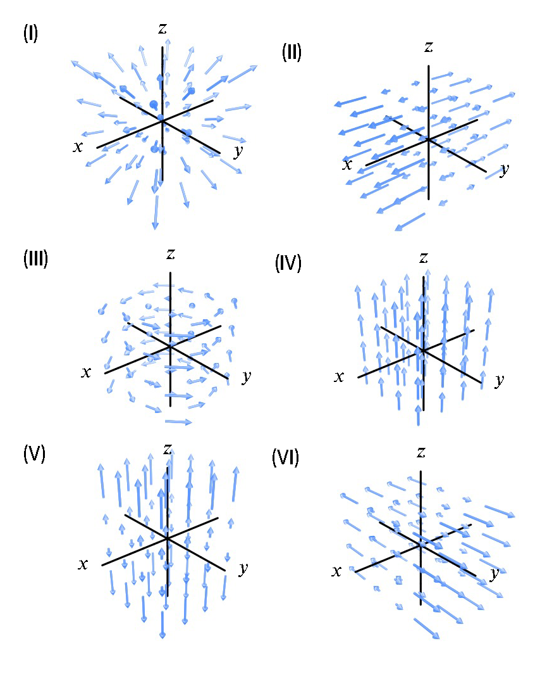

- **Solution (inspecting axis orientation and arrow directions in the 3D plots on p. 965):**
  - **(a) $-y\vec{i}+x\vec{j} \longleftrightarrow \text{(III)}$:** The $z$-component is $0$, so arrows lie in horizontal planes parallel to the $xy$-plane and circulate counterclockwise around the $z$-axis. Only graph (III) shows horizontal circular flow around the $z$-axis.
  - **(b) $x\vec{i} \longleftrightarrow \text{(II)}$:** All arrows are parallel to the $x$-axis, pointing in the $+x$ direction (front-left) when $x > 0$ and the $-x$ direction (back-right) when $x < 0$, growing longer as $|x|$ increases. This matches graph (II).
  - **(c) $y\vec{j} \longleftrightarrow \text{(VI)}$:** All arrows are parallel to the $y$-axis, pointing in the $+y$ direction (front-right) when $y > 0$ and the $-y$ direction (back-left) when $y < 0$, growing longer as $|y|$ increases. This matches graph (VI).
  - **(d) $z\vec{k} \longleftrightarrow \text{(V)}$:** All arrows are vertical (parallel to the $z$-axis), pointing upward above the $xy$-plane ($z > 0$) and downward below the $xy$-plane ($z < 0$), with lengths increasing with $|z|$. This matches graph (V).
  - **(e) $2\vec{k} \longleftrightarrow \text{(IV)}$:** All arrows are vertical, point **upward** everywhere (both above and below the $xy$-plane), and have **constant length**. This matches graph (IV).
  - **(f) $\vec{r} = x\vec{i}+y\vec{j}+z\vec{k} \longleftrightarrow \text{(I)}$:** Arrows point radially outward from the origin in all three dimensions and grow longer farther from the origin. This matches graph (I).
- **Final answer:** (a) (III), (b) (II), (c) (VI), (d) (V), (e) (IV), (f) (I).

---

> **Shared directions for Problems 32–34 (p. 965):** *"In Problems 32–34, write formulas for vector fields with the given properties."*

### Problem 33

- **Applicable PT:** No established PT (**Supplementary** verbal-to-formula construction, Concept 4.2, using **Core** unit-vector normalization from `Week6-sol.pdf` p. 5).
- **Property:** All vectors point toward the origin and have constant length.
- **Solution:** Start with the inward radial field $-\vec{r}$ and divide by its magnitude $\|\vec{r}\|$ to obtain constant length $1$ (or multiply by any constant $c > 0$ for constant length $c$):
  - In 2-space (for $(x,y) \ne (0,0)$):
    $$\vec{F}(x,y) = -\frac{\vec{r}}{\|\vec{r}\|} = \frac{-x\vec{i} - y\vec{j}}{\sqrt{x^2 + y^2}}.$$
  - In 3-space (for $(x,y,z) \ne (0,0,0)$):
    $$\vec{F}(x,y,z) = -\frac{\vec{r}}{\|\vec{r}\|} = \frac{-x\vec{i} - y\vec{j} - z\vec{k}}{\sqrt{x^2 + y^2 + z^2}}.$$
- **Verification:** At every nonzero point, $\vec{F}$ is a negative scalar multiple of $\vec{r}$ (points directly toward the origin) and $\|\vec{F}\| = \frac{\|\vec{r}\|}{\|\vec{r}\|} = 1$ (constant).

---

## 4. Self-Test Questions and Answers

Attempt all three questions before checking the answers below.

### Self-Test Questions

1. **`ST-01` (Tests `PT-01`):** Consider $\vec{F}(x,y) = (3 + e^{-x})\vec{i}$ on the region $x > 0,\ y > 0$.
   - (a) Is $\vec{F}$ parallel to the $x$-axis, parallel to the $y$-axis, or neither?
   - (b) As $x$ increases, does $\|\vec{F}\|$ increase, decrease, or neither?
   - (c) As $y$ increases, does $\|\vec{F}\|$ increase, decrease, or neither?

2. **`ST-02` (Tests `PT-02`):** Sketch a portion of the vector field $\vec{F}(x,y) = -x\vec{i}$ on the integer grid $x, y \in \{-2, -1, 0, 1, 2\}$. State where $\vec{F} = \vec{0}$ and how arrow direction and length vary across the plane.

3. **`ST-03` (Tests `PT-03`):** Shown below are uniformly scaled plots of
   $$\vec{H}_1(x,y) = -x\vec{i} - y\vec{j} \qquad \text{and} \qquad \vec{H}_2(x,y) = \frac{-x\vec{i} - y\vec{j}}{\sqrt{x^2+y^2}}.$$
   Determine which plot (Plot I or Plot II) represents each field and justify your answer.

---

### Self-Test Answers

1. **`ST-01` Answer (`PT-01`):**
   - (a) **Parallel to the $x$-axis** (the $\vec{j}$-component is $0$ and the $\vec{i}$-component $3 + e^{-x}$ is nonzero).
   - (b) Since $3 + e^{-x} > 0$, $\|\vec{F}(x,y)\| = 3 + e^{-x}$. As $x$ increases, $e^{-x}$ decreases, so $\|\vec{F}\|$ **decreases**.
   - (c) **Neither** ($3 + e^{-x}$ is independent of $y$).

2. **`ST-02` Answer (`PT-02`):**
   - $\vec{F}(x,y) = \vec{0}$ along the entire $y$-axis ($x = 0$).
   - Arrows are horizontal and identical along each vertical line: pointing **left** for $x > 0$ (e.g., $(1,y) \mapsto -\vec{i}$, $(2,y) \mapsto -2\vec{i}$) and **right** for $x < 0$ (e.g., $(-1,y) \mapsto \vec{i}$, $(-2,y) \mapsto 2\vec{i}$), with length $|x|$ growing linearly away from the $y$-axis.

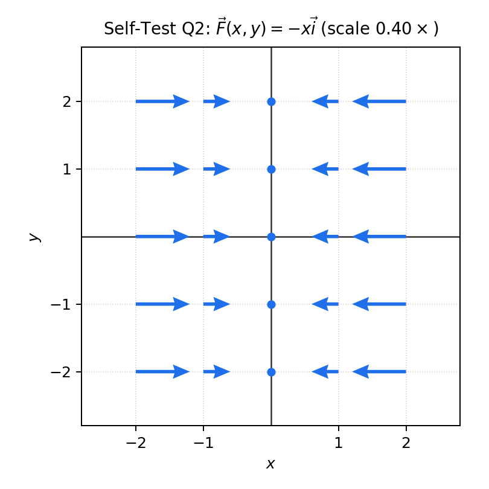

3. **`ST-03` Answer (`PT-03`):**
   - Both fields point radially inward for $(x,y) \ne (0,0)$.
   - $\|\vec{H}_1(x,y)\| = \sqrt{x^2+y^2}$ grows linearly with distance from the origin and equals $0$ at $(0,0)$ $\implies$ **Plot I $\longleftrightarrow \vec{H}_1(x,y) = -x\vec{i}-y\vec{j}$**.
   - $\|\vec{H}_2(x,y)\| = 1$ for all $(x,y) \ne (0,0)$ (constant length, undefined at $(0,0)$) $\implies$ **Plot II $\longleftrightarrow \vec{H}_2(x,y) = \frac{-x\vec{i}-y\vec{j}}{\sqrt{x^2+y^2}}$**.

---

## 5. Coverage Appendix

### 5.1 Inspected Sources and Reading Status

| Source | Role | Reading / Scope Status |
| :--- | :--- | :--- |
| `W6/lec/Week6-sol.pdf` (pp. 1–6) | Primary lecture handout (annotated) | **Verified Core** (pp. 2–5 cover §17.3; p. 1 is schedule/TT1 logistics; p. 6 contains only stray ink overflow from p. 5). |
| `W6/lec/oct 14.pdf` (pp. 1–4) | Primary Oct 14 lecture notes | **Verified Core** (all 4 pages cover §17.3). |
| `W6/lec/oct 16.pdf` (pp. 1–4) | TT1 Review lecture notes | **Out of scope** (Ch. 12–13 TT1 review), except p. 1 item $6^\circ$ (1-line §17.3 True/False, included in `SQ-01`). |
| `W6/lec/oct 19.pdf` (pp. 1–3) | TT1 Review lecture notes | **Out of scope** (Ch. 13 TT1 review); excluded from §17.3 notes. |
| `MAT235_textbook.pdf` §17.3 — Definition of a Vector Field (Quercus cites p. 959; formal definition box on p. 960 in 8th ed.) & Examples 2–3 (pp. 960–961; both on p. 961 in 8th ed.) | Hughes-Hallett et al., *Calculus*, **8th Edition** | **Verified assigned pre-class reading** (per Quercus Week 6 Pre-Class Reading page). |
| `MAT235_textbook.pdf` §17.3 — remaining exposition (pp. 958–960, 962, including uniform scaling in Fig. 17.21), exercise pages (pp. 963–965), and back-of-book odd answers (pp. 1169–1170) | Hughes-Hallett et al., *Calculus*, **8th Edition** | **Supporting reading / reference** (exercises source and independent verification). |
| Week 6 Quercus objectives & exercise list (transcribed in prompt) | Official scope & exercise list | **Verified.** |

### 5.2 Learning Objectives, Concepts, and Problem Type Map

| Quercus Learning Objective | Concepts Covered | Established Problem Types | Slide Questions | Textbook Exercises |
| :--- | :--- | :--- | :--- | :--- |
| **LO-1:** Translate between algebraic, verbal, and graphical representations of vector fields. | Concept 1 (**Core**), Concept 3 (**Core**; 3D **Supplementary**), Concept 4 (**Supplementary**) | `PT-01`, `PT-03` | `SQ-01`, `SQ-02`, `SQ-03`, `SQ-04`, `SQ-06` | `PT-01`: 7, 9 `PT-03`: 29, 31 No PT (**Supplementary**): 1, 3, 5, 23, 25, 27, 33 |
| **LO-2:** Sketch portions of a vector field given an algebraic representation. | Concept 2 (**Core**) | `PT-02` | `SQ-02`, `SQ-05` | `PT-02`: 11, 13, 15, 17 |

### 5.3 Source Gaps, Edition Check, and Difficulty-Label Verification

- **Textbook edition verification:** `MAT235_textbook.pdf` was verified (front matter, PDF pp. 5 and 7) to be **Hughes-Hallett et al., *Calculus*, Eighth Edition**, matching Quercus numbering with **zero edition discrepancies**.
- **Unverified "Basic" difficulty labels (recorded gap):** In Hughes-Hallett 8th Edition (§17.3, pp. 963–966), questions are grouped under **EXERCISES** (1–22), **PROBLEMS** (23–40), and **Strengthen Your Understanding** (41–44), with green square markers denoting shared-instruction blocks rather than a "Basic" difficulty tier. Because the textbook does not provide an explicit "Basic" marker, **all three Problem Types (`PT-01`, `PT-02`, `PT-03`) were established strictly from verified Week 6 slide questions**, and requested exercises whose tasks did not appear as slide questions (Exercises 1, 3, 5 and Problems 23, 25, 27, 33) were solved in full without creating additional Problem Types.
- **Unresolved items:** None. All supplied Week 6 lecture pages and all 15 textbook exercises (including all subparts and source figures) were readable and visually inspected.
