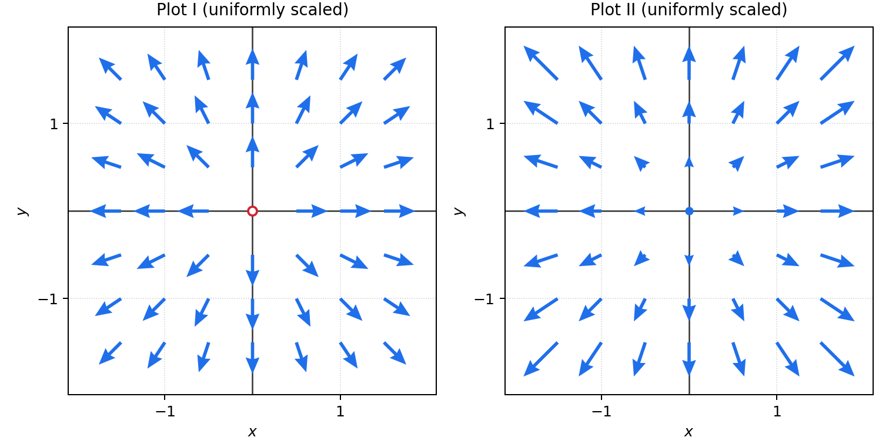

# MAT235H1 Week 6 Study Notes — §17.3 Vector Fields

## Contents

1. [Scope, Sources, and Notation](#scope-sources-and-notation)
2. [Concept 1: Vector Fields — Definition, Notation, and Geometric Meaning (Core)](#concept-1-vector-fields--definition-notation-and-geometric-meaning-core)
   - [PT-01: Interpret Direction, Magnitude, and Scaling from a Vector-Field Formula](#pt-01-interpret-direction-magnitude-and-scaling-from-a-vector-field-formula)
3. [Concept 2: Sketching Portions of a 2D Vector Field (Core)](#concept-2-sketching-portions-of-a-2d-vector-field-core)
   - [PT-02: Sketch a Portion of a 2D Vector Field from an Algebraic Formula](#pt-02-sketch-a-portion-of-a-2d-vector-field-from-an-algebraic-formula)
4. [Concept 3: Matching Vector-Field Formulas to Graphical Plots and Normalization (Core)](#concept-3-matching-vector-field-formulas-to-graphical-plots-and-normalization-core)
   - [PT-03: Match Vector-Field Formulas to Plots Using Direction and Magnitude](#pt-03-match-vector-field-formulas-to-plots-using-direction-and-magnitude)
5. [Concept 4: Translating Graphs and Verbal Properties into Vector-Field Formulas (Supplementary)](#concept-4-translating-graphs-and-verbal-properties-into-vector-field-formulas-supplementary)

---

## Scope, Sources, and Notation

### Week 6 Scope and Learning Objectives

These notes cover **Section 17.3: Vector Fields** (Hughes-Hallett et al., *Calculus*, 8th Edition, pp. 958–966). Term Test 1 review materials from Oct 16 and Oct 19 (Chapters 12–13) are kept separate from these notes.

The two official Week 6 Quercus learning objectives are:
1. **LO-1:** Translate between algebraic, verbal, and graphical representations of vector fields.
2. **LO-2:** Sketch portions of a vector field given an algebraic representation.

### Depth Labels

- **Core:** Supported directly by the professor's Week 6 lecture materials (`Week6-sol.pdf` pp. 2–5, `oct 14.pdf` pp. 1–4, and the §17.3 True/False item in `oct 16.pdf` p. 1, item $6^\circ$).
- **Supplementary:** Material beyond the verified Week 6 slides that is included concisely to support a Quercus learning objective or a requested §17.3 exercise.

### Notation Summary (**Core** — `Week6-sol.pdf` pp. 3–4; `oct 14.pdf` p. 1)

| Object | 2-Space ($\mathbb{R}^2$) | 3-Space ($\mathbb{R}^3$) |
| :--- | :--- | :--- |
| Position vector of a point | $\vec{r} = x\vec{i} + y\vec{j} = \langle x, y \rangle$ | $\vec{r} = x\vec{i} + y\vec{j} + z\vec{k} = \langle x, y, z \rangle$ |
| Distance from the origin | $\|\vec{r}\| = \sqrt{x^2 + y^2}$ | $\|\vec{r}\| = \sqrt{x^2 + y^2 + z^2}$ |
| Vector field | $\vec{F}(x,y) = P(x,y)\vec{i} + Q(x,y)\vec{j} = (P(x,y), Q(x,y))$ | $\vec{F}(x,y,z) = P\vec{i} + Q\vec{j} + R\vec{k}$ |
| Position-vector shorthand | $\vec{F}(\vec{r})$ | $\vec{F}(\vec{r})$ |
| Magnitude (length) of $\vec{F}$ | $\|\vec{F}(x,y)\| = \sqrt{P(x,y)^2 + Q(x,y)^2}$ | $\|\vec{F}(x,y,z)\| = \sqrt{P^2 + Q^2 + R^2}$ |

> **Companion file:** All teaching-example solutions, lecture-slide question solutions, worked solutions for all 15 Quercus-suggested §17.3 exercises, self-test questions and answers, and the coverage appendix are in [Answers-and-Practice.md](Answers-and-Practice.md).

---

## Concept 1: Vector Fields — Definition, Notation, and Geometric Meaning (**Core**)

*Sources: `Week6-sol.pdf` pp. 2–4; `oct 14.pdf` pp. 1–3; `oct 16.pdf` p. 1 item $6^\circ$.*

### Definition (**Core**)

- A **vector field in 2-space** is a function $\vec{F}(x,y)$ (also written $\vec{F}(\vec{r})$) that assigns a **2-dimensional vector** to each point $(x,y)$ in its domain:
  $$\vec{F}(x,y) = P(x,y)\vec{i} + Q(x,y)\vec{j},$$
  where $P(x,y)$ and $Q(x,y)$ are scalar 2-variable functions (`Week6-sol.pdf` pp. 3–4; `oct 14.pdf` p. 1).
- A **vector field in 3-space** is a function $\vec{F}(x,y,z)$ that assigns a **3-dimensional vector** to each point $(x,y,z)$ in its domain (`Week6-sol.pdf` p. 3).

### Physical Intuition (**Core**)

On a weather map (`Week6-sol.pdf` p. 2; `oct 14.pdf` p. 1), each location carries a wind arrow:
- The **direction** of the arrow gives the direction the wind blows toward (note meteorological convention: a *west wind* blows from the west toward the east, as drawn at Toronto on `Week6-sol.pdf` p. 2).
- The **length** (magnitude) of the arrow gives the wind speed (e.g., $16\text{ km/h}$).

More generally, a vector field encodes a **direction** and a **magnitude** at every point in space.

### Key Algebraic Checks on Direction and Magnitude (**Core**)

1. **Magnitude formula (`Week6-sol.pdf` pp. 3, 5; `oct 14.pdf` p. 2):**
   $$\|\vec{F}(x,y)\| = \sqrt{P(x,y)^2 + Q(x,y)^2}.$$
   - If $\vec{F}(x,y)$ is constant, $\|\vec{F}\|$ is constant and independent of $(x,y)$.
   - For radial or linear rotational fields such as $\vec{F} = x\vec{i}+y\vec{j}$, $\vec{F} = -x\vec{i}-y\vec{j}$, or $\vec{F} = -y\vec{i}+x\vec{j}$, we have $\|\vec{F}(x,y)\| = \sqrt{x^2+y^2}$, which equals the distance from the origin $(0,0)$ to $(x,y)$.
2. **Multiplying a field by $-1$ (`oct 14.pdf` p. 2):**
   Replacing $\vec{F}$ by $-\vec{F}$ **reverses every arrow's direction** (rotates each arrow by $180^\circ$) while **leaving every arrow's magnitude unchanged**, since $\|-\vec{F}\| = \|\vec{F}\|$.
3. **Orthogonality via the dot product (`oct 14.pdf` p. 3):**
   To check whether $\vec{F}(x,y)$ is perpendicular to the position vector $\vec{r} = (x,y)$ (and hence tangent to circles centered at the origin), compute $\vec{r} \cdot \vec{F}(x,y)$:
   $$(x,y) \cdot (-y,x) = -xy + yx = 0.$$
4. **Axis-aligned fields and monotonicity in $x$ or $y$ (**Supplementary** — needed for §17.3 Exercises 7, 9):**
   - If $Q(x,y) \equiv 0$ (so $\vec{F} = P(x,y)\vec{i}$), every vector is **parallel to the $x$-axis** and its length is $\|\vec{F}\| = |P(x,y)|$.
   - If $P(x,y) \equiv 0$ (so $\vec{F} = Q(x,y)\vec{j}$), every vector is **parallel to the $y$-axis** and its length is $\|\vec{F}\| = |Q(x,y)|$.
   - On a given region (such as $x, y > 0$), simplify $|P|$ or $|Q|$ using the sign of the component, then check whether the expression increases, decreases, or stays unchanged as $x$ increases (holding $y$ fixed) and as $y$ increases (holding $x$ fixed).

---

### PT-01: Interpret Direction, Magnitude, and Scaling from a Vector-Field Formula

- **Qualifying sources:** `Week6-sol.pdf` p. 3 (Worksheet p. 1: *"For each field, describe how the direction and magnitude of the vectors change as the point moves away from the origin"*); `oct 14.pdf` p. 2 (constant field input dependence and magnitude; comparing outward and inward radial fields under multiplication by $-1$); `oct 14.pdf` p. 3 (perpendicularity check $(x,y)\cdot(-y,x)=0$).
- **Applies to textbook exercises:** §17.3 Exercises 7, 9.

#### Recognition Cues

- **Given:** An explicit algebraic formula $\vec{F}(x,y) = P(x,y)\vec{i} + Q(x,y)\vec{j}$ (possibly with a domain restriction such as $x, y > 0$, or a pair of related fields such as $\vec{F}$ and $-\vec{F}$).
- **Asked for:** Qualitative or algebraic descriptions of vector direction (parallel to an axis, radial, rotational/perpendicular to $\vec{r}$), magnitude $\|\vec{F}(x,y)\|$, how length changes as $x$, $y$, or distance from the origin increases, or how multiplying by a scalar changes the diagram.

#### Reusable Method

1. **Read the components $P(x,y)$ and $Q(x,y)$:**
   - Check if either component is identically $0$ (parallel to an axis) or if both are constant (constant direction and length).
   - Check if $\vec{F}$ is a scalar multiple of $\vec{r}$ (radial) or satisfies $\vec{r}\cdot\vec{F} = 0$ (tangent to circles about the origin).
2. **Compute the magnitude $\|\vec{F}(x,y)\| = \sqrt{P^2 + Q^2}$:**
   - Simplify using any stated domain conditions (e.g., for $x > 0$, $\sqrt{x^2} = x$).
   - Note any points where $\vec{F} = \vec{0}$ or where $\vec{F}$ is undefined (division by $0$).
3. **Analyze variation / scaling:**
   - To see how length changes with distance $r = \sqrt{x^2+y^2}$, express $\|\vec{F}\|$ in terms of $r$ when possible.
   - To see how length changes with $x$ (resp. $y$), hold $y$ (resp. $x$) fixed and check monotonicity of $\|\vec{F}\|$.
   - Under $\vec{F} \mapsto c\vec{F}$, magnitudes scale by $|c|$; directions stay the same if $c > 0$ and reverse if $c < 0$.
4. **Sanity-check with 2–3 sample points** (e.g., $(1,0), (0,1), (2,0)$, or points in the specified domain) to confirm sign and trend.

#### Teaching Example (`TE-01`)

Consider the vector field $\vec{F}(x,y) = (y + 2e^{-x})\vec{j}$ on the first quadrant $x > 0,\ y > 0$.
1. Is $\vec{F}$ parallel to the $x$-axis, parallel to the $y$-axis, or neither?
2. Compute $\|\vec{F}(x,y)\|$ for $x > 0,\ y > 0$.
3. As $x$ increases (with $y > 0$ fixed), does the length of $\vec{F}$ increase, decrease, or neither? What happens as $y$ increases (with $x > 0$ fixed)?
4. How does the diagram of $-\vec{F}(x,y)$ compare to the diagram of $\vec{F}(x,y)$?

*Worked solution:* [Teaching Example Solutions — PT-01](Answers-and-Practice.md#te-01-solution).

#### Complete-Solution Checklist

- [ ] Identified $P(x,y)$ and $Q(x,y)$ and stated the direction conclusion with algebraic justification.
- [ ] Computed $\|\vec{F}(x,y)\| = \sqrt{P^2 + Q^2}$ and applied any domain sign assumptions correctly.
- [ ] Justified how magnitude changes with each requested variable or distance from the origin.
- [ ] For scalar multiplication/negation questions, addressed **both** direction and magnitude.

#### Common Mistakes and How to Catch Them

- **Confusing $\vec{i}$ (parallel to the $x$-axis) with $\vec{j}$ (parallel to the $y$-axis):** For $\vec{F} = x\vec{j}$, the *magnitude* depends on $x$, but the *direction* is vertical (parallel to the $y$-axis). Catch it by evaluating at $(1,0) \mapsto \vec{j} = (0,1)$, which points straight up.
- **Dropping absolute values when simplifying $\sqrt{u^2}$:** $\sqrt{u^2} = |u|$, which equals $u$ only when $u \ge 0$. Check the stated domain (e.g., $x, y > 0$) before removing absolute value bars.
- **Forgetting that $e^{-t}$ decreases as $t$ increases:** Test two numbers (e.g., $t = 1$ vs. $t = 2$) to confirm monotonicity.

---

## Concept 2: Sketching Portions of a 2D Vector Field (**Core**)

*Sources: `Week6-sol.pdf` p. 3; `oct 14.pdf` pp. 1–4.*

### The Tail-at-$(x,y)$ Convention (**Core**)

To draw the vector $\vec{F}(x,y)$ at a point $(x,y)$ in the $xy$-plane, **place the tail of the vector at $(x,y)$** (`Week6-sol.pdf` p. 3). Thus, an unscaled arrow representing $\vec{F}(x,y) = P\vec{i} + Q\vec{j}$ starts at $(x,y)$ and ends at $(x + P,\ y + Q)$.

### Uniform Scaling (**Supplementary** — textbook §17.3, p. 960 Fig. 17.21 & p. 961 Fig. 17.24)

When arrows are long enough to overlap and obscure each other, we **scale all arrows down by the same positive constant factor** $c > 0$ (uniform scaling). Uniform scaling preserves:
- Every arrow's **direction**, and
- All **relative lengths** (an arrow twice as long in truth remains twice as long in the sketch).

*(Contrast with **unit-vector normalization** in Concept 3 (**Core**, `Week6-sol.pdf` p. 5), which divides each nonzero vector by its own magnitude $\|\vec{v}\|$ and therefore changes relative lengths so every arrow has length $1$.)*

### Four Canonical 2D Patterns from Lecture (**Core** — `oct 14.pdf` pp. 2–3)

| Pattern | Formula | Direction | Magnitude $\|\vec{F}(x,y)\|$ |
| :--- | :--- | :--- | :--- |
| **1. Constant field** | $\vec{F}(x,y) = a\vec{i} + b\vec{j}$ (e.g., $\langle 2,1\rangle$) | Same at every point | Constant $\sqrt{a^2+b^2}$ |
| **2. Outward radial** | $\vec{F}(x,y) = x\vec{i} + y\vec{j} = \vec{r}$ | Directly away from $(0,0)$ | $\sqrt{x^2+y^2}$ (distance from origin) |
| **3. Inward radial** | $\vec{F}(x,y) = -x\vec{i} - y\vec{j} = -\vec{r}$ | Directly toward $(0,0)$ | $\sqrt{x^2+y^2}$ (distance from origin) |
| **4. CCW rotational** | $\vec{F}(x,y) = -y\vec{i} + x\vec{j}$ | Tangent to circles, counterclockwise | $\sqrt{x^2+y^2}$ (distance from origin) |

*(Note: $\vec{F}(x,y) = y\vec{i} - x\vec{j} = -(-y\vec{i}+x\vec{j})$ is the **clockwise** rotational field with the same magnitude $\sqrt{x^2+y^2}$.)*

### Single-Component / Shear Fields (**Core** — `oct 14.pdf` p. 4)

Fields such as $\vec{F}(x,y) = 2y\vec{i}$ (`oct 14.pdf` p. 4) or $\vec{F}(x,y) = -y\vec{j}$ depend on only one coordinate:
- Arrows are **identical along every line where that coordinate is constant** (e.g., horizontal lines for $2y\vec{i}$, vertical lines for $x\vec{j}$).
- Arrows vanish ($\vec{F} = \vec{0}$) along the coordinate axis where the component equals $0$.
- Arrows reverse direction across that axis and grow linearly with distance from it.

---

### PT-02: Sketch a Portion of a 2D Vector Field from an Algebraic Formula

- **Qualifying sources:** `Week6-sol.pdf` p. 3 (Worksheet p. 1: sketch $\vec{F}_1(x,y) = -y\vec{i}+x\vec{j}$ and $\vec{F}_2(\vec{r}) = \vec{r}$); `oct 14.pdf` p. 1 (draw $\vec{F}(x,y) = (-y,x)$); `oct 14.pdf` p. 4 (sketch $\vec{F}(x,y) = 3\vec{i}+4\vec{j}$ and $\vec{F}(x,y) = 2y\vec{i}$).
- **Applies to textbook exercises:** §17.3 Exercises 11, 13, 15, 17.

#### Recognition Cues

- **Given:** A 2D vector-field formula $\vec{F}(x,y)$ or $\vec{F}(\vec{r})$.
- **Asked for:** A hand or plotted sketch of a representative portion of the vector field in the $xy$-plane.

#### Reusable Method

1. **Check domain and zero set:**
   - Find where $\vec{F}(x,y) = \vec{0}$ (plot dots or note zero vectors) and where $\vec{F}$ is undefined (e.g., $(0,0)$ when dividing by $\|\vec{r}\| = \sqrt{x^2+y^2}$; leave $(0,0)$ empty / mark an open circle).
2. **Identify global structure before plotting:**
   - Is $\vec{F}$ constant, single-component (horizontal/vertical), radial, rotational, or normalized (unit length)?
   - Determine any lines or circles along which direction or magnitude is constant.
3. **Build a compact table of values** at representative grid points spanning all four quadrants and both axes—typically $(0,0)$, $(\pm 1, 0)$, $(0, \pm 1)$, $(\pm 1, \pm 1)$, and $(\pm 2, 0)$ or $(0, \pm 2)$ to show how length changes with distance.
4. **Plot each vector with its tail at $(x,y)$:**
   - If true lengths overlap, apply one **uniform scale factor** to all arrows and state that the arrows are uniformly scaled.
5. **Verify visually:**
   - Check that arrow directions match the signs of $P$ and $Q$ in every quadrant and on both axes.
   - Check that relative arrow lengths match $\|\vec{F}(x,y)\|$.

#### Teaching Example (`TE-02`)

Sketch a portion of the vector field $\vec{F}(x,y) = 2x\vec{j}$ in the $xy$-plane on the grid $x, y \in \{-2, -1, 0, 1, 2\}$. Include a brief table of representative values and describe how direction and magnitude vary across the plane.

*Worked solution:* [Teaching Example Solutions — PT-02](Answers-and-Practice.md#te-02-solution).

#### Complete-Solution Checklist

- [ ] Axes labeled ($x$ and $y$) with tick marks/scale.
- [ ] Representative sample points evaluated and placed with **tails at $(x,y)$**.
- [ ] Zero vectors or undefined points (such as $(0,0)$ for $\vec{r}/\|\vec{r}\|$) handled accurately.
- [ ] Relative lengths consistent with $\|\vec{F}(x,y)\|$ (with uniform scaling noted if used).
- [ ] Directions verified in all four quadrants and on coordinate axes.

#### Common Mistakes and How to Catch Them

- **Drawing arrows starting from the origin instead of placing the tail at $(x,y)$:** Every arrow must begin at the input point $(x,y)$ where $\vec{F}$ was evaluated.
- **Confusing clockwise and counterclockwise rotation:** For $\vec{F} = -y\vec{i}+x\vec{j}$ vs. $y\vec{i}-x\vec{j}$, test $(1,0)$: $(0,1)$ points **up** (counterclockwise), while $(0,-1)$ points **down** (clockwise).
- **Drawing all arrows the same length when $\|\vec{F}\|$ varies (or vice versa):** Compare $\|\vec{F}(1,0)\|$ and $\|\vec{F}(2,0)\|$ before drawing.

---

## Concept 3: Matching Vector-Field Formulas to Graphical Plots and Normalization (**Core**)

*Sources: `Week6-sol.pdf` p. 5 (Worksheet p. 2); `oct 14.pdf` pp. 2–3.*

### Unit-Vector Normalization (**Core** — `Week6-sol.pdf` p. 5)

Given any nonzero vector $\vec{v} = a\vec{i} + b\vec{j}$, the **unit vector in the same direction** is
$$\vec{u} = \frac{\vec{v}}{\|\vec{v}\|} = \frac{a\vec{i} + b\vec{j}}{\sqrt{a^2 + b^2}}.$$
Dividing a vector field $\vec{F}_1(x,y)$ by its magnitude $\|\vec{F}_1(x,y)\|$ produces a **unit vector field** $\vec{F}_2(x,y) = \frac{\vec{F}_1(x,y)}{\|\vec{F}_1(x,y)\|}$ that:
- Points in the **exact same direction** as $\vec{F}_1(x,y)$ wherever $\vec{F}_1(x,y) \ne \vec{0}$,
- Has **constant magnitude $1$** everywhere it is defined, and
- Is **undefined** wherever $\vec{F}_1(x,y) = \vec{0}$ (e.g., at $(0,0)$).

### Extension to 3D Vector-Field Matching (**Supplementary** — needed for §17.3 Problem 31)

In 3-space ($\vec{r} = x\vec{i} + y\vec{j} + z\vec{k}$), the exact same two-feature strategy (direction + magnitude) distinguishes 3D plots:
- **Single-axis fields** ($x\vec{i}$, $y\vec{j}$, $z\vec{k}$, $2\vec{k}$): all arrows lie parallel to one coordinate axis. Check whether length is constant ($2\vec{k}$) or grows and reverses sign across the corresponding coordinate plane ($x=0$, $y=0$, or $z=0$).
- **2D-like fields embedded in 3D** (e.g., $-y\vec{i} + x\vec{j}$): the $z$-component is $0$, so all arrows lie in horizontal planes parallel to the $xy$-plane and circulate around the $z$-axis.
- **3D radial field** ($\vec{r} = x\vec{i} + y\vec{j} + z\vec{k}$): arrows point radially outward from the origin in all 3D directions (including upward/downward out of the $xy$-plane).

---

### PT-03: Match Vector-Field Formulas to Plots Using Direction and Magnitude

- **Qualifying sources:** `Week6-sol.pdf` p. 5 (Worksheet p. 2: *"Shown below are the plots of the two vector fields $\vec{F}_1(x,y) = -y\vec{i}+x\vec{j}$, $\vec{F}_2(x,y) = \frac{-y\vec{i}+x\vec{j}}{\sqrt{x^2+y^2}}$. Determine which plot represents each field and explain your reasoning."*).
- **Applies to textbook exercises:** §17.3 Problems 29, 31 (3D extension in Problem 31 is **Supplementary**).

#### Recognition Cues

- **Given:** Two or more vector-field formulas and an equal number of unlabeled vector-field plots (2D or 3D).
- **Asked for:** Which plot represents each formula, with a clear justification.

#### Reusable Method

1. **Test 1 — Direction on coordinate axes and in one quadrant:**
   - Evaluate each formula at $(1,0)$ and $(0,1)$ (and $(0,0,1)$ in 3D).
   - Compare with the drawn arrows on the positive $x$-axis, positive $y$-axis (and positive $z$-axis), and in Quadrant I.
   - Eliminate any plot whose arrow directions contradict a formula at a test point.
2. **Test 2 — Magnitude behavior:**
   - Compute $\|\vec{F}\|$ for each formula.
   - Check whether arrow lengths in the plot are **constant** everywhere, **grow** with distance from an axis/origin, or **shrink** with distance.
   - Check where arrows are $\vec{0}$ (or missing/undefined at the origin).
3. **Test 3 — Symmetry / invariance (tie-breaker):**
   - Check whether arrows stay unchanged along vertical lines (independent of $y$), horizontal lines (independent of $x$), or circles about the origin (depends only on $r$).
4. **State the match explicitly with point-level evidence** for every formula–plot pair.

#### Teaching Example (`TE-03`)

Shown below are uniformly scaled plots of the two vector fields
$$\vec{G}_1(x,y) = x\vec{i} + y\vec{j}, \qquad \vec{G}_2(x,y) = \frac{x\vec{i} + y\vec{j}}{\sqrt{x^2 + y^2}}.$$
Determine which plot (Plot I or Plot II) represents $\vec{G}_1$ and which represents $\vec{G}_2$, and explain your reasoning.

*Worked solution:* [Teaching Example Solutions — PT-03](Answers-and-Practice.md#te-03-solution).

#### Complete-Solution Checklist

- [ ] Evaluated direction at specific test points (e.g., $(1,0)$, $(0,1)$, or quadrant points) when formulas differ in direction.
- [ ] Computed and compared magnitudes $\|\vec{F}\|$ when formulas share the same directions (e.g., normalized vs. unnormalized fields).
- [ ] Cited concrete visual features from each plot (arrow orientation, length trend, zero/undefined origin) to justify every match.

#### Common Mistakes and How to Catch Them

- **Checking only direction when two fields are positive scalar multiples of each other:** For $\vec{F}_1 = -y\vec{i}+x\vec{j}$ and $\vec{F}_2 = \frac{-y\vec{i}+x\vec{j}}{\sqrt{x^2+y^2}}$, directions are identical everywhere except $(0,0)$. You **must** compare magnitudes ($\sqrt{x^2+y^2}$ vs. $1$).
- **Misreading 3D axis labels:** Always locate the $x$-, $y$-, and $z$-axis labels on each 3D plot before deciding which direction arrows point.

---

## Concept 4: Translating Graphs and Verbal Properties into Vector-Field Formulas (**Supplementary**)

*Sources: Quercus Learning Objective 1 (translate between algebraic, verbal, and graphical representations); textbook §17.3 Exercises 1, 3, 5 and Problems 23, 25, 27, 33. Not directly worked as a separate question type in the Week 6 slides, so all techniques below are labelled **Supplementary** and do not establish separate Problem Types.*

### 4.1 Reading a Formula from a Graph (**Supplementary**)

When a question gives a 2D vector-field plot and asks for *a* possible formula (remember: uniform scaling means any positive constant multiple $c\vec{F}$ produces a visually similar plot):
1. **Check direction pattern first:**
   - All arrows horizontal $\implies \vec{F} = P(x,y)\vec{i}$.
   - All arrows vertical $\implies \vec{F} = Q(x,y)\vec{j}$.
   - All arrows point radially outward $\implies \vec{F} = g(x,y)(x\vec{i} + y\vec{j})$ with $g > 0$.
   - All arrows point radially inward $\implies \vec{F} = -g(x,y)(x\vec{i} + y\vec{j})$ with $g > 0$.
2. **Check sign changes and zero set (to rule out candidates):**
   - Where do arrows have length $0$? Vanishing along an entire axis (e.g., on the $y$-axis $x=0$) points to a factor of $x$ and rules out nonzero constant fields; vanishing **only at the origin** rules out single-axis zero lines and nonzero constant fields, **but does not by itself identify the field as radial or rotational** (for example, the hyperbolic/saddle field $\vec{H}(x,y) = x\vec{i} - y\vec{j}$ in Problem 29 also vanishes only at $(0,0)$). Always verify arrow directions at nonzero test points (such as $(1,0)$, $(0,1)$, and $(1,1)$) to distinguish radial, rotational, and saddle patterns.
   - Check which side of each zero line has positive vs. negative components.
3. **Check invariance and length growth:**
   - If arrows look identical along every vertical line, the formula depends only on $x$.
   - If arrows look identical along every horizontal line, the formula depends only on $y$.
   - If lengths grow linearly with distance from the origin, use $g(x,y) = 1$ (e.g., $\pm\vec{r}$).

### 4.2 Constructing a Formula from Verbal Properties (**Supplementary**)

To build $\vec{F}(x,y) = P(x,y)\vec{i} + Q(x,y)\vec{j}$ satisfying given properties, combine two standard building blocks:

1. **Direction $\times$ Magnitude decomposition:**
   $$\vec{F}(x,y) = (\text{desired magnitude}) \cdot (\text{unit vector in desired direction}).$$
   - Example: To point **toward the origin** with **constant length $c > 0$**, take the inward unit vector $-\frac{\vec{r}}{\|\vec{r}\|}$ and multiply by $c$:
     $$\vec{F}(x,y) = -c\,\frac{x\vec{i} + y\vec{j}}{\sqrt{x^2 + y^2}} \quad ((x,y) \ne (0,0)).$$
2. **Constant magnitude, nonconstant direction:**
   - Either normalize any nonconstant direction field $\vec{v}(x,y)$ (where $\vec{v} \ne \vec{0}$ everywhere if defined on all of $\mathbb{R}^2$, e.g., $\frac{\vec{i} + x\vec{j}}{\sqrt{1+x^2}}$), **or**
   - Use unit trigonometric components: $\vec{F}(x,y) = \cos(x)\vec{i} + \sin(x)\vec{j}$, whose magnitude is $\sqrt{\cos^2 x + \sin^2 x} = 1$ everywhere on $\mathbb{R}^2$.
3. **Perpendicular to a given field $\vec{G}(x,y) = A(x,y)\vec{i} + B(x,y)\vec{j}$ at every point:**
   - We need $\vec{F}(x,y) \cdot \vec{G}(x,y) = P A + Q B = 0$ for all $(x,y)$.
   - The cleanest choice is to **swap components and negate one**:
     $$\vec{F}(x,y) = -B(x,y)\vec{i} + A(x,y)\vec{j} \quad \text{or} \quad \vec{F}(x,y) = B(x,y)\vec{i} - A(x,y)\vec{j}.$$
   - Verification: $(-B)(A) + (A)(B) = 0$ identically! (Any scalar multiple $h(x,y)(-B\vec{i} + A\vec{j})$ also works.)
