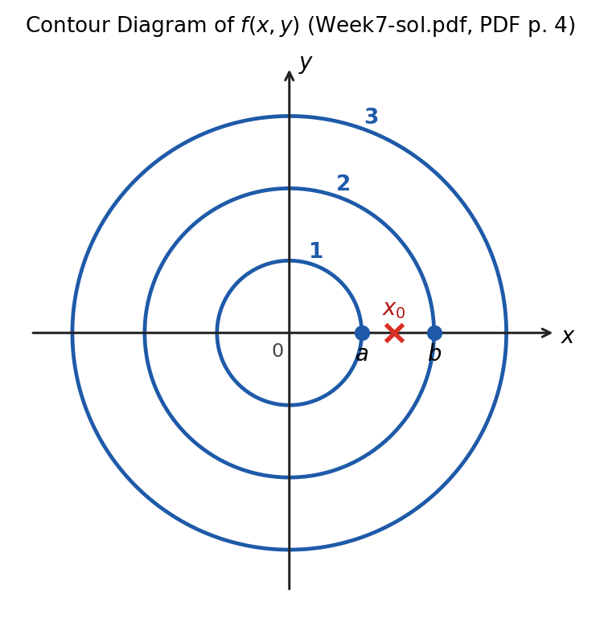
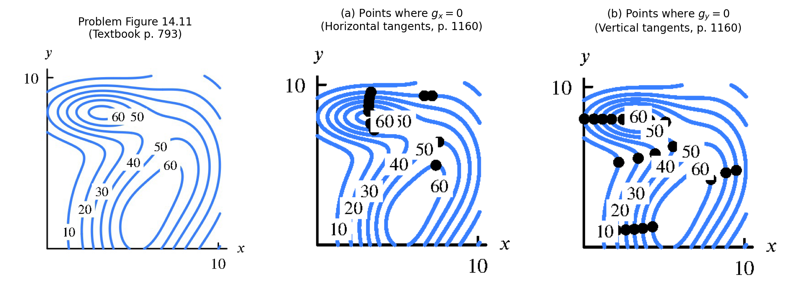
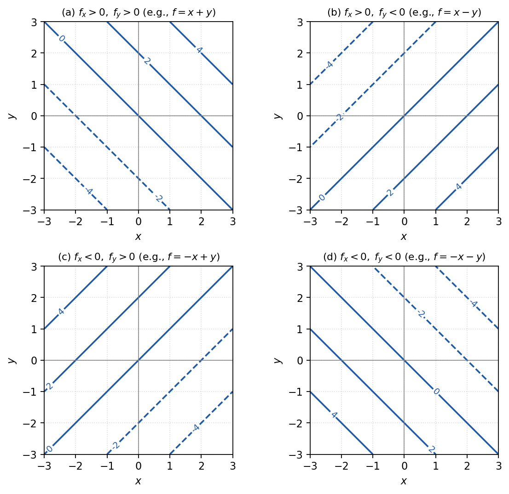
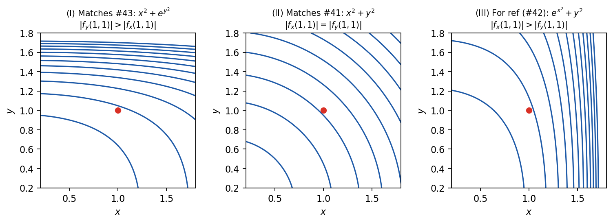

# MAT235H1 Week 7 Answers and Practice — Partial Derivatives

**Course:** MAT235H1 — Multivariable Calculus  
**Topic:** Sections 14.1–14.2 (The Partial Derivative & Computing Partial Derivatives Algebraically)  
**Companion File:** [Study-Notes.md](./Study-Notes.md)

---

## Contents

1. [Teaching-Example Solutions](#1-teaching-example-solutions)
2. [Instructor Questions and Solutions](#2-instructor-questions-and-solutions)
   - [2.1 `oct 21.pdf` (Section 14.1 Lecture)](#21-oct-21pdf-section-141-lecture)
   - [2.2 `oct 23.pdf` (Section 14.2 Lecture)](#22-oct-23pdf-section-142-lecture)
   - [2.3 `Week7-sol.pdf` (Annotated Week 7 Lecture Handout)](#23-week7-solpdf-annotated-week-7-lecture-handout)
3. [Textbook Exercise Solutions (All 33 Quercus Exercises)](#3-textbook-exercise-solutions-all-33-quercus-exercises)
   - [3.1 Section 14.1 Exercises (13 Exercises)](#31-section-141-exercises-13-exercises)
   - [3.2 Section 14.2 Exercises (20 Exercises)](#32-section-142-exercises-20-exercises)
4. [Original Self-Test](#4-original-self-test)
5. [Self-Test Answers](#5-self-test-answers)
6. [Coverage Appendix](#6-coverage-appendix)

---

## 1. Teaching-Example Solutions

Each solution below corresponds to the original teaching question in [Study-Notes.md](./Study-Notes.md) with the exact same PT ID and name.

### PT-01: Computing a Partial Derivative at a Point from the Limit Definition

**Problem ([Study-Notes.md](./Study-Notes.md#pt-01-computing-a-partial-derivative-at-a-point-from-the-limit-definition)):** For $f(x, y) = 2x^2 - 3xy + y^2$, compute $f_x(2, -1)$ and $f_y(2, -1)$ from the limit definition.

**Solution:**  
First evaluate the base value:
$$f(2, -1) = 2(2)^2 - 3(2)(-1) + (-1)^2 = 8 + 6 + 1 = 15.$$

1. **Compute $f_x(2, -1)$ (hold $y = -1$ fixed):**
   $$f(2 + h, -1) = 2(2 + h)^2 - 3(2 + h)(-1) + (-1)^2 = 2(4 + 4h + h^2) + 3(2 + h) + 1 = 15 + 11h + 2h^2.$$
   Therefore,
   $$f_x(2, -1) = \lim_{h \to 0} \frac{f(2 + h, -1) - f(2, -1)}{h} = \lim_{h \to 0} \frac{(15 + 11h + 2h^2) - 15}{h} = \lim_{h \to 0} (11 + 2h) = 11.$$

2. **Compute $f_y(2, -1)$ (hold $x = 2$ fixed):**
   $$f(2, -1 + h) = 2(2)^2 - 3(2)(-1 + h) + (-1 + h)^2 = 8 + 6 - 6h + (1 - 2h + h^2) = 15 - 8h + h^2.$$
   Therefore,
   $$f_y(2, -1) = \lim_{h \to 0} \frac{f(2, -1 + h) - f(2, -1)}{h} = \lim_{h \to 0} \frac{(15 - 8h + h^2) - 15}{h} = \lim_{h \to 0} (-8 + h) = -8.$$

**Result:** $f_x(2, -1) = 11$ and $f_y(2, -1) = -8$.

---

### PT-02: Interpreting Partial Derivatives, Signs, Units, and One-Input Predictions in Context

**Problem ([Study-Notes.md](./Study-Notes.md#pt-02-interpreting-partial-derivatives-signs-units-and-one-input-predictions-in-context)):** Monthly heating electricity cost $C = g(T, h)$ (dollars), outdoor temperature $T$ ($^\circ\text{C}$), thermostat $h$ ($^\circ\text{C}$), with $g(-5, 21) = 185$, $g_T(-5, 21) = -6.4$, $g_h(-5, 21) = 9.2$.

**Solution:**
1. **Units and signs:**
   - Both $g_T$ and $g_h$ have units of **dollars per $^\circ\text{C}$** ($\$/^\circ\text{C}$).
   - $g_T(-5, 21) = -6.4 < 0$ makes sense: holding the thermostat fixed at $21^\circ\text{C}$, a warmer outdoor temperature requires less heating, so monthly cost decreases.
   - $g_h(-5, 21) = 9.2 > 0$ makes sense: holding outdoor temperature fixed at $-5^\circ\text{C}$, raising the thermostat requires more heating, so monthly cost increases.
2. **Practical interpretation of $g_h(-5, 21) = 9.2$:**  
   When the average outdoor temperature is fixed at $-5^\circ\text{C}$ and the thermostat is set to $21^\circ\text{C}$, raising the thermostat by $1^\circ\text{C}$ increases the monthly electricity cost by approximately $\$9.20$ (i.e., cost increases at a rate of approximately $\$9.20/^\circ\text{C}$).
3. **One-input prediction ($\Delta h = 19.5 - 21 = -1.5^\circ\text{C}$, $T = -5^\circ\text{C}$ fixed):**
   $$\Delta C \approx g_h(-5, 21)\,\Delta h = (9.2)(-1.5) = -13.8 \text{ dollars}.$$
   $$g(-5, 19.5) \approx g(-5, 21) + \Delta C = 185 - 13.8 = 171.2 \text{ dollars}.$$

**Result:** Monthly cost drops by approximately $\$13.80$ to approximately $\$171.20$.

---

### PT-03: Determining Signs of Partial Derivatives from a Surface Graph or Contour Diagram

**Problem ([Study-Notes.md](./Study-Notes.md#pt-03-determining-signs-of-partial-derivatives-from-a-surface-graph-or-contour-diagram)):** Evaluate $f$ and determine the signs of $f_x$ and $f_y$ at $P(3, -1)$ and $Q(-1, 1)$ on [fig_pt03_teaching_contour.png](./figures/fig_pt03_teaching_contour.png).

**Solution:**  
Notice that the concentric circular contours are centered at $(1, -1)$ and **decrease outward** ($19 \to 16 \to 12 \to 8 \to 4$).
1. **At $P(3, -1)$:**
   - $P$ lies on the contour labeled $16$, so $f(P) = 16$.
   - Moving right ($+x$, $y = -1$ fixed) moves outward from $16$ toward $12$, so $f_x(P) < 0$.
   - Moving up ($+y$, $x = 3$ fixed) is **tangent** to the circular contour $f = 16$ at its rightmost point, so $f_y(P) = 0$.
2. **At $Q(-1, 1)$:**
   - $Q$ lies on the contour labeled $12$, so $f(Q) = 12$.
   - Moving right ($+x$) moves inward toward $16$, so $f_x(Q) > 0$.
   - Moving up ($+y$) moves outward toward $8$, so $f_y(Q) < 0$.

**Result:** $f(P) = 16$, $f_x(P) < 0$, $f_y(P) = 0$; $f(Q) = 12$, $f_x(Q) > 0$, $f_y(Q) < 0$.

---

### PT-04: Estimating Partial Derivatives from a Formula Using Difference Quotients

**Problem ([Study-Notes.md](./Study-Notes.md#pt-04-estimating-partial-derivatives-from-a-formula-using-difference-quotients)):** For $f(x, y) = x^2 e^{y - 1}$, estimate $f_x(2, 1)$ and $f_y(2, 1)$ using forward difference quotients with $h = 0.01$.

**Solution:**  
First, $f(2, 1) = 2^2 e^{0} = 4$.
1. **Estimate $f_x(2, 1)$:**
   $$f_x(2, 1) \approx \frac{f(2.01, 1) - f(2, 1)}{0.01} = \frac{(2.01)^2 e^{0} - 4}{0.01} = \frac{4.0401 - 4}{0.01} = 4.01.$$
2. **Estimate $f_y(2, 1)$:**
   $$f_y(2, 1) \approx \frac{f(2, 1.01) - f(2, 1)}{0.01} = \frac{4 e^{0.01} - 4}{0.01} \approx \frac{4(1.01005017) - 4}{0.01} \approx 4.0201.$$

**Result:** $f_x(2, 1) \approx 4.01$ and $f_y(2, 1) \approx 4.0201$ (exact values are both $4$).

---

### PT-05: Estimating Partial Derivatives and Signs from a Table of Values

**Problem ([Study-Notes.md](./Study-Notes.md#pt-05-estimating-partial-derivatives-and-signs-from-a-table-of-values)):** Crop yield $Y = f(r, n)$ (tonnes/ha), rainfall $r$ (cm, rows), nitrogen $n$ (kg/ha, columns). Estimate $f_r(40, 60)$ and $f_n(40, 60)$ using central differences and interpret.

**Solution:**
1. **Estimate $f_r(40, 60)$ (hold column $n = 60$ fixed, vary row $r$ from $30$ to $50$):**
   $$f_r(40, 60) \approx \frac{f(50, 60) - f(30, 60)}{50 - 30} = \frac{6.6 - 5.0}{20} = \frac{1.6}{20} = 0.08 \text{ (tonnes/ha) per cm}.$$
2. **Estimate $f_n(40, 60)$ (hold row $r = 40$ fixed, vary column $n$ from $40$ to $80$):**
   $$f_n(40, 60) \approx \frac{f(40, 80) - f(40, 40)}{80 - 40} = \frac{6.6 - 5.1}{40} = \frac{1.5}{40} = 0.0375 \text{ (tonnes/ha) per (kg/ha)}.$$
3. **Practical interpretations:**
   - When rainfall is $40\text{ cm}$ and nitrogen is held fixed at $60\text{ kg/ha}$, each additional $1\text{ cm}$ of rainfall increases crop yield by approximately $0.08\text{ tonnes/ha}$.
   - When rainfall is held fixed at $40\text{ cm}$ and nitrogen is $60\text{ kg/ha}$, each additional $1\text{ kg/ha}$ of nitrogen increases crop yield by approximately $0.0375\text{ tonnes/ha}$.

---

### PT-06: Estimating Partial Derivatives and Comparing Magnitudes from a Contour Diagram

**Problem ([Study-Notes.md](./Study-Notes.md#pt-06-estimating-partial-derivatives-and-comparing-magnitudes-from-a-contour-diagram)):** From [fig_pt06_teaching_contour.png](./figures/fig_pt06_teaching_contour.png), estimate $T(2, 3)$, $T_x(2, 3)$, and $T_y(2, 3)$, and interpret with units.

**Solution:**
1. **Read $T(2, 3)$:** The point $(2, 3)$ lies directly on the contour labeled $30$, so $T(2, 3) \approx 30^\circ\text{C}$.
2. **Estimate $T_x(2, 3)$ (move horizontally along $y = 3$):**  
   Moving right from $(2, 3)$ ($T = 30$) to $(3, 3)$ crosses the $T = 27$ contour cleanly ($\Delta x = 1\text{ m}$, $\Delta T = -3^\circ\text{C}$):
   $$T_x(2, 3) \approx \frac{27 - 30}{3 - 2} = -3\;^\circ\text{C/m}.$$
3. **Estimate $T_y(2, 3)$ (move vertically along $x = 2$):**  
   Moving up from $(2, 3)$ ($T = 30$) to $(2, 4.5)$ crosses the $T = 33$ contour cleanly ($\Delta y = 1.5\text{ m}$, $\Delta T = +3^\circ\text{C}$):
   $$T_y(2, 3) \approx \frac{33 - 30}{4.5 - 3} = \frac{3}{1.5} = 2\;^\circ\text{C/m}.$$
4. **Interpretation:** Near $(2, 3)$ on the lab floor, moving in the positive $x$-direction (with $y = 3\text{ m}$ fixed) decreases temperature by about $3^\circ\text{C}$ per meter, while moving in the positive $y$-direction (with $x = 2\text{ m}$ fixed) increases temperature by about $2^\circ\text{C}$ per meter.

---

### PT-07: Computing Partial Derivatives Algebraically (Two or More Variables)

**Problem ([Study-Notes.md](./Study-Notes.md#pt-07-computing-partial-derivatives-algebraically-two-or-more-variables)):** Compute the requested partial derivatives.

**Solution:**
1. $f(x, y) = x^2 e^{3y} + \ln(x^2 + 4y)$:
   - Fix $y$: $f_x(x, y) = 2x e^{3y} + \dfrac{2x}{x^2 + 4y}$.
   - Fix $x$: $f_y(x, y) = 3x^2 e^{3y} + \dfrac{4}{x^2 + 4y}$.
2. $V(r, h) = \pi r^2 h$:
   - Fix $h$: $\dfrac{\partial V}{\partial r} = 2\pi r h$.
   - Fix $r$: $\dfrac{\partial V}{\partial h} = \pi r^2$.
3. $g(x, y) = \dfrac{y \sin(xy)}{x^2 + 1}$:
   - Fix $y$ (pull out constant $y$, apply quotient + chain rules in $x$):
     $$g_x(x, y) = y \cdot \frac{\big(y\cos(xy)\big)(x^2 + 1) - \sin(xy)(2x)}{(x^2 + 1)^2} = \frac{y\big(y(x^2 + 1)\cos(xy) - 2x\sin(xy)\big)}{(x^2 + 1)^2}.$$
   - Fix $x$ (pull out constant $\frac{1}{x^2 + 1}$, apply product + chain rules in $y$):
     $$g_y(x, y) = \frac{1}{x^2 + 1}\Big(1\cdot\sin(xy) + y\cdot x\cos(xy)\Big) = \frac{\sin(xy) + xy\cos(xy)}{x^2 + 1}.$$

---

### PT-08: Evaluating Algebraic Partial Derivatives at a Point and Interpreting in Context

**Problem ([Study-Notes.md](./Study-Notes.md#pt-08-evaluating-algebraic-partial-derivatives-at-a-point-and-interpreting-in-context)):** $H(x, t) = 20 + 60 e^{-0.2 t}\sin(\frac{\pi x}{2})$ ($0 \le x \le 2$). Compute and interpret $H_x(0.5, 0)$ and $H_t(0.5, 0)$.

**Solution:**
1. **Compute $H_x(x, t)$ and evaluate at $(0.5, 0)$:**
   $$H_x(x, t) = 60 e^{-0.2 t} \cdot \frac{\pi}{2}\cos\!\left(\frac{\pi x}{2}\right) = 30\pi e^{-0.2 t}\cos\!\left(\frac{\pi x}{2}\right).$$
   $$H_x(0.5, 0) = 30\pi e^0 \cos\!\left(\frac{\pi}{4}\right) = 30\pi \cdot \frac{\sqrt{2}}{2} = 15\sqrt{2}\pi \approx 66.64\;^\circ\text{C/m}.$$
2. **Compute $H_t(x, t)$ and evaluate at $(0.5, 0)$:**
   $$H_t(x, t) = 60(-0.2)e^{-0.2 t}\sin\!\left(\frac{\pi x}{2}\right) = -12 e^{-0.2 t}\sin\!\left(\frac{\pi x}{2}\right).$$
   $$H_t(0.5, 0) = -12 e^0 \sin\!\left(\frac{\pi}{4}\right) = -12 \cdot \frac{\sqrt{2}}{2} = -6\sqrt{2} \approx -8.49\;^\circ\text{C/min}.$$
3. **Practical interpretations:**
   - At the instant $t = 0\text{ min}$, moving rightward along the bar past $x = 0.5\text{ m}$ increases the temperature at a rate of approximately $66.64^\circ\text{C}$ per meter.
   - At the fixed position $x = 0.5\text{ m}$, at time $t = 0\text{ min}$, the bar is cooling at a rate of approximately $8.49^\circ\text{C}$ per minute.

---

## 2. Instructor Questions and Solutions

All in-scope questions from `oct 21.pdf`, `oct 23.pdf`, and `Week7-sol.pdf` are collected below. (`oct26.pdf` covers §14.3 Tangent Planes and is excluded as Week 8 material; see [Coverage Appendix](#6-coverage-appendix).)

### 2.1 `oct 21.pdf` (Section 14.1 Lecture)

#### Instructor Q1 (`oct 21.pdf`, PDF pp. 1–4) — *PT-01, PT-04*
**Statement:** Consider $f(x, y) = x^2 + xy - y^2$.
- (a) (p. 1) Compute $f(1, 2)$, $f(1.1, 2)$, and $f(1, 2.1)$ to observe directional behavior.
- (b) (pp. 2–3) Compute $f_x(1, 2)$ and $f_y(1, 2)$ using the limit definition.
- (c) (p. 4) Approximate $\frac{\partial f}{\partial x}(1, 2)$ with step $h = 0.1$ using both the forward and central difference quotients.

**Solution:**
- (a) $f(1, 2) = 1 + 2 - 4 = -1$; $f(1.1, 2) = 1.21 + 2.2 - 4 = -0.59$ (increases as $x$ increases); $f(1, 2.1) = 1 + 2.1 - 4.41 = -1.31$ (decreases as $y$ increases).
- (b) Using the limit definition:
  $$f_x(1, 2) = \lim_{h \to 0} \frac{(1+h)^2 + 2(1+h) - 4 - (-1)}{h} = \lim_{h \to 0} \frac{4h + h^2}{h} = \lim_{h \to 0}(4 + h) = 4.$$
  $$f_y(1, 2) = \lim_{h \to 0} \frac{1 + (2+h) - (2+h)^2 - (-1)}{h} = \lim_{h \to 0} \frac{-3h - h^2}{h} = \lim_{h \to 0}(-3 - h) = -3.$$
- (c) Forward difference ($h = 0.1$):
  $$\frac{\partial f}{\partial x}(1, 2) \approx \frac{f(1.1, 2) - f(1, 2)}{0.1} = \frac{-0.59 - (-1)}{0.1} = \frac{0.41}{0.1} = 4.1.$$
  Central difference ($h = 0.1$, span $2h = 0.2$): $f(0.9, 2) = 0.81 + 1.8 - 4 = -1.39$, so
  $$\frac{\partial f}{\partial x}(1, 2) \approx \frac{f(1.1, 2) - f(0.9, 2)}{0.2} = \frac{-0.59 - (-1.39)}{0.2} = \frac{0.80}{0.2} = 4.0$$
  *(exact here because $f(x, 2)$ is quadratic in $x$!)*.

---

### 2.2 `oct 23.pdf` (Section 14.2 Lecture)

#### Instructor Q2 (`oct 23.pdf`, PDF p. 1) — *PT-07*
**Statement:** Compute $f_x$ and $f_y$ for:
1. $f(x, y) = x^3 y - 4xy^2 + 7y$
2. $f(x, y) = \sin(x^2 + y)$
3. $f(x, y) = \dfrac{x}{1 + y^2}$
4. $f(x, y) = \dfrac{1}{y} e^{-x^2/y}$
5. $f(x, y) = e^x \sin(x + b)$ *(source transcription note below)*

**Solution:**
1. $f_x(x, y) = 3x^2 y - 4y^2$; $\quad f_y(x, y) = x^3 - 8xy + 7$.
2. $f_x(x, y) = 2x \cos(x^2 + y)$; $\quad f_y(x, y) = \cos(x^2 + y)$.
3. $f_x(x, y) = \dfrac{1}{1 + y^2}$; $\quad f_y(x, y) = x \cdot \dfrac{-2y}{(1 + y^2)^2} = -\dfrac{2xy}{(1 + y^2)^2}$.
4. For $f(x, y) = y^{-1} e^{-x^2 y^{-1}}$:
   - Fix $y$: $f_x(x, y) = \dfrac{1}{y} e^{-x^2/y} \left(-\dfrac{2x}{y}\right) = -\dfrac{2x}{y^2} e^{-x^2/y}$.
   - Fix $x$ (product + chain rule):
     $$f_y(x, y) = \left(-\frac{1}{y^2}\right) e^{-x^2/y} + \frac{1}{y} e^{-x^2/y}\left(\frac{x^2}{y^2}\right) = \frac{x^2 - y}{y^3} e^{-x^2/y}.$$
5. **Source discrepancy flag:** The handwritten slide reads $f(x, y) = e^x \sin(x + b)$, which appears to adapt $z = e^a \sin(a + b)$ from `Week7-sol.pdf` p. 7 (part b) / §14.2 #35.
   - *Literally as written* (treating $b$ as a constant): $f_x(x, y) = e^x \sin(x + b) + e^x \cos(x + b)$ and $f_y(x, y) = 0$.
   - *If $b$ was intended to be $y$* ($f(x, y) = e^x \sin(x + y)$): $f_x(x, y) = e^x(\sin(x + y) + \cos(x + y))$ and $f_y(x, y) = e^x \cos(x + y)$.

#### Instructor Q3 (`oct 23.pdf`, PDF p. 2) — *PT-08, PT-02*
**Statement:** Consider the local temperature model $T(x, y) = 20 + x^2 + xy - y^2$, where $(x, y)$ are coordinates in cm and $T$ is in $^\circ\text{C}$. (1) Compute $T_x(1, 2)$ and $T_y(1, 2)$. (2) Give verbal interpretations.

**Solution:**
1. $T_x(x, y) = 2x + y \implies T_x(1, 2) = 4\;^\circ\text{C/cm}$; $\quad T_y(x, y) = x - 2y \implies T_y(1, 2) = -3\;^\circ\text{C/cm}$.
2. Near $(1, 2)$:
   - With $y = 2\text{ cm}$ fixed, temperature increases at approximately $4^\circ\text{C}$ per cm in the positive $x$-direction.
   - With $x = 1\text{ cm}$ fixed, temperature decreases at approximately $3^\circ\text{C}$ per cm in the positive $y$-direction.

#### Instructor Q4 (`oct 23.pdf`, PDF p. 3, bullet 1 — also Textbook §14.2 #47) — *PT-07, PT-02*
**Statement:** Money in a bank account earns interest at a continuous rate $r$. The balance $\$B$ depends on deposit $\$P$ and time $t$ via $B = P e^{rt}$. Find $\frac{\partial B}{\partial t}$ and $\frac{\partial B}{\partial P}$ and interpret each in financial terms. *(Note: slide annotation writes "$t$ (second)", though financial rates $r$ are typically annual; units below use "unit of time $t$".)*

**Solution:**
- $\dfrac{\partial B}{\partial t} = r P e^{rt}$ (dollars per unit time): holding the initial deposit $P$ (and rate $r$) fixed, this is the instantaneous rate at which the account balance grows over time (interest earned per unit time at time $t$).
- $\dfrac{\partial B}{\partial P} = e^{rt}$ (dollars of balance per dollar deposited): holding time $t$ (and rate $r$) fixed, each additional $\$1$ initially deposited increases the balance at time $t$ by $\$e^{rt}$.

#### Instructor Q5 (`oct 23.pdf`, PDF p. 3, bullet 2 — also Textbook §14.2 #50) — *PT-07, PT-02*
**Statement:** The kinetic energy $E$ of a body of mass $m$ moving with speed $v$ ($0 \le v < c$, $c$ constant speed of light) is
$$E = m c^2 \left(\frac{1}{\sqrt{1 - v^2/c^2}} - 1\right).$$
(a) Find $\frac{\partial E}{\partial m}$ and explain its expected sign. (b) Find $\frac{\partial E}{\partial v}$ and explain its expected sign.

**Solution:**
- (a) $\dfrac{\partial E}{\partial m} = c^2\left(\dfrac{1}{\sqrt{1 - v^2/c^2}} - 1\right)$. Since $0 \le v < c$, $\sqrt{1 - v^2/c^2} \le 1$, so $\frac{\partial E}{\partial m} > 0$ for $v > 0$ (and $0$ when $v = 0$). Physically, at any fixed positive speed, a more massive object has greater kinetic energy.
- (b) Writing $(1 - v^2/c^2)^{-1/2}$ and applying the chain rule:
  $$\frac{\partial E}{\partial v} = m c^2 \left(-\frac{1}{2}\right)\left(1 - \frac{v^2}{c^2}\right)^{-3/2}\left(-\frac{2v}{c^2}\right) = \frac{m v}{\left(1 - v^2/c^2\right)^{3/2}}.$$
  For $m > 0$ and $0 < v < c$, $\frac{\partial E}{\partial v} > 0$ (and $0$ at $v = 0$). Physically, for a fixed mass, increasing the speed always increases kinetic energy.

---

### 2.3 `Week7-sol.pdf` (Annotated Week 7 Lecture Handout)

#### Instructor Q6 (`Week7-sol.pdf`, PDF p. 2 / printed p. 1 of 5) — *PT-05, PT-02*
**Statement:** Temperature $T = f(x, y)$ ($^\circ\text{C}$) on an $8\text{ m} \times 8\text{ m}$ metal plate ($x, y$ in meters). Using the table on p. 2 (relevant entries around $(3, -1)$: $f(2,-1)=55$, $f(3,-1)=50$, $f(4,-1)=43$; $f(3,-2)=47$, $f(3,0)=51$), estimate $f_x(3, -1)$ and $f_y(3, -1)$ and interpret their signs and units.

**Solution:**
- (a) Fix $y = -1$ (central difference): $f_x(3, -1) \approx \dfrac{f(4, -1) - f(2, -1)}{4 - 2} = \dfrac{43 - 55}{2} = -6\;^\circ\text{C/m} < 0$. Near $(3, -1)$, holding $y = -1\text{ m}$ fixed, temperature decreases at about $6^\circ\text{C}$ per meter in the $+x$-direction.
- (b) Fix $x = 3$ (central difference): $f_y(3, -1) \approx \dfrac{f(3, 0) - f(3, -2)}{0 - (-2)} = \dfrac{51 - 47}{2} = 2\;^\circ\text{C/m} > 0$. Near $(3, -1)$, holding $x = 3\text{ m}$ fixed, temperature increases at about $2^\circ\text{C}$ per meter in the $+y$-direction.

#### Instructor Q7 (`Week7-sol.pdf`, PDF p. 3 / printed p. 2 of 5, Example 1) — *PT-02*
**Statement:** Monthly mortgage payment $P = f(A, r, N)$ (dollars), where $A$ is amount borrowed (dollars), $r$ is annual interest rate (%), and $N$ is loan duration (years).
(a) Interpret $f(92000, 14, 30) = 1090.8$. (b) Interpret $f_r(92000, 14, 30) = 72.82$. (c) Is $\frac{\partial P}{\partial N}$ positive or negative?

**Solution:**
- (a) Borrowing $\$92{,}000$ at a $14\%$ annual interest rate over $30$ years results in a monthly payment of $\$1{,}090.80$.
- (b) Units: dollars per percentage point. Borrowing $\$92{,}000$ over $30$ years at $14\%$, raising the annual interest rate by $1$ percentage point increases the monthly payment by approximately $\$72.82$.
- (c) $\dfrac{\partial P}{\partial N} < 0$: spreading the same loan amount at the same interest rate over more years lowers the required monthly payment.

#### Instructor Q8 (`Week7-sol.pdf`, PDF p. 3 / printed p. 2 of 5, Example 2) — *PT-02*
**Cross-reference:** Identical to Textbook §14.1 #23 (solved in full under [§14.1 #23](#141-23-pt-02)). Summary: (i) $\leftrightarrow$ (c) $f_v(T, v) < 0$; (ii) $\leftrightarrow$ (a) $f_T(T, v) > 0$; remaining (b) $f(0, v) \le 0$ means at $0^\circ\text{F}$ air temperature, the windchill feels $0^\circ\text{F}$ or colder at any cycling speed $v$.

#### Instructor Q9 (`Week7-sol.pdf`, PDF p. 4 — handwritten contour example) — *PT-06*
**Statement:** Given the concentric contour diagram of $f(x, y)$ below with level curves labeled $1, 2, 3$ and known values $f(a, 0) = 1$ and $f(b, 0) = 2$ bracketing $x_0$ along the positive $x$-axis, estimate $f_x(x_0, 0)$.

**Solution:**  
Hold $y = 0$ fixed and move horizontally along the $x$-axis from $(a, 0)$ (on the $f = 1$ contour) to $(b, 0)$ (on the $f = 2$ contour). Using the difference quotient across the bracketing interval $[a, b]$:
$$f_x(x_0, 0) \approx \frac{\Delta f}{\Delta x} = \frac{f(b, 0) - f(a, 0)}{b - a} = \frac{2 - 1}{b - a} = \frac{1}{b - a}.$$

#### Instructor Q10 (`Week7-sol.pdf`, PDF p. 6 / printed p. 3 of 5) — *PT-02, PT-06*
**Statement:** Sunfish density $F(h, D)$ (average number of sunfish per $10^6\text{ m}^3$ at hour $h$ and depth $D$ in km), with contour diagram on p. 6.
(a) Describe in words what $\frac{\partial F}{\partial D}(h_0, D_0)$ represents. (b) For $0 \le h \le 20$, at what time $h$ is $\left|\frac{\partial F}{\partial D}(h, 3)\right|$ the largest?

**Solution:**
- (a) $\frac{\partial F}{\partial D}(h_0, D_0)$ is the instantaneous rate of change of sunfish density (in sunfish per $10^6\text{ m}^3$ per km of depth) as depth increases, at fixed time $h_0$ and depth $D_0$.
- (b) Along the horizontal line $D = 3$, $\left|\frac{\partial F}{\partial D}\right| \approx \left|\frac{\Delta F}{\Delta D}\right|$ is largest where the contours (which have equal contour interval $\Delta F = 1$) are **closest together vertically** along the $D$-axis scale. From the contour plot on p. 6, the vertical spacing between contours around $D = 3$ is tightest at **$h \approx 13$** (where $\Delta F \approx -6$ over $\Delta D = 1\text{ km}$, vs. $\Delta F \approx -3$ near $h = 2$).

#### Instructor Q11 (`Week7-sol.pdf`, PDF p. 7 / printed p. 4 of 5) — *PT-07*
**Statement:** Calculate the partial derivatives with respect to each independent variable:
(a) $z = x^2 y + y^2 x$; (b) $z = e^a \sin(a + b)$; (c) $f(x, y, z) = z \ln(y \cos x)$ *(marked HW)*; (d) $f(m, r, v) = \frac{m v^2}{r}$ *(marked HW)*; (e) $f(x, y) = x e^{\sqrt{xy}}$ ($xy > 0$).

**Solution:**
- (a) $\dfrac{\partial z}{\partial x} = 2xy + y^2$; $\quad \dfrac{\partial z}{\partial y} = x^2 + 2xy$.
- (b) $\dfrac{\partial z}{\partial a} = e^a \sin(a + b) + e^a \cos(a + b)$; $\quad \dfrac{\partial z}{\partial b} = e^a \cos(a + b)$.
- (c) $f_x = z \cdot \dfrac{-y\sin x}{y\cos x} = -z \tan x$; $\quad f_y = z \cdot \dfrac{\cos x}{y\cos x} = \dfrac{z}{y}$; $\quad f_z = \ln(y \cos x)$.
- (d) $f_m = \dfrac{v^2}{r}$; $\quad f_r = -\dfrac{m v^2}{r^2}$; $\quad f_v = \dfrac{2 m v}{r}$.
- (e) *(Also Textbook §14.2 #13 for $f_x$)*:
  $$f_x(x, y) = e^{\sqrt{xy}} + x e^{\sqrt{xy}} \cdot \frac{y}{2\sqrt{xy}} = e^{\sqrt{xy}}\left(1 + \frac{\sqrt{xy}}{2}\right).$$
  $$f_y(x, y) = x e^{\sqrt{xy}} \cdot \frac{x}{2\sqrt{xy}} = \frac{x^2 e^{\sqrt{xy}}}{2\sqrt{xy}}.$$
  *(Note: We keep $\sqrt{xy}$ unsplit rather than writing $\sqrt{x}/\sqrt{y}$, because the domain $xy > 0$ includes the third quadrant $x < 0, y < 0$ where $\sqrt{x}$ and $\sqrt{y}$ are not real.)*

#### Instructor Q12 (`Week7-sol.pdf`, PDF p. 8 / printed p. 5 of 5, Example 1 — also Textbook §14.2 #45) — *PT-04, PT-08*
**Statement:** Let $f(w, z) = e^{w \ln z}$ ($= z^w$ for $z > 0$). (a) Use difference quotients with $h = 0.01$ to approximate $f_w(2, 2)$ and $f_z(2, 2)$. (b) Evaluate $f_w(2, 2)$ and $f_z(2, 2)$ exactly.

**Solution:**
- (a) $f(2, 2) = 2^2 = 4$.
  $$f_w(2, 2) \approx \frac{2^{2.01} - 2^2}{0.01} \approx \frac{4.027822 - 4}{0.01} \approx 2.782, \qquad f_z(2, 2) \approx \frac{(2.01)^2 - 2^2}{0.01} = \frac{4.0401 - 4}{0.01} = 4.01.$$
- (b) $f_w(w, z) = e^{w\ln z}\ln z \implies f_w(2, 2) = 4\ln 2 \approx 2.773$; $\quad f_z(w, z) = e^{w\ln z}\cdot\frac{w}{z} = w z^{w-1} \implies f_z(2, 2) = 2(2)^1 = 4$.

#### Instructor Q13 (`Week7-sol.pdf`, PDF p. 8 / printed p. 5 of 5, Example 2 — also Textbook §14.2 Example 4) — *PT-08, PT-02*
**Statement:** Guitar string displacement $y = f(x, t) = 0.003 \sin(\pi x)\sin(2765 t)$ (meters; $x$ in meters, $t$ in seconds). Evaluate and interpret (a) $f_x(0.3, 1)$ and (b) $f_t(0.3, 1)$.

**Solution:**
- (a) $f_x(x, t) = 0.003\pi \cos(\pi x)\sin(2765 t) \implies f_x(0.3, 1) = 0.003\pi \cos(0.3\pi)\sin(2765) \approx 0.00215$ (dimensionless, $\text{m/m}$). This is the **slope of the string** at position $x = 0.3\text{ m}$ at the instant $t = 1\text{ s}$.
- (b) $f_t(x, t) = 0.003(2765)\sin(\pi x)\cos(2765 t) = 8.295\sin(\pi x)\cos(2765 t) \implies f_t(0.3, 1) \approx 6.19\text{ m/s}$ (or $\approx 6\text{ m/s}$). This is the **vertical velocity** of the point $x = 0.3\text{ m}$ on the string at $t = 1\text{ s}$ (moving upward since $> 0$).

---

## 3. Textbook Exercise Solutions (All 33 Quercus Exercises)

All exercises below are verified against *Calculus*, 8th Edition (Hughes-Hallett et al.), §§14.1–14.2 (printed pp. 790–800 / PDF pp. 810–820). Statements are faithfully paraphrased with all required data, subparts, and shared directions preserved.

### 3.1 Section 14.1 Exercises (13 Exercises)

#### §14.1 #1 (*PT-05*)
**Paraphrase (EXERCISES, p. 790):** Estimate $f_x(3, 2)$ and $f_y(3, 2)$ from the table of $z = f(x, y)$ (assuming they exist):

| $x \setminus y$ | $0$ | $2$ | $5$ |
| :---: | :---: | :---: | :---: |
| **$1$** | $1$ | $2$ | $4$ |
| **$3$** | $-1$ | $1$ | $2$ |
| **$6$** | $-3$ | $0$ | $0$ |

**Solution:**  
Notice $x$ labels the **rows** ($1, 3, 6$) and $y$ labels the **columns** ($0, 2, 5$). Because the spacings around $(3, 2)$ are unequal, we show backward, forward, and averaged estimates:
- **Estimate $f_x(3, 2)$ (hold column $y = 2$ fixed):**
  - Backward ($x$: $1 \to 3$): $\dfrac{f(3, 2) - f(1, 2)}{3 - 1} = \dfrac{1 - 2}{2} = -0.5$.
  - Forward ($x$: $3 \to 6$): $\dfrac{f(6, 2) - f(3, 2)}{6 - 3} = \dfrac{0 - 1}{3} = -\dfrac{1}{3} \approx -0.33$.
  - Average of one-sided quotients: $\dfrac{-0.5 + (-1/3)}{2} = -\dfrac{5}{12} \approx -0.42$ *(secant across $1 \to 6$ gives $\frac{0 - 2}{5} = -0.4$)*.
- **Estimate $f_y(3, 2)$ (hold row $x = 3$ fixed):**
  - Backward ($y$: $0 \to 2$): $\dfrac{f(3, 2) - f(3, 0)}{2 - 0} = \dfrac{1 - (-1)}{2} = 1$.
  - Forward ($y$: $2 \to 5$): $\dfrac{f(3, 5) - f(3, 2)}{5 - 2} = \dfrac{2 - 1}{3} = \dfrac{1}{3} \approx 0.33$.
  - Average of one-sided quotients: $\dfrac{1 + 1/3}{2} = \dfrac{2}{3} \approx 0.67$ *(secant across $0 \to 5$ gives $\frac{2 - (-1)}{5} = 0.6$)*.

**Result (estimates):** $f_x(3, 2) \approx -0.4$ (any value between $-0.5$ and $-0.33$ with method stated); $f_y(3, 2) \approx 0.6$–$0.67$ (or $1$ backward / $0.33$ forward with method stated).

---

#### §14.1 #5 (*PT-02*)
**Paraphrase (EXERCISES, p. 791):** Monthly car payment $P = f(P_0, t, r)$ (dollars), where $\$P_0$ is amount borrowed, $t$ is number of months to pay off the loan, and $r\%$ is the interest rate. Find the units, financial meaning, and signs of $\partial P / \partial t$ and $\partial P / \partial r$.

**Solution:**
- **$\dfrac{\partial P}{\partial t}$:**
  - *Units:* dollars per month (i.e., dollars of monthly payment per extra month of loan term).
  - *Meaning:* Holding the loan amount $P_0$ and interest rate $r$ fixed, the rate at which the monthly payment changes per additional month added to the repayment period.
  - *Sign:* **Negative** ($\frac{\partial P}{\partial t} < 0$), because taking more months to pay off the same loan lowers each monthly payment.
- **$\dfrac{\partial P}{\partial r}$:**
  - *Units:* dollars per percentage point (dollars per $\%$).
  - *Meaning:* Holding $P_0$ and $t$ fixed, the rate at which the monthly payment changes per $1$ percentage point increase in the interest rate.
  - *Sign:* **Positive** ($\frac{\partial P}{\partial r} > 0$), because a higher interest rate increases the monthly payment.

---

#### §14.1 #7 (*PT-02*)
**Paraphrase (EXERCISES, p. 791):** Borrowing $\$A$ at $r\%$ per month over $t$ months gives monthly payment $P = g(A, r, t)$ dollars. Interpret in financial terms: (a) $g(8000, 1, 24) = 376.59$; (b) $\left.\frac{\partial g}{\partial A}\right|_{(8000, 1, 24)} = 0.047$; (c) $\left.\frac{\partial g}{\partial r}\right|_{(8000, 1, 24)} = 44.83$.

**Solution:**
- **(a)** Borrowing $\$8{,}000$ at a monthly interest rate of $1\%$ over $24$ months requires a monthly payment of $\$376.59$.
- **(b)** Units: dollars per dollar borrowed. For a $\$8{,}000$ loan at $1\%$ per month over $24$ months (with $r = 1\%$ and $t = 24$ fixed), each additional $\$1$ borrowed increases the monthly payment by approximately $\$0.047$ (about $4.7\text{ cents}$, or $\$4.70$ per extra $\$100$ borrowed).
- **(c)** Units: dollars per percentage point. For a $\$8{,}000$ loan over $24$ months at $1\%$ per month (with $A = 8000$ and $t = 24$ fixed), increasing the monthly interest rate by $1$ percentage point increases the monthly payment by approximately $\$44.83$.

---

#### §14.1 #9 (*PT-02*)
**Paraphrase (EXERCISES, p. 791):** Quantity $Q$ of beef purchased (kg/week) is a function of beef price $b$ and chicken price $c$ (both in $\$/\text{kg}$). (a) Expected sign of $\partial Q/\partial b$? (b) Expected sign of $\partial Q/\partial c$? (c) Interpret $\partial Q/\partial b = -213$.

**Solution:**
- **(a)** $\dfrac{\partial Q}{\partial b} < 0$ (**negative**): holding chicken price $c$ fixed, if beef becomes more expensive, shoppers buy less beef.
- **(b)** $\dfrac{\partial Q}{\partial c} > 0$ (**positive**): holding beef price $b$ fixed, if chicken becomes more expensive, shoppers substitute beef for chicken and buy more beef.
- **(c)** Units: $(\text{kg/week})/(\$/\text{kg})$. Holding the price of chicken fixed, each $\$1/\text{kg}$ increase in the price of beef decreases the quantity of beef purchased by approximately $213\text{ kg/week}$.

---

#### §14.1 #11 (*PT-03*)
**Paraphrase (EXERCISES, p. 791):** A contour diagram shows horizontal parallel contour lines labeled from top to bottom as $5, 10, 15, 20$, with point $A$ on the contour labeled $15$. (a) Evaluate $f(A)$. (b) Sign of $f_x(A)$? (c) Sign of $f_y(A)$?

**Solution:**
- **(a)** $f(A) = 15$ (point $A$ lies directly on the $f = 15$ level curve).
- **(b)** $f_x(A) = 0$ (moving right in the $+x$-direction stays on the horizontal contour $f = 15$, so $f$ does not change).
- **(c)** $f_y(A) < 0$ (moving up in the $+y$-direction goes from $15$ toward $10$, so $f$ decreases).

---

#### §14.1 #17 (*PT-03*)
**Paraphrase (EXERCISES, p. 791, Figure 14.7):** Concentric circular contours centered at the origin with values increasing outward ($11, 13, 15, 17, 19$). Determine the signs of $f_x$ and $f_y$ at point $Q$ (in Quadrant IV: $x > 0, y < 0$).

**Solution:**
- Moving right ($+x$) from $Q$ moves **outward** toward larger contour values $\implies f_x(Q) > 0$.
- Moving up ($+y$) from $Q$ moves **inward** toward smaller contour values $\implies f_y(Q) < 0$.

---

#### §14.1 #19 (*PT-03*)
**Paraphrase (EXERCISES, p. 791, Figure 14.7):** Same concentric circular contours increasing outward ($11, 13, 15, 17, 19$). Determine the signs of $f_x$ and $f_y$ at point $S$ (in Quadrant II: $x < 0, y > 0$).

**Solution:**
- Moving right ($+x$) from $S$ moves **inward** toward smaller contour values $\implies f_x(S) < 0$.
- Moving up ($+y$) from $S$ moves **outward** toward larger contour values $\implies f_y(S) > 0$.

---

#### §14.1 #21 (*PT-03, PT-06*)
**Paraphrase (PROBLEMS, p. 792, Figure 14.8):** Figure 14.8 shows equally spaced parallel linear contours of $z = f(x, y)$ labeled $-6, -2, 2, 6, 10, 14, 18$ on a $1 \times 1$ grid ($0 \le x \le 5, 0 \le y \le 5$). Is $f_x$ positive or negative? Is $f_y$ positive or negative? Estimate $f(2, 1)$, $f_x(2, 1)$, and $f_y(2, 1)$.

**Solution:**  
Reading Figure 14.8 directly from the grid:
- **Signs:** Moving right ($+x$) crosses contours of increasing value ($6 \to 10 \to 14$), so **$f_x > 0$**. Moving up ($+y$) crosses contours of decreasing value ($10 \to 6 \to 2$), so **$f_y < 0$**.
- **Value at $(2, 1)$:** Point $(2, 1)$ lies directly on the contour labeled $10$, so **$f(2, 1) \approx 10$**.
- **Estimate $f_x(2, 1)$ (horizontal line $y = 1$):** Moving right from $(2, 1)$ ($z = 10$) to $(4, 1)$ hits the $z = 14$ contour:
  $$f_x(2, 1) \approx \frac{14 - 10}{4 - 2} = \frac{4}{2} = 2.$$
- **Estimate $f_y(2, 1)$ (vertical line $x = 2$):** Moving up from $(2, 1)$ ($z = 10$) to $(2, 2)$ hits the $z = 6$ contour:
  $$f_y(2, 1) \approx \frac{6 - 10}{2 - 1} = -4.$$

---

#### §14.1 #23 (*PT-02*)
**Paraphrase (PROBLEMS, p. 792; also `Week7-sol.pdf` p. 3):** Windchill $W = f(T, v)$ ($^\circ\text{F}$) as a function of air temperature $T$ ($^\circ\text{F}$) and cycling speed $v$ (m/s). Match (i) *"The faster you ride, the colder you'll feel"* and (ii) *"The warmer the day, the warmer you'll feel"* with (a) $f_T(T, v) > 0$, (b) $f(0, v) \le 0$, (c) $f_v(T, v) < 0$, and interpret the remaining statement.

**Solution:**
- **(i) matches (c) $f_v(T, v) < 0$:** Holding air temperature $T$ fixed, increasing speed $v$ decreases windchill $W$.
- **(ii) matches (a) $f_T(T, v) > 0$:** Holding cycling speed $v$ fixed, increasing air temperature $T$ increases windchill $W$.
- **Remaining statement (b) $f(0, v) \le 0$:** When the actual air temperature is $0^\circ\text{F}$, the windchill temperature you feel at any cycling speed $v$ is $0^\circ\text{F}$ or colder.

---

#### §14.1 #29 (*PT-05, PT-02*)
**Paraphrase (PROBLEMS, p. 792, Table 14.4):** Percent $P = f(t, c)$ of rats surviving formaldehyde at concentration $c$ (ppm, rows: $0, 2, 6, 15$) after $t$ months (columns: $14, 16, 18, 20, 22, 24$). Relevant entries:
- Row $c = 6$: $f(16, 6) = 95$, $f(18, 6) = 93$, $f(20, 6) = 90$.
- Column $t = 18$: $f(18, 2) = 98$, $f(18, 6) = 93$, $f(18, 15) = 82$.
Estimate $f_t(18, 6)$ and $f_c(18, 6)$ and interpret in terms of formaldehyde toxicity.

**Solution:**
- **Estimate $f_t(18, 6)$ (hold row $c = 6\text{ ppm}$ fixed; equal spacing $\Delta t = 2$, use central difference):**
  $$f_t(18, 6) \approx \frac{f(20, 6) - f(16, 6)}{20 - 16} = \frac{90 - 95}{4} = -1.25 \text{ percent per month}.$$
  *(Forward gives $-1.5$, backward gives $-1.0$; their average is $-1.25$.)*
  - *Interpretation:* At a fixed concentration of $6\text{ ppm}$, after $18$ months of exposure, the percentage of surviving rats is decreasing by about $1.25$ percentage points per additional month.
- **Estimate $f_c(18, 6)$ (hold column $t = 18\text{ months}$ fixed; unequal spacing $2, 6, 15$):**
  - Backward ($c$: $2 \to 6$): $\dfrac{f(18, 6) - f(18, 2)}{6 - 2} = \dfrac{93 - 98}{4} = -1.25\text{ \%/ppm}$.
  - Forward ($c$: $6 \to 15$): $\dfrac{f(18, 15) - f(18, 6)}{15 - 6} = \dfrac{82 - 93}{9} = -\dfrac{11}{9} \approx -1.22\text{ \%/ppm}$.
  - Average: $\approx -1.24\text{ percent per ppm}$ *(secant $2 \to 15$ gives $\frac{82-98}{13} \approx -1.23\text{ \%/ppm}$)*.
  - *Interpretation:* After $18$ months of exposure near $6\text{ ppm}$, increasing the formaldehyde concentration by $1\text{ ppm}$ decreases the survival percentage by about $1.24$ percentage points.

---

#### §14.1 #31 (*Outside established PTs — extends PT-03 to locating zero partial derivatives*)
**Paraphrase (PROBLEMS, p. 793, Figure 14.11):** Mark the points on the contours of $g(x, y)$ in Figure 14.11 where (a) $g_x = 0$ and (b) $g_y = 0$.

**Solution:**  
A partial derivative is zero on a contour where moving in that coordinate direction is **tangent** to the contour:
- **(a) $g_x = 0$ (horizontal tangent to a contour, middle panel above):** Moving horizontally ($+x$) does not cross contours instantaneously. Mark the **top and bottom** of each closed oval loop around the upper-left peak, the horizontal crests along the upper-right contours, and the **top (crest)** of the lower-right $50$ and $60$ arches.
- **(b) $g_y = 0$ (vertical tangent to a contour, right panel above):** Moving vertically ($+y$) does not cross contours instantaneously. Mark the **leftmost and rightmost** points of each closed loop around the upper-left peak, the **rightmost turning points ("noses")** of the left-side contours ($10, 20, 30, 40$), the **leftmost/bottom vertical tangents** near the $x$-axis ($10$–$40$), and the **rightmost turning points** of the outer contours on the right side.

---

#### §14.1 #33 (*PT-03*)
**Paraphrase (PROBLEMS, p. 793, Figure 14.13):** Figure 14.13 shows a saddle-shaped surface $z = f(x, y)$ with the point $(0, 5, 3)$ marked on the surface (with blue cross-section curves parallel to the $x$- and $y$-axes passing through it). Find the signs of (a) $f_x(0, 5)$ and (b) $f_y(0, 5)$.

**Solution:**
- **(a) $f_x(0, 5) < 0$ (negative):** Following the blue cross-section $y = 5$ in the **positive $x$-direction** (forward and to the left in Figure 14.13) from $(0, 5, 3)$, the surface **descends**, so the slope in the $+x$-direction is negative.
- **(b) $f_y(0, 5) > 0$ (positive):** Following the blue cross-section $x = 0$ in the **positive $y$-direction** (to the right in Figure 14.13) from $(0, 5, 3)$, the point sits just past the bottom of the valley where the curve is **rising** toward the right ridge, so the slope in the $+y$-direction is positive. *(Matches textbook answer key, printed p. 1160.)*

---

#### §14.1 #41 (*Outside established PTs — inverse of PT-03: constructing contours from signs*)
**Paraphrase (PROBLEMS, p. 794):** Give a possible contour diagram for $f(x, y)$ if: (a) $f_x > 0, f_y > 0$; (b) $f_x > 0, f_y < 0$; (c) $f_x < 0, f_y > 0$; (d) $f_x < 0, f_y < 0$.

**Solution:**  
Simple linear functions give parallel straight-line contours with constant signs everywhere:
- **(a)** $f(x, y) = x + y$: contours slope downward ($y = c - x$), increasing as you move right or up.
- **(b)** $f(x, y) = x - y$: contours slope upward ($y = x - c$), increasing right and decreasing up.
- **(c)** $f(x, y) = -x + y$: contours slope upward ($y = x + c$), decreasing right and increasing up.
- **(d)** $f(x, y) = -x - y$: contours slope downward ($y = -x - c$), decreasing right and decreasing up.

---

### 3.2 Section 14.2 Exercises (20 Exercises)

*(Shared directions for Exercises 2–40, printed p. 797: "Find the partial derivatives. The variables are restricted to a domain on which the function is defined.")*

#### §14.2 #1 (*PT-04, PT-08*)
**Paraphrase (EXERCISES, p. 797):** Let $f(x, y) = 2x^2 + xy + y^2$. (a) Approximate $f_y(3, 2)$ using $\Delta y = 0.01$. (b) Find the exact value of $f_y(3, 2)$.

**Solution:**
- **(a)** $f(3, 2) = 2(9) + 6 + 4 = 28$, and $f(3, 2.01) = 18 + 3(2.01) + (2.01)^2 = 18 + 6.03 + 4.0401 = 28.0701$.
  $$f_y(3, 2) \approx \frac{f(3, 2.01) - f(3, 2)}{0.01} = \frac{28.0701 - 28}{0.01} = 7.01.$$
- **(b)** Differentiating w.r.t. $y$ ($x$ fixed): $f_y(x, y) = x + 2y \implies f_y(3, 2) = 3 + 2(2) = 7$.

---

#### §14.2 #3 (*PT-08*)
**Paraphrase (EXERCISES, p. 797):** Find $f_x(1, 2)$ and $f_y(1, 2)$ for $f(x, y) = x^3 + 3x^2 y - 2y^2$.

**Solution:**
- $f_x(x, y) = 3x^2 + 6xy \implies f_x(1, 2) = 3(1)^2 + 6(1)(2) = 15$.
- $f_y(x, y) = 3x^2 - 4y \implies f_y(1, 2) = 3(1)^2 - 4(2) = -5$.

---

#### §14.2 #5 (*PT-07*)
**Paraphrase (EXERCISES, p. 797):** Find $\frac{\partial z}{\partial x}$ and $\frac{\partial z}{\partial y}$ if $z = (x^2 + x - y)^7$.

**Solution (Chain Rule):**
- $\dfrac{\partial z}{\partial x} = 7(x^2 + x - y)^6 (2x + 1)$.
- $\dfrac{\partial z}{\partial y} = 7(x^2 + x - y)^6 (-1) = -7(x^2 + x - y)^6$.

---

#### §14.2 #7 (*PT-07*)
**Paraphrase (EXERCISES, p. 797):** Find $f_x$ and $f_y$ if $f(x, y) = \ln(x^{0.6} y^{0.4})$.

**Solution:**  
Using log laws first simplifies immediately: $f(x, y) = 0.6 \ln x + 0.4 \ln y$.
- $f_x(x, y) = \dfrac{0.6}{x} = \dfrac{3}{5x}$.
- $f_y(x, y) = \dfrac{0.4}{y} = \dfrac{2}{5y}$.

---

#### §14.2 #9 (*PT-07*)
**Paraphrase (EXERCISES, p. 798):** Find $z_x$ if $z = x^2 y + 2x^5 y$.

**Solution:**  
Hold $y$ fixed: $z_x = 2xy + 10x^4 y$.

---

#### §14.2 #11 (*PT-07*)
**Paraphrase (EXERCISES, p. 798):** Find $V_r$ if $V = \frac{1}{3}\pi r^2 h$.

**Solution:**  
Hold $h$ fixed: $V_r = \dfrac{2}{3}\pi r h$.

---

#### §14.2 #13 (*PT-07*)
**Paraphrase (EXERCISES, p. 798; also `Week7-sol.pdf` p. 7 part e):** Find $\dfrac{\partial}{\partial x}\!\left(x e^{\sqrt{xy}}\right)$.

**Solution (Product + Chain Rule, $y$ fixed):**
$$\frac{\partial}{\partial x}\!\left(x e^{\sqrt{xy}}\right) = 1\cdot e^{\sqrt{xy}} + x e^{\sqrt{xy}} \cdot \frac{1}{2}(xy)^{-1/2} \cdot y = e^{\sqrt{xy}}\left(1 + \frac{\sqrt{xy}}{2}\right).$$

---

#### §14.2 #15 (*PT-07*)
**Paraphrase (EXERCISES, p. 798):** Find $F_m$ if $F = mg$.

**Solution:**  
Hold $g$ fixed: $F_m = g$.

---

#### §14.2 #17 (*PT-07*)
**Paraphrase (EXERCISES, p. 798):** Find $\dfrac{\partial A}{\partial h}$ if $A = \frac{1}{2}(a + b)h$.

**Solution:**  
Hold $a$ and $b$ fixed: $\dfrac{\partial A}{\partial h} = \dfrac{1}{2}(a + b)$.

---

#### §14.2 #19 (*PT-07*)
**Paraphrase (EXERCISES, p. 798):** Find $\dfrac{\partial}{\partial B}\!\left(\dfrac{1}{u_0} B^2\right)$.

**Solution:**  
Hold $u_0$ fixed: $\dfrac{\partial}{\partial B}\!\left(\dfrac{1}{u_0} B^2\right) = \dfrac{2B}{u_0}$.

---

#### §14.2 #21 (*PT-07*)
**Paraphrase (EXERCISES, p. 798; also `Week7-sol.pdf` p. 7 part d):** Find $F_v$ if $F = \dfrac{m v^2}{r}$.

**Solution:**  
Hold $m$ and $r$ fixed: $F_v = \dfrac{2mv}{r}$.

---

#### §14.2 #23 (*PT-07*)
**Paraphrase (EXERCISES, p. 798):** Find $z_x$ if $z = \sin(5x^3 y - 3xy^2)$.

**Solution (Chain Rule, $y$ fixed):**
$$z_x = \cos(5x^3 y - 3xy^2)\cdot(15x^2 y - 3y^2) = (15x^2 y - 3y^2)\cos(5x^3 y - 3xy^2).$$

---

#### §14.2 #25 (*PT-07*)
**Paraphrase (EXERCISES, p. 798):** Find $g_x$ if $g(x, y) = \ln(y e^{xy})$.

**Solution:**  
Simplify with log rules: $g(x, y) = \ln y + \ln(e^{xy}) = \ln y + xy$. Holding $y$ fixed:
$$g_x(x, y) = 0 + y = y.$$
*(Check via chain rule: $\frac{y \cdot y e^{xy}}{y e^{xy}} = y$.)*

---

#### §14.2 #27 (*PT-07* — uses **Supplementary** $x^y$ rule from C4)
**Paraphrase (EXERCISES, p. 798):** Find $z_x$ and $z_y$ for $z = x^7 + 2^y + x^y$ *(with $x > 0$)*.

**Solution:**
- **Find $z_x$ (hold $y$ fixed):** $x^7 \to 7x^6$; $2^y$ is constant $\to 0$; $x^y$ uses the **power rule** $\to y x^{y - 1}$.
  $$z_x = 7x^6 + y x^{y - 1}.$$
- **Find $z_y$ (hold $x$ fixed):** $x^7$ is constant $\to 0$; $2^y$ and $x^y$ both use the **exponential rule** $\frac{d}{dy}(a^y) = (\ln a) a^y$.
  $$z_y = (\ln 2)\, 2^y + (\ln x)\, x^y.$$

---

#### §14.2 #41 and §14.2 #43 (*PT-08; part (b) uses **Supplementary** inverse contour-matching variant of PT-06*)
**Shared Directions (PROBLEMS, p. 798):** For each function: (a) Find $f_x(1, 1)$ and $f_y(1, 1)$. (b) Use part (a) to match $f(x, y)$ with one of contour diagrams (I)–(III) on p. 798, each centered at $(1, 1)$ with **equal contour intervals $\Delta f$** and the **same numerical scale in the $x$- and $y$-directions**.

- **§14.2 #41:** $f(x, y) = x^2 + y^2$.
  - **(a)** $f_x(x, y) = 2x \implies f_x(1, 1) = 2$; $\quad f_y(x, y) = 2y \implies f_y(1, 1) = 2$.
  - **(b) (Supplementary contour-matching step):** Because each diagram uses equal contour intervals $\Delta f$ and the same scale on both axes, $|f_x(1, 1)| = |f_y(1, 1)| = 2$ means the contour spacing is **equal** in the $x$- and $y$-directions (symmetric circular arcs). This matches **diagram (II)**.

- **§14.2 #43:** $f(x, y) = x^2 + e^{y^2}$.
  - **(a)** $f_x(x, y) = 2x \implies f_x(1, 1) = 2$; $\quad f_y(x, y) = 2y e^{y^2} \implies f_y(1, 1) = 2e \approx 5.44$.
  - **(b) (Supplementary contour-matching step):** Because the contour interval $\Delta f$ and the $x$- and $y$-axis scales are equal, $|f_y(1, 1)| = 2e > 2 = |f_x(1, 1)|$ means the function changes much faster in the $y$-direction than in the $x$-direction, so contours are **packed much closer together vertically** than horizontally. This matches **diagram (I)**. *(For reference, diagram (III) has tightly packed horizontal spacing and corresponds to unrequested #42, $e^{x^2} + y^2$.)*

---

#### §14.2 #49 (*PT-08, PT-02*)
**Paraphrase (PROBLEMS, p. 799):** The Dubois formula gives human surface area $s = f(w, h) = 0.01 w^{0.25} h^{0.75}$ ($\text{m}^2$) in terms of weight $w$ (kg) and height $h$ (cm). Find $f(65, 160)$, $f_w(65, 160)$, and $f_h(65, 160)$, and interpret.

**Solution:**
- **Function value:**
  $$f(65, 160) = 0.01 (65)^{0.25} (160)^{0.75} \approx 1.28\text{ m}^2.$$
  *Interpretation:* A person weighing $65\text{ kg}$ and $160\text{ cm}$ tall has a body surface area of approximately $1.28\text{ m}^2$.
- **Partial derivative w.r.t. $w$:**
  $$f_w(w, h) = 0.01(0.25) w^{-0.75} h^{0.75} = 0.0025 \left(\frac{h}{w}\right)^{0.75} \implies f_w(65, 160) \approx 0.00491\text{ m}^2/\text{kg}.$$
  *Interpretation:* For a person who is $160\text{ cm}$ tall (height fixed) and weighs $65\text{ kg}$, gaining $1\text{ kg}$ of weight increases body surface area by approximately $0.0049\text{ m}^2$.
- **Partial derivative w.r.t. $h$:**
  $$f_h(w, h) = 0.01(0.75) w^{0.25} h^{-0.25} = 0.0075 \left(\frac{w}{h}\right)^{0.25} \implies f_h(65, 160) \approx 0.00599\text{ m}^2/\text{cm}.$$
  *Interpretation:* For a person weighing $65\text{ kg}$ (weight fixed) who is $160\text{ cm}$ tall, an extra $1\text{ cm}$ of height corresponds to an increase in surface area of approximately $0.0060\text{ m}^2$.

---

#### §14.2 #53 (*PT-07 + algebraic identity verification*)
**Paraphrase (PROBLEMS, p. 799):** Show that the Cobb-Douglas production function $Q = b K^\alpha L^{1 - \alpha}$ ($0 < \alpha < 1$, $b$ constant) satisfies $K\dfrac{\partial Q}{\partial K} + L\dfrac{\partial Q}{\partial L} = Q$.

**Solution:**  
Compute both partial derivatives using PT-07:
$$\frac{\partial Q}{\partial K} = b \alpha K^{\alpha - 1} L^{1 - \alpha}, \qquad \frac{\partial Q}{\partial L} = b (1 - \alpha) K^\alpha L^{-\alpha}.$$
Substitute into the left-hand side:
$$K\frac{\partial Q}{\partial K} + L\frac{\partial Q}{\partial L} = K\left(b \alpha K^{\alpha - 1} L^{1 - \alpha}\right) + L\left(b (1 - \alpha) K^\alpha L^{-\alpha}\right) = \alpha b K^\alpha L^{1 - \alpha} + (1 - \alpha) b K^\alpha L^{1 - \alpha} = (\alpha + 1 - \alpha) Q = Q. \quad \blacksquare$$

---

#### §14.2 #55 (*Outside established PTs — uses PT-07 + solving $f_x = 0, f_y = 0$*)
**Paraphrase (PROBLEMS, p. 799):** Find all points where both partial derivatives of $f(x, y) = x e^y$ are $0$.

**Solution:**
$$f_x(x, y) = e^y, \qquad f_y(x, y) = x e^y.$$
Setting $f_x(x, y) = 0$ requires $e^y = 0$, which has **no real solution** (since $e^y > 0$ for all $y \in \mathbb{R}$).  
**Result:** There are **no points** where both $f_x = 0$ and $f_y = 0$.

---

#### §14.2 #57 (*Outside established PTs — uses PT-07 + solving $f_x = 0, f_y = 0$*)
**Paraphrase (PROBLEMS, p. 799):** Find all points where both partial derivatives of $f(x, y) = x^3 + 3x^2 + y^3 - 3y$ are $0$.

**Solution:**
$$f_x(x, y) = 3x^2 + 6x = 3x(x + 2) = 0 \implies x = 0 \text{ or } x = -2.$$
$$f_y(x, y) = 3y^2 - 3 = 3(y - 1)(y + 1) = 0 \implies y = 1 \text{ or } y = -1.$$
Since the two equations are independent, every pairing $(x, y)$ satisfies both equations simultaneously.  
**Result:** Four points: **$(0, 1)$, $(0, -1)$, $(-2, 1)$, and $(-2, -1)$**.

---

## 4. Original Self-Test

Attempt all 8 questions (one per established Problem Type) before checking Section 5.

1. **(PT-01)** Let $f(x, y) = x^2 - 2xy + 3y$. Use the **limit definition** to compute $f_x(-1, 2)$ and $f_y(-1, 2)$.
2. **(PT-02)** A delivery service's profit $P = g(w, r)$ (dollars/day) depends on package volume $w$ (packages/day) and fuel price $r$ (dollars/litre). Suppose $g(30, 50) = 1200$, $g_w(30, 50) = 18$, and $g_r(30, 50) = -45$. (a) Give units and practical interpretations of $g_w(30, 50)$ and $g_r(30, 50)$. (b) Holding volume fixed at $30$ packages/day, predict the approximate profit if fuel price rises by $\$0.50/\text{litre}$ to $\$50.50$.
3. **(PT-03)** A contour diagram of $z = f(x, y)$ consists of parallel straight lines of slope $+1$ ($y = x + c$) whose contour values **increase** as you move upward-left (e.g., $z = 0$ through $(0,0)$, $z = 5$ through $(-2, 0)$ and $(0, 2)$). Determine the signs of $f_x(0, 0)$ and $f_y(0, 0)$.
4. **(PT-04)** Let $f(x, y) = \ln(x + y^2)$. Use forward difference quotients with $h = 0.01$ to approximate $f_x(1, 2)$ and $f_y(1, 2)$.
5. **(PT-05)** Use the table of $z = f(x, y)$ below ($x$ in rows, $y$ in columns) to estimate $f_x(4, 10)$ and $f_y(4, 10)$ via central difference quotients:

   | $x \setminus y$ | $8$ | $10$ | $12$ |
   | :---: | :---: | :---: | :---: |
   | **$2$** | $14$ | $18$ | $23$ |
   | **$4$** | $11$ | $15$ | $19$ |
   | **$6$** | $7$ | $10$ | $14$ |

6. **(PT-06)** On a contour diagram of elevation $E(x, y)$ (meters; $x, y$ in km), the point $(3, 4)$ sits on the $E = 500\text{ m}$ contour. Moving horizontally right to $(3.5, 4)$ reaches the $E = 540\text{ m}$ contour; moving vertically up to $(3, 4.2)$ reaches the $E = 460\text{ m}$ contour. Estimate $E_x(3, 4)$ and $E_y(3, 4)$ with units, and state in which coordinate direction the terrain is steeper at $(3, 4)$.
7. **(PT-07)** Compute all first partial derivatives of: (a) $g(x, y) = (x^2 + 1)\cos(xy)$; (b) $h(u, v, w) = \dfrac{u^3 v}{w^2}$.
8. **(PT-08)** A firm's daily revenue (in dollars) is $R(p, q) = 500 p e^{-0.02 p}\sqrt{q}$, where $p$ is unit price (dollars) and $q$ is advertising units. Evaluate $R_p(25, 100)$ and $R_q(25, 100)$ (exact and rounded to 2 decimal places) and interpret both in context.

---

## 5. Self-Test Answers

1. **(PT-01)** $f(-1, 2) = 1 + 4 + 6 = 11$.
   - $f_x(-1, 2) = \lim_{h\to 0}\dfrac{((-1+h)^2 - 4(-1+h) + 6) - 11}{h} = \lim_{h\to 0}\dfrac{-6h + h^2}{h} = -6$.
   - $f_y(-1, 2) = \lim_{h\to 0}\dfrac{(1 + 2(2+h) + 3(2+h)) - 11}{h} = \lim_{h\to 0}\dfrac{5h}{h} = 5$.
   *(Diagnostic check: algebraic $f_x = 2x - 2y \implies -6$ and $f_y = -2x + 3 \implies 5$ confirm both limits.)*

2. **(PT-02)**
   - (a) $g_w(30, 50) = 18\text{ dollars per package}$: at $w = 30$ packages/day with fuel price fixed at $\$50/\text{L}$, each extra package/day increases daily profit by about $\$18$. $g_r(30, 50) = -45\text{ (dollars/day)/(dollars/L)}$: at $r = \$50/\text{L}$ with volume fixed at $30$ packages/day, each $\$1/\text{L}$ increase in fuel price decreases daily profit by about $\$45/\text{day}$.
   - (b) $\Delta r = +0.50 \implies \Delta P \approx (-45)(0.50) = -22.5$, so $g(30, 50.5) \approx 1200 - 22.5 = \$1{,}177.50/\text{day}$.

3. **(PT-03)** Moving right ($+x$) from $(0, 0)$ moves away from the higher $z = 5$ contour toward lower values $\implies f_x(0, 0) < 0$. Moving up ($+y$) from $(0, 0)$ moves toward $(0, 2)$ on the $z = 5$ contour $\implies f_y(0, 0) > 0$.

4. **(PT-04)** $f(1, 2) = \ln 5 \approx 1.609438$.
   - $f_x(1, 2) \approx \dfrac{\ln(5.01) - \ln(5)}{0.01} \approx \dfrac{1.611436 - 1.609438}{0.01} \approx 0.1998$ (exact: $\frac{1}{5} = 0.2$).
   - $f_y(1, 2) \approx \dfrac{\ln(1 + 2.01^2) - \ln(5)}{0.01} = \dfrac{\ln(5.0401) - \ln(5)}{0.01} \approx \dfrac{1.617426 - 1.609438}{0.01} \approx 0.7988$ (exact: $\frac{4}{5} = 0.8$).

5. **(PT-05)**
   - $f_x(4, 10) \approx \dfrac{f(6, 10) - f(2, 10)}{6 - 2} = \dfrac{10 - 18}{4} = -2$.
   - $f_y(4, 10) \approx \dfrac{f(4, 12) - f(4, 8)}{12 - 8} = \dfrac{19 - 11}{4} = 2$.
   *(Common error check: if you got $+2$ and $-2$, you swapped rows and columns!)*

6. **(PT-06)**
   - $E_x(3, 4) \approx \dfrac{540 - 500}{3.5 - 3} = \dfrac{40}{0.5} = 80\text{ m/km}$.
   - $E_y(3, 4) \approx \dfrac{460 - 500}{4.2 - 4} = \dfrac{-40}{0.2} = -200\text{ m/km}$.
   - Since $|E_y(3, 4)| \approx 200 > 80 \approx |E_x(3, 4)|$ (contours are closer together vertically), the terrain is steeper in the **$y$-direction** (descending steeply northward).

7. **(PT-07)**
   - (a) $g_x(x, y) = 2x\cos(xy) - y(x^2 + 1)\sin(xy)$; $\quad g_y(x, y) = -x(x^2 + 1)\sin(xy)$ *(no product rule needed for $g_y$ since $x^2 + 1$ is constant w.r.t. $y$!)*.
   - (b) $h_u = \dfrac{3u^2 v}{w^2}$; $\quad h_v = \dfrac{u^3}{w^2}$; $\quad h_w = -\dfrac{2u^3 v}{w^3}$.

8. **(PT-08)**
   - $R_p(p, q) = 500\sqrt{q}\left(e^{-0.02p} - 0.02 p e^{-0.02p}\right) = 500\sqrt{q}(1 - 0.02p)e^{-0.02p}$. At $(25, 100)$: $R_p(25, 100) = 500(10)(0.5)e^{-0.5} = 2500 e^{-1/2} \approx \$1{,}516.33/\text{dollar}$. At $p = \$25$ with advertising fixed at $q = 100$, raising price by $\$1$ increases daily revenue by about $\$1{,}516.33$.
   - $R_q(p, q) = 500 p e^{-0.02p}\cdot\dfrac{1}{2\sqrt{q}} = \dfrac{250 p e^{-0.02p}}{\sqrt{q}}$. At $(25, 100)$: $R_q(25, 100) = \dfrac{250(25)e^{-0.5}}{10} = 625 e^{-1/2} \approx \$379.08/\text{ad unit}$. At $q = 100$ with price fixed at $\$25$, one extra unit of advertising increases daily revenue by about $\$379.08$.

---

## 6. Coverage Appendix

### 6.1 Mapping of Lecture Pages and Quercus Objectives to Concepts, PTs, and Exercises

| Source / Objective | Concept(s) | PT(s) | Instructor Qs | Requested Textbook Exercises |
| :--- | :---: | :---: | :---: | :--- |
| **Quercus §14.1 Obj 1:** Definition & notations | C1 (**Core**) | PT-01 | Q1 | — |
| **Quercus §14.1 Obj 2:** Interpret as slopes & rates of change; make predictions | C2 (**Core**) | PT-02, PT-03 | Q3, Q7, Q8, Q10, Q13 | §14.1 #5, 7, 9, 11, 17, 19, 21, 23, 33 |
| **Quercus §14.1 Obj 3:** Estimate numerically & graphically | C3 (**Core**) | PT-04, PT-05, PT-06 | Q1, Q6, Q9, Q10, Q12 | §14.1 #1, 21, 29; §14.2 #1(a), 41(b)*, 43(b)* |
| **Quercus §14.2 Obj 1:** Compute algebraically via 1-var rules | C4 (**Core**) | PT-07 | Q2, Q4, Q5, Q11 | §14.2 #5, 7, 9, 11, 13, 15, 17, 19, 21, 23, 25, 27, 53 |
| **Quercus §14.2 Obj 2:** Evaluate at a point & interpret practically | C4 (**Core**), C2 | PT-08, PT-02 | Q3, Q12, Q13 | §14.2 #1(b), 3, 41(a), 43(a), 49 |
| `oct 21.pdf` (pp. 1–4) | C1, C2, C3 | PT-01, PT-04 | Q1 | — |
| `oct 23.pdf` (pp. 1–3) | C4, C2 | PT-07, PT-08, PT-02 | Q2–Q5 | Cross-refs §14.2 #47, #50 |
| `Week7-sol.pdf` (pp. 1–8) | C1–C4 | PT-02, PT-04–PT-08 | Q6–Q13 | Cross-refs §14.1 #23; §14.2 #13, #45, Ex. 4 |
| Pre-class reading (§14.1 pp. 787–789 / PDF pp. 807–809) | C1, C2, C3 | PT-02, PT-03, PT-06 | — | Definition (p. 787), Graph/Ex. 3 (p. 788), Ex. 5 (p. 789) |

### 6.2 Supplementary Material Recorded
- **Variable base and exponent $x^y$** (in C4): Explicitly contrasted power rule w.r.t. $x$ ($y x^{y-1}$) vs. exponential rule w.r.t. $y$ ($(\ln x)x^y$) to support §14.2 #27 (`Week7-sol.pdf` p. 8 treats the equivalent $e^{w\ln z}$ via chain rule).
- **Fix-then-differentiate evaluation shortcut** (in C4, from Textbook §14.2 Example 1, p. 795 / PDF p. 815): Mentioned as an optional shortcut for computing $f_x(a, b)$ at a point.
- **Inverse contour-diagram matching from computed partial derivatives** (marked `*` above, in §14.2 #41(b) and #43(b)): Using relative magnitudes $|f_x(1,1)|$ vs. $|f_y(1,1)|$ to match a formula to a contour plot (under equal $\Delta f$ and equal axis scales) appears only in `PROBLEMS` #41–#43, not in qualifying slides or Basic `EXERCISES`; it is therefore labeled **Supplementary** rather than part of Core `PT-06`.

### 6.3 Cross-Week Exclusions, Textbook Groupings, and Source Discrepancies
- **Cross-week exclusion (`oct26.pdf`, PDF pp. 1–4):** Visually inspected in full; all 4 pages cover *Tangent Planes of a Surface* and normal vectors (§14.3, Week 8). Excluded from Week 7 scope.
- **Quercus wording discrepancy:** The Quercus Week 7 page introduces the 33-exercise list as "sections introduced in Week 6," whereas the page title (*Week 7 Learning Objectives and Practice Problems*), headings (§14.1, §14.2), and *Week 7 Pre-Class Reading* confirm these are Week 7 deliverables.
- **Textbook edition and Basic group:** Verified `MAT235_textbook.pdf` is *Calculus*, 8th Edition (Hughes-Hallett et al.), with printed page $+ 20 =$ PDF page. In this textbook, the basic exercise group is titled **EXERCISES** (§14.1 #1–20; §14.2 #1–40), distinct from **PROBLEMS** (§14.1 #21–45; §14.2 #41–58). Only **EXERCISES** and in-scope lecture slides were used as qualifying evidence to establish `PT-01`–`PT-08`.
- **Requested PROBLEMS outside established PTs (solved under source headings):**
  - **§14.1 #31:** Locating points on a contour diagram where $g_x = 0$ or $g_y = 0$ (extends PT-03 to horizontal/vertical contour tangents).
  - **§14.1 #41:** Sketching possible contour diagrams from prescribed signs of $(f_x, f_y)$ (inverse of PT-03).
  - **§14.2 #53:** Combines PT-07 with verifying a partial differential identity (Euler's theorem for Cobb-Douglas).
  - **§14.2 #55, #57:** Combines PT-07 with solving the simultaneous system $f_x = 0, f_y = 0$ (critical points preview).
- **Minor lecture-note typos flagged:**
  - `oct 21.pdf` p. 1 omits "$- f(a, b)$" in the general limit formula numerator (present correctly on pp. 2–3 and in `Week7-sol.pdf` pp. 2, 5).
  - `oct 23.pdf` p. 1 Exercise 5 writes $f(x, y) = e^x \sin(x + b)$ (likely adapting $z = e^a \sin(a + b)$ from `Week7-sol.pdf` p. 7); both the literal ($b$ constant) and intended ($b \to y$) solutions are given under Instructor Q2.
  - `oct 23.pdf` p. 3 annotates time $t$ as "(second)" in the bank-account problem (§14.2 #47); solution uses general "unit of time $t$".
- **Unresolved source gaps:** None. All 4 local PDFs, both Quercus pages, and all 33 requested textbook exercises (including all figures and tables) were recovered and visually verified.
