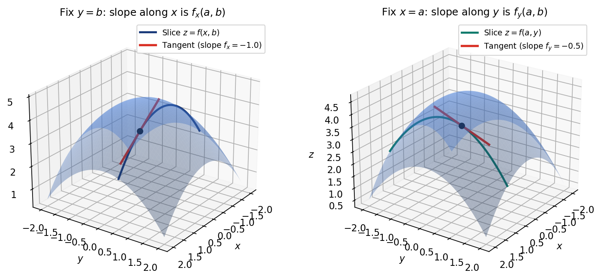
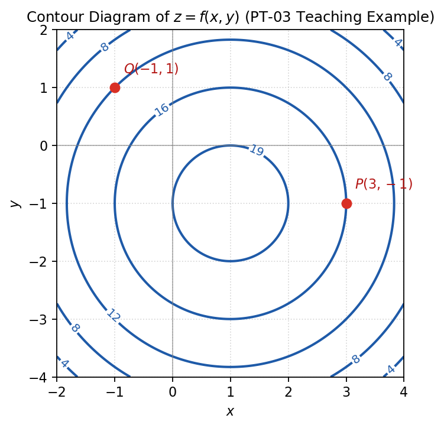
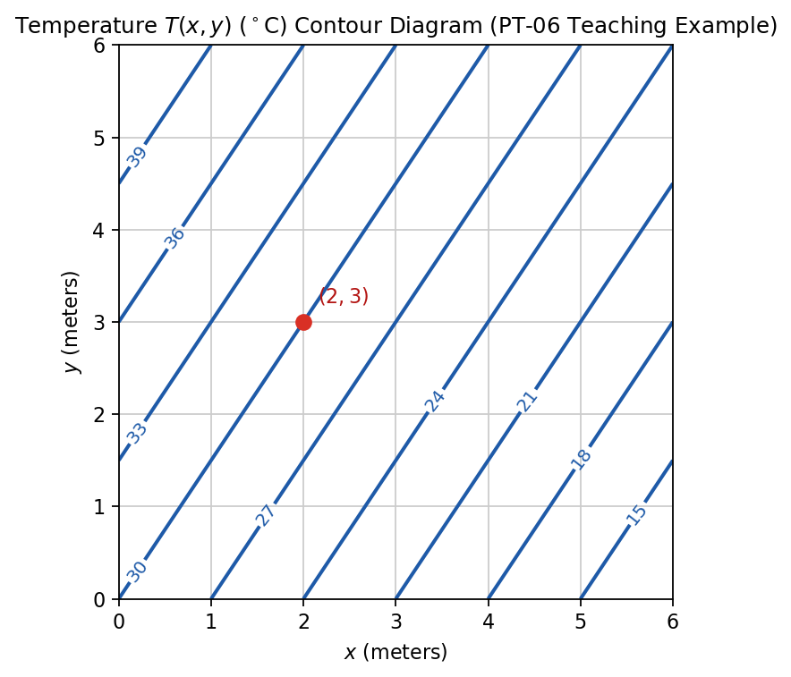

# MAT235H1 Week 7 Study Notes — Partial Derivatives

**Course:** MAT235H1 — Multivariable Calculus  
**Topic:** Sections 14.1–14.2 (The Partial Derivative & Computing Partial Derivatives Algebraically)  
**Companion File:** [Answers-and-Practice.md](./Answers-and-Practice.md)

---

## Contents

- [Scope, Sources, and Notation](#scope-sources-and-notation)
- [C1: Definition and Notation of Partial Derivatives](#c1-definition-and-notation-of-partial-derivatives)
  - [PT-01: Computing a Partial Derivative at a Point from the Limit Definition](#pt-01-computing-a-partial-derivative-at-a-point-from-the-limit-definition)
- [C2: Geometric Slopes, Practical Rates of Change, and One-Input Predictions](#c2-geometric-slopes-practical-rates-of-change-and-one-input-predictions)
  - [PT-02: Interpreting Partial Derivatives, Signs, Units, and One-Input Predictions in Context](#pt-02-interpreting-partial-derivatives-signs-units-and-one-input-predictions-in-context)
  - [PT-03: Determining Signs of Partial Derivatives from a Surface Graph or Contour Diagram](#pt-03-determining-signs-of-partial-derivatives-from-a-surface-graph-or-contour-diagram)
- [C3: Estimating Partial Derivatives Numerically and Graphically](#c3-estimating-partial-derivatives-numerically-and-graphically)
  - [PT-04: Estimating Partial Derivatives from a Formula Using Difference Quotients](#pt-04-estimating-partial-derivatives-from-a-formula-using-difference-quotients)
  - [PT-05: Estimating Partial Derivatives and Signs from a Table of Values](#pt-05-estimating-partial-derivatives-and-signs-from-a-table-of-values)
  - [PT-06: Estimating Partial Derivatives and Comparing Magnitudes from a Contour Diagram](#pt-06-estimating-partial-derivatives-and-comparing-magnitudes-from-a-contour-diagram)
- [C4: Computing Partial Derivatives Algebraically and Evaluating at a Point](#c4-computing-partial-derivatives-algebraically-and-evaluating-at-a-point)
  - [PT-07: Computing Partial Derivatives Algebraically (Two or More Variables)](#pt-07-computing-partial-derivatives-algebraically-two-or-more-variables)
  - [PT-08: Evaluating Algebraic Partial Derivatives at a Point and Interpreting in Context](#pt-08-evaluating-algebraic-partial-derivatives-at-a-point-and-interpreting-in-context)

---

## Scope, Sources, and Notation

### Week 7 Scope
These notes cover **§14.1 (The Partial Derivative)** and **§14.2 (Computing Partial Derivatives Algebraically)** from *Calculus*, 8th Edition (Hughes-Hallett et al.), aligned with the Quercus *Week 7 Learning Objectives and Practice Problems* and *Week 7 Pre-Class Reading* pages.

- **In-scope lecture sources:**
  - `oct 21.pdf` (PDF pp. 1–4): motivation, limit definition, notation, cross-section slopes, and numerical difference-quotient approximations (§14.1).
  - `oct 23.pdf` (PDF pp. 1–3): algebraic rules, worked differentiation exercises, practical interpretations, and applied models (§14.2).
  - `Week7-sol.pdf` (PDF pp. 1–8; printed handout pp. 1–5 plus 3 inserted whiteboard pages): annotated MAT235 Week 7 lecture worksheet covering §§14.1–14.2.
- **Cross-week exclusion:** `oct26.pdf` (PDF pp. 1–4) covers *Tangent Planes of a Surface* (§14.3, Week 8) and is excluded from this Week 7 deliverable. Likewise, tangent-plane approximations, differentials, gradients, directional derivatives, and later Chapter 14 topics are outside Week 7 scope; predictions here are restricted to **one-input** changes with all other inputs held fixed.
- **Note on Quercus wording:** The Quercus Week 7 objectives page refers to the exercise list as "sections introduced in Week 6" in its introductory sentence, while the page title, section headings (§14.1 and §14.2), and pre-class reading all place §§14.1–14.2 in Week 7.
- **Verified textbook pagination (8th ed.):** Printed page $+ 20 =$ PDF page.
  - Pre-class reading (§14.1): Definition of partial derivative (printed p. 787 / PDF p. 807), *"Visualizing Partial Derivatives on a Graph"* and Example 3 (printed p. 788 / PDF p. 808), and Example 5 (printed p. 789 / PDF p. 809).
  - §14.1 exercises: printed pp. 790–795 (PDF pp. 810–815).
  - §14.2 text and exercises: printed pp. 795–800 (PDF pp. 815–820).

### Core vs. Supplementary Convention
- **Core** marks concepts, methods, and notations directly taught on in-scope lecture pages (`oct 21.pdf`, `oct 23.pdf`, `Week7-sol.pdf`).
- **Supplementary** marks a method, notation, or variant absent from the lecture pages that is included only where needed for a Quercus objective or a requested exercise.

### Notation Summary
For $z = f(x, y)$ at a general point $(x, y)$ or a specific point $(a, b)$:

| Differentiate w.r.t. | Held Fixed | Subscript | Leibniz | Operator (`oct 21.pdf` p. 2) | Evaluated at $(a, b)$ |
| :--- | :--- | :--- | :--- | :--- | :--- |
| $x$ | $y = b$ | $f_x(x, y)$ or $z_x$ | $\dfrac{\partial f}{\partial x}$ or $\dfrac{\partial z}{\partial x}$ | $D_x f$ | $f_x(a, b)$ or $\left.\dfrac{\partial z}{\partial x}\right\|_{(a,b)}$ |
| $y$ | $x = a$ | $f_y(x, y)$ or $z_y$ | $\dfrac{\partial f}{\partial y}$ or $\dfrac{\partial z}{\partial y}$ | $D_y f$ | $f_y(a, b)$ or $\left.\dfrac{\partial z}{\partial y}\right\|_{(a,b)}$ |

When a function uses other variable names—such as $P = f(A, r, N)$ or $y = f(x, t)$—adjust the subscript or $\partial$-denominator to match the varying input (e.g., $f_r = \frac{\partial P}{\partial r}$, $f_t = \frac{\partial y}{\partial t}$).

---

## C1: Definition and Notation of Partial Derivatives

**Status:** **Core**  
**Sources:** `oct 21.pdf` pp. 1–3; `Week7-sol.pdf` pp. 2, 5 (printed p. 1 of 5 & Wednesday recap); Textbook §14.1 (printed p. 787 / PDF p. 807).

### Why Partial Derivatives Are Needed
A function of two or more variables can increase in one coordinate direction while decreasing in another. For example, on `oct 21.pdf` p. 1, for $f(x, y) = x^2 + xy - y^2$ near $(1, 2)$ where $f(1,2) = -1$:
- Increasing $x$ slightly ($f(1.1, 2) = -0.59$) **increases** the output.
- Increasing $y$ slightly ($f(1, 2.1) = -1.31$) **decreases** the output.

To study how each input affects the output individually, we **hold all other independent variables fixed** and take an ordinary one-variable derivative with respect to the chosen variable.

### Limit Definition
For a function $f(x, y)$, the **partial derivatives at $(a, b)$** are defined whenever the corresponding one-variable limits exist:

$$f_x(a, b) = \lim_{h \to 0} \frac{f(a + h, b) - f(a, b)}{h} \qquad (\text{hold } y = b \text{ fixed, vary } x)$$

$$f_y(a, b) = \lim_{h \to 0} \frac{f(a, b + h) - f(a, b)}{h} \qquad (\text{hold } x = a \text{ fixed, vary } y)$$

> **Key Distinction (`Week7-sol.pdf` p. 5):** Each partial derivative is a **one-variable limit** in the scalar step $h \to 0$, *not* a two-variable limit $(x, y) \to (a, b)$ from §12.6.
> *(Note: On `oct 21.pdf` p. 1, the general formula accidentally omits "$- f(a, b)$" in the numerator, though the worked examples on pp. 2–3 and `Week7-sol.pdf` pp. 2, 5 include it correctly.)*

### Derivative Function vs. Derivative at a Point vs. Estimate
- **Partial derivative function** $f_x(x, y) = \frac{\partial f}{\partial x}$: a formula giving the instantaneous rate of change with respect to $x$ at any $(x, y)$ in the domain.
- **Partial derivative at a point** $f_x(a, b) = \left.\frac{\partial f}{\partial x}\right|_{(a,b)}$: a **single scalar number** (the exact limit as $h \to 0$).
- **Difference-quotient estimate** $\frac{f(a + h, b) - f(a, b)}{h}$ for a fixed nonzero $h$: an **approximation** to $f_x(a, b)$, not the exact derivative.

---

### PT-01: Computing a Partial Derivative at a Point from the Limit Definition

**Qualifying Original Questions:** `oct 21.pdf` pp. 2–3 (compute $f_x(1, 2)$ and $f_y(1, 2)$ for $f(x, y) = x^2 + xy - y^2$ using the limit definition).

#### Recognition Cues
- The problem explicitly asks to compute $f_x(a, b)$ or $f_y(a, b)$ **from the definition** (or using a limit of difference quotients).

#### Reusable Solution Method
1. **Identify the varying coordinate and the fixed coordinate(s):**
   - For $f_x(a, b)$, fix $y = b$ and write $f(a + h, b) - f(a, b)$.
   - For $f_y(a, b)$, fix $x = a$ and write $f(a, b + h) - f(a, b)$.
2. **Substitute into the function formula** carefully using parentheses around $(a + h)$ or $(b + h)$ and around $f(a, b)$.
3. **Expand and simplify the numerator** so all constant terms cancel and every remaining term contains a factor of $h$.
4. **Factor out and cancel $h$** (valid since $h \neq 0$ in the limit).
5. **Evaluate the one-variable limit as $h \to 0$** to obtain a single number.

#### Original Teaching Question (PT-01)
Let $f(x, y) = 2x^2 - 3xy + y^2$. Use the **limit definition** of the partial derivative to compute:
1. $f_x(2, -1)$
2. $f_y(2, -1)$

*Result-free checklist:*
- [ ] Did you hold the non-differentiated variable fixed at its given coordinate in both terms of the numerator?
- [ ] Did you subtract $f(2, -1)$ with full parentheses?
- [ ] Did all terms without $h$ cancel before dividing by $h$?
- [ ] Did you take $h \to 0$ only *after* canceling $h$?

*Common mistakes:* Perturbing both $x$ and $y$ at the same time (e.g., $f(2+h, -1+h)$); forgetting the minus sign when subtracting $f(a, b)$; dropping the $\lim_{h \to 0}$ notation too early.

[View worked solution in Answers-and-Practice.md](./Answers-and-Practice.md#pt-01-computing-a-partial-derivative-at-a-point-from-the-limit-definition)

---

## C2: Geometric Slopes, Practical Rates of Change, and One-Input Predictions

**Status:** **Core**  
**Sources:** `oct 21.pdf` pp. 3–4; `oct 23.pdf` pp. 2–3; `Week7-sol.pdf` pp. 1, 3, 5, 8 (printed pp. 2 & 5 of 5); Textbook §14.1 (printed pp. 788–790 / PDF pp. 808–810, pre-class reading: *"Visualizing Partial Derivatives on a Graph"*, Example 3, Example 5).

### Geometric Interpretation: Slopes of Cross-Sections
Holding $y = b$ fixed slices the surface $z = f(x, y)$ with the vertical plane $y = b$, producing the one-variable curve $z = f(x, b)$.
- **$f_x(a, b)$** is the **slope of the tangent line** to the cross-section curve $z = f(x, b)$ at $x = a$ (moving in the positive $x$-direction).
- **$f_y(a, b)$** is the **slope of the tangent line** to the cross-section curve $z = f(a, y)$ at $y = b$ (moving in the positive $y$-direction).

### Practical Rate-of-Change Interpretation and Units
In an applied model $z = f(x, y)$:
- **Units:**
  $$\text{Units of } \frac{\partial z}{\partial x} = \frac{\text{units of } z}{\text{units of } x}, \qquad \text{Units of } \frac{\partial z}{\partial y} = \frac{\text{units of } z}{\text{units of } y}.$$
  *(Notice that $\partial z/\partial x$ and $\partial z/\partial y$ generally have **different** units whenever $x$ and $y$ have different units!)*
- **Sign:**
  - $f_x(a, b) > 0$: near $(a, b)$, with $y = b$ held fixed, $z$ **increases** as $x$ increases.
  - $f_x(a, b) < 0$: near $(a, b)$, with $y = b$ held fixed, $z$ **decreases** as $x$ increases.
  - $f_x(a, b) = 0$: at $(a, b)$, the cross-section $z = f(x, b)$ has a horizontal tangent line (instantaneous rate of change is zero).
- **Verbal template (4 required ingredients):**
  1. **Base state (point):** "When $x = a$ [units] and $y = b$ [units]..."
  2. **Which variable is held fixed:** "...holding $y$ fixed at $b$ [units]..."
  3. **Direction & magnitude with units:** "...$z$ increases (if $>0$) / decreases (if $<0$) at a rate of approximately $|f_x(a, b)|$ [units of $z$] per [unit of $x$]."
  4. **Local nature:** Emphasize "approximately" / "for each additional small unit of $x$" near $(a, b)$.

### One-Input Predictions (Week 7 Scope)
Because $f_x(a, b) \approx \frac{\Delta f}{\Delta x}$ when $\Delta x$ is small and $y = b$ is held fixed (`Week7-sol.pdf` p. 3, p. 5; `oct 23.pdf` p. 2 sketch), we can predict the approximate change in output or the new output value for a **small change in one input alone**:

$$\Delta f \approx f_x(a, b)\,\Delta x \qquad \Longrightarrow \qquad f(a + \Delta x, b) \approx f(a, b) + f_x(a, b)\,\Delta x$$

Similarly, holding $x = a$ fixed and changing $y$ by a small $\Delta y$:

$$\Delta f \approx f_y(a, b)\,\Delta y \qquad \Longrightarrow \qquad f(a, b + \Delta y) \approx f(a, b) + f_y(a, b)\,\Delta y$$

> **Distinguishing the Three Quantities:**
> - **Derivative at a point** $f_x(a, b)$: instantaneous rate of change (units: $\text{output}/\text{input}$).
> - **Predicted change** $\Delta f \approx f_x(a, b)\,\Delta x$: approximate change in output for a small step $\Delta x$ (units: $\text{output}$).
> - **Predicted value** $f(a + \Delta x, b) \approx f(a, b) + f_x(a, b)\,\Delta x$: approximate new output level (units: $\text{output}$).
> - **Assumption:** Accuracy requires $\Delta x$ to be small enough that the cross-section curve is close to its tangent line, and *all other inputs remain fixed*.

---

### PT-02: Interpreting Partial Derivatives, Signs, Units, and One-Input Predictions in Context

**Qualifying Original Questions:** `oct 23.pdf` p. 2 (local temperature model $T(x, y)$); `Week7-sol.pdf` p. 3 (mortgage payment $P = f(A, r, N)$ and windchill $W = f(T, v)$ matching); Textbook §14.1 Exercises #4, #5, #6, #7, #8, #9.

#### Recognition Cues
- A word problem defines a multivariable quantity (price, payment, temperature, demand, weight, concentration) with physical or financial units.
- Asks for: the **units** of $\partial f/\partial x$, the **expected sign** (and why), a **practical/everyday interpretation** of a statement like $f_r(92000, 14, 30) = 72.82$, **matching** verbal statements to inequalities, or a **one-input prediction** for a small change in one variable.

#### Reusable Solution Method
1. **List every variable with its symbol and units** (output and every input).
2. **For units:** Form $\frac{\text{output units}}{\text{differentiated input units}}$.
3. **For expected sign:** Fix all other inputs mentally. Ask: *"If this one input increases slightly, does the output increase ($+$) or decrease ($-$) in reality?"* State the real-world reason clearly.
4. **For interpreting $f_x(a, b) = k$:** Use the 4-part verbal template (base point, held-fixed variable(s), sign/direction, magnitude + units).
5. **For a one-input prediction:** Compute $\Delta f \approx f_x(a, b)\,\Delta x$ (and add to $f(a, b)$ if the new value is requested), checking that units cancel to give output units.

#### Original Teaching Question (PT-02)
The monthly electricity cost $C = g(T, h)$ (in dollars) to heat a home depends on the average outdoor temperature $T$ (in $^\circ\text{C}$) and the thermostat setting $h$ (in $^\circ\text{C}$). Suppose $g(-5, 21) = 185$, $g_T(-5, 21) = -6.4$, and $g_h(-5, 21) = 9.2$.
1. State the units and explain why the signs of $g_T(-5, 21)$ and $g_h(-5, 21)$ make practical sense.
2. Give a practical interpretation of $g_h(-5, 21) = 9.2$.
3. If the average outdoor temperature stays fixed at $-5^\circ\text{C}$ and you lower the thermostat from $21^\circ\text{C}$ to $19.5^\circ\text{C}$, predict the approximate change in monthly cost and the new monthly cost.

*Result-free checklist:*
- [ ] Did you state units as output units per input unit?
- [ ] Did you explicitly name the base state $(-5, 21)$ and which variable is held fixed?
- [ ] For part 3, did you use the correct sign for $\Delta h$ (lowering means $\Delta h < 0$)?
- [ ] Did you clearly label the prediction as *approximate*?

*Common mistakes:* Confusing the function value $g(a, b)$ with a rate of change; omitting which variable is held fixed; forgetting the negative sign when an input *decreases*; writing output units instead of rate units for a derivative.

[View worked solution in Answers-and-Practice.md](./Answers-and-Practice.md#pt-02-interpreting-partial-derivatives-signs-units-and-one-input-predictions-in-context)

---

### PT-03: Determining Signs of Partial Derivatives from a Surface Graph or Contour Diagram

**Qualifying Original Questions:** Textbook §14.1 Example 3 (printed p. 788, pre-class reading); Textbook §14.1 Exercises #10–15 (evaluate $f(A)$ and determine signs of $f_x(A), f_y(A)$), #16–19 (signs on Figure 14.7); `Week7-sol.pdf` p. 6 (contour sign rule).

#### Recognition Cues
- Given a **3D surface graph** $z = f(x, y)$ or a **2D contour diagram** with labeled level curves and one or more marked points ($A, P, Q, \dots$).
- Asks for the value $f(A)$ and whether $f_x$ and $f_y$ are **positive, negative, or zero** at the marked point(s).

#### Reusable Solution Method
- **On a contour diagram:**
  1. **Evaluate $f(A)$:** Read the label of the contour passing through $A$ (or interpolate if $A$ lies between contours).
  2. **Sign of $f_x(A)$:** Start at $A$ and move a tiny step **horizontally to the right** (positive $x$-direction, $y$ fixed):
     - Contour values increase $\implies f_x(A) > 0$.
     - Contour values decrease $\implies f_x(A) < 0$.
     - Movement is along (or tangent to) a contour $\implies f_x(A) = 0$.
  3. **Sign of $f_y(A)$:** Start at $A$ and move a tiny step **vertically upward** (positive $y$-direction, $x$ fixed) and apply the same rule.
- **On a 3D surface graph:**
  1. Locate the positive $x$-axis and positive $y$-axis carefully (axes can be oriented differently across figures!).
  2. From the point on the surface, imagine walking in the positive $x$-direction (keeping $y$ constant): going uphill $\implies f_x > 0$; downhill $\implies f_x < 0$; flat/peak/trough along that slice $\implies f_x = 0$.
  3. Repeat walking in the positive $y$-direction (keeping $x$ constant) for $f_y$.

#### Original Teaching Question (PT-03)
Use the contour diagram of $z = f(x, y)$ below.

1. Evaluate $f(P)$ and determine whether $f_x(P)$ and $f_y(P)$ are positive, negative, or zero at $P(3, -1)$.
2. Evaluate $f(Q)$ and determine whether $f_x(Q)$ and $f_y(Q)$ are positive, negative, or zero at $Q(-1, 1)$.

*Result-free checklist:*
- [ ] Did you check whether contour labels increase inward or outward before deciding signs?
- [ ] For $f_x$, did you move strictly **right** ($+x$)? For $f_y$, strictly **up** ($+y$)?
- [ ] Did you check whether a coordinate direction is tangent to a contour (giving $0$)?

*Common mistakes:* Moving in the negative axis direction (left or down) and flipping the sign; assuming concentric circles always increase outward; forgetting that a vertical tangent to a contour means $f_y = 0$ (not $f_x = 0$).

[View worked solution in Answers-and-Practice.md](./Answers-and-Practice.md#pt-03-determining-signs-of-partial-derivatives-from-a-surface-graph-or-contour-diagram)

---

## C3: Estimating Partial Derivatives Numerically and Graphically

**Status:** **Core**  
**Sources:** `oct 21.pdf` p. 4; `Week7-sol.pdf` pp. 2, 4, 6, 8 (printed pp. 1, 3, 5 of 5 + contour sketch); Textbook §14.1 (printed pp. 786–789 / PDF pp. 806–809).

### Numerical Difference Quotients
Because $f_x(a, b) = \lim_{h \to 0} \frac{f(a+h, b) - f(a, b)}{h}$, for a small nonzero step $h = \Delta x$ we can estimate $f_x(a, b)$ using:
- **Forward difference quotient** (`oct 21.pdf` p. 4; `Week7-sol.pdf` p. 8):
  $$f_x(a, b) \approx \frac{f(a + h, b) - f(a, b)}{h}$$
- **Backward difference quotient** (used when only smaller input values are available, or to average with forward):
  $$f_x(a, b) \approx \frac{f(a, b) - f(a - h, b)}{h}$$
- **Central (symmetric) difference quotient** (`oct 21.pdf` p. 4; `Week7-sol.pdf` p. 2):
  $$f_x(a, b) \approx \frac{f(a + h, b) - f(a - h, b)}{2h}$$
  *(When symmetric data around $(a, b)$ exist—such as in an interior cell of a table—the central difference quotient is typically more accurate because it averages the forward and backward slopes.)*

The analogous formulas for $f_y(a, b)$ hold $x = a$ fixed and vary $y$ by $h = \Delta y$.

### Reading Tables vs. Contour Diagrams
- **From a table of values:** First identify which variable labels the **rows** and which labels the **columns**! (Tables in the textbook and lectures vary: in `Week7-sol.pdf` p. 2, $x$ is columns and $y$ is rows; in §14.1 #1, $x$ is rows and $y$ is columns.) Hold the other variable fixed (stay in one row or one column) and compute $\frac{\Delta f}{\Delta (\text{varying input})}$.
- **From a contour diagram:** Move strictly parallel to the axis of the differentiated variable (horizontal for $f_x$, vertical for $f_y$) from $(a, b)$ to a nearby contour crossing, read $\Delta f$ (contour value change) and $\Delta x$ or $\Delta y$ (grid distance), and compute $\frac{\Delta f}{\Delta x}$ or $\frac{\Delta f}{\Delta y}$.
- **Comparing magnitudes on a contour diagram (`Week7-sol.pdf` p. 6):** When comparing **the same change in function value $\Delta f$** (equal contour interval) and measuring distance **using the actual numerical scale of the coordinate axis**, a smaller step $\Delta x$ (closer contours along the $x$-direction) means a **larger** $|f_x| \approx \left|\frac{\Delta f}{\Delta x}\right|$.

> **Always mark graphical and tabular answers as estimates ($\approx$)** and state which points or step size you used.

---

### PT-04: Estimating Partial Derivatives from a Formula Using Difference Quotients

**Qualifying Original Questions:** `oct 21.pdf` p. 4 ($f(x, y) = x^2 + xy - y^2$ at $(1, 2)$ with $h = 0.1$); `Week7-sol.pdf` p. 8 ($f(w, z) = e^{w \ln z}$ at $(2, 2)$ with $h = 0.01$); Textbook §14.1 Exercises #2, #3; §14.2 Exercise #1(a).

#### Recognition Cues
- Gives an explicit formula $f(x, y)$, a point $(a, b)$, and a specific step size $h$, $\Delta x$, or $\Delta y$ (e.g., $0.1$ or $0.01$), asking to **approximate** or **estimate** $f_x(a, b)$ or $f_y(a, b)$ using difference quotients.

#### Reusable Solution Method
1. Write down the difference quotient for the requested variable (forward $\frac{f(a+h,b)-f(a,b)}{h}$ unless central is specified).
2. Evaluate $f(a, b)$ and $f(a + h, b)$ (or $f(a, b + h)$) to sufficient decimal places (keep at least 5–6 significant digits in intermediate steps to avoid rounding loss when subtracting nearly equal numbers!).
3. Subtract and divide by $h$.
4. Report the result with $\approx$ (and compare to the exact value if part (b) asks for it).

#### Original Teaching Question (PT-04)
Let $f(x, y) = x^2 e^{y - 1}$. Use forward difference quotients with $h = 0.01$ to estimate:
1. $f_x(2, 1)$
2. $f_y(2, 1)$

*Result-free checklist:*
- [ ] Did you perturb only *one* coordinate at a time?
- [ ] Did you retain enough intermediate digits before subtracting and dividing by $0.01$?
- [ ] Did you use $\approx$ rather than $=$?

*Common mistakes:* Rounding $f(a+h, b)$ too early (causing large cancellation error after dividing by $0.01$); dividing by $h$ instead of $2h$ when using a central difference; plugging in $h$ to both coordinates.

[View worked solution in Answers-and-Practice.md](./Answers-and-Practice.md#pt-04-estimating-partial-derivatives-from-a-formula-using-difference-quotients)

---

### PT-05: Estimating Partial Derivatives and Signs from a Table of Values

**Qualifying Original Questions:** `Week7-sol.pdf` p. 2 (metal plate temperature table $T = f(x, y)$ at $(3, -1)$); Textbook §14.1 Exercises #1, #20.

#### Recognition Cues
- Gives a 2D numerical table of $f(x, y)$ (possibly in an applied context) and asks to **estimate** $f_x(a, b)$ and $f_y(a, b)$ or determine their **signs** (assuming they exist).

#### Reusable Solution Method
1. **Check table orientation first:** Which variable runs across the top (columns), and which runs down the side (rows)?
2. **Locate the cell for $(a, b)$** and highlight the row and column passing through it.
3. **To estimate $f_x(a, b)$:** Move only along the line where $y = b$ is constant.
   - If entries exist on both sides of $a$ with **equal spacing** ($a - h$ and $a + h$), use the **central difference** $\frac{f(a+h, b) - f(a-h, b)}{2h}$ (as in `Week7-sol.pdf` p. 2).
   - If the grid spacing around $a$ is **unequal** (e.g., $x = 1, 3, 6$ in §14.1 #1), you may compute the forward quotient, the backward quotient, and/or their average—state clearly which quotient you used!
   - If $(a, b)$ is on the boundary of the table, use the one-sided (forward or backward) quotient available.
4. **Repeat for $f_y(a, b)$** holding $x = a$ fixed.
5. **Attach units and interpret** if the table represents a real-world quantity.

#### Original Teaching Question (PT-05)
The table below gives the crop yield $Y = f(r, n)$ (in tonnes per hectare) as a function of seasonal rainfall $r$ (in cm) and nitrogen fertilizer $n$ (in kg/ha).

| $r \setminus n$ | $40$ | $60$ | $80$ | $100$ |
| :---: | :---: | :---: | :---: | :---: |
| **$30$** | $4.2$ | $5.0$ | $5.5$ | $5.7$ |
| **$40$** | $5.1$ | $6.0$ | $6.6$ | $6.8$ |
| **$50$** | $5.6$ | $6.6$ | $7.3$ | $7.6$ |

1. Estimate $f_r(40, 60)$ and $f_n(40, 60)$ using central difference quotients.
2. State the units and give a practical interpretation of each estimate.

*Result-free checklist:*
- [ ] Did you verify which variable labels rows ($r$) and which labels columns ($n$)?
- [ ] Did you keep the other variable strictly fixed?
- [ ] Did you divide by the *full* span $2h$ (not $h$) when using a central difference?
- [ ] Did you include units and mark the answers as estimates ($\approx$)?

*Common mistakes:* Swapping rows and columns; dividing a central difference by $h$ instead of $2h$; subtracting in the wrong order ($\frac{f(a-h,b) - f(a+h,b)}{2h}$ flips the sign).

[View worked solution in Answers-and-Practice.md](./Answers-and-Practice.md#pt-05-estimating-partial-derivatives-and-signs-from-a-table-of-values)

---

### PT-06: Estimating Partial Derivatives and Comparing Magnitudes from a Contour Diagram

**Qualifying Original Questions:** `Week7-sol.pdf` p. 4 (concentric contour sketch for $f_x(x_0, 0)$) and p. 6 (sunfish density contour diagram $F(h, D)$); Textbook §14.1 Example 4 (printed p. 789 / PDF p. 809).

#### Recognition Cues
- Gives a contour diagram with numbered axes (gridlines or scale) and labeled level curves.
- Asks to **estimate** $f_x(a, b)$ or $f_y(a, b)$ numerically, or **find where $|\partial f/\partial \text{var}|$ is largest/smallest** along a coordinate direction.

#### Reusable Solution Method
1. **Locate $(a, b)$** on the contour diagram and estimate $f(a, b)$ from the nearest contour(s).
2. **To estimate $f_x(a, b)$:** Draw a horizontal line through $y = b$. Find a nearby point $(a + \Delta x, b)$ (or bracket $(a_1, b)$ and $(a_2, b)$ around $(a, b)$) where that horizontal line crosses a labeled contour cleanly. Compute:
   $$f_x(a, b) \approx \frac{\Delta f}{\Delta x} = \frac{f(a_2, b) - f(a_1, b)}{a_2 - a_1}.$$
3. **To estimate $f_y(a, b)$:** Draw a vertical line through $x = a$, find clean contour crossing(s) along that vertical line, and compute $\frac{\Delta f}{\Delta y}$.
4. **To compare magnitudes (steepness):** Provided you compare **the same change in function value $\Delta f$** (equal contour interval) and measure distances **according to the actual numerical scale of the coordinate axis**, **tighter (closer) contours $\iff$ larger $|\partial f/\partial \text{var}|$**, and **wider spacing $\iff$ smaller $|\partial f/\partial \text{var}|$**.
5. **Check the sign** independently using PT-03.

#### Original Teaching Question (PT-06)
The contour diagram below shows the temperature $T(x, y)$ (in $^\circ\text{C}$) across a laboratory floor, where $x$ and $y$ are measured in meters.

1. Estimate $T(2, 3)$, $T_x(2, 3)$, and $T_y(2, 3)$ from the contour diagram.
2. State the units and explain what $T_x(2, 3)$ and $T_y(2, 3)$ mean in practical terms.

*Result-free checklist:*
- [ ] Did you move strictly horizontally for $T_x$ and strictly vertically for $T_y$?
- [ ] Did you double-check the sign of $\Delta T$ when moving in the positive axis direction?
- [ ] Did you state which contour crossings you read and mark the results as estimates ($\approx$)?

*Common mistakes:* Measuring the perpendicular distance between contours instead of the horizontal ($\Delta x$) or vertical ($\Delta y$) distance; forgetting the sign when contour values decrease in the positive direction.

[View worked solution in Answers-and-Practice.md](./Answers-and-Practice.md#pt-06-estimating-partial-derivatives-and-comparing-magnitudes-from-a-contour-diagram)

---

## C4: Computing Partial Derivatives Algebraically and Evaluating at a Point

**Status:** **Core**  
**Sources:** `oct 23.pdf` pp. 1–3; `Week7-sol.pdf` pp. 7–8 (printed pp. 4–5 of 5); Textbook §14.2 (printed pp. 795–797 / PDF pp. 815–817).

### Algebraic Rule (Two or More Variables)
Because $f_x(x, y)$ is the ordinary derivative of $x \mapsto f(x, y)$ with $y$ held constant, **all single-variable differentiation rules apply directly**:
- **To compute $f_x(x, y)$:** Differentiate with respect to $x$, treating $y$ (and any other independent variables or parameters) as constants.
- **To compute $f_y(x, y)$:** Differentiate with respect to $y$, treating $x$ (and any other independent variables or parameters) as constants.
- **Three or more variables (`Week7-sol.pdf` p. 7 (c)–(d); Textbook §14.2 p. 796):** To find $\frac{\partial f}{\partial x_i}$, treat *every* variable other than $x_i$ as a constant.

### Single-Variable Rules Reminder (`Week7-sol.pdf` p. 7)
- **Constant rule:** The partial derivative of any term depending *only* on the fixed variable(s) is $0$.
- **Power rule:** $\frac{\partial}{\partial x}(x^k) = k x^{k-1}$ when $k$ does not depend on $x$.
- **Product rule:** Only needed when **both** factors depend on the variable of differentiation. If one factor depends only on the fixed variable(s), pull it out as a constant multiple!
- **Quotient rule:** Often avoidable when the numerator or denominator is constant w.r.t. the chosen variable (e.g., $\frac{\partial}{\partial x}\left(\frac{x}{1+y^2}\right) = \frac{1}{1+y^2}$ directly, without the quotient rule).
- **Chain rule:** $\frac{\partial}{\partial x} g(u(x, y)) = g'(u(x, y)) \cdot \frac{\partial u}{\partial x}$.

### **Supplementary:** Two Subtle Cases Needed for Requested Exercises
1. **Variable base and variable exponent $x^y$** (needed for §14.2 #27; related to $e^{w \ln z} = z^w$ on `Week7-sol.pdf` p. 8):
   - Differentiating w.r.t. $x$ ($y$ fixed): **power rule** $\implies \frac{\partial}{\partial x}(x^y) = y x^{y-1}$.
   - Differentiating w.r.t. $y$ ($x > 0$ fixed): **exponential rule** $\implies \frac{\partial}{\partial y}(x^y) = (\ln x)\, x^y$.
2. **Shortcut for evaluating at a point $(a, b)$** (Textbook §14.2 Example 1, printed p. 795 / PDF p. 815):
   - To find $f_x(a, b)$, you may either:
     - *(Standard)* Differentiate $f(x, y)$ w.r.t. $x$ first, then plug in $(a, b)$; **or**
     - *(Shortcut)* Plug in the **fixed** coordinate $y = b$ first to simplify $f(x, b)$, then take the 1-variable derivative w.r.t. $x$ and plug in $x = a$.
   - *Warning:* Never plug in the variable you are differentiating with respect to *before* differentiating!

---

### PT-07: Computing Partial Derivatives Algebraically (Two or More Variables)

**Qualifying Original Questions:** `oct 23.pdf` p. 1 (5 exercises); `Week7-sol.pdf` p. 7 (parts (a)–(e)); Textbook §14.2 Exercises #2, #4–23, #25, #27–40.

#### Recognition Cues
- Gives an explicit algebraic formula (polynomial, rational, trigonometric, exponential, logarithmic, power, or physics/economics formula with multiple variables/parameters) and asks to find $f_x$, $f_y$, $\frac{\partial z}{\partial x}$, $\frac{\partial V}{\partial r}$, etc.

#### Reusable Solution Method
1. **Circle (mentally or on paper) the variable of differentiation** and treat every other letter as a fixed constant.
2. **Simplify algebraically before differentiating** if helpful (e.g., $\ln(y e^{xy}) = \ln y + xy$, or $\frac{1}{y} e^{-x^2/y} = y^{-1} e^{-x^2 y^{-1}}$).
3. **Check whether product/quotient/chain rules are actually needed** for the chosen variable (factors without the chosen variable are just constant coefficients!).
4. **Apply the 1-variable derivative rules** step by step.
5. **Simplify** the resulting partial derivative cleanly.

#### Original Teaching Question (PT-07)
Compute the indicated partial derivatives:
1. $f_x(x, y)$ and $f_y(x, y)$ for $f(x, y) = x^2 e^{3y} + \ln(x^2 + 4y)$.
2. $\dfrac{\partial V}{\partial r}$ and $\dfrac{\partial V}{\partial h}$ for the cylinder volume $V(r, h) = \pi r^2 h$.
3. $g_x(x, y)$ and $g_y(x, y)$ for $g(x, y) = \dfrac{y \sin(xy)}{x^2 + 1}$.

*Result-free checklist:*
- [ ] Did you treat all other variables (and constants like $\pi$) as constants?
- [ ] Did you apply the chain rule to every inner function containing the chosen variable?
- [ ] In part 3, did you check which factors depend on $x$ vs. $y$ before applying the product/quotient rule?

*Common mistakes:* Differentiating a constant-w.r.t.-$x$ term (like $2^y$) as if it were $0$ when differentiating w.r.t. $y$, or vice versa; applying the power rule to $2^y$ instead of the exponential rule $(\ln 2)\,2^y$; forgetting the inner derivative in the chain rule.

[View worked solution in Answers-and-Practice.md](./Answers-and-Practice.md#pt-07-computing-partial-derivatives-algebraically-two-or-more-variables)

---

### PT-08: Evaluating Algebraic Partial Derivatives at a Point and Interpreting in Context

**Qualifying Original Questions:** `oct 23.pdf` pp. 2–3 (temperature model $T(x, y)$ at $(1, 2)$, bank account $B = Pe^{rt}$, relativistic energy $E$); `Week7-sol.pdf` p. 8 ($f(w, z) = e^{w\ln z}$ at $(2, 2)$ and vibrating guitar string $y = f(x, t)$ at $(0.3, 1)$); Textbook §14.2 Exercises #1(b), #3, #24, #26.

#### Recognition Cues
- Gives an explicit formula (pure math or applied model) and asks to **evaluate** $f_x(a, b)$ or $f_y(a, b)$ at a specific point $(a, b)$, often followed by **interpreting** the value, sign, and units in practical terms.

#### Reusable Solution Method
1. **Compute the partial derivative formula** using PT-07 (or use the Supplementary shortcut: substitute the *fixed* variable first, then differentiate).
2. **Substitute the evaluation point $(a, b)$** into the derivative formula. (Keep radians for trigonometric functions!)
3. **Give the exact value** and, if appropriate for an applied problem, a clearly rounded decimal approximation.
4. **Interpret in context** using PT-02: state the base point, what is held fixed, the sign (increasing/decreasing), the magnitude, and the exact units.

#### Original Teaching Question (PT-08)
The temperature (in $^\circ\text{C}$) along a heated metal bar at position $x$ (in meters from the left end) and time $t$ (in minutes) is modeled by
$$H(x, t) = 20 + 60 e^{-0.2 t} \sin\!\left(\frac{\pi x}{2}\right), \qquad 0 \le x \le 2.$$
1. Compute $H_x(0.5, 0)$ and $H_t(0.5, 0)$ exactly, and give decimal approximations to two decimal places.
2. Interpret both values in practical terms, including their signs and units.

*Result-free checklist:*
- [ ] Did you differentiate *before* plugging in the variable of differentiation?
- [ ] Did you evaluate trigonometric functions in **radians**?
- [ ] Did you include the units ($^\circ\text{C}/\text{m}$ for $H_x$ and $^\circ\text{C}/\text{min}$ for $H_t$) and state which variable is held fixed?

*Common mistakes:* Plugging in both $x$ and $t$ before differentiating (which always gives $0$); evaluating $\sin$ or $\cos$ in degrees instead of radians; dropping the chain-rule factor $\frac{\pi}{2}$ or $-0.2$.

[View worked solution in Answers-and-Practice.md](./Answers-and-Practice.md#pt-08-evaluating-algebraic-partial-derivatives-at-a-point-and-interpreting-in-context)
