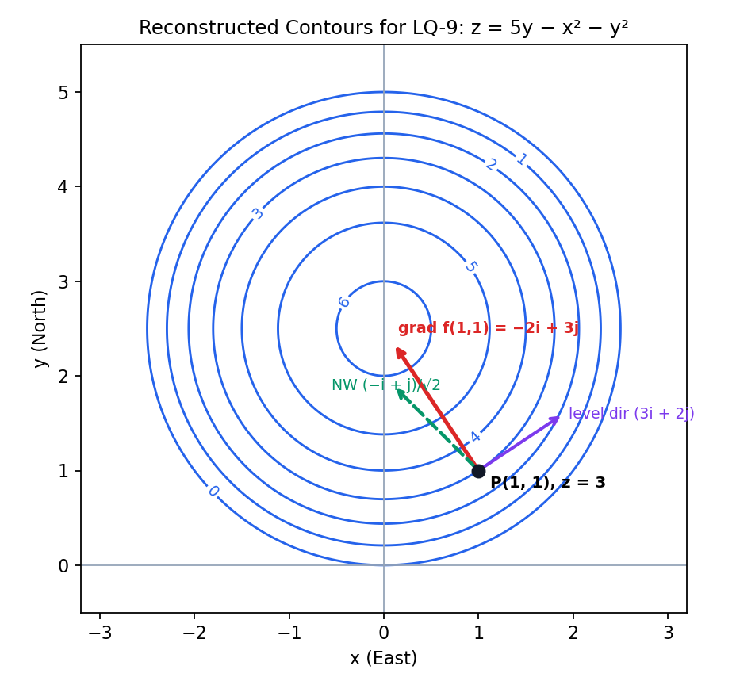
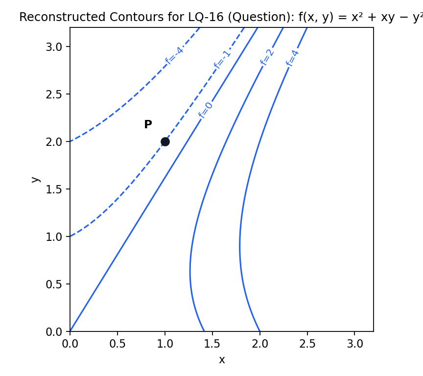
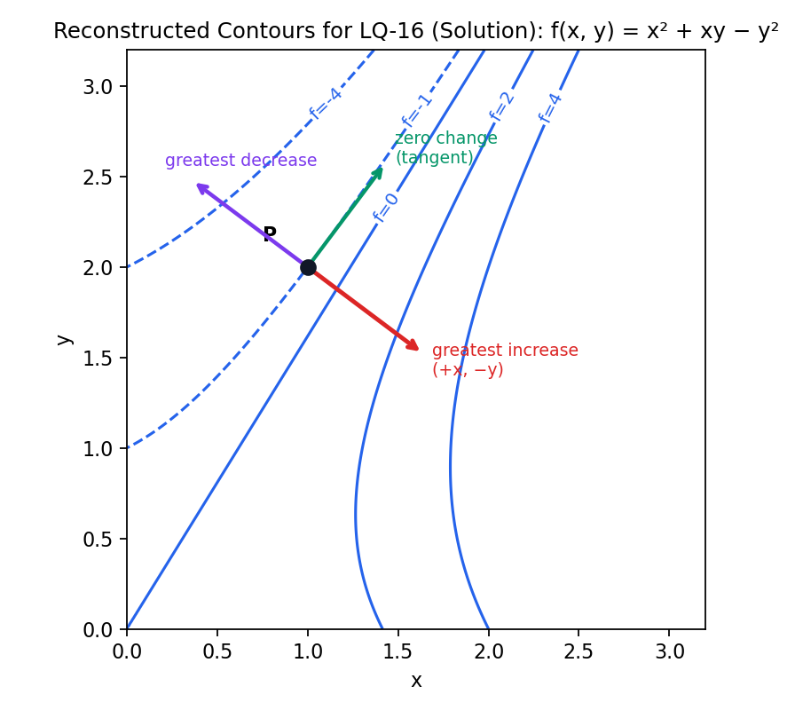
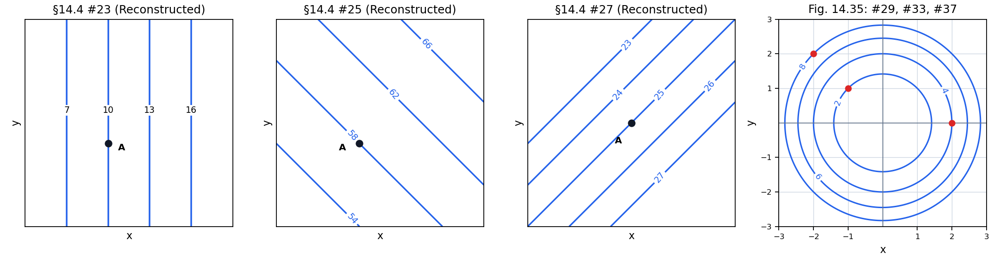

# MAT235 Week 8 Answers and Practice — §§14.3–14.5

Companion to [Study-Notes.md](Study-Notes.md).

## Contents

- [1. Teaching-Example Solutions](#1-teaching-example-solutions)
- [2. Lecture Questions and Solutions](#2-lecture-questions-and-solutions)
- [3. Requested Textbook Exercises and Solutions](#3-requested-textbook-exercises-and-solutions)
  - [Section 14.3 Exercises (16)](#section-143-exercises-16)
  - [Section 14.4 Exercises (24)](#section-144-exercises-24)
  - [Section 14.5 Exercises (20)](#section-145-exercises-20)
- [4. Self-Test Questions](#4-self-test-questions)
- [5. Self-Test Answers](#5-self-test-answers)
- [6. Coverage Appendix](#6-coverage-appendix)

---

## 1. Teaching-Example Solutions

### PT-01 — Finding the Tangent Plane to an Explicit Surface

*Question link:* [Problem Type PT-01](Study-Notes.md#problem-type-pt-01--finding-the-tangent-plane-to-an-explicit-surface)

We have $f(x,y) = (x + 2)e^{y - x^2}$ at $(0,0)$.
1. **Base value:** $f(0,0) = (0 + 2)e^{0} = 2$.
2. **Partial derivatives:**
   $$f_x(x,y) = 1\cdot e^{y - x^2} + (x + 2)(-2x)e^{y - x^2} = (1 - 2x^2 - 4x)e^{y - x^2}, \qquad f_x(0,0) = 1.$$
   $$f_y(x,y) = (x + 2)e^{y - x^2}, \qquad f_y(0,0) = 2.$$
3. **Tangent plane:**
   $$z = f(0,0) + f_x(0,0)(x - 0) + f_y(0,0)(y - 0) = 2 + x + 2y.$$

**Final answer:** $z = x + 2y + 2$.

---

### PT-02 — Estimating Function Values and Changes via Local Linearization

*Question link:* [Problem Type PT-02](Study-Notes.md#problem-type-pt-02--estimating-function-values-and-changes-via-local-linearization)

We estimate $f(0.02, 0.96, 1.03)$ for $f(x,y,z) = e^{2x}\sqrt{y + 3z}$.
1. **Base point:** Choose $(a,b,c) = (0, 1, 1)$, so $y + 3z = 4$ (a perfect square). Displacements:
   $$\Delta x = 0.02, \qquad \Delta y = -0.04, \qquad \Delta z = 0.03.$$
2. **Value and partials at $(0,1,1)$:**
   - $f(0,1,1) = e^0 \sqrt{4} = 2$.
   - $f_x = 2e^{2x}\sqrt{y+3z} \implies f_x(0,1,1) = 2(1)(2) = 4$.
   - $f_y = \dfrac{e^{2x}}{2\sqrt{y+3z}} \implies f_y(0,1,1) = \dfrac{1}{4}$.
   - $f_z = \dfrac{3e^{2x}}{2\sqrt{y+3z}} \implies f_z(0,1,1) = \dfrac{3}{4}$.
3. **Linear approximation:**
   $$f(0.02, 0.96, 1.03) \approx 2 + 4(0.02) + \frac{1}{4}(-0.04) + \frac{3}{4}(0.03) = 2 + 0.08 - 0.01 + 0.0225 = 2.0925.$$
   *(Exact check: $e^{0.04}\sqrt{4.05} \approx 2.0946$.)*

**Final answer:** $f(0.02, 0.96, 1.03) \approx 2.0925$.

---

### PT-03 — Computing Differentials and Estimating Changes

*Question link:* [Problem Type PT-03](Study-Notes.md#problem-type-pt-03--computing-differentials-and-estimating-changes)

Given $V(r,h) = \frac{1}{3}\pi r^2 h$ at $(r,h) = (6, 10)$:
(a) Compute partial derivatives:
$$V_r = \frac{2}{3}\pi r h, \quad V_r(6,10) = 40\pi; \qquad V_h = \frac{1}{3}\pi r^2, \quad V_h(6,10) = 12\pi.$$
Thus the differential at $(6,10)$ is:
$$dV = 40\pi\,dr + 12\pi\,dh.$$
(b) With $dr = 0.1\text{ cm}$ and $dh = -0.2\text{ cm}$:
$$\Delta V \approx dV = 40\pi(0.1) + 12\pi(-0.2) = 4\pi - 2.4\pi = 1.6\pi = \frac{8\pi}{5} \approx 5.03\text{ cm}^3.$$

**Final answer:** (a) $dV = 40\pi\,dr + 12\pi\,dh$; (b) $\Delta V \approx 1.6\pi\text{ cm}^3 \approx 5.03\text{ cm}^3$ (an increase of about $5.03\text{ cm}^3$).

---

### PT-04 — Computing the Gradient Vector

*Question link:* [Problem Type PT-04](Study-Notes.md#problem-type-pt-04--computing-the-gradient-vector)

Given $g(x,y,z) = x^2 y - z e^y$:
(a) Compute each partial derivative:
$$g_x = 2xy, \qquad g_y = x^2 - ze^y, \qquad g_z = -e^y.$$
So $\operatorname{grad} g(x,y,z) = (2xy)\vec{i} + (x^2 - ze^y)\vec{j} - e^y\vec{k}$.
(b) At $(2, 0, 3)$:
$$g_x(2,0,3) = 0, \qquad g_y(2,0,3) = 4 - 3(1) = 1, \qquad g_z(2,0,3) = -1.$$
Thus $\operatorname{grad} g(2,0,3) = \vec{j} - \vec{k} = (0, 1, -1)$ and $\|\operatorname{grad} g(2,0,3)\| = \sqrt{0^2 + 1^2 + (-1)^2} = \sqrt{2}$.

**Final answer:** (a) $\operatorname{grad} g(x,y,z) = 2xy\,\vec{i} + (x^2 - ze^y)\vec{j} - e^y\vec{k}$; (b) $\operatorname{grad} g(2,0,3) = \vec{j} - \vec{k}$, $\|\operatorname{grad} g(2,0,3)\| = \sqrt{2}$.

---

### PT-05 — Computing and Interpreting Directional Derivatives

*Question link:* [Problem Type PT-05](Study-Notes.md#problem-type-pt-05--computing-and-interpreting-directional-derivatives)

Given $T(x,y) = 20 - \frac{1}{2}x^2 - y^2$, $P = (2,1)$, $Q = (5,-3)$:
1. **Direction vector and normalization:**
   $$\vec{v} = \overrightarrow{PQ} = (5 - 2)\vec{i} + (-3 - 1)\vec{j} = 3\vec{i} - 4\vec{j}, \qquad \|\vec{v}\| = \sqrt{3^2 + (-4)^2} = 5, \qquad \vec{u} = \frac{3}{5}\vec{i} - \frac{4}{5}\vec{j}.$$
2. **Gradient at $P(2,1)$:**
   $$\operatorname{grad} T(x,y) = -x\vec{i} - 2y\vec{j} \implies \operatorname{grad} T(2,1) = -2\vec{i} - 2\vec{j}.$$
3. **Directional derivative:**
   $$T_{\vec{u}}(2,1) = \operatorname{grad} T(2,1) \cdot \vec{u} = (-2)\left(\frac{3}{5}\right) + (-2)\left(-\frac{4}{5}\right) = -\frac{6}{5} + \frac{8}{5} = \frac{2}{5} = 0.4^\circ\text{C/m}.$$

**Final answer:** $T_{\vec{u}}(2,1) = 0.4^\circ\text{C/m}$. Moving away from $(2,1)$ toward $(5,-3)$, the temperature increases at an instantaneous rate of $0.4^\circ\text{C}$ per meter.

---

### PT-06 — Finding Directions and Rates of Steepest Ascent, Descent, and Zero Change

*Question link:* [Problem Type PT-06](Study-Notes.md#problem-type-pt-06--finding-directions-and-rates-of-steepest-ascent-descent-and-zero-change)

Given $H(x,y) = 12 - x^2 - 3y^2 + 2x$ at $(2,-1)$:
$$\operatorname{grad} H(x,y) = (-2x + 2)\vec{i} - 6y\vec{j} \implies \operatorname{grad} H(2,-1) = -2\vec{i} + 6\vec{j}.$$
Its magnitude is $\|\operatorname{grad} H(2,-1)\| = \sqrt{(-2)^2 + 6^2} = \sqrt{40} = 2\sqrt{10}$.
(a) **Steepest ascent:** Unit direction $\vec{u}_{\max} = \dfrac{-2\vec{i}+6\vec{j}}{2\sqrt{10}} = \dfrac{-\vec{i} + 3\vec{j}}{\sqrt{10}}$; maximum rate $2\sqrt{10}$ (m per horizontal m).
(b) **Steepest descent:** Direction $2\vec{i} - 6\vec{j}$ (unit vector $\dfrac{\vec{i} - 3\vec{j}}{\sqrt{10}}$); rate $-2\sqrt{10}$.
(c) **Zero change:** Require $(-2\vec{i} + 6\vec{j}) \cdot \vec{v} = 0$, giving $\pm(6\vec{i} + 2\vec{j}) = \pm(3\vec{i} + \vec{j})$. Normalizing gives $\pm\dfrac{3\vec{i} + \vec{j}}{\sqrt{10}}$.

**Final answer:** (a) Unit direction $\dfrac{-\vec{i}+3\vec{j}}{\sqrt{10}}$, rate $2\sqrt{10}$; (b) Direction $\vec{i}-3\vec{j}$ (or unit $\dfrac{\vec{i}-3\vec{j}}{\sqrt{10}}$), rate $-2\sqrt{10}$; (c) $\dfrac{3\vec{i}+\vec{j}}{\sqrt{10}}$ and $\dfrac{-3\vec{i}-\vec{j}}{\sqrt{10}}$.

---

### PT-07 — Reading Gradients, Contours, and Directional-Derivative Signs from a Contour Diagram

*Question link:* [Problem Type PT-07](Study-Notes.md#problem-type-pt-07--reading-gradients-contours-and-directional-derivative-signs-from-a-contour-diagram)

Using Figure 5(a) in `Study-Notes.md` at $A(2,1)$:
(a) Point $A(2,1)$ lies on the contour labeled **$f = 6$**.
(b) Contour values increase outward from $2, 4, 6$ to $8, 10, 12$. At $A(2,1)$ in the first quadrant, the outward normal perpendicular to the ellipse points into the **first quadrant** (positive $x$- and positive $y$-components, approximately along $\vec{i} + \vec{j}$). Steepest decrease points in the opposite direction, into the **third quadrant** (negative $x$- and negative $y$-components).
(c) Since $\operatorname{grad} f(A)$ has both positive $x$- and positive $y$-components (equivalently, moving right or moving up from $A$ crosses to higher contour values), **$f_x(A) > 0$** and **$f_y(A) > 0$**.
(d) Moving in the direction $\vec{v} = -\vec{i} + \vec{j}$ (up and left) is tangent to the contour $f = 6$ at $A(2,1)$ (indeed, for $f(x,y)=x^2+2y^2$, $\operatorname{grad} f(2,1) = 4\vec{i}+4\vec{j}$, which is orthogonal to $-\vec{i}+\vec{j}$), so **$f_{\vec{u}}(A) \approx 0$** (exact $0$).

**Final answer:** (a) $f = 6$; (b) $\operatorname{grad} f(A)$ points outward into Q1 ($\approx \vec{i}+\vec{j}$), steepest decrease into Q3 ($\approx -\vec{i}-\vec{j}$); (c) $f_x(A) > 0$, $f_y(A) > 0$; (d) approximately zero ($0$).

---

### PT-08 — Finding the Tangent Plane to a Level Surface

*Question link:* [Problem Type PT-08](Study-Notes.md#problem-type-pt-08--finding-the-tangent-plane-to-a-level-surface)

Define $F(x,y,z) = x^2 z + y e^{z-1}$ so the surface is the level surface $F(x,y,z) = 5$.
1. **Point check:** $F(2,1,1) = 2^2(1) + 1\cdot e^0 = 4 + 1 = 5$. The point $(2,1,1)$ lies on the surface.
2. **Gradient (normal vector):**
   $$F_x = 2xz, \qquad F_y = e^{z-1}, \qquad F_z = x^2 + y e^{z-1}.$$
   At $(2,1,1)$: $\operatorname{grad} F(2,1,1) = 4\vec{i} + \vec{j} + 5\vec{k} \neq \vec{0}$.
3. **Tangent plane:**
   $$4(x - 2) + 1(y - 1) + 5(z - 1) = 0 \iff 4x + y + 5z = 14.$$

**Final answer:** $4x + y + 5z = 14$.

---

## 2. Lecture Questions and Solutions

All 17 distinct in-scope lecture questions from `Week8-sol.pdf`, `Nov 4.pdf`, and `Nov 6.pdf` are collected below. (`Nov 9.pdf` covers curl and divergence and is excluded as out of scope.)

### LQ-01 — Find and Use a Tangent Plane (`Week8-sol.pdf`, p. 2 / Slide 1 of 8) `[PT-01, PT-02]`

**Question:** Let $f(x,y) = (y+1)e^{x^2+y^2}$.
(a) Find the tangent plane to the graph of $f$ at $(0,0)$.
(b) Use the tangent plane to approximate $f(0.5, 0.5)$ and compare your answer with the exact value of $f(0.5, 0.5)$.
(c) Use the tangent plane to approximate $f(0.1, 0.1)$ and compare your answer with the exact value of $f(0.1, 0.1)$. *(Instructor also checks $(0.01, 0.01)$.)*

**Solution:**
(a) $f(0,0) = 1\cdot e^0 = 1$. Partial derivatives:
$$f_x(x,y) = 2x(y+1)e^{x^2+y^2} \implies f_x(0,0) = 0,$$
$$f_y(x,y) = e^{x^2+y^2} + (y+1)(2y)e^{x^2+y^2} = (2y^2 + 2y + 1)e^{x^2+y^2} \implies f_y(0,0) = 1.$$
Tangent plane: $z = 1 + 0(x - 0) + 1(y - 0) = y + 1$.
(b) $f(0.5, 0.5) \approx 0.5 + 1 = 1.5$, whereas exact $f(0.5, 0.5) = 1.5 e^{0.5} \approx 2.4731$ (poor approximation because $(0.5,0.5)$ is far from $(0,0)$).
(c) $f(0.1, 0.1) \approx 0.1 + 1 = 1.1$, whereas exact $f(0.1, 0.1) = 1.1 e^{0.02} \approx 1.1222$ (much closer). At $(0.01, 0.01)$, $L(0.01, 0.01) = 1.01$ vs. exact $1.01 e^{0.0002} \approx 1.010202$.

---

### LQ-02 — Use Rates of Change to Estimate a Temperature Change (`Week8-sol.pdf`, p. 3 / Slide 2 of 8) `[PT-02]`

**Question:** In a room, the temperature is given by $T = f(x,t)$ degrees Celsius, where $x$ is the distance from a heater in meters and $t$ is the elapsed time in minutes since the heat has been turned on. A person standing $3\text{ m}$ from the heater $5\text{ min}$ after it has been turned on observes: (1) the temperature is increasing by $1.2^\circ\text{C/min}$; (2) walking away from the heater, the temperature decreases by $2^\circ\text{C/m}$ as time is held constant. Estimate how much cooler or warmer it would be $2.5\text{ m}$ from the heater after $6\text{ min}$.

**Solution:**
Base point $(x,t) = (3,5)$, with $f_t(3,5) = 1.2^\circ\text{C/min}$ and $f_x(3,5) = -2^\circ\text{C/m}$ (negative because temperature *decreases* as $x$ increases). Moving to $(2.5, 6)$ gives $\Delta x = 2.5 - 3 = -0.5\text{ m}$ and $\Delta t = 6 - 5 = 1\text{ min}$.
$$\Delta T \approx f_x(3,5)\Delta x + f_t(3,5)\Delta t = (-2)(-0.5) + (1.2)(1) = 1 + 1.2 = 2.2^\circ\text{C}.$$
It would be about **$2.2^\circ\text{C}$ warmer**.

---

### LQ-03 — Use a Linear Approximation in Three Variables (`Week8-sol.pdf`, p. 3 / Slide 2 of 8) `[PT-02]`

**Question:** Let $f(x,y,z) = e^x \sqrt{yz}$. Estimate $f(0.01, 3.9, 1.02)$ using a linear approximation and compare with the actual value.

**Solution:**
Choose base point $(0, 4, 1)$, so $\Delta x = 0.01$, $\Delta y = -0.1$, $\Delta z = 0.02$.
- $f(0,4,1) = e^0 \sqrt{4} = 2$.
- $f_x = e^x\sqrt{yz} \implies f_x(0,4,1) = 2$.
- $f_y = \frac{1}{2}e^x\sqrt{z/y} \implies f_y(0,4,1) = \frac{1}{2}(1)\sqrt{\frac{1}{4}} = \frac{1}{4}$.
- $f_z = \frac{1}{2}e^x\sqrt{y/z} \implies f_z(0,4,1) = \frac{1}{2}(1)\sqrt{\frac{4}{1}} = 1$.
$$f(0.01, 3.9, 1.02) \approx 2 + 2(0.01) + \frac{1}{4}(-0.1) + 1(0.02) = 2 + 0.02 - 0.025 + 0.02 = 2.015.$$
Exact value: $e^{0.01}\sqrt{3.9 \times 1.02} \approx 2.014537$ (error $\approx 0.00046$).

---

### LQ-04 — $z$-Coordinates of $R, S, T$ on the Differential Diagram (`Week8-sol.pdf`, p. 5 / Slide 3 of 8) `[PT-03]`

**Question:** On the diagram of the surface $z = f(x,y)$ and its tangent plane at $(a,b,f(a,b))$ (see [Figure 1](Study-Notes.md#concept-2--differentials-and-exact-vs-approximate-change-143-core)), find the $z$-coordinates of points $R$, $S$, and $T$ lying vertically above $(x,y) = (a+\Delta x, b+\Delta y)$.

**Solution:**
- $R$: $z = f(a,b)$ (same height as the base point).
- $S$: $z = f(a,b) + f_x(a,b)\Delta x + f_y(a,b)\Delta y = f(a,b) + df$ (height on the tangent plane).
- $T$: $z = f(x,y) = f(a+\Delta x, b+\Delta y) = f(a,b) + \Delta f$ (height on the surface).

---

### LQ-05 — Find and Use a Differential (`Week8-sol.pdf`, p. 5 / Slide 3 of 8) `[PT-03]`

**Question:** (a) Find the differential of $g(u,v) = u^2 + uv$. (b) Use your answer to estimate the change in $g$ as you move from $(1,2)$ to $(1.2, 2.1)$.

**Solution:**
(a) $g_u = 2u + v$ and $g_v = u$, so $dg = (2u + v)\,du + u\,dv$.
(b) At base point $(1,2)$ with $du = 0.2$ and $dv = 0.1$:
$$\Delta g \approx dg = (2(1) + 2)(0.2) + 1(0.1) = 4(0.2) + 0.1 = 0.9.$$
*(Exact change: $g(1.2, 2.1) - g(1,2) = 3.96 - 3 = 0.96$.)*

---

### LQ-06 — Estimate a Change in Volume (`Week8-sol.pdf`, p. 5 / Slide 3 of 8) `[PT-03]`

**Question:** A right circular cylinder has a radius of $50\text{ cm}$ and a height of $100\text{ cm}$. Use differentials to estimate the change in volume if its height and radius are both increased by $1\text{ cm}$.

**Solution:**
$V(r,h) = \pi r^2 h \implies dV = 2\pi r h\,dr + \pi r^2\,dh$.
At $(r,h) = (50, 100)$ with $dr = 1\text{ cm}$ and $dh = 1\text{ cm}$:
$$\Delta V \approx dV = 2\pi(50)(100)(1) + \pi(50)^2(1) = 10000\pi + 2500\pi = 12500\pi \approx 39269.9\text{ cm}^3.$$

---

### LQ-07 — Find a Directional Derivative on a Metal Plate (`Week8-sol.pdf`, p. 6 / Slide 4 of 8) `[PT-05]`

**Question:** The temperature at $(x,y)$ is $T(x,y) = 1 - \frac{1}{4}x^2 - \frac{1}{4}y^2$ degrees Celsius, where $x$ and $y$ are measured in centimeters. Find the derivative of $T$ at $P = (1,1)$ as we move toward $Q = (1.7, 0.5)$, units included.

**Solution:**
1. $\vec{v} = \overrightarrow{PQ} = 0.7\vec{i} - 0.5\vec{j}$, $\|\vec{v}\| = \sqrt{0.49 + 0.25} = \sqrt{0.74} = \dfrac{\sqrt{74}}{10}$, so $\vec{u} = \dfrac{7\vec{i} - 5\vec{j}}{\sqrt{74}}$.
2. $\operatorname{grad} T(x,y) = -\frac{1}{2}x\vec{i} - \frac{1}{2}y\vec{j} \implies \operatorname{grad} T(1,1) = -\frac{1}{2}\vec{i} - \frac{1}{2}\vec{j}$.
3. $T_{\vec{u}}(1,1) = \left(-\frac{1}{2}\vec{i} - \frac{1}{2}\vec{j}\right) \cdot \dfrac{7\vec{i} - 5\vec{j}}{\sqrt{74}} = \dfrac{-7 + 5}{2\sqrt{74}} = -\dfrac{1}{\sqrt{74}} \approx -0.116^\circ\text{C/cm}$.
*(Note: The lecture slide rounds $\vec{u} \approx 0.81\vec{i} - 0.58\vec{j}$ before dotting, obtaining $\approx -0.115^\circ\text{C/cm}$.)*

---

### LQ-08 — Interpret a Gradient and a Directional Derivative (`Week8-sol.pdf`, p. 7 / Slide 5 of 8) `[PT-04, PT-05, PT-06]`

**Question:** The fluid pressure, in atmospheres, at the bottom of a body of water of varying depths is $P(x,y) = 1 + \frac{x^2 y}{100}$, where $x$ and $y$ are measured in meters.
(a) Find $\operatorname{grad} P(1,2)$ and $\|\operatorname{grad} P(1,2)\|$.
(b) At $(1,2)$, in which direction does the fluid pressure increase most rapidly? What is the maximum rate of increase?
(c) Find $P_{\vec{u}}(1,2)$, where $\vec{u}$ is a unit vector in the direction of $3\vec{i} - \vec{j}$. Interpret your answer.
(d) *(Handwritten addition on slide)* At $(1,2)$, in which direction(s) does $P$ remain unchanged?

**Solution:**
(a) $P_x = \frac{2xy}{100}$, $P_y = \frac{x^2}{100}$. At $(1,2)$:
$$\operatorname{grad} P(1,2) = \frac{4}{100}\vec{i} + \frac{1}{100}\vec{j} = \frac{1}{100}(4\vec{i} + \vec{j}), \qquad \|\operatorname{grad} P(1,2)\| = \frac{\sqrt{17}}{100}\text{ atm/m}.$$
(b) Pressure increases most rapidly in the direction of $\operatorname{grad} P(1,2)$, i.e., $4\vec{i} + \vec{j}$ (unit vector $\frac{4\vec{i}+\vec{j}}{\sqrt{17}}$), at maximum rate $\frac{\sqrt{17}}{100} \approx 0.0412\text{ atm/m}$.
(c) Unit vector $\vec{u} = \frac{3\vec{i}-\vec{j}}{\sqrt{10}}$.
$$P_{\vec{u}}(1,2) = \frac{1}{100}(4\vec{i}+\vec{j}) \cdot \frac{3\vec{i}-\vec{j}}{\sqrt{10}} = \frac{12 - 1}{100\sqrt{10}} = \frac{11}{100\sqrt{10}} \approx 0.0348\text{ atm/m}.$$
*Interpretation:* Moving away from $(1,2)$ in the direction of $3\vec{i} - \vec{j}$, the fluid pressure increases at a rate of about $0.0348\text{ atm}$ per meter of horizontal distance.
(d) Perpendicular to $\operatorname{grad} P(1,2) = \frac{1}{100}(4\vec{i}+\vec{j})$, i.e., in the directions $\pm(-\vec{i} + 4\vec{j})$ (unit vectors $\pm\frac{-\vec{i}+4\vec{j}}{\sqrt{17}}$).

---

### LQ-09 — Find Directions of Ascent and Descent (`Week8-sol.pdf`, p. 8 / Slide 6 of 8) `[PT-05, PT-06, PT-07]`

**Question:** You are standing at $P = (1,1,3)$ on the hill whose equation is $z = f(x,y) = 5y - x^2 - y^2$. Take east as $+x$ and north as $+y$. (See reconstructed contour diagram below.)
(a) If you choose to climb in the direction of steepest ascent, what is your initial rate of ascent relative to horizontal distance?
(b) If you decide to go straight northwest, will you be ascending or descending? At what rate?
(c) If you decide to maintain your altitude, in what directions can you go?

*Figure 3 (Reconstructed from `Week8-sol.pdf`, p. 8): Contours of $z = 5y - x^2 - y^2$ with $\operatorname{grad} f(1,1) = -2\vec{i}+3\vec{j}$, the northwest direction, and a tangent level direction.*

**Solution:**
$\operatorname{grad} f(x,y) = -2x\vec{i} + (5 - 2y)\vec{j} \implies \operatorname{grad} f(1,1) = -2\vec{i} + 3\vec{j}$.
(a) Direction of steepest ascent: $-2\vec{i} + 3\vec{j}$; initial rate of ascent: $\|\operatorname{grad} f(1,1)\| = \sqrt{(-2)^2 + 3^2} = \sqrt{13}$ (vertical units per horizontal unit).
(b) Northwest unit vector: $\vec{u} = \frac{-\vec{i}+\vec{j}}{\sqrt{2}}$.
$$f_{\vec{u}}(1,1) = (-2\vec{i}+3\vec{j}) \cdot \frac{-\vec{i}+\vec{j}}{\sqrt{2}} = \frac{2 + 3}{\sqrt{2}} = \frac{5}{\sqrt{2}} \approx 3.536 > 0.$$
You are **ascending** at rate $\frac{5}{\sqrt{2}}$.
(c) Maintain altitude means $f_{\vec{u}}(1,1) = 0 \iff \vec{u} \perp (-2\vec{i}+3\vec{j})$, so you can go in the directions $\pm(3\vec{i} + 2\vec{j})$ (unit vectors $\pm\frac{3\vec{i}+2\vec{j}}{\sqrt{13}}$).

---

### LQ-10 — Find a Tangent Plane to a Level Surface (`Week8-sol.pdf`, p. 10 / Slide 7 of 8) `[PT-08]`

**Question:** Find the equation of the tangent plane to $2e^z = \cos z + x^3 y z + x y^3$ at the point $(1,1,0)$.

**Solution:**
Define $F(x,y,z) = \cos z + x^3 y z + x y^3 - 2e^z$ (level surface $F = 0$).
1. **Point check:** $F(1,1,0) = \cos 0 + 0 + 1 - 2e^0 = 1 + 1 - 2 = 0$ (verified).
2. **Gradient:**
   $$F_x = 3x^2 y z + y^3 \implies F_x(1,1,0) = 1,$$
   $$F_y = x^3 z + 3x y^2 \implies F_y(1,1,0) = 3,$$
   $$F_z = -\sin z + x^3 y - 2e^z \implies F_z(1,1,0) = 0 + 1 - 2 = -1.$$
   Thus $\operatorname{grad} F(1,1,0) = \vec{i} + 3\vec{j} - \vec{k} \neq \vec{0}$.
3. **Tangent plane:** $1(x - 1) + 3(y - 1) - 1(z - 0) = 0 \iff x + 3y - z = 4$.

---

### LQ-11 — Find a Rate of Temperature Change in Space (`Week8-sol.pdf`, p. 11 / Slide 8 of 8) `[PT-05]`

**Question:** The temperature in a spherical portion of space is $T(x,y,z) = 2x^2 y z$ degrees Fahrenheit, where $x,y,z$ are measured in meters. How fast does the temperature change as you move away from $(1,1,2)$ in the direction of the origin?

**Solution:**
1. Direction from $(1,1,2)$ toward $(0,0,0)$: $\vec{v} = -\vec{i} - \vec{j} - 2\vec{k}$, $\|\vec{v}\| = \sqrt{1+1+4} = \sqrt{6}$, so $\vec{u} = \frac{-\vec{i}-\vec{j}-2\vec{k}}{\sqrt{6}}$.
2. $\operatorname{grad} T = 4xyz\,\vec{i} + 2x^2 z\,\vec{j} + 2x^2 y\,\vec{k} \implies \operatorname{grad} T(1,1,2) = 8\vec{i} + 4\vec{j} + 2\vec{k}$.
3. $T_{\vec{u}}(1,1,2) = \frac{8(-1) + 4(-1) + 2(-2)}{\sqrt{6}} = -\frac{16}{\sqrt{6}} = -\frac{8\sqrt{6}}{3} \approx -6.53^\circ\text{F/m}$.

---

### LQ-12 — Find a Directional Derivative in Space (`Week8-sol.pdf`, p. 11 / Slide 8 of 8; also Textbook §14.5 #21) `[PT-05]`

**Question:** Find the directional derivative of $f(x,y,z) = xy + z^2$ as you leave $(1,1,0)$ heading in the direction of $(0,1,1)$.

**Solution:**
1. $\vec{v} = (0-1, 1-1, 1-0) = -\vec{i} + \vec{k}$, $\|\vec{v}\| = \sqrt{2}$, $\vec{u} = \frac{-\vec{i}+\vec{k}}{\sqrt{2}}$.
2. $\operatorname{grad} f = y\vec{i} + x\vec{j} + 2z\vec{k} \implies \operatorname{grad} f(1,1,0) = \vec{i} + \vec{j}$.
3. $f_{\vec{u}}(1,1,0) = (\vec{i} + \vec{j}) \cdot \frac{-\vec{i}+\vec{k}}{\sqrt{2}} = -\frac{1}{\sqrt{2}} = -\frac{\sqrt{2}}{2}$.

---

### LQ-13 — Directional Derivative Exercise 1 (`Nov 4.pdf`, pp. 1–2) `[PT-05]`

**Question:** Let $f(x,y) = x^2 + y^2$, $\vec{u} = (1,1)$. Compute $D_{\vec{u}} f(1,1)$.

**Solution:**
$\nabla f(x,y) = (2x, 2y) \implies \nabla f(1,1) = (2,2)$.
- *Unnormalized convention used on Nov 4 (to motivate $\nabla f \cdot \vec{u}$):* $\nabla f(1,1) \cdot (1,1) = 2(1) + 2(1) = 4$.
- *Standard MAT235 unit-vector convention (clarified on `Nov 6.pdf`, p. 1 and `Week8-sol.pdf`, p. 6):* Normalize $\hat{u} = \frac{1}{\sqrt{2}}(1,1)$, giving $f_{\hat{u}}(1,1) = (2,2)\cdot\frac{1}{\sqrt{2}}(1,1) = \frac{4}{\sqrt{2}} = 2\sqrt{2}$.

---

### LQ-14 — Directional Derivative Exercise 2 (`Nov 4.pdf`, p. 3) `[PT-05]`

**Question:** Let $f(x,y) = x^2 + y^2$, $\vec{u} = (1,2)$. Compute $D_{\vec{u}} f(2,1)$.

**Solution:**
$\nabla f(2,1) = (4, 2)$.
- *Unnormalized (Nov 4 convention):* $(4,2)\cdot(1,2) = 4 + 4 = 8$.
- *Standard unit-vector convention:* Normalize $\hat{u} = \frac{1}{\sqrt{5}}(1,2)$, giving $f_{\hat{u}}(2,1) = \frac{8}{\sqrt{5}} = \frac{8\sqrt{5}}{5}$.

---

### LQ-15 — Direction of Greatest Increase (`Nov 4.pdf`, p. 4) `[PT-06]`

**Question:** For $f(x,y) = 2x^2 - y^2$, find the direction of greatest increase at $(1,2)$.

**Solution:**
$\nabla f(x,y) = (4x, -2y) \implies \nabla f(1,2) = (4, -4) = 4\vec{i} - 4\vec{j}$.
The direction of greatest increase is $\vec{i} - \vec{j}$ (unit vector $\frac{1}{\sqrt{2}}(\vec{i} - \vec{j})$, maximum rate $\|\nabla f(1,2)\| = 4\sqrt{2}$).

---

### LQ-16 — Reading a Contour Diagram (`Nov 6.pdf`, p. 3, top) `[PT-07]`

**Question:** Using the contour diagram of $f(x,y) = x^2 + xy - y^2$ showing contours $f = -4, -1, 0, 2, 4$ and a marked point $P$ in the first quadrant:
(1) Identify the contour through $P$.
(2) Draw a direction of greatest increase at $P$.
(3) Draw a direction of greatest decrease at $P$.
(4) Draw a direction with zero instantaneous change.
(5) Predict the signs of $f_x(P)$ and $f_y(P)$.

*Figure 4a (Reconstructed from `Nov 6.pdf`, p. 3 — answer-free): Contours of $f(x,y) = x^2 + xy - y^2$ with marked point $P$ (the original handwritten sketch marks $P$ without coordinates).*

**Solution:**
(1) Reading the label of the curve through $P$, the contour passing through $P$ is **$f = -1$**.
(2) Greatest increase: perpendicular to the contour $f = -1$ at $P$, pointing down-and-right toward higher contours $f = 0, 2, 4$ (red arrow in Figure 4b).
(3) Greatest decrease: opposite to greatest increase, pointing up-and-left toward $f = -4$ (purple arrow).
(4) Zero instantaneous change: tangent to the contour $f = -1$ at $P$ (green arrow, or its opposite).
(5) Because $\nabla f(P)$ points right ($+x$) and down ($-y$), **$f_x(P) > 0$** and **$f_y(P) < 0$**. *(Algebraic sanity check using the illustrative point $P = (1,2)$ chosen on $f = -1$ for our reconstruction — not given in the original sketch: $\nabla f(1,2) = (2x+y, x-2y)|_{(1,2)} = (4, -3)$, confirming $f_x > 0, f_y < 0$.)*

*Figure 4b (Reconstructed solution overlay for `Nov 6.pdf`, p. 3): Directions of greatest increase, greatest decrease, and zero change at the illustrative point $P(1,2)$ on $f = -1$.*

---

### LQ-17 — Contour Sketch and Steepest Temperature Increase (`Nov 6.pdf`, p. 3, bottom) `[PT-06, PT-07]`

**Question:** The temperature function is $T(x,y) = 30 - x^2 - 2y^2$ at $P = (1,1)$.
(1) Sketch the contour passing through $P$.
(2) Find the unit direction and rate of greatest temperature increase.

**Solution:**
(1) At $P(1,1)$, $T(1,1) = 30 - 1 - 2 = 27$. The contour through $P$ is $30 - x^2 - 2y^2 = 27 \iff x^2 + 2y^2 = 3 \iff \frac{x^2}{3} + \frac{y^2}{3/2} = 1$, an **ellipse** centered at $(0,0)$ with horizontal semi-axis $\sqrt{3} \approx 1.73$ and vertical semi-axis $\sqrt{3/2} \approx 1.22$, passing through $(1,1)$.
(2) $\nabla T(x,y) = (-2x, -4y) \implies \nabla T(1,1) = (-2, -4) = -2\vec{i} - 4\vec{j}$.
Rate of greatest increase: $\|\nabla T(1,1)\| = \sqrt{4 + 16} = \sqrt{20} = 2\sqrt{5}$.
Unit direction of greatest increase: $\vec{u} = \dfrac{-2\vec{i} - 4\vec{j}}{2\sqrt{5}} = -\dfrac{1}{\sqrt{5}}\vec{i} - \dfrac{2}{\sqrt{5}}\vec{j}$.

---

## 3. Requested Textbook Exercises and Solutions

All 60 requested exercises from Hughes-Hallett *Calculus* (8th ed.) §§14.3–14.5 are solved below, with faithful paraphrases of shared directions and statements, verified subparts, and PT tags.

### Section 14.3 Exercises (16)

*Shared direction for #1, #3, #5, #7:* Find the equation of the tangent plane at the given point.

- **§14.3 #1** `[PT-01]`: $z = y e^{x/y}$ at $(1, 1, e)$.
  Check: $z(1,1) = 1\cdot e^1 = e$. Partials: $z_x = y\cdot\frac{1}{y}e^{x/y} = e^{x/y} \implies z_x(1,1) = e$; $z_y = e^{x/y} + y\left(-\frac{x}{y^2}\right)e^{x/y} = \left(1 - \frac{x}{y}\right)e^{x/y} \implies z_y(1,1) = 0$.
  Tangent plane: $z = e + e(x - 1) + 0(y - 1) \implies$ **$z = ex$**.

- **§14.3 #3** `[PT-01]`: $z = \ln(x^2 + 1) + y^2$ at $(0, 3, 9)$.
  Check: $z(0,3) = \ln 1 + 9 = 9$. Partials: $z_x = \frac{2x}{x^2+1} \implies z_x(0,3) = 0$; $z_y = 2y \implies z_y(0,3) = 6$.
  Tangent plane: $z = 9 + 0(x - 0) + 6(y - 3) \implies$ **$z = 6y - 9$**.

- **§14.3 #5** `[PT-01]`: $z = \frac{1}{2}(x^2 + 4y^2)$ at $(2, 1, 4)$.
  Check: $z(2,1) = \frac{1}{2}(4 + 4) = 4$. Partials: $z_x = x \implies z_x(2,1) = 2$; $z_y = 4y \implies z_y(2,1) = 4$.
  Tangent plane: $z = 4 + 2(x - 2) + 4(y - 1) \implies$ **$z = 2x + 4y - 4$**.

- **§14.3 #7** `[PT-01]`: $x^2 y^2 + z - 40 = 0$ at $x = 2, y = 3$.
  Solve for $z$: $z = 40 - x^2 y^2$, so $z(2,3) = 40 - 36 = 4$. Partials: $z_x = -2xy^2 \implies z_x(2,3) = -36$; $z_y = -2x^2 y \implies z_y(2,3) = -24$.
  Tangent plane: $z = 4 - 36(x - 2) - 24(y - 3) \implies$ **$z = -36x - 24y + 148$** (or $36x + 24y + z = 148$).

*Shared direction for #9, #11:* Find the differential of the function.

- **§14.3 #9** `[PT-03]`: $f(x,y) = \sin(xy)$.
  $f_x = y\cos(xy)$, $f_y = x\cos(xy) \implies$ **$df = y\cos(xy)\,dx + x\cos(xy)\,dy$**.

- **§14.3 #11** `[PT-03]`: $z = e^{-x}\cos y$.
  $z_x = -e^{-x}\cos y$, $z_y = -e^{-x}\sin y \implies$ **$dz = -e^{-x}\cos y\,dx - e^{-x}\sin y\,dy$**.

*Shared direction for #13, #15:* Find the differential of the function at the point.

- **§14.3 #13** `[PT-03]`: $g(x,t) = x^2 \sin(2t)$ at $(2, \pi/4)$.
  $g_x = 2x\sin(2t) \implies g_x(2, \pi/4) = 4\sin(\pi/2) = 4$; $g_t = 2x^2\cos(2t) \implies g_t(2, \pi/4) = 8\cos(\pi/2) = 0$.
  **$dg = 4\,dx$**.

- **§14.3 #15** `[PT-03]`: $P(L, K) = 1.01 L^{0.25} K^{0.75}$ at $(100, 1)$.
  $P_L = 1.01(0.25)L^{-0.75}K^{0.75} = 0.2525(100)^{-0.75}(1) \approx 0.007985$;
  $P_K = 1.01(0.75)L^{0.25}K^{-0.25} = 0.7575(100)^{0.25}(1) = 0.7575\sqrt{10} \approx 2.3954$.
  **$dP = 0.2525(100)^{-3/4}\,dL + 0.7575\sqrt{10}\,dK \approx 0.00798\,dL + 2.395\,dK$**.

*Shared direction for #17:* Assume points $P$ and $Q$ are close. Estimate $\Delta f = f(Q) - f(P)$ using the differential $df$.

- **§14.3 #17** `[PT-03]`: $df = 10\,dx - 5\,dy$, $P = (200, 400)$, $Q = (202, 405)$.
  $dx = 202 - 200 = 2$, $dy = 405 - 400 = 5 \implies \Delta f \approx 10(2) - 5(5) = 20 - 25 =$ **$-5$**.

*Shared direction for #21, #23:* Assume points $P$ and $Q$ are close. Estimate $g(Q)$.

- **§14.3 #21** `[PT-02]`: $P = (60, 80)$, $Q = (60.5, 82)$, $g(P) = 100$, $g_x(P) = 2$, $g_y(P) = -3$.
  $\Delta x = 0.5$, $\Delta y = 2 \implies g(Q) \approx 100 + 2(0.5) + (-3)(2) = 100 + 1 - 6 =$ **$95$**.

- **§14.3 #23** `[PT-02]`: $P = (5, 8)$, $Q = (4.97, 7.99)$, $g(P) = 12$, $g_x(P) = -0.1$, $g_y(P) = -0.2$.
  $\Delta x = -0.03$, $\Delta y = -0.01 \implies g(Q) \approx 12 + (-0.1)(-0.03) + (-0.2)(-0.01) = 12 + 0.003 + 0.002 =$ **$12.005$**.

- **§14.3 #29** `[PT-01, PT-02]`: *Paraphrase:* The tangent plane to $z = f(x,y)$ at $(1,2)$ is $z = 3x + 2y - 5$. (a) Find $f_x(1,2)$ and $f_y(1,2)$. (b) What is $f(1,2)$? (c) Approximate $f(1.1, 1.9)$.
  *Solution:*
  (a) Read off the coefficients of $x$ and $y$: **$f_x(1,2) = 3$** and **$f_y(1,2) = 2$**.
  (b) The surface and tangent plane share the base point $(1,2,f(1,2))$: **$f(1,2) = 3(1) + 2(2) - 5 = 2$**.
  (c) **$f(1.1, 1.9) \approx 3(1.1) + 2(1.9) - 5 = 3.3 + 3.8 - 5 = 2.1$**.

- **§14.3 #33** `[PT-02]`: Differentiable $h(x,y)$ with $h(600, 100) = 300$, $h_x(600,100) = 12$, $h_y(600,100) = -8$. Estimate $h(605, 98)$.
  $\Delta x = 5$, $\Delta y = -2 \implies h(605, 98) \approx 300 + 12(5) + (-8)(-2) = 300 + 60 + 16 =$ **$376$**.

- **§14.3 #35** `[PT-03]`: Find the differential of $f(x,y) = \sqrt{x^2 + y^3}$ at $(1,2)$ and use it to estimate $f(1.04, 1.98)$.
  $f(1,2) = \sqrt{1 + 8} = 3$. Partials: $f_x = \frac{x}{\sqrt{x^2+y^3}} \implies f_x(1,2) = \frac{1}{3}$; $f_y = \frac{3y^2}{2\sqrt{x^2+y^3}} \implies f_y(1,2) = \frac{12}{6} = 2$.
  Differential at $(1,2)$: **$df = \frac{1}{3}\,dx + 2\,dy$**.
  With $dx = 0.04$, $dy = -0.02$: $f(1.04, 1.98) \approx 3 + \frac{1}{3}(0.04) + 2(-0.02) = 3 + \frac{0.04}{3} - 0.04 = 3 - \frac{0.08}{3} = \frac{223}{75} \approx$ **$2.9733$**.

- **§14.3 #37** `[PT-02]`: Heated plate temperature $T(x,y)$ ($^\circ\text{C}$) with $T(2,1) = 135$, $T_x(2,1) = 16$, $T_y(2,1) = -15$. Estimate $T(2.04, 0.97)$.
  $\Delta x = 0.04$, $\Delta y = -0.03 \implies T(2.04, 0.97) \approx 135 + 16(0.04) + (-15)(-0.03) = 135 + 0.64 + 0.45 =$ **$136.09^\circ\text{C}$**.

- **§14.3 #49** `[No matching source-backed PT — Supplementary differential of an implicit equation; part (c) connects to PT-08]`:
  *Paraphrased directions:* Point $(2,3,2)$ lies on $2x^2 + 13 = y^2 + 3z^2$. (a) Find the differential of the equation. (b) Find $dz$ at $(2,3,2)$. (c) Find an equation of the tangent plane at $(2,3,2)$.
  Check point: $2(2)^2 + 13 = 21 = 3^2 + 3(2)^2$.
  (a) Take differentials of both sides: **$4x\,dx = 2y\,dy + 6z\,dz$**.
  (b) Substitute $(2,3,2)$: $8\,dx = 6\,dy + 12\,dz \implies 12\,dz = 8\,dx - 6\,dy \implies$ **$dz = \frac{2}{3}\,dx - \frac{1}{2}\,dy$**.
  (c) Replace $dx = x - 2$, $dy = y - 3$, $dz = z - 2$:
  $z - 2 = \frac{2}{3}(x - 2) - \frac{1}{2}(y - 3) \implies$ **$z = \frac{2}{3}x - \frac{1}{2}y + \frac{13}{6}$** (equivalently $4x - 3y - 6z = -13$).

---

### Section 14.4 Exercises (24)

*Shared direction for #1, #3, #5, #7, #9, #11, #13:* Find the gradient of the function (assuming variables are restricted to its domain).

- **§14.4 #1** `[PT-04]`: $f(x,y) = \frac{3}{2}x^5 - \frac{4}{7}y^6 \implies$ **$\operatorname{grad} f = \frac{15}{2}x^4\,\vec{i} - \frac{24}{7}y^5\,\vec{j}$**.
- **§14.4 #3** `[PT-04]`: $f(m,n) = m^2 + n^2 \implies$ **$\operatorname{grad} f = 2m\,\vec{i} + 2n\,\vec{j}$** (or $(2m, 2n)$).
- **§14.4 #5** `[PT-04]`: $f(\alpha, \beta) = \sqrt{5\alpha^2 + \beta} \implies$ **$\operatorname{grad} f = \dfrac{5\alpha}{\sqrt{5\alpha^2+\beta}}\,\vec{i} + \dfrac{1}{2\sqrt{5\alpha^2+\beta}}\,\vec{j}$**.
- **§14.4 #7** `[PT-04]`: $z = (x + y)e^y \implies$ **$\operatorname{grad} z = e^y\,\vec{i} + (x + y + 1)e^y\,\vec{j}$**.
- **§14.4 #9** `[PT-04]`: $f(r, \theta) = r\sin\theta \implies$ **$\operatorname{grad} f = \sin\theta\,\vec{i} + r\cos\theta\,\vec{j}$** (in $(r,\theta)$-coordinates: $(\sin\theta, r\cos\theta)$).
- **§14.4 #11** `[PT-04]`: $z = \sin(x/y) \implies$ **$\operatorname{grad} z = \dfrac{\cos(x/y)}{y}\,\vec{i} - \dfrac{x\cos(x/y)}{y^2}\,\vec{j}$**.
- **§14.4 #13** `[PT-04]`: $f(\alpha, \beta) = \dfrac{2\alpha + 3\beta}{2\alpha - 3\beta}$. Using the quotient rule:
  $f_\alpha = \dfrac{2(2\alpha-3\beta) - 2(2\alpha+3\beta)}{(2\alpha-3\beta)^2} = \dfrac{-12\beta}{(2\alpha-3\beta)^2}$, $f_\beta = \dfrac{3(2\alpha-3\beta) - (-3)(2\alpha+3\beta)}{(2\alpha-3\beta)^2} = \dfrac{12\alpha}{(2\alpha-3\beta)^2}$.
  **$\operatorname{grad} f = \dfrac{-12\beta}{(2\alpha - 3\beta)^2}\,\vec{i} + \dfrac{12\alpha}{(2\alpha - 3\beta)^2}\,\vec{j}$**.

*Shared direction for #15, #17, #19:* Find the gradient at the point.

- **§14.4 #15** `[PT-04]`: $f(x,y) = x^2 y + 7xy^3$ at $(1,2)$.
  $f_x = 2xy + 7y^3 \implies f_x(1,2) = 4 + 56 = 60$; $f_y = x^2 + 21xy^2 \implies f_y(1,2) = 1 + 84 = 85$.
  **$\operatorname{grad} f(1,2) = 60\vec{i} + 85\vec{j}$**.
- **§14.4 #17** `[PT-04]`: $f(r,h) = 2\pi r h + \pi r^2$ at $(2,3)$.
  $f_r = 2\pi h + 2\pi r \implies f_r(2,3) = 10\pi$; $f_h = 2\pi r \implies f_h(2,3) = 4\pi$.
  **$\operatorname{grad} f(2,3) = 10\pi\,\vec{i} + 4\pi\,\vec{j}$** (or $(10\pi, 4\pi)$).
- **§14.4 #19** `[PT-04]`: $f(x,y) = \sin(x^2) + \cos y$ at $(\sqrt{\pi}/2, 0)$.
  $f_x = 2x\cos(x^2) \implies f_x(\sqrt{\pi}/2, 0) = \sqrt{\pi}\cos(\pi/4) = \frac{\sqrt{2\pi}}{2}$; $f_y = -\sin y \implies f_y(\sqrt{\pi}/2, 0) = 0$.
  **$\operatorname{grad} f(\sqrt{\pi}/2, 0) = \dfrac{\sqrt{2\pi}}{2}\,\vec{i}$**.

*Figure 6 (Reconstructed from Hughes-Hallett 8th ed., p. 815): Contour diagrams for §14.4 #23, #25, #27, and Figure 14.35 (used for #29, #33, #37).*

*Shared direction for #23, #25, #27:* Which of the vectors $\vec{i}, -\vec{i}, \vec{j}, -\vec{j}, \vec{i}+\vec{j}, \vec{i}-\vec{j}, -\vec{i}+2\vec{j}, -2\vec{i}-\vec{j}$ gives the direction of $\operatorname{grad} f$ at point $A$? (Equal axis scales.)

- **§14.4 #23** `[PT-07]`: Contours are vertical lines $7, 10, 13, 16$ increasing to the right ($+x$). Perpendicular toward higher values: **$\vec{i}$**.
- **§14.4 #25** `[PT-07]`: Contours are lines of slope $-1$ ($54, 58, 62, 66$) increasing toward upper-right. Perpendicular toward higher values: **$\vec{i} + \vec{j}$**.
- **§14.4 #27** `[PT-07]`: Contours are lines of slope $+1$ ($23, 24, 25, 26, 27$) increasing toward lower-right. Perpendicular toward higher values: **$\vec{i} - \vec{j}$**.

*Shared direction for #29, #33:* Use Figure 14.35 (concentric circles $2, 4, 6, 8$ increasing radially outward from $(0,0)$) to decide whether the directional derivative is positive, negative, or approximately zero.

- **§14.4 #29** `[PT-07]`: At $(-2, 2)$ in direction $\vec{i}$. Moving right from $(-2,2)$ goes inward toward smaller contour values (angle between $\vec{i}$ and outward radial gradient $-\vec{i}+\vec{j}$ is $135^\circ > 90^\circ$) $\implies$ **negative**.
- **§14.4 #33** `[PT-07]`: At $(-1, 1)$ in direction $\vec{i} + \vec{j}$. The vector $\vec{i}+\vec{j}$ is perpendicular to the radial direction $-\vec{i}+\vec{j}$ (tangent to the circular contour through $(-1,1)$) $\implies$ **approximately zero** ($0$).

*Shared direction for #37:* Use Figure 14.35 to find the approximate direction of the gradient vector at the given point.

- **§14.4 #37** `[PT-07]`: At $(2, 0)$, the circular contour is vertical and values increase radially outward to the right $\implies$ **$\vec{i}$** (positive $x$-direction).

- **§14.4 #43** `[No matching source-backed PT — Supplementary difference-quotient estimation]`:
  *Paraphrase:* Approximate the directional derivative of $f$ in the direction from $P = (10, 12)$ to $Q = (10.3, 12.1)$ given $f(P) = 50$, $f(Q) = 52$.
  Distance $\|\overrightarrow{PQ}\| = \sqrt{0.3^2 + 0.1^2} = \sqrt{0.10} = \frac{\sqrt{10}}{10}$.
  $$f_{\vec{u}}(P) \approx \frac{f(Q) - f(P)}{\|\overrightarrow{PQ}\|} = \frac{52 - 50}{\sqrt{10}/10} = \frac{20}{\sqrt{10}} = 2\sqrt{10} \approx \mathbf{6.32}.$$

*Shared direction for #45, #47:* Find $f_{\vec{u}}(1,2)$ with unit vector $\vec{u} = (3\vec{i} - 4\vec{j})/5$.

- **§14.4 #45** `[PT-05]`: $f(x,y) = xy + y^3$. $\operatorname{grad} f = y\vec{i} + (x + 3y^2)\vec{j} \implies \operatorname{grad} f(1,2) = 2\vec{i} + 13\vec{j}$.
  $$f_{\vec{u}}(1,2) = (2\vec{i}+13\vec{j})\cdot\frac{3\vec{i}-4\vec{j}}{5} = \frac{6 - 52}{5} = \mathbf{-\frac{46}{5}} = -9.2.$$
- **§14.4 #47** `[PT-05]`: $f(x,y) = x^2 - y^2$. $\operatorname{grad} f(1,2) = 2\vec{i} - 4\vec{j}$.
  $$f_{\vec{u}}(1,2) = (2\vec{i}-4\vec{j})\cdot\frac{3\vec{i}-4\vec{j}}{5} = \frac{6 + 16}{5} = \mathbf{\frac{22}{5}} = 4.4.$$

- **§14.4 #49** `[PT-05]`: Find the directional derivative of $f(x,y) = x^2 y$ at $(2,6)$ in the direction of $\vec{v} = 4\vec{i} - 3\vec{j}$.
  $\|\vec{v}\| = 5$, $\vec{u} = \frac{4\vec{i}-3\vec{j}}{5}$. $\operatorname{grad} f = 2xy\,\vec{i} + x^2\vec{j} \implies \operatorname{grad} f(2,6) = 24\vec{i} + 4\vec{j}$.
  $$f_{\vec{u}}(2,6) = \frac{24(4) + 4(-3)}{5} = \frac{96 - 12}{5} = \mathbf{\frac{84}{5}} = 16.8.$$

- **§14.4 #57** `[PT-05]`: *Paraphrase:* A student asked for the directional derivative of $f(x,y) = x^2 e^y$ at $(1,0)$ in direction $\vec{v} = 4\vec{i} + 3\vec{j}$ wrote $f_{\vec{u}}(1,0) = \operatorname{grad} f(1,0)\cdot\vec{u} = \frac{8}{5}\vec{i} + \frac{3}{5}\vec{j}$. (a) At a glance, how do you know this is wrong? (b) What is the correct answer?
  *Solution:*
  (a) A directional derivative (a dot product of two vectors) must be a **scalar**, not a vector.
  (b) $\operatorname{grad} f(1,0) = 2\vec{i} + \vec{j}$, $\vec{u} = \frac{4}{5}\vec{i} + \frac{3}{5}\vec{j}$, so $f_{\vec{u}}(1,0) = 2\left(\frac{4}{5}\right) + 1\left(\frac{3}{5}\right) = \mathbf{\frac{11}{5}} = 2.2$.

- **§14.4 #65** `[PT-05]`: Find the directional derivative of $f(x,y) = \dfrac{x + y}{1 + x^2}$ at $(1,-2)$ in the direction of $\vec{v} = 3\vec{i} + 4\vec{j}$.
  $f_x = \dfrac{(1+x^2) - 2x(x+y)}{(1+x^2)^2} \implies f_x(1,-2) = \dfrac{2 - 2(-1)}{4} = 1$; $f_y = \dfrac{1}{1+x^2} \implies f_y(1,-2) = \frac{1}{2}$.
  $\vec{u} = \frac{3\vec{i}+4\vec{j}}{5} \implies f_{\vec{u}}(1,-2) = 1\left(\frac{3}{5}\right) + \frac{1}{2}\left(\frac{4}{5}\right) = \frac{3}{5} + \frac{2}{5} =$ **$1$**.

- **§14.4 #95** `[PT-05]`: Greatest rate of temperature increase is $5^\circ\text{C/m}$ toward the northeast. Rate moving directly north?
  Here $\|\operatorname{grad} T\| = 5^\circ\text{C/m}$ and the angle between northeast and north is $\theta = 45^\circ = \pi/4$.
  $$T_{\vec{u}} = \|\operatorname{grad} T\|\cos(45^\circ) = 5\cdot\frac{\sqrt{2}}{2} = \mathbf{\frac{5\sqrt{2}}{2} \approx 3.54^\circ\text{C/m}}.$$

- **§14.4 #97** `[PT-07, PT-05, PT-06]`: *Paraphrase:* Let $T = f(x,y) = 100 e^{-x^2/2 - y^2}$ represent the temperature ($^\circ\text{C}$) at $(x,y)$ ($x,y$ in meters). (a) Describe the contours of $f$ and explain their meaning in context. (b) Find the rate at which the temperature changes as you move away from $(1,1)$ toward $(2,3)$, with units. (c) In what direction should you move away from $(1,1)$ for the temperature to increase as fast as possible?
  *Solution:*
  (a) Setting $100 e^{-x^2/2 - y^2} = c$ ($0 < c < 100$) gives $\frac{x^2}{2} + y^2 = \ln(100/c)$, a family of **concentric ellipses** centered at the origin (wider horizontally by a factor of $\sqrt{2}$). Each contour is an **isotherm** — a curve of constant temperature (maximum $100^\circ\text{C}$ at $(0,0)$, decreasing outward).
  (b) $\operatorname{grad} T = 100 e^{-x^2/2 - y^2}(-x\vec{i} - 2y\vec{j}) \implies \operatorname{grad} T(1,1) = -100e^{-3/2}(\vec{i} + 2\vec{j})$.
  From $(1,1)$ toward $(2,3)$: $\vec{v} = \vec{i} + 2\vec{j}$, $\vec{u} = \frac{\vec{i}+2\vec{j}}{\sqrt{5}}$.
  $$T_{\vec{u}}(1,1) = -100e^{-3/2}(\vec{i}+2\vec{j})\cdot\frac{\vec{i}+2\vec{j}}{\sqrt{5}} = -100e^{-3/2}\cdot\frac{5}{\sqrt{5}} = \mathbf{-100\sqrt{5}\,e^{-3/2} \approx -49.89^\circ\text{C/m}}.$$
  (c) Fastest increase is in the direction of $\operatorname{grad} T(1,1)$, i.e., **$-\vec{i} - 2\vec{j}$** (unit vector $-\dfrac{\vec{i}+2\vec{j}}{\sqrt{5}}$).

---

### Section 14.5 Exercises (20)

*Shared direction for #1, #3, #5, #7, #9, #11:* Find the gradient of the function.

- **§14.5 #1** `[PT-04]`: $f(x,y,z) = x^2 \implies$ **$\operatorname{grad} f = 2x\,\vec{i}$** (i.e., $2x\vec{i} + 0\vec{j} + 0\vec{k}$).
- **§14.5 #3** `[PT-04]`: $f(x,y,z) = e^{x+y+z} \implies$ **$\operatorname{grad} f = e^{x+y+z}(\vec{i} + \vec{j} + \vec{k})$**.
- **§14.5 #5** `[PT-04]`: $f(x,y,z) = \dfrac{yz^2}{1 + x^2} \implies$ **$\operatorname{grad} f = -\dfrac{2xyz^2}{(1+x^2)^2}\,\vec{i} + \dfrac{z^2}{1+x^2}\,\vec{j} + \dfrac{2yz}{1+x^2}\,\vec{k}$**.
- **§14.5 #7** `[PT-04]`: $f(x,y,z) = \sqrt{x^2 + y^2 + z^2} \implies$ **$\operatorname{grad} f = \dfrac{x\vec{i} + y\vec{j} + z\vec{k}}{\sqrt{x^2+y^2+z^2}}$** (valid for $(x,y,z) \neq (0,0,0)$).
- **§14.5 #9** `[PT-04]`: $f(x,y,z) = xy + \sin(e^z) \implies$ **$\operatorname{grad} f = y\,\vec{i} + x\,\vec{j} + e^z\cos(e^z)\,\vec{k}$**.
- **§14.5 #11** `[PT-04]`: $f(p,q,r) = e^p + \ln q + e^{r^2} \implies$ **$\operatorname{grad} f = e^p\,\vec{i} + \dfrac{1}{q}\,\vec{j} + 2r e^{r^2}\,\vec{k}$** (or $(e^p, 1/q, 2re^{r^2})$).

*Shared direction for #13, #15, #17:* Find the gradient at the point.

- **§14.5 #13** `[PT-04]`: $f(x,y,z) = zy^2$ at $(1,0,1)$.
  $\operatorname{grad} f = 0\vec{i} + 2yz\,\vec{j} + y^2\vec{k} \implies$ **$\operatorname{grad} f(1,0,1) = \vec{0}$** (i.e., $0\vec{i} + 0\vec{j} + 0\vec{k}$).
- **§14.5 #15** `[PT-04]`: $f(x,y,z) = x^2 + y^2 - z^4$ at $(3,2,1)$.
  $\operatorname{grad} f = 2x\vec{i} + 2y\vec{j} - 4z^3\vec{k} \implies$ **$\operatorname{grad} f(3,2,1) = 6\vec{i} + 4\vec{j} - 4\vec{k}$**.
- **§14.5 #17** `[PT-04]`: $f(x,y,z) = \sin(xy) + \sin(yz)$ at $(1, \pi, -1)$.
  $f_x = y\cos(xy) \implies \pi\cos(\pi) = -\pi$; $f_y = x\cos(xy) + z\cos(yz) \implies 1\cdot(-1) + (-1)\cdot(-1) = 0$; $f_z = y\cos(yz) \implies \pi\cos(-\pi) = -\pi$.
  **$\operatorname{grad} f(1,\pi,-1) = -\pi\vec{i} - \pi\vec{k}$**.

*Shared direction for #19, #21:* Find the directional derivative using $f(x,y,z) = xy + z^2$ (note $\operatorname{grad} f = y\vec{i} + x\vec{j} + 2z\vec{k}$).

- **§14.5 #19** `[PT-05]`: At $(1,2,3)$ in direction $\vec{i} + \vec{j} + \vec{k}$.
  $\vec{u} = \frac{\vec{i}+\vec{j}+\vec{k}}{\sqrt{3}}$, $\operatorname{grad} f(1,2,3) = 2\vec{i} + \vec{j} + 6\vec{k}$.
  $$f_{\vec{u}}(1,2,3) = \frac{2 + 1 + 6}{\sqrt{3}} = \frac{9}{\sqrt{3}} = \mathbf{3\sqrt{3}}.$$
- **§14.5 #21** `[PT-05]`: Leaving $(1,1,0)$ toward $(0,1,1)$ *(same problem as [LQ-12](#lq-12--find-a-directional-derivative-in-space-week8-solpdf-p-11--slide-8-of-8-also-textbook-145-21-pt-05))*.
  $\vec{v} = -\vec{i} + \vec{k}$, $\vec{u} = \frac{-\vec{i}+\vec{k}}{\sqrt{2}}$, $\operatorname{grad} f(1,1,0) = \vec{i} + \vec{j} \implies f_{\vec{u}}(1,1,0) = \mathbf{-\dfrac{1}{\sqrt{2}} = -\dfrac{\sqrt{2}}{2}}$.

*Shared direction for #25, #27, #29:* Check that $(-1,1,2)$ lies on the given surface. Viewing it as a level surface of $F(x,y,z)$, find a normal vector and an equation of the tangent plane at $(-1,1,2)$.

- **§14.5 #25** `[PT-08]`: $x^2 - y^2 + z^2 = 4$.
  Check: $(-1)^2 - 1^2 + 2^2 = 1 - 1 + 4 = 4$ (on surface). Let $F = x^2 - y^2 + z^2$.
  Normal: $\operatorname{grad} F(-1,1,2) = (-2\vec{i} - 2\vec{j} + 4\vec{k}) \neq \vec{0}$.
  Tangent plane: $-2(x+1) - 2(y-1) + 4(z-2) = 0 \iff$ **$x + y - 2z = -4$**.

- **§14.5 #27** `[PT-08]`: $y^2 = z^2 - 3$.
  Check: $1^2 = 1 = 2^2 - 3$ (on surface). Let $F(x,y,z) = y^2 - z^2$ (level surface $F = -3$).
  Normal: $\operatorname{grad} F(-1,1,2) = 2\vec{j} - 4\vec{k} \neq \vec{0}$.
  Tangent plane: $2(y - 1) - 4(z - 2) = 0 \iff$ **$y - 2z = -3$**.

- **§14.5 #29** `[PT-08]`: $\cos(x + y) = e^{xz + 2}$.
  Check: $\cos(-1 + 1) = \cos 0 = 1$ and $e^{(-1)(2) + 2} = e^0 = 1$ (on surface). Let $F(x,y,z) = \cos(x+y) - e^{xz+2}$ (level surface $F = 0$).
  $F_x = -\sin(x+y) - ze^{xz+2} \implies F_x(-1,1,2) = 0 - 2(1) = -2$;
  $F_y = -\sin(x+y) \implies F_y(-1,1,2) = 0$;
  $F_z = -xe^{xz+2} \implies F_z(-1,1,2) = -(-1)(1) = 1$.
  Normal: **$-2\vec{i} + \vec{k} \neq \vec{0}$**.
  Tangent plane: $-2(x + 1) + 1(z - 2) = 0 \iff$ **$-2x + z = 4$** (or $z = 2x + 4$).

*Shared direction for #33, #35, #37:* Find an equation of the tangent plane to the surface at the given point.

- **§14.5 #33** `[PT-08]`: $x^2 + y^2 + z^2 = 17$ at $(2,3,2)$.
  Check: $4 + 9 + 4 = 17$. $F = x^2+y^2+z^2 \implies \operatorname{grad} F(2,3,2) = 4\vec{i} + 6\vec{j} + 4\vec{k} \neq \vec{0}$.
  Tangent plane: $4(x-2) + 6(y-3) + 4(z-2) = 0 \iff$ **$2x + 3y + 2z = 17$**.

- **§14.5 #35** `[PT-08 / PT-01]`: $z = 2x + y + 3$ at $(0,0,3)$.
  Check: $z(0,0) = 3$. $F(x,y,z) = 2x + y - z = -3 \implies \operatorname{grad} F = 2\vec{i} + \vec{j} - \vec{k} \neq \vec{0}$.
  Tangent plane: $2x + y - (z - 3) = 0 \iff$ **$z = 2x + y + 3$** (a plane is its own tangent plane!).

- **§14.5 #37** `[PT-08 / PT-01]`: $z = \dfrac{9}{x + 4y}$ at $x = 1, y = 2$.
  Base point: $z(1,2) = \frac{9}{1+8} = 1$, so $P = (1,2,1)$. Let $F(x,y,z) = \frac{9}{x+4y} - z = 0$.
  $F_x = \frac{-9}{(x+4y)^2} \implies -\frac{1}{9}$; $F_y = \frac{-36}{(x+4y)^2} \implies -\frac{4}{9}$; $F_z = -1$.
  Normal: $-\frac{1}{9}\vec{i} - \frac{4}{9}\vec{j} - \vec{k} \neq \vec{0}$.
  Tangent plane: $-\frac{1}{9}(x-1) - \frac{4}{9}(y-2) - (z-1) = 0 \iff$ **$x + 4y + 9z = 18$** (or $z = 2 - \frac{1}{9}x - \frac{4}{9}y$).

- **§14.5 #41** `[PT-08 / PT-01]`: Tangent plane at $(3,2,2)$ to $z = \sqrt{17 - x^2 - y^2}$.
  Check: $\sqrt{17 - 9 - 4} = \sqrt{4} = 2$. Equivalent level surface (upper hemisphere): $F(x,y,z) = x^2 + y^2 + z^2 = 17$.
  Normal: $\operatorname{grad} F(3,2,2) = 6\vec{i} + 4\vec{j} + 4\vec{k} \neq \vec{0}$.
  Tangent plane: $6(x-3) + 4(y-2) + 4(z-2) = 0 \iff$ **$3x + 2y + 2z = 17$** (or $z = -\frac{3}{2}x - y + \frac{17}{2}$).

- **§14.5 #67** `[PT-07, PT-05, PT-06]`: *Paraphrase:* The function $T = f(x,y,z) = 2x - 3y + z + 10$ gives the temperature ($^\circ\text{C}$) at $(x,y,z)$. (a) In words, describe the isothermal surfaces. (b) Calculate $f_z(0,0,0)$ and interpret it in terms of temperature. (c) Standing at $(0,0,0)$, in what direction should you move to increase temperature the fastest? (d) Is $z = -2x + 3y + 17$ an isothermal surface? If so, what is the temperature on this isotherm?
  *Solution:*
  (a) Setting $2x - 3y + z + 10 = c$ gives **$2x - 3y + z = c - 10$**, a family of **parallel planes** with normal vector $2\vec{i} - 3\vec{j} + \vec{k}$.
  (b) **$f_z(0,0,0) = 1^\circ\text{C}$ per unit $z$**. Moving in the positive $z$-direction from the origin, temperature increases at $1^\circ\text{C}$ per unit distance.
  (c) $\operatorname{grad} f(0,0,0) = 2\vec{i} - 3\vec{j} + \vec{k}$. Move in direction **$2\vec{i} - 3\vec{j} + \vec{k}$** (unit vector $\dfrac{2\vec{i}-3\vec{j}+\vec{k}}{\sqrt{14}}$).
  (d) Rearranging $z = -2x + 3y + 17$ gives $2x - 3y + z = 17$, so $f(x,y,z) = 17 + 10 = 27^\circ\text{C}$ everywhere on this plane. **Yes**, it is an isothermal surface at **$27^\circ\text{C}$**.

- **§14.5 #69** `[PT-05, PT-06]`: *Paraphrase:* The temperature of a gas at $(x,y,z)$ is $G(x,y,z) = x^2 - 5xy + y^2 z$. (a) What is the rate of change of temperature at $(1,2,3)$ in the direction $\vec{v} = 2\vec{i} + \vec{j} - 4\vec{k}$? (b) What is the direction of maximum rate of change at $(1,2,3)$? (c) What is the maximum rate of change at $(1,2,3)$?
  *Solution:*
  $\operatorname{grad} G = (2x - 5y)\vec{i} + (-5x + 2yz)\vec{j} + y^2\vec{k} \implies \operatorname{grad} G(1,2,3) = -8\vec{i} + 7\vec{j} + 4\vec{k}$.
  (a) $\|\vec{v}\| = \sqrt{4 + 1 + 16} = \sqrt{21}$, $\vec{u} = \frac{2\vec{i}+\vec{j}-4\vec{k}}{\sqrt{21}}$.
  $$G_{\vec{u}}(1,2,3) = \frac{-8(2) + 7(1) + 4(-4)}{\sqrt{21}} = \mathbf{-\frac{25}{\sqrt{21}} = -\frac{25\sqrt{21}}{21}}.$$
  (b) Direction of maximum rate of change: **$-8\vec{i} + 7\vec{j} + 4\vec{k}$** (unit vector $\dfrac{-8\vec{i}+7\vec{j}+4\vec{k}}{\sqrt{129}}$).
  (c) Maximum rate of change: $\|\operatorname{grad} G(1,2,3)\| = \sqrt{(-8)^2 + 7^2 + 4^2} = \mathbf{\sqrt{129}}$.

---

## 4. Self-Test Questions

Try all 8 questions below before checking Section 5.

1. **ST-01 (`PT-01`):** Find the equation of the tangent plane to the surface $z = \ln(1 + xy) + 2x$ at the point $(1, 0, 2)$.
2. **ST-02 (`PT-02`):** Suppose $f$ is differentiable at $(10, 4)$ with $f(10,4) = 50$, $f_x(10,4) = -3$, and $f_y(10,4) = 4.5$. Estimate $f(10.2, 3.8)$.
3. **ST-03 (`PT-03`):** Find the differential $dh$ of $h(x,y) = x\sqrt{y}$ at $(3,4)$, and use it to estimate $\Delta h$ as you move from $(3,4)$ to $(3.1, 3.8)$.
4. **ST-04 (`PT-04`):** Find $\operatorname{grad} f(2, 0, 3)$ for $f(x,y,z) = x\sin(yz) + z^2$.
5. **ST-05 (`PT-05`):** Find the directional derivative of $f(x,y,z) = x^2 y - yz^2$ at $(1, 2, -1)$ in the direction of $\vec{v} = 2\vec{i} - \vec{j} + 2\vec{k}$.
6. **ST-06 (`PT-06`):** For $f(x,y) = 4xy - y^2$ at $(1,3)$, find: (a) the unit vector in the direction of steepest increase and the maximum rate of increase; (b) both unit vectors in which the instantaneous rate of change is zero.
7. **ST-07 (`PT-07`):** Using **Figure 5(b)** in [Study-Notes.md](Study-Notes.md#problem-type-pt-07--reading-gradients-contours-and-directional-derivative-signs-from-a-contour-diagram) at point $B(1,1)$: (a) identify the contour value through $B$; (b) determine the direction of $\operatorname{grad} g(B)$ (quadrant / exact vector direction using contour slope); (c) determine the signs of $g_x(B)$, $g_y(B)$, and $g_{\vec{u}}(B)$ for $\vec{u}$ in the direction of $\vec{i} + 2\vec{j}$.
8. **ST-08 (`PT-08`):** Verify that $(1, 2, 2)$ lies on the surface $x^2 + 2y^2 - z^2 = 5$, and find an equation of the tangent plane to the surface at $(1, 2, 2)$.

---

## 5. Self-Test Answers

1. **ST-01 (`PT-01`):** $f(1,0) = \ln 1 + 2 = 2$. $f_x = \frac{y}{1+xy} + 2 \implies f_x(1,0) = 2$; $f_y = \frac{x}{1+xy} \implies f_y(1,0) = 1$. Tangent plane: $z = 2 + 2(x - 1) + 1(y - 0) \implies$ **$z = 2x + y$**. *(Check: did you center at $(x-1)$ rather than $x$?)*
2. **ST-02 (`PT-02`):** $\Delta x = 0.2$, $\Delta y = -0.2$. $f(10.2, 3.8) \approx 50 + (-3)(0.2) + 4.5(-0.2) = 50 - 0.6 - 0.9 =$ **$48.5$**. *(Check: $\Delta y$ is negative!)*
3. **ST-03 (`PT-03`):** $h_x = \sqrt{y} \implies h_x(3,4) = 2$; $h_y = \frac{x}{2\sqrt{y}} \implies h_y(3,4) = \frac{3}{4}$. Differential at $(3,4)$: **$dh = 2\,dx + \frac{3}{4}\,dy$**. With $dx = 0.1$, $dy = -0.2$: $\Delta h \approx 2(0.1) + \frac{3}{4}(-0.2) = 0.2 - 0.15 =$ **$0.05$**.
4. **ST-04 (`PT-04`):** $f_x = \sin(yz) \implies 0$; $f_y = xz\cos(yz) \implies 2(3)(1) = 6$; $f_z = xy\cos(yz) + 2z \implies 0 + 6 = 6$. **$\operatorname{grad} f(2,0,3) = 6\vec{j} + 6\vec{k}$**. *(Check: keep it as a vector, not $12$!)*
5. **ST-05 (`PT-05`):** $\|\vec{v}\| = \sqrt{4+1+4} = 3$, so $\vec{u} = \frac{2\vec{i}-\vec{j}+2\vec{k}}{3}$. $\operatorname{grad} f = 2xy\vec{i} + (x^2-z^2)\vec{j} - 2yz\vec{k} \implies \operatorname{grad} f(1,2,-1) = 4\vec{i} + 0\vec{j} + 4\vec{k}$. $f_{\vec{u}}(1,2,-1) = \frac{4(2) + 0(-1) + 4(2)}{3} =$ **$\dfrac{16}{3}$**. *(Check: did you divide by $\|\vec{v}\| = 3$?)*
6. **ST-06 (`PT-06`):** $\operatorname{grad} f = 4y\vec{i} + (4x - 2y)\vec{j} \implies \operatorname{grad} f(1,3) = 12\vec{i} - 2\vec{j}$, $\|\operatorname{grad} f(1,3)\| = \sqrt{144 + 4} = \sqrt{148} = 2\sqrt{37}$.
   (a) Unit direction **$\dfrac{6\vec{i} - \vec{j}}{\sqrt{37}}$**, maximum rate **$2\sqrt{37}$**.
   (b) Perpendicular to $6\vec{i} - \vec{j}$: **$\pm\dfrac{\vec{i} + 6\vec{j}}{\sqrt{37}}$**.
7. **ST-07 (`PT-07`):** (a) $B(1,1)$ lies on contour **$g = 1$**. (b) Contours are parallel lines of slope $+2$ increasing down-and-right (from $-3, -1, 1$ to $3, 5$), so $\operatorname{grad} g(B)$ is perpendicular with slope $-\frac{1}{2}$ pointing into Q4: direction **$2\vec{i} - \vec{j}$**. (c) Moving right increases $g$ ($g_x(B) > 0$), moving up decreases $g$ ($g_y(B) < 0$), and $\vec{i} + 2\vec{j}$ is parallel to the contour line of slope $2$, so **$g_{\vec{u}}(B) = 0$**.
8. **ST-08 (`PT-08`):** Check: $1^2 + 2(2)^2 - 2^2 = 1 + 8 - 4 = 5$ (verified). $F = x^2 + 2y^2 - z^2 \implies \operatorname{grad} F(1,2,2) = 2\vec{i} + 8\vec{j} - 4\vec{k} \neq \vec{0}$. Tangent plane: $2(x-1) + 8(y-2) - 4(z-2) = 0 \iff$ **$x + 4y - 2z = 5$**.

---

## 6. Coverage Appendix

### Learning Objectives Mapping

| Section | Quercus Week 8 Learning Objective | Status | Owning Concept | Problem Type(s) | Lecture Source(s) | Textbook Exercises |
|---|---|---|---|---|---|---|
| §14.3 | Find tangent plane to explicit surface; explain when approximation is good | Core | Concept 1 | PT-01 | `Week8-sol.pdf` pp. 1–2, 9; LQ-01 | §14.3 #1, 3, 5, 7, 29(a–b) |
| §14.3 | Use local linearization to estimate nearby function values (2D & 3D) | Core | Concept 1 | PT-02 | `Week8-sol.pdf` pp. 2–3; LQ-01, LQ-02, LQ-03 | §14.3 #21, 23, 29(c), 33, 37 |
| §14.3 | Find differentials and use them to estimate changes or values | Core (+ Supp. note) | Concept 2 | PT-03 | `Week8-sol.pdf` pp. 4–5; LQ-04, LQ-05, LQ-06 | §14.3 #9, 11, 13, 15, 17, 35 *(plus #49 Supp.)* |
| §14.4 | Compute directional derivative of 2-variable function; relate to partials | Core (+ Supp. note) | Concept 3 | PT-05 | `Week8-sol.pdf` pp. 6–8; `Nov 4.pdf` pp. 1–3; `Nov 6.pdf` p. 1; LQ-07, LQ-08(c), LQ-09(b), LQ-13, LQ-14 | §14.4 #45, 47, 49, 57, 65, 95, 97(b) *(plus #43 Supp.)* |
| §14.4 | Define gradient vector and explain geometric properties | Core | Concepts 3–4 | PT-04, PT-07 | `Week8-sol.pdf` pp. 6–9; `Nov 4.pdf` pp. 2–4; `Nov 6.pdf` pp. 2–3; LQ-08(a), LQ-16, LQ-17(1) | §14.4 #1, 3, 5, 7, 9, 11, 13, 15, 17, 19, 23, 25, 27, 29, 33, 37, 97(a) |
| §14.4 | Connect gradient and directional derivative ($f_{\vec{u}} = \operatorname{grad} f \cdot \vec{u} = \|\operatorname{grad} f\|\cos\theta$) | Core | Concepts 3–4 | PT-05, PT-06 | `Week8-sol.pdf` pp. 6–7; `Nov 4.pdf` pp. 2, 4; LQ-08 | §14.4 #45, 47, 49, 57, 65, 95 |
| §14.4 | Find direction of maximum increase algebraically and graphically | Core | Concept 4 | PT-06, PT-07 | `Week8-sol.pdf` pp. 7–9; `Nov 4.pdf` pp. 3–4; `Nov 6.pdf` pp. 2–3; LQ-08(b,d), LQ-09(a,c), LQ-15, LQ-16, LQ-17(2) | §14.4 #23, 25, 27, 37, 97(c) |
| §14.5 | Extend gradient to 3-variable functions | Core | Concept 3 | PT-04 | `Week8-sol.pdf` pp. 10–11 | §14.5 #1, 3, 5, 7, 9, 11, 13, 15, 17, 67(a,c,d), 69(b,c) |
| §14.5 | Compute directional derivatives of 3-variable functions | Core | Concept 3 | PT-05 | `Week8-sol.pdf` pp. 10–11; LQ-11, LQ-12 | §14.5 #19, 21, 67(b), 69(a) |
| §14.5 | Use gradient as normal vector to find tangent plane to level surface | Core | Concept 5 | PT-08 | `Week8-sol.pdf` p. 10; LQ-10 | §14.5 #25, 27, 29, 33, 35, 37, 41 |

### Source Audit, Discrepancies, and Recorded Gaps

1. **Out-of-scope file in `W8/lec` (`Nov 9.pdf`, pp. 1–4):** Visually inspected all 4 pages. `Nov 9.pdf` covers **curl** ($\nabla \times \vec{F}$, p. 1), operator comparison table (p. 1), and **divergence** ($\nabla \cdot \vec{V}$, physical fluid-flow intuition and two divergence exercises, pp. 2–4). These belong to §14.5* (outside Week 8 scope) and are excluded.
2. **Textbook edition & `Basic` difficulty-label gap:** Verified `/Users/stevenli/Documents/University of toronto/MAT235/MAT235_textbook.pdf` is Hughes-Hallett *Calculus*, **Eighth Edition** (PDF pp. 820–846 cover §§14.3–14.5); all 60 requested exercise numbers match the 8th edition exactly. However, this textbook labels end-of-section sets as *EXERCISES*, *PROBLEMS*, and *Strengthen Your Understanding* — it does **not** use a *Basic* heading. Per the source-evidence rule, this gap is recorded and **all 8 Problem Types (`PT-01`–`PT-08`) are established strictly from verified in-scope lecture questions**.
3. **Exercises with no matching slide-backed PT:** Two exercises — **§14.3 #49** (taking the differential of an implicit equation) and **§14.4 #43** (numerical difference-quotient approximation of $f_{\vec{u}}$ from two points $P, Q$) — use techniques not explicitly taught in the Week 8 lectures. Both are marked **No matching source-backed PT**, briefly explained under **Supplementary** notes in `Study-Notes.md`, and solved completely above.
4. **Notation/rounding notes from lecture materials:**
   - `Nov 4.pdf` pp. 1–3 initially computes $D_{\vec{u}} f$ without normalizing $\vec{u}$; `Nov 6.pdf` p. 1 (dated "Nov 5." at top of page) and `Week8-sol.pdf` p. 6 explicitly adopt the unit-vector convention $\|\vec{u}\| = 1$. Both conventions are noted in LQ-13 and LQ-14.
   - `Week8-sol.pdf` p. 6 rounds $\vec{u}$ before dotting in LQ-07 ($-0.115$ vs. exact $-1/\sqrt{74} \approx -0.1162^\circ\text{C/cm}$).
   - `Week8-sol.pdf` p. 11 has a printed typo $\|\operatorname{grad} f\|$ in the $w=g(x,y,z)$ column of the Summary table, which the instructor corrected in red ink to $\|\operatorname{grad} g\|$.
