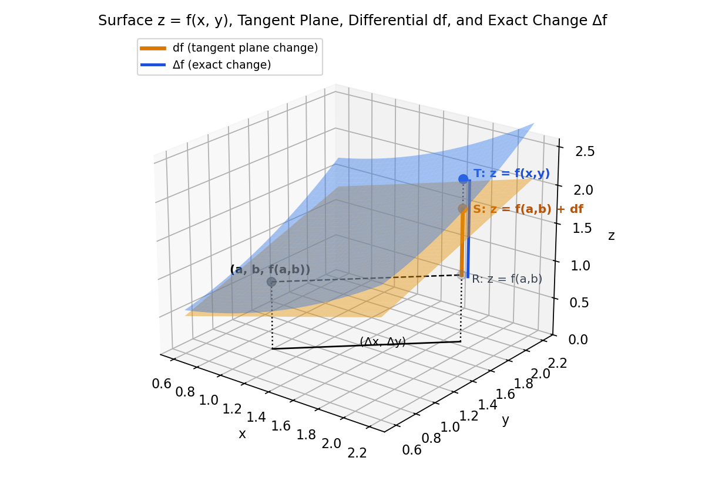
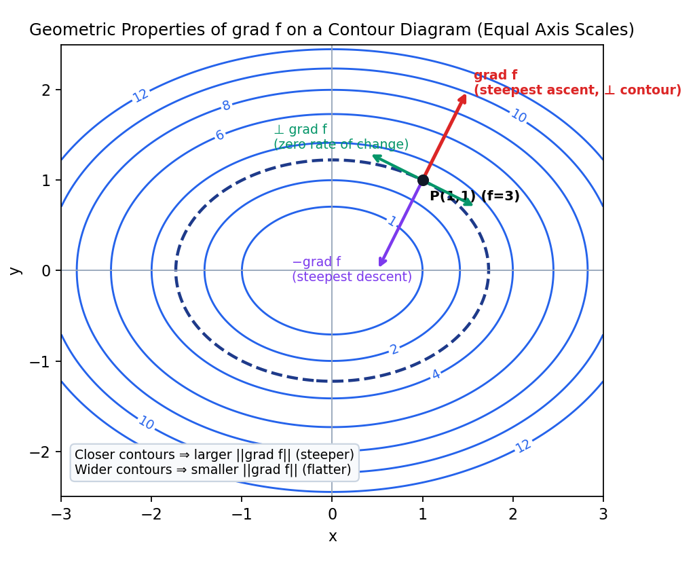
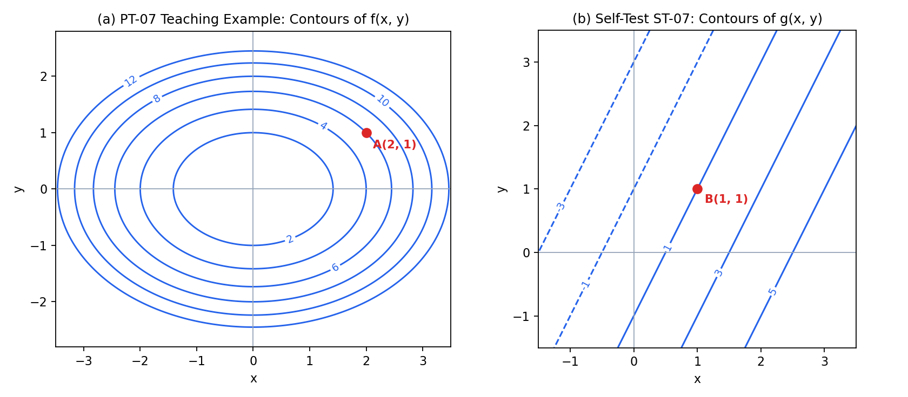

# MAT235 Week 8 Study Notes — §§14.3–14.5

## Contents

- [Scope, Notation, and Source Conventions](#scope-notation-and-source-conventions)
- [Concept 1 — Tangent Planes and Local Linearization (§14.3, Core)](#concept-1--tangent-planes-and-local-linearization-143-core)
  - [Problem Type PT-01 — Finding the Tangent Plane to an Explicit Surface](#problem-type-pt-01--finding-the-tangent-plane-to-an-explicit-surface)
  - [Problem Type PT-02 — Estimating Function Values and Changes via Local Linearization](#problem-type-pt-02--estimating-function-values-and-changes-via-local-linearization)
- [Concept 2 — Differentials and Exact vs. Approximate Change (§14.3, Core)](#concept-2--differentials-and-exact-vs-approximate-change-143-core)
  - [Problem Type PT-03 — Computing Differentials and Estimating Changes](#problem-type-pt-03--computing-differentials-and-estimating-changes)
- [Concept 3 — Directional Derivatives and the Gradient Vector (§§14.4–14.5, Core)](#concept-3--directional-derivatives-and-the-gradient-vector-144145-core)
  - [Problem Type PT-04 — Computing the Gradient Vector](#problem-type-pt-04--computing-the-gradient-vector)
  - [Problem Type PT-05 — Computing and Interpreting Directional Derivatives](#problem-type-pt-05--computing-and-interpreting-directional-derivatives)
- [Concept 4 — Geometric Properties of the Gradient and Contour Diagrams (§§14.4–14.5, Core)](#concept-4--geometric-properties-of-the-gradient-and-contour-diagrams-144145-core)
  - [Problem Type PT-06 — Finding Directions and Rates of Steepest Ascent, Descent, and Zero Change](#problem-type-pt-06--finding-directions-and-rates-of-steepest-ascent-descent-and-zero-change)
  - [Problem Type PT-07 — Reading Gradients, Contours, and Directional-Derivative Signs from a Contour Diagram](#problem-type-pt-07--reading-gradients-contours-and-directional-derivative-signs-from-a-contour-diagram)
- [Concept 5 — Tangent Planes to Level Surfaces in Space (§14.5, Core)](#concept-5--tangent-planes-to-level-surfaces-in-space-145-core)
  - [Problem Type PT-08 — Finding the Tangent Plane to a Level Surface](#problem-type-pt-08--finding-the-tangent-plane-to-a-level-surface)

---

## Scope, Notation, and Source Conventions

**In-scope sections (Core):** Hughes-Hallett *Calculus* (8th ed.) **§14.3** (Local Linearity and the Differential), **§14.4** (Gradients and Directional Derivatives in the Plane), and **§14.5** (Gradients and Directional Derivatives in Space), aligned with the Week 8 Quercus learning objectives and the verified in-scope lecture materials (`Week8-sol.pdf`, `Nov 4.pdf`, and `Nov 6.pdf`).

**Core vs. Supplementary labels:**
- **Core** marks concepts, formulas, and methods directly covered in the Week 8 lecture slides and notes.
- **Supplementary** marks a technique not explicitly taught in the Week 8 lectures that is genuinely needed for a listed textbook exercise (specifically: taking the differential of both sides of an implicit equation in Concept 2 for §14.3 #49, and numerical difference-quotient estimation of a directional derivative from two points in Concept 3 for §14.4 #43).

**Out of scope for Week 8:**
- Divergence and curl (§14.5*): all four pages of `Nov 9.pdf` cover curl and divergence and are excluded from Week 8 scope (recorded in the [Coverage Appendix](Answers-and-Practice.md#6-coverage-appendix)).
- Multivariable chain rule (§14.6), second-order Taylor approximations (§14.7), and the formal $\varepsilon$-$\delta$ / limit definition of differentiability (§14.8).

**Course notation and conventions:**
- **Partial derivatives:** $f_x(a,b) = \dfrac{\partial f}{\partial x}(a,b)$ and $f_y(a,b) = \dfrac{\partial f}{\partial y}(a,b)$ (and similarly $f_z(a,b,c)$ in 3D).
- **Gradient vector:** $\operatorname{grad} f$ or $\nabla f$ ("del" / "nabla"), written in either $\vec{i}, \vec{j}, \vec{k}$ form or component form $(f_x, f_y)$ / $(f_x, f_y, f_z)$.
- **Directional derivative:** $f_{\vec{u}}(a,b)$ (`Week8-sol.pdf`, textbook) or $D_{\vec{u}} f(a,b)$ (`Nov 4.pdf`, `Nov 6.pdf`). **Unit-vector rule:** In `Nov 4.pdf` pp. 1–3, the instructor initially motivates $D_{\vec{u}} f$ with general vectors $\vec{u}$, and then in `Nov 6.pdf` p. 1 and `Week8-sol.pdf` p. 6 explicitly restricts $\vec{u}$ to be a **unit vector** ($\|\vec{u}\| = 1$) so that $f_{\vec{u}}$ measures the rate of change *per unit distance*. Throughout MAT235, always normalize a given nonzero direction vector $\vec{v}$ to $\vec{u} = \vec{v}/\|\vec{v}\|$.
- **Source basis for Problem Types:** Hughes-Hallett (8th ed.) organizes end-of-section sets into *EXERCISES*, *PROBLEMS*, and *Strengthen Your Understanding* without an explicit *Basic* label. Accordingly, every Problem Type (`PT-01`–`PT-08`) below is established strictly from verified in-scope lecture questions.

**Companion file:** Full worked solutions to all teaching examples, all 17 in-scope lecture questions, all 60 requested textbook exercises, self-test practice, and the coverage map are in [Answers-and-Practice.md](Answers-and-Practice.md).

---

## Concept 1 — Tangent Planes and Local Linearization (§14.3, Core)

### Core Idea: Local Linearity

In single-variable calculus, if $y = f(x)$ is differentiable at $x = a$, zooming in on the graph near $(a, f(a))$ makes the curve look like its tangent line $y = f(a) + f'(a)(x-a)$ (`Week8-sol.pdf`, p. 1).

For a function of two variables $z = f(x,y)$ that is **differentiable** at $(a,b)$, zooming in on the surface $z = f(x,y)$ near $(a,b,f(a,b))$ makes the surface look like a flat plane — its **tangent plane** (`Week8-sol.pdf`, pp. 2, 9).

### Tangent Plane and Local Linearization Formulas

Suppose $f$ is differentiable at $(a,b)$:
- **Equation of the tangent plane** to the explicit surface $z = f(x,y)$ at $(a,b,f(a,b))$:
  $$z = f(a,b) + f_x(a,b)(x - a) + f_y(a,b)(y - b)$$
- **Local linearization (linear approximation)** of $f(x,y)$ for $(x,y)$ near $(a,b)$:
  $$f(x,y) \approx f(a,b) + f_x(a,b)(x - a) + f_y(a,b)(y - b)$$
- **In increment form**, letting $\Delta x = x - a$ and $\Delta y = y - b$:
  $$\Delta f = f(a+\Delta x, b+\Delta y) - f(a,b) \approx f_x(a,b)\Delta x + f_y(a,b)\Delta y$$

**Three-variable extension (`Week8-sol.pdf`, p. 3):** If $f(x,y,z)$ is differentiable at $(a,b,c)$, then for $(x,y,z)$ near $(a,b,c)$,
$$f(x,y,z) \approx f(a,b,c) + f_x(a,b,c)(x - a) + f_y(a,b,c)(y - b) + f_z(a,b,c)(z - c),$$
or in increment form, $\Delta f \approx f_x(a,b,c)\Delta x + f_y(a,b,c)\Delta y + f_z(a,b,c)\Delta z$.

### Applicability and Accuracy Conditions

1. **Differentiability vs. existence of partial derivatives (`Week8-sol.pdf`, p. 9):** Intuitively, $f$ is differentiable at $(a,b)$ when its graph "looks like a plane" near $(a,b)$. Unlike 1-variable calculus, merely knowing that $f_x(a,b)$ and $f_y(a,b)$ exist does **not** guarantee differentiability (there exist pathological counterexamples). *(Supplementary — not stated in Week 8 lectures: a standard sufficient condition from calculus is that if $f_x$ and $f_y$ are continuous in a neighborhood of $(a,b)$, then $f$ is differentiable at $(a,b)$.)*
2. **When the approximation is good:** The tangent plane gives a good local approximation only when $(x,y)$ is **close** to $(a,b)$ (small $|\Delta x|, |\Delta y|$). As seen in `Week8-sol.pdf` p. 2, shrinking the step from $(0.5, 0.5)$ to $(0.1, 0.1)$ to $(0.01, 0.01)$ dramatically reduces the error.

---

### Problem Type PT-01 — Finding the Tangent Plane to an Explicit Surface

- **Source basis.** `Week8-sol.pdf`, p. 2 (Slide 1, part (a): tangent plane to $f(x,y) = (y+1)e^{x^2+y^2}$ at $(0,0)$).
- **Recognition cues.** You are given an explicit surface $z = f(x,y)$ (or an equation easily solved for $z$) and a base point $(a,b)$ or $(a,b,z_0)$, and asked for the tangent plane equation (or given a tangent plane equation and asked to read off $f(a,b)$, $f_x(a,b)$, and $f_y(a,b)$).
- **General method.**
  1. If the surface is written implicitly with $z$ appearing linearly (e.g., $x^2 y^2 + z - 40 = 0$), solve for $z = f(x,y)$.
  2. Evaluate $f(a,b)$ (if $z_0$ is given, verify that $f(a,b) = z_0$).
  3. Compute the partial derivatives $f_x(x,y)$ and $f_y(x,y)$, then evaluate both at $(a,b)$ to obtain **constants** $f_x(a,b)$ and $f_y(a,b)$.
  4. Substitute into $z = f(a,b) + f_x(a,b)(x - a) + f_y(a,b)(y - b)$ and simplify if helpful.
  5. **Reverse check:** If given a tangent plane $z = c + mx + ny$ at $(a,b)$, the coefficients of $x$ and $y$ are $f_x(a,b) = m$ and $f_y(a,b) = n$, and $f(a,b) = c + ma + nb$.
- **Teaching example.** Find the equation of the tangent plane to the surface $z = f(x,y) = (x + 2)e^{y - x^2}$ at the point $(0, 0)$. *(See solution: [TE-01](Answers-and-Practice.md#pt-01--finding-the-tangent-plane-to-an-explicit-surface).)*
- **A complete answer must include.**
  - The base value $f(a,b)$ (verified against $z_0$ if provided).
  - The partial derivatives $f_x(x,y)$ and $f_y(x,y)$ and their numerical values at $(a,b)$.
  - A linear equation in $x$, $y$, and $z$ using $(x-a)$ and $(y-b)$ centered at the base point.
- **Common mistakes.**
  - Leaving variable expressions $f_x(x,y)$ and $f_y(x,y)$ inside the tangent plane equation instead of evaluating them at $(a,b)$ (a tangent plane must be *linear* in $x, y, z$).
  - Writing $x$ and $y$ instead of $(x-a)$ and $(y-b)$ when $(a,b) \neq (0,0)$.
  - Forgetting the product rule or chain rule when differentiating composite terms.

---

### Problem Type PT-02 — Estimating Function Values and Changes via Local Linearization

- **Source basis.** `Week8-sol.pdf`, p. 2 (Slide 1, parts (b)–(c)); `Week8-sol.pdf`, p. 3 (Slide 2: temperature rate-of-change word problem and 3-variable approximation of $e^x\sqrt{yz}$).
- **Recognition cues.** You are asked to estimate a nearby value $f(x,y)$ or $f(x,y,z)$, or estimate a change $\Delta f$, given either an explicit formula (often near an "easy" base point you must choose yourself) or given numerical values of $f$ and its partial derivatives at a base point $P$.
- **General method.**
  1. Identify the base point $P = (a,b)$ (or $(a,b,c)$) where the function value and partial derivatives are known or easy to compute exactly.
  2. Compute the signed displacements $\Delta x = x - a$, $\Delta y = y - b$ (and $\Delta z = z - c$ in 3D). Watch signs carefully: moving *closer* or *decreasing* gives a negative increment.
  3. Find $f(P)$ and all first partial derivatives at $P$ (read them from the prompt, paying attention to words like "decreases" $\Rightarrow$ negative derivative, or compute them from the formula).
  4. Apply $\Delta f \approx f_x(P)\Delta x + f_y(P)\Delta y$ (plus $f_z(P)\Delta z$ in 3D), and if estimating the new value, compute $f(Q) \approx f(P) + \Delta f$.
  5. Include units if the problem is applied, and state whether the quantity increases or decreases.
- **Teaching example.** Let $f(x,y,z) = e^{2x}\sqrt{y + 3z}$. Use a local linear approximation near an appropriate base point to estimate $f(0.02, 0.96, 1.03)$. *(See solution: [TE-02](Answers-and-Practice.md#pt-02--estimating-function-values-and-changes-via-local-linearization).)*
- **A complete answer must include.**
  - The chosen base point $P$ and the signed increments $\Delta x, \Delta y$ (and $\Delta z$ if 3D).
  - The base value $f(P)$ (when estimating a value) and the evaluated partial derivatives at $P$.
  - The linear approximation calculation and clearly stated final estimate (with units when applicable).
- **Common mistakes.**
  - Reversing the sign of $\Delta x = x_{\text{new}} - x_{\text{base}}$ (computing base minus target instead of target minus base).
  - Missing a negative sign when a rate of change is described verbally as "decreasing."
  - Stopping at $\Delta f$ when the question asks for the new value $f(Q)$, or adding $f(P)$ when the question asks only for the change $\Delta f$.

---

## Concept 2 — Differentials and Exact vs. Approximate Change (§14.3, Core)

### Core Definition

Let $z = f(x,y)$ be differentiable at $(a,b)$, and let $dx = \Delta x = x - a$ and $dy = \Delta y = y - b$ represent changes in the independent variables (`Week8-sol.pdf`, pp. 4–5).

- **Exact change in $f$:**
  $$\Delta f = f(a + dx, b + dy) - f(a,b)$$
- **Differential of $f$ at $(a,b)$** (a linear function of $dx$ and $dy$):
  $$df = f_x(a,b)\,dx + f_y(a,b)\,dy$$
- **General differential formula** (at a general point $(x,y)$):
  $$df = f_x(x,y)\,dx + f_y(x,y)\,dy$$
- **Approximation relationship:** In general $df \neq \Delta f$, because $df$ measures the vertical change along the **tangent plane** whereas $\Delta f$ measures the vertical change along the **surface**. For small $dx$ and $dy$,
  $$\Delta f \approx df.$$

In three variables, $df = f_x\,dx + f_y\,dy + f_z\,dz$.

*Figure 1 (Conceptual diagram matching `Week8-sol.pdf`, p. 5): Above $(x,y) = (a+\Delta x, b+\Delta y)$, point $R$ has height $f(a,b)$, point $S$ on the tangent plane has height $f(a,b) + df$, and point $T$ on the surface has height $f(x,y)$. Thus $df$ is the vertical distance from $R$ to $S$, while $\Delta f$ is the vertical distance from $R$ to $T$.*

### Supplementary: Differential of an Implicit Equation (§14.3, Supplementary)

> **Supplementary (not covered in Week 8 lectures; needed for textbook §14.3 #49):**
> Given an equation $F(x,y,z) = G(x,y,z)$ (equivalently $H(x,y,z) = F(x,y,z) - G(x,y,z) = 0$), taking the differential of both sides applies standard differentiation rules term-by-term to obtain $dH = H_x\,dx + H_y\,dy + H_z\,dz = 0$. Provided **$H_z(x_0, y_0, z_0) \neq 0$** at the base point $(x_0, y_0, z_0)$ on the surface (so the tangent plane is not vertical), you can evaluate the coefficients at $(x_0, y_0, z_0)$ and solve for $dz$ to get $dz = A\,dx + B\,dy$; replacing $dx = x - x_0$, $dy = y - y_0$, $dz = z - z_0$ yields the tangent plane $z - z_0 = A(x - x_0) + B(y - y_0)$. Notice that this produces the exact same tangent plane as the **Core** level-surface gradient method in [Concept 5](#concept-5--tangent-planes-to-level-surfaces-in-space-145-core) (which also handles vertical tangent planes where $H_z = 0$).

---

### Problem Type PT-03 — Computing Differentials and Estimating Changes

- **Source basis.** `Week8-sol.pdf`, p. 5 (Slide 3: $g(u,v) = u^2 + uv$, cylinder volume $V = \pi r^2 h$, and the $R, S, T$ diagram prompt).
- **Recognition cues.** You are asked to find the differential $df$ (generally or at a specific point), or to use a differential (either computed from a formula or given directly as $df = A\,dx + B\,dy$) to estimate a change $\Delta f$ or new value $f(Q)$.
- **General method.**
  1. Identify the dependent and independent variables (e.g., $g(u,v)$, $V(r,h)$, $P(L,K)$).
  2. Compute each first partial derivative.
  3. Write the general differential $df = f_x\,dx + f_y\,dy$ (or evaluate the partial derivatives at the given base point $P$ if asked for $df$ *at* a point).
  4. To estimate $\Delta f$ from $P$ to $Q$, compute $dx = x_Q - x_P$ and $dy = y_Q - y_P$, substitute the base point $P$ (never $Q$) into the coefficients, and evaluate $\Delta f \approx df$.
  5. If asked for $f(Q)$, compute $f(Q) \approx f(P) + df$. Keep track of units (e.g., $\text{cm}^3$ for volume).
- **Teaching example.** A right circular cone has volume $V(r,h) = \frac{1}{3}\pi r^2 h$.
  (a) Find the differential $dV$ at $r = 6\text{ cm}$, $h = 10\text{ cm}$.
  (b) Use differentials to estimate the change in volume if the radius increases by $0.1\text{ cm}$ and the height decreases by $0.2\text{ cm}$. *(See solution: [TE-03](Answers-and-Practice.md#pt-03--computing-differentials-and-estimating-changes).)*
- **A complete answer must include.**
  - Each partial derivative (with respect to the correct named variables).
  - The differential expression including $dx, dy$ (or $dr, dh$, etc.) with coefficients evaluated at the base point when required.
  - The signed increments and the resulting numerical estimate for $\Delta f$ (clearly marked as an approximation $\Delta f \approx df$, with units if applicable).
- **Common mistakes.**
  - Omitting $dx$ and $dy$ (writing a sum of partial derivatives instead of a differential).
  - Evaluating the coefficients of $df$ at the target point $Q$ instead of the starting point $P$.
  - Confusing $df$ (approximate change) with $\Delta f$ (exact change), or forgetting a negative sign on a decreasing increment like $dh = -0.2$.

---

## Concept 3 — Directional Derivatives and the Gradient Vector (§§14.4–14.5, Core)

### Directional Derivative: Definition and Meaning

Partial derivatives $f_x$ and $f_y$ measure the rate of change of $f$ only along the positive $x$- and $y$-axes. To measure the rate of change in an arbitrary direction given by a **unit vector** $\vec{u} = u_1\vec{i} + u_2\vec{j}$ ($\|\vec{u}\| = 1$), we define the **directional derivative** (`Week8-sol.pdf`, p. 6; `Nov 6.pdf`, p. 1):
$$f_{\vec{u}}(a,b) = \lim_{h \to 0} \frac{f(a + hu_1, b + hu_2) - f(a,b)}{h},$$
provided the limit exists.
- $f_{\vec{u}}(a,b)$ is a **scalar** (a single number, not a vector!) representing the instantaneous rate of change of $f$ per unit distance in the direction of $\vec{u}$.
- In the coordinate directions, $f_{\vec{i}} = f_x$ and $f_{\vec{j}} = f_y$.
- **Why $\vec{u}$ must be a unit vector (`Nov 6.pdf`, p. 1):** When $\|\vec{u}\| = 1$, the horizontal step $h\vec{u}$ has length $\|h\vec{u}\| = |h|$, so the limit is genuinely $\lim \frac{\Delta f}{\text{distance}}$, isolating the effect of *direction* independently of vector length. If given a nonzero direction vector $\vec{v}$, first normalize:
  $$\vec{u} = \frac{\vec{v}}{\|\vec{v}\|}.$$

> **Supplementary (not covered in Week 8 lectures; needed for textbook §14.4 #43):**
> When you are given only two nearby points $P$ and $Q$ along with function values $f(P)$ and $f(Q)$ (and no formula for $f$), you can approximate the directional derivative of $f$ at $P$ in the direction toward $Q$ directly from the difference quotient:
> $$f_{\vec{u}}(P) \approx \frac{f(Q) - f(P)}{\|\overrightarrow{PQ}\|}, \qquad \text{where } \|\overrightarrow{PQ}\| = \sqrt{(x_Q - x_P)^2 + (y_Q - y_P)^2}.$$

### The Gradient Vector and the Dot-Product Formula

For a differentiable function, local linearity $\Delta f \approx f_x(a,b)(hu_1) + f_y(a,b)(hu_2)$ divided by $h$ yields the fundamental computing formula (`Week8-sol.pdf`, pp. 6, 10; `Nov 4.pdf`, p. 2):

- **In the plane ($\mathbb{R}^2$):**
  $$\operatorname{grad} f(a,b) = \nabla f(a,b) = f_x(a,b)\vec{i} + f_y(a,b)\vec{j}$$
  $$f_{\vec{u}}(a,b) = \operatorname{grad} f(a,b) \cdot \vec{u} = f_x(a,b)u_1 + f_y(a,b)u_2 = \|\operatorname{grad} f(a,b)\|\cos\theta$$
- **In space ($\mathbb{R}^3$):**
  $$\operatorname{grad} f(a,b,c) = \nabla f(a,b,c) = f_x(a,b,c)\vec{i} + f_y(a,b,c)\vec{j} + f_z(a,b,c)\vec{k}$$
  $$f_{\vec{u}}(a,b,c) = \operatorname{grad} f(a,b,c) \cdot \vec{u} = f_x(a,b,c)u_1 + f_y(a,b,c)u_2 + f_z(a,b,c)u_3 = \|\operatorname{grad} f(a,b,c)\|\cos\theta$$

where $\vec{u}$ is a **unit vector** and $\theta$ is the angle between $\operatorname{grad} f$ and $\vec{u}$.

**Type check (critical):**
- $\operatorname{grad} f$ is a **vector** living in the *domain* ($\mathbb{R}^2$ for $f(x,y)$, $\mathbb{R}^3$ for $f(x,y,z)$).
- $f_{\vec{u}}$ is a **scalar**.

---

### Problem Type PT-04 — Computing the Gradient Vector

- **Source basis.** `Week8-sol.pdf`, p. 7 (Slide 5, part (a): $\operatorname{grad} P(1,2)$ and $\|\operatorname{grad} P(1,2)\|$); `Week8-sol.pdf`, p. 10 (Slide 7, 3D gradient step).
- **Recognition cues.** You are given a scalar function of 2 or 3 variables and asked to find $\operatorname{grad} f$ (either as a general vector function or evaluated at a specific point, and sometimes its magnitude $\|\operatorname{grad} f\|$).
- **General method.**
  1. Identify all independent variables (including non-$x,y,z$ names such as $(m,n)$, $(r,\theta)$, $(\alpha,\beta)$, $(p,q,r)$).
  2. Compute each first partial derivative, treating all other variables as constants.
  3. Assemble the gradient as a **vector**: $f_x\vec{i} + f_y\vec{j}$ (in 2D) or $f_x\vec{i} + f_y\vec{j} + f_z\vec{k}$ (in 3D). (If variables are not $x,y,z$, component notation $(f_m, f_n)$ or $f_m\vec{i} + f_n\vec{j}$ is standard — match the prompt's style.)
  4. If a specific point is given, substitute the coordinates into each component; if asked for $\|\operatorname{grad} f\|$, compute $\sqrt{f_x^2 + f_y^2}$ (or $\sqrt{f_x^2 + f_y^2 + f_z^2}$).
- **Teaching example.** Let $g(x,y,z) = x^2 y - z e^y$.
  (a) Find $\operatorname{grad} g(x,y,z)$.
  (b) Evaluate $\operatorname{grad} g(2, 0, 3)$ and $\|\operatorname{grad} g(2, 0, 3)\|$. *(See solution: [TE-04](Answers-and-Practice.md#pt-04--computing-the-gradient-vector).)*
- **A complete answer must include.**
  - Each partial derivative computed accurately.
  - The gradient written explicitly as a **vector** (not a scalar sum).
  - Exact evaluation at the given point (and magnitude if requested).
- **Common mistakes.**
  - Adding the partial derivatives together as a scalar ($f_x + f_y$) instead of forming a vector ($f_x\vec{i} + f_y\vec{j}$).
  - Dropping a zero component or forgetting the third component in $\mathbb{R}^3$ when a variable does not appear in $f(x,y,z)$.
  - Substituting the point *before* differentiating.

---

### Problem Type PT-05 — Computing and Interpreting Directional Derivatives

- **Source basis.** `Week8-sol.pdf`, p. 6 (Slide 4: metal plate $T(x,y)$ toward $Q$), p. 7 (Slide 5, part (c)), p. 8 (Slide 6, part (b)), p. 11 (Slide 8: both 3D examples); `Nov 4.pdf`, pp. 1–3.
- **Recognition cues.** You are asked for the directional derivative $f_{\vec{u}}(P)$ (or rate of change of temperature/pressure/altitude at $P$) in the direction of a given vector $\vec{v}$, toward a given point $Q$, along a compass direction (e.g., northwest), or at a given angle $\theta$ from $\operatorname{grad} f$.
- **General method.**
  1. **Form the direction vector $\vec{v}$:**
     - If given a vector $\vec{v}$, use it directly.
     - If moving from $P$ *toward* $Q$, compute $\vec{v} = \overrightarrow{PQ} = Q - P$ (destination minus start!).
     - If given a compass direction (with $+x$ East, $+y$ North), use e.g. NW $\to -\vec{i}+\vec{j}$, N $\to \vec{j}$, NE $\to \vec{i}+\vec{j}$.
  2. **Normalize to a unit vector:** $\vec{u} = \vec{v}/\|\vec{v}\|$. Always check $\|\vec{u}\| = 1$.
  3. **Compute $\operatorname{grad} f(P)$:** Find partial derivatives and evaluate at $P$.
  4. **Take the dot product:** $f_{\vec{u}}(P) = \operatorname{grad} f(P) \cdot \vec{u}$ (a **scalar**). *(Alternatively, if $\|\operatorname{grad} f(P)\|$ and the angle $\theta$ between $\operatorname{grad} f(P)$ and $\vec{u}$ are known, use $f_{\vec{u}}(P) = \|\operatorname{grad} f(P)\|\cos\theta$.)*
  5. **Interpret with units** if requested: units are $(\text{units of } f)/(\text{units of distance})$, and the sign tells whether $f$ is increasing ($>0$), decreasing ($<0$), or momentarily unchanged ($=0$).
- **Teaching example.** The temperature on a flat plate is $T(x,y) = 20 - \frac{1}{2}x^2 - y^2$ degrees Celsius, where $x$ and $y$ are in meters. Find the directional derivative of $T$ at $P = (2, 1)$ in the direction toward $Q = (5, -3)$, and interpret your answer with units. *(See solution: [TE-05](Answers-and-Practice.md#pt-05--computing-and-interpreting-directional-derivatives).)*
- **A complete answer must include.**
  - The displacement/direction vector $\vec{v}$ (with correct $Q - P$ orientation) and its normalized unit vector $\vec{u} = \vec{v}/\|\vec{v}\|$.
  - The gradient evaluated at the base point $P$.
  - The scalar dot product $f_{\vec{u}}(P) = \operatorname{grad} f(P) \cdot \vec{u}$ and, when asked, a clear interpretation with units.
- **Common mistakes.**
  - Forgetting to divide $\vec{v}$ by $\|\vec{v}\|$ (using a non-unit vector gives $\|\vec{v}\|$ times the true directional derivative).
  - Using $P - Q$ instead of $Q - P$ when moving *from $P$ toward $Q$*, which flips the sign.
  - Writing the dot product as a vector (e.g., $a\vec{i} + b\vec{j}$ instead of $a + b$).
  - Rounding intermediate components of $\vec{u}$ too aggressively before dotting (keep exact radicals until the final step).

---

## Concept 4 — Geometric Properties of the Gradient and Contour Diagrams (§§14.4–14.5, Core)

### Extreme Rates of Change from $f_{\vec{u}} = \|\operatorname{grad} f\|\cos\theta$

Suppose $f$ is differentiable at $P$ and $\operatorname{grad} f(P) \neq \vec{0}$. Since $-1 \le \cos\theta \le 1$ (`Week8-sol.pdf`, pp. 7, 10):

| Question | Condition on $\theta$ | Direction | Rate of change $f_{\vec{u}}(P)$ |
|---|---|---|---|
| **Greatest rate of increase** (steepest ascent) | $\theta = 0$ ($\cos\theta = 1$) | Direction of $\operatorname{grad} f(P)$ (unit vector $\dfrac{\operatorname{grad} f(P)}{\|\operatorname{grad} f(P)\|}$) | $+\|\operatorname{grad} f(P)\|$ |
| **Greatest rate of decrease** (steepest descent) | $\theta = \pi$ ($\cos\theta = -1$) | Direction of $-\operatorname{grad} f(P)$ (unit vector $-\dfrac{\operatorname{grad} f(P)}{\|\operatorname{grad} f(P)\|}$) | $-\|\operatorname{grad} f(P)\|$ |
| **Zero instantaneous change** (level / maintain altitude) | $\theta = \pi/2$ ($\cos\theta = 0$) | Any direction $\perp \operatorname{grad} f(P)$ (i.e., $\operatorname{grad} f(P) \cdot \vec{u} = 0$) | $0$ |

In $\mathbb{R}^2$, if $\operatorname{grad} f(a,b) = A\vec{i} + B\vec{j} \neq \vec{0}$, the two directions perpendicular to $\operatorname{grad} f(a,b)$ are $\pm(-B\vec{i} + A\vec{j})$ (tangent to the contour through $(a,b)$).

### Relations to Contour Diagrams (`Week8-sol.pdf`, pp. 8–9; `Nov 6.pdf`, p. 2)

Assuming **equal scales on both axes** (if axis scales are unequal, the gradient vector does not visually appear perpendicular to the contour lines; see textbook Figs. 14.45–14.46):
1. **Perpendicularity:** $\operatorname{grad} f(a,b)$ is **perpendicular** to the contour (level curve) through $(a,b)$. *Why:* $f$ is constant along a contour, so its directional derivative in the tangent direction is $0$, meaning $\operatorname{grad} f \cdot \vec{u}_{\text{tan}} = 0$.
2. **Orientation:** $\operatorname{grad} f(a,b)$ points toward **increasing** contour values.
3. **Magnitude and spacing:** For equally spaced contour values, $\|\operatorname{grad} f\|$ is **large** where contour lines are close together (steep slope) and **small** where contour lines are far apart (gentle slope).
4. **Reading partial-derivative signs:** Because $\operatorname{grad} f = f_x\vec{i} + f_y\vec{j}$, the sign of $f_x(P)$ is the sign of the $x$-component of $\operatorname{grad} f(P)$ (does $f$ increase when moving right?), and the sign of $f_y(P)$ is the sign of the $y$-component (does $f$ increase when moving up?).

*Figure 2: At $P(1,1)$ on the contour $f = 3$, $\operatorname{grad} f$ is perpendicular to the contour and points toward higher contour values; $-\operatorname{grad} f$ gives steepest descent; the two tangent directions $\perp \operatorname{grad} f$ give zero instantaneous rate of change.*

---

### Problem Type PT-06 — Finding Directions and Rates of Steepest Ascent, Descent, and Zero Change

- **Source basis.** `Week8-sol.pdf`, p. 7 (Slide 5, parts (b) and handwritten (d)), p. 8 (Slide 6, parts (a) and (c)); `Nov 4.pdf`, p. 4; `Nov 6.pdf`, p. 3 (bottom, part (2)).
- **Recognition cues.** You are given $f(x,y)$ or $f(x,y,z)$ and a base point $P$, and asked for: (i) the direction of greatest increase/decrease (or unit direction), (ii) the maximum/minimum rate of change, or (iii) the direction(s) in which $f$ remains momentarily unchanged (maintains altitude).
- **General method.**
  1. Compute $\operatorname{grad} f(P)$ and check that $\operatorname{grad} f(P) \neq \vec{0}$.
  2. **Steepest ascent:** direction is $\operatorname{grad} f(P)$ (unit vector $\vec{u}_{\max} = \operatorname{grad} f(P)/\|\operatorname{grad} f(P)\|$); maximum rate is $\|\operatorname{grad} f(P)\|$.
  3. **Steepest descent:** direction is $-\operatorname{grad} f(P)$ (unit vector $-\vec{u}_{\max}$); minimum rate is $-\|\operatorname{grad} f(P)\|$.
  4. **Zero change:** solve $\operatorname{grad} f(P) \cdot \vec{u} = 0$. In 2D, if $\operatorname{grad} f(P) = A\vec{i} + B\vec{j}$, the two opposite directions are $\pm(-B\vec{i} + A\vec{j})$ (divide by $\sqrt{A^2+B^2}$ if unit vectors are requested).
- **Teaching example.** The elevation (in meters) on a smooth terrain is given by $H(x,y) = 12 - x^2 - 3y^2 + 2x$. At the point $(2, -1)$:
  (a) Find the unit vector in the direction of steepest ascent and the maximum rate of ascent.
  (b) Find the direction of steepest descent and its rate.
  (c) Find both unit vectors in which the instantaneous rate of change of elevation is zero. *(See solution: [TE-06](Answers-and-Practice.md#pt-06--finding-directions-and-rates-of-steepest-ascent-descent-and-zero-change).)*
- **A complete answer must include.**
  - $\operatorname{grad} f(P)$ evaluated at the given point.
  - Clear distinction between the **direction** (a vector; normalized if a unit vector is requested) and the **rate** (a scalar $\pm\|\operatorname{grad} f(P)\|$).
  - For zero change in 2D, both opposite perpendicular directions satisfying $\operatorname{grad} f(P) \cdot \vec{v} = 0$.
- **Common mistakes.**
  - Reporting $\operatorname{grad} f(P)$ as the "maximum rate of change" (the rate is the *magnitude* $\|\operatorname{grad} f(P)\|$, a scalar).
  - Confusing the direction of steepest ascent on a surface $z=f(x,y)$ with a 3D vector: the horizontal direction in the domain is a **2D vector** $\operatorname{grad} f(a,b) \in \mathbb{R}^2$.
  - Giving only one of the two opposite zero-change directions in 2D.

---

### Problem Type PT-07 — Reading Gradients, Contours, and Directional-Derivative Signs from a Contour Diagram

- **Source basis.** `Nov 6.pdf`, p. 3 (top: $f(x,y)=x^2+xy-y^2$ contour diagram, parts 1–5; bottom: sketching contour of $T(x,y)=30-x^2-2y^2$); `Week8-sol.pdf`, pp. 8–9.
- **Recognition cues.** You are given a labeled contour diagram (or asked to sketch/describe contours or level surfaces) and asked to determine the direction of $\operatorname{grad} f$ at a point, determine whether a directional derivative or partial derivative is positive/negative/zero, or draw steepest-ascent/descent/zero-change arrows.
- **General method.**
  1. Locate the point $P$ and identify the contour value $c$ passing through $P$.
  2. Draw/imagine the tangent line to the contour at $P$: this gives the **zero-change** directions.
  3. Draw the normal perpendicular to the contour at $P$, pointing toward **higher** contour labels: this is the direction of $\operatorname{grad} f(P)$ (**greatest increase**); the opposite arrow is $-\operatorname{grad} f(P)$ (**greatest decrease**).
  4. **Sign of $f_{\vec{u}}(P)$:** Move a small step from $P$ in direction $\vec{u}$ (equivalently check the angle $\theta$ between $\vec{u}$ and $\operatorname{grad} f(P)$):
     - Crossing to higher contours ($\theta < 90^\circ$) $\Rightarrow f_{\vec{u}}(P) > 0$.
     - Crossing to lower contours ($\theta > 90^\circ$) $\Rightarrow f_{\vec{u}}(P) < 0$.
     - Moving tangent to the contour ($\theta = 90^\circ$) $\Rightarrow f_{\vec{u}}(P) \approx 0$.
  5. **Signs of $f_x(P)$ and $f_y(P)$:** Apply step 4 with $\vec{u} = \vec{i}$ (right) and $\vec{u} = \vec{j}$ (up).
- **Teaching example.** Use the contour diagram of $f(x,y)$ in **Figure 5(a)** below (equal axis scales) at the marked point $A(2, 1)$:
  (a) Identify the contour value passing through $A$.
  (b) State the approximate direction (quadrant / signs of components) of $\operatorname{grad} f(A)$ and of steepest decrease at $A$.
  (c) Determine the signs of $f_x(A)$ and $f_y(A)$.
  (d) Is the directional derivative $f_{\vec{u}}(A)$ positive, negative, or approximately zero in the direction of $\vec{v} = -\vec{i} + \vec{j}$? *(See solution: [TE-07](Answers-and-Practice.md#pt-07--reading-gradients-contours-and-directional-derivative-signs-from-a-contour-diagram).)*

*Figure 5: Panel (a) is used for the PT-07 Teaching Example; Panel (b) is used for Self-Test ST-07 in [Answers-and-Practice.md](Answers-and-Practice.md).*

- **A complete answer must include.**
  - Reference to the contour labels around the given point to justify increasing vs. decreasing direction.
  - Perpendicularity to the contour for $\pm\operatorname{grad} f$ and tangency to the contour for zero change.
  - Clear sign justification for any requested partial or directional derivative.
- **Common mistakes.**
  - Drawing $\operatorname{grad} f$ *tangent* to the contour instead of *perpendicular* to it.
  - Pointing $\operatorname{grad} f$ toward *smaller* contour labels instead of *larger* ones.
  - Forgetting that moving *left* is $-\vec{i}$ (not $+\vec{i}$) when checking the sign of $f_x$.

---

## Concept 5 — Tangent Planes to Level Surfaces in Space (§14.5, Core)

### Gradient as a Normal Vector to a Level Surface

For a differentiable 3-variable function $F(x,y,z)$, the equation $F(x,y,z) = c$ defines a **level surface** in $\mathbb{R}^3$. If $(a,b,c_0)$ lies on this surface and $\operatorname{grad} F(a,b,c_0) \neq \vec{0}$, then (`Week8-sol.pdf`, p. 10):
- $\operatorname{grad} F(a,b,c_0)$ is **perpendicular (normal)** to the level surface $F(x,y,z) = c$ at $(a,b,c_0)$.
- Therefore, $\vec{n} = \operatorname{grad} F(a,b,c_0)$ is a normal vector to the **tangent plane** at $(a,b,c_0)$, giving the tangent plane equation:
  $$\operatorname{grad} F(a,b,c_0) \cdot \big((x-a)\vec{i} + (y-b)\vec{j} + (z-c_0)\vec{k}\big) = 0,$$
  or expanded in components:
  $$F_x(a,b,c_0)(x - a) + F_y(a,b,c_0)(y - b) + F_z(a,b,c_0)(z - c_0) = 0.$$

### Summary Comparison: 2-Variable vs. 3-Variable Gradients (`Week8-sol.pdf`, p. 11)

| Property (assuming differentiability and nonzero gradient) | $z = f(x,y)$ | $w = g(x,y,z)$ |
|---|---|---|
| Domain lies in | $\mathbb{R}^2$ | $\mathbb{R}^3$ |
| Graph lies in | $\mathbb{R}^3$ | $\mathbb{R}^4$ |
| Gradient is a vector in | $\mathbb{R}^2$ | $\mathbb{R}^3$ |
| Gradient is normal to | a level curve (contour) in $\mathbb{R}^2$ | a level surface in $\mathbb{R}^3$ |
| Maximum rate of increase | $\|\operatorname{grad} f\|$ | $\|\operatorname{grad} g\|$ |

### Connecting the Two Tangent-Plane Settings (§14.3 $\leftrightarrow$ §14.5)

Every explicit surface $z = f(x,y)$ from §14.3 is also a **level surface** $F(x,y,z) = 0$ in §14.5 by defining
$$F(x,y,z) = f(x,y) - z \quad (\text{or } z - f(x,y) = 0).$$
Then at $(a, b, f(a,b))$,
$$\operatorname{grad} F(a,b,f(a,b)) = f_x(a,b)\vec{i} + f_y(a,b)\vec{j} - \vec{k} \neq \vec{0},$$
and the §14.5 level-surface tangent plane equation
$$f_x(a,b)(x-a) + f_y(a,b)(y-b) - 1\cdot(z - f(a,b)) = 0$$
rearranges directly to the §14.3 explicit tangent plane formula
$$z = f(a,b) + f_x(a,b)(x-a) + f_y(a,b)(y-b).$$
Thus §14.5 strictly generalizes §14.3: use §14.3 when $z = f(x,y)$ is already isolated, and use §14.5 whenever a surface is given implicitly (like $2e^z = \cos z + x^3yz + xy^3$ or $x^2 + y^2 + z^2 = 17$).

---

### Problem Type PT-08 — Finding the Tangent Plane to a Level Surface

- **Source basis.** `Week8-sol.pdf`, p. 10 (Slide 7: tangent plane to $2e^z = \cos z + x^3yz + xy^3$ at $(1,1,0)$).
- **Recognition cues.** You are given a surface equation in $x, y, z$ (often implicit, where solving for $z$ is hard or impossible) and a point $P = (a,b,c_0)$ on the surface, and asked for a normal vector and/or the equation of the tangent plane at $P$.
- **General method.**
  1. Move all variable terms to one side to define $F(x,y,z) = c$ (so the surface is a level surface of $F$).
  2. **Point check:** Verify that $(a,b,c_0)$ satisfies the surface equation (if only two coordinates are given, solve for the third).
  3. Compute $F_x, F_y, F_z$ and evaluate $\vec{n} = \operatorname{grad} F(a,b,c_0)$.
  4. **Nonzero-gradient check:** Verify that $\operatorname{grad} F(a,b,c_0) \neq \vec{0}$.
  5. Write the tangent plane $F_x(P)(x - a) + F_y(P)(y - b) + F_z(P)(z - c_0) = 0$ and simplify to $Ax + By + Cz = D$ if desired.
- **Teaching example.** Find an equation of the tangent plane to the surface $x^2 z + y e^{z-1} = 5$ at the point $(2, 1, 1)$. *(See solution: [TE-08](Answers-and-Practice.md#pt-08--finding-the-tangent-plane-to-a-level-surface).)*
- **A complete answer must include.**
  - An explicit level-surface function $F(x,y,z)$ and confirmation that the given point lies on the surface.
  - The evaluated normal vector $\operatorname{grad} F(a,b,c_0)$ (verified nonzero).
  - The tangent plane equation in $x, y, z$ passing through $(a,b,c_0)$.
- **Common mistakes.**
  - Moving terms across the equals sign with the wrong sign when forming $F(x,y,z) = c$.
  - Forgetting to evaluate $F_x, F_y, F_z$ at the given point before plugging into the plane equation.
  - Setting $F_x(P)x + F_y(P)y + F_z(P)z = 0$ (passing through the origin instead of through $(a,b,c_0)$).
  - Confusing $\operatorname{grad} f(x,y)$ (a 2D vector in the $xy$-plane) with a 3D normal vector to $z = f(x,y)$ (which must include the $-1$ or $+1$ in the $\vec{k}$-component).
