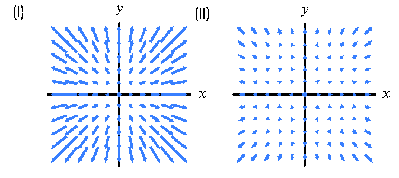
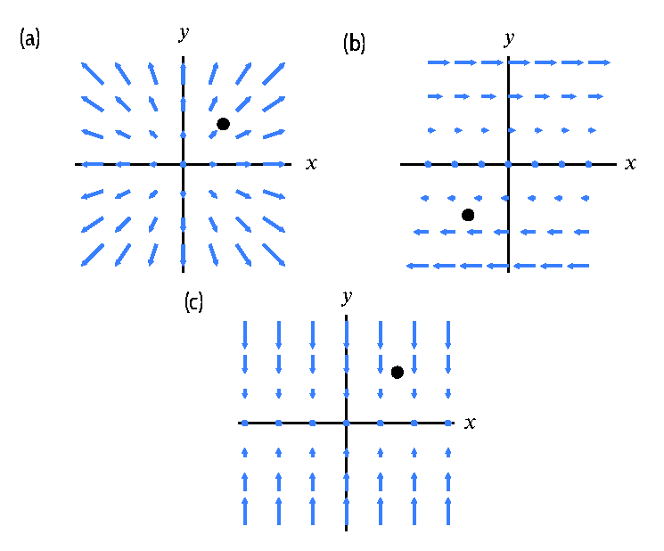
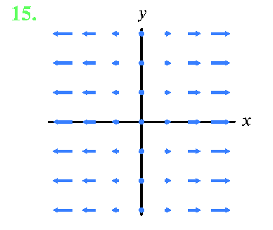
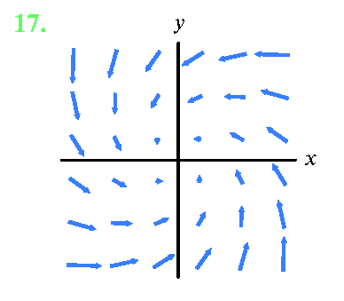
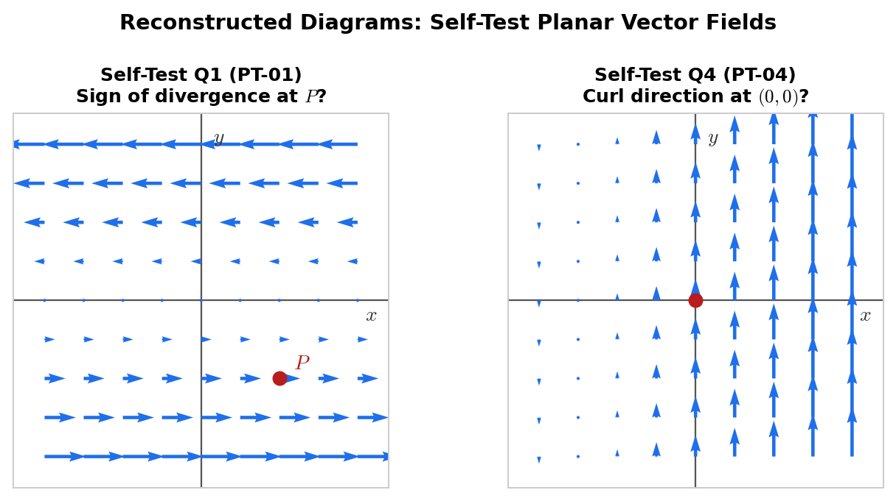

# MAT235H1 Week 9 Answers and Practice — §14.5* Grad, Divergence and Curl & §14.6 The Chain Rule

> **Companion file:** Concept explanations, formulas, diagrams, and Problem Types (PT-01 through PT-07) are in [Study-Notes.md](Study-Notes.md).

## Contents

1. [Section 1: Teaching-Example Solutions (PT-01 to PT-07)](#section-1-teaching-example-solutions-pt-01-to-pt-07)
2. [Section 2: Professor's Slide Questions](#section-2-professors-slide-questions)
3. [Section 3: Quercus Suggested Textbook Exercises (27 Exercises)](#section-3-quercus-suggested-textbook-exercises-27-exercises)
   - [§19.3 Exercises (1, 3, 5, 7, 9, 11, 13)](#193-exercises-1-3-5-7-9-11-13)
   - [§20.1 Exercises (1, 3, 5, 7, 9, 11, 15, 17)](#201-exercises-1-3-5-7-9-11-15-17)
   - [§14.6 Exercises and Problems (1, 3, 5, 7, 9, 11, 13, 17, 19, 29, 33, 35)](#146-exercises-and-problems-1-3-5-7-9-11-13-17-19-29-33-35)
4. [Section 4: Self-Test Questions and Answers](#section-4-self-test-questions-and-answers)
   - [Self-Test Questions](#self-test-questions)
   - [Self-Test Answers](#self-test-answers)
5. [Section 5: Coverage and Unresolved Items](#section-5-coverage-and-unresolved-items)

---

## Section 1: Teaching-Example Solutions (PT-01 to PT-07)

### PT-01 Solution
*Back to question:* [Study-Notes.md — PT-01](Study-Notes.md#pt-01-determine-the-sign-or-relative-size-of-divergence-from-a-planar-vector-field-diagram)

- **PT-01 Example (i) at $P$:** Draw a small axis-aligned square centered at $P$ in the first quadrant. All vectors are purely vertical, so there is zero horizontal flow across the left and right edges. Along the bottom edge, upward arrows enter the box; along the top edge, **longer** upward arrows leave the box. Because net outflow exceeds net inflow, **$\operatorname{div}\vec{F}(P) > 0$ (positive)**. *(Formula check: the plotted field is $\vec{F} = 1.4y\vec{j}$, so $\operatorname{div}\vec{F} = 1.4 > 0$.)*
- **PT-01 Example (ii) at $Q$:** Draw a small axis-aligned square centered at $Q$ in the second quadrant. All vectors are purely horizontal (pointing right toward the $y$-axis), so there is zero vertical flow across the top and bottom edges. Along the left edge, longer rightward arrows enter the box; along the right edge, **shorter** rightward arrows leave the box. Because net inflow exceeds net outflow, **$\operatorname{div}\vec{F}(Q) < 0$ (negative)**. *(Formula check: the plotted field is $\vec{F} = -1.4x\vec{i}$, so $\operatorname{div}\vec{F} = -1.4 < 0$.)*

### PT-02 Solution
*Back to question:* [Study-Notes.md — PT-02](Study-Notes.md#pt-02-compute-divergence-and-test-for-divergence-free-behavior-on-a-domain)

- **(a)** $\operatorname{div}\vec{F}$ is a **scalar** function. Identifying $F_1 = x^2y - 3x$, $F_2 = y^2 - xy^2 + \cos z$, $F_3 = kz + x^3$ (all polynomials/trig functions, so domain is all of $\mathbb{R}^3$):
  $$\frac{\partial F_1}{\partial x} = 2xy - 3, \qquad \frac{\partial F_2}{\partial y} = 2y - 2xy, \qquad \frac{\partial F_3}{\partial z} = k.$$
  Adding gives
  $$\operatorname{div}\vec{F}(x,y,z) = (2xy - 3) + (2y - 2xy) + k = 2y + k - 3, \qquad \text{domain: } \mathbb{R}^3.$$
- **(b)** For $\vec{F}$ to be divergence-free on $\mathbb{R}^3$, we need $2y + k - 3 = 0$ **identically for all $(x,y,z) \in \mathbb{R}^3$**. Because the coefficient of $y$ is $2 \neq 0$, no choice of constant $k$ can make $2y + k - 3$ vanish everywhere (for any fixed $k$, it vanishes only on the single plane $y = \frac{3-k}{2}$). Therefore, **no such constant $k$ exists**.

### PT-03 Solution
*Back to question:* [Study-Notes.md — PT-03](Study-Notes.md#pt-03-compute-curl-3d-or-planar-and-test-for-curl-free-behavior)

- **(a)** $\operatorname{curl}\vec{F}$ is a **vector** field. With $F_1 = y^2 + z$, $F_2 = 2xy - z^2$, $F_3 = x - 2yz$ (all polynomials, domain $\mathbb{R}^3$):
  $$\begin{aligned}
  \operatorname{curl}\vec{F} &= \begin{vmatrix} \vec{i} & \vec{j} & \vec{k} \\ \partial/\partial x & \partial/\partial y & \partial/\partial z \\ y^2 + z & 2xy - z^2 & x - 2yz \end{vmatrix} \\
  &= \left(\frac{\partial(x-2yz)}{\partial y} - \frac{\partial(2xy-z^2)}{\partial z}\right)\vec{i} + \left(\frac{\partial(y^2+z)}{\partial z} - \frac{\partial(x-2yz)}{\partial x}\right)\vec{j} + \left(\frac{\partial(2xy-z^2)}{\partial x} - \frac{\partial(y^2+z)}{\partial y}\right)\vec{k} \\
  &= \big((-2z) - (-2z)\big)\vec{i} + (1 - 1)\vec{j} + (2y - 2y)\vec{k} = \vec{0}.
  \end{aligned}$$
- **(b)** Since $\operatorname{curl}\vec{F}(x,y,z) = \vec{0}$ for **every** $(x,y,z) \in \mathbb{R}^3$, $\vec{F}$ **is curl-free (irrotational) on $\mathbb{R}^3$**. *(Verification — **Supplementary** identity $\operatorname{curl}(\operatorname{grad} f) = \vec{0}$ for smooth $f$, Textbook §20.1 Problem 31, printed p. 1063 / PDF p. 1083: $\vec{F} = \nabla(xy^2 + xz - yz^2)$, which confirms $\operatorname{curl}\vec{F} = \vec{0}$.)*

### PT-04 Solution
*Back to question:* [Study-Notes.md — PT-04](Study-Notes.md#pt-04-determine-curl-existence-and-direction-from-a-planar-vector-field-diagram-using-the-right-hand-rule)

- **PT-04 Example (i) at $(0,0)$:** All vectors are horizontal and point right near the origin, with **longer** rightward arrows above the $x$-axis ($y>0$) than below it ($y<0$). A tiny paddle-wheel at $(0,0)$ is pushed harder to the right on its top blades than on its bottom blades, causing it to spin **clockwise** (viewed from $+z$). By the right-hand rule, **$\operatorname{curl}\vec{F}(0,0)$ is nonzero and points in $-\vec{k}$ (into the page)**. *(Formula check: $\vec{F} = (y+1.5)\vec{i} \implies \operatorname{curl}\vec{F} = (0 - 1)\vec{k} = -\vec{k}$.)*
- **PT-04 Example (ii) at $(0,0)$:** The field points radially inward toward $(0,0)$ with rotational symmetry. Every arrow strikes a tiny paddle-wheel centered at $(0,0)$ radially (zero tangential component), producing no net torque. Thus **$\operatorname{curl}\vec{F}(0,0) = \vec{0}$**. *(Formula check: $\vec{F} = -x\vec{i} - y\vec{j} \implies \operatorname{curl}\vec{F} = (0 - 0)\vec{k} = \vec{0}$.)*

### PT-05 Solution
*Back to question:* [Study-Notes.md — PT-05](Study-Notes.md#pt-05-draw-a-dependency-tree-and-formulate-the-chain-rule-formulas)

- **Dependency tree:**
  - Top node: $w$ (3 outgoing edges: $\frac{\partial w}{\partial x}$ to $x$, $\frac{\partial w}{\partial y}$ to $y$, $\frac{\partial w}{\partial z}$ to $z$).
  - Middle nodes:
    - $x$ has 2 outgoing edges: $\frac{\partial x}{\partial s}$ to $s$, and $\frac{\partial x}{\partial t}$ to $t$.
    - $y$ has 2 outgoing edges: $\frac{\partial y}{\partial s}$ to $s$, and $\frac{\partial y}{\partial t}$ to $t$.
    - $z$ has **1** outgoing edge: $\frac{dz}{dt}$ (ordinary derivative!) to $t$.
  - Bottom nodes: $s$ and $t$ (two independent variables, so $\frac{\partial w}{\partial s}$ and $\frac{\partial w}{\partial t}$ are partial derivatives).
- **Chain Rule formulas:**
  - Paths from $w$ to $s$ (2 paths: $w\to x\to s$ and $w\to y\to s$):
    $$\frac{\partial w}{\partial s} = \frac{\partial w}{\partial x}\frac{\partial x}{\partial s} + \frac{\partial w}{\partial y}\frac{\partial y}{\partial s}.$$
  - Paths from $w$ to $t$ (3 paths: $w\to x\to t$, $w\to y\to t$, and $w\to z\to t$):
    $$\frac{\partial w}{\partial t} = \frac{\partial w}{\partial x}\frac{\partial x}{\partial t} + \frac{\partial w}{\partial y}\frac{\partial y}{\partial t} + \frac{\partial w}{\partial z}\frac{dz}{dt}.$$

### PT-06 Solution
*Back to question:* [Study-Notes.md — PT-06](Study-Notes.md#pt-06-compute-ordinary-and-partial-derivatives-of-explicit-or-tabulated-composite-functions)

- **(a)** Dependency tree: $z \to (x, y) \to (u, v)$. Outer partials: $\frac{\partial z}{\partial x} = 2xy$, $\frac{\partial z}{\partial y} = x^2 - e^y$. Inner partials: $\frac{\partial x}{\partial u} = v$, $\frac{\partial x}{\partial v} = u$, $\frac{\partial y}{\partial u} = 1$, $\frac{\partial y}{\partial v} = -2$.
  - For $\frac{\partial z}{\partial u}$:
    $$\frac{\partial z}{\partial u} = \frac{\partial z}{\partial x}\frac{\partial x}{\partial u} + \frac{\partial z}{\partial y}\frac{\partial y}{\partial u} = (2xy)(v) + (x^2 - e^y)(1) = 2(uv)(u-2v)v + u^2v^2 - e^{u-2v} = 3u^2v^2 - 4uv^3 - e^{u-2v}.$$
  - For $\frac{\partial z}{\partial v}$:
    $$\frac{\partial z}{\partial v} = \frac{\partial z}{\partial x}\frac{\partial x}{\partial v} + \frac{\partial z}{\partial y}\frac{\partial y}{\partial v} = (2xy)(u) + (x^2 - e^y)(-2) = 2(uv)(u-2v)u - 2u^2v^2 + 2e^{u-2v} = 2u^3v - 6u^2v^2 + 2e^{u-2v}.$$
  - *Direct substitution check:* $z = u^2v^2(u-2v) - e^{u-2v} = u^3v^2 - 2u^2v^3 - e^{u-2v} \implies z_u = 3u^2v^2 - 4uv^3 - e^{u-2v}$ and $z_v = 2u^3v - 6u^2v^2 + 2e^{u-2v}$. Matches!
- **(b)** At $(u_0, v_0) = (2, -1)$, the image point is $(x_0, y_0) = (x(2,-1), y(2,-1)) = (3, 4)$. Applying the evaluation-point rule:
  $$z_v(2,-1) = f_x(3,4)\,x_v(2,-1) + f_y(3,4)\,y_v(2,-1) = (5)(4) + (-3)(-1) = 20 + 3 = 23.$$
  *(Note: $f_x(2,-1)$, $f_y(2,-1)$, $x_v(3,4)$, $y_v(3,4)$ are evaluated at the wrong points and must not be used.)*

### PT-07 Solution
*Back to question:* [Study-Notes.md — PT-07](Study-Notes.md#pt-07-solve-applied-multivariable-rate-of-change-problems-via-the-chain-rule)

- **Given:** $P(T, V) = \frac{nRT}{V}$ with constants $n = 0.005\text{ mol}$, $R = 8.314\times 10^3\text{ kPa}\cdot\text{cm}^3/(\text{mol}\cdot\text{K})$. At the instant: $V = 250\text{ cm}^3$, $T = 400\text{ K}$, $\frac{dV}{dt} = +5\text{ cm}^3/\text{min}$ (expanding), $\frac{dT}{dt} = -2\text{ K}/\text{min}$ (cooled).
- **Dependency tree:** $P \to (T, V) \to t$, giving
  $$\frac{dP}{dt} = \frac{\partial P}{\partial T}\frac{dT}{dt} + \frac{\partial P}{\partial V}\frac{dV}{dt}.$$
- **Differentiate, then substitute:**
  $$\frac{\partial P}{\partial T} = \frac{nR}{V}, \qquad \frac{\partial P}{\partial V} = -\frac{nRT}{V^2}.$$
  At $V = 250$, $T = 400$, with $nR = (0.005)(8.314\times 10^3) = 41.57\text{ kPa}\cdot\text{cm}^3/\text{K}$:
  $$\frac{dP}{dt} = \frac{nR}{250}(-2) + \left(-\frac{nR\cdot 400}{250^2}\right)(5) = nR\left(-\frac{2}{250} - \frac{2000}{62500}\right) = nR(-0.008 - 0.032) = -0.04\,nR = -1.6628\text{ kPa/min}.$$
- **Final Answer:** $\dfrac{dP}{dt} = -1.6628\text{ kPa/min}$ (pressure is decreasing at about $1.663\text{ kPa/min}$).
- **Checks:** Both terms have units $\frac{\text{kPa}}{\text{K}}\cdot\frac{\text{K}}{\text{min}} = \text{kPa/min}$ and $\frac{\text{kPa}}{\text{cm}^3}\cdot\frac{\text{cm}^3}{\text{min}} = \text{kPa/min}$. Expanding volume and cooling temperature both reduce pressure, confirming the negative sign.

---

## Section 2: Professor's Slide Questions

All in-scope original questions from `W9/lec/Week9-sol.pdf`, `W9/lec/Nov 11.pdf`, and `W9/lec/Nov 13.pdf` are solved below. (`Nov 16.pdf` covers §14.7 second-order partials / Taylor polynomials and is out of Week 9 scope.)

### Slide Q1: `Week9-sol.pdf` p. 2 (Slide p. 1 of 8) and Textbook §14.6 Ex. 5 [PT-06]
**Statement:** Find $\frac{dz}{dt}$ if $z = xe^y$, $x = 2t$, $y = 1 - t^2$:
(a) First express $z$ as a function of $t$, then differentiate.
(b) Use the multivariable Chain Rule.

**Solution:**
- **(a) Direct substitution:** $z(t) = 2t\,e^{1-t^2}$. By the product rule and 1-variable chain rule:
  $$\frac{dz}{dt} = 2e^{1-t^2} + 2t\cdot e^{1-t^2}(-2t) = (2 - 4t^2)e^{1-t^2}.$$
- **(b) Multivariable Chain Rule:** Tree $z \to (x,y) \to t$. We have $\frac{\partial z}{\partial x} = e^y$, $\frac{\partial z}{\partial y} = xe^y$, $\frac{dx}{dt} = 2$, $\frac{dy}{dt} = -2t$. Thus
  $$\frac{dz}{dt} = \frac{\partial z}{\partial x}\frac{dx}{dt} + \frac{\partial z}{\partial y}\frac{dy}{dt} = e^y(2) + (xe^y)(-2t) = 2e^{1-t^2} - 4t^2 e^{1-t^2} = (2 - 4t^2)e^{1-t^2}.$$
Both methods agree identically.

### Slide Q2 — `Week9-sol.pdf` p. 3 (Slide p. 2 of 8) [PT-05]
**Statement:** Suppose $z = f(x,y)$ is differentiable, where $x = g(r,s,t)$ and $y = h(r,s,t)$ are differentiable functions of $r, s, t$. Draw a dependence diagram and write out the corresponding formula(s) for the Chain Rule.

**Solution:**
- **Dependence diagram:** Top node $z$ connects to middle nodes $x$ (edge $\frac{\partial z}{\partial x}$) and $y$ (edge $\frac{\partial z}{\partial y}$). Each of $x$ and $y$ connects to bottom nodes $r, s, t$ with partial-derivative edges $\frac{\partial x}{\partial r}, \frac{\partial x}{\partial s}, \frac{\partial x}{\partial t}$ and $\frac{\partial y}{\partial r}, \frac{\partial y}{\partial s}, \frac{\partial y}{\partial t}$.
- **Chain Rule formulas:**
  $$\frac{\partial z}{\partial r} = \frac{\partial z}{\partial x}\frac{\partial x}{\partial r} + \frac{\partial z}{\partial y}\frac{\partial y}{\partial r}, \qquad \frac{\partial z}{\partial s} = \frac{\partial z}{\partial x}\frac{\partial x}{\partial s} + \frac{\partial z}{\partial y}\frac{\partial y}{\partial s}, \qquad \frac{\partial z}{\partial t} = \frac{\partial z}{\partial x}\frac{\partial x}{\partial t} + \frac{\partial z}{\partial y}\frac{\partial y}{\partial t}.$$

### Slide Q3 — `Week9-sol.pdf` p. 4 (Slide p. 3 of 8, HW) (= Textbook §14.6 Ex. 8) [PT-06]
**Statement:** Find $\frac{\partial z}{\partial u}$ and $\frac{\partial z}{\partial v}$ if $z = \ln(xy)$, $x = (u^2+v^2)^2$, $y = (u^3+v^3)^2$.

**Solution:**
Outer partials: $\frac{\partial z}{\partial x} = \frac{y}{xy} = \frac{1}{x}$ and $\frac{\partial z}{\partial y} = \frac{1}{y}$ (valid where $xy > 0$).
Inner partials:
$$\frac{\partial x}{\partial u} = 4u(u^2+v^2), \quad \frac{\partial x}{\partial v} = 4v(u^2+v^2), \quad \frac{\partial y}{\partial u} = 6u^2(u^3+v^3), \quad \frac{\partial y}{\partial v} = 6v^2(u^3+v^3).$$
By the Chain Rule:
$$\frac{\partial z}{\partial u} = \frac{1}{(u^2+v^2)^2}\cdot 4u(u^2+v^2) + \frac{1}{(u^3+v^3)^2}\cdot 6u^2(u^3+v^3) = \frac{4u}{u^2+v^2} + \frac{6u^2}{u^3+v^3},$$
$$\frac{\partial z}{\partial v} = \frac{1}{(u^2+v^2)^2}\cdot 4v(u^2+v^2) + \frac{1}{(u^3+v^3)^2}\cdot 6v^2(u^3+v^3) = \frac{4v}{u^2+v^2} + \frac{6v^2}{u^3+v^3}.$$
*(Direct check: wherever $u^2+v^2 > 0$ and $u^3+v^3 \neq 0$, $z = \ln((u^2+v^2)^2(u^3+v^3)^2) = 2\ln(u^2+v^2) + 2\ln|u^3+v^3|$, whose partial derivatives match the Chain Rule results above.)*

### Slide Q4 — `Week9-sol.pdf` p. 4 (Slide p. 3 of 8, Ideal Gas Law) [PT-07]
**Statement:** Pressure $P$ (kPa), volume $V$ ($\text{cm}^3$), and temperature $T$ (K) of $n$ moles of an ideal gas satisfy $PV = nRT$ with $R = 8.314\times 10^3$. A container of volume $100\text{ cm}^3$ contains $0.002\text{ mol}$ of gas at $300\text{ K}$. The sample is compressed at $2\text{ cm}^3/\text{min}$ and heated at $1\text{ K}/\text{min}$. How fast is its pressure changing at this instant?

**Solution:**
Given: $V = 100\text{ cm}^3$, $n = 0.002\text{ mol}$, $T = 300\text{ K}$, $\frac{dV}{dt} = -2\text{ cm}^3/\text{min}$, $\frac{dT}{dt} = +1\text{ K}/\text{min}$.
Write $P(T,V) = \frac{nRT}{V}$. Tree: $P \to (T,V) \to t$.
$$\frac{\partial P}{\partial T} = \frac{nR}{V}, \qquad \frac{\partial P}{\partial V} = -\frac{nRT}{V^2}.$$
$$\frac{dP}{dt} = \frac{nR}{100}(1) + \left(-\frac{nR(300)}{100^2}\right)(-2) = nR(0.01 + 0.06) = 0.07\,nR = 0.07(0.002)(8314) = 1.16396 \approx 1.164\text{ kPa/min}.$$

### Slide Q5 — `Week9-sol.pdf` p. 4 (Slide p. 3 of 8, Question Box) [PT-05]
**Statement:** Can you state the general multivariable Chain Rule for functions of the form $g = f(x_1,\dots,x_m)$, where each $x_i = x_i(t_1,\dots,t_n)$?

**Solution:**
Assuming $f$ and every $x_i$ are differentiable, for each $j \in \{1,\dots,n\}$:
$$\frac{\partial g}{\partial t_j} = \sum_{i=1}^{m}\frac{\partial f}{\partial x_i}\frac{\partial x_i}{\partial t_j} = \frac{\partial f}{\partial x_1}\frac{\partial x_1}{\partial t_j} + \frac{\partial f}{\partial x_2}\frac{\partial x_2}{\partial t_j} + \cdots + \frac{\partial f}{\partial x_m}\frac{\partial x_m}{\partial t_j},$$
with each $\frac{\partial f}{\partial x_i}$ evaluated at $(x_1(t_1,\dots,t_n), \dots, x_m(t_1,\dots,t_n))$. (If $n=1$, replace $\partial$ with $d$ on the left and on each $dx_i/dt_1$.)

### Slide Q6 — `Week9-sol.pdf` p. 5 (Slide p. 4 of 8) [PT-01, PT-02]
**Statement:** For which vector fields is the divergence at the origin positive, negative, or zero?
(a) $\vec{F} = x\vec{i} + y\vec{j}$  (b) $\vec{F} = -x\vec{i} - y\vec{j}$  (c) $\vec{F} = x\vec{i} - y\vec{j}$  (d) $\vec{F} = -y\vec{i} + x\vec{j}$.

**Solution:**
- **(a)** Outward source around $(0,0)$: $\operatorname{div}\vec{F} = 1 + 1 = 2 > 0$ (**positive**).
- **(b)** Inward sink around $(0,0)$: $\operatorname{div}\vec{F} = -1 - 1 = -2 < 0$ (**negative**).
- **(c)** Saddle flow (outflow along $x$ balances inflow along $y$): $\operatorname{div}\vec{F} = 1 + (-1) = 0$ (**zero**).
- **(d)** Pure counterclockwise rotation (tangential to circles, no net inflow/outflow): $\operatorname{div}\vec{F} = 0 + 0 = 0$ (**zero**).

### Slide Q7 — `Week9-sol.pdf` p. 8 (Slide p. 5 of 8, Outward-Pointing Field) [PT-02, PT-01]
**Statement:** In the plane, let $\vec{F}(\vec{r}) = \frac{\vec{r}}{\|\vec{r}\|^3}$, $\vec{r} = x\vec{i} + y\vec{j} \neq \vec{0}$.
(a) Write the components of $\vec{F}$ in terms of $x$ and $y$, and calculate $\operatorname{div}\vec{F}$.
(b) Compare your result with the sketch. Does an outward-pointing field necessarily have positive divergence?

**Solution:**
- **(a)** Since $\|\vec{r}\| = (x^2+y^2)^{1/2}$, $\vec{F}(x,y) = \frac{x}{(x^2+y^2)^{3/2}}\vec{i} + \frac{y}{(x^2+y^2)^{3/2}}\vec{j}$ on $\mathbb{R}^2\setminus\{(0,0)\}$. By the quotient rule:
  $$\frac{\partial F_1}{\partial x} = \frac{(x^2+y^2)^{3/2} - x\cdot \frac{3}{2}(x^2+y^2)^{1/2}(2x)}{(x^2+y^2)^3} = \frac{y^2 - 2x^2}{(x^2+y^2)^{5/2}},$$
  and by symmetry $\frac{\partial F_2}{\partial y} = \frac{x^2 - 2y^2}{(x^2+y^2)^{5/2}}$. Adding gives
  $$\operatorname{div}\vec{F} = \frac{-x^2 - y^2}{(x^2+y^2)^{5/2}} = -\frac{1}{(x^2+y^2)^{3/2}} = -\frac{1}{\|\vec{r}\|^3} < 0 \quad (\vec{r}\neq \vec{0}).$$
- **(b)** **No.** Although all arrows point outward away from the origin, their magnitude $\|\vec{F}(\vec{r})\| = 1/\|\vec{r}\|^2$ decays so rapidly with distance that across any small box not containing the origin, longer arrows enter the inner side than leave the outer side, producing net inflow ($\operatorname{div}\vec{F} < 0$).

### Slide Q8 — `Week9-sol.pdf` p. 8 (Slide p. 5 of 8) (= Textbook §19.3 Problem 24) [PT-02]
**Statement:** Let $f(x,y) = axy + ax^2y + y^3$, where $a$ is a constant.
(a) Find $\operatorname{grad} f$, and then find $\operatorname{div}(\operatorname{grad} f)$.
(b) Choose $a$ so that $\operatorname{div}(\operatorname{grad} f) = 0$ for all $x$ and $y$.

**Solution:**
- **(a)** $\operatorname{grad} f = (ay + 2axy)\vec{i} + (ax + ax^2 + 3y^2)\vec{j}$. Then
  $$\operatorname{div}(\operatorname{grad} f) = \frac{\partial}{\partial x}(ay + 2axy) + \frac{\partial}{\partial y}(ax + ax^2 + 3y^2) = 2ay + 6y = 2(a + 3)y.$$
- **(b)** To make $2(a+3)y = 0$ for all $x, y \in \mathbb{R}$, we must set $a + 3 = 0$, so **$a = -3$**.

### Slide Q9 — `Week9-sol.pdf` p. 10 (Slide p. 6 of 8, HW) (= Textbook §20.1 Ex. 12) [PT-03, PT-02]
**Statement:** Find $\operatorname{curl}\vec{F}$ (and handwritten: also $\operatorname{div}\vec{F}$) for $\vec{F}(x,y,z) = (x+yz)\vec{i} + (y^2+xzy)\vec{j} + (zx^3y^2+x^7y^6)\vec{k}$.

**Solution:**
- **Curl:**
  $$\begin{aligned}
  \operatorname{curl}\vec{F} &= \left(\frac{\partial(zx^3y^2+x^7y^6)}{\partial y} - \frac{\partial(y^2+xzy)}{\partial z}\right)\vec{i} + \left(\frac{\partial(x+yz)}{\partial z} - \frac{\partial(zx^3y^2+x^7y^6)}{\partial x}\right)\vec{j} + \left(\frac{\partial(y^2+xzy)}{\partial x} - \frac{\partial(x+yz)}{\partial y}\right)\vec{k} \\
  &= (2x^3yz + 6x^7y^5 - xy)\vec{i} + (y - 3x^2y^2z - 7x^6y^6)\vec{j} + (yz - z)\vec{k}.
  \end{aligned}$$
- **Divergence (handwritten addition):** $\operatorname{div}\vec{F} = 1 + (2y + xz) + x^3y^2 = 1 + 2y + xz + x^3y^2$.

### Slide Q10 — `Week9-sol.pdf` p. 11 (Slide p. 7 of 8) (= Textbook §20.1 Problem 24) [PT-04, PT-03]
**Statement:** The sketch shows the velocity vector field $\vec{F} = y\vec{i} + x\vec{j}$ in the $xy$-plane. Describe rotations as viewed from the positive $z$-axis.
(a) What is the direction of rotation of a thin twig placed at the origin along the $x$-axis?
(b) What is the direction of rotation of a thin twig placed at the origin along the $y$-axis?
(c) Compute $\operatorname{curl}\vec{F}$. Does the result contradict your answers to (a) and (b)?

**Solution:**
- **(a)** On the $x$-axis ($y=0$), $\vec{F}(x,0) = x\vec{j}$: pushes upward for $x>0$ and downward for $x<0$, rotating the $x$-twig **counterclockwise**.
- **(b)** On the $y$-axis ($x=0$), $\vec{F}(0,y) = y\vec{i}$: pushes right for $y>0$ and left for $y<0$, rotating the $y$-twig **clockwise**.
- **(c)** $\operatorname{curl}\vec{F} = \left(\frac{\partial x}{\partial x} - \frac{\partial y}{\partial y}\right)\vec{k} = (1 - 1)\vec{k} = \vec{0}$. **No contradiction:** curl measures the **net** rotational tendency of a rigid symmetric paddle-wheel (combining both perpendicular directions), and here the equal and opposite CCW and CW torques cancel to zero.

### Slide Q11 — `Week9-sol.pdf` pp. 12–13 (Slide p. 8 of 8, Toy Model by Jason Siefken) [Concept 1 & 2 Derivation]
**Statement (faithful summary of subparts 1.1–1.4, 2.1–2.5, 5.1–5.5):** An inchworm floats in a pond with force field $\vec{F} = f\vec{i} + g\vec{j}$ acting at its tail $\vec{p}$ and head $\vec{q}$.
- **1.1** Possible motions/deformations: pushed (translated), stretched/compressed, rotated.
- **1.2** Pushed in a particular direction when $\vec{F}(\vec{p}) + \vec{F}(\vec{q}) \neq \vec{0}$ (direction of net force $\vec{F}(\vec{p}) + \vec{F}(\vec{q})$).
- **1.3** Stretched when $(\vec{q}-\vec{p})\cdot(\vec{F}(\vec{q}) - \vec{F}(\vec{p})) > 0$ (head pulled away from tail along the body axis).
- **1.4** Rotated (CCW) when $\vec{n}\cdot(\vec{F}(\vec{q}) - \vec{F}(\vec{p})) > 0$, where $\vec{n}$ is the $90^\circ$-CCW normal to $\vec{q}-\vec{p}$.
- **2.1–2.5 (Horizontal/vertical stretching of length $\Delta$ from $\vec{p}=(a,b)$):**
  - 2.1: Horizontal head is at $(a+\Delta, b)$.
  - 2.2: Horizontal stretching force $= f(a+\Delta, b) - f(a,b)$.
  - 2.3: Normalized horizontal stretching force $S_h^n = \frac{f(a+\Delta, b) - f(a,b)}{\Delta}$.
  - 2.4: Vertically aligned normalized stretching force $S_v^n = \frac{g(a, b+\Delta) - g(a,b)}{\Delta}$.
  - 2.5: As $\Delta \to 0$, $S_h^n \to \frac{\partial f}{\partial x}(a,b)$ and $S_v^n \to \frac{\partial g}{\partial y}(a,b)$; their sum is $\frac{\partial f}{\partial x} + \frac{\partial g}{\partial y} = \operatorname{div}\vec{F}(a,b)$.
- **5.1–5.5 (Counterclockwise rotational force of length $\Delta$ from $\vec{p}=(a,b)$):**
  - 5.1: Push tail downward and head upward with equal magnitude (no net translation: $\vec{F}(a,b)+\vec{F}(a+\Delta,b)=\vec{0}$; no stretching: $f(a+\Delta,b)-f(a,b)=0$).
  - 5.2 & 5.3: Total CCW rotational force on horizontal inchworm $= g(a+\Delta,b) - g(a,b)$; normalized $R_h^n = \frac{g(a+\Delta,b)-g(a,b)}{\Delta}$.
  - 5.4: For vertical inchworm (head at $(a, b+\Delta)$), pushing head left ($-f$) and tail right ($+f$) rotates CCW, so $R_v^n = \frac{-f(a, b+\Delta) + f(a,b)}{\Delta}$.
  - 5.5: As $\Delta \to 0$, $R_h^n \to \frac{\partial g}{\partial x}(a,b)$ and $R_v^n \to -\frac{\partial f}{\partial y}(a,b)$; their sum is $\frac{\partial g}{\partial x} - \frac{\partial f}{\partial y}$ (the 2D scalar curl!).

### Slide Q12 — `Nov 11.pdf` pp. 1–2 (Planar Curl Examples 1–3) [PT-03, PT-04]
- **(1)** $\vec{F} = \langle -y, x, 0\rangle$: CCW rotation, $\operatorname{curl}\vec{F} = \langle 0, 0, 1 - (-1)\rangle = \langle 0, 0, 2\rangle$ ($+\vec{k}$).
- **(2)** $\vec{F} = \langle y, -x, 0\rangle$: CW rotation, $\operatorname{curl}\vec{F} = \langle 0, 0, -1 - 1\rangle = \langle 0, 0, -2\rangle$ ($-\vec{k}$).
- **(3)** $\vec{F} = \langle 1, 1, 0\rangle$: constant field, no rotation, $\operatorname{curl}\vec{F} = \langle 0, 0, 0\rangle = \vec{0}$.

### Slide Q13 — `Nov 11.pdf` p. 3 (3D Curl Exercise) [PT-03]
**Statement:** For $\vec{F} = (x^2+y^2+z^2,\, x-z,\, x+y+z)$, compute $\operatorname{curl}\vec{F}$.

**Solution:**
$$\begin{aligned}
\operatorname{curl}\vec{F} &= \left(\frac{\partial(x+y+z)}{\partial y} - \frac{\partial(x-z)}{\partial z}\right)\vec{i} + \left(\frac{\partial(x^2+y^2+z^2)}{\partial z} - \frac{\partial(x+y+z)}{\partial x}\right)\vec{j} + \left(\frac{\partial(x-z)}{\partial x} - \frac{\partial(x^2+y^2+z^2)}{\partial y}\right)\vec{k} \\
&= (1 - (-1))\vec{i} + (2z - 1)\vec{j} + (1 - 2y)\vec{k} = 2\vec{i} + (2z - 1)\vec{j} + (1 - 2y)\vec{k}.
\end{aligned}$$
Not curl-free on $\mathbb{R}^3$ (since the $\vec{i}$-component is $2 \neq 0$).

### Slide Q14 — `Nov 11.pdf` p. 4 (1-Variable Chain Rule Exercise) [PT-06]
**Statement:** $z = x\cos y$, $x = t^3$, $y = 2t$. Compute $\frac{dz}{dt}$.

**Solution:**
$$\frac{dz}{dt} = \frac{\partial z}{\partial x}\frac{dx}{dt} + \frac{\partial z}{\partial y}\frac{dy}{dt} = (\cos y)(3t^2) + (-x\sin y)(2) = 3t^2\cos(2t) - 2t^3\sin(2t).$$

### Slide Q15 — `Nov 13.pdf` p. 2 (3-Variable Dependency Exercise) [PT-05]
**Statement:** $\alpha = \alpha(x,y,z)$, $x = x(u,v,w)$, $y = y(u,v,w)$, $z = z(u,v,w)$. Compute $\frac{\partial\alpha}{\partial u}, \frac{\partial\alpha}{\partial v}, \frac{\partial\alpha}{\partial w}$.

**Solution:**
$$\frac{\partial\alpha}{\partial u} = \frac{\partial\alpha}{\partial x}\frac{\partial x}{\partial u} + \frac{\partial\alpha}{\partial y}\frac{\partial y}{\partial u} + \frac{\partial\alpha}{\partial z}\frac{\partial z}{\partial u},$$
$$\frac{\partial\alpha}{\partial v} = \frac{\partial\alpha}{\partial x}\frac{\partial x}{\partial v} + \frac{\partial\alpha}{\partial y}\frac{\partial y}{\partial v} + \frac{\partial\alpha}{\partial z}\frac{\partial z}{\partial v},$$
$$\frac{\partial\alpha}{\partial w} = \frac{\partial\alpha}{\partial x}\frac{\partial x}{\partial w} + \frac{\partial\alpha}{\partial y}\frac{\partial y}{\partial w} + \frac{\partial\alpha}{\partial z}\frac{\partial z}{\partial w}.$$

### Slide Q16 — `Nov 13.pdf` p. 2 (Application 1: Moving Person in a Temperature Field) [PT-07, PT-06]
**Statement:** Temperature field is $T(x,y) = 20 + x^2 + xy - y^2$. A person's position is $(x(t), y(t)) = (1+3t, 2-4t)$ where $t$ is time. Find the temperature at this person's place at time $t$ *(and its rate of change $\frac{dT}{dt}$ by the Chain Rule)*.

**Solution:**
- **Temperature at time $t$:**
  $$T(t) = 20 + (1+3t)^2 + (1+3t)(2-4t) - (2-4t)^2 = 20 + (1+6t+9t^2) + (2+2t-12t^2) - (4-16t+16t^2) = 19 + 24t - 19t^2.$$
- **Rate of change via Chain Rule:** $T_x = 2x + y$, $T_y = x - 2y$, $\frac{dx}{dt} = 3$, $\frac{dy}{dt} = -4$.
  $$\frac{dT}{dt} = (2x+y)(3) + (x-2y)(-4) = 2x + 11y = 2(1+3t) + 11(2-4t) = 24 - 38t.$$
  *(Check: $\frac{d}{dt}(19 + 24t - 19t^2) = 24 - 38t$. Matches!)*

### Slide Q17 — `Nov 13.pdf` pp. 2–3 (Application 2: Sugar Solution Concentration) [PT-07]
**Statement:** Concentration $C(M,V) = \frac{M}{V}$, where $M$ is sugar mass and $V$ is solution volume. At one instant, $M = 10$, $V = 2$, sugar is added at $\frac{dM}{dt} = 2$, and volume increases at $\frac{dV}{dt} = 0.2$. How quickly is the concentration changing?

**Solution:**
$\frac{\partial C}{\partial M} = \frac{1}{V}$ and $\frac{\partial C}{\partial V} = -\frac{M}{V^2}$. By the Chain Rule:
$$\frac{dC}{dt} = \frac{\partial C}{\partial M}\frac{dM}{dt} + \frac{\partial C}{\partial V}\frac{dV}{dt} = \frac{1}{2}(2) + \left(-\frac{10}{2^2}\right)(0.2) = 1 - 0.5 = 0.5\text{ (concentration units per unit time)}.$$
*(Note: units on $M, V, t$ were crossed out/omitted in the handwritten notes, so the numerical rate is $+0.5$ in the corresponding mass/(volume$\cdot$time) units.)*

### Slide Q18 — `Nov 13.pdf` pp. 3–4 (Application 3: Ohm's Law & Parallel Resistors) (= Textbook §14.6 Problem 20) [PT-07]
**Statement:** Voltage $V$ (volts) satisfies $V = IR$, where $I$ is current (amps) and $R$ is resistance (ohms). Two circuits with resistances $R_1, R_2$ in parallel give $\frac{1}{R} = \frac{1}{R_1} + \frac{1}{R_2}$. Suppose $I = 2\text{ A}$ increasing at $10^{-2}\text{ A/s}$, $R_1 = 3\text{ }\Omega$ increasing at $0.5\text{ }\Omega/\text{s}$, and $R_2 = 5\text{ }\Omega$ decreasing at $0.1\text{ }\Omega/\text{s}$. Calculate $\frac{dV}{dt}$.

**Solution:**
- **Given:** $I = 2\text{ A}$, $\frac{dI}{dt} = 0.01\text{ A/s}$; $R_1 = 3\text{ }\Omega$, $\frac{dR_1}{dt} = 0.5\text{ }\Omega/\text{s}$; $R_2 = 5\text{ }\Omega$, $\frac{dR_2}{dt} = -0.1\text{ }\Omega/\text{s}$.
- **Current value of $R$:** $\frac{1}{R} = \frac{1}{3} + \frac{1}{5} = \frac{8}{15} \implies R = \frac{15}{8} = 1.875\text{ }\Omega$.
- **Dependency tree:** $V \to (I, R)$, $R \to (R_1, R_2)$, all $\to t$ (see Figure 3(c) in [Study-Notes.md](Study-Notes.md)).
- **Derivatives:** From $V = IR$, $\frac{\partial V}{\partial I} = R$ and $\frac{\partial V}{\partial R} = I$. From $R = (R_1^{-1} + R_2^{-1})^{-1}$,
  $$\frac{\partial R}{\partial R_1} = -(R_1^{-1}+R_2^{-1})^{-2}(-R_1^{-2}) = \frac{R^2}{R_1^2}, \qquad \frac{\partial R}{\partial R_2} = \frac{R^2}{R_2^2}.$$
- **Evaluate $\frac{dR}{dt}$ and $\frac{dV}{dt}$:**
  $$\frac{dR}{dt} = \left(\frac{15/8}{3}\right)^2(0.5) + \left(\frac{15/8}{5}\right)^2(-0.1) = \frac{25}{64}\cdot\frac{1}{2} - \frac{9}{64}\cdot\frac{1}{10} = \frac{125 - 9}{640} = \frac{116}{640} = \frac{29}{160}\text{ }\Omega/\text{s},$$
  $$\frac{dV}{dt} = R\frac{dI}{dt} + I\frac{dR}{dt} = \frac{15}{8}\cdot\frac{1}{100} + 2\cdot\frac{29}{160} = \frac{3}{160} + \frac{58}{160} = \frac{61}{160} = 0.38125\text{ V/s}.$$
- **Final Answer:** Voltage is increasing at $\dfrac{61}{160} = 0.38125\text{ V/s}$. *(Unit check: $\Omega\cdot\text{A/s} + \text{A}\cdot\Omega/\text{s} = \text{V/s}$.)*

---

## Section 3: Quercus Suggested Textbook Exercises (27 Exercises)

Source: Hughes-Hallett et al., *Calculus*, 8th Edition (`MAT235_textbook.pdf`, PDF page $=$ printed page $+ 20$).

### §19.3 Exercises (1, 3, 5, 7, 9, 11, 13)
*Source locator: Printed p. 1045 / PDF p. 1065 (all under `EXERCISES`).*

#### §19.3 Ex. 1 [PT-02]
**Shared instruction (Ex. 1–2):** Is the quantity a vector or a scalar? Calculate it.
**Problem:** $\operatorname{div}\!\left((x^2+y)\vec{i} + (xye^z)\vec{j} - \ln(x^2+y^2)\vec{k}\right)$.
**Solution:**
Divergence is a **scalar**. Domain: $\{(x,y,z) \in \mathbb{R}^3 : x^2+y^2 > 0\}$ (all of $\mathbb{R}^3$ except the $z$-axis).
$$\operatorname{div}\vec{F} = \frac{\partial}{\partial x}(x^2+y) + \frac{\partial}{\partial y}(xye^z) + \frac{\partial}{\partial z}\!\big(-\ln(x^2+y^2)\big) = 2x + xe^z + 0 = x(2 + e^z).$$
*Check:* $-\ln(x^2+y^2)$ has no $z$-dependence, so its $z$-partial is $0$. Not divergence-free on its domain (nonzero whenever $x \neq 0$).

#### §19.3 Ex. 3 [PT-01]
**Problem:** Which of the two vector fields (I) or (II), sketched in the $xy$-plane on the same scale, appears to have the greater divergence at the origin?

*Source figure: Hughes-Hallett et al., 8th ed., §19.3 Ex. 3 (printed p. 1045 / PDF p. 1065).*

**Solution:**
Both (I) and (II) are radial outward fields centered at the origin, so both have positive divergence at $(0,0)$. On the same scale, the outward arrows in **(I)** are visibly much longer at the same distance from the origin than in **(II)**, meaning net outflow per unit area around $(0,0)$ is larger in (I).
**Final Answer:** Field **(I)** has the greater divergence at the origin.

#### §19.3 Ex. 5 [PT-02]
**Shared instruction (Ex. 4–12):** Find the divergence of the vector field.
**Problem:** $\vec{F}(x,y) = -x\vec{i} + y\vec{j}$.
**Solution:**
Domain: $\mathbb{R}^2$.
$$\operatorname{div}\vec{F} = \frac{\partial(-x)}{\partial x} + \frac{\partial(y)}{\partial y} = -1 + 1 = 0.$$
**Final Answer:** $\operatorname{div}\vec{F} = 0$ everywhere on $\mathbb{R}^2$ (so $\vec{F}$ is **divergence-free** on $\mathbb{R}^2$).

#### §19.3 Ex. 7 [PT-02]
**Problem:** $\vec{F}(x,y) = (x^2-y^2)\vec{i} + 2xy\vec{j}$.
**Solution:**
Domain: $\mathbb{R}^2$.
$$\operatorname{div}\vec{F} = \frac{\partial(x^2-y^2)}{\partial x} + \frac{\partial(2xy)}{\partial y} = 2x + 2x = 4x.$$
**Final Answer:** $\operatorname{div}\vec{F} = 4x$. *(Note: vanishes on the $y$-axis $x=0$, but is NOT divergence-free on $\mathbb{R}^2$.)*

#### §19.3 Ex. 9 [PT-02]
**Problem:** $\vec{F}(x,y,z) = \ln(x^2+1)\vec{i} + (\cos y)\vec{j} + (xye^z)\vec{k}$.
**Solution:**
Since $x^2+1 \ge 1 > 0$ everywhere, the domain is all of $\mathbb{R}^3$.
$$\operatorname{div}\vec{F} = \frac{\partial}{\partial x}\ln(x^2+1) + \frac{\partial}{\partial y}(\cos y) + \frac{\partial}{\partial z}(xye^z) = \frac{2x}{x^2+1} - \sin y + xye^z.$$
**Final Answer:** $\operatorname{div}\vec{F} = \dfrac{2x}{x^2+1} - \sin y + xye^z$. *(Not divergence-free on $\mathbb{R}^3$.)*

#### §19.3 Ex. 11 [PT-02]
**Problem:** $\vec{F}(x,y) = \dfrac{-y\vec{i} + x\vec{j}}{x^2+y^2}$.
**Solution:**
Domain: $\mathbb{R}^2 \setminus \{(0,0)\}$. Using the quotient rule on $F_1 = \frac{-y}{x^2+y^2}$ and $F_2 = \frac{x}{x^2+y^2}$:
$$\frac{\partial F_1}{\partial x} = \frac{0\cdot(x^2+y^2) - (-y)(2x)}{(x^2+y^2)^2} = \frac{2xy}{(x^2+y^2)^2}, \qquad \frac{\partial F_2}{\partial y} = \frac{0\cdot(x^2+y^2) - x(2y)}{(x^2+y^2)^2} = -\frac{2xy}{(x^2+y^2)^2}.$$
Adding gives $\operatorname{div}\vec{F} = \frac{2xy - 2xy}{(x^2+y^2)^2} = 0$.
**Final Answer:** $\operatorname{div}\vec{F} = 0$ on $\mathbb{R}^2 \setminus \{(0,0)\}$ (so $\vec{F}$ is **divergence-free on its domain** $\mathbb{R}^2\setminus\{(0,0)\}$).

#### §19.3 Ex. 13 [PT-01]
**Problem:** For each of the vector fields (a), (b), (c) sketched in the $xy$-plane, decide if the divergence is positive, zero, or negative at the indicated point.

*Source figure: Hughes-Hallett et al., 8th ed., §19.3 Ex. 13 (printed p. 1045 / PDF p. 1065).*

**Solution:**
- **(a)** Indicated point in Quadrant I in a radial outward field whose arrows lengthen moving away from the origin. Around a small box at the point, arrows exiting the right and top edges are longer than arrows entering the left and bottom edges $\implies$ **positive** ($\operatorname{div}\vec{F} > 0$).
- **(b)** Indicated point in Quadrant III in a purely horizontal shear field (rightward for $y>0$, leftward for $y<0$, constant length along each horizontal line). Around a small box, inflow on the right edge equals outflow on the left edge, and vertical flow is zero $\implies$ **zero** ($\operatorname{div}\vec{F} = 0$).
- **(c)** Indicated point in Quadrant I in a purely vertical field pointing downward toward the $x$-axis, with arrows shortening as $y \to 0^+$. Around a small box, longer downward arrows enter the top edge than leave the bottom edge (and horizontal flow is zero) $\implies$ **negative** ($\operatorname{div}\vec{F} < 0$).

---

### §20.1 Exercises (1, 3, 5, 7, 9, 11, 15, 17)
*Source locator: Printed p. 1062 / PDF p. 1082 (all under `EXERCISES`).*

#### §20.1 Ex. 1 [PT-03]
**Shared instruction (Ex. 1–5):** Is the quantity a vector or a scalar? Calculate it.
**Problem:** $\operatorname{curl}(z\vec{i} - x\vec{j} + y\vec{k})$.
**Solution:**
Curl is a **vector**. Domain: $\mathbb{R}^3$.
$$\operatorname{curl}\vec{F} = \left(\frac{\partial y}{\partial y} - \frac{\partial(-x)}{\partial z}\right)\vec{i} + \left(\frac{\partial z}{\partial z} - \frac{\partial y}{\partial x}\right)\vec{j} + \left(\frac{\partial(-x)}{\partial x} - \frac{\partial z}{\partial y}\right)\vec{k} = (1-0)\vec{i} + (1-0)\vec{j} + (-1-0)\vec{k} = \vec{i} + \vec{j} - \vec{k}.$$
**Final Answer:** Vector; $\vec{i} + \vec{j} - \vec{k}$. *(Not curl-free.)*

#### §20.1 Ex. 3 [PT-03]
**Problem:** $\operatorname{curl}(-2z\vec{i} - z\vec{j} + xy\vec{k})$.
**Solution:**
Curl is a **vector**. Domain: $\mathbb{R}^3$.
$$\operatorname{curl}\vec{F} = \left(\frac{\partial(xy)}{\partial y} - \frac{\partial(-z)}{\partial z}\right)\vec{i} + \left(\frac{\partial(-2z)}{\partial z} - \frac{\partial(xy)}{\partial x}\right)\vec{j} + \left(\frac{\partial(-z)}{\partial x} - \frac{\partial(-2z)}{\partial y}\right)\vec{k} = (x + 1)\vec{i} + (-2 - y)\vec{j} + 0\vec{k}.$$
**Final Answer:** Vector; $(x+1)\vec{i} - (y+2)\vec{j}$. *(Not curl-free.)*

#### §20.1 Ex. 5 [PT-03]
**Problem:** $\operatorname{curl}(x\vec{i} + y\vec{j} + z\vec{k})$.
**Solution:**
Curl is a **vector**. Domain: $\mathbb{R}^3$.
$$\operatorname{curl}\vec{F} = (0-0)\vec{i} + (0-0)\vec{j} + (0-0)\vec{k} = \vec{0}.$$
**Final Answer:** Vector; $\vec{0}$ (**curl-free / irrotational** on $\mathbb{R}^3$). *(Check — **Supplementary** identity $\operatorname{curl}(\operatorname{grad} f) = \vec{0}$, Textbook §20.1 Problem 31, printed p. 1063 / PDF p. 1083: $\vec{F} = \nabla\!\left(\frac{1}{2}(x^2+y^2+z^2)\right)$.)*

#### §20.1 Ex. 7 [PT-03]
**Shared instruction (Ex. 6–13):** Compute the curl of the vector field.
**Problem:** $\vec{F}(x,y) = (x^2-y^2)\vec{i} + 2xy\vec{j}$.
**Solution:**
Planar field with $F_3 = 0$ and no $z$-dependence, domain $\mathbb{R}^2$ (or $\mathbb{R}^3$).
$$\operatorname{curl}\vec{F} = \left(\frac{\partial(2xy)}{\partial x} - \frac{\partial(x^2-y^2)}{\partial y}\right)\vec{k} = \big(2y - (-2y)\big)\vec{k} = 4y\vec{k}.$$
**Final Answer:** $\operatorname{curl}\vec{F} = 4y\vec{k}$. *(Vanishes on $y=0$, but NOT curl-free on $\mathbb{R}^2$.)*

#### §20.1 Ex. 9 [PT-03]
**Problem:** $\vec{F}(x,y,z) = 2yz\vec{i} + 3xz\vec{j} + 7xy\vec{k}$.
**Solution:**
Domain: $\mathbb{R}^3$.
$$\operatorname{curl}\vec{F} = (7x - 3x)\vec{i} + (2y - 7y)\vec{j} + (3z - 2z)\vec{k} = 4x\vec{i} - 5y\vec{j} + z\vec{k}.$$
**Final Answer:** $\operatorname{curl}\vec{F} = 4x\vec{i} - 5y\vec{j} + z\vec{k}$. *(Check — **Supplementary** identity $\operatorname{div}(\operatorname{curl}\vec{F}) = 0$ for smooth $\vec{F}$, Textbook §20.1 Problem 30, printed p. 1063 / PDF p. 1083: $\operatorname{div}(4x\vec{i} - 5y\vec{j} + z\vec{k}) = 4 - 5 + 1 = 0$.)*

#### §20.1 Ex. 11 [PT-03]
**Problem:** $\vec{F}(x,y,z) = e^x\vec{i} + \cos y\,\vec{j} + e^{z^2}\vec{k}$.
**Solution:**
Domain: $\mathbb{R}^3$. Each component depends only on its own coordinate ($F_1(x), F_2(y), F_3(z)$), so all cross-partials vanish:
$$\operatorname{curl}\vec{F} = (0-0)\vec{i} + (0-0)\vec{j} + (0-0)\vec{k} = \vec{0}.$$
**Final Answer:** $\operatorname{curl}\vec{F} = \vec{0}$ (**curl-free / irrotational** on $\mathbb{R}^3$).

#### §20.1 Ex. 15 [PT-04]
**Shared instruction (Ex. 14–17):** Does the vector field appear to have nonzero curl at the origin? The vector field is shown in the $xy$-plane; it has no $z$-component and is independent of $z$.
**Problem:** Determine whether the planar vector field shown below appears to have nonzero curl at the origin.

*Source figure: Hughes-Hallett et al., 8th ed., §20.1 Ex. 15 (printed p. 1062 / PDF p. 1082).*

**Solution:**
The field points purely horizontally away from the $y$-axis (rightward for $x>0$, leftward for $x<0$, with length depending only on $|x|$, like $\vec{F} = cx\vec{i}$). Place a tiny paddle-wheel at $(0,0)$. The arrows above and below the $x$-axis at the same $x$ have identical length and direction, and the field is symmetric across both axes, so there is no net tangential torque around $(0,0)$.
**Final Answer:** **No** — the curl appears to be **$\vec{0}$** at the origin.

#### §20.1 Ex. 17 [PT-04]
**Problem:** Determine whether the planar vector field shown below appears to have nonzero curl at the origin.

*Source figure: Hughes-Hallett et al., 8th ed., §20.1 Ex. 17 (printed p. 1062 / PDF p. 1082).*

**Solution:**
The vector field swirls counterclockwise around the origin. A tiny paddle-wheel centered at $(0,0)$ is pushed tangentially **counterclockwise** (viewed from $+z$). By the right-hand rule, curling fingers CCW points the thumb in **$+\vec{k}$**.
**Final Answer:** **Yes** — the field appears to have **nonzero curl** at the origin, pointing in **$+\vec{k}$** (out of the $xy$-plane).

---

### §14.6 Exercises and Problems (1, 3, 5, 7, 9, 11, 13, 17, 19, 29, 33, 35)
*Source locators: Ex. 1–13 under `EXERCISES` on printed p. 834 / PDF p. 854; Problems 17, 19 on printed p. 835 / PDF p. 855; Problems 29, 33, 35 on printed p. 836 / PDF p. 856.*

#### §14.6 Ex. 1 [PT-06]
**Shared instruction (Ex. 1–6):** Find $dz/dt$ using the chain rule. Assume variables are restricted to domains on which the functions are defined.
**Problem:** $z = xy^2$, $x = e^{-t}$, $y = \sin t$.
**Solution:**
Tree: $z \to (x,y) \to t$. With $\frac{\partial z}{\partial x} = y^2$, $\frac{\partial z}{\partial y} = 2xy$, $\frac{dx}{dt} = -e^{-t}$, $\frac{dy}{dt} = \cos t$:
$$\frac{dz}{dt} = y^2(-e^{-t}) + 2xy(\cos t) = -e^{-t}\sin^2 t + 2e^{-t}\sin t\cos t = e^{-t}\sin t(2\cos t - \sin t).$$
*Check:* $z(t) = e^{-t}\sin^2 t \implies z'(t) = -e^{-t}\sin^2 t + 2e^{-t}\sin t\cos t$. Matches!

#### §14.6 Ex. 3 [PT-06]
**Problem:** $z = \sin(x/y)$, $x = 2t$, $y = 1 - t^2$ ($t \neq \pm 1$).
**Solution:**
$\frac{\partial z}{\partial x} = \frac{1}{y}\cos\!\left(\frac{x}{y}\right)$, $\frac{\partial z}{\partial y} = -\frac{x}{y^2}\cos\!\left(\frac{x}{y}\right)$, $\frac{dx}{dt} = 2$, $\frac{dy}{dt} = -2t$.
$$\frac{dz}{dt} = \frac{2}{1-t^2}\cos\!\left(\frac{2t}{1-t^2}\right) + \left(-\frac{2t}{(1-t^2)^2}\cos\!\left(\frac{2t}{1-t^2}\right)\right)(-2t) = \frac{2(1-t^2) + 4t^2}{(1-t^2)^2}\cos\!\left(\frac{2t}{1-t^2}\right) = \frac{2(1+t^2)}{(1-t^2)^2}\cos\!\left(\frac{2t}{1-t^2}\right).$$
*Check:* $\frac{d}{dt}\!\left(\frac{2t}{1-t^2}\right) = \frac{2(1-t^2)-2t(-2t)}{(1-t^2)^2} = \frac{2(1+t^2)}{(1-t^2)^2}$. Matches!

#### §14.6 Ex. 5 [PT-06]
**Problem:** $z = xe^y$, $x = 2t$, $y = 1 - t^2$.
**Solution:** This exercise is identical to `Week9-sol.pdf` p. 2 (Slide p. 1 of 8). See the complete two-method solution in [Slide Q1](#slide-q1-week9-solpdf-p-2-slide-p-1-of-8-and-textbook-146-ex-5-pt-06).
**Final Answer:** $\dfrac{dz}{dt} = (2 - 4t^2)e^{1-t^2}$.

#### §14.6 Ex. 7 [PT-06]
**Shared instruction (Ex. 7–15):** Find $\partial z/\partial u$ and $\partial z/\partial v$.
**Problem:** $z = \sin(x/y)$, $x = \ln u$, $y = v$ ($u > 0, v \neq 0$).
**Solution:**
$\frac{\partial z}{\partial x} = \frac{1}{y}\cos(x/y)$, $\frac{\partial z}{\partial y} = -\frac{x}{y^2}\cos(x/y)$; $x_u = \frac{1}{u}$, $x_v = 0$, $y_u = 0$, $y_v = 1$.
$$\frac{\partial z}{\partial u} = \frac{1}{v}\cos\!\left(\frac{\ln u}{v}\right)\cdot\frac{1}{u} + 0 = \frac{1}{uv}\cos\!\left(\frac{\ln u}{v}\right),$$
$$\frac{\partial z}{\partial v} = 0 + \left(-\frac{\ln u}{v^2}\cos\!\left(\frac{\ln u}{v}\right)\right)\cdot 1 = -\frac{\ln u}{v^2}\cos\!\left(\frac{\ln u}{v}\right).$$

#### §14.6 Ex. 9 [PT-06]
**Problem:** $z = xe^y$, $x = \ln u$, $y = v$ ($u > 0$).
**Solution:**
$z_x = e^y$, $z_y = xe^y$; $x_u = \frac{1}{u}$, $x_v = 0$, $y_u = 0$, $y_v = 1$.
$$\frac{\partial z}{\partial u} = e^v\cdot\frac{1}{u} + 0 = \frac{e^v}{u}, \qquad \frac{\partial z}{\partial v} = 0 + (\ln u)e^v\cdot 1 = e^v\ln u.$$
*Check:* $z = (\ln u)e^v \implies z_u = e^v/u$, $z_v = e^v\ln u$. Matches!

#### §14.6 Ex. 11 [PT-06]
**Problem:** $z = xe^y$, $x = u^2+v^2$, $y = u^2-v^2$.
**Solution:**
$z_x = e^y$, $z_y = xe^y$; $x_u = 2u$, $x_v = 2v$, $y_u = 2u$, $y_v = -2v$.
$$\frac{\partial z}{\partial u} = e^{u^2-v^2}(2u) + (u^2+v^2)e^{u^2-v^2}(2u) = 2u(u^2+v^2+1)e^{u^2-v^2},$$
$$\frac{\partial z}{\partial v} = e^{u^2-v^2}(2v) + (u^2+v^2)e^{u^2-v^2}(-2v) = 2v(1 - u^2 - v^2)e^{u^2-v^2}.$$

#### §14.6 Ex. 13 [PT-06]
**Problem:** $z = xe^{-y} + ye^{-x}$, $x = u\sin v$, $y = v\cos u$.
**Solution:**
Outer partials: $z_x = e^{-y} - ye^{-x}$, $z_y = -xe^{-y} + e^{-x}$.
Inner partials: $x_u = \sin v$, $x_v = u\cos v$, $y_u = -v\sin u$, $y_v = \cos u$.
$$\frac{\partial z}{\partial u} = (e^{-y} - ye^{-x})\sin v + (-xe^{-y} + e^{-x})(-v\sin u) = \big(e^{-v\cos u} - v\cos u\,e^{-u\sin v}\big)\sin v + v\sin u\big(u\sin v\,e^{-v\cos u} - e^{-u\sin v}\big),$$
$$\frac{\partial z}{\partial v} = (e^{-y} - ye^{-x})(u\cos v) + (-xe^{-y} + e^{-x})\cos u = u\cos v\big(e^{-v\cos u} - v\cos u\,e^{-u\sin v}\big) + \cos u\big(e^{-u\sin v} - u\sin v\,e^{-v\cos u}\big).$$
*(Verified symbolically via SymPy against direct differentiation of $z(u,v)$.)*

#### §14.6 Problem 17 [PT-06]
**Problem:** Use the chain rule to find $\frac{\partial w}{\partial \rho}$ and $\frac{\partial w}{\partial \theta}$, given $w = x^2 + y^2 - z^2$ and $x = \rho\sin\phi\cos\theta$, $y = \rho\sin\phi\sin\theta$, $z = \rho\cos\phi$.
**Solution:**
Tree: $w \to (x,y,z) \to (\rho, \phi, \theta)$. Outer partials: $w_x = 2x$, $w_y = 2y$, $w_z = -2z$.
- **For $\frac{\partial w}{\partial \rho}$:** $x_\rho = \sin\phi\cos\theta$, $y_\rho = \sin\phi\sin\theta$, $z_\rho = \cos\phi$.
  $$\begin{aligned}
  \frac{\partial w}{\partial \rho} &= 2x(\sin\phi\cos\theta) + 2y(\sin\phi\sin\theta) - 2z(\cos\phi) \\
  &= 2\rho\sin^2\phi\cos^2\theta + 2\rho\sin^2\phi\sin^2\theta - 2\rho\cos^2\phi \\
  &= 2\rho(\sin^2\phi - \cos^2\phi) = -2\rho\cos(2\phi).
  \end{aligned}$$
- **For $\frac{\partial w}{\partial \theta}$:** $x_\theta = -\rho\sin\phi\sin\theta$, $y_\theta = \rho\sin\phi\cos\theta$, $z_\theta = 0$.
  $$\frac{\partial w}{\partial \theta} = 2(\rho\sin\phi\cos\theta)(-\rho\sin\phi\sin\theta) + 2(\rho\sin\phi\sin\theta)(\rho\sin\phi\cos\theta) + 0 = 0.$$
*Direct check:* $w = \rho^2\sin^2\phi - \rho^2\cos^2\phi = -\rho^2\cos(2\phi)$ (independent of $\theta$), so $w_\rho = -2\rho\cos(2\phi)$ and $w_\theta = 0$. Matches!

#### §14.6 Problem 19 [PT-07 — Conceptual Variant; Direct-$t$ Edge Supplementary]
**Problem:** A bison moves along $(x(t), y(t))$ where north is $+y$. Temperature is colder farther north. As time passes, the sun rises (warming) and a cold front blows in from the east. Air temperature is $H = f(x,y,t)$ with $\frac{dH}{dt} = \frac{\partial f}{\partial x}\frac{dx}{dt} + \frac{\partial f}{\partial y}\frac{dy}{dt} + \frac{\partial f}{\partial t}$. Identify the term giving the contribution due to: (a) the rising sun; (b) the coming cold front; (c) the bison's change in latitude.
**Solution:**
- **(a) The rising sun:** $\dfrac{\partial f}{\partial t}$ — this is the rate of temperature change at a *fixed* location $(x,y)$ as time passes (which captures both the rising sun and the approaching cold front passing over a fixed spot).
- **(b) The coming cold front:** Also $\dfrac{\partial f}{\partial t}$ (at fixed $(x,y)$, the front blowing in changes temperature over time; note that if the front creates an east–west spatial gradient as well, moving east/west interacts with $\frac{\partial f}{\partial x}\frac{dx}{dt}$, but the *coming* front itself as a time-varying weather event is part of $\frac{\partial f}{\partial t}$).
- **(c) The bison's change in latitude:** $\dfrac{\partial f}{\partial y}\dfrac{dy}{dt}$ — since north is $+y$, $\frac{dy}{dt}$ is the bison's northward velocity and $\frac{\partial f}{\partial y}$ is the north–south temperature gradient.

#### §14.6 Problem 29 [PT-05]
**Problem:** Suppose $w = f(x,y,z)$ and $x, y, z$ are all functions of $t$. Use a tree diagram to write down the chain rule for $\frac{dw}{dt}$.
**Solution:**
- **Tree diagram:** Top node $w$ connects to middle nodes $x, y, z$ via partial-derivative edges $\frac{\partial w}{\partial x}, \frac{\partial w}{\partial y}, \frac{\partial w}{\partial z}$. Each of $x, y, z$ connects to the single bottom node $t$ via ordinary-derivative edges $\frac{dx}{dt}, \frac{dy}{dt}, \frac{dz}{dt}$.
- **Chain Rule formula:**
  $$\frac{dw}{dt} = \frac{\partial w}{\partial x}\frac{dx}{dt} + \frac{\partial w}{\partial y}\frac{dy}{dt} + \frac{\partial w}{\partial z}\frac{dz}{dt}.$$

#### §14.6 Problem 33 [PT-06 — Tabulated Variant, Supplementary]
**Shared instruction (Problems 33–34):** Let $z = f(x,y)$, $x = x(u,v)$, $y = y(u,v)$, and $x(1,2) = 5$, $y(1,2) = 3$. Given $f_x(1,2)=a$, $f_y(1,2)=c$, $x_u(1,2)=e$, $y_u(1,2)=p$, $f_x(5,3)=b$, $f_y(5,3)=d$, $x_v(1,2)=k$, $y_v(1,2)=q$, calculate $z_u(1,2)$.
**Solution:**
At $(u,v) = (1,2)$, $(x,y) = (5,3)$. Therefore $f_x$ and $f_y$ are evaluated at $(5,3)$, while $x_u$ and $y_u$ are evaluated at $(1,2)$:
$$z_u(1,2) = f_x(5,3)\,x_u(1,2) + f_y(5,3)\,y_u(1,2) = be + dp.$$
**Final Answer:** $be + dp$.

#### §14.6 Problem 35 [PT-06 — Tabulated Variant, Supplementary]
**Shared instruction (Problems 35–36):** Let $z = f(x,y)$, $x = x(u,v)$, $y = y(u,v)$, and $x(4,5) = 2$, $y(4,5) = 3$. Given $f_x(4,5)=a$, $f_y(4,5)=c$, $x_u(4,5)=e$, $y_u(4,5)=p$, $f_x(2,3)=b$, $f_y(2,3)=d$, $x_v(4,5)=k$, $y_v(4,5)=q$, $x_u(2,3)=r$, $y_u(2,3)=s$, $x_v(2,3)=t$, $y_v(2,3)=w$, calculate $z_u(4,5)$.
**Solution:**
At $(u,v) = (4,5)$, $(x,y) = (2,3)$. Evaluate $f_x, f_y$ at $(2,3)$ and $x_u, y_u$ at $(4,5)$ (ignoring distractors $a, c, k, q, r, s, t, w$):
$$z_u(4,5) = f_x(2,3)\,x_u(4,5) + f_y(2,3)\,y_u(4,5) = be + dp.$$
**Final Answer:** $be + dp$.

---

## Section 4: Self-Test Questions and Answers

### Self-Test Questions

*Try all 7 questions before checking the answers below.*

*Figure 5 (Reconstructed): Planar vector-field diagrams for Self-Test Q1 and Q4.*

1. **[PT-01]** Using the left panel of Figure 5 (**Self-Test Q1**), determine whether $\operatorname{div}\vec{F}$ is positive, negative, or zero at the marked point $P$. Justify your answer geometrically.
2. **[PT-02]** Let $\vec{F}(x,y,z) = (y\sin x)\vec{i} + (y\cos x)\vec{j} + (e^z - z)\vec{k}$. Compute $\operatorname{div}\vec{F}$ and determine whether $\vec{F}$ is divergence-free on $\mathbb{R}^3$.
3. **[PT-03]** Compute $\operatorname{curl}\vec{F}$ for $\vec{F}(x,y,z) = (xz)\vec{i} + (yz)\vec{j} + (x^2 + y^2)\vec{k}$. Is $\vec{F}$ curl-free on $\mathbb{R}^3$?
4. **[PT-04]** Using the right panel of Figure 5 (**Self-Test Q4**), where $\vec{F}$ lies in the $xy$-plane with no $z$-component and no $z$-dependence, determine whether $\operatorname{curl}\vec{F}(0,0)$ is $\vec{0}$, points in $+\vec{k}$, or points in $-\vec{k}$.
5. **[PT-05]** Suppose $u = f(x, y)$ where $x = g(r, s)$ and $y = h(r)$ (so $y$ depends only on $r$). Draw the dependency tree with correctly typed derivative labels and write the Chain Rule formulas for $\frac{\partial u}{\partial r}$ and $\frac{\partial u}{\partial s}$.
6. **[PT-06]** Use the Chain Rule to find $\frac{dz}{dt}$ for $z = \ln(x^2 + y)$, where $x = e^t$ and $y = 3t^2$. Express your answer in terms of $t$.
7. **[PT-07]** The concentration of a salt solution is $C(M, V) = \frac{M}{V}$ (in $\text{g/L}$), where $M$ is salt mass (g) and $V$ is solution volume (L). At a certain instant, $M = 24\text{ g}$ and $V = 4\text{ L}$, while salt is being added at $3\text{ g/min}$ and water is evaporating so that volume is **decreasing** at $0.5\text{ L/min}$. Find $\frac{dC}{dt}$ at this instant, including units.

---

### Self-Test Answers

1. **Q1 Answer [PT-01]:** **Zero** ($\operatorname{div}\vec{F}(P) = 0$). All arrows are purely horizontal and have the same length along any horizontal line ($y = \text{const}$), so across a small box centered at $P$, inflow on the left edge equals outflow on the right edge, and there is no vertical flow. *(Plotted field: $\vec{F} = -y\vec{i}$, $\operatorname{div}\vec{F} = 0$.)*
2. **Q2 Answer [PT-02]:** $\operatorname{div}\vec{F} = y\cos x + \cos x + e^z - 1$ on $\mathbb{R}^3$. **Not divergence-free** on $\mathbb{R}^3$ (e.g., at $(0,0,0)$, $\operatorname{div}\vec{F} = 1 \neq 0$).
3. **Q3 Answer [PT-03]:**
   $$\operatorname{curl}\vec{F} = (2y - y)\vec{i} + (x - 2x)\vec{j} + (0 - 0)\vec{k} = y\vec{i} - x\vec{j}.$$
   **Not curl-free** on $\mathbb{R}^3$ (vanishes only along the $z$-axis $x=y=0$).
4. **Q4 Answer [PT-04]:** **Nonzero, pointing in $+\vec{k}$ (out of the page)**. All arrows point upward near $(0,0)$, with longer upward arrows to the right ($x>0$) than to the left ($x<0$), spinning a paddle-wheel at $(0,0)$ **counterclockwise** (viewed from $+z$). By the right-hand rule, curl points in $+\vec{k}$. *(Plotted field: $\vec{F} = (x+1.5)\vec{j}$, $\operatorname{curl}\vec{F} = +\vec{k}$.)*
5. **Q5 Answer [PT-05]:** Tree: $u \to (x, y)$ via $\frac{\partial u}{\partial x}, \frac{\partial u}{\partial y}$; $x \to (r, s)$ via $\frac{\partial x}{\partial r}, \frac{\partial x}{\partial s}$; $y \to r$ via $\frac{dy}{dr}$ (ordinary derivative).
   $$\frac{\partial u}{\partial r} = \frac{\partial u}{\partial x}\frac{\partial x}{\partial r} + \frac{\partial u}{\partial y}\frac{dy}{dr}, \qquad \frac{\partial u}{\partial s} = \frac{\partial u}{\partial x}\frac{\partial x}{\partial s}.$$
6. **Q6 Answer [PT-06]:** $z_x = \frac{2x}{x^2+y}$, $z_y = \frac{1}{x^2+y}$, $x'(t) = e^t$, $y'(t) = 6t$.
   $$\frac{dz}{dt} = \frac{2e^t\cdot e^t + 1\cdot 6t}{e^{2t} + 3t^2} = \frac{2e^{2t} + 6t}{e^{2t} + 3t^2}.$$
7. **Q7 Answer [PT-07]:** Given $M = 24\text{ g}$, $V = 4\text{ L}$, $\frac{dM}{dt} = +3\text{ g/min}$, $\frac{dV}{dt} = -0.5\text{ L/min}$.
   $$\frac{dC}{dt} = \frac{1}{V}\frac{dM}{dt} - \frac{M}{V^2}\frac{dV}{dt} = \frac{1}{4}(3) - \frac{24}{16}(-0.5) = 0.75 + 0.75 = 1.5\text{ g/(L}\cdot\text{min)}.$$

---

## Section 5: Coverage and Unresolved Items

### Learning-Objective Coverage Map

| Objective | Slide / Source Verification | Concept(s) | PT(s) |
| :--- | :--- | :--- | :--- |
| §14.5\* — Cartesian definitions of divergence | **Core:** `Week9-sol.pdf` pp. 5–9, 12; Textbook §19.3 p. 1039 (PDF 1059) | Concept 1 | PT-02 |
| §14.5\* — Sign of divergence from planar diagram | **Core:** `Week9-sol.pdf` pp. 5–8; Textbook §19.3 Ex. 3, 13 | Concept 1 | PT-01 |
| §14.5\* — Compute divergence & test divergence-free | **Core:** `Week9-sol.pdf` pp. 5, 8, 10; `Nov 11.pdf` p. 3; §19.3 Ex. 1, 5, 7, 9, 11 | Concept 1 | PT-02 |
| §14.5\* — Compute curl & test curl-free | **Core:** `Week9-sol.pdf` pp. 9–11; `Nov 11.pdf` pp. 1–3; §20.1 Ex. 1, 3, 5, 7, 9, 11 | Concept 2 | PT-03 |
| §14.5\* — Right-hand rule for curl from planar diagram | **Core:** `Week9-sol.pdf` p. 11; `Nov 11.pdf` pp. 1–2; §20.1 Ex. 15, 17, Example 2 | Concept 2 | PT-04 |
| §14.6 — Ordinary & partial derivatives of composites | **Core:** `Week9-sol.pdf` pp. 2, 4; `Nov 11.pdf` p. 4; §14.6 Ex. 1–13, Prob. 17, 33, 35 (**Supp.** for tabulated) | Concept 3 | PT-06 |
| §14.6 — Dependency trees & Chain Rule formulas | **Core:** `Week9-sol.pdf` pp. 2–4; `Nov 13.pdf` pp. 1–2; §14.6 Prob. 29 | Concept 3 | PT-05 |
| §14.6 — Physics & chemistry Chain Rule applications | **Core:** `Week9-sol.pdf` p. 4 (Ideal gas); `Nov 13.pdf` pp. 2–4 (Temp, Sugar, Ohm's law); §14.6 Prob. 19 (**Supp.** direct-$t$ edge) | Concept 4 | PT-07 |

### Accounting of All Slide Questions and 27 Textbook Exercises

- **Professor's slide questions (18 items, all in-scope items covered in Section 2):** Slide Q1–Q11 (`Week9-sol.pdf` pp. 2–13), Slide Q12–Q14 (`Nov 11.pdf` pp. 1–4), Slide Q15–Q18 (`Nov 13.pdf` pp. 2–4).
- **Textbook exercises (27/27 solved in Section 3, all subparts included):**
  - **§19.3 (7/7):** 1, 3, 5, 7, 9, 11, 13 (including 13(a), (b), (c)).
  - **§20.1 (8/8):** 1, 3, 5, 7, 9, 11, 15, 17.
  - **§14.6 (12/12):** 1, 3, 5 (linked to Slide Q1), 7, 9, 11, 13, 17, 19 (including 19(a), (b), (c)), 29, 33, 35.

### Source Gaps, Edition Notes, and Scope Boundaries

1. **Quercus Week 9 screenshot missing from workspace:** No screenshot image was present in `W9/` or attached to the prompt. Learning objectives, pre-class reading list, and the 27 suggested exercises were taken from the prompt's Quercus transcription and cross-checked against `Week9-sol.pdf` p. 1 (which matches the pre-class reading verbatim) and `MAT235_textbook.pdf` (8th Edition).
2. **Textbook edition and page-locator note:** `MAT235_textbook.pdf` is verified as Hughes-Hallett et al., *Calculus*, 8th Edition (PDF viewer page $=$ printed page $+ 20$). In this edition, §20.1 Example 2 begins on **printed p. 1058** (PDF p. 1078) with its Figure 20.6 continuing on **printed p. 1059** (PDF p. 1079), whereas the pre-class reading list cites "p. 1059". Also, the 8th edition labels its basic skill tier `EXERCISES` (rather than "Basic") and its applied/conceptual tier `PROBLEMS`.
3. **Out-of-scope file excluded:** `W9/lec/Nov 16.pdf` (4 pages) covers second-order partial derivatives ($f_{xx}, f_{xy}, f_{yx}, f_{yy}$, Clairaut's theorem) and degree-2 Taylor polynomials (§14.7, Week 10 material) and is excluded from Week 9 notes.
4. **TT2 scope boundary:** Implicit differentiation is omitted from the main §14.6 teaching sequence per TT2 scope; none of the 27 listed Week 9 exercises require implicit differentiation.
5. **Minor handwritten-note ambiguity:** On `Nov 13.pdf` p. 2 (Application 1), the handwritten prompt asks to "Find the temperature at this person's place at time $t$" without explicitly writing "rate of change"; Slide Q16 gives both $T(t)$ and $\frac{dT}{dt}$ so the Chain Rule connection is complete. On `Nov 13.pdf` p. 3 (Application 2), the units "gram/minute" were crossed out by the professor, so Slide Q17 reports $+0.5$ in general concentration-per-time units.
