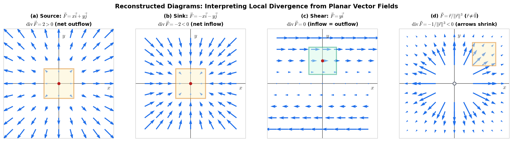
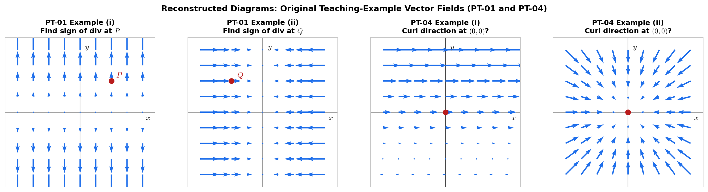
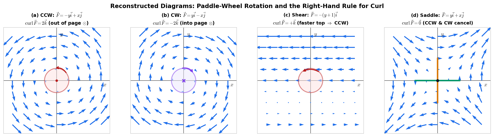
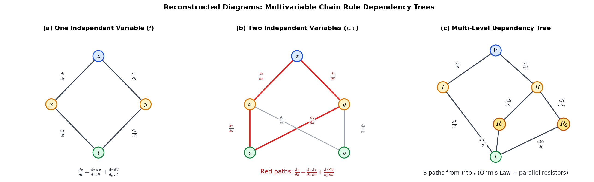

# MAT235H1 Week 9 Study Notes — §14.5* Grad, Divergence and Curl & §14.6 The Chain Rule

## Contents

1. [Scope, Sources, and Notation](#scope-sources-and-notation)
2. [Concept 1: The Del Operator, Gradient, and Cartesian Divergence (Core)](#concept-1-the-del-operator-gradient-and-cartesian-divergence-core)
   - [PT-01: Determine the Sign or Relative Size of Divergence from a Planar Vector-Field Diagram](#pt-01-determine-the-sign-or-relative-size-of-divergence-from-a-planar-vector-field-diagram)
   - [PT-02: Compute Divergence and Test for Divergence-Free Behavior on a Domain](#pt-02-compute-divergence-and-test-for-divergence-free-behavior-on-a-domain)
3. [Concept 2: Curl, Scalar Curl, and the Right-Hand Rule (Core)](#concept-2-curl-scalar-curl-and-the-right-hand-rule-core)
   - [PT-03: Compute Curl (3D or Planar) and Test for Curl-Free Behavior](#pt-03-compute-curl-3d-or-planar-and-test-for-curl-free-behavior)
   - [PT-04: Determine Curl Existence and Direction from a Planar Vector-Field Diagram Using the Right-Hand Rule](#pt-04-determine-curl-existence-and-direction-from-a-planar-vector-field-diagram-using-the-right-hand-rule)
4. [Concept 3: Dependency Trees and the Multivariable Chain Rule (Core)](#concept-3-dependency-trees-and-the-multivariable-chain-rule-core)
   - [PT-05: Draw a Dependency Tree and Formulate the Chain Rule Formula(s)](#pt-05-draw-a-dependency-tree-and-formulate-the-chain-rule-formulas)
   - [PT-06: Compute Ordinary and Partial Derivatives of Explicit or Tabulated Composite Functions](#pt-06-compute-ordinary-and-partial-derivatives-of-explicit-or-tabulated-composite-functions)
5. [Concept 4: Applied Multivariable Rates of Change in Physics and Chemistry (Core)](#concept-4-applied-multivariable-rates-of-change-in-physics-and-chemistry-core)
   - [PT-07: Solve Applied Multivariable Rate-of-Change Problems via the Chain Rule](#pt-07-solve-applied-multivariable-rate-of-change-problems-via-the-chain-rule)

---

## Scope, Sources, and Notation

### Week 9 Scope and Learning Objectives

These notes cover MAT235 Week 9: **§14.5\* (Grad, Divergence and Curl)** — drawing on Cartesian divergence from §19.3 and Cartesian curl from §20.1 — and **§14.6 (The Chain Rule)** in Hughes-Hallett et al., *Calculus*, 8th Edition (`MAT235_textbook.pdf`, where PDF viewer page $=$ printed page $+ 20$).

**Learning Objectives (from Week 9 Quercus specification):**

- **§14.5\* — Grad, Divergence and Curl**
  1. Understand the Cartesian definitions of divergence.
  2. Determine the sign of divergence at a point from a planar vector-field diagram.
  3. Compute divergence and determine whether a field is divergence-free on the stated domain.
  4. Compute curl and determine whether a field is curl-free on the stated domain.
  5. Use the right-hand rule to determine the direction of curl from a planar vector-field diagram.
- **§14.6 — The Chain Rule**
  6. Compute ordinary and partial derivatives of multivariable composite functions.
  7. Draw dependency trees and use them to formulate the corresponding Chain Rule.
  8. Apply the Chain Rule to the physics and chemistry problems supplied in the sources.

> **TT2 Scope Note:** Consistent with MAT235 Term Test 2 scope, implicit differentiation is omitted from the main teaching sequence, and §19.3 / §20.1 coverage is restricted to Cartesian divergence, Cartesian curl, and their planar geometric interpretations (omitting flux/circulation integrals and integral theorems). `Nov 16.pdf` in `W9/lec/` covers second-order partial derivatives and degree-2 Taylor polynomials (§14.7, Week 10 material) and is therefore excluded from Week 9 scope.

### Source Inventory and Depth Labels

- **Professor's Week 9 slides and handwritten lecture notes:**
  - `W9/lec/Week9-sol.pdf` (13 PDF pages: p. 1 pre-class reading; pp. 2–4 §14.6 slides; pp. 5–13 §14.5\* slides and inserted handwritten models).
  - `W9/lec/Nov 11.pdf` (4 pages: curl geometry, right-hand rule, 3D curl exercise, divergence-free/curl-free definitions, 1-variable Chain Rule).
  - `W9/lec/Nov 13.pdf` (4 pages: multivariable Chain Rule, dependency trees, 3 applications: temperature field, sugar concentration, Ohm's law parallel resistors).
- **Textbook (8th Edition):** Pre-class reading lists §19.3 Cartesian definition of divergence (printed p. 1039 / PDF p. 1059) and Example 1(b) (printed p. 1040 / PDF p. 1060), plus §20.1 Cartesian definition of curl (printed pp. 1056–1058 / PDF pp. 1076–1078) and Example 2 (printed pp. 1058–1059 / PDF pp. 1078–1079). Supporting reading: §14.6 (printed pp. 827–837 / PDF pp. 847–857), §19.3 Exercises (printed p. 1045 / PDF p. 1065), and §20.1 Exercises (printed p. 1062 / PDF p. 1082).
- **Source Gap Note:** The Quercus Week 9 screenshot file was not present in `W9/`; the learning objectives, pre-class reading list, and 27 suggested exercises are taken from the supplied Quercus transcription and cross-checked against `Week9-sol.pdf` p. 1 and the 8th-edition textbook.
- **Depth Labels:**
  - **Core:** Directly verified in `Week9-sol.pdf`, `Nov 11.pdf`, or `Nov 13.pdf`.
  - **Supplementary:** Specific technique or variation not shown in the slides, included concisely to support a Week 9 objective or listed exercise.

### Notation Summary (**Core** — `Week9-sol.pdf` pp. 2–5, 9–11; `Nov 11.pdf` pp. 1, 3)

| Object / Operator | 2D ($\mathbb{R}^2$) | 3D ($\mathbb{R}^3$) | Output Type |
| :--- | :--- | :--- | :--- |
| Position vector | $\vec{r} = x\vec{i} + y\vec{j}$ | $\vec{r} = x\vec{i} + y\vec{j} + z\vec{k}$ | Vector |
| Vector field | $\vec{F} = F_1\vec{i} + F_2\vec{j} = \langle P, Q \rangle$ | $\vec{F} = F_1\vec{i} + F_2\vec{j} + F_3\vec{k}$ | Vector field |
| Del (nabla) operator | $\nabla = \frac{\partial}{\partial x}\vec{i} + \frac{\partial}{\partial y}\vec{j}$ | $\nabla = \frac{\partial}{\partial x}\vec{i} + \frac{\partial}{\partial y}\vec{j} + \frac{\partial}{\partial z}\vec{k}$ | Differential operator |
| Gradient | $\operatorname{grad} f = \nabla f = f_x\vec{i} + f_y\vec{j}$ | $\operatorname{grad} f = \nabla f = f_x\vec{i} + f_y\vec{j} + f_z\vec{k}$ | Vector field |
| Divergence | $\operatorname{div}\vec{F} = \nabla \cdot \vec{F} = \frac{\partial F_1}{\partial x} + \frac{\partial F_2}{\partial y}$ | $\operatorname{div}\vec{F} = \nabla \cdot \vec{F} = \frac{\partial F_1}{\partial x} + \frac{\partial F_2}{\partial y} + \frac{\partial F_3}{\partial z}$ | **Scalar** function |
| Curl | $\operatorname{curl}\vec{F} = \left(\frac{\partial F_2}{\partial x} - \frac{\partial F_1}{\partial y}\right)\vec{k}$ (scalar curl $= \frac{\partial F_2}{\partial x} - \frac{\partial F_1}{\partial y}$) | $\operatorname{curl}\vec{F} = \nabla \times \vec{F}$ ($3\times 3$ determinant) | **Vector** field (scalar for 2D scalar curl) |
| Composite derivatives | $\frac{dz}{dt}$ (1 independent variable $t$) | $\frac{\partial z}{\partial u}, \frac{\partial z}{\partial v}$ (2+ independent variables) | Scalar derivative |

> **Companion file:** All teaching-example solutions, professor's slide question solutions, all 27 Quercus textbook exercise solutions, self-test questions and answers, and the coverage appendix are in [Answers-and-Practice.md](Answers-and-Practice.md).

---

## Concept 1: The Del Operator, Gradient, and Cartesian Divergence (**Core**)

**Verified Sources:** `Week9-sol.pdf` p. 5 (Slide p. 4 of 8), pp. 6–7 (oil-drop and square-deformation models), p. 8 (Slide p. 5 of 8), p. 9 (three-operator summary table), p. 12 (inchworm model 1.1–2.5), p. 13; `Nov 11.pdf` p. 3; Textbook §19.3 printed pp. 1039–1040 (PDF pp. 1059–1060).

### Brief Prerequisite Reminder: Del ($\nabla$) and Gradient

The differential operator **del** (or **nabla**) is
$$\nabla = \frac{\partial}{\partial x}\vec{i} + \frac{\partial}{\partial y}\vec{j} \quad \text{(in 2D)}, \qquad \nabla = \frac{\partial}{\partial x}\vec{i} + \frac{\partial}{\partial y}\vec{j} + \frac{\partial}{\partial z}\vec{k} \quad \text{(in 3D)}.$$
Applied to a differentiable scalar function $f$, it produces the **gradient** vector field $\operatorname{grad} f = \nabla f = \frac{\partial f}{\partial x}\vec{i} + \frac{\partial f}{\partial y}\vec{j} + \frac{\partial f}{\partial z}\vec{k}$, which points in the direction of steepest ascent and has magnitude equal to the maximum rate of increase.

### Cartesian Definition of Divergence

Let $\vec{F}$ be a vector field whose component functions have **continuous first partial derivatives** on a domain $D$.

- **In $\mathbb{R}^2$:** If $\vec{F}(x,y) = F_1(x,y)\vec{i} + F_2(x,y)\vec{j}$, then
  $$\operatorname{div}\vec{F} = \nabla \cdot \vec{F} = \frac{\partial F_1}{\partial x} + \frac{\partial F_2}{\partial y}.$$
- **In $\mathbb{R}^3$:** If $\vec{F}(x,y,z) = F_1(x,y,z)\vec{i} + F_2(x,y,z)\vec{j} + F_3(x,y,z)\vec{k}$, then
  $$\operatorname{div}\vec{F} = \nabla \cdot \vec{F} = \frac{\partial F_1}{\partial x} + \frac{\partial F_2}{\partial y} + \frac{\partial F_3}{\partial z}.$$

**Key Properties and Conditions:**
1. **Input/Output Type:** $\operatorname{div}$ takes a **vector field** and outputs a **scalar-valued function** (never a vector).
2. **Domain & Smoothness Assumption:** In this course we assume the components $F_1, F_2$ (and $F_3$) have continuous first partial derivatives on the stated domain (matching `Week9-sol.pdf` p. 5). Strictly speaking, evaluating the Cartesian divergence formula at a single point only requires the corresponding partial derivatives appearing in the formula ($\frac{\partial F_1}{\partial x}, \frac{\partial F_2}{\partial y}$, and $\frac{\partial F_3}{\partial z}$ in 3D) to exist at that point. For example, $\vec{F}(\vec{r}) = \vec{r}/\|\vec{r}\|^3$ is defined only on $\mathbb{R}^2 \setminus \{(0,0)\}$.
3. **Divergence-Free vs. Zero at a Point:** A vector field $\vec{F}$ is **divergence-free** (or incompressible) if $\operatorname{div}\vec{F} = 0$ **everywhere on its stated domain** (`Week9-sol.pdf` p. 5; `Nov 11.pdf` p. 3). Having $\operatorname{div}\vec{F}(a,b) = 0$ at one isolated point (or along a line, such as $\operatorname{div}\vec{F} = 4x = 0$ along $x=0$) does **not** make $\vec{F}$ divergence-free on $\mathbb{R}^2$.
4. **Composition $\operatorname{div}(\operatorname{grad} f)$:** For a twice-differentiable scalar function $f(x,y)$, $\operatorname{div}(\operatorname{grad} f) = \nabla \cdot (\nabla f) = f_{xx} + f_{yy}$ (`Week9-sol.pdf` pp. 8, 13).

### Geometric and Physical Interpretation

Think of $\vec{F}$ as the velocity field of a fluid (`Week9-sol.pdf` pp. 5–7):
- **Oil-drop / small-box test:** Imagine a tiny drop of oil (or tiny square) centered at $P$:
  - $\operatorname{div}\vec{F}(P) > 0$: **net outflow** (local source) — the oil patch expands in area/volume.
  - $\operatorname{div}\vec{F}(P) < 0$: **net inflow** (local sink) — the oil patch compresses.
  - $\operatorname{div}\vec{F}(P) = 0$: **local balance** — the shape may translate, rotate, or shear, but local area/volume is unchanged.
- **Crucial Warning (Outward $\not\Rightarrow$ Positive Divergence):** As shown in `Week9-sol.pdf` p. 8, an outward-pointing field like $\vec{F}(\vec{r}) = \vec{r}/\|\vec{r}\|^3$ in 2D has $\operatorname{div}\vec{F} = -1/\|\vec{r}\|^3 < 0$ everywhere away from the origin because the arrows **shrink rapidly** as you move outward, so more flow enters the inner side of a small box than leaves the outer side!

*Figure 1 (Reconstructed): Four canonical planar divergence behaviors — (a) source, (b) sink, (c) divergence-free shear, and (d) outward-pointing field with negative divergence.*

---

### PT-01: Determine the Sign or Relative Size of Divergence from a Planar Vector-Field Diagram

- **Owning Concept:** Concept 1 — The Del Operator, Gradient, and Cartesian Divergence (**Core**).
- **Qualifying Sources:** `Week9-sol.pdf` p. 5 (Slide p. 4 of 8, Example: Read divergence from a vector field (a)–(d)); Textbook §19.3 Ex. 3 and Ex. 13(a)–(c) (`EXERCISES`, printed p. 1045 / PDF p. 1065).
- **Recognition Cues:**
  - *Given:* A 2D vector-field plot with a marked point $P$ (or two plots on the same scale at the origin), without necessarily giving an algebraic formula.
  - *Asked:* Determine whether $\operatorname{div}\vec{F}$ at the point is positive, negative, or zero, or decide which of two fields has greater divergence.
- **Reusable Method:**
  1. Draw an imaginary small square (or circle) centered at the indicated point $P$, aligned with the coordinate axes.
  2. Compare **horizontal flow**: compare the horizontal arrows entering the left side against those leaving the right side (sign of $\partial F_1/\partial x$).
  3. Compare **vertical flow**: compare the vertical arrows entering the bottom side against those leaving the top side (sign of $\partial F_2/\partial y$).
  4. Combine net outflow minus net inflow across all four edges:
     - Outflow $>$ inflow $\implies \operatorname{div}\vec{F}(P) > 0$.
     - Inflow $>$ outflow $\implies \operatorname{div}\vec{F}(P) < 0$.
     - Outflow $=$ inflow (e.g., constant flow, pure rotation, pure horizontal/vertical shear) $\implies \operatorname{div}\vec{F}(P) = 0$.
  5. When comparing two fields on the same scale, compare how fast outward arrow lengths grow (or inward arrow lengths shrink) across the same small box.
- **Original Teaching Question (PT-01):**
  Use the two planar vector-field plots labeled **PT-01 Example (i)** and **PT-01 Example (ii)** in Figure 4 below to decide whether the divergence is positive, negative, or zero at the marked points $P$ and $Q$, respectively. Justify each answer using net inflow vs. outflow across a small box.
  *(Solution: [Answers-and-Practice.md — PT-01 Solution](Answers-and-Practice.md#pt-01-solution))*

*Figure 4 (Reconstructed): Planar vector-field diagrams for the PT-01 and PT-04 original teaching questions.*

- **Checklist & Common Mistakes:**
  - *Checklist:* (1) Small box centered at the *indicated* point (not automatically the origin); (2) Both $x$-edge and $y$-edge arrow lengths and directions checked; (3) Clear sign/comparison conclusion justified by net outflow vs. inflow.
  - *Mistakes to avoid:* Assuming outward arrows always imply $\operatorname{div} > 0$ (check whether arrows lengthen or shorten!); confusing shear (parallel arrows changing length *perpendicular* to the flow) with expansion (arrows changing length *along* the flow).

---

### PT-02: Compute Divergence and Test for Divergence-Free Behavior on a Domain

- **Owning Concept:** Concept 1 — The Del Operator, Gradient, and Cartesian Divergence (**Core**).
- **Qualifying Sources:** `Week9-sol.pdf` p. 8 (Slide p. 5 of 8, $\vec{r}/\|\vec{r}\|^3$ and $\operatorname{div}(\operatorname{grad} f)$), p. 10 (handwritten $\operatorname{div}\vec{F}$); Textbook §19.3 Ex. 1, 5, 7, 9, 11 (`EXERCISES`, printed p. 1045 / PDF p. 1065).
- **Recognition Cues:**
  - *Given:* An explicit 2D or 3D vector field $\vec{F}$ (possibly in position-vector form $\vec{r}$ or via $\operatorname{grad} f$), sometimes with a scalar/vector classification prompt or an unknown constant $a$.
  - *Asked:* Identify whether the quantity is a scalar or vector, compute $\operatorname{div}\vec{F}$, test whether $\vec{F}$ is divergence-free on its domain, or solve for a constant making $\operatorname{div}\vec{F} = 0$ identically.
- **Reusable Method:**
  1. Write $\vec{F}$ explicitly in Cartesian components $F_1\vec{i} + F_2\vec{j}$ (or $+ F_3\vec{k}$) and note the **domain** where $F_1, F_2, F_3$ have continuous first partial derivatives (watch for denominators like $x^2+y^2 = 0$ or $\ln$ arguments).
  2. Differentiate each component with respect to its *matching* coordinate: $\frac{\partial F_1}{\partial x}$, $\frac{\partial F_2}{\partial y}$, (and $\frac{\partial F_3}{\partial z}$ in 3D).
  3. **Add** the partial derivatives to obtain a **scalar** expression (drop all $\vec{i}, \vec{j}, \vec{k}$). Simplify completely.
  4. **Divergence-free test:** Check whether the simplified expression is identically $0$ for **every** point in the stated domain (not just at isolated points). If solving for a constant, set the expression equal to $0$ identically for all $(x,y)$ in the domain.
- **Original Teaching Question (PT-02):**
  Let $\vec{F}(x,y,z) = (x^2 y - 3x)\vec{i} + (y^2 - x y^2 + \cos z)\vec{j} + (k z + x^3)\vec{k}$, where $k$ is a real constant.
  (a) Is $\operatorname{div}\vec{F}$ a scalar or a vector? Compute $\operatorname{div}\vec{F}$ and state its domain.
  (b) Find the value of $k$ (if any) for which $\vec{F}$ is divergence-free on $\mathbb{R}^3$.
  *(Solution: [Answers-and-Practice.md — PT-02 Solution](Answers-and-Practice.md#pt-02-solution))*
- **Checklist & Common Mistakes:**
  - *Checklist:* (1) Correct component identification (including missing components $= 0$); (2) Scalar result (no $\vec{i},\vec{j},\vec{k}$); (3) Domain stated; (4) Identity check over the entire domain for divergence-free conclusions.
  - *Mistakes to avoid:* Leaving unit vectors $\vec{i},\vec{j},\vec{k}$ in $\operatorname{div}\vec{F}$; differentiating a component with respect to the wrong variable; concluding a field is divergence-free because $\operatorname{div}\vec{F}(0,0)=0$ when $\operatorname{div}\vec{F}(x,y)$ is nonzero elsewhere; forgetting the quotient/chain rule on rational radial fields like $\frac{-y\vec{i}+x\vec{j}}{x^2+y^2}$.

---

## Concept 2: Curl, Scalar Curl, and the Right-Hand Rule (**Core**)

**Verified Sources:** `Week9-sol.pdf` p. 8 (cross-product recall), p. 9 (three-operator summary table), p. 10 (Slide p. 6 of 8, 3D curl), p. 11 (Slide p. 7 of 8, 2D scalar curl, right-hand rule, two twigs), pp. 12–13 (inchworm model 5.1–5.5); `Nov 11.pdf` pp. 1–3; Textbook §20.1 printed pp. 1056–1059 (PDF pp. 1076–1079).

### Cartesian Definition of Curl (3D)

Let $\vec{F}(x,y,z) = F_1\vec{i} + F_2\vec{j} + F_3\vec{k}$, where $F_1, F_2, F_3$ have **continuous first partial derivatives** on a domain $D$. The **curl** of $\vec{F}$ is the **vector field**
$$\operatorname{curl}\vec{F} = \nabla \times \vec{F} = \begin{vmatrix} \vec{i} & \vec{j} & \vec{k} \\ \dfrac{\partial}{\partial x} & \dfrac{\partial}{\partial y} & \dfrac{\partial}{\partial z} \\ F_1 & F_2 & F_3 \end{vmatrix} = \left(\frac{\partial F_3}{\partial y} - \frac{\partial F_2}{\partial z}\right)\vec{i} + \left(\frac{\partial F_1}{\partial z} - \frac{\partial F_3}{\partial x}\right)\vec{j} + \left(\frac{\partial F_2}{\partial x} - \frac{\partial F_1}{\partial y}\right)\vec{k}.$$

> **Sign Alert on the $\vec{j}$-Component:** Expanding the determinant along the first row gives $-\left(\frac{\partial F_3}{\partial x} - \frac{\partial F_1}{\partial z}\right)\vec{j} = +\left(\frac{\partial F_1}{\partial z} - \frac{\partial F_3}{\partial x}\right)\vec{j}$. Double-check this sign every time!

### Planar (2D) Curl and Scalar Curl

If $\vec{F}(x,y) = F_1(x,y)\vec{i} + F_2(x,y)\vec{j}$ is a planar field, regard it in 3D with $F_3 = 0$ and no $z$-dependence: $\vec{F}(x,y,z) = F_1(x,y)\vec{i} + F_2(x,y)\vec{j} + 0\vec{k}$. Then the $\vec{i}$- and $\vec{j}$-components vanish, leaving
$$\operatorname{curl}\vec{F} = \left(\frac{\partial F_2}{\partial x} - \frac{\partial F_1}{\partial y}\right)\vec{k} = \begin{vmatrix} \dfrac{\partial}{\partial x} & \dfrac{\partial}{\partial y} \\ F_1 & F_2 \end{vmatrix}\vec{k}.$$
The coefficient $\frac{\partial F_2}{\partial x} - \frac{\partial F_1}{\partial y}$ is called the **2D (or scalar) curl** (`Week9-sol.pdf` p. 11).

**Curl-Free (Irrotational):** A vector field $\vec{F}$ is **curl-free** (or **irrotational**) on its domain $D$ if $\operatorname{curl}\vec{F} = \vec{0}$ **everywhere in $D$** (`Week9-sol.pdf` p. 10; `Nov 11.pdf` p. 3).

### Geometric Interpretation: Paddle-Wheel and the Right-Hand Rule

Imagine placing a tiny paddle-wheel at point $P$ in the $xy$-plane with its axle parallel to the $z$-axis (`Week9-sol.pdf` p. 11; `Nov 11.pdf` pp. 1–2):
- **Counterclockwise (CCW) rotation** (viewed from $+z$-axis): curl your right-hand fingers CCW $\implies$ thumb points in **$+\vec{k}$** (out of the page, $\odot$). Scalar curl $> 0$.
- **Clockwise (CW) rotation** (viewed from $+z$-axis): curl your right-hand fingers CW $\implies$ thumb points in **$-\vec{k}$** (into the page, $\otimes$). Scalar curl $< 0$.
- **Zero curl ($\vec{0}$):** No **net** local tendency for the paddle-wheel to rotate.
- **Two Crucial Subtle Cases:**
  1. **Parallel shear can have nonzero curl!** In $\vec{F} = -(y+1)\vec{i}$ (Figure 2(c), Textbook §20.1 Example 2(c)), all arrows are horizontal, yet faster leftward flow on the top of the paddle-wheel than on the bottom spins it **CCW** ($\operatorname{curl}\vec{F} = +\vec{k}$).
  2. **Opposing twig rotations can cancel to zero curl!** In $\vec{F} = y\vec{i} + x\vec{j}$ (Figure 2(d), `Week9-sol.pdf` p. 11), a single twig along the $x$-axis rotates CCW while a twig along the $y$-axis rotates CW at the same rate, so a rigid paddle-wheel has zero net rotation ($\operatorname{curl}\vec{F} = \vec{0}$).

*Figure 2 (Reconstructed): Paddle-wheel rotation and right-hand rule for (a) CCW vortex, (b) CW vortex, (c) horizontal shear with nonzero curl, and (d) zero-curl saddle field.*

---

### PT-03: Compute Curl (3D or Planar) and Test for Curl-Free Behavior

- **Owning Concept:** Concept 2 — Curl, Scalar Curl, and the Right-Hand Rule (**Core**).
- **Qualifying Sources:** `Week9-sol.pdf` p. 10 (Slide p. 6 of 8, 3D curl example), p. 11 (Slide p. 7 of 8, part (c)); `Nov 11.pdf` pp. 1–3 (planar examples and 3D curl exercise); Textbook §20.1 Ex. 1, 3, 5, 7, 9, 11 (`EXERCISES`, printed p. 1062 / PDF p. 1082).
- **Recognition Cues:**
  - *Given:* An explicit 3D or 2D vector field $\vec{F}$.
  - *Asked:* Identify whether $\operatorname{curl}\vec{F}$ is a vector or scalar, compute $\operatorname{curl}\vec{F}$, and/or determine whether $\vec{F}$ is curl-free (irrotational) on its domain.
- **Reusable Method:**
  1. Identify all three components $F_1, F_2, F_3$ (for a 2D field, set $F_3 = 0$ and verify $F_1, F_2$ are independent of $z$). State the domain where $F_1, F_2, F_3$ have continuous first partial derivatives.
  2. Set up the $3\times 3$ determinant $\nabla \times \vec{F}$ (or use $(\partial F_2/\partial x - \partial F_1/\partial y)\vec{k}$ directly for planar fields independent of $z$).
  3. Expand carefully with cofactor signs $(+, -, +)$:
     - $\vec{i}$-component: $\frac{\partial F_3}{\partial y} - \frac{\partial F_2}{\partial z}$
     - $\vec{j}$-component: $-\left(\frac{\partial F_3}{\partial x} - \frac{\partial F_1}{\partial z}\right) = \frac{\partial F_1}{\partial z} - \frac{\partial F_3}{\partial x}$
     - $\vec{k}$-component: $\frac{\partial F_2}{\partial x} - \frac{\partial F_1}{\partial y}$
  4. Write the result as a **vector** (with $\vec{i},\vec{j},\vec{k}$ or angle brackets, and $\vec{0}$ — not scalar $0$ — if all three components vanish).
  5. **Curl-free test:** Conclude $\vec{F}$ is curl-free on $D$ if and only if all three components are identically $0$ across $D$.
- **Original Teaching Question (PT-03):**
  Let $\vec{F}(x,y,z) = (y^2 + z)\vec{i} + (2xy - z^2)\vec{j} + (x - 2yz)\vec{k}$.
  (a) Is $\operatorname{curl}\vec{F}$ a vector or a scalar? Compute $\operatorname{curl}\vec{F}$.
  (b) Is $\vec{F}$ curl-free on $\mathbb{R}^3$? Explain.
  *(Solution: [Answers-and-Practice.md — PT-03 Solution](Answers-and-Practice.md#pt-03-solution))*
- **Checklist & Common Mistakes:**
  - *Checklist:* (1) Output written as a vector (including $\vec{0}$ when zero); (2) Minus sign on the $\vec{j}$-cofactor verified; (3) All six partial derivatives checked; (4) Domain-wide check for curl-free claim.
  - *Mistakes to avoid:* Forgetting the negative sign on the $\vec{j}$-component; writing a scalar $0$ instead of $\vec{0}$ for curl; writing the 2D scalar curl $\frac{\partial F_2}{\partial x} - \frac{\partial F_1}{\partial y}$ without $\vec{k}$ when asked for $\operatorname{curl}\vec{F}$; assuming a 2D field has zero curl just because it is missing a $\vec{k}$-component.

---

### PT-04: Determine Curl Existence and Direction from a Planar Vector-Field Diagram Using the Right-Hand Rule

- **Owning Concept:** Concept 2 — Curl, Scalar Curl, and the Right-Hand Rule (**Core**).
- **Qualifying Sources:** `Week9-sol.pdf` p. 11 (Slide p. 7 of 8, right-hand rule and two-twigs example); `Nov 11.pdf` pp. 1–2; Textbook §20.1 Ex. 15, 17 (`EXERCISES`, printed p. 1062 / PDF p. 1082) and Example 2 (printed pp. 1058–1059 / PDF pp. 1078–1079).
- **Recognition Cues:**
  - *Given:* A sketch of a planar vector field $\vec{F}(x,y)$ in the $xy$-plane (with $F_3 = 0$ and independent of $z$) and a target point (usually the origin).
  - *Asked:* Determine whether $\operatorname{curl}\vec{F}$ appears to be nonzero at that point, and if so, whether it points in $+\vec{k}$ (out of page / up) or $-\vec{k}$ (into page / down).
- **Reusable Method:**
  1. Place an imaginary tiny paddle-wheel centered at the target point with axle along the $z$-axis.
  2. Inspect the **tangential push** on opposite sides of the paddle-wheel:
     - Top vs. bottom (horizontal component $F_1$ changing with $y$): stronger leftward push on top than bottom (or stronger rightward on bottom) $\implies$ CCW; stronger rightward push on top than bottom $\implies$ CW.
     - Right vs. left (vertical component $F_2$ changing with $x$): stronger upward push on right than left $\implies$ CCW; stronger downward push on right than left $\implies$ CW.
  3. Combine the horizontal and vertical torques. Check for symmetry/cancellation (purely radial fields, symmetric stretching along axes, or balanced saddles give zero net rotation).
  4. Apply the **right-hand rule** viewed from the $+z$-axis:
     - Net CCW spin $\implies \operatorname{curl}\vec{F}$ points in **$+\vec{k}$** (up / out of page).
     - Net CW spin $\implies \operatorname{curl}\vec{F}$ points in **$-\vec{k}$** (down / into page).
     - No net spin $\implies \operatorname{curl}\vec{F} = \vec{0}$.
- **Original Teaching Question (PT-04):**
  Each field in **PT-04 Example (i)** and **PT-04 Example (ii)** of Figure 4 above lies in the $xy$-plane with no $z$-component and no $z$-dependence. For each field, use a paddle-wheel and the right-hand rule to determine whether $\operatorname{curl}\vec{F}(0,0)$ is $\vec{0}$, points in $+\vec{k}$, or points in $-\vec{k}$.
  *(Solution: [Answers-and-Practice.md — PT-04 Solution](Answers-and-Practice.md#pt-04-solution))*
- **Checklist & Common Mistakes:**
  - *Checklist:* (1) Both horizontal-shear torque and vertical-shear torque checked; (2) Spin direction stated as viewed from $+z$; (3) Right-hand rule applied to state $+\vec{k}$, $-\vec{k}$, or $\vec{0}$.
  - *Mistakes to avoid:* Thinking parallel arrows always have zero curl (shear creates torque!); confusing divergence (radial in/out) with curl (tangential spin); using the left hand for the right-hand rule.

---

## Concept 3: Dependency Trees and the Multivariable Chain Rule (**Core**)

**Verified Sources:** `Week9-sol.pdf` p. 2 (Slide p. 1 of 8), p. 3 (Slide p. 2 of 8), p. 4 (Slide p. 3 of 8); `Nov 11.pdf` pp. 3–4; `Nov 13.pdf` pp. 1–2; Textbook §14.6 printed pp. 827–834 (PDF pp. 847–854).

### Core Chain Rule Formulas

Assume all component functions are **differentiable** on their domains.

1. **One Independent Variable ($t$):** If $z = f(x,y)$ with $x = g(t)$ and $y = h(t)$, then $z$ is a function of $t$ alone and
   $$\frac{dz}{dt} = \frac{\partial z}{\partial x}\frac{dx}{dt} + \frac{\partial z}{\partial y}\frac{dy}{dt},$$
   where $\frac{\partial z}{\partial x}$ and $\frac{\partial z}{\partial y}$ are evaluated at $(x,y) = (g(t), h(t))$ (`Week9-sol.pdf` p. 2).
2. **Two Independent Variables ($u, v$):** If $z = f(x,y)$ with $x = g(u,v)$ and $y = h(u,v)$, then
   $$\frac{\partial z}{\partial u} = \frac{\partial z}{\partial x}\frac{\partial x}{\partial u} + \frac{\partial z}{\partial y}\frac{\partial y}{\partial u}, \qquad \frac{\partial z}{\partial v} = \frac{\partial z}{\partial x}\frac{\partial x}{\partial v} + \frac{\partial z}{\partial y}\frac{\partial y}{\partial v},$$
   where $\frac{\partial z}{\partial x}$ and $\frac{\partial z}{\partial y}$ are evaluated at $(x,y) = (g(u,v), h(u,v))$ (`Week9-sol.pdf` p. 3; `Nov 13.pdf` p. 1).
3. **General Case ($m$ intermediate, $n$ independent):** If $g = f(x_1,\dots,x_m)$ and each $x_i = x_i(t_1,\dots,t_n)$ is differentiable, then for each $j = 1,\dots,n$,
   $$\frac{\partial g}{\partial t_j} = \sum_{i=1}^{m} \frac{\partial f}{\partial x_i}\frac{\partial x_i}{\partial t_j} \quad \text{(use } \frac{dg}{dt} \text{ and } \frac{dx_i}{dt} \text{ when } n = 1\text{)}$$
   (`Week9-sol.pdf` p. 4 Question box).

### Dependency Tree Method (**Core** — "KEY: Always start from dependence diagram", `Week9-sol.pdf` p. 3)

1. Put the **dependent variable** at the top, **intermediate variables** in the middle row(s), and **independent variable(s)** at the bottom.
2. Draw an edge from each variable to every variable it directly depends on.
3. Label each edge with $\frac{\partial(\text{top})}{\partial(\text{bottom})}$ if the top variable depends on **two or more** variables, or $\frac{d(\text{top})}{d(\text{bottom})}$ if it depends on **only one** variable.
4. To compute a derivative with respect to a bottom variable, find **all downward paths** from the top variable to that bottom variable, **multiply** the derivatives along each path, and **add** the results across all paths.

*Figure 3 (Reconstructed): Dependency trees for (a) one independent variable, (b) two independent variables with $u$-paths highlighted, and (c) a three-level applied tree (Ohm's law with parallel resistors).*

### Supplementary Extensions for Listed §14.6 Problems (**Supplementary**)

- **Tabulated Partial Derivatives (`§14.6 Problems 33, 35`, printed p. 836 / PDF p. 856):** When $f$, $x$, $y$ are not given by formulas and instead a table lists partial-derivative values at several points, **track the evaluation point carefully**: to compute $z_u(u_0, v_0)$, first find $(x_0, y_0) = (x(u_0,v_0), y(u_0,v_0))$, then evaluate
  $$z_u(u_0, v_0) = f_x(x_0, y_0)\,x_u(u_0, v_0) + f_y(x_0, y_0)\,y_u(u_0, v_0).$$
  Ignore distractor entries in the table evaluated at the wrong point (such as $f_x(u_0, v_0)$ or $x_u(x_0, y_0)$).
- **Direct Independent-Variable Edge (`§14.6 Problem 19`, printed p. 835 / PDF p. 855):** If an outer function depends *both* on intermediate variables and directly on $t$, such as $H = f(x, y, t)$ with $x = x(t)$ and $y = y(t)$, draw a direct edge from $H$ to $t$ labeled $\frac{\partial f}{\partial t}$ (since $f$ has 3 inputs). Its path contributes $\frac{\partial f}{\partial t} \cdot 1$, giving $\frac{dH}{dt} = \frac{\partial f}{\partial x}\frac{dx}{dt} + \frac{\partial f}{\partial y}\frac{dy}{dt} + \frac{\partial f}{\partial t}$.

---

### PT-05: Draw a Dependency Tree and Formulate the Chain Rule Formula(s)

- **Owning Concept:** Concept 3 — Dependency Trees and the Multivariable Chain Rule (**Core**).
- **Qualifying Sources:** `Week9-sol.pdf` p. 3 (Slide p. 2 of 8, $z=f(x,y)$ with $x,y$ functions of $r,s,t$), p. 4 (general $m,n$ question); `Nov 13.pdf` p. 2 ($\alpha(x,y,z)$ with $x,y,z$ functions of $u,v,w$); Textbook §14.6 Problem 29 (printed p. 836 / PDF p. 856).
- **Recognition Cues:**
  - *Given:* Abstract differentiable relationships (no explicit algebraic formulas) specifying which variables depend on which.
  - *Asked:* Draw a dependency tree/diagram and write out the Chain Rule formula(s) for the requested derivative(s).
- **Reusable Method:**
  1. Classify every variable as dependent (top), intermediate (middle level(s)), or independent (bottom).
  2. Draw all direct dependency edges and label each with $\partial$ (if the parent node has $\ge 2$ children) or $d$ (if the parent node has exactly $1$ child).
  3. Decide whether the final target derivative is ordinary ($d$, if only 1 independent variable at the bottom) or partial ($\partial$, if $\ge 2$ independent variables).
  4. List every path from the top variable to the target bottom variable, multiply labels along each path, and sum all path products.
- **Original Teaching Question (PT-05):**
  Suppose $w = f(x, y, z)$ is differentiable, where $x = x(s, t)$, $y = y(s, t)$, and $z = z(t)$ (note that $z$ depends only on $t$). Draw the dependency tree with correctly labeled edges and write out the Chain Rule formulas for $\frac{\partial w}{\partial s}$ and $\frac{\partial w}{\partial t}$.
  *(Solution: [Answers-and-Practice.md — PT-05 Solution](Answers-and-Practice.md#pt-05-solution))*
- **Checklist & Common Mistakes:**
  - *Checklist:* (1) Correct levels (top, middle, bottom); (2) Correct $d$ vs. $\partial$ on every edge and on the left-hand side; (3) Every path counted once, no missing or spurious edges.
  - *Mistakes to avoid:* Using $\partial$ on a single-variable edge (like $z(t)$) or $d$ when a variable has multiple inputs; adding along a path instead of multiplying; forgetting a variable that has a direct link to the bottom.

---

### PT-06: Compute Ordinary and Partial Derivatives of Explicit or Tabulated Composite Functions

- **Owning Concept:** Concept 3 — Dependency Trees and the Multivariable Chain Rule (**Core**; tabulated-values variant **Supplementary**).
- **Qualifying Sources:** `Week9-sol.pdf` p. 2 (Slide p. 1 of 8, also §14.6 Ex. 5), p. 4 (Slide p. 3 of 8, also §14.6 Ex. 8); `Nov 11.pdf` p. 4 ($z=x\cos y$); Textbook §14.6 Ex. 1, 3, 5, 7, 9, 11, 13 (`EXERCISES`, printed p. 834 / PDF p. 854) and Problems 17, 33, 35 (`PROBLEMS`, printed pp. 835–836 / PDF pp. 855–856).
- **Recognition Cues:**
  - *Given:* Explicit formulas for $z = f(x,y)$ (or $w = f(x,y,z)$) and $x, y$ (and $z$) in terms of $t$ or $(u,v)$ or $(\rho,\phi,\theta)$, **or** a table of partial derivative values at specific points.
  - *Asked:* Compute $\frac{dz}{dt}$, $\frac{\partial z}{\partial u}$, $\frac{\partial z}{\partial v}$ (or evaluate at a specific point $(u_0, v_0)$).
- **Reusable Method:**
  1. Draw the dependency tree and write the Chain Rule formula.
  2. Compute the outer partial derivatives ($\frac{\partial z}{\partial x}, \frac{\partial z}{\partial y}, \dots$) and inner derivatives ($\frac{dx}{dt}, \frac{dy}{dt}$ or $\frac{\partial x}{\partial u}, \dots$).
  3. **Evaluation / Substitution Step:**
     - For explicit formulas: substitute $x(t), y(t)$ (or $x(u,v), y(u,v)$) into the outer partials so the final answer is expressed cleanly in the independent variable(s) (unless leaving in mixed variables is explicitly allowed), and simplify.
     - For tabulated values (**Supplementary**): compute $(x_0, y_0) = (x(u_0,v_0), y(u_0,v_0))$ first, then plug in $f_x(x_0,y_0), f_y(x_0,y_0)$ and $x_u(u_0,v_0), y_u(u_0,v_0)$.
  4. **Quick Check:** When $z$ is simple enough, substitute $x, y$ into $z$ directly and differentiate to verify the Chain Rule result matches.
- **Original Teaching Question (PT-06):**
  (a) Use the Chain Rule to find $\frac{\partial z}{\partial u}$ and $\frac{\partial z}{\partial v}$ for $z = x^2 y - e^y$, where $x = u v$ and $y = u - 2v$. Express your final answers purely in terms of $u$ and $v$.
  (b) *(Supplementary tabulated variant)* Suppose $z = f(x,y)$ with $x = x(u,v)$, $y = y(u,v)$, and $x(2,-1) = 3$, $y(2,-1) = 4$. Given $f_x(2,-1) = 7$, $f_x(3,4) = 5$, $f_y(2,-1) = -2$, $f_y(3,4) = -3$, $x_v(2,-1) = 4$, $y_v(2,-1) = -1$, $x_v(3,4) = 9$, $y_v(3,4) = 6$, find $z_v(2,-1)$.
  *(Solution: [Answers-and-Practice.md — PT-06 Solution](Answers-and-Practice.md#pt-06-solution))*
- **Checklist & Common Mistakes:**
  - *Checklist:* (1) Dependency tree drawn; (2) Every outer and inner derivative computed accurately; (3) Outer partials evaluated at $(x(u,v), y(u,v))$ (not at $(u,v)$); (4) Simplified final expression in the requested variables.
  - *Mistakes to avoid:* Evaluating $f_x, f_y$ at $(u_0, v_0)$ instead of $(x_0, y_0)$ in table problems; forgetting to substitute $x$ and $y$ back into $f_x, f_y$ when simplifying; dropping chain-rule factors inside trig/log/exponential terms (e.g., $\frac{\partial}{\partial y}\sin(x/y) = -\frac{x}{y^2}\cos(x/y)$).

---

## Concept 4: Applied Multivariable Rates of Change in Physics and Chemistry (**Core**)

**Verified Sources:** `Week9-sol.pdf` p. 4 (Slide p. 3 of 8, Ideal Gas Law); `Nov 13.pdf` pp. 2–4 (Applications 1, 2, 3: temperature field, sugar concentration, Ohm's law parallel resistors); Textbook §14.6 Problem 19 (printed p. 835 / PDF p. 855) and Problem 20 (= `Nov 13.pdf` Application 3, printed p. 835 / PDF p. 855).

### Modeling Physical and Chemical Rates with the Chain Rule

In physical, chemical, and engineering systems, a target state quantity (pressure $P$, concentration $C$, voltage $V$, temperature $T$ or $H$) depends on multiple intermediate state variables that each vary with time $t$:
- **Ideal Gas Law** (`Week9-sol.pdf` p. 4): $PV = nRT \implies P(T, V) = \frac{nRT}{V}$ (for fixed moles $n$), so $\frac{dP}{dt} = \frac{\partial P}{\partial T}\frac{dT}{dt} + \frac{\partial P}{\partial V}\frac{dV}{dt}$.
- **Solution Concentration** (`Nov 13.pdf` pp. 2–3): $C(M, V) = \frac{M}{V}$, so $\frac{dC}{dt} = \frac{\partial C}{\partial M}\frac{dM}{dt} + \frac{\partial C}{\partial V}\frac{dV}{dt}$.
- **Multi-Level Circuit (Ohm's Law + Parallel Resistors)** (`Nov 13.pdf` pp. 3–4; §14.6 Problem 20): $V = IR$ with $\frac{1}{R} = \frac{1}{R_1} + \frac{1}{R_2}$. Here $V$ depends on $I$ and $R$, while $R$ depends on $R_1$ and $R_2$, giving **three paths** to $t$ (Figure 3(c)):
  $$\frac{dV}{dt} = \frac{\partial V}{\partial I}\frac{dI}{dt} + \frac{\partial V}{\partial R}\frac{\partial R}{\partial R_1}\frac{dR_1}{dt} + \frac{\partial V}{\partial R}\frac{\partial R}{\partial R_2}\frac{dR_2}{dt}.$$
- **Sign Convention & Units:** Words like *compressed*, *decreasing*, *dropping*, or *shrinking* mean a **negative** time derivative; *heated*, *increasing*, or *added* mean a **positive** time derivative. Every term in the Chain Rule sum must carry the **same final units** (a powerful dimensional check!).

---

### PT-07: Solve Applied Multivariable Rate-of-Change Problems via the Chain Rule

- **Owning Concept:** Concept 4 — Applied Multivariable Rates of Change in Physics and Chemistry (**Core**).
- **Qualifying Sources:** `Week9-sol.pdf` p. 4 (Slide p. 3 of 8, Ideal Gas Law); `Nov 13.pdf` pp. 2–4 (Applications 1, 2, 3); Textbook §14.6 Problem 19 (conceptual term identification, printed p. 835 / PDF p. 855).
- **Recognition Cues:**
  - *Given:* A physical/chemical law (e.g., $PV=nRT$, $C=M/V$, $V=IR$, temperature field $T(x,y)$ or $H(x,y,t)$), instantaneous values of state variables, and rates of change with respect to time (or a Chain Rule expansion whose terms must be interpreted physically).
  - *Asked:* Find the instantaneous rate of change of the target quantity (with units), or identify the physical meaning of each term in the Chain Rule expansion.
- **Reusable Method:**
  1. **Define variables & signs:** List every constant, every time-varying state variable, its value at the given instant, and its **signed** rate of change with units.
  2. **Express the target explicitly:** Rearrange the governing law so the target variable is written in terms of intermediate variables (e.g., $P = nRT/V$, or $R = \frac{R_1 R_2}{R_1 + R_2}$).
  3. **Draw the dependency tree** (including any intermediate levels or direct $t$-edges) and write the Chain Rule formula.
  4. **Differentiate first, then substitute** the instantaneous values and signed rates — never plug in numbers before differentiating!
  5. **Verify units and physical plausibility:** Confirm each summed term has the same units as the target rate and check whether the sign makes physical sense.
- **Original Teaching Question (PT-07):**
  An ideal gas obeys $PV = nRT$, where $P$ is pressure (in kPa), $V$ is volume (in $\text{cm}^3$), $T$ is temperature (in K), and $R = 8.314 \times 10^3\text{ kPa}\cdot\text{cm}^3/(\text{mol}\cdot\text{K})$. A cylinder with a movable piston holds $n = 0.005\text{ mol}$ of gas. At a certain instant, $V = 250\text{ cm}^3$ and $T = 400\text{ K}$, while the cylinder is **expanding** at $5\text{ cm}^3/\text{min}$ and being **cooled** at $2\text{ K}/\text{min}$. Draw the dependency tree and find the rate of change of pressure $\frac{dP}{dt}$ at this instant, including units.
  *(Solution: [Answers-and-Practice.md — PT-07 Solution](Answers-and-Practice.md#pt-07-solution))*
- **Checklist & Common Mistakes:**
  - *Checklist:* (1) Constants vs. time-varying variables separated; (2) Signs on all rates checked ("decreasing/cooled/compressed" $\to$ negative); (3) Dependency tree drawn; (4) Differentiation performed *before* plugging in instantaneous values; (5) Final answer includes exact/rounded value and units.
  - *Mistakes to avoid:* Dropping negative signs on decreasing quantities; plugging instantaneous numbers into $P(T,V)$ before taking partial derivatives; forgetting intermediate levels (e.g., differentiating $1/R = 1/R_1 + 1/R_2$ incorrectly); mismatching units (e.g., cm vs. m or seconds vs. minutes).
